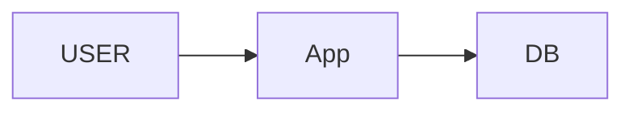
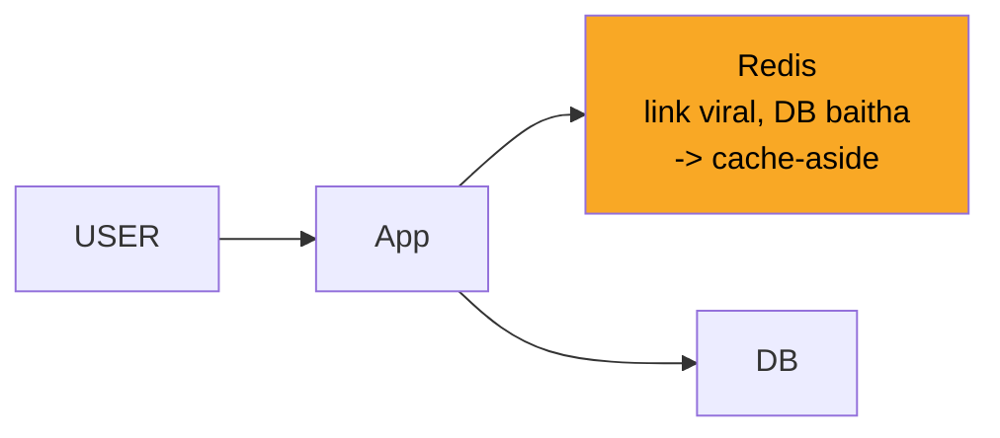
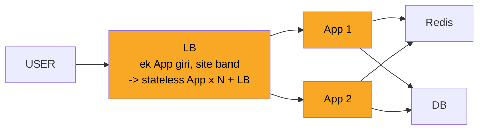
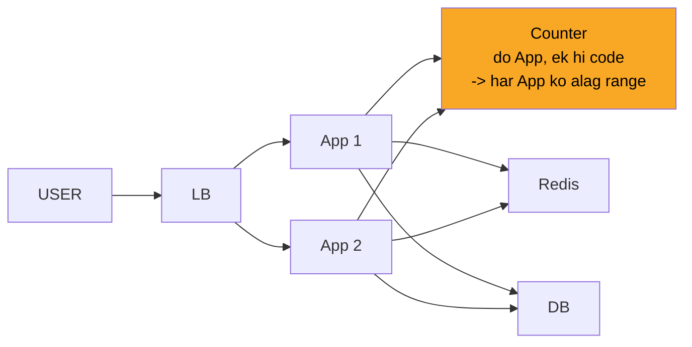
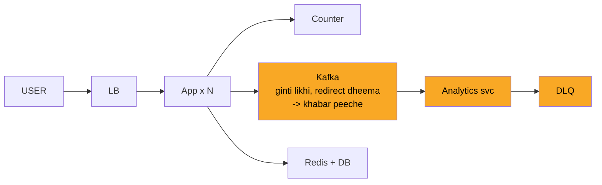
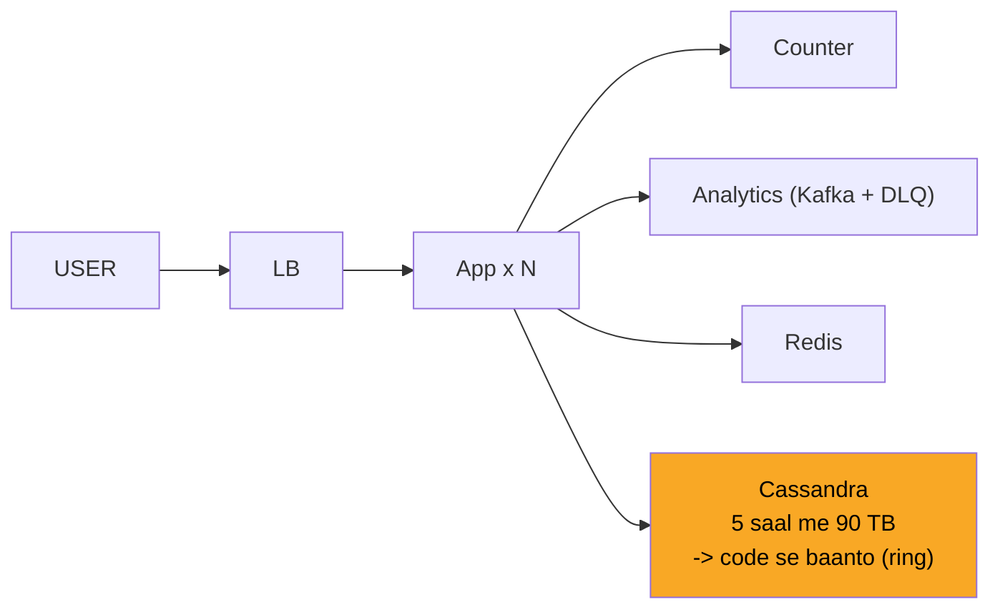
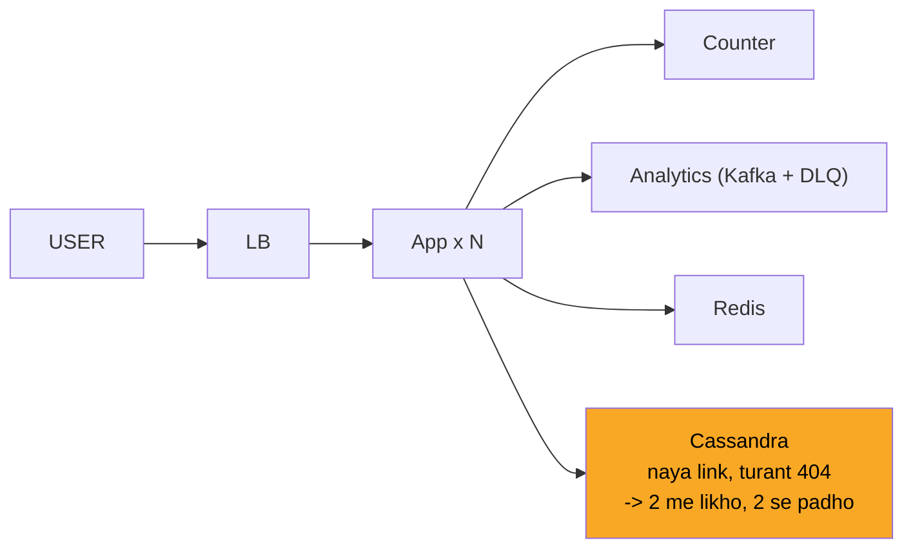
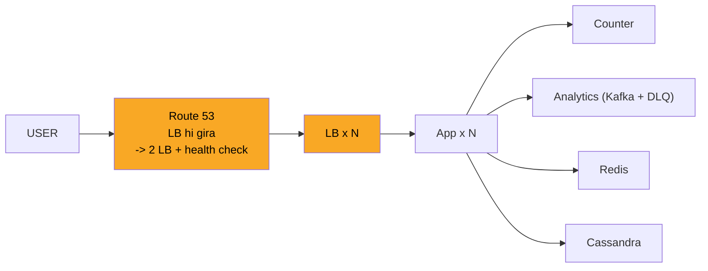
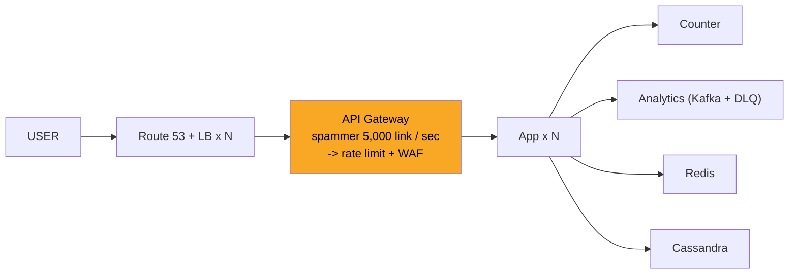
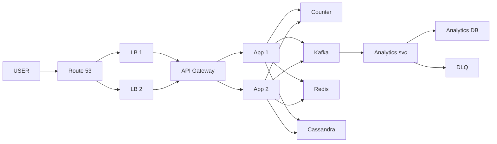

# URL Shortener

> Lamba link do -> chhota 7 akshar ka code milta hai. Koi chhote link pe click kare -> asli link pe bhej do (302 redirect).
> Is design ka dil do cheezein hain: **har link ka code ALAG (unique)** aur **click pe redirect bahut tez**, kyunki log link banate kam hain aur kholte bahut zyada (100 me se 99 baar kholna).

---

## KAHANI (ek din, mera sale wala link; har dikkat se design me ek dabba judta)

```
   KYA HUA                                     ILAAJ                                DABBA JUDA
1  mera sale link viral, DB baith gaya      -> REDIS CACHE (cache-aside)            Redis
2  usi bheed me ek App giri, site band      -> STATELESS App x N + LOAD BALANCER    LB + App x N
3  main aur Ravi, dono ko ek hi code        -> COUNTER RANGE (thaila) + base62      Counter
4  click ginti likhi, redirect dheema       -> KAFKA, ginti peeche                  Kafka + Analytics + DLQ
5  DB team: 5 saal me 90 TB                 -> SHARD by code (RING)                 Cassandra
6  naya link banaya, turant khola, 404      -> QUORUM (2 me likho, 2 se padho)      (Cassandra quorum)
7  shaam ko LB hi gira                      -> ROUTE 53 + 2 LB (health check)       Route 53 + LB x2
8  raat ko spammer, 5,000 link / sec        -> RATE LIMIT darwaze pe + WAF          API Gateway

POORA DESIGN (upar ke dabbe kram se):
   User -> Route 53 -> LB x2 -> API Gateway -> App x N (Counter ka thaila) -> Redis -> Cassandra
   click ki khabar: App -> Kafka -> Analytics (fail -> DLQ)
```

---

## TASVEER (ByteByteGo / Alex Xu · CC BY-NC-ND 4.0)


Source: [Explaining 5 Unique ID Generators](https://bytebytego.com/guides/explaining-5-unique-id-generators-in-distributed-systems/)
(Code kahan se aaye: UUID / Snowflake / DB ka auto-increment / range. Hamara code = ek number ko base62 me likhna.)

---

## SHURU: pehle poocho, phir numbers

```
POOCHO:  "Link banana, redirect, click ginna, apna khud ka code (custom alias), expiry — kis pe dhyaan dein?"
         -> zaroori: link banana + redirect. Click ki ginti chahiye. Bada analytics dashboard bahar.
            Custom code = time bache to.
         "Din me ~10 crore (100M) naye link, aur har link ~100 baar khulta hai — ye maan ke chalun?"
         kuch na pata ho -> "ye maine use nahi kiya" bolna theek hai, interviewer khud bata dega.

ZAROORI KAAM (FR):   lamba -> chhota banao · chhote pe click -> asli pe bhejo
KAISA CHALE (NFR):   redirect 200 ms se tez · hamesha chalu · padhna >> likhna · code kabhi dohraaye nahi
                     ("aage ka har faisla inhi 4 me se kisi ek se judega")

NUMBERS (andaaza, calculator nahi):
   naye link:  10 crore / din. Din me ~1 lakh second hote hain -> ~1,000 naye link har second.
   click:      har link ~100 baar khulta -> ~1 lakh click har second.
   jagah:      ek link ~500 byte. 5 saal me ~180 arab link -> ~90 TB.
   code:       62 akshar, 7 jagah -> 62 x 62 x ... (7 baar) = ~3.5 lakh crore code -> ~100 saal chal jaayega.

NUMBER SE FAISLA:
   click >> naye link (100 : 1)   -> CACHE lagega
   90 TB                          -> ek machine me nahi aayega, SHARD karna padega
   7 akshar                       -> code kitna lamba ho, ye jhagda khatam
   Agar interviewer chhota maane (1 arab link = ~500 GB) -> ek hi DB me aa jaata, shard ki zaroorat nahi.
   Estimate chhodna mat, par exact ganit me mat atakna.
   Din ka maana to poora din ka hi rakho, mahine se mat milao.

KYUN CHAHIYE:  Twitter / SMS me jagah kam · marketing me kis link se kitne aaye · QR / print · saaf dikhta
```

---

## ════ MOCK SE PEHLE: SIRF YE CARD PADHO ════

> Har card: pehle PEELA DABBA dekho (scene + ilaaj). Yaad aa gaya -> aage. Nahi aaya -> neeche
> DIKKAT / HAL / NAHI padho. AAGE POOCHEGA sirf jab interviewer aage kuch poochhe.

#### DABBA 0: SABSE SIMPLE (yahan se shuru, phir "kahan tootega")
```
User link deta -> App ek code banata -> DB me (code, lamba link) save.
Click aaya -> App DB me code dhoondhta -> asli link pe bhej deta.
```


#### 0 SHURU: CODE KAISE BANE (dil ka hissa)
```
DIKKAT 1   Maine diya "https://amazon.in/....../bahut-lamba-link". Mujhe chahiye "bit.ly/w7e".
           Har link ka code alag hona chahiye, warna do link ek hi jagah khulenge.
HAL        Ek ginti (counter) rakho: 1, 2, 3 ... Har naye link ko agla number do, aur us number ko
           BASE62 me likh do. Wahi code hai.

           Base62 = 62 akshar: 0-9 (10) + a-z (26) + A-Z (26).
           Number ko baar-baar 62 se bhaag do, jo bachta (remainder) wo ek akshar, aakhir me ulta padho.
           Misaal: 125 = 2 x 62 + 1 -> "21".   100 crore -> "15FTGg" (6 akshar).
           Counter kabhi dohraata nahi -> code kabhi dohraata nahi. Check karne ki zaroorat hi nahi.

DIKKAT 2   Counter kyun, lambe link ka MD5 / random code kyun nahi?
HAL        MD5 / random me do link ka code same aa sakta hai. Har baar DB se poochna padega
           "ye code pehle se hai?" Counter me ye dikkat hi nahi.

DIKKAT 3   Counter se code ka andaza nahi lag jaayega? (abc124 ke baad abc125)
HAL        Haan, ye keemat hai. Chahiye to number ko pehle shuffle / XOR karo, phir base62.
           Phir bhi unique rahega.

DIKKAT 4   User apna code maange ("bit.ly/arpan")?
HAL        Check karo: lambai theek, "admin" / "login" jaisa reserved shabd nahi, pehle se liya hua nahi.
           Do log ek saath same code maangein -> DB me UNIQUE rule, ek ko 409 (pehle se hai).

DIKKAT 5   Redirect 301 dein ya 302?
HAL        302. 301 pe browser link yaad kar leta hai, agli baar server tak aata hi nahi.
           Tab click gin nahi paate aur expiry bhi kaam nahi karti.
```

#### 1 Mera sale wala link viral hua, har click DB pe, DB baith gaya

```
DIKKAT     10 baje maine sale ka chhota link College Gang me daala, viral -> ~1 lakh click / sec, har click
           DB (disk) tak. Redirect dheema hua, phir DB hi baith gaya.
HAL        REDIS CACHE (cache-aside): pehle Redis; mila -> bhejo, nahi -> DB se laao, Redis me rakho, bhejo.
           RAM, 1 ms se kam; ~100 me se 95 click Redis se. Redis me expiry (TTL) = link ki expiry.
NAHI       DB ki read copy (replica): wo bhi disk se, dheemi; 1 lakh / sec ke liye bahut copies chahiye.
```
```
AAGE POOCHEGA:
  NIYAM: garam link RAM me; DB tak sirf wo jo Redis me nahi mila.
  "Har App apna cache rakhe?"      -> link badla to kisi App pe purana dikhta rahega; Redis sabka ek.
  "Saare 180 arab Redis me?"       -> nahi, sirf garam; bhara to sabse der se na khula nikaalo (LRU).
  "LRU wala baad me khula?"        -> DB se wapas Redis me aa jaayega.
  "Link delete / expire hua?"      -> expiry pe Redis khud hatata; delete pe pehle DB se, phir Redis se.
  "Redis hi gira?"                 -> isliye cluster + replica, warna 95% click ek saath DB pe, DB bhi gire.
  "Phir bhi gira to?"              -> kuch request mana (load shedding), garam link ko EK request DB se
                                      laaye, baaki ruke. "Kuch nahi hoga" kabhi mat bolna.
```

#### 2 Usi bheed me ek App machine giri, poori site band

```
DIKKAT     11 baje wahi bheed ek hi App machine pe. Wo dheemi hui, phir giri -> poori site band.
           Ek cheez jiske girne se sab ruk jaaye = SPOF (single point of failure).
HAL        STATELESS App x N + LOAD BALANCER: request baari-baari (round-robin) ya kam kaam wale (least-conn).
           Har ~5 sec GET /health; jawab nahi -> list se bahar, theek hui -> wapas.
NAHI       ek bahut badi machine (vertical scale): uski bhi had, aur akeli -> wahi giri to sab band.
```
```
AAGE POOCHEGA:
  NIYAM: App kuch yaad nahi rakhta, sab Redis / DB me; tabhi koi bhi machine koi bhi request le.
  "Stateless kyun zaroori?"        -> baat App-1 ki memory me, agli request App-2 pe -> App-2 ko pata nahi.
  "Machine mari nahi, dheemi hai?" -> LB jawab ka time + galtiyon ki ginti dekhta; least-conn kam bhejta.
```

#### 3 Maine aur Ravi ne link banaya, dono ko ek hi code mila

```
AAGE POOCHEGA:
  NIYAM: number ek hi jagah se, thaile me baante jaate; ek thaila kabhi do App ko nahi.
  "Kaise kaam karta?"              -> Counter service (ZooKeeper / DB ki table) har App ko alag thaila
                                      (range): App-1 ko 1-1000, App-2 ko 1001-2000. App khud ginta, counter se
                                      baat sirf thaila khatam pe.
  "App-1 400 pe crash, 401-1000?"  -> bekaar gaye, jaan-boojh ke; 3.5 lakh crore me kuch hazaar se farak nahi.
  "Har number bachana ho?"         -> har link pe coordination lagega, range ka fayda khatam.
  "Counter service giri?"          -> App ke paas thaila (1000) bacha, kaam chalta; tab tak doosri copy uthti.
  "Redis INCR kyun nahi?"          -> chal jaata, par har link pe ek call; range me 1000 link pe ek.
```

#### 4 Maine click ginti chahi, redirect hi dheema ho gaya

```
DIKKAT     2 baje mujhe ginti chahiye thi kitne click aaye. Usi request me analytics DB me likhne lage,
           phir redirect. Analytics DB dheema -> har user redirect ke liye ruka.
HAL        KAFKA (disk pe diary, App bas aakhri page pe likh ke aage): redirect turant (302), "ek click hua"
           ki khabar Kafka me. Analytics svc apni speed se padhti, kahan tak padha yaad (offset), crash pe
           wahin se; kharab khabar alag line (DLQ), baaki nahi rukti.
NAHI       App ke andar peeche ek thread: App crash = memory me padi khabarein gayi.
```
```
AAGE POOCHEGA:
  NIYAM: redirect kisi ka intezaar nahi karta; ginti peeche, apni speed se, disk pe.
  "Ek click do baar aaya?"         -> click id se, do baar nahi ginti.
  "Kafka band?"                    -> redirect phir bhi chalta, bas kuch click ginti me nahi aate.
  "SQS kyun nahi?"                 -> chal jaata; Kafka: click bahut + naya report = purane click dobara
                                      padho (replay). SQS padhne ke baad message hata deta.
```

#### 5 DB team boli: 5 saal me 90 TB, ek machine me nahi

```
DIKKAT     4 baje DB team: 10 crore link roz, 5 saal -> ~180 arab link, ~90 TB. Ek machine me nahi aata,
           aur wo ek machine mari to saare link gaye.
HAL        CASSANDRA, SHARD (tukdon me baanto) short code se: click code ke saath (GET /abc123) -> code
           se seedha kaunsi machine. RING = ek gol ghadi: machine bhi ghadi pe, code bhi; code ghadi ki
           disha me chale, jo pehli machine mile wahi uski. Har tukde ki 3 copy, alag building me.
NAHI       country / date se baanto: ek country / aaj ka din garam, aur code se country pata hi nahi.
```
```
AAGE POOCHEGA:
  NIYAM: jis cheez se padhte ho (code), usi se baanto.
  "Nayi machine aayi?"             -> sirf uske theek peeche wale code usko; "code % machine" me 3 se 4
                                      hote hi lagbhag har code ki jagah badal jaati.
  "Copy badha do, likhna tez?"     -> nahi, har copy pe likhna padta; likhne ka bojh = SHARD, copy = bachav.
  "Ek machine pe zyada code?"      -> har machine ghadi pe 100-200 jagah (virtual nodes) -> bojh barabar.
  "Ek link viral, machine garam?"  -> wo link Redis se hi nikal jaata, machine tak kam aata.
  "Cassandra kyun, MySQL nahi?"    -> join / transaction nahi, bas code se link + 90 TB; "NoSQL powerful" nahi
  "Chhota maana (~500 GB)?"        -> ek MySQL kaafi, shard bhi nahi.
```

#### 6 Maine naya link banaya, turant khola, 404 aaya

```
DIKKAT     5 baje maine naya link banaya. Cassandra har link 3 alag machine pe rakhta: copy A, B, C.
           Link A aur B me pahunch gaya, C tak abhi nahi (aam taur pe ms, bheed me second tak).
           Isi beech mera click C pe gaya -> C bola "ye link mere paas nahi" -> 404.
HAL        QUORUM (matlab "zyadatar": 3 me se 2): likhte waqt "ho gaya" tabhi jab 2 copy me likh jaaye,
           padhte waqt bhi 2 copy se poochho. Koi bhi 2 uthao (A+C, B+C, A+B), har jodi me A ya B aayegi
           hi -> khaali haath kabhi nahi. Saath me link banate hi Redis me bhi daalo, zyadatar click wahin.
NAHI       tez karne ko sirf 1 copy se padho: wo C ho sakti hai -> phir 404.
```
```
AAGE POOCHEGA:
  NIYAM: "2 me likha + 2 se padha" -> dono me ek copy common pakki; jo likha wo khona nahi.
  "Likhte waqt ek copy giri?"      -> 3 me se 2 ne likha tabhi "save"; us beech redirect Redis se.
  "Giri machine wapas uthi?"       -> girne ke beech ki likhai zinda machine ne note rakhi (hinted handoff),
                                      uthte hi de di; padhte waqt copies me farak mile to theek (read repair).
  "2 ka hi intezaar, 3 ka kyun?"   -> teeno = ek dheemi machine sabko dheema; 2 me ek gire tab bhi likh sakte.
  "2 machine gir gayi?"            -> 2 "haan" nahi -> likhna fail (ya 1 pe, risk ke saath); click Redis se.
  "2 se padhna dheema nahi?"       -> haan, thoda; isliye pehla ilaaj Redis, zyada click wahin se.
  "Kafka laga do data bachane?"    -> nahi; ye DB ki apni diary ka kaam, extra dabba mat lagao.
  "Cassandra me main copy?"        -> nahi; teeno copy barabar, koi bhi likh aur padh sakti.
```

#### 7 Shaam ko LB hi gir gaya, koi request andar nahi

```
AAGE POOCHEGA:
  NIYAM: koi dabba akela nahi; aage wala health check se sirf zinda wale pe bheje.
  "Kaise kaam karta?"              -> Route 53 (AWS ka DNS) har ~30 sec har LB se "zinda ho?"; 3 baar jawab
                                      nahi -> us LB ka pata (IP) dena band, sab doosre pe. Poora region gaya
                                      -> doosre region pe.
  "Switch turant?"                 -> nahi; phone purana pata ~60 sec yaad (DNS TTL), tab tak purane LB pe.
                                      Isliye cloud me LB khud kai data center me phaila (AWS ALB).
  "Region gaya, naye link?"        -> doosre region me copy peeche-peeche; aakhri kuch second ke kho sakte.
                                      Ye maana hua risk hai.
```

#### 8 Raat ko spammer ki script, har second 5,000 link

```
DIKKAT     Raat ko spammer: ek API key se har second 5,000 link (phishing). Aam din poore system pe ~1,000
           -> 5 guna bojh, asli users dheeme; Gmail / WhatsApp ne hamara domain "spam" maana.
HAL        RATE LIMIT darwaze (API gateway) pe: har user / IP kitni baar bana sakta, uski had + login check.
           Uske aage WAF (jaane-pehchaane hamle rokne wala). Chhota karne se pehle lamba URL check: virus /
           dhokhe wali site to nahi, warna hamara chhota link bura kaam karega.
NAHI       har gateway machine apni ginti: banda har machine pe limit tak bana lega.
```
```
AAGE POOCHEGA:
  NIYAM: rokna darwaze pe, sabki ek ginti se, us pehchaan pe jo bot badal na sake.
  "Gateway ki kai machine, ginti?" -> ek shared Redis (INCR + expiry), sab wahi ek ginti dekhein.
                                      (Poora design = 02_rate_limiter.)
  "Bot har baar naye IP se?"       -> IP pe nahi, API key / user_id pe limit, aur WAF ke bot rules.
```

---

## AAKHRI DABBA + WRAP (ek hi baar)

```
User -> Route 53 (kaunsa LB zinda + kaunsa region) -> 2 LB -> API Gateway (rate limit + login)
-> App (stateless) -> Redis (95% click, expiry = link ki expiry)
-> Cassandra (code se baanta, har tukde ki 3 copy, 2 me likha 2 se padha)
NAYA LINK: App -> thaile se agla number -> base62 (123456 -> "w7e") -> Redis + Cassandra -> chhota link
CLICK:     App -> Redis me mila? -> 302 · nahi -> Cassandra -> Redis me rakho -> 302
           · click ki khabar -> Kafka -> Analytics (fail -> DLQ), redirect ruke bina

DB:  Cassandra / DynamoDB -> join nahi, transaction nahi, ek code se ek link, 90 TB.
     Wajah = kaam ka dhaancha + size, "NoSQL powerful" nahi. Redis sirf cache.
```
```
JAWAB:    Short code = ek badhta number, jise 62 akshar (a-z, A-Z, 0-9) me likha. Har server ko numbers
          ki apni range milti, to do server kabhi same code nahi banate.
          100 me 1 baar link banta, 99 baar khulta. Isliye khulna zyadatar Redis se, baaki Cassandra se
          (short code se baanta, har tukde ki 3 copy).
          Redirect turant, click ki ginti peeche Kafka se. Do load balancer + Route 53, taaki koi ek
          gire to sab na gire. Darwaze pe had.
          Aage: apna naam wala link, purane link hatana, doosre desh me copy.
```


---

## 10 GUNA TRAFFIC — har dabba alag se

```
Route 53    -> user ko uske paas wale region pe bhejo (geo-routing)
App         -> stateless hai, machine badhao. Padhne aur likhne wale App alag rakho
               (100 : 1 -> padhne wale bahut, jaise 20 machine; likhne wale 2, ek gire to doosra chale)
Redis       -> saare link nahi samaate. Garam rakho, thande nikaalo (LRU + expiry).
               viral gaana / WhatsApp forward = garam, Redis me. Log kholna band = thanda, bahar
               (Cassandra me to hai hi, agli baar khula to wapas aa jaayega)
Cassandra   -> code se baanto + har tukde ki 3 copy. Koi "main copy" nahi, har copy padh / likh sakti hai.
               padhne ka bojh badha = aur machine / copy
Counter     -> ye bhi gir sakta hai -> 2 copy (ek chalu, ek taiyaar).
               Range waise bhi thodi der chala leti hai.
Kafka       -> partition badhao

BAANTNA CODE SE, COUNTRY SE NAHI:
   click hamesha code ke saath aata hai -> code se seedha ek machine
   country se baanta -> code dekh ke pata nahi kis country ka -> saari machine poochni padti
   country / region ka kaam = user ke paas data rakhna (jaldi jawab), data baantna nahi.
   Dono saath chal sakte hain.

POOCHEGA: "Kahan se sab gir sakta?"     -> LB (2 copy) · Counter (2 copy, ek chalu ek taiyaar)
                                           · Route 53 health check
POOCHEGA: "Chal raha hai, kaise pata?"  -> redirect ka time (p99) · galtiyon ki ginti · Kafka me kitna
                                           pending · alert
```

---

## POOCHE TO (gehra sawaal aaye tab)

Jo poochhe wahi kholo, sab ek saath mat bol dena.

```
API:      link banana = POST /api/shorten { long_url, custom_code? } -> { short_url, expires_at }
          link kholna = GET /abc123 -> 302 + Location: <lamba link>
          (ulta mat bolna: banana POST, kholna GET)

ROW:      short_code (isi se machine tay hoti hai) · long_url · created_at · expires_at
          GET /abc123 -> seedha ek machine, ek row

KAUNSA DB, KITNE TAK:
          MySQL ~1 arab row tak aaram se · Mongo ~10 arab tak · Cassandra / DynamoDB isse bahut aage
          Redis sirf cache, hamesha saath. Faisla = kaam ka dhaancha + size.

COUNTER KE 3 TAREEKE:
          DB me ek-ek badhao  -> har link pe DB, dheema
          Redis INCR          -> har link pe ek call
          RANGE (thaila)      -> 1000 link pe ek call   <- YAHI

SHABD BHOOL JAO TO SEEDHI BAAT BOLO (atko mat):
          "MD5" yaad nahi   -> "lambe link ka hash lo, uske pehle 7 akshar"
          "Base62" yaad nahi -> "62 akshar hain (0-9, a-z, A-Z), number ko unme likh do,
                                chhoti string ban jaati"
          "Counter" yaad nahi -> "ek badhta hua number, har link ko agla"
          interviewer ko shabd nahi, samajh chahiye. Naam wo khud bol dega.
```

---

ARCHETYPE F (infra/component) · CONCEPTS: [ID-gen](../../FOUNDATIONS/13_distributed_id_snowflake.md) · [caching](../../FOUNDATIONS/04_caching.md) · [sharding](../../FOUNDATIONS/06_database_sharding.md) · [← MASTER SHEET](../../00_MASTER_SHEET.md)
