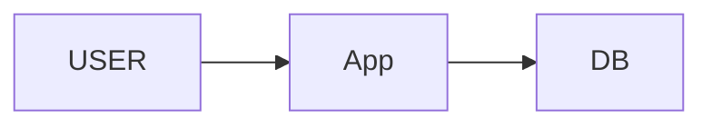
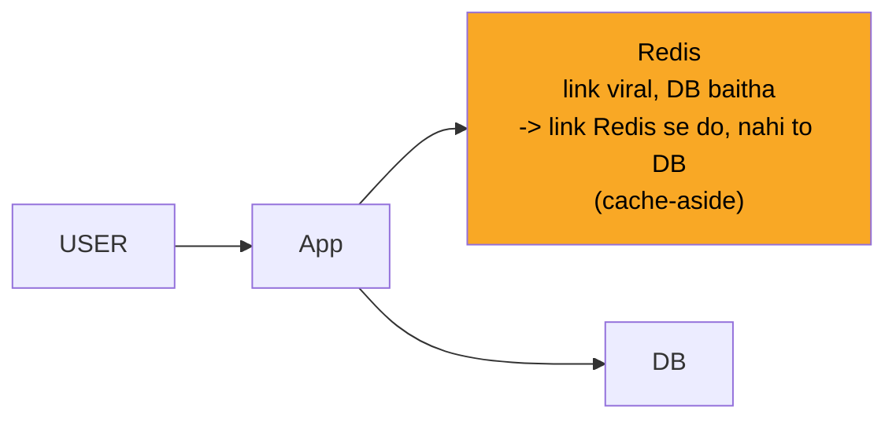
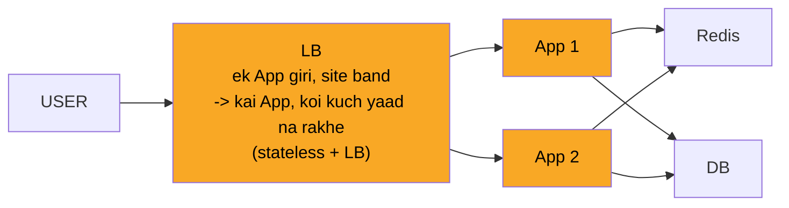
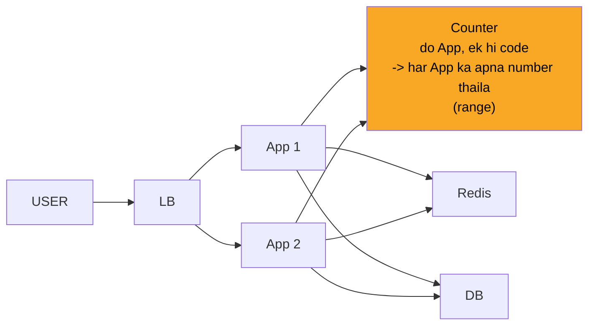
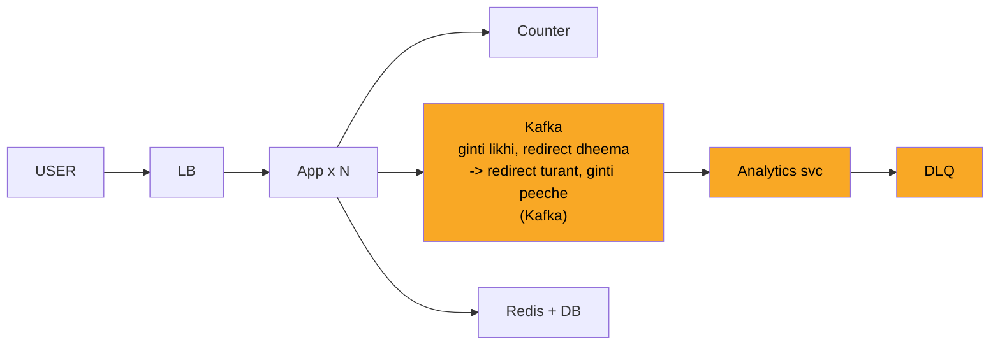
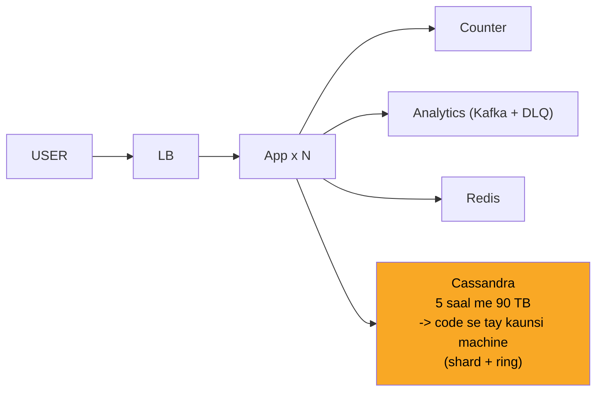
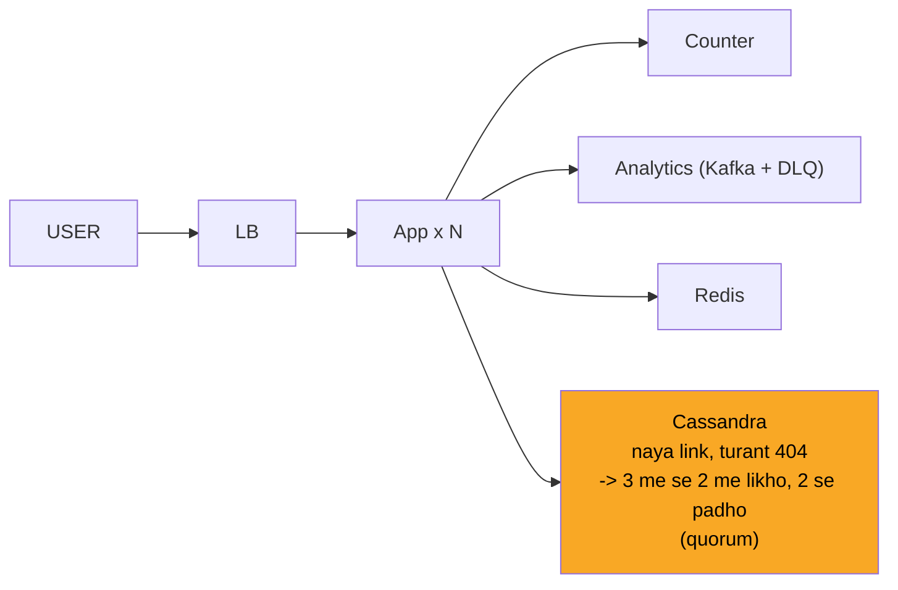
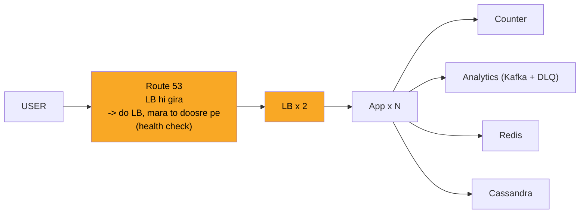
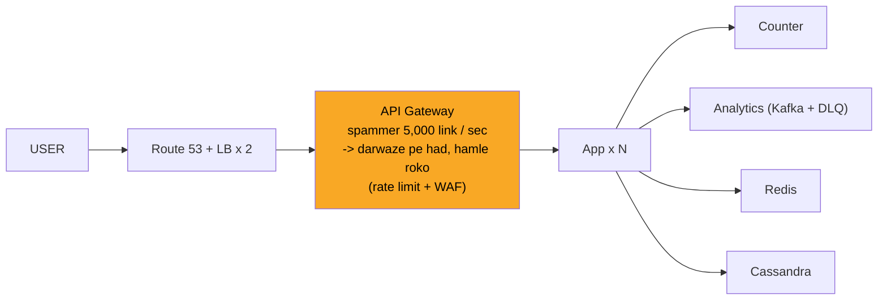
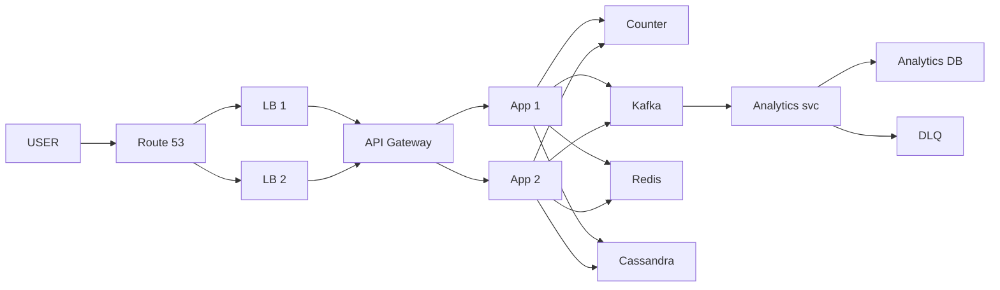

# URL Shortener

> Lamba link do -> chhota 7 akshar ka code milta hai. Koi chhote link pe click kare -> asli link pe bhej do (302 redirect).
> Is design ka dil do cheezein hain: **har link ka code ALAG (unique)** aur **click pe redirect bahut tez**, kyunki log link banate kam hain aur kholte bahut zyada (100 me se 99 baar kholna).

---

## KAHANI (ek din, mera sale wala link; har dikkat se design me ek dabba judta)

```
   KYA HUA                                     ILAAJ                                DABBA JUDA
1  mera sale link viral, DB baith gaya      -> REDIS CACHE (cache-aside)            Redis
2  usi bheed me ek App giri, site band      -> STATELESS App x N + LOAD BALANCER    LB + App x N
3  main aur Ravi, dono ko ek hi code        -> COUNTER RANGE (thaila) + base62      Counter
4  click ginti likhi, redirect dheema       -> KAFKA, ginti peeche                  Kafka + Analytics + DLQ
5  DB team: 5 saal me 90 TB                 -> SHARD by code (RING)                 Cassandra
6  naya link banaya, turant khola, 404      -> QUORUM (2 me likho, 2 se padho)      (Cassandra quorum)
7  shaam ko LB hi gira                      -> ROUTE 53 + 2 LB (health check)       Route 53 + LB x2
8  raat ko spammer, 5,000 link / sec        -> RATE LIMIT darwaze pe + WAF          API Gateway + WAF

POORA DESIGN (upar ke dabbe kram se):
   User -> Route 53 -> LB x2 -> API Gateway -> App x N (Counter ka thaila) -> Redis -> Cassandra
   click ki khabar: App -> Kafka -> Analytics (fail -> DLQ)
```

---

## TASVEER (ByteByteGo / Alex Xu · CC BY-NC-ND 4.0)


Source: [Explaining 5 Unique ID Generators](https://bytebytego.com/guides/explaining-5-unique-id-generators-in-distributed-systems/)
(Code kahan se aaye: UUID / Snowflake / DB ka auto-increment / range. Hamara code = ek number ko base62 me likhna.)

---

## SHURU: pehle poocho, phir numbers

```
POOCHO:  "Link banana, redirect, click ginna, apna khud ka code (custom alias), expiry — kis pe dhyaan dein?"
         -> zaroori: link banana + redirect. Click ki ginti chahiye. Bada analytics dashboard bahar.
            Custom code = time bache to.
         "Din me ~10 crore (100M) naye link, aur har link ~100 baar khulta hai — ye maan ke chalun?"
         kuch na pata ho -> "ye maine use nahi kiya" bolna theek hai, interviewer khud bata dega.

ZAROORI KAAM (FR):   lamba -> chhota banao · chhote pe click -> asli pe bhejo
KAISA CHALE (NFR):   redirect 200 ms se tez · hamesha chalu · padhna >> likhna · code kabhi dohraaye nahi
                     ("aage ka har faisla inhi 4 me se kisi ek se judega")

NUMBERS (andaaza, calculator nahi):
   naye link:  10 crore / din. Din me ~1 lakh second hote hain -> ~1,000 naye link har second.
   click:      har link ~100 baar khulta -> ~1 lakh click har second.
   jagah:      ek link ~500 byte. 5 saal me ~180 arab link -> ~90 TB.
   code:       62 akshar, 7 jagah -> 62 x 62 x ... (7 baar) = ~3.5 lakh crore code -> ~100 saal chal jaayega.

NUMBER SE FAISLA:
   click >> naye link (100 : 1)   -> CACHE lagega
   90 TB                          -> ek machine me nahi aayega, SHARD karna padega
   7 akshar                       -> code kitna lamba ho, ye jhagda khatam
   Agar interviewer chhota maane (1 arab link = ~500 GB) -> ek hi DB me aa jaata, shard ki zaroorat nahi.
   Estimate chhodna mat, par exact ganit me mat atakna.
   Din ka maana to poora din ka hi rakho, mahine se mat milao.

KYUN CHAHIYE:  Twitter / SMS me jagah kam · marketing me kis link se kitne aaye · QR / print · saaf dikhta
```

---

## ════ MOCK SE PEHLE: SIRF YE CARD PADHO ════

> Har card: pehle PEELA DABBA dekho (scene + ilaaj). Yaad aa gaya -> aage. Nahi aaya -> neeche
> DIKKAT / HAL / NAHI padho. AAGE POOCHEGA sirf jab interviewer aage kuch poochhe.

#### DABBA 0: SABSE SIMPLE (yahan se shuru, phir "kahan tootega")
```
User link deta -> App ek code banata -> DB me (code, lamba link) save.
Click aaya -> App DB me code dhoondhta -> asli link pe bhej deta.
```


#### 0 SHURU: CODE KAISE BANE (dil ka hissa)
```
DIKKAT 1   Maine diya "https://amazon.in/....../bahut-lamba-link". Mujhe chahiye "bit.ly/w7e".
           Har link ka code alag hona chahiye, warna do link ek hi jagah khulenge.
HAL        Ek ginti (counter) rakho: 1, 2, 3 ... Har naye link ko agla number do, aur us number ko
           BASE62 me likh do. Wahi code hai.

           Base62 = 62 akshar: 0-9 (10) + a-z (26) + A-Z (26).
           Number ko baar-baar 62 se bhaag do, jo bachta (remainder) wo ek akshar, aakhir me ulta padho.
           Misaal: 125 = 2 x 62 + 1 -> "21".   100 crore -> "15FTGg" (6 akshar).
           Counter kabhi dohraata nahi -> code kabhi dohraata nahi. Check karne ki zaroorat hi nahi.

DIKKAT 2   Counter kyun, lambe link ka MD5 / random code kyun nahi?
HAL        MD5 / random me do link ka code same aa sakta hai. Har baar DB se poochna padega
           "ye code pehle se hai?" Counter me ye dikkat hi nahi.

DIKKAT 3   Counter se code ka andaza nahi lag jaayega? (abc124 ke baad abc125)
HAL        Haan, ye keemat hai. Chahiye to number ko pehle shuffle / XOR karo, phir base62.
           Phir bhi unique rahega.

DIKKAT 4   User apna code maange ("bit.ly/arpan")?
HAL        Check karo: lambai theek, "admin" / "login" jaisa reserved shabd nahi, pehle se liya hua nahi.
           Do log ek saath same code maangein -> DB me UNIQUE rule, ek ko 409 (pehle se hai).

DIKKAT 5   Redirect 301 dein ya 302?
HAL        302. 301 pe browser link yaad kar leta hai, agli baar server tak aata hi nahi.
           Tab click gin nahi paate aur expiry bhi kaam nahi karti.
```

#### 1 Mera sale wala link viral hua, har click DB pe, DB baith gaya

```
DIKKAT     10 baje maine sale ka chhota link College Gang me daala, viral -> ~1 lakh click / sec, har click
           DB (disk) tak. Redirect dheema hua, phir DB hi baith gaya.
HAL        link Redis se do (REDIS CACHE, cache-aside): mila -> bhejo, nahi -> DB se laao, Redis me rakho.
           RAM, 1 ms se kam; ~100 me 95 click Redis se. Redis ki umar (TTL) = link ki expiry.
NAHI       DB ki read copy (replica): wo bhi disk se, dheemi; 1 lakh / sec ke liye bahut copies chahiye.
```
```
AAGE POOCHEGA:
  NIYAM: garam link RAM (Redis) me, DB tak sirf wo jo Redis me na mile; user ko farak nahi, bas tez.
         Redis gira to saara bojh DB pe -> Redis ki copy, aur aakhir me kuch request mana (DB bachao).
  "Har App apna cache kyun nahi rakhta?"    -> EK SHARED REDIS: kyunki link badla to har App ki apni copy
                                               purani reh jaati; Redis sabka ek.
  "Theek, to saare 180 arab link Redis me?" -> SIRF GARAM: kyunki RAM mehngi; bhara to sabse der se na khula
                                               nikaalo (LRU).
  "Jo LRU ne nikaala, wo kal phir khula?"   -> DB SE WAPAS: Redis me nahi mila to DB, phir Redis me daal do;
                                               NIYAM wahi.
  "Link delete ya expire hua to?"           -> DELETE = PEHLE DB, PHIR REDIS: Redis pehle hataya to beech ka
                                               click DB se purana bhar dega. Expiry pe Redis khud.
  "Aur Redis hi gir gaya?"                  -> CLUSTER + REPLICA: kyunki warna 95% click ek saath DB pe, DB
                                               bhi gira.
  "Replica bhi gaya to?"                    -> LOAD SHEDDING: kuch request mana, garam link ko EK request DB
                                               se laaye, baaki ruke. "Kuch nahi hoga" mat bolna.
```

#### 2 Usi bheed me ek App machine giri, poori site band

```
DIKKAT     11 baje wahi bheed ek hi App machine pe. Wo dheemi hui, phir giri -> poori site band.
           Ek cheez jiske girne se sab ruk jaaye = SPOF (single point of failure).
HAL        kai App machine, aage baantne wala (STATELESS + LB): request baari-baari (round-robin) ya kam kaam
           wale (least-conn). Har ~5 sec GET /health; jawab nahi -> list se bahar, theek hui -> wapas.
NAHI       ek bahut badi machine (vertical scale): uski bhi had, aur akeli -> wahi giri to sab band.
```
```
AAGE POOCHEGA:
  NIYAM: App kuch yaad nahi rakhta (sab Redis / DB me), isliye koi bhi machine koi bhi request le; ek giri
         to LB use list se hataata, user ka agla click doosri machine pe.
  "Ek machine giri, baaki kaise sambhaal leti?" -> STATELESS: kyunki App kuch yaad nahi rakhta; baat App-1 ki
                                                   memory me hoti to App-2 pe agli request ko pata hi nahi.
  "Machine mari nahi, bas dheemi hai, tab?"     -> LB HEALTH + LEAST-CONN: LB jawab ka time + galtiyan ginta,
                                                   dheemi ko kam bhejta.
```

#### 3 Maine aur Ravi ne link banaya, dono ko ek hi code mila

```
AAGE POOCHEGA:
  NIYAM: number ek hi jagah se, App ko thaile (range) me; ek thaila kabhi do App ko nahi -> code kabhi same
         nahi. App gira to bacha thaila bekaar (chalta); counter gira to bhi haath ka thaila chalta.
  "Kaise kaam karta?"                    -> THAILA (range): Counter (ZooKeeper / DB) har App ko alag range,
                                            App-1 = 1-1000, App-2 = 1001-2000; khatam pe hi counter.
  "App-1 400 pe crash, 401-1000 ka kya?" -> BEKAAR, JAAN-BOOJH KE: kyunki 3.5 lakh crore code me kuch hazaar
                                            se farak nahi.
  "Mujhe har number bachana hai, tab?"   -> HAR LINK PE COORDINATION: kyunki har number pe counter poochho =
                                            range ka fayda khatam.
  "Counter service hi gir gayi?"         -> KAAM CHALTA: kyunki App ke haath me thaila (1000) bacha; tab tak
                                            counter ki doosri copy uthti.
  "Redis INCR se kyun nahi?"             -> CHAL JAATA, par har link pe ek call; range me 1000 link pe ek
                                            call.
```

#### 4 Maine click ginti chahi, redirect hi dheema ho gaya

```
DIKKAT     2 baje mujhe ginti chahiye thi kitne click aaye. Usi request me analytics DB me likhne lage,
           phir redirect. Analytics DB dheema -> har user redirect ke liye ruka.
HAL        redirect turant, ginti peeche (KAFKA = disk pe diary): 302 do, "ek click hua" Kafka me daalo.
           Analytics svc apni speed se padhe, kahan tak padha yaad (offset); kharab khabar alag line (DLQ).
NAHI       App ke andar peeche ek thread: App crash = memory me padi khabarein gayi.
```
```
AAGE POOCHEGA:
  NIYAM: redirect kisi ka intezaar nahi karta; ginti peeche, apni speed se, disk pe (Kafka). Ginti wala
         dheema / band ho to bhi user ka link khulta, bas ginti thodi der se aati.
  "Ek click do baar aa gaya to?" -> CLICK ID: kyunki har click ki apni id; wahi id dobara aayi to ginti nahi.
  "Kafka hi band ho gaya?"       -> REDIRECT CHALTA: kyunki redirect kisi ka intezaar nahi karta; bas kuch
                                    click ginti me nahi aate.
  "SQS kyun nahi liya?"          -> REPLAY: SQS bhi chalta, par click bahut + naya report = purane click
                                    dobara padho; Kafka rakhta, SQS padhte hi hata deta.
```

#### 5 DB team boli: 5 saal me 90 TB, ek machine me nahi

```
DIKKAT     4 baje DB team: 10 crore link roz, 5 saal -> ~180 arab link, ~90 TB. Ek machine me nahi aata,
           aur wo ek machine mari to saare link gaye.
HAL        code se data tukdon me baanto (CASSANDRA SHARD): GET /abc123 -> code se seedha machine. RING = gol
           ghadi, machine + code dono us pe; code aage chale, pehli machine uski. Har tukda 3 copy.
NAHI       country / date se baanto: ek country / aaj ka din garam, aur code se country pata hi nahi.
```
```
AAGE POOCHEGA:
  NIYAM: jis cheez se padhte ho (code), usi se baanto -> har click seedha ek machine; machine judi / giri to
         sirf pados ke code khiskein, aur har tukde ki 3 copy.
  "Nayi machine judi to kya hota?"        -> SIRF PEECHE WALE CODE KHISKTE (ghadi): kyunki "code % machine" me
                                             3 se 4 hote hi lagbhag har code ki jagah badalti.
  "Copy badha do, likhna tez ho jaayega?" -> NAHI, SHARD: kyunki har copy pe likhna padta; likhne ka bojh =
                                             shard, copy = bachav.
  "Ek machine pe zyada code aa gaye?"     -> VIRTUAL NODES: kyunki har machine ghadi pe 100-200 jagah, to bojh
                                             barabar bant-ta.
  "Ek link viral, uski machine garam?"    -> REDIS SE NIKAL JAATA: kyunki garam link pehle Redis me milta,
                                             machine tak kam aata.
  "Cassandra kyun, MySQL kyun nahi?"      -> JOIN / TXN CHAHIYE HI NAHI: bas code se link + 90 TB; "NoSQL
                                             powerful" wajah nahi.
  "Agar data chhota hota, ~500 GB?"       -> EK MYSQL KAAFI: kyunki shard tab jab ek machine me na aaye; yahan
                                             aa jaata.
```

#### 6 Maine naya link banaya, turant khola, 404 aaya

```
DIKKAT     5 baje maine naya link banaya. Cassandra har link 3 alag machine pe rakhta: copy A, B, C.
           Link A aur B me pahunch gaya, C tak abhi nahi (aam taur pe ms, bheed me second tak).
           Isi beech mera click C pe gaya -> C bola "ye link mere paas nahi" -> 404.
HAL        3 me se 2 copy pe pakka (QUORUM = "zyadatar"): likhna "done" jab 2 copy me, padhna bhi 2 copy se.
           Koi bhi 2 uthao (A+C, B+C, A+B), har jodi me A ya B aayegi hi -> khaali haath kabhi nahi.
NAHI       3 me likho tabhi done, phir 1 se padho: ek copy giri = har naya link fail.
```
```
AAGE POOCHEGA:
  NIYAM: "2 me likha + 2 se padha" -> har jodi me ek taaza copy, isliye banane ke baad 404 nahi; 2 copy na
         mili to likhna fail (user ko error), par jo "done" bola wo kabhi khona nahi.
  "Redis ka kya, wahan to link hai hi nahi?" -> BANATE HI REDIS ME DAALO: kyunki zyadatar click Redis se, 404
                                                wahin ruk jaata.
  "Likhte waqt ek copy gir gayi?"            -> 2 ME HUA TO SAVE: kyunki 3 me se 2 = zyadatar (quorum); us
                                                beech redirect Redis se.
  "Giri machine wapas uthi, uska data?"      -> HINTED HANDOFF: zinda machine ne beech ki likhai note rakhi,
                                                uthte hi di; padhte farak mile to theek (read repair).
  "3 ka intezaar kyun nahi, sirf 2 ka?"      -> EK DHEEMI SAB DHEEMA: kyunki teeno ruko to ek slow machine
                                                sabko rokti; 2 me ek gire tab bhi likh sakte.
  "Aur 2 machine gir gayi to?"               -> LIKHNA FAIL: kyunki 2 "haan" nahi mile (ya 1 pe, risk ke
                                                saath); click phir bhi Redis se.
  "2 se padhna dheema nahi padta?"           -> HAAN THODA: isliye pehla ilaaj Redis, zyadatar click wahin se,
                                                DB tak kam.
  "Data bachane ko Kafka laga dein?"         -> NAHI, DB KI APNI DIARY: kyunki ye DB khud karta; extra dabba
                                                mat lagao.
  "Cassandra me main copy kaunsi?"           -> KOI NAHI: teeno copy barabar, koi bhi likh aur padh sakti.
```

#### 7 Shaam ko LB hi gir gaya, koi request andar nahi

```
AAGE POOCHEGA:
  NIYAM: koi dabba akela nahi; aage wala health check se sirf zinda wale pe bheje. Switch me thoda waqt
         (DNS ~60 sec), us beech kuch request fail -> isliye har jagah 2+ aur kai zone.
  "Kaise kaam karta?"            -> HEALTH CHECK: Route 53 (AWS ka DNS) har ~30 sec LB se "zinda?"; 3 baar
                                    chup -> sab doosre LB pe; region gaya -> doosra region.
  "Switch turant ho jaata?"      -> NAHI, DNS TTL: phone purana pata ~60 sec yaad rakhta; isliye LB khud kai
                                    data center me (AWS ALB).
  "Region gaya, uske naye link?" -> AAKHRI KUCH SECOND KHO SAKTE: kyunki doosre region me copy peeche-peeche;
                                    ye maana hua risk hai.
```

#### 8 Raat ko spammer ki script, har second 5,000 link

```
DIKKAT     Raat ko spammer: ek API key se har second 5,000 link (phishing). Aam din poore system pe ~1,000
           -> 5 guna bojh, asli users dheeme; Gmail / WhatsApp ne hamara domain "spam" maana.
HAL        darwaze pe had (RATE LIMIT, gateway pe): har user / IP ki had + login; aage WAF (pehchaane hamle).
           Chhota karne se pehle lamba URL check: virus / dhokhe ki site to nahi.
NAHI       har gateway machine apni ginti: banda har machine pe limit tak bana lega.
```
```
AAGE POOCHEGA:
  NIYAM: rokna darwaze pe, sabki ek ginti se (shared Redis), us pehchaan pe jo bot badal na sake (API key);
         had paar -> 429, asli users ki speed bachi rahe.
  "Gateway ki kai machine, ginti ek kaise?" -> SHARED REDIS: INCR + expiry, sab wahi ek ginti dekhein. (Poora
                                               design = 02_rate_limiter.)
  "Bot har baar naya IP le aaye to?"        -> API KEY / USER_ID PE: kyunki pehchaan wo jo bot badal na sake;
                                               upar se WAF ke bot rules.
```

---

## AAKHRI DABBA + WRAP (ek hi baar)

```
User -> Route 53 (kaunsa LB zinda + kaunsa region) -> 2 LB -> WAF -> API Gateway (rate limit + login)
-> App (stateless) -> Redis (95% click, expiry = link ki expiry)
-> Cassandra (code se baanta, har tukde ki 3 copy, 2 me likha 2 se padha)
NAYA LINK: App -> thaile se agla number -> base62 (123456 -> "w7e") -> Redis + Cassandra -> chhota link
CLICK:     App -> Redis me mila? -> 302 · nahi -> Cassandra -> Redis me rakho -> 302
           · click ki khabar -> Kafka -> Analytics (fail -> DLQ), redirect ruke bina

DB:  Cassandra / DynamoDB -> join nahi, transaction nahi, ek code se ek link, 90 TB.
     Wajah = kaam ka dhaancha + size, "NoSQL powerful" nahi. Redis sirf cache.
```
```
JAWAB:    Short code = ek badhta number, jise 62 akshar (a-z, A-Z, 0-9) me likha. Har server ko numbers
          ki apni range milti, to do server kabhi same code nahi banate.
          100 me 1 baar link banta, 99 baar khulta. Isliye khulna zyadatar Redis se, baaki Cassandra se
          (short code se baanta, har tukde ki 3 copy).
          Redirect turant, click ki ginti peeche Kafka se. Do load balancer + Route 53, taaki koi ek
          gire to sab na gire. Darwaze pe had.
          Aage: apna naam wala link, purane link hatana, doosre desh me copy.
```


---

## 10 GUNA TRAFFIC — har dabba alag se

```
Route 53    -> user ko uske paas wale region pe bhejo (geo-routing)
App         -> stateless hai, machine badhao. Padhne aur likhne wale App alag rakho
               (100 : 1 -> padhne wale bahut, jaise 20 machine; likhne wale 2, ek gire to doosra chale)
Redis       -> saare link nahi samaate. Garam rakho, thande nikaalo (LRU + expiry).
               viral gaana / WhatsApp forward = garam, Redis me. Log kholna band = thanda, bahar
               (Cassandra me to hai hi, agli baar khula to wapas aa jaayega)
Cassandra   -> code se baanto + har tukde ki 3 copy. Koi "main copy" nahi, har copy padh / likh sakti hai.
               padhne ka bojh badha = aur machine / copy
Counter     -> ye bhi gir sakta hai -> 2 copy (ek chalu, ek taiyaar).
               Range waise bhi thodi der chala leti hai.
Kafka       -> partition badhao

BAANTNA CODE SE, COUNTRY SE NAHI:
   click hamesha code ke saath aata hai -> code se seedha ek machine
   country se baanta -> code dekh ke pata nahi kis country ka -> saari machine poochni padti
   country / region ka kaam = user ke paas data rakhna (jaldi jawab), data baantna nahi.
   Dono saath chal sakte hain.

POOCHEGA: "Kahan se sab gir sakta?"     -> LB (2 copy) · Counter (2 copy, ek chalu ek taiyaar)
                                           · Route 53 health check
POOCHEGA: "Chal raha hai, kaise pata?"  -> redirect ka time (p99) · galtiyon ki ginti · Kafka me kitna
                                           pending · alert
```

---

## POOCHE TO (gehra sawaal aaye tab)

Jo poochhe wahi kholo, sab ek saath mat bol dena.

```
API:      link banana = POST /api/shorten { long_url, custom_code? } -> { short_url, expires_at }
          link kholna = GET /abc123 -> 302 + Location: <lamba link>
          (ulta mat bolna: banana POST, kholna GET)

ROW:      short_code (isi se machine tay hoti hai) · long_url · created_at · expires_at
          GET /abc123 -> seedha ek machine, ek row

KAUNSA DB, KITNE TAK:
          MySQL ~1 arab row tak aaram se · Mongo ~10 arab tak · Cassandra / DynamoDB isse bahut aage
          Redis sirf cache, hamesha saath. Faisla = kaam ka dhaancha + size.

COUNTER KE 3 TAREEKE:
          DB me ek-ek badhao  -> har link pe DB, dheema
          Redis INCR          -> har link pe ek call
          RANGE (thaila)      -> 1000 link pe ek call   <- YAHI

SHABD BHOOL JAO TO SEEDHI BAAT BOLO (atko mat):
          "MD5" yaad nahi   -> "lambe link ka hash lo, uske pehle 7 akshar"
          "Base62" yaad nahi -> "62 akshar hain (0-9, a-z, A-Z), number ko unme likh do,
                                chhoti string ban jaati"
          "Counter" yaad nahi -> "ek badhta hua number, har link ko agla"
          interviewer ko shabd nahi, samajh chahiye. Naam wo khud bol dega.
```

---

ARCHETYPE F (infra/component) · CONCEPTS: [ID-gen](../../FOUNDATIONS/13_distributed_id_snowflake.md) · [caching](../../FOUNDATIONS/04_caching.md) · [sharding](../../FOUNDATIONS/06_database_sharding.md) · [← MASTER SHEET](../../00_MASTER_SHEET.md)
