# URL shortener: token counter ki kahani

Ek token counter hai. Log aate hain aur bahut lamba pata likhi chit dete hain ("amazon.in/products/xyz/...").
Counter wala unhe chhota token deta hai, jaise aB3x9. Kaam: jo bhi token dikhaye, use lamba pata turant mile, aur do
logon ko kabhi same token na mile.

Har kadam = **kahani** (dikkat aur hal, bolne wali bhasha) -> **Asli naam** (interview me yahi shabd) -> tasveer
(kahani ka shabd, bracket me asli naam).

---

## FR / NFR / Numbers (interview me pehle 2 minute)

```
FR      lamba link do, chhota code lo (max 7 akshar, short.ly/aB3x9) · chhota link khole to lambe pe bhejo (redirect)
NFR     kholna turant · hamesha chale (link toota to bheja hua bekaar) · ek code = ek link, kabhi same nahi
        · dhokhe wala link na khule · machine se bheed (bot) na ho
Numbers roz 10 crore naye link = ~1,000 / sec banana · har link ~100 baar khulta = ~1 lakh / sec kholna
        5 saal me ~90 TB · 7 akshar, har akshar 62 tarah ka = ~3.5 lakh crore code
        -> kholna 100 guna zyada: cache chahiye · 90 TB ek machine me nahi: tukde chahiye
```

---

## 1. Do logon ko same token (ek line ka counter)

Counter wala token apne man se bana raha tha, kuch bhi chhota likh deta, aur ek din do alag logon ko same token de
diya. To uska token ek line wala kar do: abhi number 9 hai to agla 10. Ye ban gaya to aage badhao, phir ye ban gaya to
aage badhao, isliye number kabhi repeat nahi hoga. Counter kar do, counter service.

**Asli naam:** ek line me, aage badhao = counter (har link ko agla number), kabhi repeat nahi = takrav kabhi nahi.

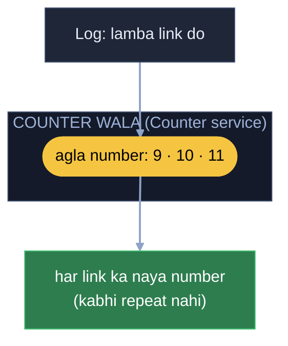

## 2. Counter 10 arab pe, token lamba (number plate jaise akshar bhi)

Saal bhar me counter 10 arab pe pahunch gaya, token "10000000000", 11 akshar, aur lamba hota jaayega. Number wahi
rakhna hai par token chhota chahiye. To gaadi ki number plate dekho: "DL 3C AB 1234" me sirf number nahi, akshar bhi
hain. DL 3C, phir 4C, 5C, phir 5D, phir A, AB ke baad CB, aise aata rahega. 1 2 3 4 ki jagah combination bana lo, aur
7 character hon to kaafi combination ho jaate hain.

**Asli naam:** number plate jaise akshar bhi, combination = base62 (0-9, a-z, A-Z), 7 character, kaafi combination =
62^7, ~3.5 lakh crore code.

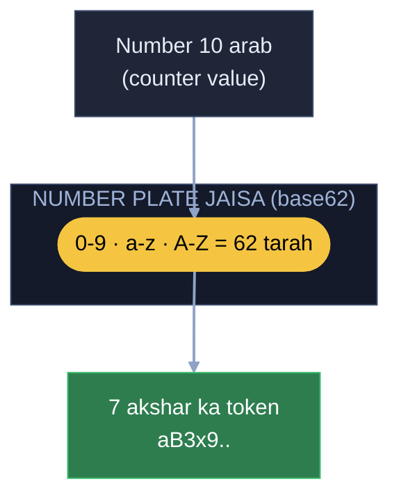

## 3. Har baar mota register palatna (chhota pehla register)

Token lene wale kam aate, par token dikha ke pata lene wale bahut, har second 1 lakh. Counter wala har baar mota
register palat ke dhoondhta, isliye line ruk jaati. Aur kuch token din me hazaar baar aate. To mota register to rakho,
koi dikkat nahi, par ek chhota pehla register bhi rakh lo, usme wahi baar-baar wale token. Jo log bahut baar poochhne
aa rahe, wo wahin se chale jaayenge.

**Asli naam:** chhota pehla register = cache (Redis), mota register = DB (Cassandra: data bas code -> link, na join na transaction, par 90 TB kai
machine me baantna hai, isliye NoSQL key-value), bahut baar
poochhe jaane wale = garam / baar-baar padhe link. Pehle Redis, nahi mila to DB se laake Redis me rakho (cache-aside).

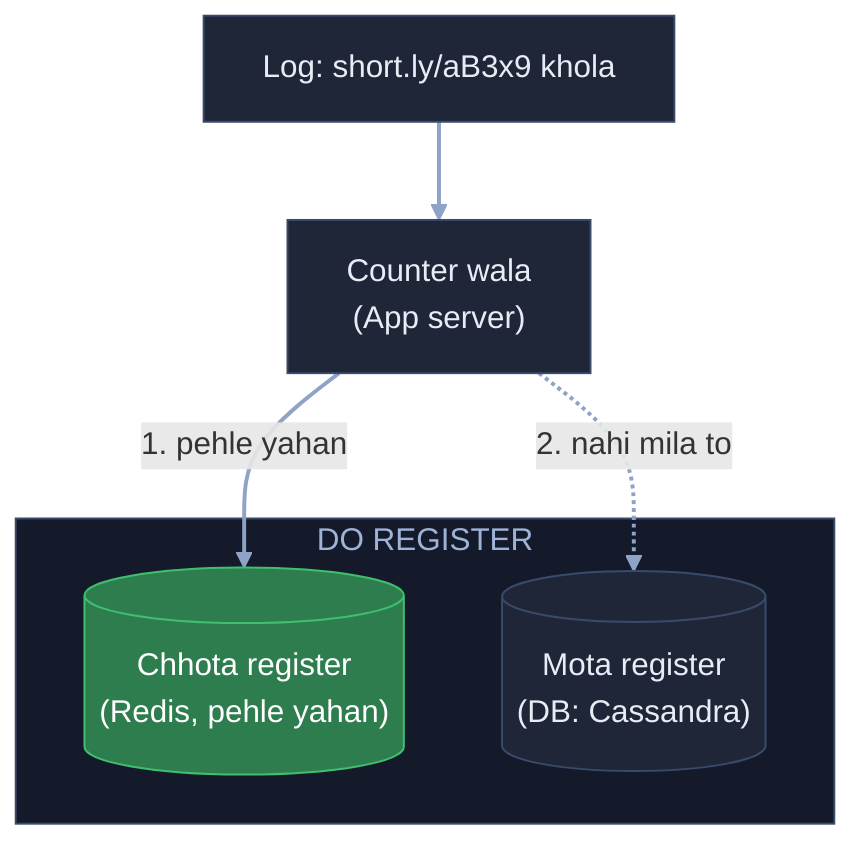

## 4. Chhota register bhar gaya (kise hatayein)

Chhota register bhar gaya aur naya token likhna hai, to kisi purane ko hatana padega. Hamare paas tareeke hain: time
laga do ki ye token itni der tak register me rahega, uske baad hata do. Ya jo sabse kam use hua, jo ab poochha hi nahi
ja raha, wo hatao, kyunki wo likha hi kyun ja raha hai.

**Asli naam:** itni der tak rahega, phir hata do = TTL, jo poochha hi nahi ja raha, hatao = LRU.

## 5. 7 baje 1,000 log mote register pe (chhota ladka)

Ek mashhoor token ka waqt theek 7 baje khatam hua aur wo chhote register se hat gaya. Usi pal 1,000 log wahi token le
ke aaye, aur saare ek saath mote register pe toot pade. To mere paas ek chhota ladka hai, main use bolunga: bhai
chupchap bhaag ke ja, mote register se wo information nikaal ke la aur chhote register me rakh de. Baaki sab yahin ruk
jaayenge. Patapat la, khatam kahani, ho gaya kaam.

**Asli naam:** ek ladka jaaye, sab yahin ruken = lock (single flight), la ke chhote register me rakh de = DB se laake
Redis bharna. Isse stampede rukta hai.

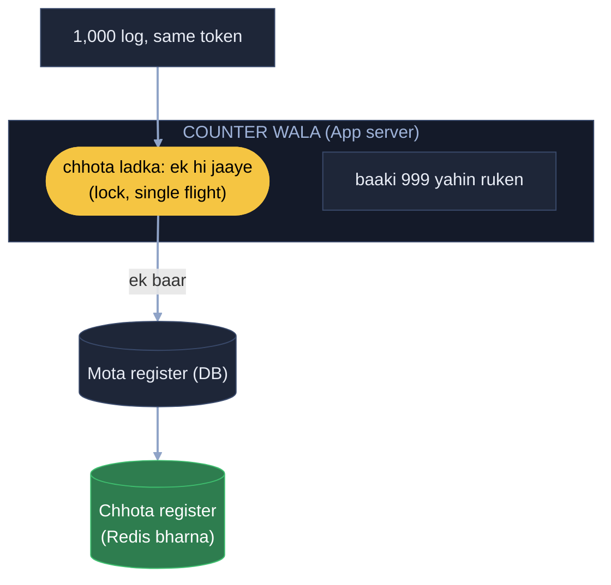

## 6. Ladka raste me gir gaya (ladke ki timeline)

Ladka bhaaga aur raste me gir gaya, kabhi wapas nahi aayega, aur baaki 999 "ladka laayega" soch ke ruke khade hain.
Yahan thoda decision lena padega, kyunki main intezaar kab tak karunga? Main us ladke ki timeline rakhunga: itni der
tak nahi aaya to 999 me se ek ko bolunga, bhai le idhar aa, mote register se information la ke de de, mera ladka pata
nahi kahan gaya. Aur tab tak logon ko purani information de sakte hain, baad me update kar denge.

**Asli naam:** ladke ki timeline, nahi aaya to agla = lock TTL (umar khatam to lock khulta, agla le leta), purani
information do, baad me update = soft / hard TTL (soft nikla to purana turant do, peeche se naya lao).

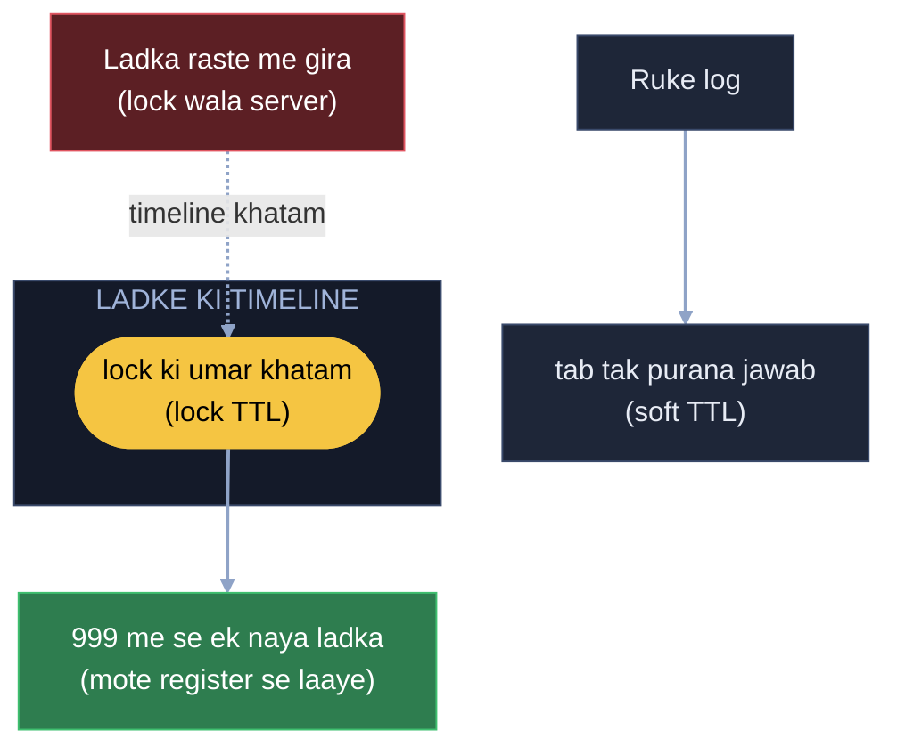

## 7. 5 counter, dono ne token "10" diya (apni-apni range)

Ek counter se bheed nahi sambhli, to 5 counter khol diye. Har counter apni ginti 1, 2, 3 chala raha, isliye counter 1
aur 2 dono ne apne 10ve aadmi ko token "10" de diya. To paanchon ko range me baant do: tu 1 se 100 karega, tu 101 se
200, tu 201 se 300, tu 301 se 400, tu 401 se 500. Ek ki range kabhi doosre se nahi milti, to same token kabhi nahi.

**Asli naam:** apni-apni range = counter range (beech ka counter har app server ko number ka dabba deta, dabba khatam hone pe hi agla maangta, to us pe bojh bhi nahi), 5 counter =
kai app server + aage load balancer.

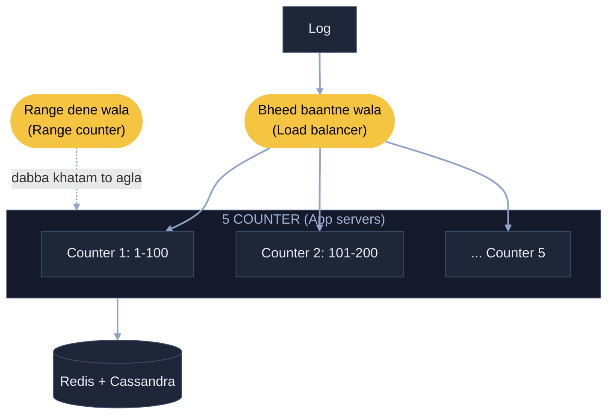

## 8. 90 TB, ek almari me nahi aata (tukde, hash se baanto)

5 saal me mote register me itne token, 90 TB, ki wo ek almari me aata hi nahi, aur bharta hi jaayega. To shard kar do,
chhote-chhote tukde bana do: 10 TB ke 9 tukde, aur sab tukde alag-alag almari me. Aur hash se baanto, ki token aaya
to is tukde pe gaya, phir same aaya to phir usi tukde pe.

**Asli naam:** chhote tukde, alag almari = shard, hash se baant do, same aaye to usi tukde pe = code ke hash se
machine tay.

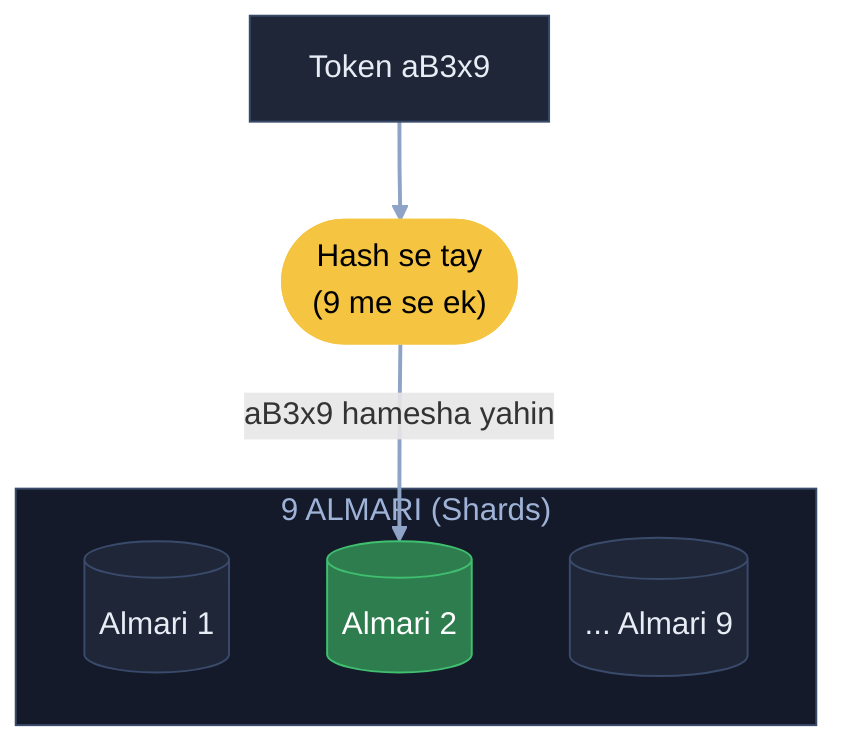

## 9. 10vi almari lagi, sab "nahi mila" (gol chakkar + paas ka shelter)

9 almari bharne lagi, jagah kam, 10vi laga di. Hisaab "9 me se kaunsi" se "10 me se kaunsi" ho gaya, aur lagbhag har token galat
almari me dhoondha ja raha, sab "nahi mila". To almari ko gol chakkar me baant do, thoda door-door rakho. Token aaya to
dekho wo kis jagah gira, jo uske paas ki almari hai usme thoos do. Jaise gaadi chala raha hoon aur beech me toofan aa
gaya, to main apne paas ka shelter dhoondhunga. Same to same yahan. Kal 9 se 10 almari hui to sirf uske paas wala
thoda badlega, poore 9 ya 10 ko alag-alag nahi karna padega.

**Maan lo poochhe, saari almari bhar gayi to unhe ring se hata ke alag kamre me kyun nahi rakhte:** ring me almari
bank locker ki tarah ek-ek karke nahi bharti. Hash har token ko ring pe kahin bhi giraata hai, to saari almari ek
saath, barabar bharti hain: koi almari "khatam" nahi hoti, naye token purani me bhi aate rehte hain, aur dhoondhne ke
liye bhi wahi ring chahiye. Sab bharne lagi to nayi almari lagao, wo paas wali ka kuch hissa le leti hai, dono me
jagah. (Ek-ek karke bharne wala tareeka bhi hota hai: bhari almari alag kamre me, beech me ek register "kaunsa token
kis kamre me". Par crore token ka register rakhna padta aur har request ek kadam extra.)
**Asli naam:** saari almari ek saath bharti = hash se barabar baant; ek-ek karke bharna = range partitioning; beech
ka register = lookup / directory.

**Asli naam:** gol chakkar, door-door almari = ring (consistent hashing), paas ka shelter = ghadi ki disha me pehli
machine, sirf paas wala thoda badlega = nayi machine pe sirf ek tukda hilta hai.

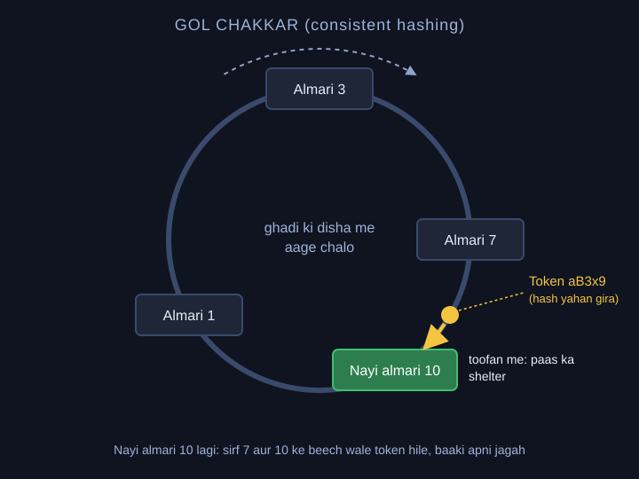

## 10. Almari number 3 me aag (copy + acknowledge)

Almari number 3 me aag lagi, uske saare token jal gaye. To ek almari mat rakho, unhi ki copy bana do: 3 gir gayi to
uski ek aur copy hai. Par isme dikkat ye ki copy thodi peeche ho sakti hai, to acknowledge wala kar lo: "haan bhai
maine likh liya, tu acknowledge bhej". Jab tak acknowledge nahi aata, tab tak pakka nahi.

**Asli naam:** almari ki copy = 3 copy (replica, alag machine), acknowledge aaye tab pakka = quorum write (W=2).

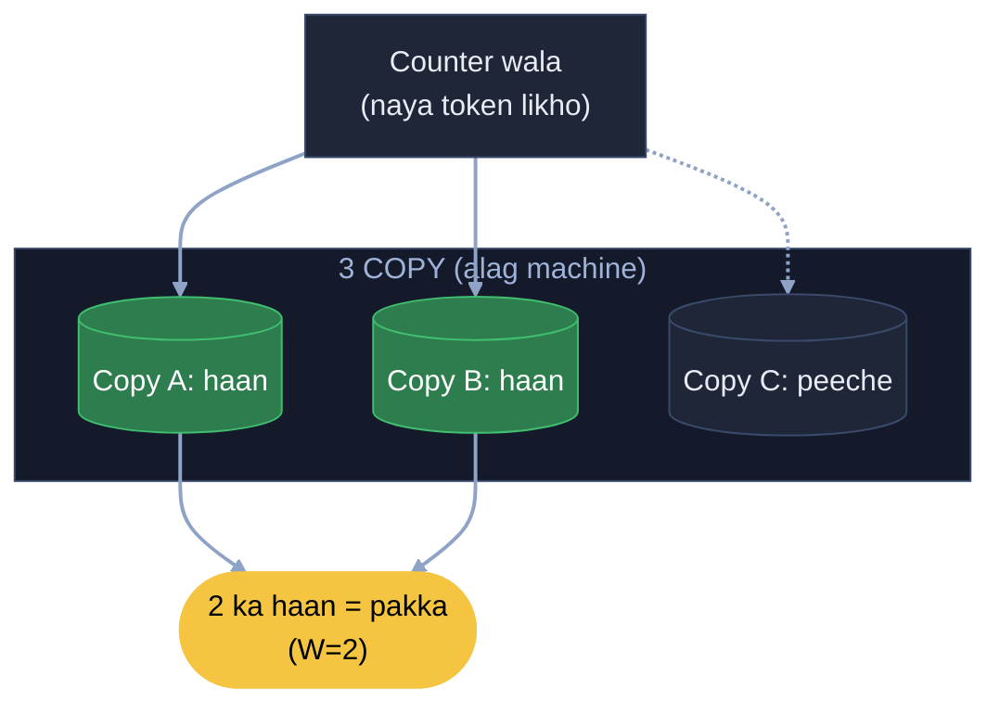

## 11. Dost ne C se padha, "nahi mila" (do se padhwao)

Teen copy A, B, C hain. Arpan ne naya token banaya, A aur B ne haan bola, C peeche reh gaya. Turant dost ne token
dikhaya, aur counter wale ne C se padha, "nahi mila". Humne do pe likha, to do se hi padhwao, single-single se nahi:
B aur C se, ya A aur C se. Ek copy peeche reh bhi gayi to atleast ek ke paas to hai, C nahi hai to B ke paas hai.

**Asli naam:** do se hi padhwao = R=2, ek ke paas to hai = W + R > 3, isliye ek copy hamesha common.

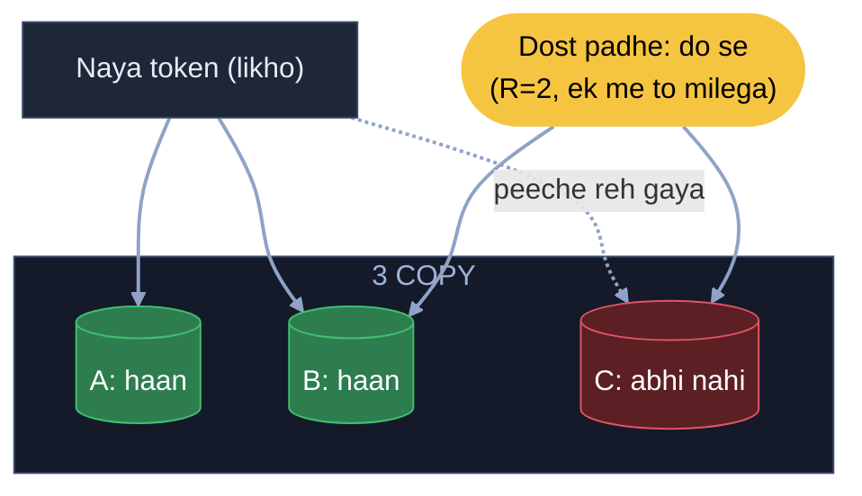

## 12. Cricket ka token viral (register ki photocopy + counter ki parchi)

Cricket match ka token viral, 1 crore log ek saath. Sab counter wale us token ke liye ek hi chhote register ki taraf
bhaag rahe, aur wo itna dheema ki uske baaki token bhi atke. Sabko wahi token chahiye, to ek hi register kyun? Uski
photocopy bana do aur divide kar do, 10 kar do, 100 kar do, bheed bat jaayegi.

**Asli naam:** chhote register ki photocopy, divide = Redis replica (garam key ki padhai copies me bant-ti).

**Maan lo copy 10 ho ya 100, par har baar counter wale ko kursi se uth ke register tak jaana padta, 1 crore log, 1
crore chakkar:** to counter wale ko bolo, ye information tu apne paas rakh le, baar-baar uth ke kyun ja raha. Ek
chhoti parchi pe uska token aur pata likh le aur kursi pe baith ja. Roz 100 log wahi information maangein aur wo
pachaas kadam door ho, to har baar wahan jaane ki jagah apne page pe likh lo. Ab koi poochhe to "le bhai, teri
information ye rahi", dobara kahin jaana hi nahi padta.
**Asli naam:** counter wala apne paas parchi rakhe = local cache (app server ki memory me garam link kuch second).

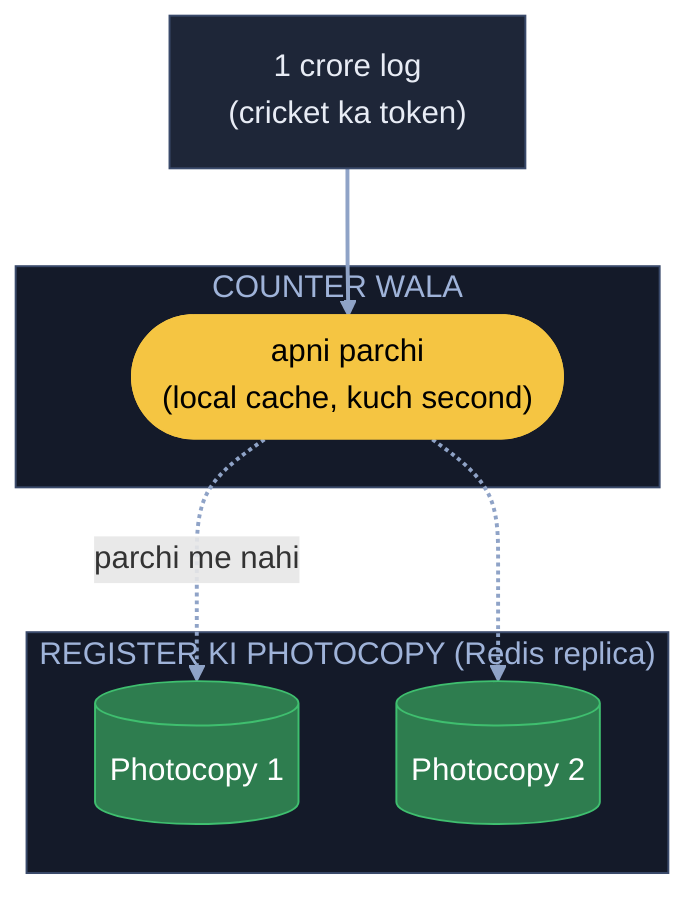

## 13. Dhokhe wala pata, log phone se seedha (token radd + phone me likhne mat do)

Kisi ka idea tha ki har aadmi pata apne phone me hi likh le, counter pe aaye hi nahi. Hafte baad pata chala ek token
ka pata dhokhe wali site ka hai, use band karna hai, par log seedha phone wale pate pe ja rahe. To token radd kar do,
ki ab wo galat site pe nahi jaayega. Aur aage se pehle hi dekh lo: user ko dene se pehle khud check karo ki jo wo bana
raha wo theek hai, galat ho to banane se hi mana kar do aur token radd.

**Asli naam:** token radd = code band (DB me "band" nishaan, aur chhote register se bhi hatao, warna TTL tak purana pata
deta rahega), dene se pehle khud check = kaali list
(Google Safe Browsing).

**Maan lo token radd kiya, par log counter pe aa hi nahi rahe, phone me likha pata seedha khol rahe:** pehla khayal:
unke phone ka cache radd kar do, to agli request seedha hamare paas aayegi. Par phone uske haath me hai, main use mita
nahi sakta. To phone pe likhne hi mat do. Likhega nahi to wo har baar hamare counter pe aayega, aur hum use theek
token de denge. Agar phone wali dikkat hai to uske phone me likhna hi mat do, saaf baat hai. Aam taur pe phone ke
cache ko TTL laga ke bhi invalidate kar sakte, par tab tak wo purana hi deta.
**Asli naam:** phone me likh le = 301 (browser cache, hamesha ke liye), phone me likhna hi mat do, har baar counter pe aaye = 302 + `Cache-Control: no-store` (save hi mat karna; 301
nahi; har click hamare paas, control hamare paas), phone cache pe TTL = browser cache ki umar.

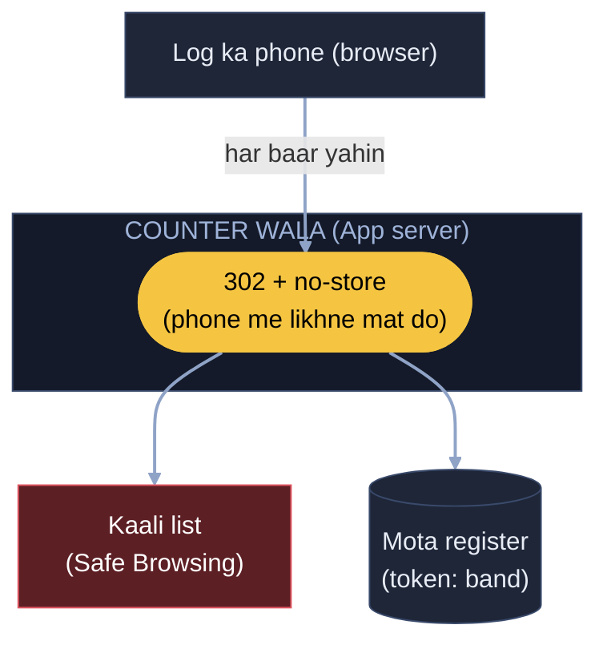

## 14. Machine se har second hazaar chit (gate pe bhaga do + har aadmi pe had)

Ek aadmi ne machine laga di, har second hazaar chit, sab nakli ya dhokhe wale pate. Counter ka number faltu khatam ho
raha, register bhar raha, aur asli log atke. To jaanch padtaal karo ki script lagi hai. Ek-do baar, teen baar, chaar
baar, phir pattern pata lag jaata ki ye banda har baar yahi drama karke chala jaata hai. To us bande ko rok do, kamre
me ghusne hi mat do, bahar gate pe hi bhaga do.

**Asli naam:** pattern pata lag jaayega, gate pe bhaga do = WAF block.

**Maan lo pakadne me 3-4 chakkar lagte, tab tak wo laakhon chit de chuka, to shuru se har aadmi ke liye kya niyam:**
yahan thoda pench hai. Had ek aadmi pe rakhenge, group pe nahi, kyunki ek office ke log ek hi WiFi se aate, sab asli
hain, unko token dena hai. To per user had: ye ek banda hai, ek baar me 5 hi lagayega, usse zyada nahi.
**Asli naam:** per user had, group pe nahi = rate limit user pe (IP pe nahi), office ka WiFi = ek IP ke peeche kai
asli user, 5 se zyada nahi = had paar pe 429.

**Maan lo bina login ke bhi link banta, script har second hazaar link bana rahi, userId hai hi nahi:** sabse pehle
login laga do, bina login link nahi, isse dashboard / tracking bhi chalega. Login nahi rakhna to tracking bhool ja, aur
IP pe had lagao: IP ki had thodi zyada, userId ki thodi kam. Script hazaar link nahi bana paayegi. Baar-baar aaye to IP
ban. Naye-naye IP se phir bhi aaye to peeche investigate karo, aur ek hi desh se aa raha to us desh ko thodi der WAF ki
block list me daal do.
**Asli naam:** login laga do = auth zaroori (tab userId pe had + tracking), bina login IP pe dheeli had = anonymous
rate limit per IP, IP ban, desh block = WAF block list / geo-block.

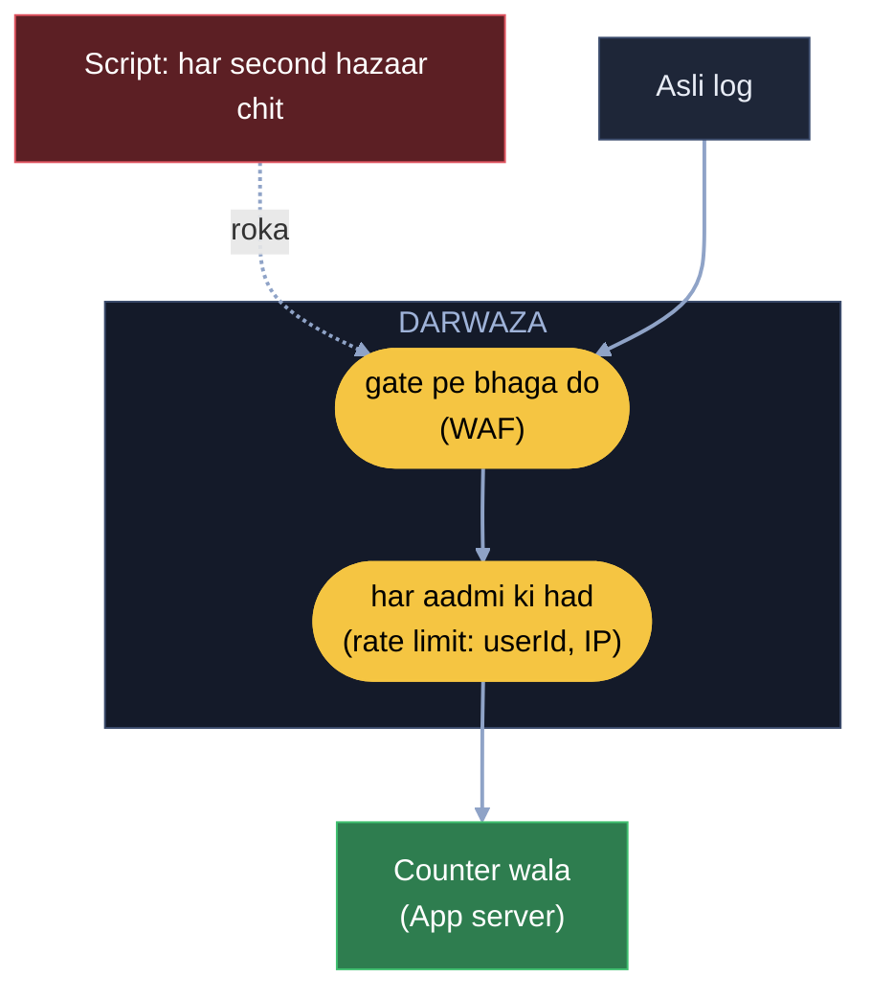

---

Notes (Arpan ke shabd) = [URL_HAND_NOTES.md](URL_HAND_NOTES.md)
