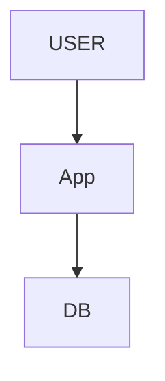
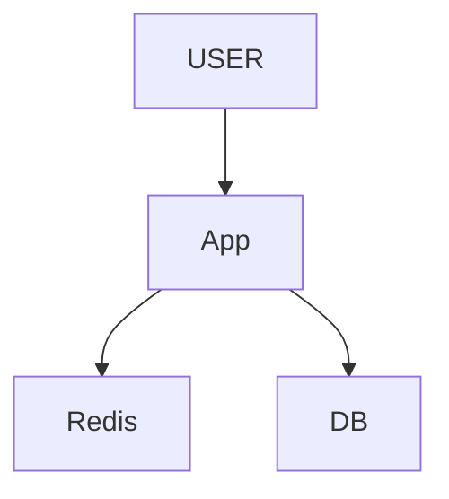
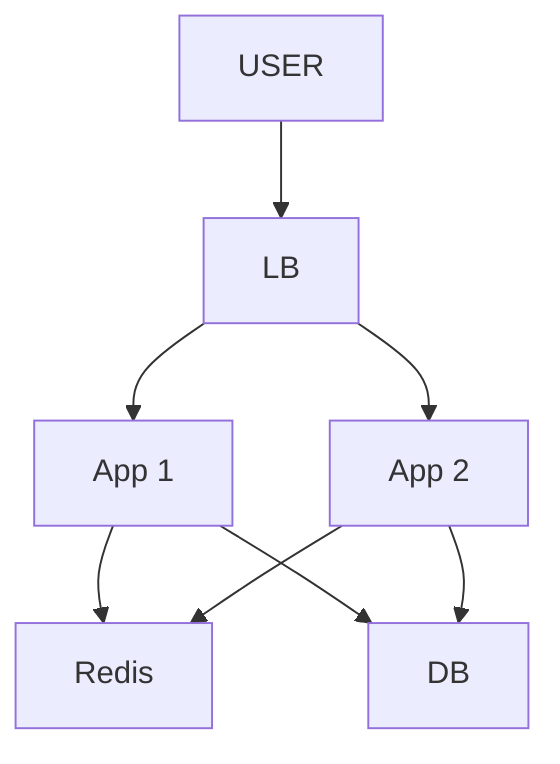
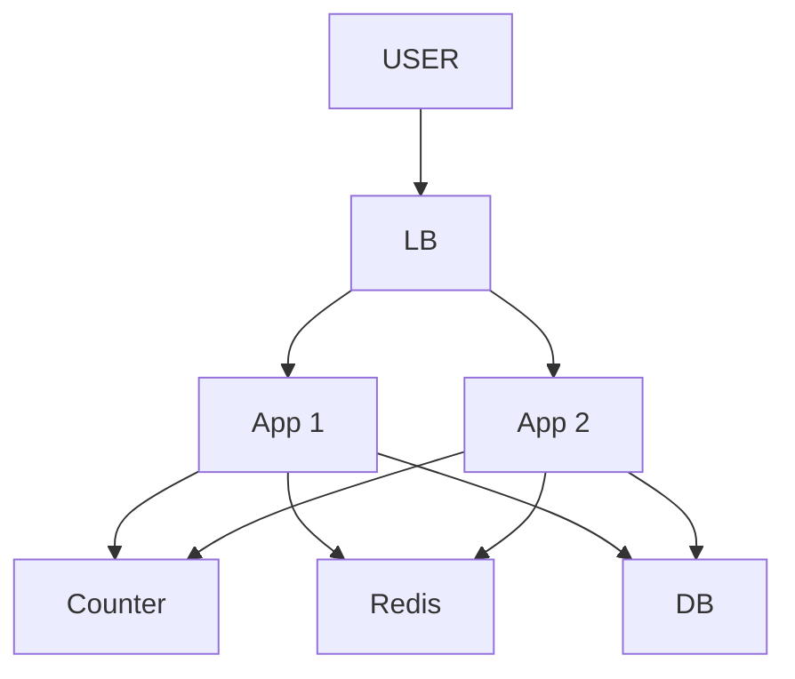
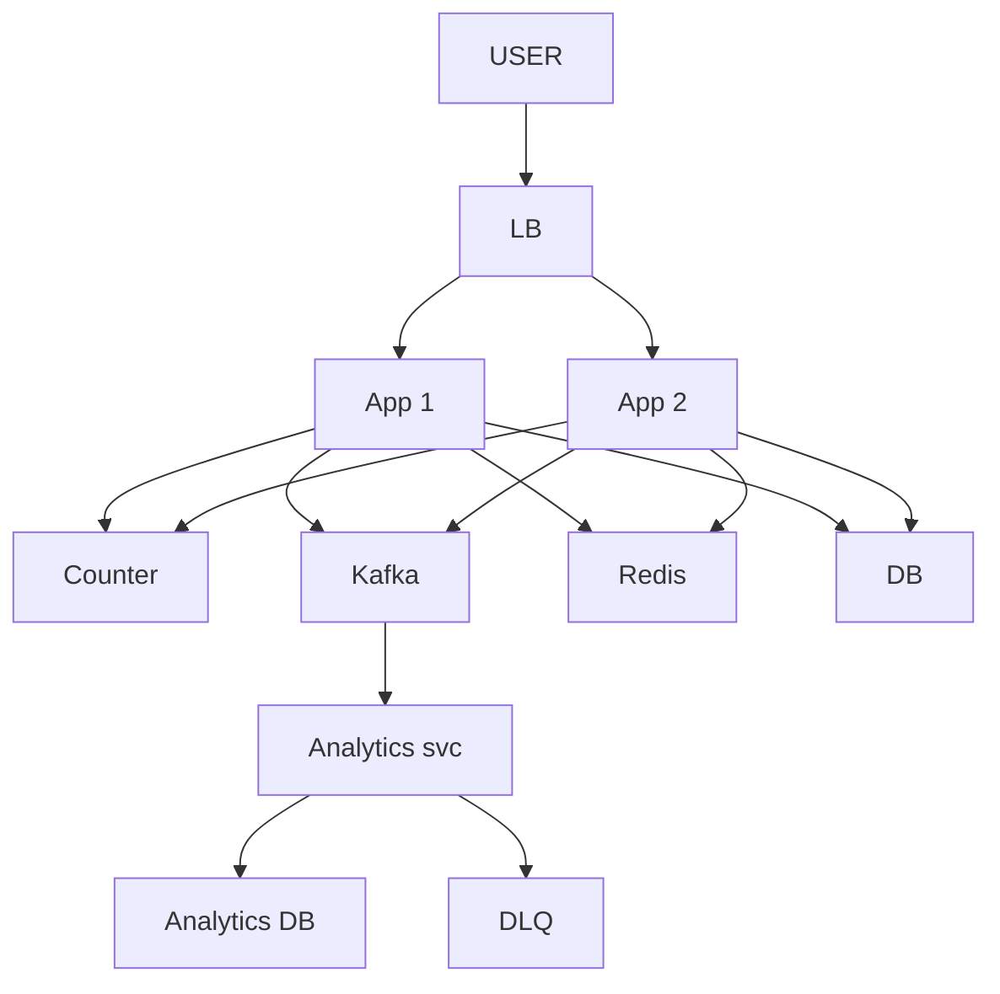
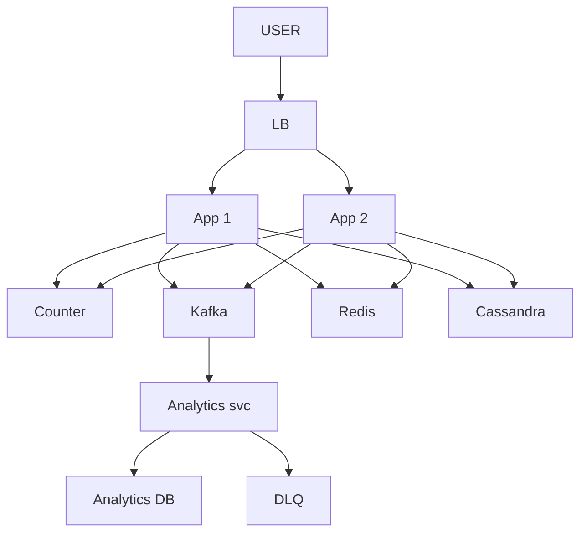
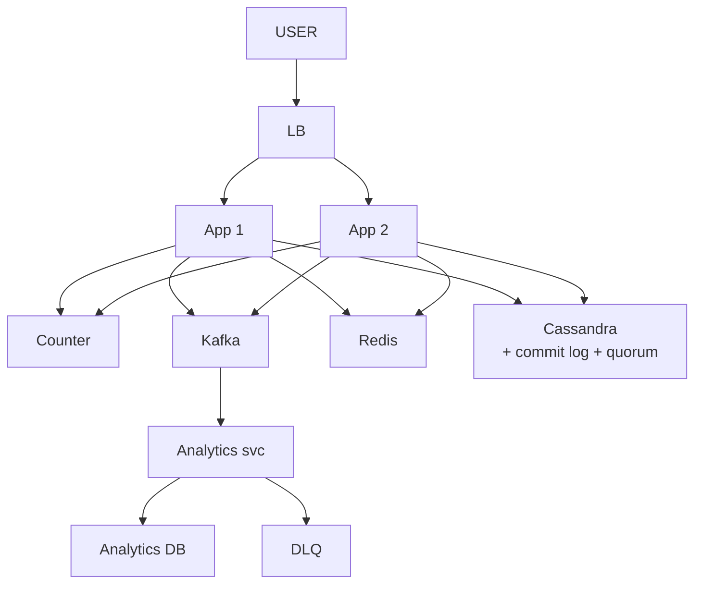
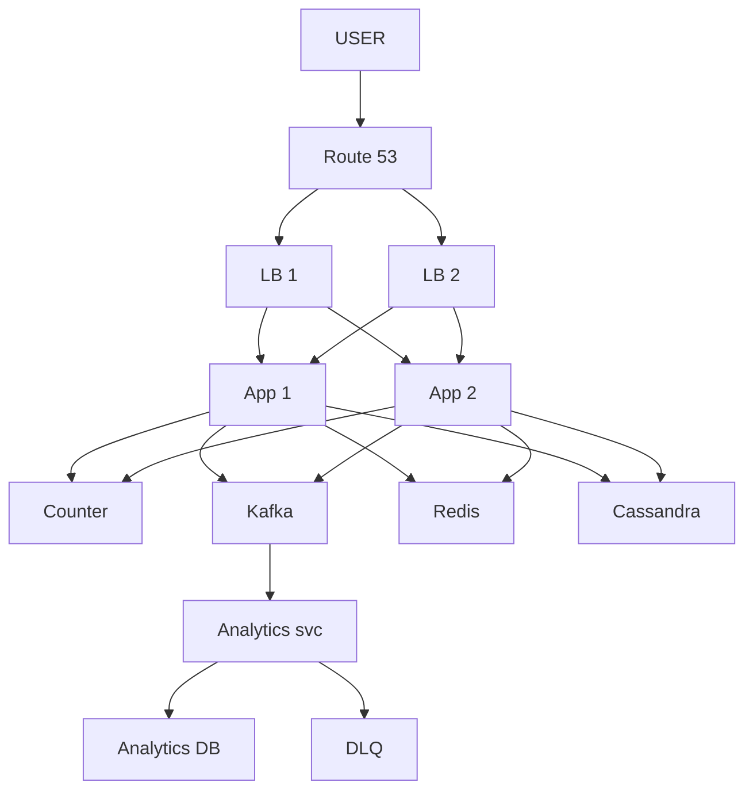
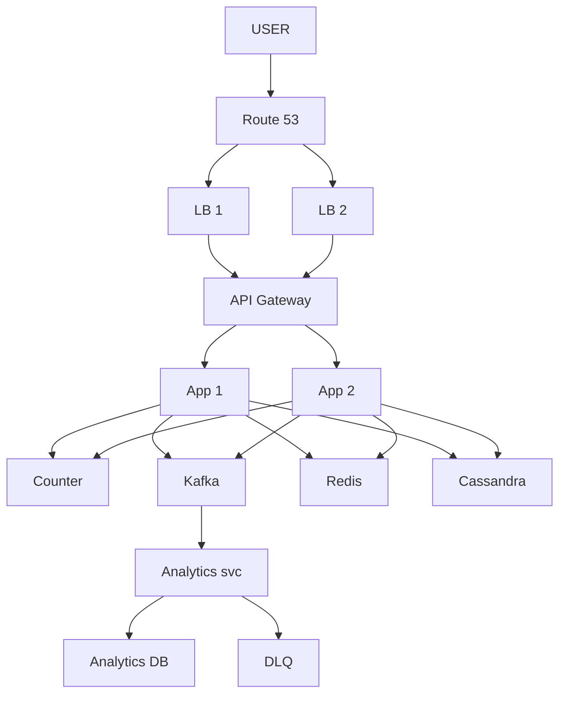

# URL Shortener

> Lamba link do -> chhota 7 akshar ka code milta hai. Koi chhote link pe click kare -> asli link pe bhej do (302 redirect).
> Is design ka dil do cheezein hain: **har link ka code ALAG (unique)** aur **click pe redirect bahut tez**, kyunki log link banate kam hain aur kholte bahut zyada (100 me se 99 baar kholna).

---

## TASVEER (ByteByteGo / Alex Xu · CC BY-NC-ND 4.0)


Source: [Explaining 5 Unique ID Generators](https://bytebytego.com/guides/explaining-5-unique-id-generators-in-distributed-systems/)
(Code kahan se aaye: UUID / Snowflake / DB ka auto-increment / range. Hamara code = ek number ko base62 me likhna.)

---

## SHURU: pehle poocho, phir numbers

```
POOCHO:  "Link banana, redirect, click ginna, apna khud ka code (custom alias), expiry — kis pe dhyaan dein?"
         -> zaroori: link banana + redirect. Click ki ginti chahiye. Bada analytics dashboard bahar.
            Custom code = time bache to.
         "Din me ~10 crore (100M) naye link, aur har link ~100 baar khulta hai — ye maan ke chalun?"
         kuch na pata ho -> "ye maine use nahi kiya" bolna theek hai, interviewer khud bata dega.

ZAROORI KAAM (FR):   lamba -> chhota banao · chhote pe click -> asli pe bhejo
KAISA CHALE (NFR):   redirect 200 ms se tez · hamesha chalu · padhna >> likhna · code kabhi dohraaye nahi
                     ("aage ka har faisla inhi 4 me se kisi ek se judega")

NUMBERS (andaaza, calculator nahi):
   naye link:  10 crore / din. Din me ~1 lakh second hote hain -> ~1,000 naye link har second.
   click:      har link ~100 baar khulta -> ~1 lakh click har second.
   jagah:      ek link ~500 byte. 5 saal me ~180 arab link -> ~90 TB.
   code:       62 akshar, 7 jagah -> 62 x 62 x ... (7 baar) = ~3.5 lakh crore code -> 100+ saal chal jaayega.

NUMBER SE FAISLA:
   click >> naye link (100 : 1)   -> CACHE lagega
   90 TB                          -> ek machine me nahi aayega, SHARD karna padega
   7 akshar                       -> code kitna lamba ho, ye jhagda khatam
   Agar interviewer chhota maane (1 arab link = ~500 GB) -> ek hi DB me aa jaata, shard ki zaroorat nahi.
   Estimate chhodna mat, par exact ganit me mat atakna. Din
   ka maana to poora din ka hi rakho, mahine se mat milao.

KYUN CHAHIYE:  Twitter / SMS me jagah kam · marketing me kis link se kitne aaye · QR / print · saaf dikhta
```

---

## ════ MOCK SE PEHLE: SIRF YE CARD PADHO ════

> Har card: DIKKAT 1 (kya toota) -> HAL (kya kiya) -> diagram -> DIKKAT 2, 3 ... (interviewer ke
> agle sawaal) har ek ke neeche uska HAL. Revise: sirf baayein column padho.

#### DABBA 0: SABSE SIMPLE (yahan se shuru, phir "kahan tootega")
```
User link deta -> App ek code banata -> DB me (code, lamba link) save.
Click aaya -> App DB me code dhoondhta -> asli link pe bhej deta.
```


#### 0 SHURU: CODE KAISE BANE (dil ka hissa)
```
DIKKAT 1   User ne diya "https://amazon.in/....../bahut-lamba-link". Use chahiye "bit.ly/w7e".
           Har link ka code alag hona chahiye, warna do link ek hi jagah khulenge.
HAL        Ek ginti (counter) rakho: 1, 2, 3 ... Har naye link ko agla number do, aur us number ko
           BASE62 me likh do. Wahi code hai.

           Base62 = 62 akshar: 0-9 (10) + a-z (26) + A-Z (26).
           Number ko baar-baar 62 se bhaag do, jo bachta (remainder) wo ek akshar, aakhir me ulta padho.
           Misaal: 125 = 2 x 62 + 1 -> "21".   100 crore -> "15FTGg" (6 akshar).
           Counter kabhi dohraata nahi -> code kabhi dohraata nahi. Check karne ki zaroorat hi nahi.
```
```
DIKKAT 2   Counter kyun, lambe link ka MD5 / random code kyun nahi?
HAL        MD5 / random me do link ka code same aa sakta hai.
           Har baar DB se poochna padega "ye code pehle se hai?"
           Counter me ye dikkat hi nahi.

DIKKAT 3   Counter se code ka andaza nahi lag jaayega? (abc124 ke baad abc125)
HAL        Haan, ye keemat hai. Chahiye to number ko pehle shuffle
           / XOR karo, phir base62. Phir bhi unique rahega.

DIKKAT 4   User apna code maange ("bit.ly/arpan")?
HAL        Check karo: lambai theek, "admin" / "login" jaisa reserved shabd nahi, pehle se liya hua nahi.
           Do log ek saath same code maangein -> DB me UNIQUE rule, ek ko 409 (pehle se hai).

DIKKAT 5   Redirect 301 dein ya 302?
HAL        302. 301 pe browser link yaad kar leta hai, agli baar server tak aata hi nahi.
           Tab click gin nahi paate aur expiry bhi kaam nahi karti.
```

#### 1 HAR CLICK DB PE, REDIRECT 200 MS SE TEZ CHAHIYE
```
DIKKAT 1   Ek second me 1 lakh click aa rahe hain. Har click DB tak ja raha hai, aur DB disk se padhta hai.
           DB pe bojh badhta gaya, redirect dheema hua. Ek viral link pe to DB hi baith gaya.
HAL        DB ke aage REDIS (cache). Click aaya -> pehle Redis dekho.
           Mila -> wahi se bhej do. Nahi mila -> DB se laao, Redis me rakh do, phir bhejo.
           (Isi ko cache-aside kehte hain.)
           Redis me link ki expiry (TTL) wahi rakho jo link ki hai.
           Redis RAM me rakhta hai, ek milisecond se kam me jawab. DB disk se padhta hai, kai milisecond.
           Log zyadatar wahi link baar-baar kholte hain -> ~100 me se 95 click Redis se hi nikal jaate.
           DB bach gaya.
```

```
DIKKAT 2   Redis me saare 180 arab link rakhoge?
HAL        Nahi, sirf jo abhi garam (zyada khul rahe) hain. Jagah bhar gayi to jo link sabse der se nahi
           khula use nikaalo (LRU). Wo baad me khula to DB se wapas aa jaayega.

DIKKAT 3   Link delete / expire ho gaya, par Redis me abhi pada hai?
HAL        Expiry pe Redis khud hata deta hai. Delete pe pehle DB se hatao, phir Redis se.

DIKKAT 4   Redis hi gir gaya?
HAL        Wo 95% click ek saath DB pe girenge, DB bhi gir sakta
           hai. Isliye Redis ki bhi copies (cluster + replica).
           Phir bhi gira to kuch request mana karo (load shedding), aur garam link ko sirf EK request
           DB se laaye, baaki ruke. "kuch nahi hoga" kabhi mat bolna.

DIKKAT 5   DB ki read copy (replica) kyun nahi, ya har App apna cache rakhe?
HAL        Replica bhi disk se padhti hai, dheemi. Har App ka apna cache = sabke paas alag copy, link badla
           to kisi App pe purana dikhta rahega.
```

#### 2 EK APP 1 LAKH / SEC NAHI JHELTA, GIRA TO SITE BAND
```
DIKKAT 1   Saari request ek hi App machine pe. Bojh se wo dheema hua, aur ek din
           wahi gir gaya -> poori site band.
           Ek cheez jiske girne se sab ruk jaaye, use SPOF (single point of failure) kehte hain.
HAL        Ek ki jagah kai app server, aur koi bhi server user ka kuch yaad nahi rakhta (sab Redis / DB me).
           Isliye koi bhi request kisi bhi server pe jaa sakti hai.
           Aage load balancer baitha hai. Wo har kuch second me har server se poochhta 'zinda ho?'. Jo jawab
           na de ya dheema ho, usko list se hata deta, request baaki servers pe jaati hain.
           LB request baari-baari bhejta hai (round-robin), ya jiske paas kam kaam hai use (least-conn).
           Har ~5 second LB har machine se poochta hai "zinda ho?" (GET /health).
           Jawab nahi aaya -> us machine ko list se hata do. Theek hui -> wapas jod do.
```

```
DIKKAT 2   Stateless kyun zaroori hai?
HAL        Agar user ki baat App-1 ki memory me hai aur agli request App-2 pe
           gayi, to App-2 ko kuch pata nahi.
           Sab Redis / DB me ho to koi bhi machine koi bhi request le sakti hai.

DIKKAT 3   Ek bahut badi machine le lo (vertical scale)?
HAL        Uski bhi ek had hai, aur wo akeli hai -> phir wahi gire to sab band.

DIKKAT 4   Machine mari nahi, bas dheemi hai?
HAL        LB jawab ka time aur galtiyon ki ginti bhi dekhta hai. Least-conn khud usko kam bhejta hai.
```

#### 3 KAI APP, DO APP EK HI CODE BANA DENGE
```
DIKKAT 1   Ab App ki 2 machine hain, dono apna-apna counter chala rahi hain.
           App-1 ka counter 5 pe hai, App-2 ka bhi 5 pe. Dono ne naya link banaya -> dono ka
           number 6 -> dono ka code same.
           Do alag link, ek hi code. Ise COLLISION kehte hain.
HAL        Ek COUNTER service (ZooKeeper ya DB ki ek table) har App ko numbers
           ka ALAG thaila (range) deti hai.
           App-1 ko 1 se 1000, App-2 ko 1001 se 2000. Dono ke number kabhi takrayenge hi nahi.
           App apne thaile me se khud ginta rehta hai. Counter service se baat sirf tab, jab thaila khatam ho.
           Matlab har link pe network call nahi, 1000 link me ek baar.
```

```
DIKKAT 2   App-1 number 400 pe crash ho gaya. 401 se 1000 ka kya?
HAL        Wo bekaar gaye, aur ye jaan-boojh ke maana hai. 3.5 lakh crore code hain,
           kuch hazaar jaane se farak nahi.
           Har number bachana ho to har link pe coordination lagega, range ka fayda hi khatam.

DIKKAT 3   Counter service khud gir gayi?
HAL        App ke paas abhi apna thaila (1000 number) bacha hai, kaam chalta rehta hai.
           Tab tak counter ki doosri copy uth jaati hai.

DIKKAT 4   Redis ka INCR (ek-ek badhao) kyun nahi?
HAL        Chal jaata, par har link pe ek call. Range me 1000 link pe ek call.
```

#### 4 HAR CLICK PE ANALYTICS LIKHNA
```
DIKKAT 1   User ne click kiya. Usi request me hum "click hua" analytics DB me likhne lage, phir redirect kiya.
           Analytics DB dheema tha -> user ko redirect ke liye rukna pada. Yahan har milisecond keemti hai.
HAL        Redirect turant user ko bhej deta (302), aur saath me 'ek click hua' ki khabar Kafka me daal
           deta. Click ginne wali service peeche se aaram se padhti.
           Ek hi click do baar aa jaaye to click id dekh ke doosri baar nahi ginti. Koi khabar baar-baar
           fail ho to alag line (DLQ) me, taaki baaki atke nahi.
           Kafka band ho gaya to bhi redirect chalta rahega, bas kuch click ginti me nahi aayenge.
           Kafka ek diary jaisa hai: disk pe likha jaata hai, App bas aakhri
                                     page pe likh ke aage badh jaata hai.
           Analytics service yaad rakhti hai kahan tak padha (offset). Crash hui to wahin se dobara.
           Ek kharab khabar DLQ me chali jaati hai, baaki line nahi rukti.
```

```
DIKKAT 2   App ke andar hi peeche ek thread se likh do?
HAL        App crash = memory me padi khabarein gayi. Kafka disk pe hai, aur purane
           click dobara padh bhi sakte hain.

DIKKAT 3   Kafka kyun, SQS kyun nahi?
HAL        SQS bhi chal jaata. Kafka isliye ki click bahut zyada hain, aur naya report banana ho to purane
           click dobara padh sakte hain (replay). SQS padhne ke baad message hata deta hai.
```

#### 5 5 SAAL KA ~90 TB EK MACHINE ME NAHI
```
DIKKAT 1   10 crore link roz, 5 saal -> ~180 arab link, ~90 TB. Itna ek machine me nahi aata.
           Aur wo ek machine mari to saare link gaye.
HAL        Data ko tukdon me baanto, short code ke hisaab se. 'abc' wala link hamesha ek hi tukde pe, to
           redirect ko pata hai kahan dhoondhna.
           Har tukde ki 3 copy, alag-alag building me, taaki ek gire to bhi data rahe.
           Click hamesha code ke saath aata hai (GET /abc123).
           Code se seedha pata chal jaata hai kaunsi machine.
           RING: ek gol ghadi socho. Machines ghadi pe kahin-kahin baithi hain,
           har code bhi ghadi pe ek jagah.
           Code ghadi ki disha me chalta hai, jo pehli machine mile wahi uski.
           Nayi machine aayi -> sirf uske theek peeche wale codes usko jaate, baaki apni jagah.
           (Agar "code % machine ki ginti" karte, to 3 se 4
           machine hote hi lagbhag har code ki jagah badal jaati.)
```

```
DIKKAT 2   Country ya date ke hisaab se kyun nahi baanta?
HAL        Ek country / aaj ka din garam ho jaata, ek machine pe saara bojh.
           Aur code dekh ke pata hi nahi kis country ka -> saari machine poochni padti.

DIKKAT 3   Copies (replica) badha do, likhna bhi tez ho jaayega?
HAL        Nahi. Har copy pe likhna to padta hi hai. Likhne ka bojh baantna = SHARD.
           Copy = bachav + padhne ka bojh.

DIKKAT 4   Ek machine pe zyada code aa gaye?
HAL        Har machine ko ghadi pe 100-200 jagah baitha do (virtual nodes) -> bojh barabar bat jaata.

DIKKAT 5   Ek link viral, uski machine garam?
HAL        Wo link Redis se hi nikal jaata, machine tak kam aata.

DIKKAT 6   Cassandra kyun, MySQL kyun nahi?
HAL        Join / transaction chahiye hi nahi, bas "code se link nikaalo" + 90 TB.
           Wajah = kaam ka dhaancha + size. "NoSQL zyada powerful" wajah nahi.
           Chhota maana (~500 GB) to ek MySQL kaafi, shard bhi nahi.
```

#### 6 WRITE KE BEECH EK COPY WALA NODE GIRA
```
DIKKAT 1   User ne link banaya. Cassandra use 3 copy me likh raha tha, aur beech me
           ek copy wali machine gir gayi.
           Jo likh diya, wo khona nahi chahiye.
HAL        DB koi bhi cheez likhne se pehle apni diary (commit log) me note karta, phir data me daalta. Gira
           aur utha to diary dekh ke poora kar leta.
           Aur ek link tab hi 'save ho gaya' maana jaata jab 3 me se kam se kam 2 copy ne likh liya. Ek
           machine giri to baaki do ke paas wo link hai.
           Us beech redirect waise bhi Redis se chal rahe hain.
           Machine wapas uthi -> apni diary padh ke jo adhoora tha wo poora kar leti hai.
           2 copy me pehle se hai -> ek gire to bhi data bacha.
```

```
DIKKAT 2   2 ka hi intezaar kyun, teeno ka kyun nahi?
HAL        Teeno ka intezaar = ek dheemi machine sabko dheema kar degi. 2 me ek gire tab bhi likh sakte.

DIKKAT 3   2 machine gir gayi?
HAL        2 haan nahi milenge -> likhna fail (ya 1 pe likh lo, risk ke saath). Click
           tab tak Redis se chalte rahenge.

DIKKAT 4   Kafka laga do data bachane ke liye?
HAL        Nahi. Ye DB ki apni diary ka kaam hai, extra dabba mat lagao.
```

#### 7 NAYA LINK BANAYA, TURANT CLICK -> 404
```
DIKKAT 1   Tune link banaya. Cassandra har link ko 3 jagah rakhta hai: copy A, copy B, copy C.
           Likhte waqt link A aur B me pahunch gaya, C tak pahunchne me thoda time lagta (aam taur pe
           milisecond, bheed me second tak).
           Isi beech tune click kiya, aur request C pe gayi. C bola "ye link mere paas nahi" -> 404.
HAL        Raasta 1 (aasaan wala):
           Link banate hi Redis me bhi daal do. Click sabse pehle Redis dekhta hai, wahan link mil jaata hai.
           C tak jaana hi nahi padta.

           Raasta 2 (DB ke andar wala):
           Likhte waqt tabhi "ho gaya" bolo jab link 2 copy me likh jaaye.
           Padhte waqt bhi 2 copy se poochho.
           Kyun chalta:
           Link likha A aur B me. Ab padhte waqt koi bhi 2 copy uthao: A+C, B+C ya A+B.
           Har jodi me A ya B me se ek to aayegi hi, aur usme naya link hai. Khaali haath kabhi nahi lautoge.
           Isi ko QUORUM kehte hain: "2 me likha + 2 se padha" -> dono me ek copy common pakki.
```

```
DIKKAT 2   Tez karne ke liye sirf 1 copy se padh lo?
HAL        Wo 1 copy C ho sakti hai, jisme abhi link aaya hi nahi -> phir 404.

DIKKAT 3   2 copy se padhna dheema nahi hoga?
HAL        Haan, thoda. Isliye pehla ilaaj Redis hai: zyada click Redis se hi nikal jaate.

DIKKAT 4   Cassandra me koi "main copy" hoti hai?
HAL        Nahi. Teeno copy barabar hain, koi bhi likh sakti hai aur koi bhi padh sakti hai.
```

#### 8 LB KHUD GIR GAYA
```
DIKKAT 1   App, Redis, DB sab zinda hain. Par sabko request baantne wala Load Balancer hi mar gaya.
           Ab koi request andar aa hi nahi rahi -> site band.
HAL        Do LB rakho, aur unke aage ROUTE 53 (AWS ka DNS) jo dekhta rahe kaunsa LB zinda hai.
           Ek mara -> sab request doosre pe. Poora region (shehar ka data center) gaya -> doosre region pe.
           Route 53 har ~30 second har LB se poochta hai "zinda ho?".
           3 baar jawab nahi -> us LB ka pata (IP) user ko dena band kar deta hai.
```

```
DIKKAT 2   Switch turant ho jaata hai?
HAL        Nahi. User ka phone purana pata ~60 second yaad rakhta hai (DNS TTL),
           tab tak kuch log purane LB pe.
           Isliye cloud me LB khud kai data center me phaila hota hai (AWS ALB).

DIKKAT 3   Poora region gaya, to naye link ka kya?
HAL        Doosre region me data thoda peeche-peeche copy hota hai. Aakhri kuch
           second ke naye link kho sakte hain.
           Ye maana hua risk hai.
```

#### 9 SCRIPT SE RAAT ME 10 LAKH LINK
```
DIKKAT 1   Ek bande ne script likh di, raat bhar me 10 lakh link bana diye.
           Counter ke number tez khatam hue, DB me kachra bhar gaya, asli users ke liye dheema.
HAL        Darwaze (API gateway) pe hi rok: har user / IP kitni baar link bana sakta,
           uski had. Login check bhi wahin.
           Uske bhi aage WAF jo jaane-pehchaane hamle rokta.
           Aur lamba URL chhota karne se pehle check karo ki wo virus / dhokhe wali site to nahi, warna
           hamara chhota link bura kaam karega.
           Ginti ek hi jagah honi chahiye. Har App apni alag gine to banda har App pe limit tak bana lega.
           Isliye ginti ek shared Redis me (INCR + expiry), sab gateway wahi dekhte hain.
```

```
DIKKAT 2   Gateway ki kai machine hain, ginti kahan?
HAL        Shared Redis me, sab ek hi ginti dekhein. (Poora design = 02_rate_limiter.)

DIKKAT 3   Bot har baar naye IP se aa raha?
HAL        IP pe nahi, API key / user_id pe limit, aur WAF ke bot rules.
```

```
AAKHRI DABBE (sab dikkat ke baad):
  User -> Route 53 -> 2 LB -> API Gateway (rate limit + login) -> App (stateless)
  -> Redis (95% click yahin se, expiry = link ki expiry) -> Cassandra (code se baanta, har tukde ki 3 copy)
  NAYA LINK:  Counter ka thaila + base62 -> Redis + Cassandra me likho
  CLICK:      Redis / Cassandra se link -> 302. Click ki khabar ->
              Kafka -> Analytics (fail -> DLQ), redirect ruke bina

DB KYUN:  Cassandra / DynamoDB -> join nahi, transaction nahi, ek code se ek link, 90 TB.
          Wajah = kaam ka dhaancha + size, "NoSQL powerful" nahi. Redis sirf cache.

END ME POOCHEGA:
  "10 guna traffic?"        -> App machine badhao · padhne aur likhne wale
  App alag · Redis me garam link (LRU + expiry) · Cassandra aur baanto
  "Kahan se sab gir sakta?" -> LB (2 copy) · Counter (2 copy, ek chalu ek taiyaar) · Route 53 health check
  "Chal raha hai, kaise pata?" -> redirect ka time (p99) · galtiyon ki ginti · Kafka me kitna pending · alert
  "301 ya 302?"             -> 302: har click server tak
  aata, gin paate. 301 pe browser yaad kar leta, click gaya
```

AAKHRI DABBE ki tasveer:


---

## 10 GUNA TRAFFIC — har dabba alag se

```
Route 53    -> user ko uske paas wale region pe bhejo (geo-routing)
App         -> stateless hai, machine badhao. Padhne aur likhne wale App alag rakho
               (100 : 1 -> jaise padhne ke 20, likhne ke 2; ek gire to doosra chale)
Redis       -> saare link nahi samaate. Garam rakho, thande nikaalo (LRU + expiry).
               viral gaana / WhatsApp forward = garam, Redis me. Log kholna band = thanda, bahar
               (Cassandra me to hai hi, agli baar khula to wapas aa jaayega)
Cassandra   -> code se baanto + har tukde ki 3 copy. Koi "main copy" nahi, har copy padh / likh sakti hai.
               padhne ka bojh badha = aur machine / copy
Counter     -> ye bhi gir sakta hai -> 2 copy (ek chalu,
ek taiyaar). Range waise bhi thodi der chala leti hai.
Kafka       -> partition badhao

BAANTNA CODE SE, COUNTRY SE NAHI:
   click hamesha code ke saath aata hai -> code se seedha ek machine
   country se baanta -> code dekh ke pata nahi kis country ka -> saari machine poochni padti
   country / region ka kaam = user ke paas data rakhna (jaldi
   jawab), data baantna nahi. Dono saath chal sakte hain.
```

---

## POOCHE TO (gehra sawaal aaye tab)

Jo poochhe wahi kholo, sab ek saath mat bol dena.

```
API:      link banana = POST /api/shorten { long_url, custom_code? } -> { short_url, expires_at }
          link kholna = GET /abc123 -> 302 + Location: <lamba link>
          (ulta mat bolna: banana POST, kholna GET)

ROW:      short_code (isi se machine tay hoti hai) · long_url · created_at · expires_at
          GET /abc123 -> seedha ek machine, ek row

KAUNSA DB, KITNE TAK:
          MySQL ~1 arab row tak aaram se · Mongo ~10 arab tak · Cassandra / DynamoDB isse bahut aage
          Redis sirf cache, hamesha saath. Faisla = kaam ka dhaancha + size.

COUNTER KE 3 TAREEKE:
          DB me ek-ek badhao  -> har link pe DB, dheema
          Redis INCR          -> har link pe ek call
          RANGE (thaila)      -> 1000 link pe ek call   <- YAHI

SHABD BHOOL JAO TO SEEDHI BAAT BOLO (atko mat):
          "MD5" yaad nahi   -> "lambe link ka hash lo, uske pehle 7 akshar"
          "Base62" yaad nahi -> "62 akshar hain (0-9, a-z, A-Z),
          number ko unme likh do, chhoti string ban jaati"
          "Counter" yaad nahi -> "ek badhta hua number, har link ko agla"
          interviewer ko shabd nahi, samajh chahiye. Naam wo khud bol dega.
```

---

## AAKHRI DABBA + WRAP

```
Route 53 = kaunsa LB zinda + kaunsa region · API Gateway = rate limit + login · LB = 2 copy · App = stateless
Counter = thaila + base62 · Redis = 95% click, expiry = link ki
expiry · Cassandra = code se baanta + 3 copy + 2 me likha 2 se padha
Kafka = click ki ginti peeche se, fail -> DLQ
```
```
CLICK:     LB -> App -> Redis me mila? -> 302 · nahi mila -> Cassandra
           -> Redis me rakho -> 302 · click ki khabar -> Kafka
NAYA LINK: LB -> App -> thaile se agla number -> base62 (123456
           -> "w7e") -> Redis + Cassandra -> chhota link wapas
```
```
JAWAB:    Short code = ek badhta number, jise 62 akshar (a-z, A-Z, 0-9) me likha. Har server ko numbers
          ki apni range milti, to do server kabhi same code nahi banate.
          100 me 1 baar link banta, 99 baar khulta. Isliye khulna zyadatar Redis se, baaki Cassandra se
          (short code se baanta, har tukde ki 3 copy).
          Redirect turant, click ki ginti peeche Kafka se. Do load balancer + Route 53, taaki koi ek
          gire to sab na gire. Darwaze pe had.
          Aage: apna naam wala link, purane link hatana, doosre desh me copy.
```

ARCHETYPE F (infra/component) · CONCEPTS: [ID-gen](../../FOUNDATIONS/13_distributed_id_snowflake.md) · [caching](../../FOUNDATIONS/04_caching.md) · [sharding](../../FOUNDATIONS/06_database_sharding.md) · [← MASTER SHEET](../../00_MASTER_SHEET.md)
