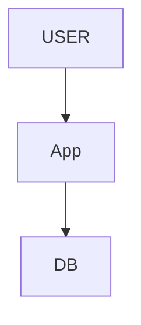
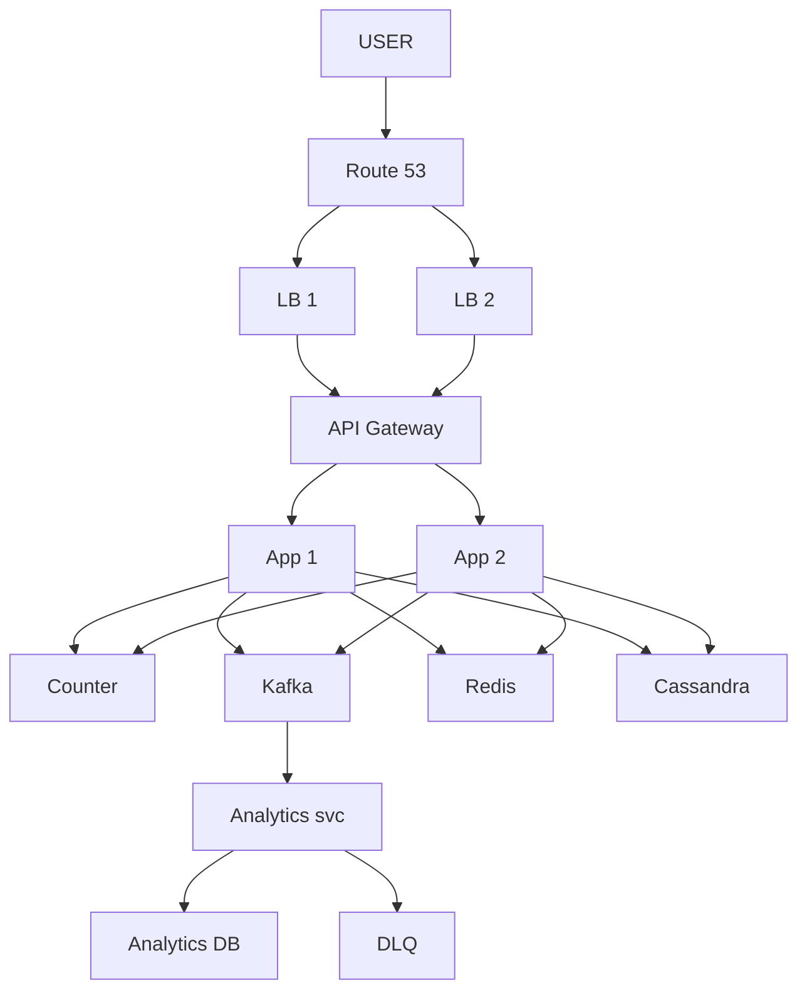
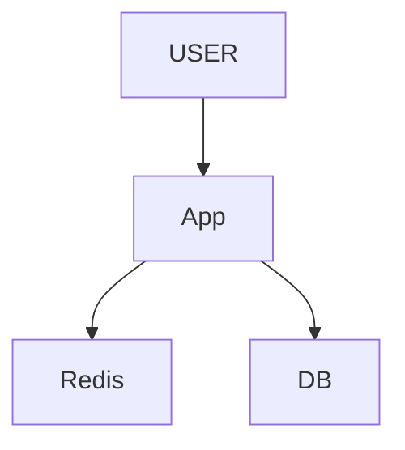
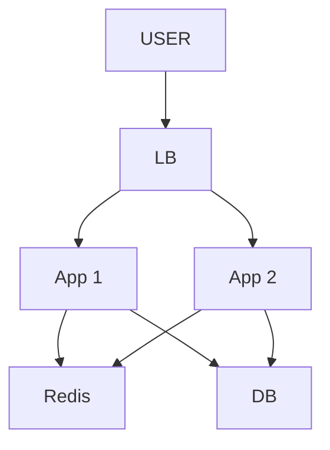
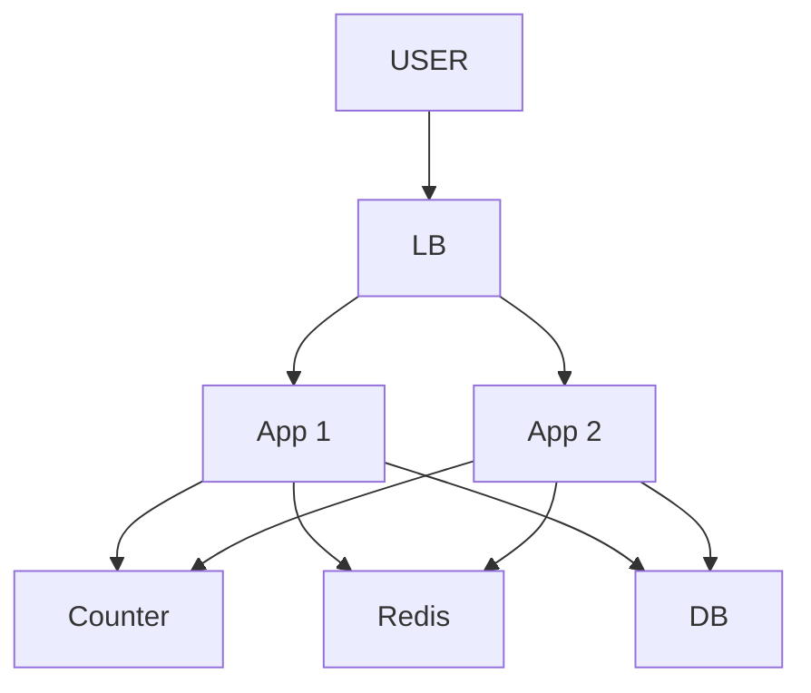
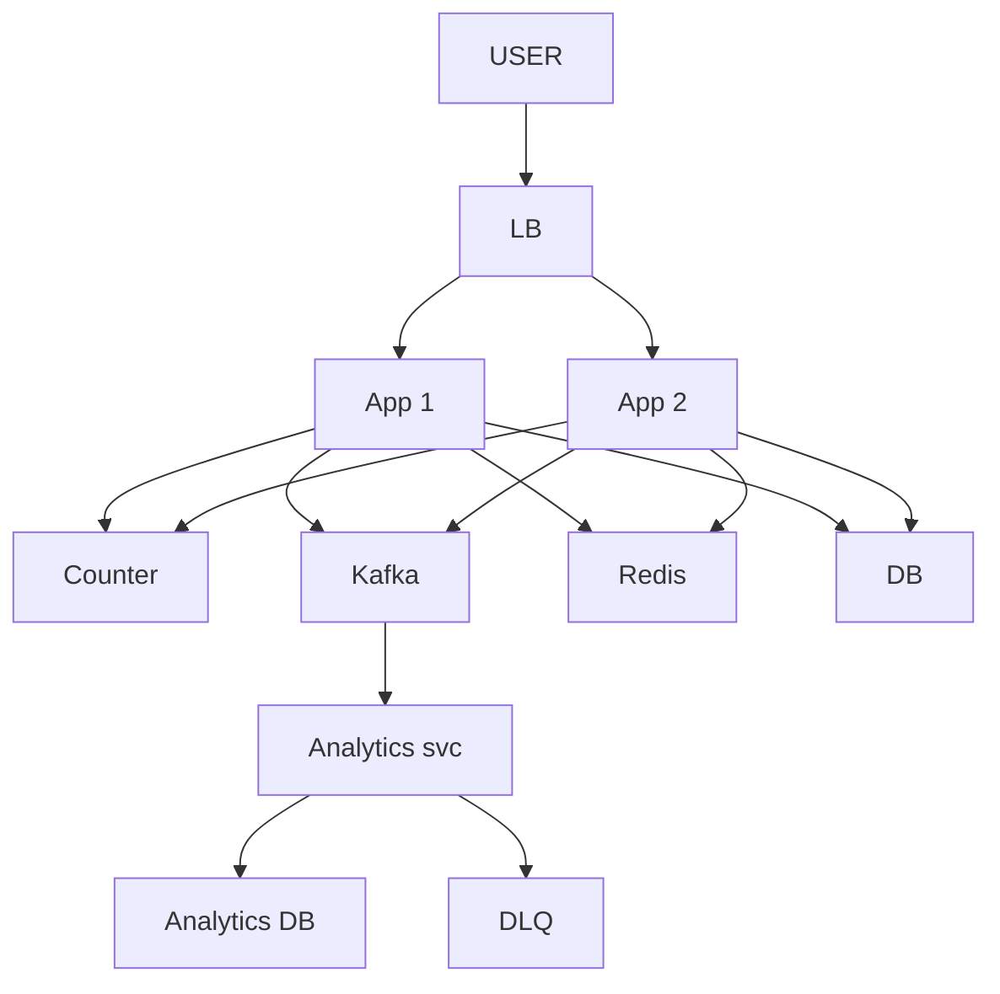
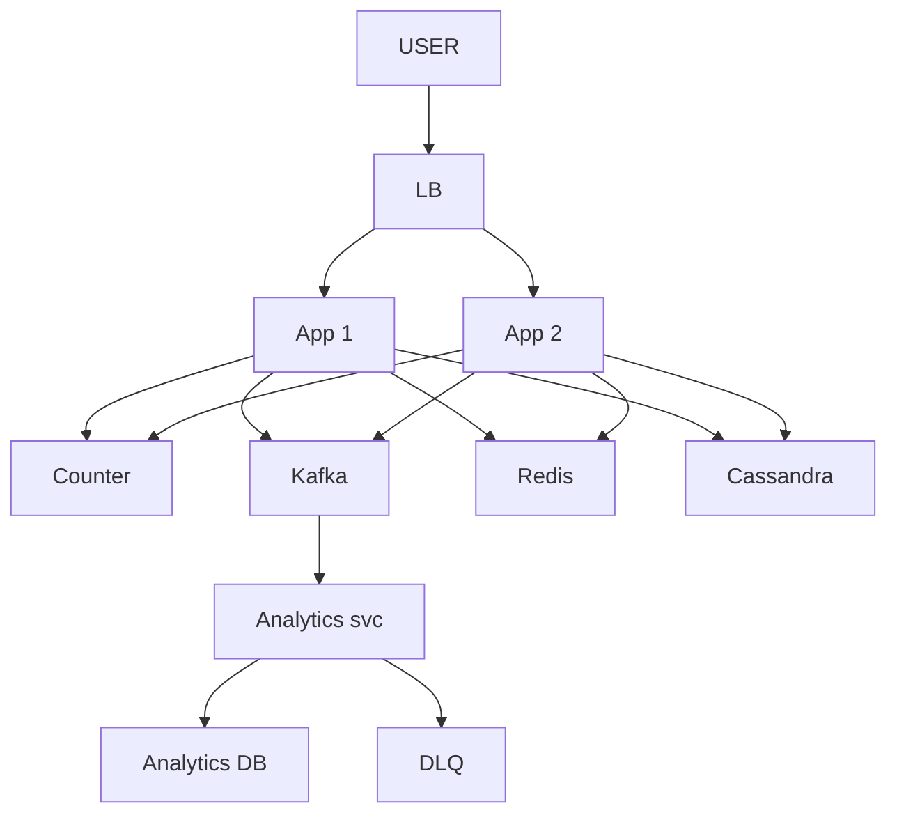
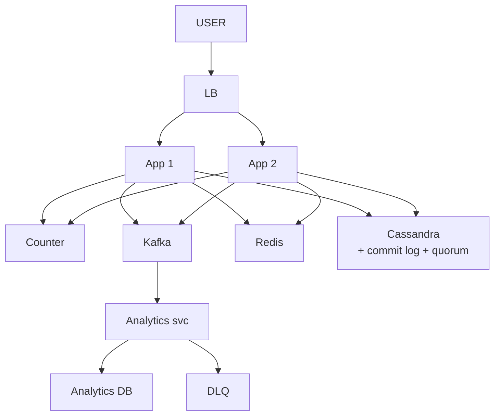
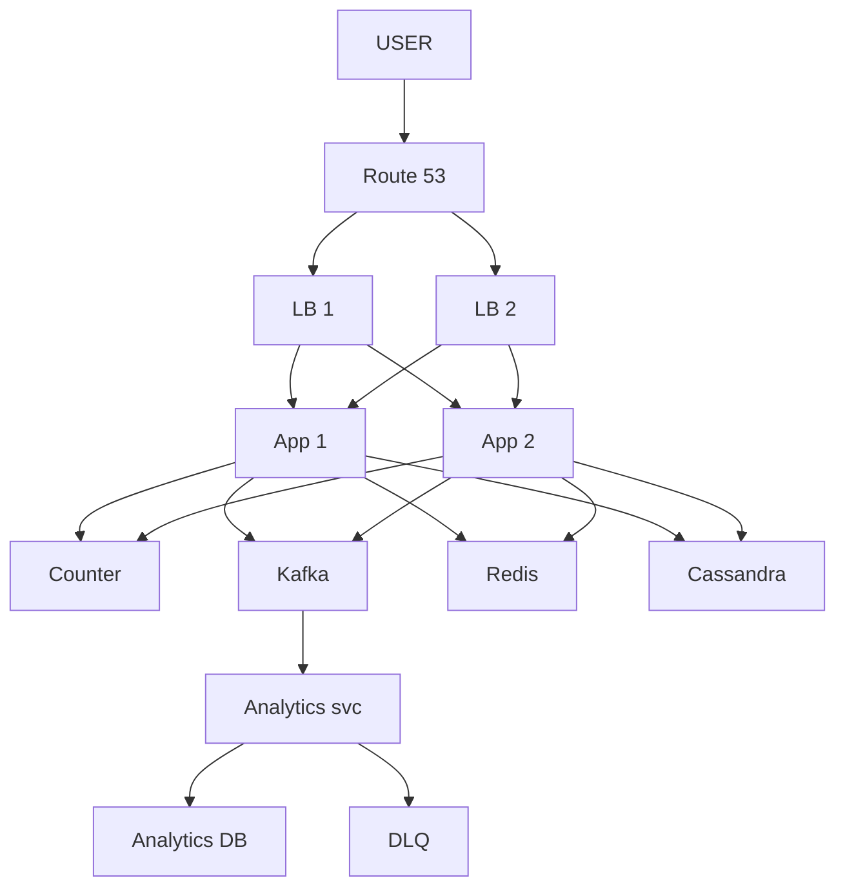

# URL Shortener

> Lamba link do -> chhota 7 akshar ka code milta hai. Koi chhote link pe click kare -> asli link pe bhej do (302 redirect).
> Is design ka dil do cheezein hain: **har link ka code ALAG (unique)** aur **click pe redirect bahut tez**, kyunki log link banate kam hain aur kholte bahut zyada (100 me se 99 baar kholna).

---

## TASVEER (ByteByteGo / Alex Xu · CC BY-NC-ND 4.0)


Source: [Explaining 5 Unique ID Generators](https://bytebytego.com/guides/explaining-5-unique-id-generators-in-distributed-systems/)
(Code kahan se aaye: UUID / Snowflake / DB ka auto-increment / range. Hamara code = ek number ko base62 me likhna.)

---

## SHURU: pehle poocho, phir numbers

```
POOCHO:  "Link banana, redirect, click ginna, apna khud ka code (custom alias), expiry — kis pe dhyaan dein?"
         -> zaroori: link banana + redirect. Click ki ginti chahiye. Bada analytics dashboard bahar.
            Custom code = time bache to.
         "Din me ~10 crore (100M) naye link, aur har link ~100 baar khulta hai — ye maan ke chalun?"
         kuch na pata ho -> "ye maine use nahi kiya" bolna theek hai, interviewer khud bata dega.

ZAROORI KAAM (FR):   lamba -> chhota banao · chhote pe click -> asli pe bhejo
KAISA CHALE (NFR):   redirect 200 ms se tez · hamesha chalu · padhna >> likhna · code kabhi dohraaye nahi
                     ("aage ka har faisla inhi 4 me se kisi ek se judega")

NUMBERS (andaaza, calculator nahi):
   naye link:  10 crore / din. Din me ~1 lakh second hote hain -> ~1,000 naye link har second.
   click:      har link ~100 baar khulta -> ~1 lakh click har second.
   jagah:      ek link ~500 byte. 5 saal me ~180 arab link -> ~90 TB.
   code:       62 akshar, 7 jagah -> 62 x 62 x ... (7 baar) = ~3.5 lakh crore code -> 100+ saal chal jaayega.

NUMBER SE FAISLA:
   click >> naye link (100 : 1)   -> CACHE lagega
   90 TB                          -> ek machine me nahi aayega, SHARD karna padega
   7 akshar                       -> code kitna lamba ho, ye jhagda khatam
   Agar interviewer chhota maane (1 arab link = ~500 GB) -> ek hi DB me aa jaata, shard ki zaroorat nahi.
   Estimate chhodna mat, par exact ganit me mat atakna. Din
   ka maana to poora din ka hi rakho, mahine se mat milao.

KYUN CHAHIYE:  Twitter / SMS me jagah kam · marketing me kis link se kitne aaye · QR / print · saaf dikhta
```

---

## ════ MOCK SE PEHLE: SIRF YE CARD PADHO ════

> Har dikkat ek card: KAHANI (kya hua, kaun, kitna) -> ILAAJ -> ANDAR KAISE (ilaaj kyun kaam karta) ->
> ISKE BAAD KYA TOOTEGA (interviewer yahin ghusta hai: dabba lagaya, ab kya?).

#### DABBA 0: SABSE SIMPLE (yahan se shuru, phir "kahan tootega")
```
User link deta -> App ek code banata -> DB me (code, lamba link) save.
Click aaya -> App DB me code dhoondhta -> asli link pe bhej deta.
```


#### 0 SHURU: CODE KAISE BANE (dil ka hissa)
```
KAHANI:  User ne diya "https://amazon.in/....../bahut-lamba-link". Use chahiye "bit.ly/w7e".
         Har link ka code alag hona chahiye, warna do link ek hi jagah khulenge.

ILAAJ:   Ek ginti (counter) rakho: 1, 2, 3 ... Har naye link ko agla number do,
         aur us number ko BASE62 me likh do. Wahi code hai.

ANDAR KAISE:
         Base62 = 62 akshar: 0-9 (10) + a-z (26) + A-Z (26).
         Number ko baar-baar 62 se bhaag do, jo bachta (remainder) wo ek akshar, aakhir me ulta padho.
         Misaal: 125 = 2 x 62 + 1 -> "21".   100 crore -> "15FTGg" (6 akshar).
         Counter kabhi dohraata nahi -> code kabhi dohraata nahi. Check karne ki zaroorat hi nahi.

ISKE BAAD KYA TOOTEGA:
  - Counter kyun, lambe link ka MD5 / random code kyun nahi?
      -> MD5 / random me do link ka code same aa sakta hai.
         Har baar DB se poochna padega "ye code pehle se hai?"
         Counter me ye dikkat hi nahi.
  - Counter se code ka andaza nahi lag jaayega? (abc124 ke baad abc125)
      -> haan, ye keemat hai. Chahiye to number ko pehle shuffle
         / XOR karo, phir base62. Phir bhi unique rahega.
  - User apna code maange ("bit.ly/arpan")?
      -> check karo: lambai theek, "admin" / "login" jaisa reserved shabd nahi, pehle se liya hua nahi.
         Do log ek saath same code maangein -> DB me UNIQUE rule, ek ko 409 (pehle se hai).
  - Redirect 301 dein ya 302?
      -> 302. 301 pe browser link yaad kar leta hai, agli baar server tak aata hi nahi.
         Tab click gin nahi paate aur expiry bhi kaam nahi karti.
```

#### [1](#d1) HAR CLICK DB PE, REDIRECT 200 MS SE TEZ CHAHIYE
```
KAHANI:  Ek second me 1 lakh click aa rahe hain. Har click DB tak ja raha hai, aur DB disk se padhta hai.
         DB pe bojh badhta gaya, redirect dheema hua. Ek viral link pe to DB hi baith gaya.

ILAAJ:   DB ke aage REDIS (cache). Click aaya -> pehle Redis dekho.
         Mila -> wahi se bhej do. Nahi mila -> DB se laao, Redis
         me rakh do, phir bhejo. (Isi ko cache-aside kehte hain.)
         Redis me link ki expiry (TTL) wahi rakho jo link ki hai.

ANDAR KAISE:
         Redis RAM me rakhta hai, ek milisecond se kam me jawab. DB disk se padhta hai, kai milisecond.
         Log zyadatar wahi link baar-baar kholte hain -> ~95
         me se 95 click Redis se hi nikal jaate. DB bach gaya.

ISKE BAAD KYA TOOTEGA:
  - Redis me saare 180 arab link rakhoge?
      -> nahi, sirf jo abhi garam (zyada khul rahe) hain. Jagah bhar gayi to jo link sabse der se nahi khula
         use nikaalo (LRU). Wo baad me khula to DB se wapas aa jaayega.
  - Link delete / expire ho gaya, par Redis me abhi pada hai?
      -> expiry pe Redis khud hata deta hai. Delete pe pehle DB se hatao, phir Redis se.
  - Redis hi gir gaya?
      -> wo 95% click ek saath DB pe girenge, DB bhi gir sakta
         hai. Isliye Redis ki bhi copies (cluster + replica).
         Phir bhi gira to kuch request mana karo (load shedding), aur garam link ko sirf EK request
         DB se laaye, baaki ruke. "kuch nahi hoga" kabhi mat bolna.
  - DB ki read copy (replica) kyun nahi, ya har App apna cache rakhe?
      -> replica bhi disk se padhti hai, dheemi. Har App ka apna cache = sabke paas alag copy,
         link badla to kisi App pe purana dikhta rahega.
```

#### [2](#d2) EK APP 1 LAKH / SEC NAHI JHELTA, GIRA TO SITE BAND
```
KAHANI:  Saari request ek hi App machine pe. Bojh se wo dheema
         hua, aur ek din wahi gir gaya -> poori site band.
         Ek cheez jiske girne se sab ruk jaaye, use SPOF (single point of failure) kehte hain.

ILAAJ:   App ki kai machine lagao, aur aage LOAD BALANCER (LB) jo request baante.
         App STATELESS rakho: user ka koi data App ki memory me nahi, sab Redis / DB me.

ANDAR KAISE:
         LB request baari-baari bhejta hai (round-robin), ya jiske paas kam kaam hai use (least-conn).
         Har ~5 second LB har machine se poochta hai "zinda ho?" (GET /health).
         Jawab nahi aaya -> us machine ko list se hata do. Theek hui -> wapas jod do.

ISKE BAAD KYA TOOTEGA:
  - Stateless kyun zaroori hai?
      -> agar user ki baat App-1 ki memory me hai aur agli request App-2 pe gayi, to App-2 ko kuch pata nahi.
         Sab Redis / DB me ho to koi bhi machine koi bhi request le sakti hai.
  - Ek bahut badi machine le lo (vertical scale)?
      -> uski bhi ek had hai, aur wo akeli hai -> phir wahi gire to sab band.
  - Machine mari nahi, bas dheemi hai?
      -> LB jawab ka time aur galtiyon ki ginti bhi dekhta hai. Least-conn khud usko kam bhejta hai.
```

#### [3](#d3) KAI APP, DO APP EK HI CODE BANA DENGE
```
KAHANI:  Ab App ki 2 machine hain, dono apna-apna counter chala rahi hain.
         App-1 ka counter 5 pe hai, App-2 ka bhi 5 pe. Dono ne naya
         link banaya -> dono ka number 6 -> dono ka code same.
         Do alag link, ek hi code. Ise COLLISION kehte hain.

ILAAJ:   Ek COUNTER service (ZooKeeper ya DB ki ek table) har App ko numbers ka ALAG thaila (range) deti hai.
         App-1 ko 1 se 1000, App-2 ko 1001 se 2000. Dono ke number kabhi takrayenge hi nahi.

ANDAR KAISE:
         App apne thaile me se khud ginta rehta hai. Counter service se baat sirf tab, jab thaila khatam ho.
         Matlab har link pe network call nahi, 1000 link me ek baar.

ISKE BAAD KYA TOOTEGA:
  - App-1 number 400 pe crash ho gaya. 401 se 1000 ka kya?
      -> wo bekaar gaye, aur ye jaan-boojh ke maana hai. 3.5
         lakh crore code hain, kuch hazaar jaane se farak nahi.
         Har number bachana ho to har link pe coordination lagega, range ka fayda hi khatam.
  - Counter service khud gir gayi?
      -> App ke paas abhi apna thaila (1000 number) bacha hai, kaam chalta rehta hai.
         Tab tak counter ki doosri copy uth jaati hai.
  - Redis ka INCR (ek-ek badhao) kyun nahi?
      -> chal jaata, par har link pe ek call. Range me 1000 link pe ek call.
```

#### [4](#d4) HAR CLICK PE ANALYTICS LIKHNA
```
KAHANI:  User ne click kiya. Usi request me hum "click hua" analytics DB me likhne lage, phir redirect kiya.
         Analytics DB dheema tha -> user ko redirect ke liye rukna pada. Yahan har milisecond keemti hai.

ILAAJ:   Click ki khabar KAFKA me daal do aur user ko turant 302 de do.
         Analytics service peeche se Kafka padhti rahe aur ginti likhti rahe.
         Koi khabar baar-baar fail ho -> use alag DLQ (dead letter queue) me daal do.

ANDAR KAISE:
         Kafka ek diary jaisa hai: disk pe likha jaata hai, App bas aakhri
                                   page pe likh ke aage badh jaata hai.
         Analytics service yaad rakhti hai kahan tak padha (offset). Crash hui to wahin se dobara.
         Ek kharab khabar DLQ me chali jaati hai, baaki line nahi rukti.

ISKE BAAD KYA TOOTEGA:
  - Kafka hi band hai?
      -> redirect pehle. Khabar na jaaye to thoda App me rakh lo ya chhod do.
         Analytics thoda kam ginega, par user ka redirect nahi rukega.
  - Ek click do baar gina gaya?
      -> Kafka ek khabar kabhi-kabhi do baar de deta hai. Har
         click ka ek id (clickId), Analytics dohraav chhod de.
  - App ke andar hi peeche ek thread se likh do?
      -> App crash = memory me padi khabarein gayi. Kafka disk
         pe hai, aur purane click dobara padh bhi sakte hain.
  - Kafka kyun, SQS kyun nahi?
      -> SQS bhi chal jaata. Kafka isliye ki click bahut zyada hain, aur naya report banana ho to
         purane click dobara padh sakte hain (replay). SQS padhne ke baad message hata deta hai.
```

#### [5](#d5) 5 SAAL KA ~90 TB EK MACHINE ME NAHI
```
KAHANI:  10 crore link roz, 5 saal -> ~180 arab link, ~90 TB. Itna ek machine me nahi aata.
         Aur wo ek machine mari to saare link gaye.

ILAAJ:   Data ko kai machine me baanto (SHARD), code ke hisaab se. Cassandra ye khud karta hai.
         Har tukde ki 3 copy, 3 alag data center (AZ) me. Nayi machine jodni ho -> consistent hashing.

ANDAR KAISE:
         Click hamesha code ke saath aata hai (GET /abc123).
         Code se seedha pata chal jaata hai kaunsi machine.
         RING: ek gol ghadi socho. Machines ghadi pe kahin-kahin baithi hain, har code bhi ghadi pe ek jagah.
         Code ghadi ki disha me chalta hai, jo pehli machine mile wahi uski.
         Nayi machine aayi -> sirf uske theek peeche wale codes usko jaate, baaki apni jagah.
         (Agar "code % machine ki ginti" karte, to 3 se 4
         machine hote hi lagbhag har code ki jagah badal jaati.)

ISKE BAAD KYA TOOTEGA:
  - Country ya date ke hisaab se kyun nahi baanta?
      -> ek country / aaj ka din garam ho jaata, ek machine pe saara bojh.
         Aur code dekh ke pata hi nahi kis country ka -> saari machine poochni padti.
  - Copies (replica) badha do, likhna bhi tez ho jaayega?
      -> nahi. Har copy pe likhna to padta hi hai. Likhne ka bojh baantna = SHARD.
         Copy = bachav + padhne ka bojh.
  - Ek machine pe zyada code aa gaye?
      -> har machine ko ghadi pe 100-200 jagah baitha do (virtual nodes) -> bojh barabar bat jaata.
  - Ek link viral, uski machine garam?
      -> wo link Redis se hi nikal jaata, machine tak kam aata.
  - Cassandra kyun, MySQL kyun nahi?
      -> join / transaction chahiye hi nahi, bas "code se link nikaalo" + 90 TB.
         Wajah = kaam ka dhaancha + size. "NoSQL zyada powerful" wajah nahi.
         Chhota maana (~500 GB) to ek MySQL kaafi, shard bhi nahi.
```

#### [6](#d6) WRITE KE BEECH EK COPY WALA NODE GIRA
```
KAHANI:  User ne link banaya. Cassandra use 3 copy me likh
         raha tha, aur beech me ek copy wali machine gir gayi.
         Jo likh diya, wo khona nahi chahiye.

ILAAJ:   (1) DB har cheez pehle ek LOG (diary) me likhta hai, phir asli table me.
             Cassandra me ise commit log kehte hain, Postgres me WAL.
         (2) "Likh diya" tabhi bolo jab 3 me se kam se kam 2 copy haan bolein (QUORUM).

ANDAR KAISE:
         Machine wapas uthi -> apni diary padh ke jo adhoora tha wo poora kar leti hai.
         2 copy me pehle se hai -> ek gire to bhi data bacha.

ISKE BAAD KYA TOOTEGA:
  - 2 ka hi intezaar kyun, teeno ka kyun nahi?
      -> teeno ka intezaar = ek dheemi machine sabko dheema kar degi. 2 me ek gire tab bhi likh sakte.
  - 2 machine gir gayi?
      -> 2 haan nahi milenge -> likhna fail (ya 1 pe likh lo,
         risk ke saath). Click tab tak Redis se chalte rahenge.
  - Kafka laga do data bachane ke liye?
      -> nahi. Ye DB ki apni diary ka kaam hai, extra dabba mat lagao.
```

#### [7](#d7) NAYA LINK BANAYA, TURANT CLICK -> 404
```
KAHANI:  Tune link banaya. Cassandra har link ko 3 jagah rakhta hai: copy A, copy B, copy C.
         Likhte waqt link A aur B me pahunch gaya, C tak pahunchne me 1-2 second lagte hain.
         Isi beech tune click kiya, aur request C pe gayi. C bola "ye link mere paas nahi" -> 404.

ILAAJ 1 (aasaan wala):
         Link banate hi Redis me bhi daal do. Click sabse pehle Redis dekhta hai, wahan link mil jaata hai.
         C tak jaana hi nahi padta.

ILAAJ 2 (DB ke andar wala):
         Likhte waqt tabhi "ho gaya" bolo jab link 2 copy me likh jaaye.
         Padhte waqt bhi 2 copy se poochho.

ANDAR KAISE (ye kaam kyun karta hai):
         Link likha A aur B me. Ab padhte waqt koi bhi 2 copy uthao: A+C, B+C ya A+B.
         Har jodi me A ya B me se ek to aayegi hi, aur usme naya link hai. Khaali haath kabhi nahi lautoge.
         Isi ko QUORUM kehte hain: "2 me likha + 2 se padha" -> dono me ek copy common pakki.

ISKE BAAD KYA TOOTEGA:
  - Tez karne ke liye sirf 1 copy se padh lo?
      -> wo 1 copy C ho sakti hai, jisme abhi link aaya hi nahi -> phir 404.
  - 2 copy se padhna dheema nahi hoga?
      -> haan, thoda. Isliye pehla ilaaj Redis hai: zyada click Redis se hi nikal jaate.
  - Cassandra me koi "main copy" hoti hai?
      -> nahi. Teeno copy barabar hain, koi bhi likh sakti hai aur koi bhi padh sakti hai.
```

#### [8](#d8) LB KHUD GIR GAYA
```
KAHANI:  App, Redis, DB sab zinda hain. Par sabko request baantne wala Load Balancer hi mar gaya.
         Ab koi request andar aa hi nahi rahi -> site band.

ILAAJ:   Do LB rakho, aur unke aage ROUTE 53 (AWS ka DNS) jo dekhta rahe kaunsa LB zinda hai.
         Ek mara -> sab request doosre pe. Poora region (shehar ka data center) gaya -> doosre region pe.

ANDAR KAISE:
         Route 53 har ~30 second har LB se poochta hai "zinda ho?".
         3 baar jawab nahi -> us LB ka pata (IP) user ko dena band kar deta hai.

ISKE BAAD KYA TOOTEGA:
  - Switch turant ho jaata hai?
      -> nahi. User ka phone purana pata ~60 second yaad rakhta hai (DNS TTL), tab tak kuch log purane LB pe.
         Isliye cloud me LB khud kai data center me phaila hota hai (AWS ALB).
  - Poora region gaya, to naye link ka kya?
      -> doosre region me data thoda peeche-peeche copy hota
         hai. Aakhri kuch second ke naye link kho sakte hain.
         Ye maana hua risk hai.
```

#### [9](#d9) SCRIPT SE RAAT ME 10 LAKH LINK
```
KAHANI:  Ek bande ne script likh di, raat bhar me 10 lakh link bana diye.
         Counter ke number tez khatam hue, DB me kachra bhar gaya, asli users ke liye dheema.

ILAAJ:   Sabse aage API GATEWAY, aur wahan RATE LIMIT: ek user / API key / IP kitne link bana sakta hai.
         Login (auth) bhi wahin. Lamba link malware / phishing list se milao, aur WAF bure bots roke.

ANDAR KAISE:
         Ginti ek hi jagah honi chahiye. Har App apni alag gine to banda har App pe limit tak bana lega.
         Isliye ginti ek shared Redis me (INCR + expiry), sab gateway wahi dekhte hain.

ISKE BAAD KYA TOOTEGA:
  - Gateway ki kai machine hain, ginti kahan?
      -> shared Redis me, sab ek hi ginti dekhein. (Poora design = 02_rate_limiter.)
  - Bot har baar naye IP se aa raha?
      -> IP pe nahi, API key / user_id pe limit, aur WAF ke bot rules.
```

```
AAKHRI DABBE (sab dikkat ke baad):
  User -> Route 53 -> 2 LB -> API Gateway (rate limit + login) -> App (stateless)
  -> Redis (95% click yahin se, expiry = link ki expiry) -> Cassandra (code se baanta, har tukde ki 3 copy)
  NAYA LINK:  Counter ka thaila + base62 -> Redis + Cassandra me likho
  CLICK:      Redis / Cassandra se link -> 302. Click ki khabar ->
              Kafka -> Analytics (fail -> DLQ), redirect ruke bina

DB KYUN:  Cassandra / DynamoDB -> join nahi, transaction nahi, ek code se ek link, 90 TB.
          Wajah = kaam ka dhaancha + size, "NoSQL powerful" nahi. Redis sirf cache.

END ME POOCHEGA:
  "10 guna traffic?"        -> App machine badhao · padhne aur likhne wale
  App alag · Redis me garam link (LRU + expiry) · Cassandra aur baanto
  "Kahan se sab gir sakta?" -> LB (2 copy) · Counter (2 copy, ek chalu ek taiyaar) · Route 53 health check
  "Chal raha hai, kaise pata?" -> redirect ka time (p99) · galtiyon ki ginti · Kafka me kitna pending · alert
  "301 ya 302?"             -> 302: har click server tak
  aata, gin paate. 301 pe browser yaad kar leta, click gaya
```

AAKHRI DABBE ki tasveer:



---
## ════ DETAIL: HAR DIKKAT KI INTERVIEW LINE + TASVEER ════

> Card me poori kahani hai. Yahan har dikkat ki ek English line (interview me bolne ke liye) aur us waqt tak ka diagram.

---

<a id="d1"></a>

## DIKKAT 1 — har click DB pe, redirect tez chahiye

```
POOCHEGA: "What if the cache goes down?"
BOL:      "Redis runs as a replicated cluster. If it still goes down, the DB takes the load,
           so I shed load and let only one request rebuild a hot key, not a thousand at once."
```


---

<a id="d2"></a>

## DIKKAT 2 — ek App sab nahi jhelta, gira to site band

```
BOL:      "I run several stateless app servers behind a load balancer, so any server can take any request. The
           load balancer health-checks every few seconds and takes a dead or slow server out of rotation."
```


---

<a id="d3"></a>

## DIKKAT 3 — kai App, ek hi code ban sakta

```
POOCHEGA: "That server crashed at 400 — what about the rest of its range?"
BOL:      "The restarted server asks for a new range, so 401 to 1000 are wasted. I accept that
           on purpose — 3.5 trillion codes, a few thousand lost is nothing. Making every number
           crash-proof would need coordination on every request and kill the benefit of ranges."
```


---

<a id="d4"></a>

## DIKKAT 4 — click ginna redirect ko dheema na kare

```
BOL:      "The redirect returns a 302 immediately and puts a click event on Kafka; an analytics service
           consumes it in the background, de-duplicates by click id, and sends repeated failures to a dead-
           letter queue. If Kafka is down, the redirect still works and we only lose some analytics."
```


---

<a id="d5"></a>

## DIKKAT 5 — 90 TB ek machine me nahi

```
POOCHEGA: "The database is too big / takes too many writes. What do you do?"
BOL:      "I shard by short code, so every redirect goes to exactly one
           shard, and keep three replicas of each shard in different zones."
```


---

<a id="d6"></a>

## DIKKAT 6 — likhte waqt ek copy wali machine giri

```
POOCHEGA: "What happens if a DB node goes down mid-write?"
BOL:      "The DB writes to its commit log before applying, and I ack writes on quorum, so losing
           one node doesn't lose committed data. Redirects keep working from Redis meanwhile."
```


---

<a id="d7"></a>

## DIKKAT 7 — naya link, turant click, 404

```
POOCHEGA: "The user created a link but gets 404 / old value. Why?"
BOL:      "Replication lag. The write path also puts the link in Redis, and
           with quorum reads and writes the read always sees the latest write."
```


---

<a id="d8"></a>

## DIKKAT 8 — LB khud gira

```
POOCHEGA: "What if a whole region goes down?"
BOL:      "Inside a region I'm multi-AZ. If the region dies, Route 53 health checks send users to another
           region; data is copied there asynchronously, so a few of the newest links may be lost."
```


---

<a id="d9"></a>

## DIKKAT 9 — script se laakhon link

```
POOCHEGA: "How do you stop abuse?"
BOL:      "Rate limiting per user and IP at the API gateway, auth there too, a WAF at the
           edge, and I check long URLs against a malware / phishing list before shortening."
```


---
## 10 GUNA TRAFFIC — har dabba alag se

```
Route 53    -> user ko uske paas wale region pe bhejo (geo-routing)
App         -> stateless hai, machine badhao. Padhne aur likhne wale App alag rakho
               (100 : 1 -> jaise padhne ke 20, likhne ke 2; ek gire to doosra chale)
Redis       -> saare link nahi samaate. Garam rakho, thande nikaalo (LRU + expiry).
               viral gaana / WhatsApp forward = garam, Redis me. Log kholna band = thanda, bahar
               (Cassandra me to hai hi, agli baar khula to wapas aa jaayega)
Cassandra   -> code se baanto + har tukde ki 3 copy. Koi "main copy" nahi, har copy padh / likh sakti hai.
               padhne ka bojh badha = aur machine / copy
Counter     -> ye bhi gir sakta hai -> 2 copy (ek chalu,
ek taiyaar). Range waise bhi thodi der chala leti hai.
Kafka       -> partition badhao

BAANTNA CODE SE, COUNTRY SE NAHI:
   click hamesha code ke saath aata hai -> code se seedha ek machine
   country se baanta -> code dekh ke pata nahi kis country ka -> saari machine poochni padti
   country / region ka kaam = user ke paas data rakhna (jaldi
   jawab), data baantna nahi. Dono saath chal sakte hain.
```

---

## POOCHE TO (gehra sawaal aaye tab)

Jo poochhe wahi kholo, sab ek saath mat bol dena.

```
API:      link banana = POST /api/shorten { long_url, custom_code? } -> { short_url, expires_at }
          link kholna = GET /abc123 -> 302 + Location: <lamba link>
          (ulta mat bolna: banana POST, kholna GET)

ROW:      short_code (isi se machine tay hoti hai) · long_url · created_at · expires_at
          GET /abc123 -> seedha ek machine, ek row

KAUNSA DB, KITNE TAK:
          MySQL ~1 arab row tak aaram se · Mongo ~10 arab tak · Cassandra / DynamoDB isse bahut aage
          Redis sirf cache, hamesha saath. Faisla = kaam ka dhaancha + size.

COUNTER KE 3 TAREEKE:
          DB me ek-ek badhao  -> har link pe DB, dheema
          Redis INCR          -> har link pe ek call
          RANGE (thaila)      -> 1000 link pe ek call   <- YAHI

SHABD BHOOL JAO TO SEEDHI BAAT BOLO (atko mat):
          "MD5" yaad nahi   -> "lambe link ka hash lo, uske pehle 7 akshar"
          "Base62" yaad nahi -> "62 akshar hain (0-9, a-z, A-Z),
          number ko unme likh do, chhoti string ban jaati"
          "Counter" yaad nahi -> "ek badhta hua number, har link ko agla"
          interviewer ko shabd nahi, samajh chahiye. Naam wo khud bol dega.
```

---

## AAKHRI DABBA + WRAP

```
Route 53 = kaunsa LB zinda + kaunsa region · API Gateway = rate limit + login · LB = 2 copy · App = stateless
Counter = thaila + base62 · Redis = 95% click, expiry = link ki
expiry · Cassandra = code se baanta + 3 copy + 2 me likha 2 se padha
Kafka = click ki ginti peeche se, fail -> DLQ
```
```
CLICK:     LB -> App -> Redis me mila? -> 302 · nahi mila -> Cassandra
           -> Redis me rakho -> 302 · click ki khabar -> Kafka
NAYA LINK: LB -> App -> thaile se agla number -> base62 (123456
           -> "w7e") -> Redis + Cassandra -> chhota link wapas
```
```
BOL:      "The short code is a counter in base62, with ranges handed to each server so there's no
           collision. Reads are 100 to 1, so Redis serves most redirects; Cassandra, sharded by short
           code with three replicas, holds the rest. Redirect is a 302 and click analytics go async
           through Kafka. Route 53 and two load balancers remove the single points of failure, and the
           gateway rate-limits abuse. Next I'd add custom aliases, expiry cleanup and geo-distribution."
```

ARCHETYPE F (infra/component) · CONCEPTS: [ID-gen](../../FOUNDATIONS/13_distributed_id_snowflake.md) · [caching](../../FOUNDATIONS/04_caching.md) · [sharding](../../FOUNDATIONS/06_database_sharding.md) · [← MASTER SHEET](../../00_MASTER_SHEET.md)
