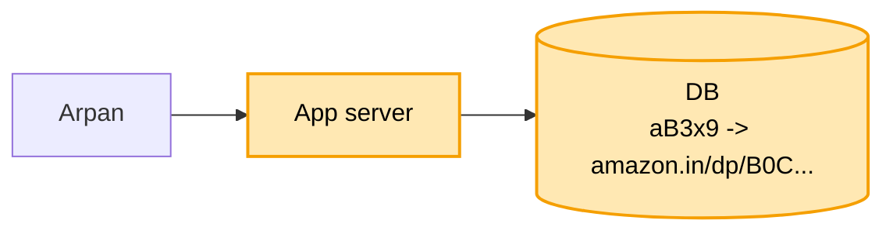
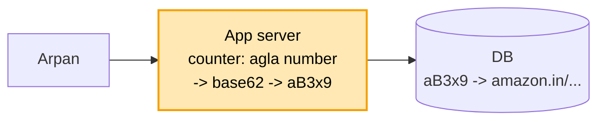
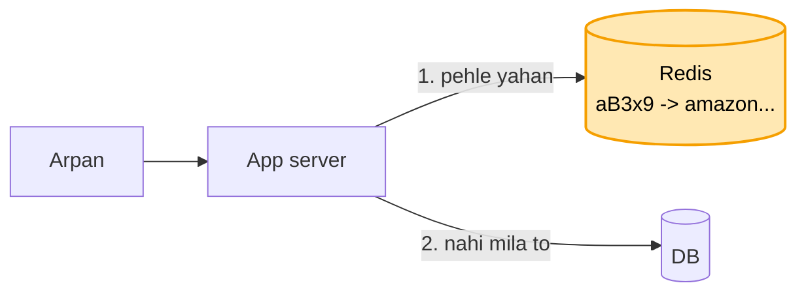
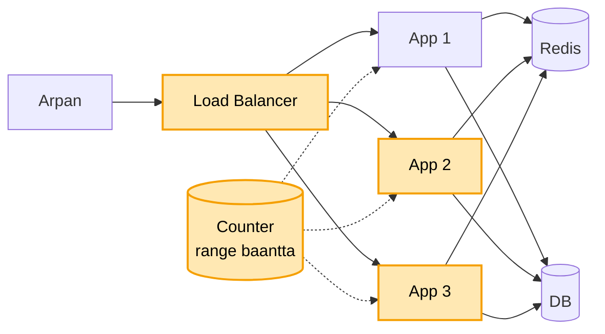
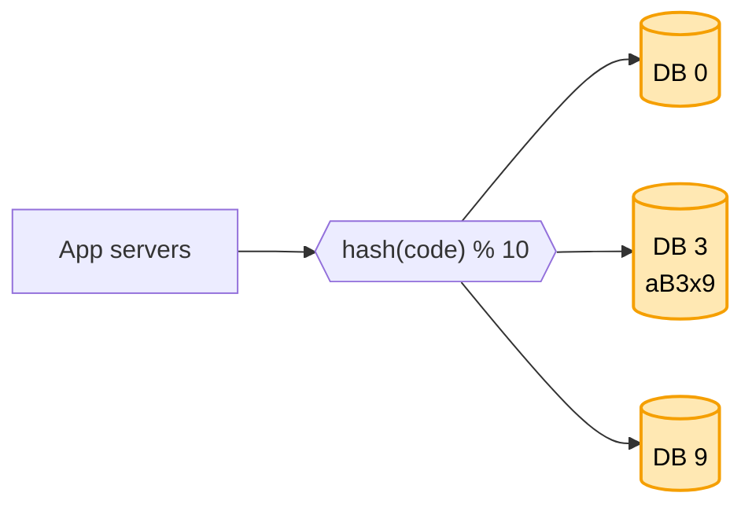
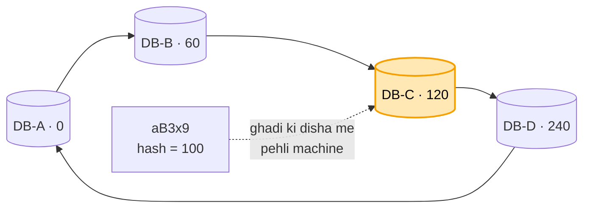
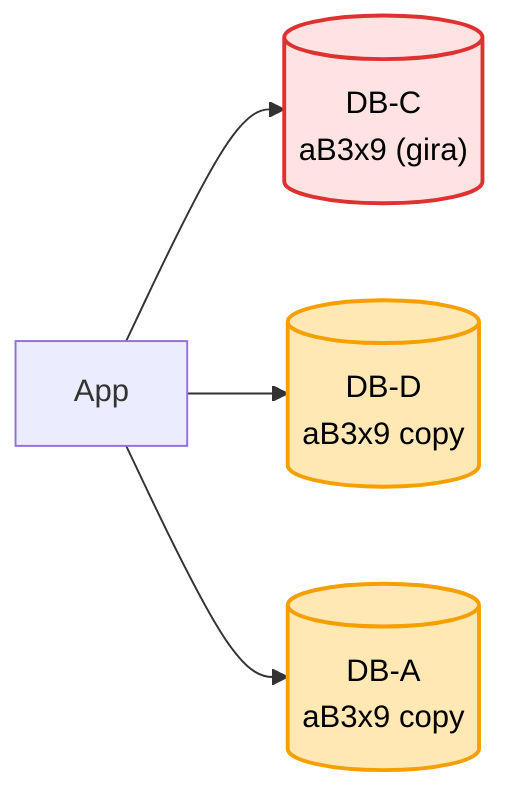
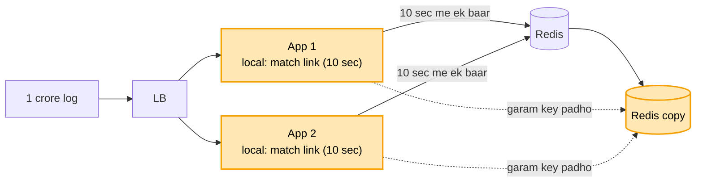
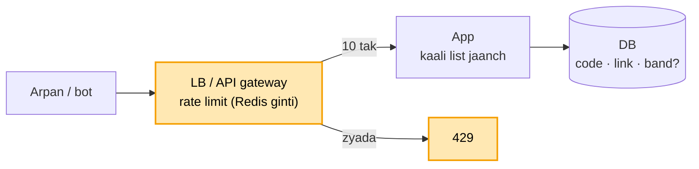

# URL shortener: shuru se, ek kahani

Kram wahi jo interview me hota hai: **FR, phir NFR, phir numbers, phir design**. Design sabse seedhe dabbe se
shuru hota hai, aur har dikkat aane pe ek naya dabba judta hai. Diagram me peela dabba = abhi juda. Poori file
me ek hi kahani hai: Arpan ka Amazon wala link.

**CUE (yahi shabd yaad rakhne hain, kram se):**
seedha (server + DB) -> counter + base62 -> Redis -> LB + counter range -> shard -> ring -> 3 copy
-> local cache (viral link) -> rate limit (bot)

---

## 1. FR: kya karna hai

Interviewer se pehle poochho, phir scope tay karo.

```
1. Arpan lamba link deta hai, use chhota code milta hai, zyada se zyada 7 akshar (short.ly/aB3x9)
2. koi bhi chhota link khole, use asli lambe link pe bhej do (redirect)
scope ke bahar (poochh ke hata do): apni pasand ka code, link kitni baar khula uski ginti
```

## 2. NFR: kaisa chalna chahiye

```
- kholna TEZ ho: click karte hi turant Amazon khule
- hamesha chale: link toot gaya to Arpan ka bheja hua link bekaar
- ek code = ek link: do logon ko kabhi same code na mile
```

## 3. Numbers: sirf wo jo design badlein

```
- roz 10 crore naye link bante hain      -> ~1,000 link har second banane hain
- har link ~100 baar khulta hai          -> ~1 lakh link har second kholne hain
- ek link ~500 byte, 5 saal ka data      -> ~180 arab link -> ~90 TB
- 7 akshar, har akshar 62 tarah ka       -> ~3.5 lakh crore code bante hain, kaafi hain
```

Link kholna banane se 100 guna zyada hai, isliye aage cache aayega. 90 TB ek machine me nahi samata, isliye
aage DB ke tukde (shard) aayenge. 62 tarah ke akshar matlab a-z (26), A-Z (26) aur 0-9 (10).

---

## 4. Design

### Kadam 1: sabse seedha (ek server, ek DB)

Arpan ke paas ek lamba link hai (`amazon.in/dp/B0C...?ref=xyz`). Wo hamari site pe daalta hai aur use
`short.ly/aB3x9` milta hai. Koi bhi ye chhota link khole, hum use Amazon pe bhej dete hain.



```
BANAO:  lamba link aaya -> chhota code banao (aB3x9) -> DB me dono saath likho
KHOLO:  aB3x9 aaya -> DB me dhoondho -> browser ko bolo "is lambe link pe jao" (redirect, HTTP 302)
```

DB kyun, server ki memory (jaise Java ka HashMap) kyun nahi? Memory me rakhte to server restart hote hi saare
link gayab ho jaate. Link saalon chalna chahiye, isliye disk wala DB.

Par chhota code `aB3x9` banega kaise? Aur do logon ko kabhi same code na mile, ye pakka kaise hoga?

### Kadam 2: code banana (counter + base62)

Code banane ke teen tareeke ho sakte hain:

```
RANDOM:   7 akshar ulte-seedhe chun lo (aB3x9Qz)
HASH:     lambe link ka MD5 nikaalo, uske pehle 7 akshar le lo
COUNTER:  har naye link ko ek badhta number do (1, 2, 3 ...), aur us number ko 62 akshar me likh do (base62)
```

Random me do logon ko same code mil sakta hai. Har baar DB me jaake dekhna padega ki ye code pehle se hai ya
nahi, aur mila to dobara banana padega. Jaise-jaise link badhte hain, aisi takkar bhi badhti hai. Hash me bhi
yahi dikkat hai: do alag link ke pehle 7 akshar same aa sakte hain. Counter me har number naya hota hai, to
code kabhi same aata hi nahi, aur DB me jaanchne ki zaroorat bhi nahi. **Isliye counter.**

Base62 aise samjho: jaise 10 ko binary me `1010` likhte hain, waise hi number ko 62 akshar (a-z, A-Z, 0-9) me
likhte hain. 1 arab bhi sirf 6 akshar me aa jaata hai, aur 7 akshar me ~3.5 lakh crore number aate hain.



Abhi ek hi server hai, to counter bhi ek hi hai. Ye DB ka apna auto-increment id bhi ho sakta hai.

Link ban rahe hain. Par har second 1 lakh log link khol rahe hain, aur har baar DB me dhoondhna pad raha hai.
DB itna bojh nahi jhel payega.

### Kadam 3: kholne ka bojh (Redis cache)

DB disk se padhta hai, isliye har baar DB me dhoondhna dheema hai. Aur zyadatar log wahi kuch link baar-baar
kholte hain. Arpan ne Amazon sale ka link group me bheja, to 1,000 log wahi ek link khol rahe hain. Har baar
DB se wahi jawab laana bekaar hai.

Ilaaj: beech me **Redis** lagao. Ye memory me rakhta hai, isliye bahut tez hai.

```
aB3x9 aaya -> pehle Redis me dekho
   mila   -> turant redirect, DB ko chhua hi nahi
   nahi   -> DB se lao, Redis me rakh do, redirect. Agli baar Redis se hi milega
```



Redis bhar gaya to? Memory DB se chhoti hoti hai, saare 180 arab link usme nahi aate. Isliye jo link sabse der
se nahi khula, use hata dete hain (LRU). Garam link Redis me rehte hain, thande link DB me.

Server ki apni memory me cache kyun nahi? Aage server ek se zyada honge. Har server ka cache alag hoga, aur
restart pe khaali ho jaayega. Redis sab servers ke liye ek jagah hai.

Par 1 lakh log kholne aa rahe hain, aur unhe sambhalne wala app server abhi bhi ek hi hai. Wo akela ye bojh
nahi jhelega.

### Kadam 4: ek server kam pad gaya (LB + kai server, counter range)

Ek server bojh nahi jhelega, aur agar wo gira to poori site band ho jaayegi.

Ilaaj: kai app server chalao (maan lo 10), aur unke aage ek **Load Balancer (LB)**. LB har request ko kisi
khaali server pe bhej deta hai.



Server badhate hi counter ki dikkat aati hai. Kadam 2 me counter ek tha, ab 10 server hain. Agar har server ka
apna counter ho, to App 1 aur App 2 dono "number 5" de denge, yaani same code, aur NFR toot gaya. Agar har
link pe sab server ek hi counter se poochhein, to wo ek counter hi bheed ban jaayega.

Ilaaj: **counter range**. Ek beech ka counter (Redis me `INCRBY`, ya ZooKeeper) numbers ke dabbe baantta hai:

```
App 1 ko: 1 - 1,000          App 1 khud 1, 2, 3 ... 1,000 deta jaata hai
App 2 ko: 1,001 - 2,000      dabba khatam hone pe hi agla dabba maangta hai
App 3 ko: 2,001 - 3,000      matlab beech wale se baat 1,000 link me sirf ek baar
```

Har server ki range alag hai, isliye do server kabhi same number nahi denge, aur beech wale counter pe bojh
bhi nahi padta. App 1 beech me gir gaya to uske bache number (jaise 501 - 1,000) bekaar chale jaate hain. Koi
dikkat nahi, 3.5 lakh crore number hain.

Par 5 saal me data ~90 TB ho jaayega. Itna ek DB machine me nahi samata.

### Kadam 5: data bahut bada (DB ke tukde = shard)

90 TB ek DB machine me nahi aata, aur ek machine itni padhai-likhai bhi nahi jhel paati.

Ilaaj: data ko kai DB machine me baanto (**shard**). Kaunsa link kis machine pe jaayega, ye code se tay hota
hai:

```
machine = hash(aB3x9) % 10      -> maan lo 3 nikla
BANAO:  aB3x9 -> DB machine 3 pe likho
KHOLO:  aB3x9 -> wahi hash -> seedha machine 3 se poochho, baaki 9 ko chhuna hi nahi
```



Code se hi kyun baanta? Kyunki link kholte waqt hamare paas sirf code hota hai. Code se hi machine nikal aati
hai, to dhoondhna seedha ek machine pe hota hai.

Par data aur badha, to 10 se 11 machine kar di. Ab `% 10` ki jagah `% 11` ho gaya, aur lagbhag har link ki
machine badal gayi. Arpan ka `aB3x9` machine 3 me pada hai, par app use machine 7 me dhoondh raha hai. Link
404 dega.

### Kadam 6: machine badhi to link kho gaye (ring = consistent hashing)

`% 10` se `% 11` karte hi lagbhag saara 90 TB idhar-udhar shift karna padta, aur tab tak link 404 dete.

Ilaaj: **ring**. Ek gol ghadi socho jisme 0 se 360 tak number hain. Har DB machine ghadi pe ek jagah baithti
hai. Har link ka code bhi hash hoke ghadi pe ek jagah girta hai. Wahan se ghadi ki disha me chalo, jo pehli
machine mile, link usi ka hai.



Nayi machine DB-E juda aur 95 pe baithi, to sirf 60 se 95 ke beech wale link DB-C se DB-E pe jaate hain. Baaki
saare link apni jagah rehte hain. `%` me lagbhag sab hilte the, ring me sirf ek tukda hilta hai (11 machine ho
to ~1/11).

Kisi ek machine pe zyada bojh aa gaya to har machine ko ghadi pe ek ki jagah kai jagah bithao (virtual nodes).
Tab bojh barabar batt jaata hai.

### DB kaunsa: SQL ya NoSQL?

Data dekho: bas code aur link (`aB3x9 -> amazon.in/...`). Kaam bhi bas itna: code do, link lo. Na join
chahiye, na transaction. Par 90 TB ko kai machine me baantna hai.

SQL (Postgres / MySQL) ki taakat join, transaction aur pakke rishte hain, jo yahan chahiye hi nahi. SQL ek
machine pe sabse achha chalta hai. 90 TB baantna, ring, aur machine judne pe data shift karna, ye sab SQL me
haath se karna padta. Matlab jo taakat chahiye nahi wo mil rahi hai, aur jo chahiye wo khud banani padegi.

NoSQL key-value ka kaam hi "key do, value lo" hai, jo hamara poora kaam hai. Ye data ko kai machine me khud
baantta hai, ring khud chalata hai, aur har link ki copy bhi khud rakhta hai. **Isliye NoSQL.**

Cassandra ya DynamoDB? Dono key-value hain, dono chalenge, bas farak ye hai ki chalata kaun hai. DynamoDB AWS
chalata hai: machine, copy, baantna sab unka sar-dard, hum bas table banate hain. Par hum AWS se bandh jaate
hain, aur bahut traffic pe bill bhaari hota hai. Cassandra apni machines pe khud chalate hain (ya AWS
Keyspaces pe). Kisi company se bandhe nahi, par chalana aur dekhbhaal hamari team ka kaam hai. MongoDB bhi
chal jaata, par wo document DB hai, aur hume document wali koi cheez chahiye hi nahi.

Interview me aise bolo: "Data simple hai, code se link. Join ya transaction nahi chahiye, par 90 TB kai
machine me baantna hai. SQL me ye haath se karna padta, isliye NoSQL key-value. AWS pe ho to DynamoDB, apna
setup ho to Cassandra. Main Cassandra le raha hoon."

Par ek DB machine gir gayi, to us pe pade saare link 404 denge.

### Kadam 7: ek DB machine giri (har link ki 3 copy)

DB-C gir gayi. Arpan ka `aB3x9` usi pe tha, to link 404. Disk mari to link hamesha ke liye gaya. NFR "hamesha
chale" toot gaya.

Ilaaj: har link ki **3 copy**, teen alag machine pe. Cassandra ye khud karta hai: ring pe jo machine link ki
maalik hai uske paas ek copy, aur ghadi ki disha me agli 2 machine pe ek-ek copy.

```
aB3x9 -> DB-C (maalik) + DB-D + DB-A
DB-C giri -> DB-D ya DB-A se padho, link chalta rahe
```



3 hi kyun? Ek copy ho to machine gayi to link gaya. Teen ho to ek gir bhi jaaye, phir bhi do bachti hain. Aam
taur pe yahi chalta hai. Copy alag rack ya alag zone me rakhte hain, taaki ek rack ki bijli jaaye to teeno ek
saath na jaayein.

Par ek link viral ho gaya. Cricket match ka link 1 crore log ek saath khol rahe hain, aur sab ek hi Redis
machine pe ja rahe hain.

### Kadam 8: ek link viral (local cache)

Redis bhi key ke hisaab se baant ke rakhta hai, to ek link ki key Redis ki ek hi machine pe hoti hai. Saara
bojh usi ek machine pe gira. Wo dheemi padi, aur us pe pade baaki link bhi atak gaye.

Ilaaj 1: **app server ki apni memory me chhota cache (local cache)**. Bahut garam link ko har app server apni
memory me 5-10 second ke liye rakh leta hai. Link wahan mil gaya to request Redis tak jaati hi nahi. 10 app
server hain, to Redis tak 10 second me bas 10 request jaati hain.

Kadam 3 me kaha tha "server ki memory me cache kyun nahi". Wahan saare link ki baat thi, jo memory me samate
nahi, aur har server ka cache alag hota. Yahan sirf kuch garam link hain, aur sirf thodi der ke liye. Local
cache ki chhoti dikkatein ye hain: memory chhoti hai, har server ka alag hai, link band ya badla to server 10
second tak purana deta rahega, aur restart pe khaali ho jaata hai. URL me ye chaaron chhoti hain, kyunki link
badalta hi nahi aur 10 second me sab taaza ho jaata hai.

Ilaaj 2: **Redis ki copy (replica)**. Garam key ko Redis ki 2-3 copy se padho, taaki bojh batt jaaye.



Browser hi link yaad rakh le to (301)? 301 ka matlab hai "hamesha ke liye yahin". Browser link yaad kar leta
hai aur dobara hamare paas aata hi nahi, to bojh sabse kam hota hai. Par control chala jaata hai: koi link
spam nikla aur use band karna ho, to bhi browser purane pe bhejta rahega. 302 ka matlab hai "abhi ke liye
yahin", to har click hamare paas aata hai aur control hamare paas rehta hai. Interview me bolo: "302, kyunki
control hamare paas rehta hai. Bojh cache se sambhal liya."

Par ek bot har second hazaron link bana raha hai.

### Kadam 9: bot spam link bana raha hai (rate limit + link ki jaanch)

Counter aur DB faltu bhar rahe hain, aur hamare chhote link pe
dhokhe wali site (phishing) khul rahi hai.

Ilaaj 1: **rate limit**, sirf link banane pe. Ek user ya IP ek minute me sirf 10 link bana sakta hai, usse
zyada pe `429 Too Many Requests`. Ye LB ya API gateway pe lagta hai, Redis me ginti rakh ke (token bucket).
Link kholne pe rate limit nahi lagate, kyunki kholna hi hamara asli kaam hai (1 lakh / sec), spam banane se
aata hai.

Ilaaj 2: **link ki jaanch**. Link banate waqt lambe link ko ek kaali list se milao (jaise Google Safe
Browsing). Bura nikla to banne hi mat do. Baad me koi report kare to us code ko DB me "band" kar do. Kadam 8
me 302 rakha tha, wo yahin kaam aata hai: har click hamare paas aata hai, to band link pe chetavani page dikha
dete hain. 301 hota to browser seedha phishing site pe le jaata.



---

## 5. Wrap (30 second me poora design, NFR se milao)

Link banana: request LB pe aati hai, rate limit lagta hai, phir kisi app server pe. App apni counter range se
agla number leta hai, use base62 me code banata hai, aur Cassandra me likhta hai (ring se machine tay, 3 copy,
2 pe likhna pakka) aur Redis me bhi daal deta hai.

Link kholna: LB se app pe. Pehle app ki apni memory (garam link), phir Redis, phir Cassandra (2 copy se
padho). Mil gaya to 302.

```
kholna tez         -> Redis + local cache, DB tak kam hi jaata
hamesha chale      -> kai app + LB, har link ki 3 copy, quorum (3 me se 2 pe likho / padho)
ek code = ek link  -> counter range, takkar kabhi nahi
```

---

## Pooche to (design nahi badalta, bas ek baar dekh lo)

Ye sawaal bahut aate hain. Design nahi badalte (naya dabba nahi), isliye kadam nahi, par jawab pata ho:

```
link bana, dost ko turant 404?
  -> likhai C pe pahunchi, copy D pe abhi nahi, dost D se padh gaya. Ilaaj = QUORUM (zyadatar, 3 me se 2):
     2 copy pe likho (W=2), 2 se padho (R=2). W + R > 3, to ek copy dono me common, naya link mil jaata.
     Ye Cassandra ki setting hai. Saath me link banate hi Redis me daal do, dost wahin se pa le.

entry expire hui, sab DB pe toot pade?
  -> STAMPEDE. Ilaaj = LOCK (single flight): pehli request Redis me lock le (SET lock:aB3x9 NX, 2 sec)
     aur DB se laaye, baaki 50 ms ruk ke Redis dekhein. Umar (TTL) me thoda random (1 ghanta + 0-5 min).

lock wala hi dheema pada?
  -> PURANA JAWAB: Redis me soft time (1 ghanta) aur hard time (1 din). Soft nikla to ek request peeche
     se taaza laaye, baaki sabko purana link turant. Link badalta nahi, to purana bhi sahi.
     Lock pe 2 sec ka time, DB call pe 500 ms timeout.
```

Koi bhi dabba gira to? Aaj ke system me koi dabba akela nahi chalta, har ek ki copy hoti hai.

```
LB gira?              -> AWS ka LB (ALB) kai zone me chalta hai, AWS khud sambhalta hai
counter gira?         -> counter ki copy. Tab tak har app ki range ke bache number kaam chala lete hain
Redis gira?           -> Redis ki copy. Tab tak DB se padho, thoda dheema, par link chalta rahega
AWS naam              -> Cassandra = Keyspaces ya EC2 pe khud (RDS sirf SQL hai, Cassandra RDS pe NAHI chalta)
                         · Redis = ElastiCache · key-value = DynamoDB
API                   -> POST /api/shorten { long_url } -> { short_url } · GET /aB3x9 -> 302
row                   -> code (isi se machine tay) · long_url · created_at · band?
click ginti chahiye?  -> redirect turant karo, click ki khabar Kafka me daalo, Analytics peeche gine
duniya bhar se log?   -> Route 53 user ko uske paas wale region pe bhejta hai (geo-routing)
10 guna traffic?      -> app server badhao · Redis me garam link rakho (LRU) · Cassandra ki machine badhao
kaunsa DB kitne tak?  -> MySQL ~1 arab row tak aaram se · Cassandra / DynamoDB usse bahut aage
chal raha, kaise pata? -> redirect ka time (p99 = 100 me se 99 request isse tez), galtiyon ki ginti, alert
```
