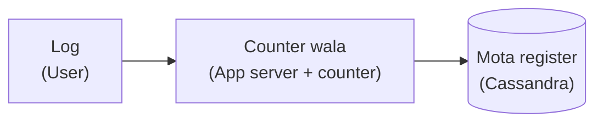
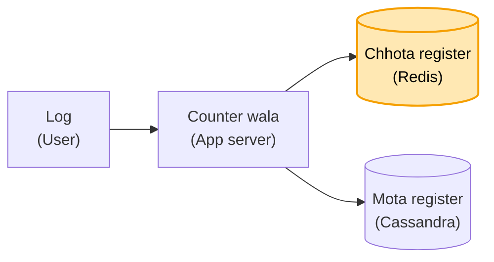
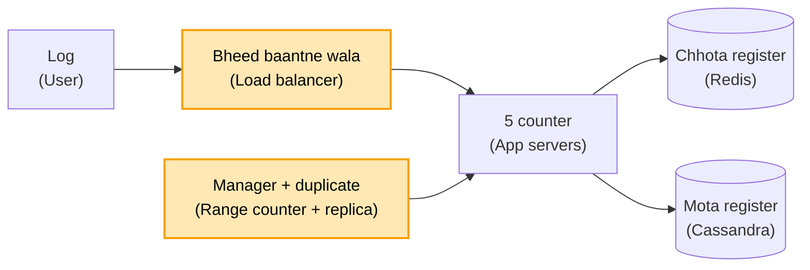
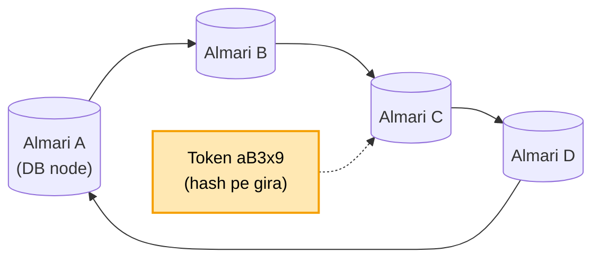

# URL shortener: token counter ki kahani

Ek token counter hai. Log aate hain aur bahut lamba pata likhi chit dete hain ("amazon.in/products/xyz/...").
Counter wala unhe chhota token deta hai, jaise aB3x9. Kaam: jo bhi token dikhaye, use lamba pata turant mile, aur do
logon ko kabhi same token na mile.

Har kadam = **kahani** (dikkat aur hal, bolne wali bhasha) -> **Asli naam** (interview me yahi shabd) -> tasveer
(kahani ka shabd, bracket me asli naam).

---

## FR / NFR / Numbers (interview me pehle 2 minute)

```
FR      lamba link do, chhota code lo (max 7 akshar, short.ly/aB3x9) · chhota link khole to lambe pe bhejo (redirect)
NFR     kholna turant · hamesha chale (link toota to bheja hua bekaar) · ek code = ek link, kabhi same nahi
Numbers roz 10 crore naye link = ~1,000 / sec banana · har link ~100 baar khulta = ~1 lakh / sec kholna
        5 saal me ~90 TB · 7 akshar, har akshar 62 tarah ka = ~3.5 lakh crore code
        -> kholna 100 guna zyada: cache chahiye · 90 TB ek machine me nahi: tukde chahiye
```

---

## 1. Same token, aur token lamba (ek line ka counter + number plate)

Counter wala token apne man se bana raha tha, kuch bhi chhota likh deta, to ek din do logon ko same de diya. To uska
token ek line wala kar do: abhi number 9 hai to agla 10. Ye ban gaya to aage badhao, phir ye ban gaya to aage badhao,
aise number kabhi repeat nahi hoga. Par saal bhar me counter 10 arab pe, token "10000000000", 11 akshar, aur lamba
hota jaayega. To gaadi ki number plate jaisa karo: DL 3C, phir 4C, 5C, phir 5D, sirf number nahi, akshar bhi.
Combination bana lo, 7 character me kaafi combination aa jaate. Token aur uska lamba pata ek mote register me likh lo,
token dikhaye to wahi se pata nikle.

**Asli naam:** ek line ka number = counter (har link ko agla number, takrav kabhi nahi), number plate = base62 (0-9,
a-z, A-Z), 7 character = 62^7, ~3.5 lakh crore code. Mota register = DB (Cassandra: data bas code -> link, na join na
transaction, par 90 TB kai machine me baantna hai, isliye NoSQL key-value).



## 2. Mota register palatna dheema (chhota pehla register)

Token lene wale kam aate, token dikha ke pata lene wale bahut, har second 1 lakh. Counter wala har baar mota
register palat ke dhoondhta, line ruk jaati. Aur kuch token din me hazaar baar aate. To mota register to rakho, koi
dikkat nahi, par ek chhota pehla register rakh lo, usme wahi baar-baar wale token. Jo log bahut baar poochhne aa rahe,
wo wahin se chale jaayenge. Chhota register bhar gaya to purana hatao: ya to time laga do ki ye token itni der tak
rahega, phir hata do; ya jo sabse kam use hua, jo ab poochha hi nahi ja raha, wo hatao. Wo likha hi kyun ja raha hai.

**Asli naam:** chhota pehla register = cache (Redis), pehle Redis, nahi mila to DB se laake Redis me rakho
(cache-aside), itni der tak = TTL, jo poochha nahi ja raha = LRU.



## 3. 7 baje 1,000 log mote register pe (chhota ladka + uski timeline)

Ek mashhoor token ka waqt theek 7 baje khatam, chhote register se hat gaya, aur usi pal 1,000 log wahi token le ke
aaye, saare mote register pe toot pade. To mere paas ek chhota ladka hai: bhai chupchap bhaag ke ja, mote register se
information nikaal ke la aur chhote register me rakh de, baaki sab yahin ruk jaayenge. Patapat la, khatam kahani.

**Asli naam:** ek ladka jaaye, baaki ruken = lock (single flight), la ke chhote register me rakh de = DB se laake Redis
bharna. Isse stampede rukta hai.

**Maan lo ladka raste me gir gaya, kabhi wapas nahi aayega, aur 999 "ladka laayega" soch ke khade:** main intezaar kab
tak karunga? Ladke ki timeline rakhunga: itni der me nahi aaya to 999 me se ek ko bolunga, bhai tu ja, mote register
se la de, mera ladka pata nahi kahan gaya. Aur tab tak logon ko purani information de sakte hain, baad me update kar
denge.
**Asli naam:** ladke ki timeline = lock TTL (umar khatam to lock khulta, agla le leta), purani do, baad me update =
soft / hard TTL (soft nikla to purana turant do, peeche se naya lao).

## 4. 5 counter, dono ne token "10" diya (apni-apni range + duplicate manager)

Ek counter se bheed nahi sambhli, 5 counter khol diye. Har counter apni ginti 1, 2, 3 chala raha, to counter 1 aur 2
dono ne apne 10ve aadmi ko token "10" de diya. To paanchon ko range me baant do: tu 1 se 100 karega, tu 101 se 200,
tu 201 se 300, tu 301 se 400, tu 401 se 500. Beech me ek manager hai jo har counter ko naya dabba deta. Ek ka dabba kabhi doosre se
nahi milta, to same token kabhi nahi.

**Asli naam:** 5 counter = kai app server + aage load balancer, apni-apni range = counter range (beech ka counter har
app server ko number ka dabba deta, dabba khatam hone pe hi agla maangta, to us pe bojh bhi nahi).

**Maan lo manager achanak chhutti pe:** uski jagah ek aur manager, uska duplicate rakh lo. Jaise company me ek manager
chhutti pe jaaye to doosra sambhaal leta, same to same yahan.
**Asli naam:** duplicate manager = range dene wale counter ki replica.



## 5. 90 TB, ek almari me nahi aata (tukde + gol chakkar)

5 saal me mote register me itne token, 90 TB, ki wo ek almari me aata hi nahi, aur bharta hi jaayega. To chhote-chhote
tukde bana do: 10 TB ke 9 tukde, sab alag-alag almari me. Aur hash se baanto, ki token aaya to is tukde pe, phir same
aaya to phir usi tukde pe. Par 9 almari bhar gayi, 10vi laga di, hisaab "9 me se kaunsi" se "10 me se kaunsi" ho
gaya, aur lagbhag har token galat almari me dhoondha ja raha, sab "nahi mila". To almari ko gol chakkar me door-door
rakho. Token aaya to dekho wo kis jagah gira, jo uske paas ki almari hai usme thoos do. Jaise gaadi chala raha hoon,
beech me toofan aa gaya, to paas ka shelter dhoondhunga. Kal 10vi almari aayi to sirf uske paas wala thoda badlega,
poore 9 ya 10 ko alag nahi karna padega.

**Asli naam:** tukde = shard, hash se baanto = code ke hash se machine tay, gol chakkar = consistent hashing (ring),
paas ka shelter = ghadi ki disha me pehli machine, sirf paas wala badle = nayi machine pe sirf ek tukda shift.



## 6. Almari me aag (copy + do me likho, do se padho)

Almari number 3 me aag lagi, uske saare token jal gaye. To ek almari mat rakho, uski copy bana do: 3 gir gayi to uski
ek aur copy hai. Par copy thodi peeche ho sakti hai, to acknowledge wala kar lo: "haan bhai maine likh liya, tu
acknowledge bhej". Jab tak acknowledge nahi aata, tab tak pakka nahi.

**Asli naam:** almari ki copy = 3 replica (alag machine), acknowledge aaye tab pakka = quorum write (W=2).

**Maan lo teen copy A, B, C, naya token A aur B ne haan bola, C peeche, aur turant dost ne token dikhaya, counter ne C
se padha, "nahi mila":** humne do pe likha, to do se hi padhwao, B aur C se ya A aur C se, single-single se nahi. Ek
copy peeche reh bhi gayi to atleast ek ke paas to hai. C nahi hai to B ke paas hai.
**Asli naam:** do se padho = R=2, W + R > 3, to ek copy hamesha common.

## 7. Cricket ka token viral (register ki photocopy + counter ki parchi)

Cricket match ka token viral, 1 crore log ek saath. Sab counter wale us token ke liye ek hi chhote register ki taraf
bhaag rahe, wo itna dheema ki uske baaki token bhi atke. Sabko wahi token chahiye, to ek hi register kyun? Uski
photocopy bana do, 10 kar do, 100 kar do, bheed bat jaayegi. Par phir bhi counter wale ko har baar kursi se uth ke
register tak jaana padta, 1 crore log, 1 crore chakkar. To counter wala ek chhoti parchi pe wo token aur pata apne
paas likh le aur kursi pe baith jaaye. Koi poochhe to "le bhai, teri information ye rahi", dobara jaana hi nahi padta.

**Asli naam:** register ki photocopy = Redis replica (garam key ki padhai copies me bant-ti), counter ki parchi = local
cache (app server ki memory me garam link kuch second).

## 8. Dhokhe wala pata, log phone se seedha (token radd + phone me likhne mat do)

Kisi ka idea tha ki har aadmi pata apne phone me hi likh le, counter pe aaye hi nahi. Hafte baad pata chala ek token
ka pata dhokhe wali site ka hai. To token radd kar do, ki ab wo galat site pe nahi jaayega. Aur aage se pehle hi dekh
lo: user ko dene se pehle khud check karo ki jo wo bana raha wo theek hai, galat ho to banane se hi mana kar do.

**Asli naam:** token radd = code band (DB me "band" nishaan, aur chhote register se bhi hatao, warna TTL tak purana pata
deta rahega), dene se pehle check = kaali list (Google Safe Browsing).

**Maan lo token radd kiya, par log counter pe aa hi nahi rahe, phone me likha pata seedha khol rahe:** phone mere haath
me nahi, main use mita nahi sakta. To phone pe likhne hi mat do. Likhega nahi to wo har baar hamare counter pe aayega,
aur hum use theek jawab de denge. Saaf baat hai.
**Asli naam:** phone me likh le = 301 (browser cache, hamesha ke liye), likhne hi mat do = 302 (har click hamare paas,
control hamare paas). Phone cache pe TTL bhi lag sakta, par tab tak wo purana hi deta.

## 9. Machine se har second hazaar chit (gate pe bhaga do + har aadmi pe had)

Ek aadmi ne machine laga di, har second hazaar chit, sab nakli ya dhokhe wale pate. Counter ka number faltu khatam,
register bhar raha, asli log atke. Ek-do baar, teen baar, chaar baar, phir pattern pata lag jaata ki ye banda har baar
yahi drama karke jaata hai. To use gate pe hi bhaga do, kamre me ghusne hi mat do.

**Asli naam:** pattern dekh ke gate pe bhaga do = WAF block.

**Maan lo pakadne me 3-4 chakkar lagte, tab tak wo laakhon chit de chuka:** to shuru se har aadmi pe had. Yahan thoda
pench hai: had group pe nahi, ek aadmi pe. Ek office ke log ek hi WiFi se aate, sab asli hain, unko token dena hai. To
ye ek banda hai, ek baar me 5 hi lagayega, usse zyada nahi.
**Asli naam:** per user had = rate limit user pe (IP pe nahi, office WiFi = ek IP ke peeche kai asli user), had paar =
429.

**Maan lo bina login ke link banta, aur script har second hazaar bana rahi, userId hai hi nahi:** pehla raasta, login
laga do, tab userId pe had bhi aur dashboard / tracking bhi. Login nahi rakhna to tracking chhodo, IP pe thodi dheeli
had (userId pe kadi). Baar-baar aaye to IP ban, ek hi desh se naye-naye IP aayein to thodi der us desh ko WAF block me.
**Asli naam:** auth zaroori ya anonymous rate limit per IP, WAF block list / geo-block.

---

Notes (Arpan ke shabd) = [URL_HAND_NOTES.md](URL_HAND_NOTES.md) · [<- MASTER SHEET](../../00_MASTER_SHEET.md)
