# URL shortener: token counter ki kahani

Ek token counter hai. Log aate hain aur bahut lamba pata likhi chit dete hain ("amazon.in/products/xyz/...").
Counter wala unhe chhota token deta hai, jaise aB3x9. Kaam: jo bhi token dikhaye, use lamba pata turant mile, aur do
logon ko kabhi same token na mile.

Har kadam = **kahani** (dikkat aur hal, bolne wali bhasha) -> **Asli naam** (interview me yahi shabd) -> tasveer
(kahani ka shabd, bracket me asli naam).

---

**Ek nazar: dhaancha + dikkat chain (round me sabse pehle ye, phir FR / NFR isi se):**
```
User  -->  LB  -->  kai counter (app server)
                        |
        naya token:     |   ginti ki line (counter, har counter ki apni range)
                        |   number -> chhota token (akshar + number, base62)
                        |   mota register me likho (Cassandra, tukdon me, 3 copy)
                        |
        token se pata:  |   pehle chhota register (Redis cache), na mile to mota register
                        v
                  lamba pata -> wahan bhej do (302)

 1  do logon ko same token              ->  ek line ka counter (ginti)
 2  10 arab pe token lamba              ->  number plate jaise akshar bhi (base62)
 3  har baar mota register palatna      ->  chhota register pehle (cache)
 4  chhota register bhar gaya           ->  jo kab se poochha nahi gaya use hatao (LRU)
 5  7 baje 1,000 log mote register pe   ->  ek chhota ladka jaaye, baaki ruke (single flight)
 6  ladka raste me gir gaya             ->  ladke ki timeline (lock ki umar)
 7  5 counter, dono ne "10" diya        ->  har counter ki apni range
 8  90 TB, ek almari me nahi            ->  tukde, hash se baanto (sharding)
 9  almari 3 me aag                     ->  copy + "haan" ka intezaar (replica, ack)
10  dost ne C se padha, "nahi mila"     ->  do me likho, do se padho (quorum)
11  cricket token viral                 ->  register ki photocopy + counter ki parchi (hot key copies, local cache)
12  dhokhe wala pata, log phone se      ->  token radd + phone me likhne mat do (302, 301 nahi)
13  machine se har second hazaar chit   ->  gate pe bhaga do + har aadmi pe had (rate limit)
```

**FR / NFR kahan se:** hawa se nahi aate. Upar ki dikkat chain dekh ke nikale; har FR / NFR line ke aage likha hai wo kis kadam ki dikkat se aayi.

## FR / NFR / Numbers (interview me pehle 2 minute)

```
FR      1  lamba URL do, chhota token lo                                  -> kadam 1, 2
        2  chhota token kholo to lambe pe bhejo                             -> kadam 3, 12
        3  dhokhe wala link pata chale to wo token band kar sako             -> kadam 12

NFR     1  kholna turant, har baar mote register pe na jaaye                -> kadam 3, 4
        2  garam (viral) token pe bhi na atke                               -> kadam 5, 6, 11
        3  lambe ka chhota hamesha sahi, abhi likha turant mile             -> kadam 9, 10
        4  jo save ho gaya wo na khoye (almari jale to bhi copy);
           save hi fail ho to user "dobara banao"                           -> kadam 9
        5  do logon ko kabhi same token na mile                             -> kadam 1, 7
        6  machine se hazaar chit na ban sake (har aadmi pe had)            -> kadam 13

Numbers sirf jahan faisla badle: saalon me itna data (~90 TB) ki ek almari me nahi aata -> tukde (kadam 8)
```

---

## 1. Do logon ko same token (ek line ka counter)

Counter wala token apne man se bana raha tha, kuch bhi chhota likh deta, aur ek din do alag logon ko same token de
diya. To uska token ek line wala kar do: abhi number 9 hai to agla 10. Ye ban gaya to aage badhao, phir ye ban gaya to
aage badhao, isliye number kabhi repeat nahi hoga. Counter kar do, counter service. Random ya hash me do logon ko same
code mil sakta, har baar DB me jaanchna padta; counter me ye dikkat hi nahi.

**Asli naam:** ek line me, aage badhao = counter (har link ko agla number), kabhi repeat nahi = takrav kabhi nahi, random / hash = collision + DB check.

**Maan lo do log ek hi pal me aayein:** upar se ek pehra aur: DB me code pe unique, "insert if not exist", jo DB me
apne aap atomic hai.
**Asli naam:** unique index / constraint on code.

**Maan lo do log same lamba link chhota karein (Delhi, Mumbai):** dono ko alag code, ek ke do link chalte, dikkat nahi;
counter aage hi chalega. bit.ly pe jaancha (21-Nov): ek hi YouTube link do baar, dono baar alag link.
**Asli naam:** same long URL = naya code, lambe link pe dedup nahi.

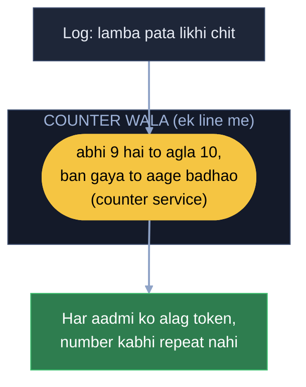

## 2. Counter 10 arab pe, token lamba (number plate jaise akshar bhi)

Saal bhar me counter 10 arab pe pahunch gaya, token "10000000000", 11 akshar, aur lamba hota jaayega. Number wahi
rakhna hai par token chhota chahiye. To gaadi ki number plate dekho: "DL 3C AB 1234" me sirf number nahi, akshar bhi
hain. DL 3C, phir 4C, 5C, phir 5D, phir A, AB ke baad CB, aise aata rahega. 1 2 3 4 ki jagah combination bana lo, aur
7 character hon to kaafi combination ho jaate hain.

**Asli naam:** number plate jaise akshar bhi, combination = base62 (0-9, a-z, A-Z), 7 character, kaafi combination =
62^7, ~3.5 lakh crore code.

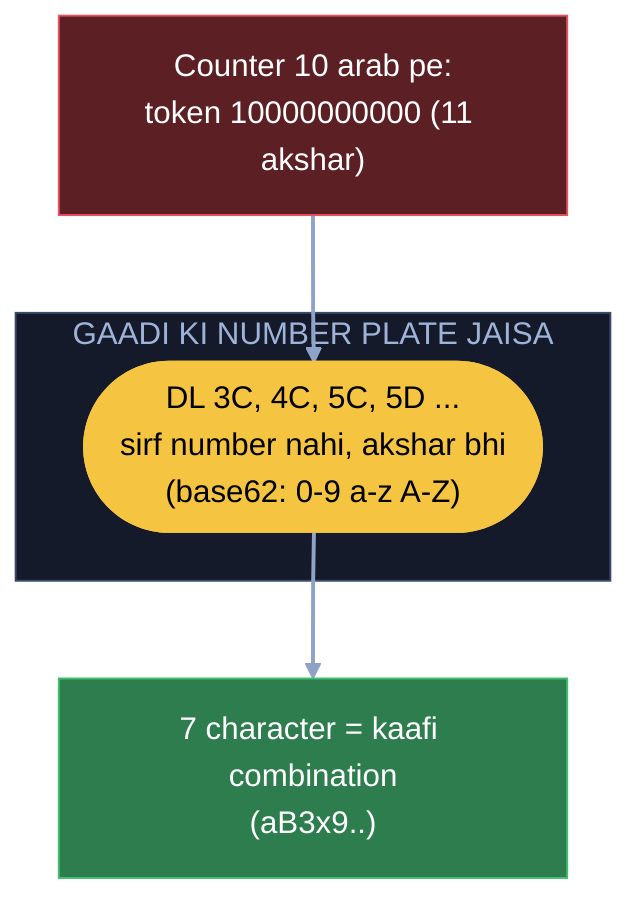

## 3. Har baar mota register palatna (chhota pehla register)

Token lene wale kam aate, par token dikha ke pata lene wale bahut, har second 1 lakh. Counter wala har baar mota
register palat ke dhoondhta, isliye line ruk jaati. Aur kuch token din me hazaar baar aate. To mota register to rakho,
koi dikkat nahi, par ek chhota pehla register bhi rakh lo, usme wahi baar-baar wale token. Jo log bahut baar poochhne
aa rahe, wo wahin se chale jaayenge.

**Asli naam:** chhota pehla register = cache (Redis), mota register = DB (Cassandra: data bas code -> link, na join na transaction, par 90 TB kai
machine me baantna hai, isliye NoSQL key-value), bahut baar
poochhe jaane wale = garam / baar-baar padhe link. Pehle Redis, nahi mila to DB se laake Redis me rakho (cache-aside).

**Maan lo server ki memory me hi rakh lo:** server restart hua to saare link gaayab, isliye pakki jagah DB, tez padhne
ko alag Redis. **Maan lo Redis gira:** copy (replica); copy bhi giri to fail open, sab DB se, itne me Redis wapas khada.
**Asli naam:** memory volatile -> durable DB; Redis replica; fail open (cache bypass).

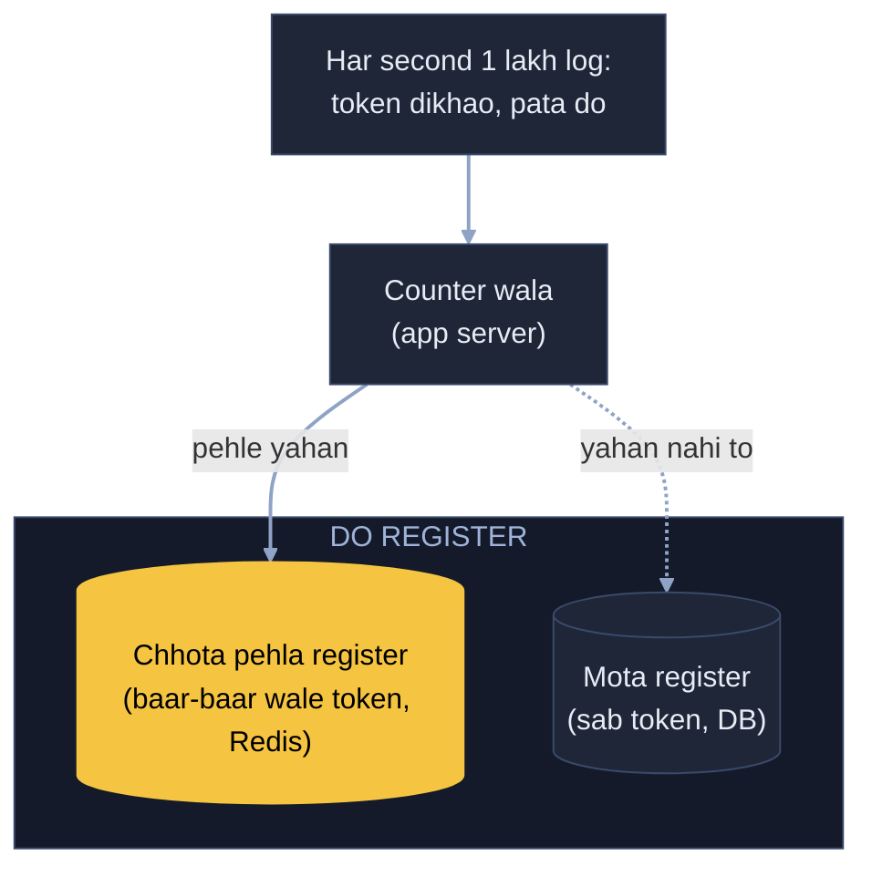

## 4. Chhota register bhar gaya (kise hatayein)

Chhota register bhar gaya aur naya token likhna hai, to kisi purane ko hatana padega. Hamare paas tareeke hain: time
laga do ki ye token itni der tak register me rahega, uske baad hata do. Ya jo sabse kam use hua, jo ab poochha hi nahi
ja raha, wo hatao, kyunki wo likha hi kyun ja raha hai.

**Asli naam:** itni der tak rahega, phir hata do = TTL, jo poochha hi nahi ja raha, hatao = LRU.

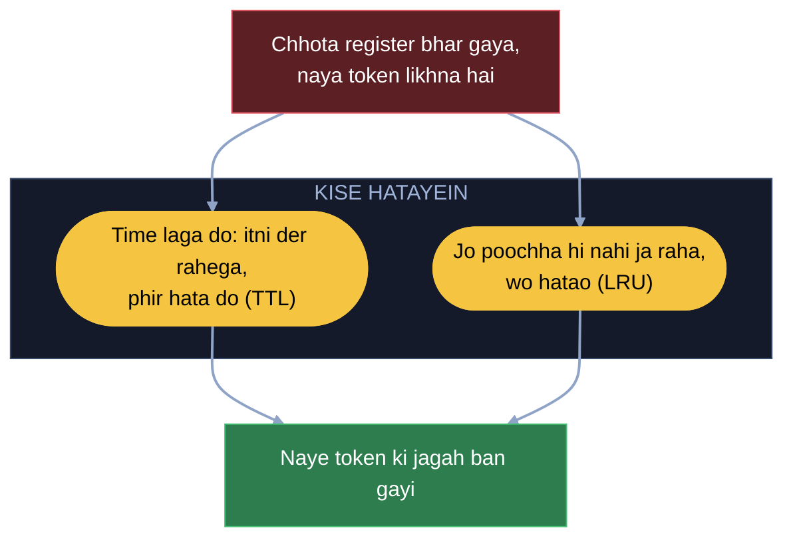

## 5. 7 baje 1,000 log mote register pe (chhota ladka)

Ek mashhoor token ka waqt theek 7 baje khatam hua aur wo chhote register se hat gaya. Usi pal 1,000 log wahi token le
ke aaye, aur saare ek saath mote register pe toot pade. To mere paas ek chhota ladka hai, main use bolunga: bhai
chupchap bhaag ke ja, mote register se wo information nikaal ke la aur chhote register me rakh de. Baaki sab yahin ruk
jaayenge. Patapat la, khatam kahani, ho gaya kaam.

**Asli naam:** ek ladka jaaye, sab yahin ruken = lock (single flight), la ke chhote register me rakh de = DB se laake
Redis bharna. Isse stampede rukta hai.

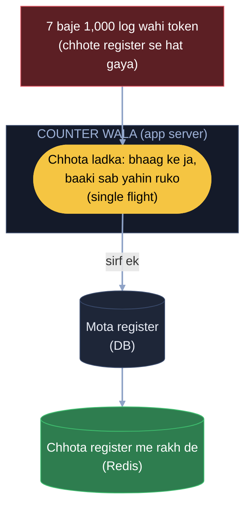

## 6. Ladka raste me gir gaya (ladke ki timeline)

Ladka bhaaga aur raste me gir gaya, kabhi wapas nahi aayega, aur baaki 999 "ladka laayega" soch ke ruke khade hain.
Yahan thoda decision lena padega, kyunki main intezaar kab tak karunga? Main us ladke ki timeline rakhunga: itni der
tak nahi aaya to 999 me se ek ko bolunga, bhai le idhar aa, mote register se information la ke de de, mera ladka pata
nahi kahan gaya. Aur tab tak logon ko purani information de sakte hain, baad me update kar denge.

**Asli naam:** ladke ki timeline, nahi aaya to agla = lock TTL (umar khatam to lock khulta, agla le leta), purani
information do, baad me update = soft / hard TTL (soft nikla to purana turant do, peeche se naya lao).

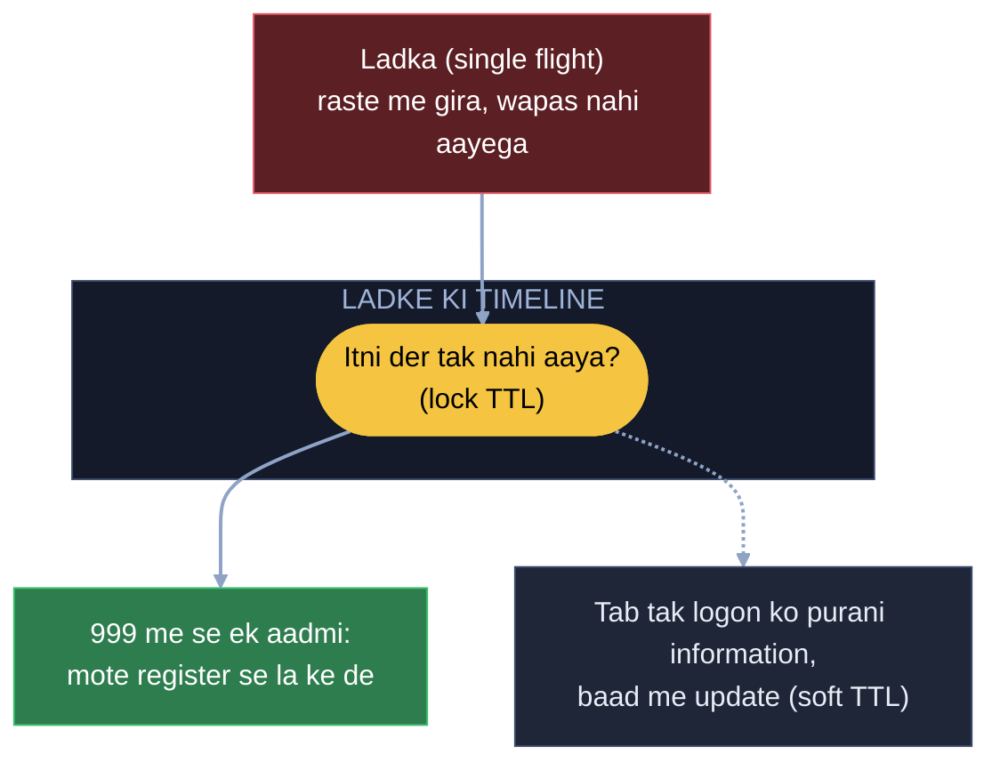

## 7. 5 counter, dono ne token "10" diya (apni-apni range)

Ek counter se bheed nahi sambhli, to 5 counter khol diye. Har counter apni ginti 1, 2, 3 chala raha, isliye counter 1
aur 2 dono ne apne 10ve aadmi ko token "10" de diya. To paanchon ko range me baant do: tu 1 se 100 karega, tu 101 se
200, tu 201 se 300, tu 301 se 400. Aise sabko range me baant dunga.

**Asli naam:** apni-apni range = counter range (beech ka counter har app server ko number ka dabba deta, dabba khatam hone pe hi agla maangta, to us pe bojh bhi nahi), 5 counter =
kai app server + aage load balancer.

**Maan lo counter range ke beech (400 pe) crash:** us range ke baaki number bekaar, par 62^7 (~3.5 trillion) hain,
koi farak nahi, app chalta rahega.
**Asli naam:** range ke bache number = gap, counter wapas nahi maangta.

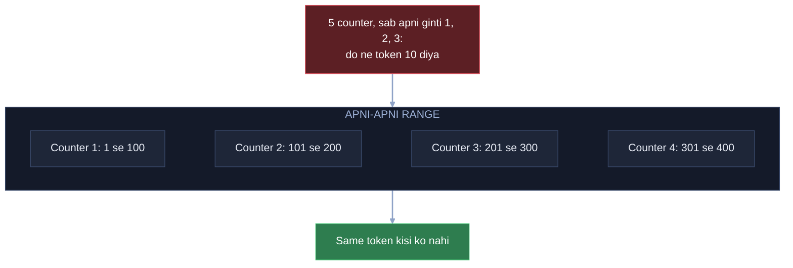

## 8. 90 TB, ek almari me nahi aata (tukde, hash se baanto)

5 saal me mote register me itne token, 90 TB, ki wo ek almari me aata hi nahi, aur bharta hi jaayega. To shard kar do,
chhote-chhote tukde bana do: 10 TB ke 9 tukde, aur sab tukde alag-alag almari me. Aur hash se baanto, ki token aaya
to is tukde pe gaya, phir same aaya to phir usi tukde pe.

**Asli naam:** chhote tukde, alag almari = shard, hash se baant do, same aaye to usi tukde pe = code ke hash se
machine tay.

**Maan lo almari phir kam padi, 10vi lagani hai:** ye Cassandra khud sambhalta hai. Token ke hash se tukda wahi tay
karta, nayi machine lagao to apne aap thoda data baant deta, baaki apni jagah. Ye uska andar ka kaam hai, hamara
faisla nahi; interview me "Cassandra, partition key = token, machine jodte jao" kaafi.
**Asli naam:** Cassandra andar token ring pe data baantta hai (official doc: "Dataset Partitioning: Consistent
Hashing", https://cassandra.apache.org/doc/latest/cassandra/architecture/dynamo.html).

**Maan lo 10vi almari:** mod se sab token idhar-udhar ho jaate, isliye almariyan gol chakkar me; hash jahan gire, uske
sabse paas wali almari.
**Asli naam:** hash % N ki dikkat -> consistent hashing (ring).

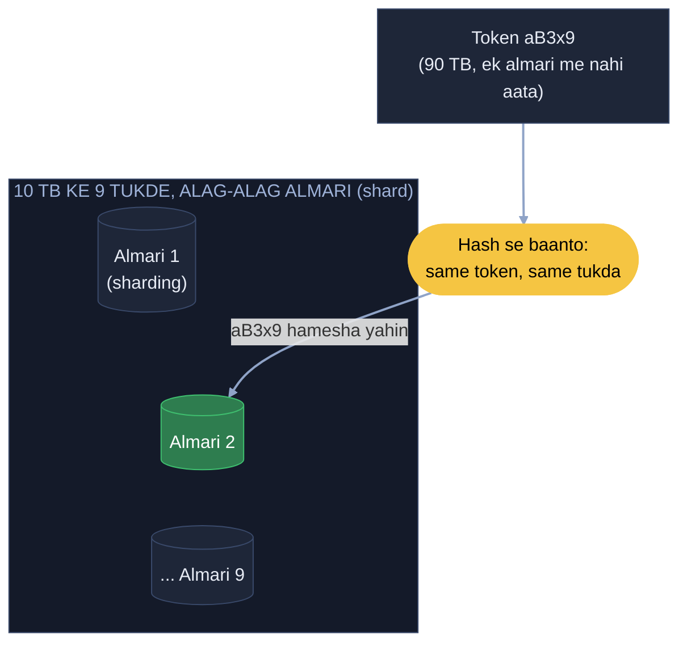

**Isi pe ek aur raasta (hash ki jagah state ke hisaab se):** mote register ko state ke hisaab se kaato (Delhi, Punjab, UP), har register pe
thappa. Token me state ka chhupa code (01 = Delhi); beech ka bada bhai shuru ke 2 digit list se mila ke sahi register
pe bheje. DB = Cassandra: key-value, likhai bahut, data me bank jaisi consistency (paisa, transaction) chahiye hi nahi, apne aap scale + replica.
**Asli naam:** geo-partition, shard id ID ke andar, router / shard map.

## 9. Almari number 3 me aag (copy + acknowledge)

Almari number 3 me aag lagi, uske saare token jal gaye. To ek almari mat rakho, unhi ki copy bana do: 3 gir gayi to
uski ek aur copy hai. Par isme dikkat ye ki copy thodi peeche ho sakti hai, to acknowledge wala kar lo: "haan bhai
maine likh liya, tu acknowledge bhej". Jab tak acknowledge nahi aata, tab tak pakka nahi.

**Asli naam:** almari ki copy = 3 copy (replica, alag machine), acknowledge aaye tab pakka = quorum write (W=2).

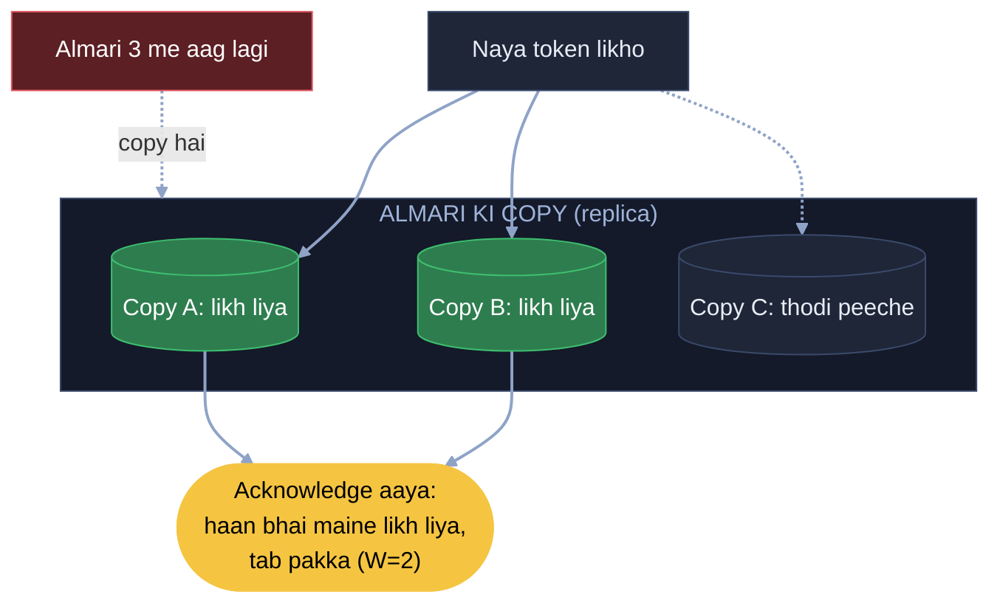

**Aur neeche (poori building / shehar me aag to; central authority):** copy Lajpat Nagar, ISBT, Kashmiri Gate; beech ki authority pehle likhe phir sabko bheje,
uski bhi ek copy. Copy peeche chale to baad me update. Save hi fail ho gaya (crash, rollback) to user ko "link bana nahi, dobara banao"; ek-do number bekaar gaye to naya number, arabon hain.
**Asli naam:** central authority = coordinator (request leta, ring me aas-paas ki copies ko bhejta), copy peeche = async
lag, authority gire to koi aur coordinator.

## 10. Dost ne C se padha, "nahi mila" (do se padhwao)

Teen copy A, B, C hain. Arpan ne naya token banaya, A aur B ne haan bola, C peeche reh gaya. Turant dost ne token
dikhaya, aur counter wale ne C se padha, "nahi mila". Humne do pe likha, to do se hi padhwao, single-single se nahi:
B aur C se, ya A aur C se. Ek copy peeche reh bhi gayi to atleast ek ke paas to hai, C nahi hai to B ke paas hai.

**Asli naam:** do se hi padhwao = R=2, ek ke paas to hai = W + R > 3, isliye ek copy hamesha common.

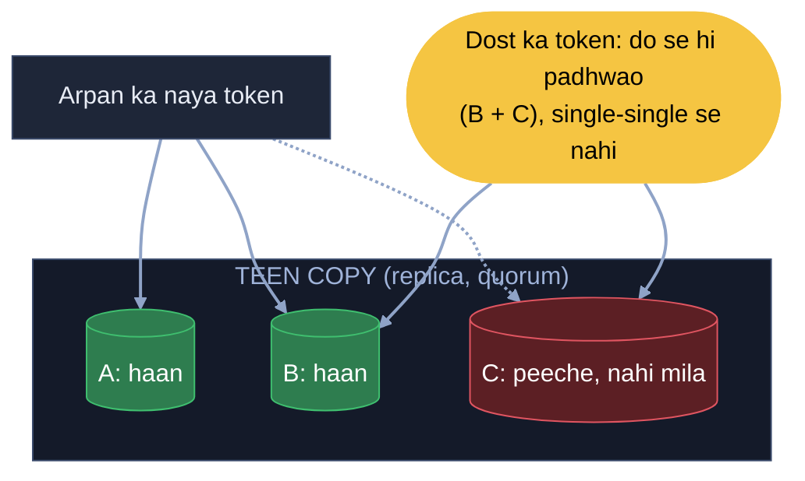

## 11. Cricket ka token viral (register ki photocopy + counter ki parchi)

Cricket match ka token viral, 1 crore log ek saath. Sab counter wale us token ke liye ek hi chhote register ki taraf
bhaag rahe, aur wo itna dheema ki uske baaki token bhi atke. Sabko wahi token chahiye, to ek hi register kyun? Uski
photocopy bana do aur divide kar do, 10 kar do, 100 kar do, bheed bat jaayegi.

**Asli naam:** chhote register ki photocopy, divide = Redis replica (garam key ki padhai copies me bant-ti).

**Maan lo copy 10 ho ya 100, par har baar counter wale ko kursi se uth ke register tak jaana padta, 1 crore log, 1
crore chakkar:** to counter wale ko bolo, ye information tu apne paas rakh le, baar-baar uth ke kyun ja raha. Ek
chhoti parchi pe uska token aur pata likh le aur kursi pe baith ja. Roz 100 log wahi information maangein aur wo
pachaas kadam door ho, to har baar wahan jaane ki jagah apne page pe likh lo. Ab koi poochhe to "le bhai, teri
information ye rahi", dobara kahin jaana hi nahi padta.
**Asli naam:** counter wala apne paas parchi rakhe = local cache (app server ki memory me garam link kuch second).

**Maan lo wahi cricket token roz garam, photocopy 7 pe 7 baje umar khatam, aur purani information to mit chuki:** aisa
token ek saath khatam hi mat hone do: nazar rakho, umar badhate raho (+60, +60), 10 photocopy ki umar alag. Photocopy 7
pe sab ruko, ladka mote register se laaye. Purani ke liye chupchaap ek aur parchi apne paas; asli mite to wo do, ladka
nayi laaye to purani phaad do. Counter wale ki apni parchi pe chhoti umar. Ladka gira to doosra; backoff tab jab 10
ladke bhi na aayein (mota register gira).
**Asli naam:** hot key TTL extend (refresh-ahead), TTL jitter, stale copy (soft / hard TTL, stale-while-revalidate; kadam 6
wali purani information yahi), local cache short TTL, DB down pe retry with backoff (ladka gira to thoda ruk ke
doosra, phir thoda zyada ruk ke teesra, 1, 2, 4 sec; bombard nahi). Jitter = upar wali "photocopy ki umar alag" (+1, +2), backoff se alag.

**Maan lo 50 counter, har counter wale ne apna ladka bheja, mote register pe 50 ladke:** saamne ek banda sabko rokta,
sirf ek ladka jaata, ek hi information to laani hai.
**Asli naam:** distributed lock (saajha lock, Redis me ek key: SET NX + umar); kadam 5 ka ladka ek counter ka ho to 50 ladke jaate.

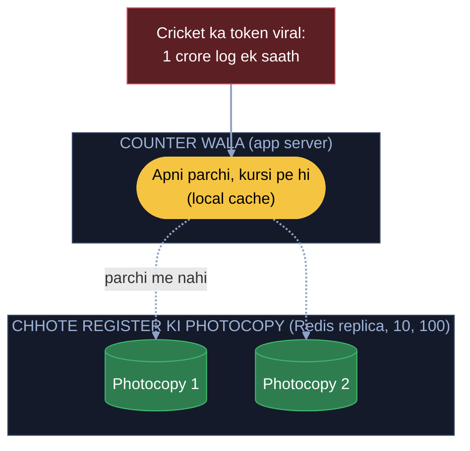

**Isi pe ek aur raasta (Redis tak aane hi mat do: local cache + alag dabba):** garam link server ke paas (local cache), aur uska alag Redis dabba + 1-2 copy, taaki
IPL ki bheed me baaki logon ke link na atkein. 3-4 counter phanse to ek chhotu laake sabke kaan me daale.
Ye consistent hashing nahi: link badal nahi raha, bas Redis ki copiyan ek ring me, aas-paas koi gira to agli copy pe.
**Asli naam:** hot key isolation, hot key replicas, request coalescing.

## 12. Dhokhe wala pata, log phone se seedha (token radd + phone me likhne mat do)

Kisi ka idea tha ki har aadmi pata apne phone me hi likh le, counter pe aaye hi nahi. Hafte baad pata chala ek token
ka pata dhokhe wali site ka hai, use band karna hai, par log seedha phone wale pate pe ja rahe. To token radd kar do,
ki ab wo galat site pe nahi jaayega. Aur aage se pehle hi dekh lo: user ko dene se pehle khud check karo ki jo wo bana
raha wo theek hai, galat ho to banane se hi mana kar do aur token radd.

**Asli naam:** token radd = code band (DB me "band" nishaan, aur chhote register se bhi hatao, warna TTL tak purana pata
deta rahega), dene se pehle khud check = kaali list
(Google Safe Browsing).

**Isi pe ek aur raasta (radd karne ki jagah banate waqt hi jaanch, library ki kitaab):** link banate waqt hi chupke se kholo, jaise kitaab library me rakhne se pehle
dekhte; gandi nikle to mat do.
**Asli naam:** create time pe URL safety check (reputation / kaali list).

**Maan lo token radd kiya, par log counter pe aa hi nahi rahe, phone me likha pata seedha khol rahe:** pehla khayal:
unke phone ka cache radd kar do, to agli request seedha hamare paas aayegi. Par phone uske haath me hai, main use mita
nahi sakta. To phone pe likhne hi mat do. Likhega nahi to wo har baar hamare counter pe aayega, aur hum use theek
token de denge. Agar phone wali dikkat hai to uske phone me likhna hi mat do, saaf baat hai. Aam taur pe phone ke
cache ko TTL laga ke invalidate kar sakte, lekin hum technical nahi, aam dikkat ka solution bol rahe the.
**Asli naam:** phone me likh le = 301 (browser cache, hamesha ke liye), phone me likhna hi mat do, har baar counter pe aaye = 302 + `Cache-Control: no-store` (save hi mat karna; 301
nahi; har click hamare paas, control hamare paas), phone cache pe TTL = browser cache ki umar.

**302 ka doosra fayda:** har click hamare paas aata hai, to link track karke dashboard bana sakte. **Maan lo har click
ginna hai:** user ko turant link do, ginti peeche Kafka / worker se; fail ho to dead letter queue, baad me theek.
**Asli naam:** click tracking / analytics, async click events (Kafka -> consumer), DLQ.

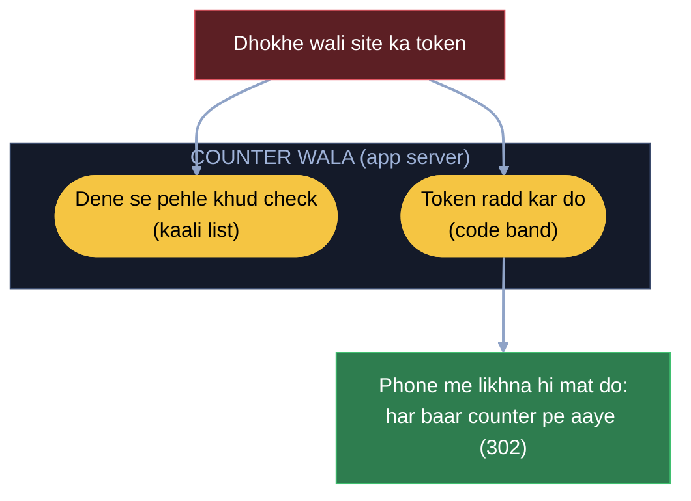

## 13. Machine se har second hazaar chit (gate pe bhaga do + har aadmi pe had)

Ek aadmi ne machine laga di, har second hazaar chit, sab nakli ya dhokhe wale pate. Counter ka number faltu khatam ho
raha, register bhar raha, aur asli log atke. To jaanch padtaal karo ki script lagi hai. Ek-do baar, teen baar, chaar
baar, phir pattern pata lag jaata ki ye banda har baar yahi drama karke chala jaata hai. To us bande ko rok do, kamre
me ghusne hi mat do, bahar gate pe hi bhaga do.

**Asli naam:** pattern pata lag jaayega, gate pe bhaga do = WAF block.

**Maan lo pakadne me 3-4 chakkar lagte, tab tak wo laakhon chit de chuka, to shuru se har aadmi ke liye kya niyam:**
yahan thoda pench hai. Had ek aadmi pe rakhenge, group pe nahi, kyunki ek office ke log ek hi WiFi se aate, sab asli
hain, unko token dena hai. To per user had: ye ek banda hai, ek baar me 5 hi lagayega, usse zyada nahi.
**Asli naam:** per user had, group pe nahi = rate limit user pe (IP pe nahi), office ka WiFi = ek IP ke peeche kai
asli user, 5 se zyada nahi = had paar pe 429.

**Maan lo bina login ke bhi link banta, script har second hazaar link bana rahi, userId hai hi nahi:** sabse pehle
login laga do, bina login link nahi, isse dashboard / tracking bhi chalega. Login nahi rakhna to tracking bhool ja, aur
IP pe had lagao: IP ki had thodi zyada, userId ki thodi kam. Script hazaar link nahi bana paayegi. Baar-baar aaye to IP
ban. Naye-naye IP se phir bhi aaye to peeche investigate karo, aur ek hi desh se aa raha to us desh ko thodi der WAF ki
block list me daal do.
**Asli naam:** login laga do = auth zaroori (tab userId pe had + tracking), bina login IP pe dheeli had = anonymous
rate limit per IP, IP ban, desh block = WAF block list / geo-block.

**Isi pe ek aur raasta (bodyguard: kuch bhi abnormal to roko):** ek aadmi script chala ke 1 lakh link le gaya, pata hi nahi laga. To gate pe bodyguard
khada karo: kuch abnormal lage (script, ek aadmi laakhon request, ek IP se 1000 ek saath) to rok do; baar-baar aaye to
jail, dobara nahi aayega. AWS ke gateway pe hi rok do, phir block list me.
**Asli naam:** API gateway / WAF pe rate limit + anomaly check, jail = IP / user ban.

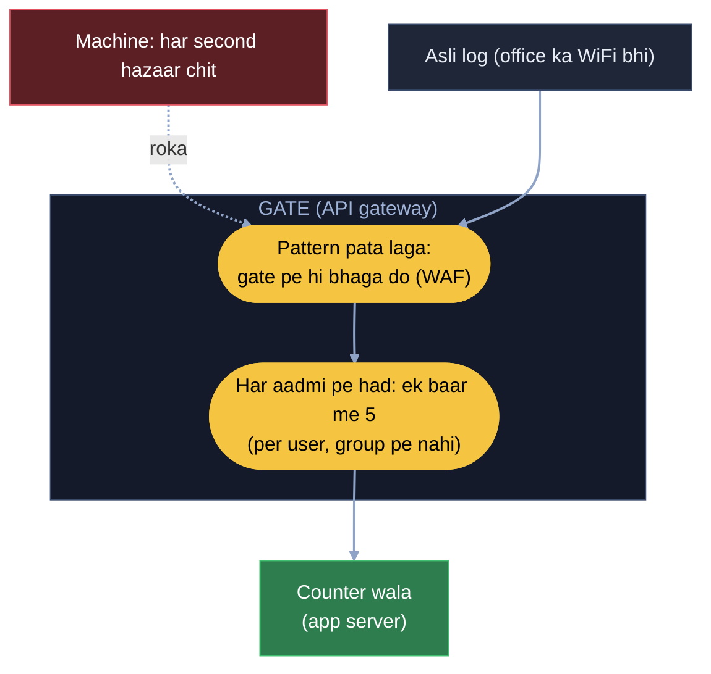

---

## Poora dhaancha ek nazar me

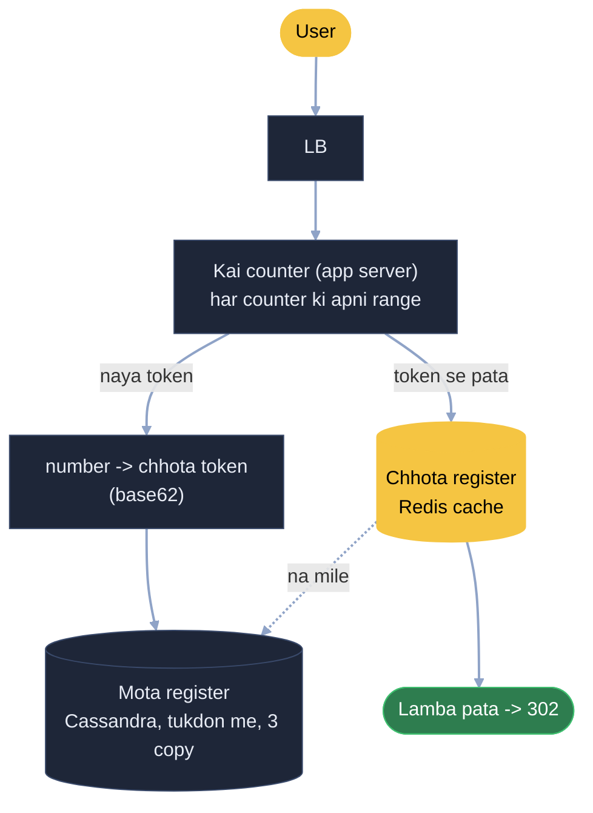

---

Notes (Arpan ke shabd) = [URL_HAND_NOTES.md](URL_HAND_NOTES.md)
