# URL Shortener

> Lamba link do, chhota 7 akshar ka code milta hai. Koi chhote link pe click kare to asli link pe bhej do (302).
> Dil do cheezein: har link ka code alag, aur click pe redirect bahut tez. Log link banate kam, kholte zyada (100 me 99 baar kholna).
>
> Mock me sirf heading + Cue + poster. Poster me sab: upar "Pehle aisa tha", tasveer (ilaaj), hara "Kyun chalta", laal number = kya toot sakta + kaise bacha, peela = doosra tareeka kyun nahi, grey = baaki.
> Cross-Q: hal ke har bade shabd pe socho -> gira? · dheema / bheed? · do ek saath? · galat hua? · kaise / kitna?

---

## Poori tasveer (aakhir me design aisa banta hai)



---

## Shuru

```
FR      lamba link do, 7 akshar ka chhota code milta hai.
        Chhote link pe click kiya to asli link pe bhejo (302)
NFR     har link ka code alag ho. Click pe redirect bahut tez ho. 100 me 99 baar kholna hi hota hai
NUMBERS roz 10 crore naye link (~1,000 / sec). Har link ~100 baar khulta hai (~1 lakh click / sec).
        Ek link ~500 byte, 5 saal me ~180 arab link, ~90 TB. 7 akshar = ~3.5 lakh crore code, ~100 saal.
        Click 100 guna hain, isliye aage cache. 90 TB ek machine me nahi aata, isliye aage shard
PEHLE   sabse simple: App code banata, DB me (code, lamba link) rakhta. Click pe App DB me code dhoondh ke
        asli link pe bhejta
```

> [!IMPORTANT]
> **RAIL: har design isi kram me chalta (8 dabbe, sab file me same)**
> kaam chala → bheed aayi → machine giri → do log ek saath → kuch dheema → data bada → door ke log → bahar ka hamla
>
> | rail | is design me | card |
> |---|---|---|
> | 1 kaam chala | lamba link → 7 akshar code, click pe 302 | Shuru |
> | 2 bheed aayi | sale link viral, har click DB pe | 1 |
> | 3 machine giri | App giri, site band | 2 |
> | 4 do log ek saath | maine aur Ravi ko ek hi code (**is design ka khaas**) | 3 |
> | 5 kuch dheema | click ginti se redirect dheema | 4 |
> | 6 data bada | 90 TB ek machine me nahi · naya link 404 | 5, 6 |
> | 7 door ke log / darwaza | LB gira, region gaya | 7 |
> | 8 bahar ka hamla | spammer 5,000 link / sec | 8 |


> [!NOTE]
> **AWS pe kaunsa DB (interview me naam bolna ho to)** · SQL wala = RDS, Cassandra RDS pe nahi chalta
>
> - Links (Cassandra) → **Amazon Keyspaces** (ya EC2 pe khud): 90 TB, likhai zyada, code se ring pe baant, RDS pe Cassandra nahi chalta
> - Cache (Redis) → **ElastiCache (Redis)**: 95% click yahin se, <1 ms

---

*ab tootega kahan? sabse pehle padhne pe, kyunki click 100 guna hain*

## 1. Mera sale wala link viral hua, har click DB pe, DB baith gaya

**Rail 2 BHEED AAYI** · Cue: REDIS CACHE (cache-aside)


---

*ab App hi ek hai, wo gir gaya to?*

## 2. Usi bheed me ek App machine giri, poori site band

**Rail 3 MACHINE GIRI** · Cue: STATELESS App x N + LOAD BALANCER


---

*ab kai App hain, sab code bana rahe, takkar?*

## 3. Maine aur Ravi ne link banaya, dono ko ek hi code mila

**Rail 4 DO LOG EK SAATH (khaas)** · Cue: COUNTER RANGE + base62


---

*ab click gin-ne gaye to redirect dheema*

## 4. Maine click ginti chahi, redirect hi dheema ho gaya

**Rail 5 KUCH DHEEMA** · Cue: KAFKA, ginti peeche


---

*ab data hi itna ho gaya*

## 5. DB team boli: 5 saal me 90 TB, ek machine me nahi

**Rail 6 DATA BADA** · Cue: SHARD by code (RING)


> [!CAUTION]
> **AWS pe Cassandra kahan? RDS pe? → NAHI.** RDS sirf SQL (MySQL · Postgres · MariaDB · Oracle · SQL Server).
> Cassandra → **Amazon Keyspaces** ya EC2 pe khud · key-value → **DynamoDB** · Mongo → **DocumentDB** · Redis → **ElastiCache**


---

*ab har tukde ki 3 copy, par naya link 404?*

## 6. Maine naya link banaya, turant khola, 404 aaya

**Rail 6 DATA BADA (copy ka AGAR)** · Cue: QUORUM (2 me likho, 2 se padho)


---

*ab LB hi ek hai*

## 7. Shaam ko LB hi gir gaya, koi request andar nahi

**Rail 7 DARWAZA / DOOR KE LOG** · Cue: ROUTE 53 + 2 LB (health check)


---

*ab koi galat istemal kare to?*

## 8. Raat ko spammer ki script, har second 5,000 link

**Rail 8 BAHAR KA HAMLA** · Cue: RATE LIMIT darwaze pe + WAF


Poora rate limit = [02_rate_limiter](../02_rate_limiter/02_rate_limiter.md).

---

## Poora design ek saans me

```
User -> Route 53 -> 2 LB -> WAF -> API Gateway (rate limit + login) -> App (stateless)
     -> Redis (95% click) -> Cassandra (code se baanta, 3 copy, 2 me likho 2 se padho)
NAYA LINK: App -> range se agla number -> base62 -> Redis + Cassandra -> chhota link
CLICK:     Redis me mila? -> 302 · nahi -> Cassandra -> Redis me rakho -> 302
           click ki khabar -> Kafka -> Analytics (kharab -> DLQ), redirect ruke bina
```

Bolne ke liye: short code ek badhta number hai, 62 akshar me likha. Har server ko numbers ki apni range milti, to do
server kabhi same code nahi banate. 100 me 99 baar link khulta, isliye khulna zyadatar Redis se, baaki Cassandra se.
Redirect turant, ginti peeche Kafka se. Do LB + Route 53, taaki ek gire to sab na gire. Darwaze pe had.

---

## 10 guna traffic

- **Route 53**: user ko uske paas wale region pe bhejo (geo-routing).
- **App**: stateless hai, machine badhao. Padhne wale aur likhne wale App alag (padhne wale ~20, likhne wale 2).
- **Redis**: saare link nahi samaate. Garam rakho, thande nikaalo (LRU + expiry). Thanda link khula to Cassandra se wapas.
- **Cassandra**: code se baanto, har tukde ki 3 copy. Padhne ka bojh badha to aur machine / copy.
- **Counter**: 2 copy, ek chalu ek taiyaar. Range waise bhi thodi der chala leti.
- **Kafka**: partition badhao.

**Pooche: kahan se sab gir sakta?** LB (2 copy), Counter (2 copy), Route 53 health check.

**Pooche: chal raha hai, kaise pata?** Redirect ka time (p99), galtiyon ki ginti, Kafka me kitna pending, alert.

---

## Pooche to (kisi card me nahi baitha)

API: link banana = POST /api/shorten { long_url, custom_code? } -> { short_url, expires_at }.
Link kholna = GET /abc123 -> 302 + Location. Banana POST, kholna GET.

Row: short_code (isi se machine tay) · long_url · created_at · expires_at.

Kaunsa DB kitne tak: MySQL ~1 arab row tak aaram se, Mongo ~10 arab tak, Cassandra / DynamoDB usse bahut aage.

Shabd bhool jao to seedhi baat bolo: "MD5" = lambe link ka hash, pehle 7 akshar. "Base62" = 62 akshar me number likh do.
"Counter" = ek badhta number, har link ko agla. Interviewer ko samajh chahiye, naam wo khud bol dega.

Koi phishing ka lamba link chhota kare? Chhota karne se pehle check karo (virus / dhokhe ki site),
taaki hamara domain spam na bane.

---

ARCHETYPE F (infra/component) · CONCEPTS: [ID-gen](../../FOUNDATIONS/13_distributed_id_snowflake.md) · [caching](../../FOUNDATIONS/04_caching.md) · [sharding](../../FOUNDATIONS/06_database_sharding.md) · [← MASTER SHEET](../../00_MASTER_SHEET.md)
