# URL Shortener

> Lamba link do -> chhota 7 akshar ka code milta hai. Koi chhote link pe click kare -> asli link pe bhej do (302 redirect).
> Is design ka dil do cheezein hain: **har link ka code ALAG (unique)** aur **click pe redirect bahut tez**, kyunki log link banate kam hain aur kholte bahut zyada (100 me se 99 baar kholna).

---

## KAHANI (ek din, mera sale wala link; har dikkat se design me ek dabba judta)

```
   KYA HUA                                     ILAAJ                                DABBA JUDA
1  mera sale link viral, DB baith gaya      -> REDIS CACHE (cache-aside)            Redis
2  usi bheed me ek App giri, site band      -> STATELESS App x N + LOAD BALANCER    LB + App x N
3  main aur Ravi, dono ko ek hi code        -> COUNTER RANGE + base62               Counter
4  click ginti likhi, redirect dheema       -> KAFKA, ginti peeche                  Kafka + Analytics + DLQ
5  DB team: 5 saal me 90 TB                 -> SHARD by code (RING)                 Cassandra
6  naya link banaya, turant khola, 404      -> QUORUM (2 me likho, 2 se padho)      (Cassandra quorum)
7  shaam ko LB hi gira                      -> ROUTE 53 + 2 LB (health check)       Route 53 + LB x2
8  raat ko spammer, 5,000 link / sec        -> RATE LIMIT darwaze pe + WAF          API Gateway + WAF

POORA DESIGN (upar ke dabbe kram se):
   User -> Route 53 -> LB x2 -> WAF -> API Gateway -> App x N (Counter se range) -> Redis -> Cassandra
   click ki khabar: App -> Kafka -> Analytics (fail -> DLQ)
```

---

## TASVEER (ByteByteGo / Alex Xu · CC BY-NC-ND 4.0)


Source: [Explaining 5 Unique ID Generators](https://bytebytego.com/guides/explaining-5-unique-id-generators-in-distributed-systems/)
(Code kahan se aaye: UUID / Snowflake / DB ka auto-increment / range. Hamara code = ek number ko base62 me likhna.)

---

## SHURU: pehle poocho, phir numbers

```
POOCHO:  "Link banana, redirect, click ginna, apna khud ka code (custom alias), expiry — kis pe dhyaan dein?"
         -> zaroori: link banana + redirect. Click ki ginti chahiye. Bada analytics dashboard bahar.
            Custom code = time bache to.
         "Din me ~10 crore (100M) naye link, aur har link ~100 baar khulta hai — ye maan ke chalun?"
         kuch na pata ho -> "ye maine use nahi kiya" bolna theek hai, interviewer khud bata dega.

ZAROORI KAAM (FR):   lamba -> chhota banao · chhote pe click -> asli pe bhejo
KAISA CHALE (NFR):   redirect 200 ms se tez · hamesha chalu · padhna >> likhna · code kabhi dohraaye nahi
                     ("aage ka har faisla inhi 4 me se kisi ek se judega")

NUMBERS (andaaza, calculator nahi):
   naye link:  10 crore / din. Din me ~1 lakh second hote hain -> ~1,000 naye link har second.
   click:      har link ~100 baar khulta -> ~1 lakh click har second.
   jagah:      ek link ~500 byte. 5 saal me ~180 arab link -> ~90 TB.
   code:       62 akshar, 7 jagah -> 62 x 62 x ... (7 baar) = ~3.5 lakh crore code -> ~100 saal chal jaayega.

NUMBER SE FAISLA:
   click >> naye link (100 : 1)   -> CACHE lagega
   90 TB                          -> ek machine me nahi aayega, SHARD karna padega
   7 akshar                       -> code kitna lamba ho, ye jhagda khatam
   Agar interviewer chhota maane (1 arab link = ~500 GB) -> ek hi DB me aa jaata, shard ki zaroorat nahi.
   Estimate chhodna mat, par exact ganit me mat atakna.
   Din ka maana to poora din ka hi rakho, mahine se mat milao.

KYUN CHAHIYE:  Twitter / SMS me jagah kam · marketing me kis link se kitne aaye · QR / print · saaf dikhta
```

---

## ════ MOCK SE PEHLE: SIRF YE CARD PADHO ════

> Har card: pehle PEELA DABBA dekho (scene + ilaaj). Yaad aa gaya -> aage. Nahi aaya -> neeche
> DIKKAT / NAHI padho. AAGE POOCHEGA sirf jab interviewer aage kuch poochhe.

#### DABBA 0: SABSE SIMPLE (yahan se shuru, phir "kahan tootega")
```
User link deta -> App ek code banata -> DB me (code, lamba link) save.
Click aaya -> App DB me code dhoondhta -> asli link pe bhej deta.
```


#### SHURU: CODE KAISE BANE
```
DIKKAT     Maine diya "https://amazon.in/....../bahut-lamba-link", mujhe chahiye "bit.ly/w7e".
           Har link ka code alag ho, warna do link ek hi jagah khulenge.
HAL        ek ginti (COUNTER) 1, 2, 3 ...: har naye link ko agla number, use BASE62 me likho = code.
           Counter dohraata nahi -> code dohraata nahi. Click pe 302 (har baar server tak, gin sakein).
```
```
TASVEER: number se code (base62)
  62 akshar: 0-9 (10) + a-z (26) + A-Z (26)
  number ko baar-baar 62 se bhaag do, bacha (remainder) = ek akshar, aakhir me ulta padho
  125 = 2 x 62 + 1 -> "21"          100 crore -> "15FTGg" (6 akshar)
```
```
AAGE POOCHEGA:
  NIYAM: code = counter ka number, base62 me; ek number ek hi baar -> code kabhi same nahi, check nahi.
         Click pe 302: har click server tak aata, isliye ginti + expiry chalti.
  SAFAR (ek naya link, har mod pe kya):
  sab theek              -> counter 1001 -> base62 "g9" -> DB me (g9, lamba link) -> user ko bit.ly/g9
  do link ek saath       -> counter ek jagah se, har request ko alag number: code kabhi same nahi
  click aaya             -> 302 -> lamba link: har click server tak, ginti + expiry chalti
  301 diya hota          -> browser yaad rakh leta, agli baar server tak aata hi nahi: ginti band
```

#### 1 Mera sale wala link viral hua, har click DB pe, DB baith gaya
```
DIKKAT     10 baje maine sale ka chhota link College Gang me daala, viral -> ~1 lakh click / sec, har click
           DB (disk) tak. Redirect dheema hua, phir DB hi baith gaya.
```


```
NAHI       DB ki read copy (replica): wo bhi disk se, dheemi; 1 lakh / sec ke liye bahut copies chahiye.
```
```
AAGE POOCHEGA:
  NIYAM: sach ek hi jagah (DB), Redis sirf garam copy: purani / khoyi ho sakti, isliye DB se wapas bane.
         User ko farak nahi, bas tez. Redis gira -> uski copy, aakhir me kuch request mana (DB bachao).
  SAFAR (ek click, har mod pe kya):
  sab theek              -> Redis me mila -> 1 ms, DB tak gaya hi nahi (naya link banate hi Redis me bhi)
  Redis me nahi          -> DB se laao, Redis me rakho: agli baar tez (kal ka nikla link bhi isi raaste)
  Redis bhar gaya        -> der se na khula nikaalo (LRU): sirf garam link, 180 arab nahi
  link ki umar khatam    -> Redis ki umar (TTL) = link ki expiry: dono saath mitte
  link badla / hataya    -> pehle DB, phir Redis se hatao: ulta = beech ka click purana bhar deta
  Redis hi gira          -> copy (cluster + replica): warna 95% click DB pe, DB phir baitha
  copy bhi gayi          -> ek link ke 1000 click me sirf 1 DB tak, baaki uska jawab lein;
                            tab bhi bojh -> kuch click mana, DB bachao (load shedding)
```

#### 2 Usi bheed me ek App machine giri, poori site band
```
DIKKAT     11 baje wahi bheed ek hi App machine pe. Wo dheemi hui, phir giri -> poori site band.
           Ek cheez jiske girne se sab ruk jaaye = SPOF (single point of failure).
```


```
NAHI       ek bahut badi machine (vertical scale): uski bhi had, aur akeli -> wahi giri to sab band.
```
```
AAGE POOCHEGA:
  NIYAM: App kuch yaad nahi rakhta (sab Redis / DB me), isliye koi bhi machine koi bhi request le; ek giri
         to LB use list se hataata, user ka agla click doosri machine pe.
  SAFAR (ek request, har mod pe kya):
  sab theek              -> LB baari-baari (round-robin) kisi bhi App ko; App kuch yaad nahi rakhta
  App-1 giri             -> /health ka jawab nahi -> LB list se hataata, agla click App-2 pe
  App-1 theek hui        -> /health phir haan -> wapas list me
  App giri nahi, dheemi  -> kam khule connection wali ko bhejo (least-conn)
  yaad App me rakhi      -> App-2 ko pata hi nahi: isliye session bahar (Redis / DB)
```

#### 3 Maine aur Ravi ne link banaya, dono ko ek hi code mila
```
DIKKAT     Dopahar maine aur Ravi ne ek hi pal me link banaya. Request do alag App pe gayi, dono ne apni
           ginti se agla number liya -> dono ko code "g9" mila. Ravi ka link khola to mera sale page khula.
```


```
AAGE POOCHEGA:
  NIYAM: number ek hi jagah se, App ko range me; ek range kabhi do App ko nahi -> code kabhi same
         nahi. App gira to bachi range bekaar (chalta); counter gira to bhi App ki range chalti.
  SAFAR (ek naya code, har mod pe kya):
  sab theek              -> App-1 ki range (1-1000; App-2 ki 1001-2000) se agla number, Counter tak nahi
  range khatam           -> tabhi Counter (ZooKeeper / DB) se agli range: 1000 link pe ek call
  App-1 400 pe crash     -> 401-1000 bekaar, jaan-boojh ke: 3.5 lakh crore me kuch hazaar se farak nahi
  Counter hi gira        -> App ki range chalti rehti, tab tak Counter ki copy uthti
```

#### 4 Maine click ginti chahi, redirect hi dheema ho gaya
```
DIKKAT     2 baje mujhe ginti chahiye thi kitne click aaye. Usi request me analytics DB me likhne lage,
           phir redirect. Analytics DB dheema -> har user redirect ke liye ruka.
```


```
NAHI       App ke andar peeche ek thread: App crash = memory me padi khabarein gayi.
```
```
AAGE POOCHEGA:
  NIYAM: redirect kisi ka intezaar nahi karta; ginti peeche, apni speed se, disk pe (Kafka). Ginti wala
         dheema / band ho to bhi user ka link khulta, bas ginti thodi der se aati.
  SAFAR (ek click ki ginti, har mod pe kya):
  sab theek              -> 302 turant, "ek click hua" Kafka me daal ke aage: kisi ka intezaar nahi
  Analytics svc dheema   -> khabar Kafka me padi, apni speed se padhe; kahan tak padha yaad (offset)
  wahi click do baar     -> har click ki apni id; wahi id dobara = ginti nahi
  kharab khabar          -> alag line (DLQ), baaki ginti chalti rahe
  Kafka hi band          -> redirect phir bhi chalta; bas kuch click ginti me nahi aate
  naya report chahiye    -> Kafka me pade purane click dobara padh lo (replay)
```

#### 5 DB team boli: 5 saal me 90 TB, ek machine me nahi
```
DIKKAT     4 baje DB team: 10 crore link roz, 5 saal -> ~180 arab link, ~90 TB. Ek machine me nahi aata,
           aur wo ek machine mari to saare link gaye.
```


```
NAHI       country / date se baanto: ek country / aaj ka din garam, aur code se country pata hi nahi.
```
```
AAGE POOCHEGA:
  NIYAM: jis cheez se padhte ho (code), usi se baanto -> har click seedha ek machine; machine judi / giri to
         sirf pados ke code khiskein, aur har tukde ki 3 copy.
  SAFAR (ek code ka ghar, har mod pe kya):
  sab theek              -> GET /abc123: code ring pe aage chale, pehli machine uski; 3 copy
  ek machine mari        -> baaki 2 copy se milta: link nahi gaye
  nayi machine judi      -> sirf peeche wale code khiskte; "code % machine" me 3->4 = sab badle
  ek machine pe zyada    -> har machine ring pe 100-200 jagah, bojh barabar (virtual nodes)
```

#### 6 Maine naya link banaya, turant khola, 404 aaya
```
DIKKAT     5 baje maine naya link banaya. Cassandra har link 3 alag machine pe rakhta: copy A, B, C.
           Link A aur B me pahunch gaya, C tak abhi nahi (aam taur pe ms, bheed me second tak).
           Isi beech mera click C pe gaya -> C bola "ye link mere paas nahi" -> 404.
```


```
NAHI       3 me likho tabhi done, phir 1 se padho: ek copy giri = har naya link fail.
```
```
AAGE POOCHEGA:
  NIYAM: "2 me likha + 2 se padha" -> har jodi me ek taaza copy, isliye banane ke baad 404 nahi; 2 copy na
         mili to likhna fail (user ko error), par jo "done" bola wo kabhi khona nahi.
  SAFAR (naya link, turant khola, har mod pe kya):
  sab theek              -> A, B me likha (3 me 2) -> "done"; padhna bhi 2 se: har jodi me A ya B
  C tak abhi nahi        -> click A+C jodi pe -> A me hai: 404 nahi
  likhte waqt C giri     -> 2 me hua to save; C uthi to padosi ki note se mili (hinted handoff)
  padhte A, C me farak   -> wahin C theek (read repair)
  A aur B dono giri      -> sirf 1 bachi: likhna fail, user ko error (ya 1 pe, risk ke saath)
```

#### 7 Shaam ko LB hi gir gaya, koi request andar nahi
```
DIKKAT     Shaam ko akela LB hi gir gaya. App machine sab zinda, par har click LB pe atka -> koi link
           nahi khula, poori site band. App badhane se kuch nahi hua, darwaza hi band tha.
```


```
AAGE POOCHEGA:
  NIYAM: koi dabba akela nahi; aage wala health check se sirf zinda wale pe bheje. Switch me thoda waqt
         (DNS ~60 sec), us beech kuch request fail -> isliye har jagah 2+ aur kai zone.
  SAFAR (request darwaze tak, har mod pe kya):
  sab theek              -> Route 53 phone ko zinda LB ka pata deta, LB aage bhejta
  LB-1 3 baar chup       -> Route 53 har ~30 sec poochta (health check), sab LB-2 pe
  phone purana pata yaad -> ~60 sec fail (DNS TTL): isliye LB khud kai zone (ALB), har jagah 2+
```

#### 8 Raat ko spammer ki script, har second 5,000 link
```
DIKKAT     Raat ko spammer: ek API key se har second 5,000 link (phishing). Aam din poore system pe ~1,000
           -> 5 guna bojh, asli users dheeme; Gmail / WhatsApp ne hamara domain "spam" maana.
```


```
NAHI       har gateway machine apni ginti: banda har machine pe limit tak bana lega.
```
```
AAGE POOCHEGA:
  NIYAM: rokna darwaze pe, sabki ek ginti se (shared Redis), us pehchaan pe jo bot badal na sake (API key);
         had paar -> 429, asli users ki speed bachi rahe.
  SAFAR (spammer ki request, har mod pe kya):
  sab theek              -> gateway gine (shared Redis), had ke andar -> aage
  spammer had paar       -> 429, asli users ki speed bachi (poora = 02_rate_limiter)
  bot naya IP le aaya    -> ginti API key / user_id pe: jo bot badal na sake
  pehchaana hamla        -> WAF darwaze pe hi rok deta
  lamba URL phishing     -> chhota karne se pehle check (virus / dhokhe ki site): domain spam na bane
```

---

## AAKHRI DABBA + WRAP (ek hi baar)

```
User -> Route 53 (kaunsa LB zinda + kaunsa region) -> 2 LB -> WAF -> API Gateway (rate limit + login)
-> App (stateless) -> Redis (95% click, expiry = link ki expiry)
-> Cassandra (code se baanta, har tukde ki 3 copy, 2 me likha 2 se padha)
NAYA LINK: App -> range se agla number -> base62 (123456 -> "w7e") -> Redis + Cassandra -> chhota link
CLICK:     App -> Redis me mila? -> 302 · nahi -> Cassandra -> Redis me rakho -> 302
           · click ki khabar -> Kafka -> Analytics (fail -> DLQ), redirect ruke bina

DB:  Cassandra / DynamoDB -> join nahi, transaction nahi, ek code se ek link, 90 TB.
     Wajah = kaam ka dhaancha + size, "NoSQL powerful" nahi. Redis sirf cache.
```
```
JAWAB:    Short code = ek badhta number, jise 62 akshar (a-z, A-Z, 0-9) me likha. Har server ko numbers
          ki apni range milti, to do server kabhi same code nahi banate.
          100 me 1 baar link banta, 99 baar khulta. Isliye khulna zyadatar Redis se, baaki Cassandra se
          (short code se baanta, har tukde ki 3 copy).
          Redirect turant, click ki ginti peeche Kafka se. Do load balancer + Route 53, taaki koi ek
          gire to sab na gire. Darwaze pe had.
          Aage: apna naam wala link, purane link hatana, doosre desh me copy.
```



---

## 10 GUNA TRAFFIC — har dabba alag se

```
Route 53    -> user ko uske paas wale region pe bhejo (geo-routing)
App         -> stateless hai, machine badhao. Padhne aur likhne wale App alag rakho
               (100 : 1 -> padhne wale bahut, jaise 20 machine; likhne wale 2, ek gire to doosra chale)
Redis       -> saare link nahi samaate. Garam rakho, thande nikaalo (LRU + expiry).
               viral gaana / WhatsApp forward = garam, Redis me. Log kholna band = thanda, bahar
               (Cassandra me to hai hi, agli baar khula to wapas aa jaayega)
Cassandra   -> code se baanto + har tukde ki 3 copy. Koi "main copy" nahi, har copy padh / likh sakti hai.
               padhne ka bojh badha = aur machine / copy
Counter     -> ye bhi gir sakta hai -> 2 copy (ek chalu, ek taiyaar).
               Range waise bhi thodi der chala leti hai.
Kafka       -> partition badhao
poora region gaya -> Route 53 doosra region; naye link ke aakhri kuch second kho sakte

BAANTNA CODE SE, COUNTRY SE NAHI:
   click hamesha code ke saath aata hai -> code se seedha ek machine
   country se baanta -> code dekh ke pata nahi kis country ka -> saari machine poochni padti
   country / region ka kaam = user ke paas data rakhna (jaldi jawab), data baantna nahi.
   Dono saath chal sakte hain.

POOCHEGA: "Kahan se sab gir sakta?"     -> LB (2 copy) · Counter (2 copy, ek chalu ek taiyaar)
                                           · Route 53 health check
POOCHEGA: "Chal raha hai, kaise pata?"  -> redirect ka time (p99) · galtiyon ki ginti · Kafka me kitna
                                           pending · alert
```

---

## POOCHE TO (gehra sawaal aaye tab)

Jo poochhe wahi kholo, sab ek saath mat bol dena.

```
API:      link banana = POST /api/shorten { long_url, custom_code? } -> { short_url, expires_at }
          link kholna = GET /abc123 -> 302 + Location: <lamba link>
          (ulta mat bolna: banana POST, kholna GET)

ROW:      short_code (isi se machine tay hoti hai) · long_url · created_at · expires_at
          GET /abc123 -> seedha ek machine, ek row

KAUNSA DB, KITNE TAK:
          MySQL ~1 arab row tak aaram se · Mongo ~10 arab tak · Cassandra / DynamoDB isse bahut aage
          Redis sirf cache, hamesha saath. Faisla = kaam ka dhaancha + size.

COUNTER KE 3 TAREEKE:
          DB me ek-ek badhao  -> har link pe DB, dheema
          Redis INCR          -> har link pe ek call
          RANGE               -> 1000 link pe ek call   <- YAHI

SHABD BHOOL JAO TO SEEDHI BAAT BOLO (atko mat):
          "MD5" yaad nahi   -> "lambe link ka hash lo, uske pehle 7 akshar"
          "Base62" yaad nahi -> "62 akshar hain (0-9, a-z, A-Z), number ko unme likh do,
                                chhoti string ban jaati"
          "Counter" yaad nahi -> "ek badhta hua number, har link ko agla"
          interviewer ko shabd nahi, samajh chahiye. Naam wo khud bol dega.

CARD SE AAYE SAWAAL (safar ke bahar):
  har App apna cache kyun nahi?  -> link badla to har App ki copy purani reh jaati; ek shared Redis
  Redis INCR se number kyun nahi? -> chal jaata, par har link pe ek call; range me 1000 link pe ek
  SQS kyun nahi, Kafka kyun?      -> SQS padhte hi hata deta; Kafka rakhta, naya report = dobara padho
  copy badha do, likhna tez?      -> nahi: har copy pe likhna padta; likhne ka bojh = shard, copy = bachav
  Cassandra kyun, MySQL kyun nahi? -> join / txn chahiye hi nahi: bas code se link + 90 TB
  data ~500 GB hota to?           -> ek MySQL kaafi: shard tab jab ek machine me na aaye
  3 copy ka intezaar kyun nahi?   -> ek dheemi copy sabko rokti; 2 me ek gire tab bhi likh sakte
  2 se padhna dheema nahi?        -> thoda; isliye pehla ilaaj Redis, DB tak kam
  data bachane ko Kafka laga dein? -> nahi, DB ka apna log ye khud karta; extra dabba nahi
  Cassandra me main copy kaunsi?  -> koi nahi: teeno barabar, koi bhi likh / padh sakti
  har number bachana ho?         -> har link pe Counter poochho: range ka fayda khatam
  ek link viral, machine garam?  -> pehle Redis me milta, Cassandra tak kam aata
  naya link turant, Redis?       -> banate hi Redis me bhi daala, zyadatar wahin se milta
  5 copy ho to?                  -> likhne + padhne ki ginti > copy (W + R > N): 3 + 3 > 5
  (SHURU) MD5 / random code?         -> do link ka code same ho sakta, har baar "pehle se hai?"; counter me na
  (SHURU) counter se code ka andaza? -> haan, keemat; chahiye to pehle shuffle / XOR, phir base62 (unique)
  (SHURU) user apna code maange?     -> lambai, reserved (admin) nahi, pehle se nahi; do log -> UNIQUE, 409
```

---

ARCHETYPE F (infra/component) · CONCEPTS: [ID-gen](../../FOUNDATIONS/13_distributed_id_snowflake.md) · [caching](../../FOUNDATIONS/04_caching.md) · [sharding](../../FOUNDATIONS/06_database_sharding.md) · [← MASTER SHEET](../../00_MASTER_SHEET.md)
