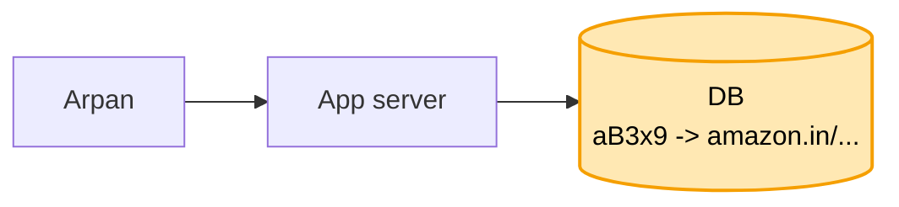
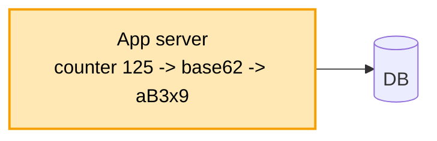
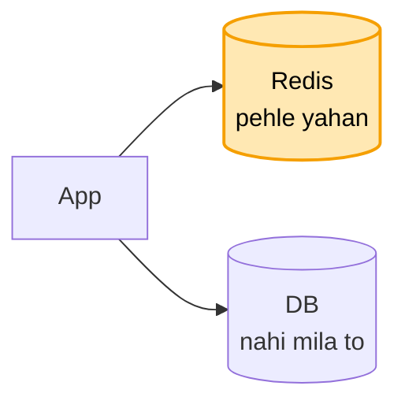
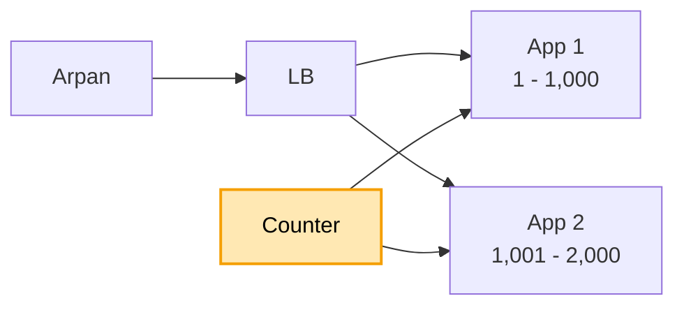
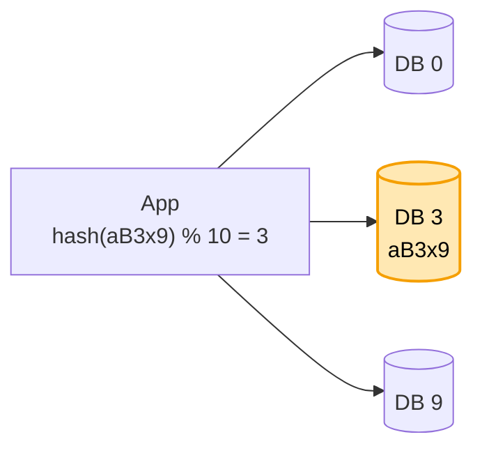
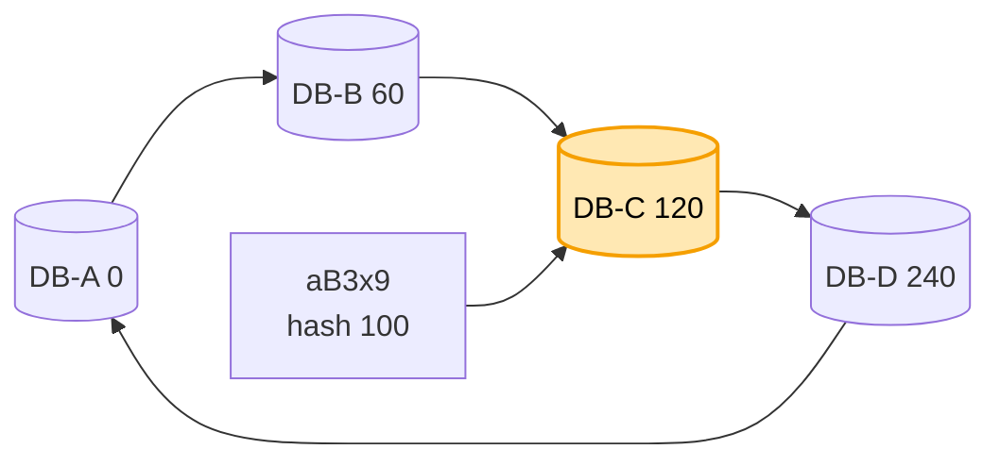
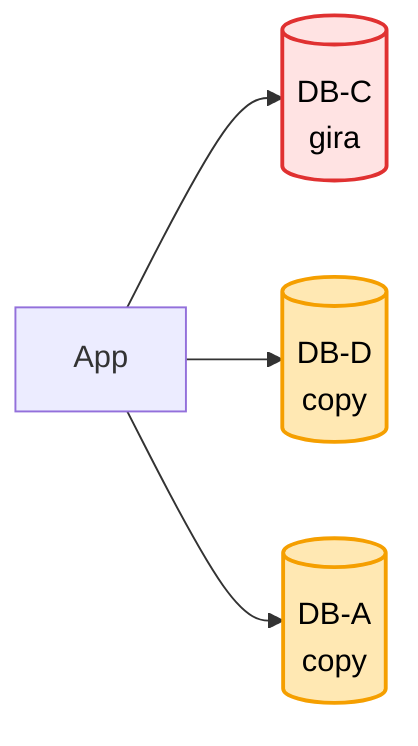
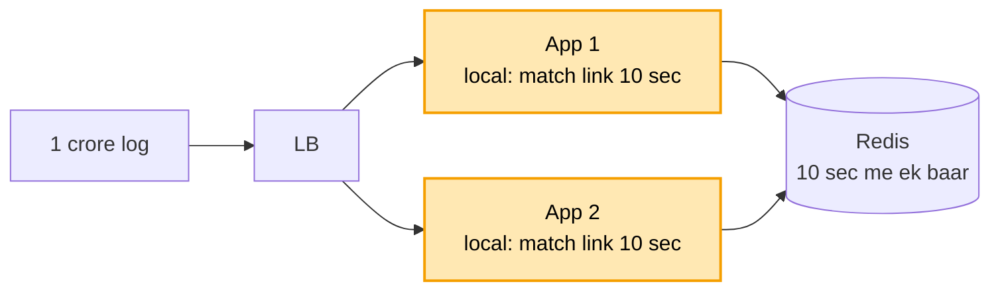
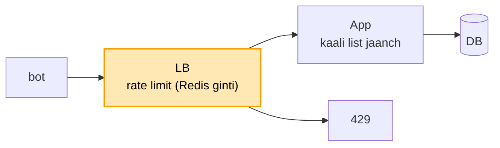

# URL shortener: hand notes (mock se pehle ye padho)

Har line waise likhi hai jaise interview me bolni hai. Padho, aur waise hi bolo.

### Shuru

**Kaam:** lamba link do to 7 akshar ka chhota code milta hai. Koi chhota link khole to use asli link pe bhej do.

**Sabse upar:** kholna tez ho, hamesha chale, aur do logon ko kabhi ek code na mile.

**Numbers:** har second 1,000 link bante hain aur 1 lakh khulte hain. Kholna 100 guna zyada hai, isliye cache lagega. 5 saal me 90 TB, jo ek machine me nahi aata, isliye shard lagega.

&nbsp;

**1. SERVER + DB**

Link aaya to code banao, dono DB me likh do. Koi khole to DB se lamba link nikaalo aur 302 se wahan bhej do.
Memory me nahi rakhta, kyunki restart pe saare link gayab ho jaate.
Par code banega kaise, aur do logon ko same na mile, ye kaise pakka?

&nbsp;

**2. COUNTER + BASE62**

Har link ko naya number deta hoon, aur use 62 akshar (a-z, A-Z, 0-9) me likhta hoon.
Random ya hash me do logon ko same code mil sakta hai, aur har baar DB me jaanchna padta. Counter kabhi dohraata nahi.
Par har second 1 lakh log khol rahe hain, aur har baar DB me jaana dheema hai.

&nbsp;

**3. REDIS**

Beech me Redis lagata hoon, jo memory me rakhta hai. Mila to turant bhej deta hoon, nahi mila to DB se laake Redis me rakh deta hoon.
Redis bhar jaaye to jo link sabse der se nahi khula, use hata deta hoon (LRU). "Sabse kam baar khula" wala LFU hota hai.

**Maan lo Redis ki entry khatam hui aur 1,000 log ek saath DB pe toot pade (stampede):** lock (single flight). Pehli request lock leti hai (umar 2 second) aur DB jaati hai, baaki 50 ms ruk ke Redis dekhti hain. DB pe 1 hi query.

**Maan lo lock wali request mar gayi:** 2 second me lock apne aap khul jaata hai, agli request DB jaati hai. User ko 2 second der, par DB bach gaya.

**Maan lo lock wali mari nahi, bas DB 5 second le raha:** sab 5 second ruke rehte. Isliye soft / hard umar. 1 ghante baad key "purani" maani jaati hai par Redis me rehti hai: purana link turant de do, ek request peeche se naya le aati hai. Link badalta nahi, to purana bhi sahi hai. Hard umar 1 din, taaki bahut purana maal na pada rahe.

Lock DB ko bachata hai, soft / hard users ko.
Par 1 lakh log aur server ek hi. Wo gira to poori site band.

&nbsp;

**4. LB + COUNTER RANGE**

Kai server lagata hoon, aage LB.
Par har server ka apna counter ho to do server same number de denge.
Isliye beech ka counter har server ko 1,000 number ka alag dabba deta hai: App 1 ko 1 se 1,000, App 2 ko 1,001 se 2,000.

**Maan lo beech ka counter gir gaya:** har app ke paas apni range ke bache number hain, kaam chalta rehta hai. Counter ki copy (replica) aage aa jaati hai.

**Maan lo App 1 gira:** uske bache number bekaar gaye. Koi dikkat nahi, 3.5 lakh crore number hain.

**Maan lo traffic 10 guna ho gaya:** app server badhao, garam link Redis me, DB ki machine badhao.

**Maan lo duniya bhar se log aaye:** Route 53 har user ko paas wale region pe bhejta hai.

Par 90 TB ek DB machine me nahi aata.

&nbsp;

**5. SHARD**

Data 10 machine me baant-ta hoon. Machine code se tay hoti hai, kyunki kholte waqt mere paas sirf code hota hai.
Par 10 se 11 machine ki to % 11 se lagbhag har link ki jagah badal gayi, link 404 dene lage.

&nbsp;

**6. RING (CONSISTENT HASHING)**

Machine aur code dono ek gol ghadi pe. Code se ghadi ki disha me chalo, jo pehli machine mile, link usi ka.
Nayi machine aaye to sirf ek chhota hissa hilta hai, baaki apni jagah.

&nbsp;

**DB KAUNSA: SQL YA NoSQL?**

Data bas code se link. Join ya transaction nahi chahiye, par 90 TB baantna hai. SQL me ye haath se karna padta, isliye NoSQL: Cassandra (AWS pe DynamoDB).

**Maan lo pooche RDS pe Cassandra:** RDS sirf SQL. Cassandra = AWS Keyspaces, ya EC2 pe khud chalao.

Par ek DB machine giri to us pe pade link 404 dene lage.

&nbsp;

**7. 3 COPY + QUORUM**

Har link ki 3 copy, teen alag machine pe. Ek gire to do bachi rehti hain.

**Maan lo link bana aur dost ko turant 404 mila:** likhai C pe hui, D pe abhi pahunchi nahi. Isliye quorum: teeno pe likho, 2 ki "haan" pe aage badho, aur padho bhi 2 se. Likhne wali 2 aur padhne wali 2 me ek copy common hoti hi hai, to naya link mil jaata.

AWS pe: Cassandra = Keyspaces, Redis = ElastiCache, LB = ALB.
Par ek link viral hua, 1 crore log ek saath, sab Redis ki ek machine pe.

&nbsp;

**8. LOCAL CACHE + 302**

Har app server us garam link ko apni memory me 5-10 second rakh leta hai, request Redis tak jaati hi nahi.
Redis giri nahi, bheed se dheemi hai. Isliye replica ko main banana kaam nahi aata, bojh nayi main pe chala jaata.

**302 kyun, 301 kyun nahi:** 301 pe browser link yaad kar leta, dobara hamare paas aata hi nahi. Bojh kam, par link spam nikla to band nahi kar sakte. 302 me har click hamare paas aata hai. Isliye 302, bojh cache se sambhala.

**Maan lo click ginti chahiye:** redirect turant, click ki khabar Kafka me, Analytics peeche gin leta hai.

Par ek bot har second hazaron link bana raha hai.

&nbsp;

**9. RATE LIMIT + KAALI LIST**

Link banane pe rate limit: ek user ek minute me 10 link, usse zyada pe 429.
Limit user pe, IP pe nahi, kyunki ek office ke saare log ek IP se aate hain.
Kholne pe limit nahi, kholna hi asli kaam hai.
Bura link kaali list (Google Safe Browsing) se jaanch ke banne hi nahi deta. Baad me report aaye to code "band", aur 302 ki wajah se chetavani page dikha deta hoon.
Jo bot baar-baar aaye, use WAF me block.

&nbsp;

### Wrap

Banana: LB, rate limit, phir app. App counter range se number, base62 code, Cassandra me likhta hai (ring, 3 copy, quorum) aur Redis me bhi.
Kholna: pehle local cache, phir Redis, phir Cassandra, aur 302.

Poora design = [01_url_shortener.md](01_url_shortener.md)
