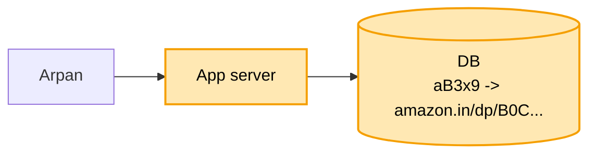

# URL shortener: shuru se, ek kahani

Kram video jaisa: **FR -> NFR -> numbers -> design**. Design sabse seedhe dabbe se shuru,
har dikkat pe ek dabba judta. Peela = abhi juda. Kahani ek hi: Arpan ka Amazon link.

---

## 1. FR: kya karna hai

Interviewer se pehle poochho, phir scope tay karo:

```
1. lamba link do     -> 7 akshar ka chhota code milta hai (short.ly/aB3x9)
2. chhota link kholo -> asli lambe link pe bhej do (redirect)
scope ke bahar (poochh ke hatao): apna naam wala code, kitni baar khula ki ginti
```

## 2. NFR: kaisa chalna chahiye

```
- kholna TEZ ho        : click pe turant Amazon khule
- hamesha chale        : link toota to Arpan ka bheja link bekaar
- ek code = ek link    : do logon ko kabhi same code na mile
```

## 3. Numbers: sirf wo jo design badlein

```
- roz 10 crore naye link        -> ~1,000 / sec banana
- har link ~100 baar khulta     -> ~1 lakh / sec kholna
- ek link ~500 byte, 5 saal     -> ~180 arab link -> ~90 TB
- 7 akshar, 62 tarah ke         -> ~3.5 lakh crore code, kaafi
```

Kholna banane se 100 guna, isliye aage cache aayega.
90 TB ek machine me nahi aata, isliye aage DB ke tukde (shard).
62 tarah = a-z (26) + A-Z (26) + 0-9 (10).

---

## 4. Design

### Kadam 1: sabse seedha (ek server, ek DB)

Arpan ke paas lamba link hai (`amazon.in/dp/B0C...?ref=xyz`). Wo hamari site pe daalta hai,
use `short.ly/aB3x9` milta hai. Koi bhi chhota link khole, hum use Amazon pe bhej dete hain.



```
BANAO:  lamba link aaya -> chhota code banao (aB3x9) -> DB me dono saath likho
KHOLO:  aB3x9 aaya      -> DB me dhoondho -> browser ko bolo "is lambe link pe jao"
                           (redirect, 302)
```

DB kyun, server ki memory (Java HashMap) kyun nahi? Memory me rakhte to server restart hote hi
saare link gayab. Link saalon chalna chahiye, isliye disk wala DB.

Agli dikkat: chhota code `aB3x9` banega kaise, aur do logon ko same code na mile ye kaise pakka?
