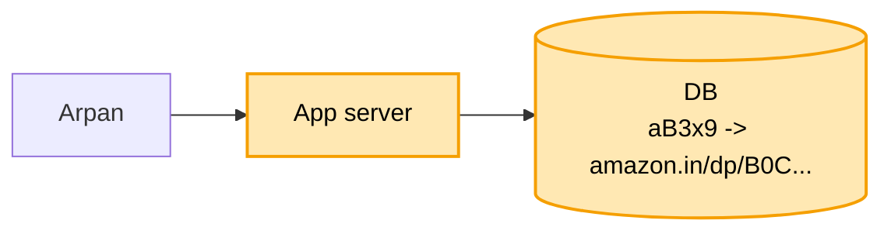
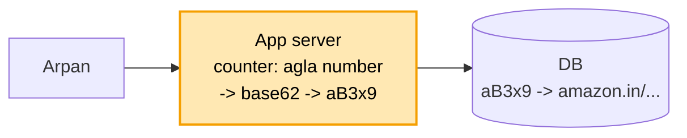
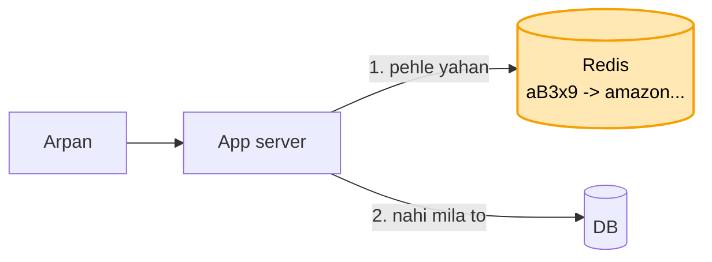
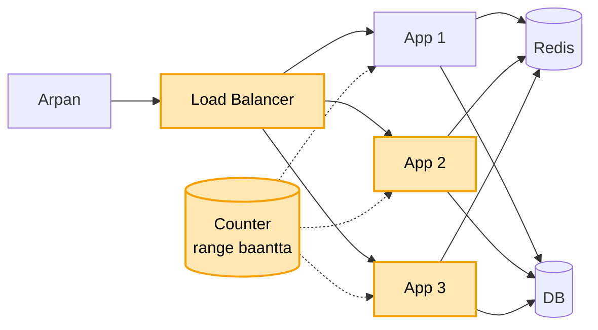
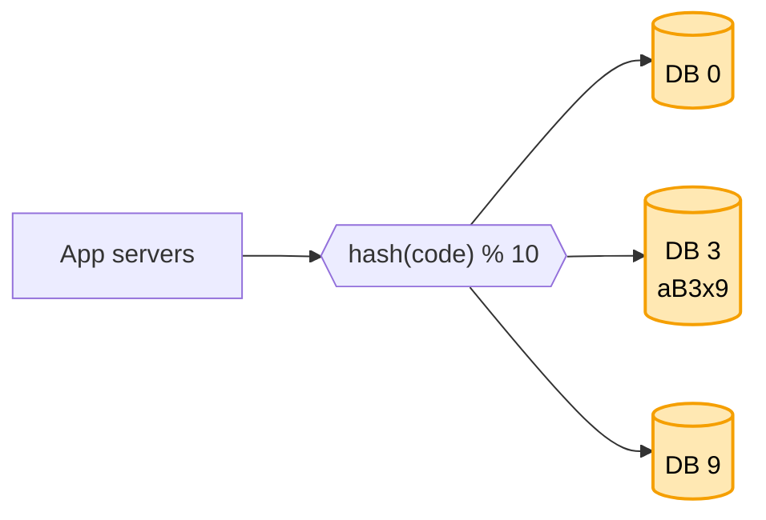
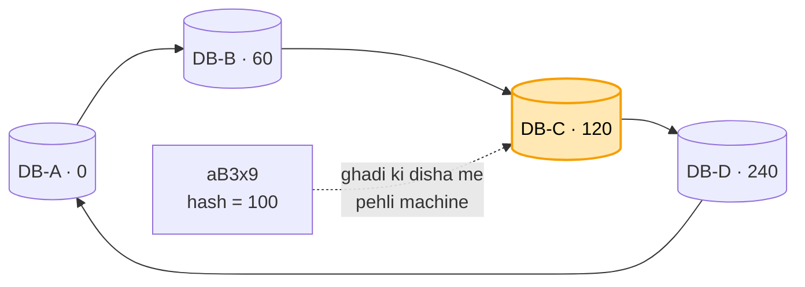
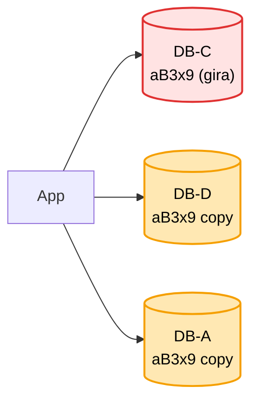
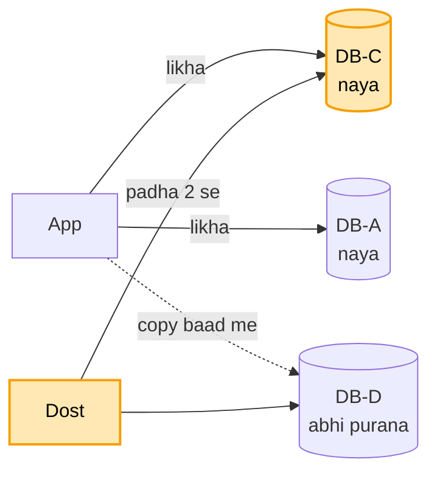
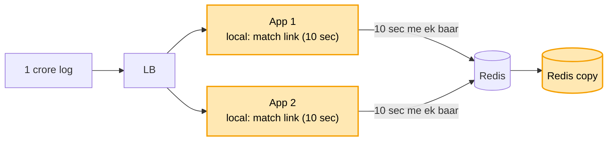
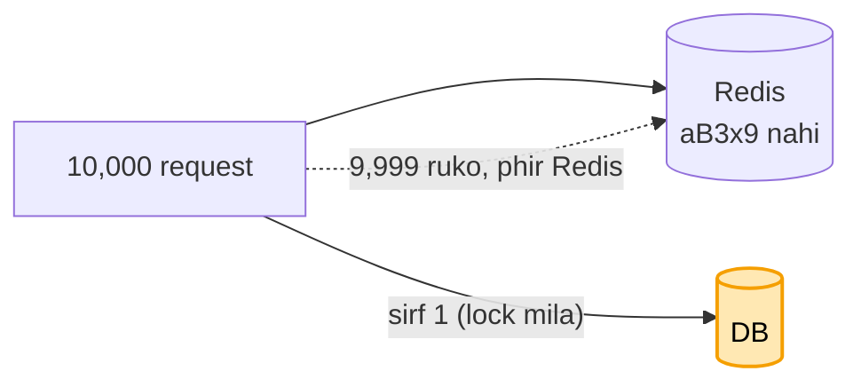

# URL shortener: shuru se, ek kahani

Kram video jaisa: **FR -> NFR -> numbers -> design**. Design sabse seedhe dabbe se shuru,
har dikkat pe ek dabba judta. Peela = abhi juda. Kahani ek hi: Arpan ka Amazon link.

**CUE (yahi kahani, yahi kram):** seedha (server + DB) -> counter + base62 -> Redis -> LB + counter range ->
shard -> ring -> 3 copy -> quorum -> local cache (viral) -> lock + purana (stampede)

---

## 1. FR: kya karna hai

Interviewer se pehle poochho, phir scope tay karo:

```
1. lamba link do     -> 7 akshar ka chhota code milta hai (short.ly/aB3x9)
2. chhota link kholo -> asli lambe link pe bhej do (redirect)
scope ke bahar (poochh ke hatao): apna naam wala code, kitni baar khula ki ginti
```

## 2. NFR: kaisa chalna chahiye

```
- kholna TEZ ho        : click pe turant Amazon khule
- hamesha chale        : link toota to Arpan ka bheja link bekaar
- ek code = ek link    : do logon ko kabhi same code na mile
```

## 3. Numbers: sirf wo jo design badlein

```
- roz 10 crore naye link        -> ~1,000 / sec banana
- har link ~100 baar khulta     -> ~1 lakh / sec kholna
- ek link ~500 byte, 5 saal     -> ~180 arab link -> ~90 TB
- 7 akshar, 62 tarah ke         -> ~3.5 lakh crore code, kaafi
```

Kholna banane se 100 guna, isliye aage cache aayega.
90 TB ek machine me nahi aata, isliye aage DB ke tukde (shard).
62 tarah = a-z (26) + A-Z (26) + 0-9 (10).

---

## 4. Design

### Kadam 1: sabse seedha (ek server, ek DB)

Arpan ke paas lamba link hai (`amazon.in/dp/B0C...?ref=xyz`). Wo hamari site pe daalta hai,
use `short.ly/aB3x9` milta hai. Koi bhi chhota link khole, hum use Amazon pe bhej dete hain.



```
BANAO:  lamba link aaya -> chhota code banao (aB3x9) -> DB me dono saath likho
KHOLO:  aB3x9 aaya      -> DB me dhoondho -> browser ko bolo "is lambe link pe jao"
                           (redirect, 302)
```

DB kyun, server ki memory (Java HashMap) kyun nahi? Memory me rakhte to server restart hote hi
saare link gayab. Link saalon chalna chahiye, isliye disk wala DB.

Par chhota code `aB3x9` banega kaise, aur do logon ko same code na mile ye kaise pakka?

### Kadam 2: code banana (counter + base62)

Teen tareeke ho sakte the:

```
(a) RANDOM:   7 akshar ulte-seedhe chuno (aB3x9Qz)
(b) HASH:     lambe link ka MD5 nikaalo, uske pehle 7 akshar lo
(c) COUNTER:  har naye link ko ek badhta number do (1, 2, 3 ...),
              us number ko 62 akshar me likh do (base62)
```

```
(a) random  -> do logon ko same code mil sakta. Har baar DB me dekho "pehle se hai?",
               mila to dobara.
               Link badhte gaye to takkar bhi badhti
(b) hash    -> do alag link ke pehle 7 akshar same aa sakte. Wahi DB check, wahi dobara
(c) counter -> har number naya, to code kabhi same nahi. DB check hi nahi chahiye. ISLIYE YE
```

Base62 = jaise 10 ko binary me `1010` likhte, waise number ko 62 akshar (a-z, A-Z, 0-9) me likho.
1 arab bhi sirf 6 akshar me. 7 akshar me ~3.5 lakh crore number.



Abhi ek hi server, to counter bhi ek (DB ka apna auto-increment id bhi chal jaata).

Ab link ban rahe hain. Par har second 1 lakh log link khol rahe hain, aur har baar DB me
dhoondhna pad raha hai. DB itna bojh nahi jhel paayega.

### Kadam 3: kholne ka bojh (cache)

Har baar DB me dhoondhna dheema (DB disk se padhta). Par zyadatar log wahi kuch link baar-baar kholte hain:
Arpan ne Amazon sale ka link group me bheja, 1,000 log wahi ek link khol rahe.
Har baar DB se wahi jawab laana bekaar.

Ilaaj: beech me **Redis** (memory me rakhta, bahut tez).

```
KHOLO:  aB3x9 aaya -> pehle Redis me dekho
          mila   -> turant redirect (DB ko chhua hi nahi)
          nahi   -> DB se lao, Redis me rakh do, redirect (agli baar Redis se)
```



```
Redis bhar gaya?           -> memory DB se chhoti, saare 180 arab link nahi aate. Jo link sabse der se nahi
                              khula, use hatao (LRU). Garam link Redis me, thande DB me
server ki memory me kyun?  -> aage server kai honge: har ek ka cache alag, restart pe khaali.
                              Redis sabke liye ek jagah
```

Par 1 lakh log kholne aa rahe hain, aur app server abhi bhi ek hi hai. Akela itna bojh nahi jhel paayega.

### Kadam 4: ek server kam pada (LB + kai server, counter range)

1 lakh log aur app server ek. Wo bojh nahi jhelega, aur wo gira to poori site band.

Ilaaj: kai app server (maan lo 10), aage **Load Balancer (LB)**. LB har request kisi khaali server ko deta.



Server badhe to counter ki dikkat. Kadam 2 me counter ek tha, ab 10 server:

```
har server ka apna counter   -> App 1 aur App 2 dono "number 5" denge = same code. NFR toota
har link pe ek counter se    -> wo ek counter hi bheed ban jaata
poochho
```

Ilaaj: **counter RANGE**. Ek beech ka counter (Redis `INCRBY` ya ZooKeeper) numbers ke dabbe baantta:

```
App 1 ko: 1 - 1,000          App 1 khud 1, 2, 3 ... 1,000 deta jaata
App 2 ko: 1,001 - 2,000      khatam hone pe hi agla dabba maangta
App 3 ko: 2,001 - 3,000      -> beech wale se baat 1,000 link me ek baar
```

Range alag, to same number kabhi nahi. Beech wale pe bojh bhi nahi. App 1 beech me gira to uske bache number
(501 - 1,000) bekaar: koi baat nahi, 3.5 lakh crore number hain.

Par 5 saal me data ~90 TB. Itna ek DB machine me nahi aata.

### Kadam 5: data bahut bada (DB ke tukde = shard)

5 saal me ~90 TB. Ek DB machine me nahi aata, aur ek machine itni padhai-likhai bhi nahi jhelti.

Ilaaj: data kai DB machine me baanto (**shard**). Kaunsa link kis machine pe, ye code se tay:

```
machine = hash(aB3x9) % 10      -> maan lo 3
BANAO:  aB3x9 -> DB machine 3 pe likho
KHOLO:  aB3x9 -> wahi hash -> seedha machine 3 (baaki 9 ko chhuna hi nahi)
```



Code se kyun baanta? Kholte waqt hamare paas sirf code hota hai. Code se hi machine nikal aati,
to dhoondhna seedha ek machine pe.

Par data aur badha, 10 se 11 machine kiye. Ab `% 10` ki jagah `% 11`,
aur lagbhag har link ki machine badal gayi. Arpan ka `aB3x9` machine 3 me pada hai,
par app use machine 7 me dhoondh raha: link 404.

### Kadam 6: machine badhi to link kho gaye (ring = consistent hashing)

`% 10` se `% 11` kiya to lagbhag har link ki machine badli. Saara 90 TB idhar-udhar, tab tak link 404.

Ilaaj: **ring**. Ek gol ghadi, 0 se 360 tak. Har DB machine ghadi pe ek jagah baithti. Har link ka code bhi
hash hoke ghadi pe girta. Wahan se ghadi ki disha me chalo, jo pehli machine mile, link usi ka.



```
nayi machine DB-E juda (95 pe)  -> sirf 60 se 95 ke beech wale link DB-C se DB-E pe.
                                   Baaki apni jagah.
                                   % me lagbhag sab hilte, ring me sirf ek tukda (~1/11)
ek machine pe zyada bojh        -> har machine ko ghadi pe kai jagah bithao (virtual nodes), bojh barabar
```

### DB kaunsa: SQL ya NoSQL?

```
data:  aB3x9 -> amazon.in/dp/B0C...   (bas code aur link)
kaam:  code do, link lo               (na join, na transaction)
size:  90 TB, kai machine pe baantna (shard + ring)
```

```
SQL (Postgres / MySQL)  -> taakat join + transaction, yahan chahiye hi nahi. Ek machine pe sabse achha.
                           Baantna, ring, data shift = sab haath se. Jo chahiye nahi wo mila, jo chahiye
                           wo khud banao. ISLIYE NAHI
NoSQL key-value         -> kaam hi "key do, value lo". Ring + baantna + copy KHUD karta. ISLIYE YE
DynamoDB                -> AWS chalata: machine, copy, baantna sab unka. Par AWS se bandhe, bada traffic
                           = bhaari bill
Cassandra               -> apni machines pe (ya AWS Keyspaces). Kisi se bandhe nahi, par chalana /
                           dekhbhaal hamari team ka
MongoDB?                -> chal jaata, par document DB. Document wali cheez chahiye hi nahi
```

Bolo: "Data simple hai, code se link. Join / transaction nahi, par 90 TB baantna hai. SQL me baantna haath se,
isliye NoSQL key-value. AWS pe ho to DynamoDB, apna setup ho to Cassandra. Main Cassandra le raha hoon."

Par ek DB machine gir gayi, to us pe pade saare link 404.

### Kadam 7: ek DB machine giri (copy = replication)

DB-C giri. Arpan ka `aB3x9` usi pe tha: link 404. Disk mari to hamesha ke liye gaya.
NFR "hamesha chale" toota.

Ilaaj: har link ki **3 copy**, teen alag machine pe. Cassandra khud karta:
ring pe maalik machine + ghadi me agli 2.

```
aB3x9 -> DB-C (maalik) + DB-D + DB-A
DB-C giri -> DB-D ya DB-A se padho, link chalta rahe
```



```
3 hi kyun?            -> 1 = machine gayi to link gaya. 3 = ek giri phir bhi 2 bachi. Aam taur pe yahi
copy alag rack / zone -> ek rack ki bijli gayi to teeno ek saath na jaayein
```

Par Arpan ne abhi link banaya, dost ne turant khola. Likhai DB-C pe pahunchi, copy DB-D tak abhi nahi. Dost ki
request DB-D pe gayi: 404, jabki link ban chuka tha.

### Kadam 8: link ban gaya, par dost ko 404 (quorum)

Ilaaj: **quorum** = zyadatar (3 me se 2).

```
LIKHO:  3 me se kam se kam 2 copy pe likh jaaye, tabhi Arpan ko "ban gaya"   (W = 2)
PADHO:  3 me se 2 copy se poochho, jo naya ho wo lo                         (R = 2)
```

Kyun chalta: likhai 2 pe, padhai 2 se. Teen me se do-do chuno to ek copy dono me common aayegi hi,
aur uske paas naya link hai.

```
copy:      C     D     A
likha:     haan  -     haan     (W = 2)
padha:     haan  haan  -        (R = 2)  -> C dono me, naya link mila
```



```
W = 3 (teeno pe likho)?  -> ek machine giri to likhna band. Dheema bhi
R = 1 (ek se padho)?     -> tez, par 404 wapas
shart                    -> W + R > 3, tabhi common copy pakki
aasan madad              -> link banate hi Redis me bhi daalo,
                            dost turant khole to Redis se mil jaaye
```

Par ek link viral ho gaya: cricket match ka link 1 crore log ek saath khol rahe, sab ek hi Redis machine pe.

### Kadam 9: ek link viral (hot link)

Cricket match ka link 1 crore log ek saath. Ek link ki key Redis ki ek hi machine pe
(Redis bhi key se baantta), to saara bojh usi pe. Wo dheemi, aur us pe pade baaki link bhi atke.

Ilaaj 1: **app server ki apni memory me chhota cache (local cache)**.
Bahut garam link har server 5-10 sec rakhe. Mila to request Redis tak jaati hi nahi.
10 server = Redis tak 10 sec me bas 10 request.

```
local cache ki dikkat:
  memory chhoti     -> saare 180 arab nahi, sirf kuch garam link
  har server alag   -> App 1 me hai, App 2 me nahi
  purana ho sakta   -> link band / badla, server 10 sec tak purana deta
  restart = khaali  -> phir Redis se bharega
URL me chaaron chhoti: link badalta nahi, 10 sec me taaza.
Kadam 3 me "saare link" ki baat thi, yahan sirf garam, sirf thodi der
```

Ilaaj 2: **Redis ki copy (replica)**, garam key 2-3 copy se padho.



Browser hi yaad rakhe (301)?

```
                       bojh bachaya        control (band / badlo)
browser (301)          sabse zyada         nahi, browser ke haath (spam link band nahi, ginti nahi)
local cache (10 sec)   bahut               haan, 10 sec me taaza
Redis                  thoda               haan, turant
```

Bolo: "302, kyunki control hamare paas. Bojh cache se sambhal liya."

Par match link ki Redis entry expire hui, aur usi pal 10,000 request ek saath "Redis me nahi"
dekh ke DB pe toot padi (**stampede**).

### Kadam 10: entry expire hui, sab DB pe toot pade (stampede)

Match link ki Redis entry ka time (TTL) khatam. Usi pal 10,000 request ko Redis me nahi mila, sab ek saath DB pe.

Ilaaj 1: **sirf ek jaaye (lock / single flight)**.

```
pehli request  -> Redis me lock (SET lock:aB3x9 NX, 2 sec)
                  mila -> DB se lao, Redis me rakho, lock hatao
baaki 9,999    -> lock nahi mila -> 50 ms ruko, phir Redis -> mil gaya
DB pe 10,000 ki jagah 1
```



Lock wali request hi dheemi (DB dheema / server atka)? Baaki 9,999 khade rahenge. Ilaaj: **intezaar mat karao,
purana do**. Redis me do time:

```
soft time 1 ghanta  -> iske baad "purani"      soft nikla:  pehli -> lock, peeche se DB se taaza
hard time 1 din     -> iske baad hi hatt-ti                 baaki  -> intezaar NAHI, purana link turant
URL me link badalta hi nahi, to purana bhi sahi
lock me time (2 sec)  -> lock wala atka / gira to lock khud hate
DB call me timeout    -> 500 ms me nahi to chhodo, purana chalta rahe
purana bhi nahi       -> 2-3 baar 50 ms ruk ke Redis, phir khud DB (timeout ke saath). Kabhi-kabhi hi
```

Ilaaj 2: sab ek saath expire na hon: TTL me thoda random (1 ghanta + 0-5 min).
