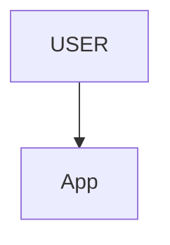
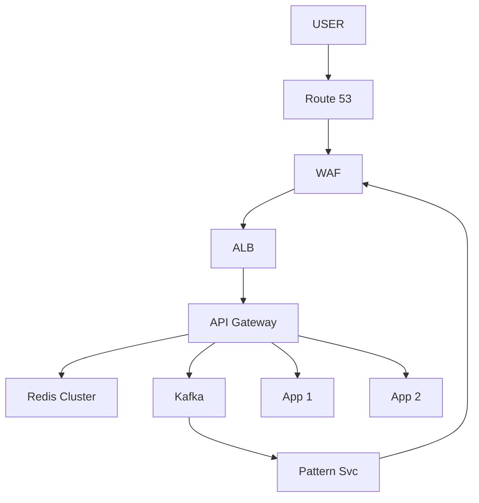
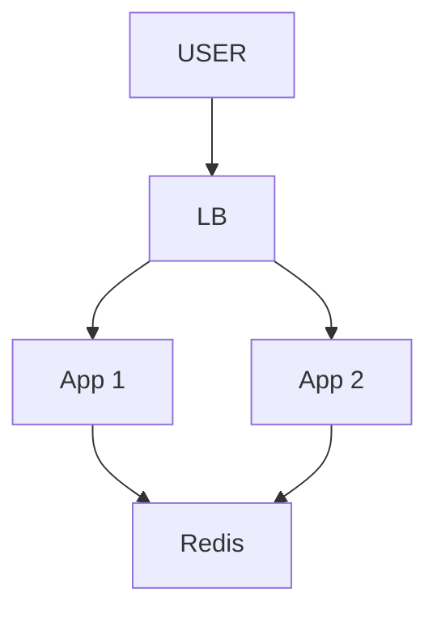
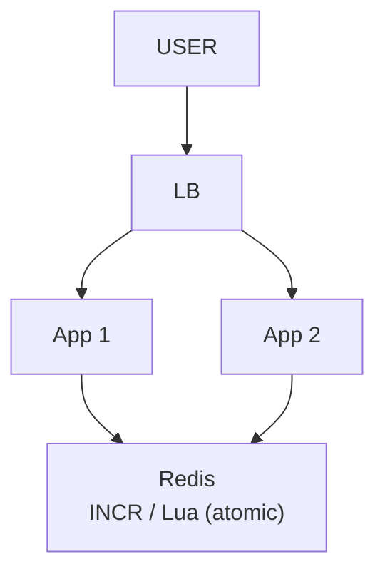
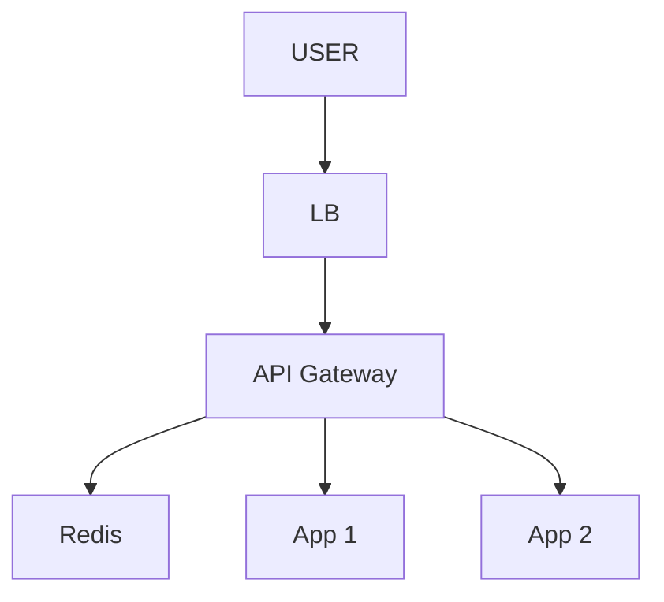
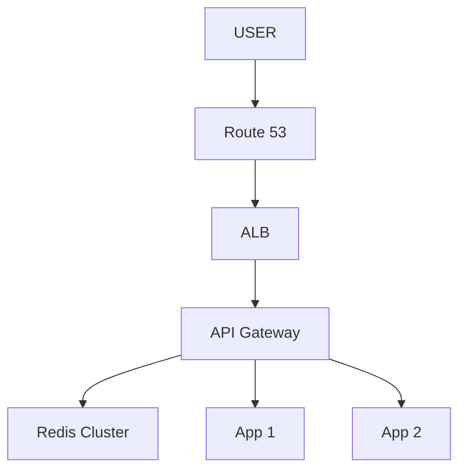
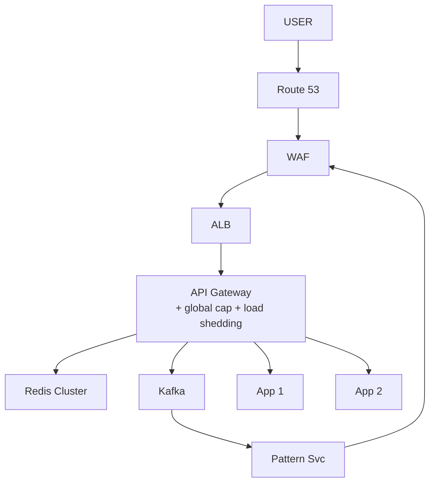

# Rate Limiter

> Ek user / IP ek tay samay me kitni request bhej sakta hai, uski had. Had paar -> 429 (Too Many Requests).
> Misaal: "ek IP se ek minute me 5 login". Is design ka dil teen cheezein hain:
> **har request ke saamne baitha hai, isliye 1 ms se tez** · **ginti saari machines pe EK** · **limiter khud gire to site na gire**.

```
DESI MISAAL: park me nal. Normal banda 1 bottle bharta, ek pagal banda 10 truck le aaya -> paani khatam,
             asli log khaali haath. Niyam lagaya "ek banda din me 5 bottle" = RATE LIMITING.
             API pe: ek bot ek second me 10,000 baar login try karta (password guess) -> "ek IP, ek minute, 5".
```

---

## TASVEER (ByteByteGo / Alex Xu · CC BY-NC-ND 4.0)


Source: [How Does Redis Persist Data?](https://bytebytego.com/guides/how-does-redis-persist-data/)
(HANDS-ON #3 CASE C: Redis ka disk pe save band tha, restart hua to saari ginti gayab. RDB / AOF yahi save karte hain.)

---

## SHURU: pehle poocho, phir numbers

```
POOCHO:  limit kis pe? IP / user_id / API key. Har endpoint ki alag (login 5 / min, search 60 / min)?
         plan ke hisaab se (free / pro / enterprise)?
         ★ sabse zaroori: maqsad SERVER BACHANA hai ya PAISA / SECURITY?
           server bachana -> thoda zyada nikal jaaye to chalta · paisa / OTP / login -> bilkul sahi ginti chahiye

MISAALEIN: login 5 / min ek IP se · password reset 3 / ghanta ek email pe · public API 100 / min ek key pe ·
           signup 10 / din ek IP se · search 60 / min ek user ka

ZAROORI KAAM (FR):   niyam (kitni) · ginti (kitni ho gayi) · samay (kis minute / ghante me) · paar -> 429
KAISA CHALE (NFR):   1 ms se tez (har request iske saamne se jaati hai, ye dheema = poora API dheema)
                     limiter mare to aam API khuli rahe (FAIL-OPEN), par login / payment / OTP band (FAIL-CLOSED)
                     kai machine pe bhi ginti sahi

NUMBERS:  jagah ka hisaab bekaar hai: har user ki ek ginti + expiry, bas.
          asli number = kitni baar poocha jaata hai. Ye har request ke aage hai -> poore system me sabse zyada
          chalne wala dabba (laakhon / second). Isliye ye jagah ka nahi, SPEED ka sawaal hai -> RAM me (Redis), DB nahi.
          Aur ginti badhana ek jhatke me (atomic) hona chahiye.
```

---

## ════ MOCK SE PEHLE: SIRF YE CARD PADHO ════

> Har dikkat ek card: KAHANI (kya hua, kaun, kitna) -> ILAAJ -> ANDAR KAISE (ilaaj kyun kaam karta) ->
> ISKE BAAD KYA TOOTEGA (interviewer yahin ghusta hai: dabba lagaya, ab kya?).

#### DABBA 0: SABSE SIMPLE (yahan se shuru, phir "kahan tootega")
```
App ki memory me ek ginti. Har request pe ginti + 1. Had paar -> 429.
```


#### [1](#d1) TEEN SERVER, GINTI BAT GAYI
```
KAHANI:  Limit hai "ek minute me 5 login". Ab App ki 3 machine hain, LB request baant raha hai.
         Arpan ne 9 baar login try kiya: App-1 pe 3, App-2 pe 4, App-3 pe 2 gayi.
         Har App ne apni ginti dekhi: 3, 4, 2 -> kisi ko 5 paar dikha hi nahi. 9 andar ghus gayi.

ILAAJ:   Ginti EK jagah rakho: REDIS. Teeno App wahi ek ginti dekhein.
         Key ka naam: rate:login:arpan. Usme ginti. Aur key ki umar (TTL) = 60 second.

ANDAR KAISE:
         Har request pe Redis me +1 (INCR).
         Pehli request pe key ki umar 60 second lagao (EXPIRE). 60 second baad key khud mit jaati -> naya minute, ginti 0.
         Ginti 5 se upar -> 429.

ISKE BAAD KYA TOOTEGA:
  - Minute ke aakhri second pe 5, agle minute ke pehle second pe 5 -> 2 second me 10?
      -> haan, ye "har minute ka ek dabba" (fixed window) ki kamzori hai, kinare pe double nikal jaata.
         Token bucket ya sliding window se theek hota hai (neeche ALGO card).
  - Har request pe Redis tak jaana = time?
      -> Redis RAM me hai, paas ke data center me ~1 ms. Chalta hai.
  - DB me ginti kyun nahi?
      -> har request pe DB me likhna padega. DB disk pe likhta + lock lagata = dheema. Redis RAM = tez.
  - Ek user ko hamesha ek hi App pe bhejo (sticky LB)?
      -> wo App gira to ginti gayi. App badhe / ghate to bantwara badla, ginti phir bat gayi.
```

#### [2](#d2) DO REQUEST EK SAATH, DONO GHUS GAYI
```
KAHANI:  Ginti 4 pe hai, limit 5. Do request bilkul ek saath aayi.
         Request A ne padha "4". Request B ne bhi padha "4". Dono ne +1 kiya aur "5" likh diya.
         Ginti 5 hi dikhi, par andar 6 request ghus gayi.

ILAAJ:   "Padho, badhao, likho" teeno ek jhatke me hone chahiye, beech me koi na ghuse.
         Redis ka INCR ye khud karta hai. Kaam me kai step ho (token bucket) to LUA script me daal do.

ANDAR KAISE:
         Redis ek hi line (single thread) me kaam karta hai: ek command poora hone tak doosra shuru hi nahi hota.
         Lua script bhi ek hi command ki tarah poora chalta hai, beech me koi nahi aata.

ISKE BAAD KYA TOOTEGA:
  - Key ki umar (EXPIRE) har request pe laga di?
      -> har baar umar phir 60 se shuru -> key kabhi mitegi hi nahi. Umar sirf pehli request pe (jab ginti 1 ho).
         Aur INCR ke baad, EXPIRE se pehle App crash -> key bina umar ke reh gayi -> user hamesha block.
         Isliye dono ek Lua script me.
  - Token bucket me Redis me kya rakhoge? 10 crore user ke bucket bharne ke liye koi job chalaoge?
      -> sirf 2 number: kitne token bache + aakhri baar kab dekha. Koi job nahi.
         Bharna tab hota hai jab request AATI hai: "pichhli baar se abhi tak kitna time beeta x bharne ki speed"
         utne token jodo (had tak), phir 1 ghatao. Jo user aa hi nahi raha, uski key umar se khud mit jaati.
  - Lua script dheema ho gaya ya atak gaya?
      -> Redis ek hi line me chalta hai -> poora Redis ruk jaayega. Isliye script chhota, koi loop nahi.
  - Ek hi line me chalta hai, to dheema nahi?
      -> RAM me hai, ek machine lagbhag lakh command / second (andaza, machine pe depend). Zyada chahiye -> SHARD.
```

#### [3](#d3) REJECT WALI REQUEST BHI ANDAR GHOOM AAYI
```
KAHANI:  Limiter App ke andar tha. Bot ki jo request ko 429 milna tha, wo bhi LB se, App tak,
         sab jagah ghoom ke aayi, aur tab jaake mana hua. Machines ka kaam bekaar gaya.

ILAAJ:   Limiter ko sabse AAGE rakho: API GATEWAY pe. 429 wahin se, App tak jaaye hi nahi.

ANDAR KAISE:
         Gateway har request pe Redis se poochta: had ke andar -> aage App ko, bahar -> wahin 429.

ISKE BAAD KYA TOOTEGA:
  - 429 ke saath client ko kya bataoge?
      -> "kab dobara aao" (Retry-After: 30) aur "kitni bachi" (X-RateLimit-Remaining).
         Retry-After me thoda aage-peeche (jitter, jaise 28, 33), warna sab theek 30 second baad
         ek saath aayenge -> nayi laher.
  - Gateway khud gira?
      -> gateway ki bhi 2+ machine, aage LB.
  - Har endpoint ki limit alag ho, aur bina naya code daale badalni ho (sale me login 5 se 10)?
      -> niyam CONFIG me rakho (DB / AWS AppConfig). Gateway unhe memory me rakhta, har ~30 second naye padh leta.
  - Limit sirf gateway pe, ya service ke andar bhi?
      -> gateway pe sabke liye ek moti limit, service ke andar uski apni baarik limit.
```

#### [4](#d4) REDIS GIR GAYA
```
KAHANI:  Saari ginti Redis me thi. Redis mar gaya -> ab kisi ko pata hi nahi kisne kitni bheji. Limiter andha.

ILAAJ:   Redis ki COPY (replica) doosre data center (AZ) me. Main mara -> copy apne aap main ban jaati.
         Poora Redis hi gaya -> pehle se tay: aam API khuli (FAIL-OPEN), login / payment / OTP band (FAIL-CLOSED).

ANDAR KAISE:
         Likhna sirf main (master) pe hota hai, copy tak thodi der baad pahunchta hai.
         Main mara -> baaki machines vote karke copy ko main bana deti hain (Redis Cluster / Sentinel).

ISKE BAAD KYA TOOTEGA:
  - Switch ke beech aakhri kuch ginti kho gayi?
      -> haan, copy thodi peeche thi. Rate limit me chalta hai, ye paisa nahi hai.
  - Redis gira nahi, bas bojh se dheema hai (CPU full)?
      -> copy se nahi bachega. Har request pe INCR = LIKHNA, aur likhna sirf main pe jaata hai. Bojh wahi rahega.
         Ilaaj = SHARD (Redis Cluster): user ke hisaab se keys 3-4 main machine me baanto, har ek pe 1/4 bojh.
         Yaad rakh: copy = bachav + padhne ka bojh. Shard = likhne ka bojh.
  - Fail-open ya fail-closed, kab tay karoge?
      -> PEHLE se, code me, har endpoint ke hisaab se. Redis gire tab sochne ka time nahi hota.
```

#### [5](#d5) EK USER TEEN REGION SE
```
KAHANI:  Limit 100. Arpan ne Bangalore se 50, Berlin se 50, aur US VPN se 50 request bheji.
         Har region ka apna Redis, har ek ne 50 gina -> kisi ko 100 paar nahi dikha. Total 150 nikal gayi.

ILAAJ:   Har user ka ek HOME region tay karo (user_id se). Request kahin se bhi aaye, ginti HOME region me hi.

ANDAR KAISE:
         Arpan ka home = India. Berlin ka gateway dekhta "iska ghar India hai" -> request India ke Redis tak bhejta.
         Teeno region ki request ek hi ginti me -> 100 pe ruk jaata.
         (Galat samajh: "India wale India me, US wale US me" -> ye to wahi alag-alag ginti hai, isi se dikkat aayi.)

ISKE BAAD KYA TOOTEGA:
  - Har request pe India tak jaana = 100-200 ms extra?
      -> haan. Isliye home region sirf paisa / security wale endpoint pe.
         Baaki pe har region apni ginti + har second aapas me milaate rehna (sync).
  - Har region apni ginti rakhe aur baad me milaaye, to kitna zyada nikal jaata?
      -> milaane ke beech (~1 second) har region apni poori limit de sakta. Halki limit ke liye chalta.
  - Arpan ka home region hi gira?
      -> Route 53 doosre region bhejta, ginti wahan 0 se. Ek minute dheela, chalta hai.
```

#### [6](#d6) BAAR-BAAR MAAR RAHA, 429 SE NAHI RUKTA
```
KAHANI:  429 sirf bolta "60 second baad aao". Bot 60 second baad phir aa jaata, din bhar, roz.

ILAAJ:   Har 429 ki khabar KAFKA me daalo. Ek Pattern service ginti kare.
         Pakka gunda nikla -> uska IP WAF me daal ke ban.

ANDAR KAISE:
         Pattern service dekhti: "is IP ko 10 minute me 500 se zyada 429 mile?" -> haan -> WAF ki block list.
         WAF sabse aage (edge pe) baitha hai, us IP ki agli request server tak pahunchti hi nahi.

ISKE BAAD KYA TOOTEGA:
  - Turant ban kyun nahi?
      -> asli user bhi kabhi tez click karta hai. Ek office ke 100 log ek hi IP (NAT) ke peeche hote hain.
         Sale me asli bheed bhi aati hai. Isliye limit maafi wali, ban sirf pakke gunde pe.
  - Galat banda ban ho gaya (office ka IP)?
      -> ban ki umar (~24 ghante), apne aap hat jaata, aur haath se hatane ka raasta bhi.
  - Gateway seedha Pattern service ko call kyun nahi karta?
      -> har request pe ek aur call = gateway dheema. Kafka me daal ke bhool jao.
  - Kafka peeche reh gaya?
      -> ban kuch minute late lagega. Tab tak rate limit to rok hi raha hai.
```

#### [7](#d7) LIMITER SAHI, PHIR BHI SERVER GIRA
```
KAHANI:  Har user ki limit 100 / minute, aur server ek second me 5,000 jhel sakta hai.
         Sale shuru hui, 10,000 asli log aaye. Har koi apni limit ke andar tha, par sab mila ke 12,000 / second.
         Server gir gaya. Limiter ne kuch nahi roka, kyunki kisi ek ne galti ki hi nahi.

ILAAJ:   LOAD SHEDDING: system ki sehat dekh ke NAYI request ko seedha 503 do. Jo chal rahi hain, wo poori hone do.
         Jaise bijli kam ho to kuch mohallon ki kaatte hain, taaki poora grid na gire.

ANDAR KAISE:
         Gateway pe poore system ki ek had (global cap) + "CPU 90% paar to nayi mat lo".
         RATE LIMIT    = ek USER ne kitni bheji     -> 429
         LOAD SHEDDING = poora SYSTEM kitna jhel sake -> 503

ISKE BAAD KYA TOOTEGA:
  - Kaunsi request chhodoge?
      -> login / payment rakho. Recommendation / analytics pehle chhodo.
  - Machine apne aap badh jaayein (autoscale)?
      -> nayi machine aane me minute lagte hain, bheed second me aati hai.
         Pata ho kab aayegi (12 baje sale) to pehle se badha do.
  - Request ko line (queue) me rok lo?
      -> chhota time (~2 second). User chala gaya to uska kaam karna bekaar.
```

#### [8](#d8) ATTACK AAYA, USI WAQT LIMITER GAYAB
```
KAHANI:  Attack aaya -> Redis pe 50 guna bojh -> Redis gir gaya -> fail-open -> sab allow.
         Jis waqt limiter sabse zyada chahiye tha, usi waqt gayab.

ILAAJ:   Redis gaya to har machine apni memory me motamoti ginti kare (local fallback).

ANDAR KAISE:
         Machine ki apni limit = poori limit / machines. 100 ki limit, 10 machine -> har machine 10.
         Redis wapas aaya -> phir se sabki ek ginti.

ISKE BAAD KYA TOOTEGA:
  - Machine badh gayi (autoscale), ab kitna baantoge?
      -> machines ki ginti config / service discovery se lo, dobara baanto.
  - Ek user ki request alag-alag machine pe gayi?
      -> har machine pe 10 -> motamoti, exact nahi. Par attack me "kuch nahi" se bahut behtar.
```

#### [9](#d9) IP PE GIN RAHE THE
```
KAHANI:  Office ke 1000 log ek hi IP ke peeche (NAT). Ek ne galti ki, IP block, saare 1000 block.
         Ulta, ek botnet ke paas 1000 IP hain, har IP se thoda-thoda -> kisi IP ki limit nahi tooti.

ILAAJ:   Login ke baad ginti user_id / API key pe karo, IP pe nahi.
         Login se pehle IP hi hai -> uspe dheeli limit, aur asli rok WAF / bot pehchaan se.

ISKE BAAD KYA TOOTEGA:
  - Login se pehle botnet 1000 IP se password guess kar raha?
      -> IP limit bekaar. ACCOUNT pe limit: is username pe 5 galat password -> thodi der lock / CAPTCHA.
  - API key chori ho gayi?
      -> key pe limit nuksaan seemit karti, aur key badalne / band karne ka raasta.
```

#### ALGO: kaunsa aur kyun
```
TOKEN BUCKET (yahi chuna):
   Ek baalti me token hain (max 10). Har second 1 token bharta hai. Har request 1 token leti hai.
   Baalti khaali -> 429. Baalti bhari hai to 10 request ek saath bhi nikal jaati hain (burst),
   aur asli traffic aisa hi hota hai. Redis me sirf 2 number, bharna request aane pe.
FIXED WINDOW:   har minute ka ek dabba. Sasta, par kinare pe double (59th + 61st second).
SLIDING LOG:    har request ka time likho, pichhle 60 second ki gino. Bilkul sahi, par memory bahut.
SLIDING COUNTER: is minute ki + pichhle minute ka hissa (jaise 70%) jodo. 2 number, lagbhag sahi.
LEAKY BUCKET:   request line me, nikalti ek fixed speed se. Smooth, par burst nahi nikalne deta.

"Token bucket hi kyun?" -> burst chahiye + memory kam + Redis me 2 number. (AWS / Stripe yahi lete hain.)
```

```
AAKHRI DABBE (sab dikkat ke baad):
  User -> Route 53 -> WAF (ban list) -> ALB (kai data center) -> API Gateway me limiter (sabse aage, jaldi mana)
  -> Redis Cluster (ek jhatke me INCR + umar / Lua, key = endpoint + user) -> had ke andar? App : 429 + Retry-After
  baar-baar wala -> Kafka -> Pattern Svc -> WAF ban

DB:  Redis = ginti ki ek hi sachchi jagah, 1 ms, key ki umar = window (umar khatam = ginti reset, safai ka job nahi)
     user ka plan (free / pro) DB se, Redis me usi limit se milao

END ME POOCHEGA:
  "Kaunsa algo?"     -> TOKEN BUCKET: asli traffic jhatke me aata, jama token se burst nikal jaata
  "10 guna?"         -> gateway machine badhao · Redis shard + copy · home region · global cap + load shedding
  "Kahan se sab gir sakta?" -> Redis (cluster + switch; aam API fail-open, login / OTP fail-closed) · LB (Route 53)
  "Chal raha, kaise pata?"  -> limiter ka time (p99) · kitne 429 · Redis ki galtiyan · alert
```

AAKHRI DABBE ki tasveer:



---
## ════ DETAIL: HAR DIKKAT KI INTERVIEW LINE + TASVEER ════

> Card me poori kahani hai. Yahan har dikkat ki ek English line (interview me bolne ke liye) aur us waqt tak ka diagram.

---

<a id="d1"></a>

## DIKKAT 1 — teen server, ginti bat gayi

```
BOL: "Each server counting on its own lets a user exceed the limit across servers, so the count lives in one place: Redis. The key is endpoint plus user, I INCR it on every request, and the first request sets a TTL equal to the window, so the key expires and the count resets on its own."
```


---

<a id="d2"></a>

## DIKKAT 2 — do request ek saath, dono ghus gayi

```
BOL: "Redis is single-threaded, so INCR is atomic. For token bucket I use a Lua script, so the check and the decrement run as one unit and there's no read-modify-write race. The TTL is set only on the first request, in the same script."
```


---

<a id="d3"></a>

## DIKKAT 3 — reject wali request bhi andar ghoom aayi

```
BOL: "The limiter sits in the API gateway, in front of everything, so a rejected request never reaches the backend. It returns 429 with a Retry-After computed from when the bucket refills, with a little jitter. Rules live in a config store so limits change without a deploy."
```


---

<a id="d4"></a>

## DIKKAT 4 — Redis gir gaya

```
BOL: "Redis has a replica with automatic failover in another zone. If the whole layer is gone I fail open for normal APIs so the site stays up, and fail closed for login and OTP. If Redis is just overloaded, a replica doesn't help because every INCR is a write, so I shard it with Redis Cluster."
```


---

<a id="d5"></a>

## DIKKAT 5 — ek user teen region se

```
BOL: "A user is pinned to a home region by user id, and every region forwards that user's count there, so the limit holds globally. That costs a cross-region hop, so I do it only for money and security endpoints; the rest count locally and sync every second. If the home region dies, the count restarts elsewhere, which is fine for one window."
```


---

<a id="d6"></a>

## DIKKAT 6 — baar-baar maar raha, 429 se nahi rukta

```
BOL: "Every 429 goes to Kafka; a pattern service spots IPs that keep getting rejected and pushes them to a WAF blocklist with a TTL, so repeat abusers are stopped at the edge. I don't ban on the first 429 because offices share IPs and real users burst."
```


---

<a id="d7"></a>

## DIKKAT 7 — limiter sahi, phir bhi server gira

```
BOL: "A per-user limit doesn't stop a crowd where everyone is under their limit. For that I need a global cap and load shedding based on system health, returning 503 and dropping low-priority work first, plus pre-scaling when I know the spike is coming."
```


---

<a id="d8"></a>

## DIKKAT 8 — attack aaya, usi waqt limiter gayab

```
BOL: "If Redis falls over during an attack, failing open would let everything through, so each node falls back to a local in-memory counter with the global limit divided by the number of nodes. It's approximate, but far better than no limit."
```


---

<a id="d9"></a>

## DIKKAT 9 — IP pe gin rahe the

```
BOL: "For logged-in traffic I limit by user id or API key, not IP, because offices share IPs and botnets spread across thousands. Before login I keep a loose IP limit, rely on the WAF, and add a per-account limit on failed logins with a lockout or CAPTCHA."
```


---
## 10 GUNA TRAFFIC — har dabba alag se

```
API Gateway   -> har request pe limiter chalta -> RAM me + ek jhatke me (atomic). Gateway machine badhao
Redis         -> SHARD (user / region ke hisaab se) + COPY (switch ke saath) + fail-open + local fallback
kai region    -> har user ka HOME region
gunda         -> Kafka -> Pattern service -> WAF ban
asli bheed    -> global cap + load shedding + line (queue) + pehle se scale
```

---

## POOCHE TO (gehra sawaal aaye tab)

```
JAWAB KE HEADER:
   theek hai -> aage bhejo + X-RateLimit-Limit: 100 · X-RateLimit-Remaining: 47 · X-RateLimit-Reset: <kab>
   had paar  -> 429 + Retry-After: 30 + Remaining: 0
   sirf "na" mat bolo, "kitna bacha" aur "kab aao" bhi batao, warna client turant phir maarta.
   Retry-After me thoda aage-peeche (28, 33), warna sab ek saath lautte hain.

ULTA SAWAAL ("tumhe kisi aur ne 429 diya, ab?"):
   "I respect Retry-After, back off exponentially with jitter, and throttle my own sends."

REDIS KEY:  rate:{endpoint}:{user} -> ginti · umar = window (60 second) -> umar khatam = reset, safai ka job nahi
            rate:login:192.168.1.5 -> 4 · rate:signup:user_456 -> 2 · rate:search:apikey_xyz -> 47

EK LINE:   User -> Route 53 -> ALB -> Gateway limiter -> Redis (INCR + umar, ek jhatke me)
           -> had ke andar? App | paar? 429 + Retry-After | baar-baar? Kafka -> WAF ban

SLIDING WINDOW (bus stand ki misaal):
   register: "pichhle 1 ghante me 5 se zyada nahi".
   11:00 pe aaye -> 10:00 ke baad 5 aa chuke -> mana.
   11:10 pe aaye -> ab 10:10 ke baad gino, Ramesh 10:05 wala bahar ho gaya -> 4 -> andar.
   window request aane pe khisakti hai, koi timer / job nahi.

KAUN KAISA:   token = burst haan, memory kam · leaky = burst nahi, smooth · fixed = sabse sasta, kinare pe double ·
              sliding log = sabse sahi, memory zyada

GINTI vs BOJH:
   100 chhoti request (5 ms) = 0.5 second kaam. 100 bhaari report (30 second) = 50 MINUTE kaam.
   Limiter ke liye dono "100". Bhaari endpoint pe kadi limit, ya request ka WAZAN (report = 50 token, login = 1),
   ya "ek user ki ek waqt me 2 hi bhaari query".

PLAN:  bina login 60 / ghanta · free 5,000 · pro 10,000 · enterprise apni · plan DB se, Redis me usi limit se milao

EK HI SHAKAL (poore HLD me ghoomti):
   LB me      bachane wali cheez ne hi maara (health check / retry / sticky)
   cache me   tez karne wali cheez ne raasta roka (dheema Redis, timeout nahi)
   limiter me rokne wali cheez ne bheed roki hi nahi (per-user vs poora system) + attack me khud gayab (fail-open)
```

---

## AAKHRI DABBA + WRAP

```
Route 53 = kaunsa LB zinda · ALB = kai data center · API Gateway = limiter sabse aage, jaldi mana
Redis Cluster = ginti ki ek jagah, 1 ms, ek jhatke me INCR / Lua, copy + shard
Kafka -> Pattern Svc -> WAF = baar-baar wale ka pakka ban
```
```
BOL: "The limiter sits in the API gateway, in front of everything, so rejected requests never reach the
      backend. Counts live in Redis with an atomic INCR or a Lua script, keyed by endpoint and user,
      with a TTL as the window. I use token bucket because real traffic is bursty. Over the limit it's a
      429 with Retry-After. Redis is replicated and sharded, fails open for normal APIs and closed for
      login and OTP. Users stick to a home region, repeat abusers go through Kafka to a WAF ban, and a
      global cap with load shedding protects against a legit crowd."
```

---

## HANDS-ON #1 — Nginx limiter LIVE (21-Aug, isi folder ki `nginx.conf`)

```
docker run -d --name rl -p 8080:80 -v "<path>\nginx.conf:/etc/nginx/nginx.conf:ro" nginx
   -d background · --name rl · -p laptop 8080 -> container 80 · -v apni conf andar MOUNT (ro) · nginx = image

nginx.conf ki 2 asli line:
   limit_req_zone $binary_remote_addr zone=mylimit:10m rate=1r/m;    <- har IP ka bucket, refill 1 / min
   limit_req zone=mylimit burst=5 nodelay;                           <- bucket SIZE 5, burst turant serve
   rate = kis speed se nikalti · burst = kitni ruk sakti
   + location / { ... root /usr/share/nginx/html; index index.html; }  <- content serve
   koi program NAHI likha — sirf ready tool (Nginx, rate limiter built-in) on kiya + config + hammer -> 503
   SACH: nginx docs isko LEAKY BUCKET kehte; nodelay se bartaav token bucket JAISA. 503 = limit_req_status default.

HAMMER:  for /L %i in (1,1,30) do @curl -s -o nul -w "%{http_code} " http://localhost:8080
         (1,1,30) = 30 baar · -s -o nul = chup, body phenk do · -w = sirf status code
DIKHA:   200 200 200 200 200 200 503 503 503 ...
LOG:     (Docker Desktop -> Containers -> rl -> Logs) "GET / HTTP/1.1" 503 197
         [error] limiting requests, excess: 5.774 by zone "mylimit", client: 172.17.0.1
         (excess = bucket se kitna upar · client = Docker gateway IP, sab ek IP = ek bucket)

GOTCHA:  1. 503 tabhi jab ARRIVAL > rate (rate=2r/s pe dheere loop -> sab 200, refill pakad leta)
         2. burst=N -> spike me N+1 pass (burst=5 -> 6, 100 -> 101); textbook N, nginx N+1, timing se 21 / 22 bhi
         3. 1 IP = 1 bucket
         4. config badla -> docker restart rl
CHALAO:  docker start rl · curl http://localhost:8080 · docker logs rl · docker restart rl · docker stop rl
```

---

## HANDS-ON #2 — App ke andar fixed window (usercrud, 26-Aug)

```java
@RestController
public class RateLimitController {
    private int LIMIT = 5;
    private long windowStart = 0;
    private int count = 0;

    @GetMapping("/rate-demo")
    public synchronized ResponseEntity<String> hit() {          // synchronized: shared counter
        long now = System.currentTimeMillis();
        if (now - windowStart > 1000) { windowStart = now; count = 0; }   // window reset
        count++;
        if (count > LIMIT)
            return ResponseEntity.status(HttpStatus.TOO_MANY_REQUESTS).body("429 - limit paar");
        return ResponseEntity.ok("OK - request #" + count);
    }
}
// SecurityConfig: .requestMatchers("/rate-demo").permitAll()
// ResponseEntity KYUN: status-code (200/429) khud set karne ko
```
```
LIVE:  1..10 | % { curl.exe -s http://localhost:8080/rate-demo; "" }
       OK #1..#5 · 429 (6..10) · 1 sec baad window reset -> phir OK
EDGE:  fixed window boundary: 999ms pe 5 + 1001ms pe 5 = ~2ms me 10
PROD:  single node memory -> restart pe reset + har server apna count -> Redis INCR + EXPIRE
       per user / IP -> map<key, counter> · lib: Bucket4j (token bucket) / Redis + Lua
BOL:   "I built a fixed-window counter in usercrud — five OK, then 429. In production I'd use token
        bucket (Bucket4j) with a shared Redis counter; Nginx limit_req does it at the edge."
```

---

## HANDS-ON #3 — Redis KHUD maara: kaise tootta

CODE: `04_HLD/HANDS_ON/01_rate_limiter_redis/RateLimiterDemo.java` · `04_HLD/HANDS_ON/02_incr_expire_crash/IncrExpireCrash.java`
(koi library nahi, socket se Redis, `java File.java`)

```
docker run -d --name demo-redis -p 6390:6379 redis:7 redis-server --save "" --appendonly no
   (RDB + AOF band -> sirf memory, restart = sab gaya, jaan-boojh ke)
docker stop / start demo-redis · docker exec demo-redis redis-cli TTL rl:user:1 · ... DEL rl:user:1

CODE KA DIL (user:1 ko 60 sec me 5):
   count = INCR KEY · if count == 1 -> EXPIRE KEY 60 · count <= 5 ALLOW else 429
   catch IOException -> FAIL_OPEN ? ALLOW : BLOCK
```
```
CASE A  chalta kaise  req 1..9:  count 1 TTL 60 ALLOW · 2/57 ALLOW · 3/56 ALLOW · 4/49 ALLOW · 5/48 ALLOW ·
                                 6/47 429 · 7/45 429 · 8/45 429 · 9/44 429     (window PEHLI request se)

CASE B  docker stop   "REDIS SE BAAT NAHI HUI: Connection refused" -> FAIL_OPEN = true -> ALLOW (2 baar)
                      fail-open = site chale, limit nahi · fail-closed = abuse nahi, site band
                      ("server ne haath khade kar diye, sab jao")

CASE C  docker start  GET rl:user:1 -> khaali · user (pehle count 7, BLOCK) -> count 1 ALLOW, 2 ALLOW
                      persistence band -> ginti gayab -> blocked ko 5 nayi mil gayi

CASE D  INCR ke baad, EXPIRE se pehle crash (USE_LUA = false)
                      RUN 1: count 1, CRASH · TTL -> -1
                      RUN 2: count 2..5 ALLOW, 6..7 429, har baar TTL -1 -> key KABHI nahi mitegi, HAMESHA block
FIX D   USE_LUA = true   req 10..14: count 10 TTL 58 · 11/57 · 12/56 · 13/56 · 14/55 -> 1 min me free

TTL:  -1 = key hai, timer nahi · -2 = key hi nahi · 58 = 58 sec baaki
```
```
FIX:  B -> faisla pehle se: fail-open (aam API) / fail-closed (login, OTP) + replica
      C -> replica / AOF on. limiter me aksar chalne do (1 min ki ginti, paisa nahi). paisa hota to nahi.
      D -> Lua: INCR + EXPIRE ek command, Redis single-thread -> script beech me nahi rukti (ya EXPIRE 60 NX)
           pehle:  app --INCR--> Redis  [crash]  app --EXPIRE--> Redis
           Lua:    app --EVAL(INCR + EXPIRE)--> Redis
```
```lua
local c = redis.call('INCR', KEYS[1])
if c == 1 then redis.call('EXPIRE', KEYS[1], ARGV[1]) end
return c
```
```
BOL: "If Redis is down the limiter fails open so the site stays up, and fails closed on login and OTP.
      A Redis restart resets counters — acceptable for a limiter, a replica reduces it. INCR and EXPIRE
      sent separately can leave a key with no TTL after a crash and block a user forever, so I send both
      in one Lua script. I killed a Docker Redis myself to see all three."
```

ARCHETYPE F · CONCEPTS: [caching/Redis](../../FOUNDATIONS/04_caching.md) · [load-balancing](../../FOUNDATIONS/03_load_balancing.md) · [SPOF](../../FOUNDATIONS/11_reliability_spof_cloud.md) · [← MASTER SHEET](../../00_MASTER_SHEET.md)
