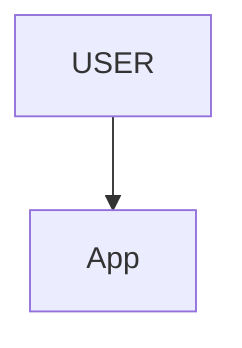
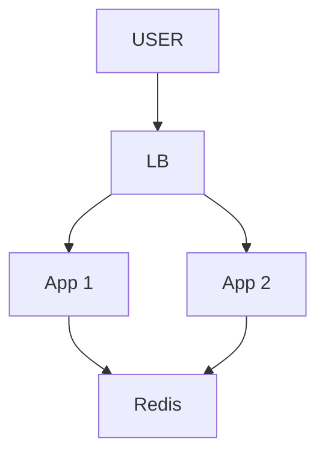
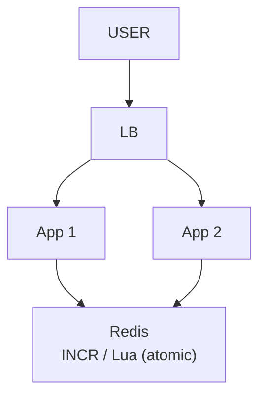
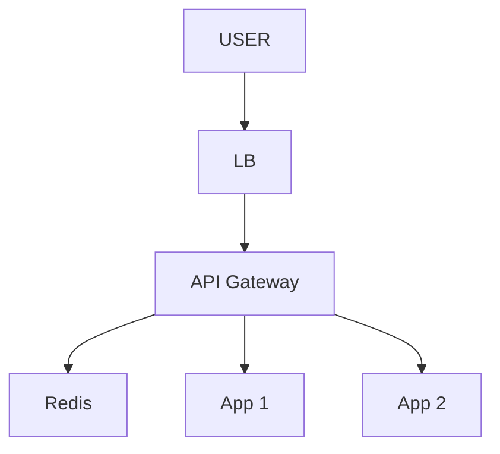
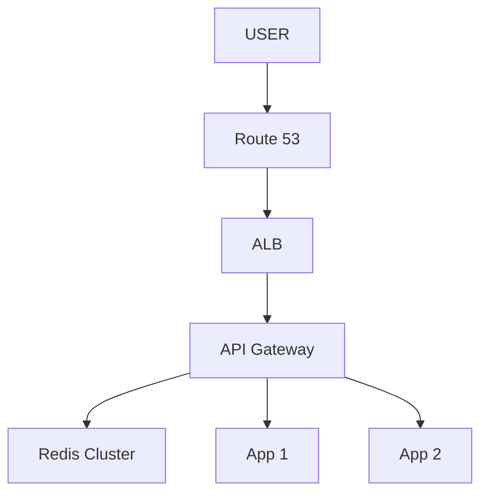
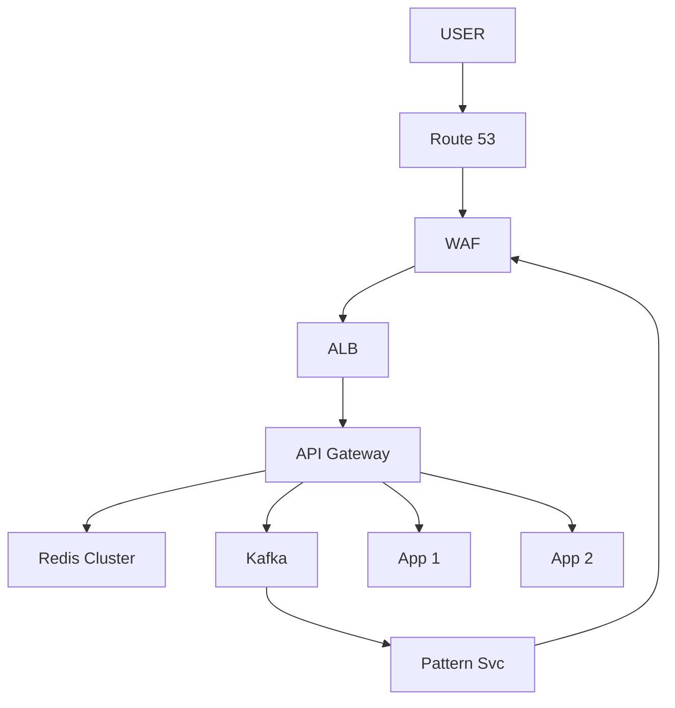
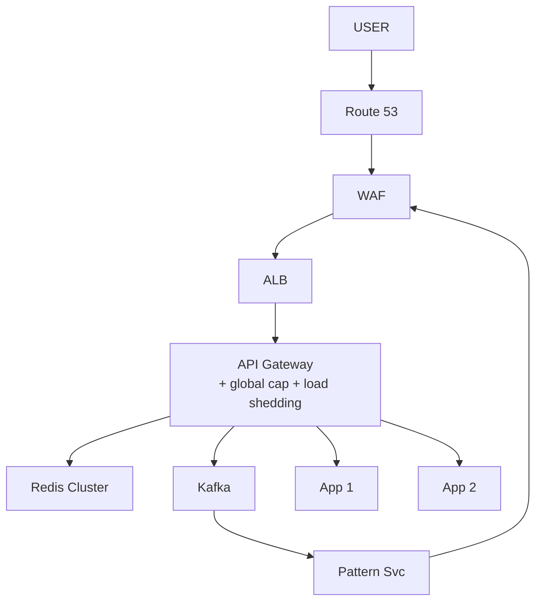

# Rate Limiter

> Ek user / IP ek tay samay me kitni request bhej sakta hai, uski had. Had paar -> 429 (Too Many Requests).
> Misaal: "ek IP se ek minute me 5 login". Is design ka dil teen cheezein hain:
> **har request ke saamne baitha hai, isliye ~1 ms** · **ginti saari machines pe EK** · **limiter khud gire to site na gire**.

```
DESI MISAAL: park me nal. Normal banda 1 bottle bharta, ek pagal banda 10 truck le aaya -> paani khatam,
             asli log khaali haath. Niyam lagaya "ek banda din me 5 bottle" = RATE LIMITING.
             API pe: ek bot ek second me 10,000 baar login try karta
                     (password guess) -> "ek IP, ek minute, 5".
```

---

## TASVEER (ByteByteGo / Alex Xu · CC BY-NC-ND 4.0)


Source: [How Does Redis Persist Data?](https://bytebytego.com/guides/how-does-redis-persist-data/)
(HANDS-ON #3 CASE C: Redis ka disk pe save band tha, restart hua to saari ginti gayab. RDB / AOF yahi save karte hain.)

---

## SHURU: pehle poocho, phir numbers

```
POOCHO:  limit kis pe? IP / user_id / API key. Har endpoint ki alag (login 5 / min, search 60 / min)?
         plan ke hisaab se (free / pro / enterprise)?
         ★ sabse zaroori: maqsad SERVER BACHANA hai ya PAISA / SECURITY?
           server bachana -> thoda zyada nikal jaaye to chalta
           · paisa / OTP / login -> bilkul sahi ginti chahiye

MISAALEIN: login 5 / min ek IP se · password reset 3 / ghanta ek email pe · public API 100 / min ek key pe ·
           signup 10 / din ek IP se · search 60 / min ek user ka

ZAROORI KAAM (FR):   niyam (kitni) · ginti (kitni ho gayi) · samay (kis minute / ghante me) · paar -> 429
KAISA CHALE (NFR):   ~1 ms (har request iske saamne se jaati hai, ye dheema = poora API dheema)
                     limiter mare to aam API khuli rahe (FAIL-OPEN),
                     par login / payment / OTP band (FAIL-CLOSED)
                     kai machine pe bhi ginti sahi

NUMBERS:  jagah ka hisaab bekaar hai: har user ki ek ginti + expiry, bas.
          asli number = kitni baar poocha jaata hai. Ye har request ke aage hai -> poore system me sabse zyada
          chalne wala dabba (laakhon / second). Isliye ye jagah ka
          nahi, SPEED ka sawaal hai -> RAM me (Redis), DB nahi.
          Aur ginti badhana ek jhatke me (atomic) hona chahiye.
```

---

## ════ MOCK SE PEHLE: SIRF YE CARD PADHO ════

> Har card: DIKKAT 1 (kya toota) -> HAL (kya kiya) -> diagram -> DIKKAT 2, 3 ... (interviewer ke
> agle sawaal) har ek ke neeche uska HAL. Revise: sirf baayein column padho.

#### DABBA 0: SABSE SIMPLE (yahan se shuru, phir "kahan tootega")
```
App ki memory me ek ginti. Har request pe ginti + 1. Had paar -> 429.
```


#### 1 DO SERVER, GINTI BAT GAYI
```
DIKKAT 1   Limit hai "ek minute me 5 login". App ki 2 machine, LB request baant raha.
           Arpan ne 9 baar login try kiya: App-1 pe 5, App-2 pe 4 gayi.
           Har App ne apni ginti dekhi: 5, 4 -> kisi ko 5 PAAR nahi dikha. 9 andar ghus gayi.
HAL        Ginti sab machines ki EK jagah: Redis. Key = "rate:Arpan:login".
           Har request pe +1 (INCR). Pehli request pe key ki umar 60 sec (EXPIRE) -> 60 sec baad key khud
           mit jaati -> naya minute, ginti 0. Ginti 5 se upar -> 429.
           (Ye "har minute ka dabba" = fixed window, samajhne ke liye sabse simple.
            Asli chuna TOKEN BUCKET hai, wo Redis me kaise -> neeche ALGO card.)
```

```
DIKKAT 2   Minute ke aakhri second pe 5, agle minute ke pehle second pe 5 -> 2 second me 10?
HAL        Haan, fixed window ki kamzori, kinare pe double nikal jaata.
           Token bucket / sliding window se theek.

DIKKAT 3   Har request pe Redis tak jaana = time?
HAL        Redis RAM me hai, paas ke data center me ~1 ms. Chalta hai.

DIKKAT 4   DB me ginti kyun nahi?
HAL        Har request pe DB me likhna padega. DB disk pe likhta + lock lagata = dheema. Redis RAM = tez.

DIKKAT 5   Ek user ko hamesha ek hi App pe bhejo (sticky LB)?
HAL        Wo App gira to ginti gayi. App badhe / ghate to bantwara badla, ginti phir bat gayi.
```

#### 2 DO REQUEST EK SAATH, DONO GHUS GAYI
```
DIKKAT 1   Ginti 4 pe hai, limit 5. Bot ne Arpan ke account pe ek hi pal me 20 login parallel bheje,
           LB ne do App pe baante. App-1 ne Redis se padha "4", App-2 ne bhi "4".
           Dono ne +1 kiya aur "5" likha -> andar 6 ghus gayi.
HAL        Redis ek hi line (single thread) me kaam karta: ek command poora hone tak doosra shuru hi
           nahi hota. Isliye INCR ek saath aaye to bhi +1, +1 sahi.
           Token bucket me do kaam ("token bacha?" dekhna + "ek ghatao") -> dono ek LUA script me.
           Lua bhi ek command ki tarah poora chalta, beech me doosri request aakhri token nahi le sakti.
```

```
DIKKAT 2   Key ki umar (EXPIRE) har request pe laga di?
HAL        Har baar umar phir 60 se shuru -> key kabhi mitegi hi nahi. Umar sirf pehli request pe (ginti 1).
           Aur INCR ke baad, EXPIRE se pehle App crash -> key bina umar ke -> user hamesha block.
           Isliye dono ek Lua script me.

DIKKAT 3   Token bucket me Redis me kya rakhoge? 10 crore user ke bucket bharne ko koi job?
HAL        Sirf 2 number: kitne token bache + aakhri baar kab dekha. Koi job nahi.
           Bharna request AANE pe: "pichhli baar se kitna time beeta x bharne ki speed" utne token jodo
           (had tak), phir 1 ghatao. Jo user aa hi nahi raha, uski key umar se khud mit jaati.

DIKKAT 4   Lua script dheema ho gaya ya atak gaya?
HAL        Redis ek hi line me chalta -> poora Redis ruk jaayega. Isliye script chhota, koi loop nahi.

DIKKAT 5   Ek hi line me chalta hai, to dheema nahi?
HAL        RAM me hai, ek machine lagbhag lakh command / second (andaza, machine pe depend).
           Zyada chahiye -> SHARD.
```

#### 3 REJECT WALI REQUEST BHI ANDAR GHOOM AAYI
```
DIKKAT 1   Limiter App ke andar tha. Bot ki jis request ko 429 milna tha, wo bhi LB se App tak ghoom ke
           aayi, tab jaake mana hui. Machines ka kaam bekaar gaya.
HAL        Limiter sabse aage, darwaze (API gateway) pe. Gateway har request pe Redis se poochhta:
           had ke andar -> aage App ko · bahar -> wahin 429. Mana wali request andar pahunchti hi nahi.
```

```
DIKKAT 2   429 ke saath client ko kya bataoge?
HAL        "Kab dobara aao" (Retry-After: 30) aur "kitni bachi" (X-RateLimit-Remaining).
           Retry-After me thoda aage-peeche (jitter, jaise 28, 33), warna sab theek 30 sec baad ek saath
           aayenge -> nayi laher.

DIKKAT 3   Gateway khud gira?
HAL        Gateway ki bhi 2+ machine, aage LB.

DIKKAT 4   Har endpoint ki limit alag ho, aur bina naya code daale badalni ho (sale me login 5 se 10)?
HAL        Niyam CONFIG me rakho (DB / AWS AppConfig). Gateway unhe memory me rakhta, har ~30 sec naye
           padh leta.

DIKKAT 5   Limit sirf gateway pe, ya service ke andar bhi?
HAL        Gateway pe sabke liye ek moti limit, service ke andar uski apni baarik limit.
```

#### 4 REDIS GIR GAYA
```
DIKKAT 1   Saari ginti Redis me thi. Redis mar gaya -> kisi ko pata hi nahi kisne kitni bheji.
           Limiter andha.
HAL        Redis ki copy doosri building me. Likhna main pe, copy thodi der baad. Main mara -> baaki
           machines vote karke copy ko main bana deti (Redis Cluster / Sentinel).
           Poora Redis hi chala gaya: aam cheezein (feed, search) sabko jaane do (FAIL-OPEN), login / OTP
           sabko roko (FAIL-CLOSED), warna koi bina had password guess karta rahega.
```

```
DIKKAT 2   Switch ke beech aakhri kuch ginti kho gayi?
HAL        Haan, copy thodi peeche thi. Rate limit me chalta hai, ye paisa nahi.

DIKKAT 3   Redis gira nahi, bas bojh se dheema hai (CPU full)?
HAL        Copy se nahi bachega: har request pe INCR = LIKHNA, aur likhna sirf main pe. Ilaaj = SHARD
           (Redis Cluster): user ke hisaab se keys 3-4 main machine me baanto, har ek pe 1/4 bojh.
           Yaad rakh: copy = bachav + padhne ka bojh. Shard = likhne ka bojh.

DIKKAT 4   Fail-open ya fail-closed, kab tay karoge?
HAL        PEHLE se, code me, har endpoint ke hisaab se. Redis gire tab sochne ka time nahi hota.

DIKKAT 5   Lua script me 2 key hain aur Redis Cluster hai?
HAL        Cluster me Lua ki saari key EK hi machine pe honi chahiye. Key ke naam me {Arpan} jaisa tag:
           rate:{Arpan}:min aur rate:{Arpan}:day -> sirf {} ke andar se machine tay -> dono ek jagah.

DIKKAT 6   Diagram me Route 53 aur ALB kyun aaye?
HAL        Redis ki tarah LB bhi ek hi ho to wahi gira = sab gira. ALB kai zone me, Route 53 dekhta
           kaunsa zinda, usi pe bhejta.
```

#### 5 EK API KEY TEEN REGION SE
```
DIKKAT 1   Limit 100 / minute ek API key pe. Arpan ki script 3 cloud server pe chal rahi: Mumbai, Frankfurt,
           US. Har server paas wale region pe gaya, har region ka apna Redis, har ek ne 50 gina
           -> kisi ko 100 paar nahi dikha. 150 nikal gayi.
HAL        Har user ka ek HOME region (user_id se). Request kahin se aaye, ginti HOME region me hi.
           Arpan ka home = India. Frankfurt ka gateway dekhta "iska ghar India" -> India ke Redis tak bhejta.
           Teeno region ki request ek hi ginti me -> 100 pe ruk jaata.
```

```
DIKKAT 2   Har request pe India tak jaana = 100-200 ms extra?
HAL        Haan. Isliye home region sirf paisa / security wale endpoint pe.
           Baaki pe har region apni ginti + har second aapas me milaate rehna (sync).

DIKKAT 3   Har region apni ginti rakhe aur baad me milaaye, to kitna zyada nikal jaata?
HAL        Milaane ke beech (~1 sec) har region apni poori limit de sakta. Halki limit ke liye chalta.

DIKKAT 4   Arpan ka home region hi gira?
HAL        Route 53 doosre region bhejta, ginti wahan 0 se. Ek minute dheela, chalta hai.
```

#### 6 BAAR-BAAR MAAR RAHA, 429 SE NAHI RUKTA
```
DIKKAT 1   429 sirf bolta "60 second baad aao". Bot 60 second baad phir aa jaata, din bhar, roz.
HAL        Har 429 pe ek khabar Kafka me. Pattern service dekhti: "is IP ko 10 minute me 500 se zyada 429
           mile?" -> haan -> WAF ki block list me kuch der ke liye.
           WAF sabse aage (edge pe) baitha, us IP ki agli request server tak pahunchti hi nahi.
```

```
DIKKAT 2   Turant ban kyun nahi?
HAL        Asli user bhi kabhi tez click karta. Ek office ke 100 log ek hi IP (NAT) ke peeche hote.
           Sale me asli bheed bhi aati. Isliye limit maafi wali, ban sirf pakke gunde pe.

DIKKAT 3   Galat banda ban ho gaya (office ka IP)?
HAL        Ban ki umar (~24 ghante), apne aap hat jaata, aur haath se hatane ka raasta bhi.

DIKKAT 4   Gateway seedha Pattern service ko call kyun nahi karta?
HAL        Har request pe ek aur call = gateway dheema. Kafka me daal ke bhool jao.

DIKKAT 5   Kafka peeche reh gaya?
HAL        Ban kuch minute late lagega. Tab tak rate limit to rok hi raha hai.
```

#### 7 LIMITER SAHI, PHIR BHI SERVER GIRA
```
DIKKAT 1   Har user ki limit 100 / minute, aur server ek second me 5,000 jhel sakta.
           Sale shuru hui, 10,000 asli log aaye. Har koi apni limit ke andar, par sab mila ke 12,000 / sec.
           Server gir gaya. Limiter ne kuch nahi roka, kyunki kisi ek ne galti ki hi nahi.
HAL        (1) Gateway pe poore system ki ek had (global cap).
           (2) LOAD SHEDDING: system thakne lage (CPU 90% paar) to kuch request seedha mana (503).
             RATE LIMIT    = ek USER ne kitni bheji       -> 429
             LOAD SHEDDING = poora SYSTEM kitna jhel sake  -> 503
```

```
DIKKAT 2   Kaunsi request chhodoge?
HAL        Login / payment rakho. Recommendation / analytics pehle chhodo.

DIKKAT 3   Machine apne aap badh jaayein (autoscale)?
HAL        Nayi machine aane me minute lagte, bheed second me aati. Pata ho kab aayegi (12 baje sale) to
           pehle se badha do.

DIKKAT 4   Request ko line (queue) me rok lo?
HAL        Chhota time (~2 sec). User chala gaya to uska kaam karna bekaar.
```

#### 8 ATTACK AAYA, USI WAQT LIMITER GAYAB
```
DIKKAT 1   Attack aaya -> Redis pe 50 guna bojh -> Redis gir gaya -> fail-open -> sab allow.
           Jis waqt limiter sabse zyada chahiye tha, usi waqt gayab.
HAL        Har server apni memory me ginti karne lage, had baant ke: poori had 100, 4 server -> har server
           25 tak. Bilkul sahi nahi, par bina had se kahin achha. Redis wapas aaya -> phir sabki ek ginti.
```

```
DIKKAT 2   Machine badh gayi (autoscale), ab kitna baantoge?
HAL        Machines ki ginti config / service discovery se lo, dobara baanto.

DIKKAT 3   Ek user ki request alag-alag machine pe gayi?
HAL        Har machine pe 25 -> motamoti, exact nahi. Par attack me "kuch nahi" se bahut behtar.
```

#### 9 IP PE GIN RAHE THE
```
DIKKAT 1   Office ke 1000 log ek hi IP ke peeche (NAT). Ek ne galti ki, IP block, saare 1000 block.
           Ulta, ek botnet ke paas 1000 IP, har IP se thoda-thoda -> kisi IP ki limit nahi tooti.
HAL        Login ke baad had user_id pe (JWT se): key = rate:<user_id>:<endpoint>.
           Office ke 1000 log = 1000 alag ginti, ek ki galti se baaki nahi rukte.
           Login se pehle user_id hai hi nahi: rate:<IP>:login (dheeli had) + WAF.
```

```
DIKKAT 2   Login se pehle botnet 1000 IP se password guess kar raha?
HAL        IP limit bekaar. ACCOUNT pe limit: rate:<username>:login_fail
           -> 5 galat password -> thodi der lock / CAPTCHA.

DIKKAT 3   API key chori ho gayi?
HAL        Key pe limit nuksaan seemit karti, aur key badalne / band karne ka raasta.
```

#### ALGO: kaunsa aur kyun
```
TOKEN BUCKET (yahi chuna):
   Ek baalti me token hain (max 10). Har second 1 token bharta hai. Har request 1 token leti hai.
   Baalti khaali -> 429. Baalti bhari hai to 10 request ek saath bhi nikal jaati hain (burst),
   aur asli traffic aisa hi hota hai. Redis me sirf 2 number, bharna request aane pe.

   REDIS ME KAISE (ek HASH, ek Lua script):
     key tb:Arpan:login -> tokens = 7, last = 10:00:05        (had 10, bharna 1 token / second)
     Request aayi 10:00:08 -> 3 second beete x 1 = 3 token bharo -> 7 + 3 = 10 (had 10 se upar nahi)
     -> token >= 1? haan -> 1 ghatao -> tokens = 9, last = 10:00:08 -> ALLOW
     Khaali (tokens 0) -> 429, Retry-After = agla token kab bharega.
     Padhna + hisaab + likhna EK Lua script me (HMGET -> hisaab -> HSET + EXPIRE), to do request ek
     saath aake aakhri token dono nahi le sakti. Time app se bhejo ya Redis ka TIME lo, ek hi rakho.

FIXED WINDOW:   har minute ka ek dabba. Sasta, par kinare pe double (59th + 61st second).
SLIDING LOG:    har request ka time likho, pichhle 60 second ki gino. Bilkul sahi, par memory bahut.
SLIDING COUNTER: is minute ki + pichhle minute ka hissa (jaise 70%) jodo. 2 number, lagbhag sahi.
LEAKY BUCKET:   request line me, nikalti ek fixed speed se. Smooth, par burst nahi nikalne deta.

"Token bucket hi kyun?" -> burst chahiye + memory kam + Redis me 2 number. (AWS / Stripe yahi lete hain.)
```

```
AAKHRI DABBE (sab dikkat ke baad):
  User -> Route 53 -> WAF (ban list) -> ALB (kai data center)
  -> API Gateway me limiter (sabse aage, jaldi mana)
  -> Redis Cluster (token bucket ek Lua script me: tokens + last, key = user + endpoint)
     -> had ke andar? App : 429 + Retry-After
  baar-baar wala -> Kafka -> Pattern Svc -> WAF ban

DB:  Redis = ginti ki ek hi sachchi jagah, 1 ms, key ki umar
     = window (umar khatam = ginti reset, safai ka job nahi)
     user ka plan (free / pro) DB se, Redis me usi limit se milao

END ME POOCHEGA:
  "Kaunsa algo?"     -> TOKEN BUCKET: asli traffic jhatke me aata, jama token se burst nikal jaata
  "10 guna?"         -> gateway machine badhao · Redis shard + copy · home region · global cap + load shedding
  "Kahan se sab gir sakta?" -> Redis (cluster + switch; aam API fail-open, login / OTP fail-closed)
                               · LB (Route 53)
  "Chal raha, kaise pata?"  -> limiter ka time (p99) · kitne 429 · Redis ki galtiyan · alert
```

AAKHRI DABBE ki tasveer:


---

## 10 GUNA TRAFFIC — har dabba alag se

```
API Gateway   -> har request pe limiter chalta -> RAM me + ek jhatke me (atomic). Gateway machine badhao
Redis         -> SHARD (user / region ke hisaab se) + COPY (switch ke saath) + fail-open + local fallback
kai region    -> har user ka HOME region
gunda         -> Kafka -> Pattern service -> WAF ban
asli bheed    -> global cap + load shedding + line (queue) + pehle se scale
```

---

## POOCHE TO (gehra sawaal aaye tab)

```
JAWAB KE HEADER:
   theek hai -> aage bhejo + X-RateLimit-Limit: 100 · X-RateLimit-Remaining: 47 · X-RateLimit-Reset: <kab>
   had paar  -> 429 + Retry-After: 30 + Remaining: 0
   sirf "na" mat bolo, "kitna bacha" aur "kab aao" bhi batao, warna client turant phir maarta.
   Retry-After me thoda aage-peeche (28, 33), warna sab ek saath lautte hain.

ULTA SAWAAL ("tumhe kisi aur ne 429 diya, ab?"):
   "I respect Retry-After, back off exponentially with jitter, and throttle my own sends."

REDIS KEY:  rate:<user>:<endpoint> -> ginti · umar = window (60 sec) -> umar khatam = reset, safai ka job nahi
            rate:192.168.1.5:login -> 4 · rate:user_456:signup -> 2 · rate:apikey_xyz:search -> 47

EK LINE:   User -> Route 53 -> ALB -> Gateway limiter -> Redis (token bucket Lua, ek jhatke me)
           -> had ke andar? App | paar? 429 + Retry-After | baar-baar? Kafka -> WAF ban

SLIDING WINDOW (bus stand ki misaal):
   register: "pichhle 1 ghante me 5 se zyada nahi".
   11:00 pe aaye -> 10:00 ke baad 5 aa chuke -> mana.
   11:10 pe aaye -> ab 10:10 ke baad gino, Ramesh 10:05 wala bahar ho gaya -> 4 -> andar.
   window request aane pe khisakti hai, koi timer / job nahi.

KAUN KAISA:   token = burst haan, memory kam · leaky = burst nahi,
              smooth · fixed = sabse sasta, kinare pe double · sliding log = sabse sahi, memory zyada

GINTI vs BOJH:
   100 chhoti request (5 ms) = 0.5 second kaam. 100 bhaari report (30 second) = 50 MINUTE kaam.
   Limiter ke liye dono "100". Bhaari endpoint pe kadi limit,
   ya request ka WAZAN (report = 50 token, login = 1),
   ya "ek user ki ek waqt me 2 hi bhaari query".

PLAN:  bina login 60 / ghanta · free 5,000 · pro 10,000 ·
       enterprise apni · plan DB se, Redis me usi limit se milao

EK HI SHAKAL (poore HLD me ghoomti):
   LB me      bachane wali cheez ne hi maara (health check / retry / sticky)
   cache me   tez karne wali cheez ne raasta roka (dheema Redis, timeout nahi)
   limiter me rokne wali cheez ne bheed roki hi nahi (per-user
   vs poora system) + attack me khud gayab (fail-open)
```

---

## AAKHRI DABBA + WRAP

```
Route 53 = kaunsa LB zinda · ALB = kai data center · API Gateway = limiter sabse aage, jaldi mana
Redis Cluster = ginti ki ek jagah, 1 ms, token bucket ek Lua script me, copy + shard
Kafka -> Pattern Svc -> WAF = baar-baar wale ka pakka ban
```
```
JAWAB:    Limiter darwaze (API gateway) pe, mana hui request andar jaati hi nahi.
          Ginti Redis me, sab servers ki ek jagah, ek kadam me (token bucket ki Lua script).
          Key = kaun user + kaunsa kaam, umar = window.
          Token bucket isliye ki asli user jhatke me request bhejta. Had paar = 429 + kitni der baad aao.
          Redis ki copy. Redis band: aam cheez khuli, login / OTP band. Baar-baar wale hamlawar ko WAF
          se block, aur badi asli bheed ke liye poore system ki had.
```

---

## HANDS-ON #1 — Nginx limiter LIVE (21-Aug, isi folder ki `nginx.conf`)

```
docker run -d --name rl -p 8080:80 -v "<path>\nginx.conf:/etc/nginx/nginx.conf:ro" nginx
   -d background · --name rl · -p laptop 8080 -> container 80 · -v apni conf andar MOUNT (ro) · nginx = image

nginx.conf ki 2 asli line:
   limit_req_zone $binary_remote_addr zone=mylimit:10m rate=1r/m;    <- har IP ka bucket, refill 1 / min
   limit_req zone=mylimit burst=5 nodelay;                           <- bucket SIZE 5, burst turant serve
   rate = kis speed se nikalti · burst = kitni ruk sakti
   + location / { ... root /usr/share/nginx/html; index index.html; }  <- content serve
   koi program NAHI likha — sirf ready tool (Nginx, rate limiter built-in) on kiya + config + hammer -> 503
   SACH: nginx docs isko LEAKY BUCKET kehte; nodelay se bartaav
         token bucket JAISA. 503 = limit_req_status default.

HAMMER:  for /L %i in (1,1,30) do @curl -s -o nul -w "%{http_code} " http://localhost:8080
         (1,1,30) = 30 baar · -s -o nul = chup, body phenk do · -w = sirf status code
DIKHA:   200 200 200 200 200 200 503 503 503 ...
LOG:     (Docker Desktop -> Containers -> rl -> Logs) "GET / HTTP/1.1" 503 197
         [error] limiting requests, excess: 5.774 by zone "mylimit", client: 172.17.0.1
         (excess = bucket se kitna upar · client = Docker gateway IP, sab ek IP = ek bucket)

GOTCHA:  1. 503 tabhi jab ARRIVAL > rate (rate=2r/s pe dheere loop -> sab 200, refill pakad leta)
         2. burst=N -> spike me N+1 pass (burst=5 -> 6, 100 ->
            101); textbook N, nginx N+1, timing se 21 / 22 bhi
         3. 1 IP = 1 bucket
         4. config badla -> docker restart rl
CHALAO:  docker start rl · curl http://localhost:8080 · docker logs rl · docker restart rl · docker stop rl
```

---

## HANDS-ON #2 — App ke andar fixed window (usercrud, 26-Aug)

```java
@RestController
public class RateLimitController {
    private int LIMIT = 5;
    private long windowStart = 0;
    private int count = 0;

    @GetMapping("/rate-demo")
    public synchronized ResponseEntity<String> hit() {          // synchronized: shared counter
        long now = System.currentTimeMillis();
        if (now - windowStart > 1000) { windowStart = now; count = 0; }   // window reset
        count++;
        if (count > LIMIT)
            return ResponseEntity.status(HttpStatus.TOO_MANY_REQUESTS).body("429 - limit paar");
        return ResponseEntity.ok("OK - request #" + count);
    }
}
// SecurityConfig: .requestMatchers("/rate-demo").permitAll()
// ResponseEntity KYUN: status-code (200/429) khud set karne ko
```
```
LIVE:  1..10 | % { curl.exe -s http://localhost:8080/rate-demo; "" }
       OK #1..#5 · 429 (6..10) · 1 sec baad window reset -> phir OK
EDGE:  fixed window boundary: 999ms pe 5 + 1001ms pe 5 = ~2ms me 10
PROD:  single node memory -> restart pe reset + har server apna count -> Redis INCR + EXPIRE
       per user / IP -> map<key, counter> · lib: Bucket4j (token bucket) / Redis + Lua
JAWAB:    usercrud me khud banaya: 5 request theek, chhathi pe 429.
          Asli system me token bucket (Bucket4j library) + sab servers ka saanjha Redis counter. Nginx
          bhi ye kaam sabse aage kar sakta (limit_req).
```

---

## HANDS-ON #3 — Redis KHUD maara: kaise tootta

CODE: `04_HLD/HANDS_ON/01_rate_limiter_redis/RateLimiterDemo.java` · `04_HLD/HANDS_ON/02_incr_expire_crash/IncrExpireCrash.java`
(koi library nahi, socket se Redis, `java File.java`)

```
docker run -d --name demo-redis -p 6390:6379 redis:7 redis-server --save "" --appendonly no
   (RDB + AOF band -> sirf memory, restart = sab gaya, jaan-boojh ke)
docker stop / start demo-redis · docker exec demo-redis redis-cli TTL rl:user:1 · ... DEL rl:user:1

CODE KA DIL (user:1 ko 60 sec me 5):
   count = INCR KEY · if count == 1 -> EXPIRE KEY 60 · count <= 5 ALLOW else 429
   catch IOException -> FAIL_OPEN ? ALLOW : BLOCK
```
```
CASE A  chalta kaise  req 1..9:  count 1 TTL 60 ALLOW · 2/57 ALLOW · 3/56 ALLOW · 4/49 ALLOW · 5/48 ALLOW ·
                                 6/47 429 · 7/45 429 · 8/45 429 · 9/44 429     (window PEHLI request se)

CASE B  docker stop   "REDIS SE BAAT NAHI HUI: Connection refused" -> FAIL_OPEN = true -> ALLOW (2 baar)
                      fail-open = site chale, limit nahi · fail-closed = abuse nahi, site band
                      ("server ne haath khade kar diye, sab jao")

CASE C  docker start  GET rl:user:1 -> khaali · user (pehle count 7, BLOCK) -> count 1 ALLOW, 2 ALLOW
                      persistence band -> ginti gayab -> blocked ko 5 nayi mil gayi

CASE D  INCR ke baad, EXPIRE se pehle crash (USE_LUA = false)
                      RUN 1: count 1, CRASH · TTL -> -1
                      RUN 2: count 2..5 ALLOW, 6..7 429, har baar TTL
                             -1 -> key KABHI nahi mitegi, HAMESHA block
FIX D   USE_LUA = true   req 10..14: count 10 TTL 58 · 11/57 · 12/56 · 13/56 · 14/55 -> 1 min me free

TTL:  -1 = key hai, timer nahi · -2 = key hi nahi · 58 = 58 sec baaki
```
```
FIX:  B -> faisla pehle se: fail-open (aam API) / fail-closed (login, OTP) + replica
      C -> replica / AOF on. limiter me aksar chalne do (1 min ki ginti, paisa nahi). paisa hota to nahi.
      D -> Lua: INCR + EXPIRE ek command, Redis single-thread -> script beech me nahi rukti
           (EXPIRE NX se nahi bachta: wo bhi alag call hai, beech me crash wahi)
           pehle:  app --INCR--> Redis  [crash]  app --EXPIRE--> Redis
           Lua:    app --EVAL(INCR + EXPIRE)--> Redis
```
```lua
local c = redis.call('INCR', KEYS[1])
if c == 1 then redis.call('EXPIRE', KEYS[1], ARGV[1]) end
return c
```
```
JAWAB:    Docker Redis khud band karke teen cheez dekhi:
          1) Redis band: aam API chalti rahi, login / OTP ruk gaye.
          2) Redis restart: saari ginti zero ho gayi. Limiter me chalta hai, copy rakho to kam hota.
          3) Ginti +1 aur 'umar lagao' alag-alag bheje aur beech me crash hua: key bina umar ke reh
          gayi, user hamesha ke liye block. Isliye dono ek Lua script me ek saath.
```

ARCHETYPE F · CONCEPTS: [caching/Redis](../../FOUNDATIONS/04_caching.md) · [load-balancing](../../FOUNDATIONS/03_load_balancing.md) · [SPOF](../../FOUNDATIONS/11_reliability_spof_cloud.md) · [← MASTER SHEET](../../00_MASTER_SHEET.md)
