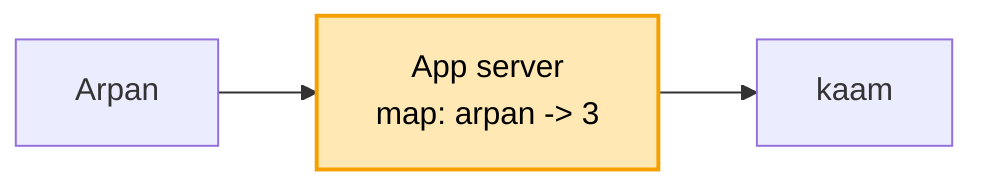
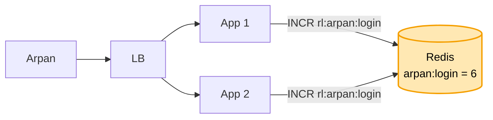
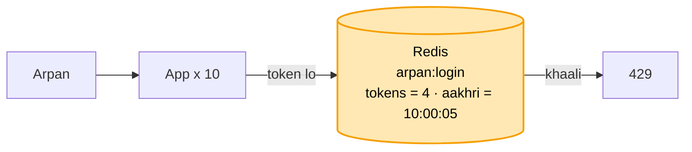
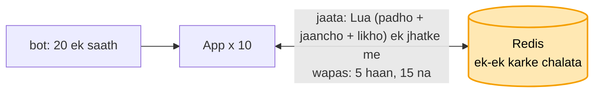
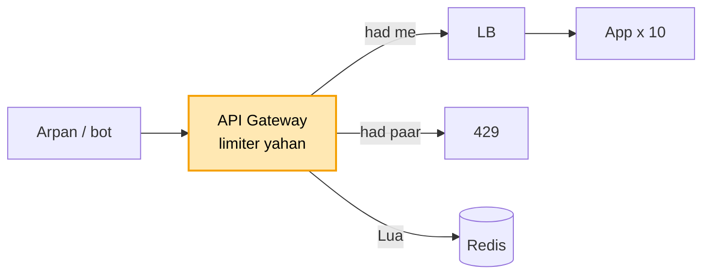
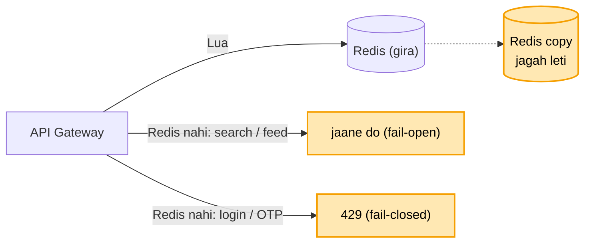
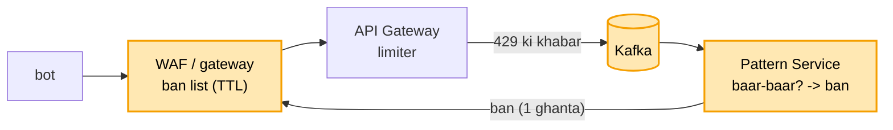
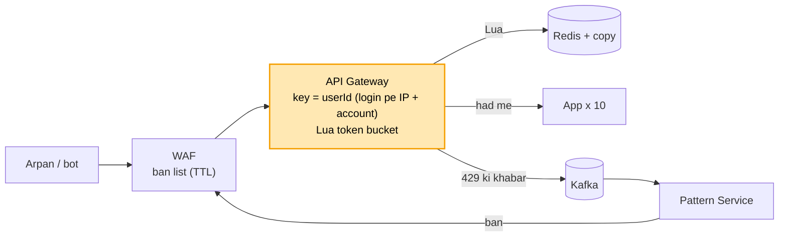
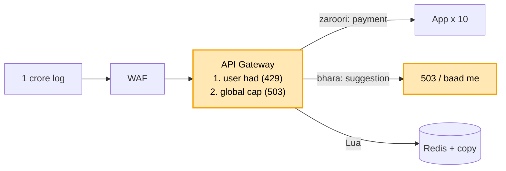
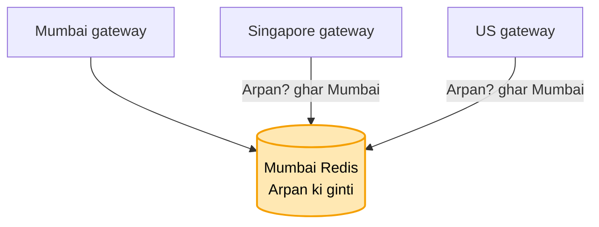

# Rate limiter: shuru se, ek kahani

**Mock se pehle hand notes:** [RATE_LIMITER_HAND_NOTES.md](RATE_LIMITER_HAND_NOTES.md)

Kram wahi jo interview me hota hai: **FR, phir NFR, phir numbers, phir design**. Design sabse seedhe dabbe se
shuru hota hai, aur har dikkat aane pe ek naya dabba judta hai. Diagram me peela dabba = abhi juda. Poori file
me ek hi kahani hai: Arpan ka app, aur uske login pe hamla karta ek bot.

**CUE (yahi shabd yaad rakhne hain, kram se):**
server me ginti -> Redis (ek ginti) -> token bucket -> Lua (ek saath 20) -> gateway pe
-> copy + fail-open / closed -> Kafka + ban -> userId (login pe IP)
-> global cap 503 -> home region

---

## 1. FR: kya karna hai

```
1. har user ki had: login 5 baar / minute, baaki API 100 / minute
2. had paar ho to 429 (Too Many Requests), saath me "kitni der baad aao" (Retry-After)
scope ke bahar (poochh ke hata do): plan ke hisaab se alag had (free / pro), ye baad me
```

## 2. NFR: kaisa chalna chahiye

```
- TEZ: limiter har request ke aage baitha hai, ~1 ms me haan ya na. Ye dheema to poori site dheemi
- ginti EK: 10 server hon tab bhi har user ki ginti ek hi jagah
- limiter gire to site na gire
```

## 3. Numbers

```
- ~1 crore user, sabse bheed wale waqt ~10,000 request har second
- har user ke liye sirf 2 chhote number (kitne bache, aakhri baar kab) -> 1 crore x ~50 byte = ~500 MB
```

Matlab dikkat jagah ki nahi, SPEED ki hai. 500 MB ek machine ki RAM me aa jaata hai. Isliye aage RAM wala
Redis aayega, DB nahi.

---

## 4. Design

### Kadam 1: sabse seedha (server ke andar ginti)

App server ki memory me ek map rakho: `user -> is minute kitni request aayi`.

```
request aayi -> map[arpan] me +1 -> 5 se zyada? -> 429
                                    nahi        -> aage jaane do
minute badla -> map saaf
```



Jab tak server ek hai, ye chalta hai: tez hai, aur sab ek hi jagah gina ja raha hai.

**Maan lo poochhe 429 pe kya bhejein:** Retry-After (kitne sec baad aao; thoda aage-peeche jaise 28 / 33, taaki
sab ek saath na lautein) + X-RateLimit-Remaining (kitne bache).

**Maan lo tumhe kisi ne 429 diya:** Retry-After maano, ruk-ruk ke dobara (backoff + jitter), apni raftaar
ghatao.

Par bheed badhi to 10 app server lag gaye, aur aage LB. Ab Arpan ki 5 login App 1 pe gayi aur 5 App 2 pe. Dono
ne alag-alag gina, dono ko laga "5 hi to hain", aur 10 andar chali gayi. Had toot gayi.

### Kadam 2: kai server, ginti ek jagah (Redis)

Ilaaj: sabki ginti **ek jagah** rakho, yaani Redis me. Har app server har request pe Redis se poochhta hai.

```
key   = rl:arpan:login          (kaun user + kaunsa kaam)
INCR  -> 1, 2, 3 ...            (Redis me ginti +1 karo, nayi ginti wapas aati hai)
umar  = 60 sec (TTL)            -> pehli request pe lagti; 60 sec baad key apne aap gayab = ginti reset
6vi aayi -> 429
```



Redis kyun, DB kyun nahi? NFR kehta hai ~1 ms, aur har second 10,000 request. DB disk pe likhta hai, har baar
kai ms lagte, poori site dheemi ho jaati. Redis RAM me hai, ~1 ms. Aur numbers me nikla tha ki data sirf 500
MB hai, RAM me aa jaata hai.

Umar (TTL) isliye ki 60 sec baad key khud mit jaaye, safai ke liye koi job na chalana pade.

**AWS pe:** Redis hum khud nahi chalate, AWS ka **ElastiCache** lete hain (Redis jise AWS chalata hai). Machine, copy, gira to copy aage karna, ye AWS ka kaam. Hum bas use karte hain.

Ye "minute" ghadi ka nahi, Arpan ki pehli request se shuru hota hai (10:00:20 pe pehli aayi to 10:01:20 tak).
Par kinare pe dikkat wahi: bot ne 10:01:19 pe 5 bheji (window ka aakhri second) aur 10:01:20 pe phir 5 (nayi window
ka pehla second). Ek second ke andar 10 andar chali gayi, kyunki umar khatam hote hi ginti 0 ho gayi.

### Kadam 3: minute ke kinare pe dugni (kaunsa tareeka gine)

Ab tak ek band khidki (60 sec) me gin rahe the, jo khatam hote hi 0 se shuru hoti hai (isse **fixed window** kehte hain). Gin-ne ke chaar tareeke hain:

```
SLIDING LOG      har request ka time likh lo, nayi aaye to pichhle 60 sec wale gino
                 -> sabse sahi, par har request ka time rakhna = 1 crore user pe bahut memory
SLIDING COUNTER  is minute ki ginti + pichhle minute ka bacha hissa (2 number)
                 -> lagbhag sahi, sasta
LEAKY BUCKET     request ek line me lagti hain aur fix raftaar se nikalti hain (nal se boond jaisi)
                 -> smooth hai, par jhatke me aayi request (burst) ko nahi nikalne deta
TOKEN BUCKET     ek baalti me max 5 token. Har 12 sec me 1 token bharta. Har request 1 token leti.
                 Baalti khaali -> 429
```

**Token bucket isliye:** isme sirf 2 number rakhne padte hain (kitne token bache, aakhri baar kab dekha), jo
wahi 500 MB hai. Jhatka bhi chalta hai: Arpan 1 ghanta baad aaya to baalti bhari mili, aur wo 5 ek saath bhej
sakta hai, asli user aise hi bhejta hai. Aur kinare wali dikkat nahi aati: baalti khaali hui to agla token 12
sec baad hi aata hai, minute badalne se kuch reset nahi hota. AWS aur Stripe bhi yahi lagate hain.

Token bharta kaun hai? Koi background job nahi. Request aane pe hi hisaab lagta hai (lazy refill):

```
tokens = min(5, tokens + (abhi - aakhri baar) x raftaar)
          ^ baalti se zyada nahi   ^ beete time me jitne bane
Arpan 1 ghanta baad aaya: beete time me 300 bante, par baalti 5 ki hai, to 5 hi
```



**Maan lo 100 halki request vs 100 bhaari:** limiter ke liye dono "100". Bhaari (report) pe kadi had, ya wazan
do (report = 50 token, login = 1).

Par bot ne ek saath 20 login bheje. 10 app server pe 20 request ne ek saath Redis se padha "tokens = 5", sabne socha "bache
hain", aur sabne 1 ghata ke likh diya. 20 andar chale gaye, jabki 5 hi jaane chahiye the.

### Kadam 4: 20 ek saath aaye, sab andar (Lua script, ek jhatke me)

Har request 3 kaam karti hai: padho, jaancho, likho. Ye teen alag kadam the, aur beech me doosri request ghus
gayi:

```
Request 1:  padha 5 -> "bache hain" -> likha 4
Request 2:  padha 5 -> "bache hain" -> likha 4      (Request 1 ka likha hua abhi dikha hi nahi)
...
Request 20: padha 5 -> "bache hain" -> likha 4     -> 20 andar, jabki had 5 thi
```

Ilaaj: teeno kaam **ek hi kadam** me karo. Redis me ek chhoti **Lua script** bhejo, jo token bharna, jaanchna
aur ghatana, teeno ek jhatke me karti hai. Redis ek baar me ek hi command chalata hai (single thread), to jab
script chal rahi hai, koi doosri request beech me ghus hi nahi sakti. 20 request line me lagti hain: pehli 5
ko token mile, baaki 15 ko 429.



Par limiter app ke andar hai. Bot ki 15 mana wali request bhi LB se hoti hui app tak aayi, app ne Redis se
poochha, aur tab jaake 429 diya. Mana karne me bhi hamare app ki machine aur time kharch hua.

### Kadam 5: mana wali request bhi andar tak aayi (limiter darwaze pe)

Ilaaj: limiter ko **sabse aage, API Gateway pe** lagao. Mana wali request app tak pahunchti hi nahi.

```
pehle:  bot -> LB -> App (Redis se poochha) -> 429      app ka time gaya
ab:     bot -> API Gateway (Redis se poochha) -> 429    app tak pahunchi hi nahi
```



Har app ke andar library kyun nahi? Tab har service (login, payment, search) ko apna limiter code likhna
padta, aur bot ka bojh fir bhi app pe padta. Gateway pe ek jagah lagao, sab pe chalega. AWS pe API Gateway me
throttling pehle se hoti hai. Par har user ki alag had chahiye to apna limiter Redis (ElastiCache) ke saath
lagate hain.

**Maan lo poochhe had kahan se aati (free / pro):** DB me user ka plan (bina login 60 / ghanta, free 5,000, pro
10,000). Gateway cache kare, Redis me usi had se milaye.

**Maan lo had badalni ho:** niyam config me (DB / AppConfig), gateway ~30 sec me padhe. Naya code nahi.

**AWS pe:** gateway khud nahi banate, AWS ka **API Gateway** lete hain, usme had (throttling) ki setting pehle se hai. Machine aur bheed AWS sambhalta hai.

Par ab sab kuch Redis pe tika hai. Dopahar ko Redis gir gaya. Ab limiter kisi request ko haan bole ya na?
Sabko 429 diya to poori site band.

### Kadam 6: Redis gira (copy + fail-open / fail-closed)

Ilaaj 1: **Redis ki copy** AWS ElastiCache khud rakhta hai.

Phir bhi un kuch second me kya karein? Do raaste hain. **Fail-open** matlab Redis nahi mila to sabko jaane do:
site chalti rahi, bas kuch second bina had ke. **Fail-closed** matlab Redis nahi mila to sabko 429: koi bot
nahi ghusa, par poori site band.

Aam API (search, feed) pe fail-open, kyunki kuch second bina had ke chal jaana chhota nuksaan hai, site band
hona bada. NFR bhi kehta hai "limiter gire to site na gire". Login aur OTP pe fail-closed, kyunki yahin bot
password ka andaza lagata hai, aur OTP pe SMS ka paisa lagta hai. Inhe kuch second band rakhna sasta padta
hai.



**Maan lo Redis + copy dono gaye:** har gateway apni memory me ginti rakhe, had baant ke: 100 / min aur 10
machine -> har machine 10 / min (had / N). LB barabar baantta, to kul lagbhag 100. Fail-open me had hi nahi
thi, yahan lagbhag sahi. Redis wapas aaya to phir Redis se ginti. (Naya dabba nahi, isliye kadam nahi)

Par wahi bot har 60 second baad wapas aa jaata hai. 429 khaata hai, minute khatam hote hi phir aata hai, aur
din bhar yahi chalta hai.

### Kadam 7: wahi bot baar-baar (pattern pakdo, ban karo)

Ilaaj: har 429 ki khabar **Kafka** me daalo. Peeche ek Pattern Service dekhta hai: "ye 1 ghante me 50 baar had
paar kar chuka hai", to use **ban** kar deta hai. Ban list gateway ya WAF (Web Application Firewall, darwaze ka chowkidar) pe hoti hai, to ban wala darwaze pe
hi ruk jaata hai, Redis tak bhi nahi pahunchta.

Kafka isliye ki 429 dena tez rahe (1 ms). Pattern dhoondhna peeche chalta hai, gateway ko roke bina.

Ban hamesha ke liye nahi, kuch der ke liye hota hai (TTL, jaise 1 ghanta, aur baar-baar aaya to badhao).
Khaaskar IP ka ban, kyunki IP badalte rehte hain, aur ek IP pe kai log hote hain (office, mobile network).
Hamesha ka ban lagaya to kal wahi IP kisi asli user ko mila to wo atak jaayega.



**AWS pe:** **AWS WAF** lete hain: rules hum likhte hain (kaunsi IP band), chalana AWS ka kaam.

Par ek naya bot aaya. Uske paas leak hui password list thi. Usne 1,000 alag account pe 4-4 password try kiye
(credential stuffing). Har account pe sirf 4, to account wali had (5 / min) kabhi lagi hi nahi. Isliye IP pe
bhi had jodi. Par office ki night shift me 1,000 log ek hi IP se aate hain (office ka internet), sab milke had
paar kar gaye, aur poora office atak gaya.

### Kadam 8: had kis naam pe (IP ya userId)

IP pe had lagane me do dikkat hain. Office ke 1,000 log ek IP pe hain, to sab atak gaye. Aur ulta, bot har
request alag IP se bheje to IP wali had kabhi lagti hi nahi.

**Login ke BAAD:** had **userId** pe lagao, jo JWT token se milta hai. Har insaan ki apni had, chahe IP ek
ho ya hazaar. Office ki dikkat yahin khatam.

**Login PE** userId hota hi nahi. Isliye do had: jis **account** pe koshish ho rahi hai us pe kadi (5 / min),
taaki ek account pe password guess karne wala ruke. Aur **IP** pe bas bahut dheeli (jaise 500 / min), sirf ek
IP se hazaaron ki baadh rokne ke liye. Ye asli deewar nahi, kyunki office me kitne log hain pata nahi (100 bhi
ho sakte, TCS jaise lakh bhi), aur bot kai IP se aata hai. Office ke 1,000 log alag-alag account hain, har ek
ki apni 5, to koi nahi atakta.

```
login se pehle   -> IP (dheeli, 500 / min) + account (kadi, 5 / min)   (rl:ip:1.2.3.4:login, rl:acct:arpan:login)
login ke baad    -> userId                                            (rl:arpan:search)
```



**Par credential stuffing (har account pe sirf 4, kai IP) in dono had se nahi rukta.** Asli ilaaj parat-dar-parat
hai, kyunki koi ek perfect hal nahi:

- **MFA / passkey:** password mil bhi gaya, to bina phone ke bekaar. Ye asli deewar hai.
- **CAPTCHA:** shaq wali koshish pe CAPTCHA dikhao. Galat password pe account block nahi, taaki asli user na atke.
- **WAF:** cloud / badnaam IP band (cloud wale apni IP list publish karte hain).

Ban me bhi yahi: userId pe lamba ban, IP pe chhota.

Par shaam ko sale hai. Har user apni had ke andar hai, par 1 crore log ek saath aa gaye. Sab "had me" hain,
phir bhi server bhar ke gir gaya.

### Kadam 9: sab had me, phir bhi server gira (global cap + 503)

User ki had har insaan ko alag rokti hai. Par 1 crore log ek saath aaye, to kul bojh server ki taakat se zyada
ho gaya.

Ilaaj: **poore system ki ek had (global cap)**. Maan lo servers 50,000 request / second jhel sakte hain.
Gateway pe ek aur ginti lagao: is second kul kitni request aayi. Uske upar wali request ko **503** do (abhi
bhar gaye hain, thodi der baad aao).

```
user ki had   (429)  -> "TU zyada bhej raha hai"     ek insaan ko rokta hai
global cap    (503)  -> "HUM abhi bhare hain"         poore system ko bachata hai
```

Sab ek barabar nahi hain, to bhar gaye to pehle kam zaroori kaam chhodo (load shedding): search suggestion,
recommendation aur analytics pehle kato, payment, order aur login aakhri tak chalao. Matlab sale me "aapke
liye suggestion" band ho gaya, par Arpan ka payment chalta raha. Sale ka time pehle se pata hota hai, to
servers pehle se badha do. Phir bhi zyada aaye to line (waiting room), jaise ticket sale me: "aap line me
2,000ve hain".



Par Arpan ki script 3 region se chali: Mumbai, Singapore aur US. Har region ka apna Redis tha, har ek ne 100
gine. Had 100 thi, par 300 nikal gayi.

### Kadam 10: 3 region se 300 nikal gayi (home region)

Ye kadam 2 wali hi dikkat hai, bas ab server ki jagah region alag-alag gin rahe hain. Teen raaste hain:

```
sab region ek hi Redis se poochhein  -> sahi ginti, par US se Mumbai Redis = ~200 ms har request. 1 ms toota
had baant do (100 / 3 = 33)          -> tez, par Arpan sirf Mumbai se aaye to bhi use 33 hi milenge
HOME REGION                          -> har user ka ek ghar region (jahan account bana), ginti sirf wahin
```

**Home region isliye:** Arpan ka ghar Mumbai hai. Wo Mumbai se aaya to Mumbai Redis, 1 ms. Uski script US se
aayi to US gateway Mumbai Redis se poochhta hai, ~200 ms. Asli user zyadatar apne hi region se aata hai, to
uske liye 1 ms hi rehta hai. Bahar se aana kabhi-kabhi hota hai, aur aksar wahi bot hota hai, to uska dheema
hona chalta hai.



Interview me bolo: "Har user ka home region. Ginti wahin. Bahar se aaye to home se poochho, thoda dheema, par
sahi."

---

## 5. Wrap (30 second me poora design, NFR se milao)

Request pehle WAF pe aati hai, jahan ban list hai. Phir API Gateway pe limiter: user ki had (429) aur poore
system ki had (503). Ginti Redis me hai, token bucket ki Lua script se ek jhatke me, key = userId (login pe
IP), user ke home region me, aur Redis ki copy ke saath. Had ke andar hai to app pe, warna 429 aur
Retry-After. Har 429 ki khabar Kafka se Pattern Service tak, jo baar-baar wale ko ban karta hai.

```
TEZ (1 ms)            -> Redis RAM me, gateway pe, ek Lua jhatka
ginti EK              -> Redis (kai server ke liye) + home region (kai region ke liye)
                         + Lua (ek saath 20 ke liye)
gire to site chale    -> Redis ki copy, fail-open (aam API) / fail-closed (login)
```

**Maan lo 10 guna traffic aa gaya:** gateway machine badhao · Redis ko user ke hisaab se shard karo + copy.

**Chal raha kaise pata:** limiter ka time (p99 = 100 me se 99 request isse tez), kitne 429 / 503, Redis ki
galtiyan, alert.
