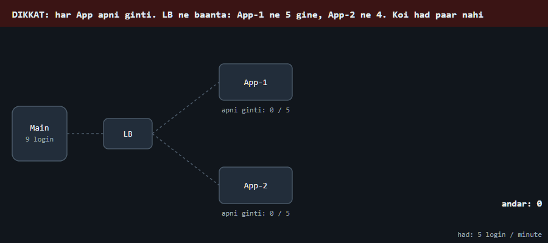
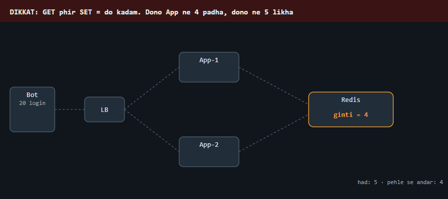
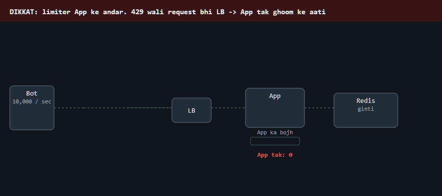
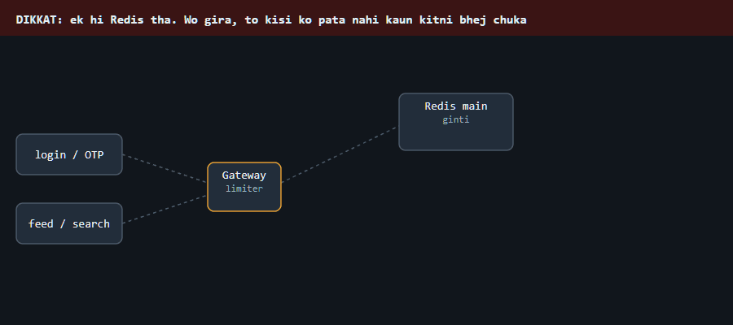
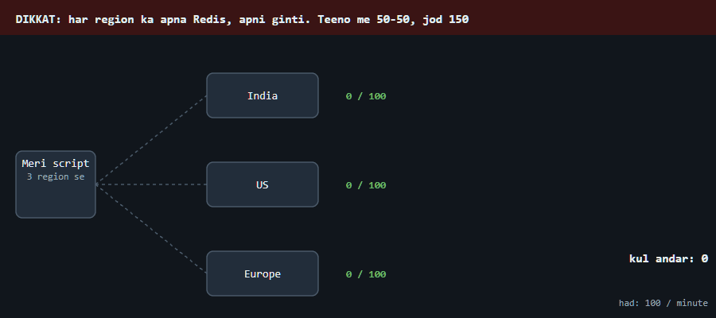
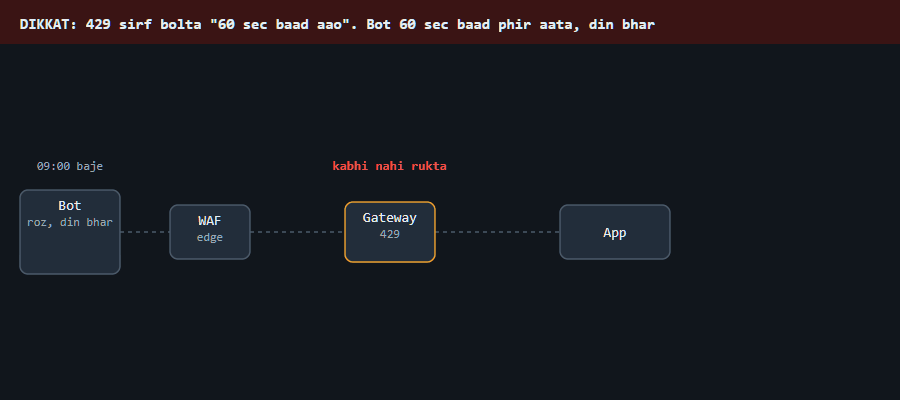
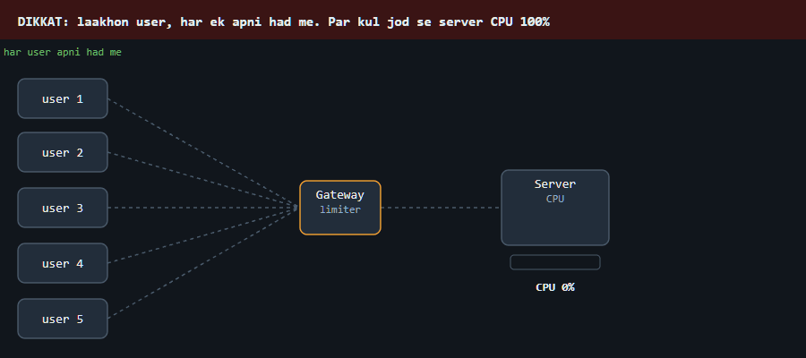
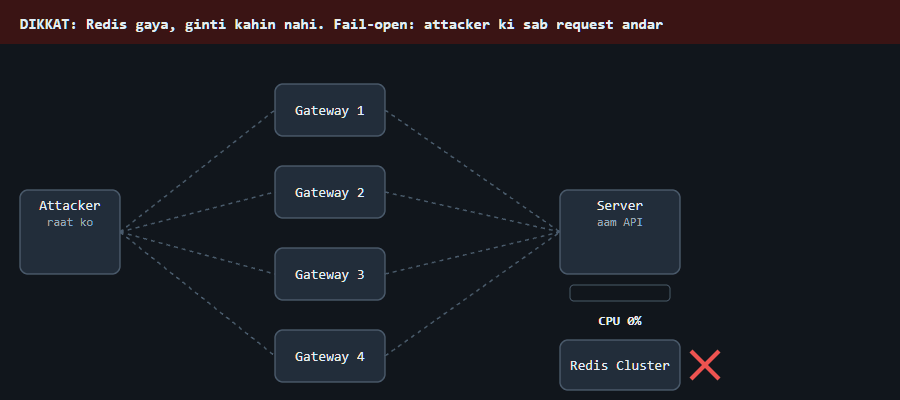
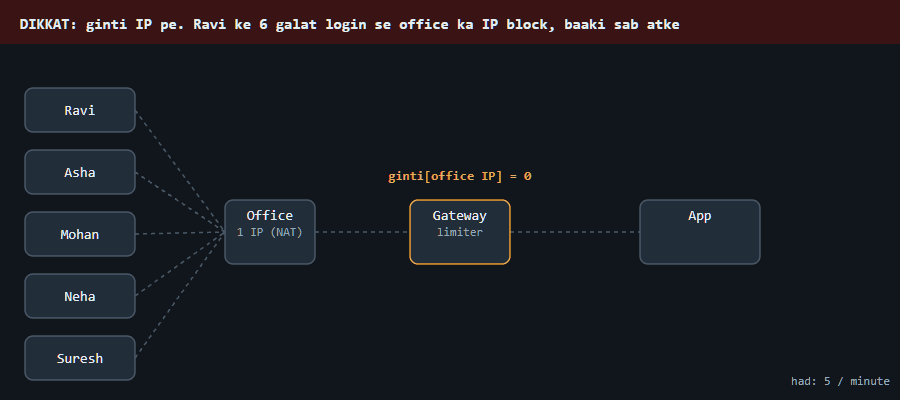

# Rate Limiter

> Ek user ek tay samay me kitni request bhej sakta hai, uski had. Had paar to 429.
> Teen cheez: har request ke aage baitha (~1 ms) · ginti saari machines pe EK · limiter gire to site na gire.
>
> Mock me sirf heading + Cue + GIF. Neeche har card: **hal** · **kyun** · **nahi** (doosra kyun nahi) · **agar ...:** (cross-Q).
> Cross-Q: hal ke har bade shabd pe socho -> gira? · dheema / bheed? · do ek saath? · galat hua? · kaise / kitna?

---

## Poori tasveer (aakhir me design aisa banta hai)


---

## Shuru

- **FR:** har user / endpoint ki had (login 5 / min, API 100 / min) · had paar to 429 + Retry-After · plan ke hisaab se had (free / pro)
- **NFR:** har request ke aage, ~1 ms · ginti saari machines pe EK · limiter gire to site na gire
- **numbers:** ~1 crore user, peak ~10,000 request / sec. Jagah ka nahi, speed ka sawaal -> RAM (Redis), DB nahi

---

*ab tootega kahan? kai App hain, har App apni ginti gin raha*

## 1. 9 baar login kiya, do App ne alag-alag gina, saari andar

**Cue:** Redis me EK ginti, 60 sec umar · dabba: Redis (LB + App x2 pehle)



- **hal:** sab App ek Redis key ginte (rate:Arpan:login), har request +1, umar 60 sec (EXPIRE) -> 6thi pe 429
- **kyun:** ginti EK jagah + RAM jitni tez. Key ki umar = window.
- **nahi:** DB -> har request pe disk + lock, dheema
- **nahi:** sticky LB -> wo App gira to ginti gayi
- **agar minute ki window (fixed):** kinare pe 5 + 5 aayi? -> 2 sec me 10 andar (fixed window ki kamzori), isliye asli me token bucket
- **token bucket:** max 10 token, har second 1 bharta, har request 1 leti, khaali = 429
- **Redis me:** sirf 2 number: tokens + lastTime. Request aane pe bharo: tokens + (now - last) x rate, max 10. Koi job nahi.
- **agar bucket bhara:** 10 ek saath aayi? -> 10 nikal gayi (burst)
- **agar bucket khaali:** 11vi aayi? -> 429 + Retry-After
- **agar user ghanta bhar soya:** phir aaya to? -> beeta time x rate, par 10 se upar nahi (bucket ki had)
- **agar sliding log lagate:** kaisa? -> sabse sahi, par har request ka time rakho = memory bahut
- **agar sliding counter lagate:** kaisa? -> is minute ki ginti + pichhle ka hissa, 2 number, lagbhag sahi
- **agar leaky bucket lagate:** kaisa? -> smooth, par burst nahi nikalne deta
- **agar token bucket:** yahi kyun? -> burst chalta, sirf 2 number, AWS / Stripe yahi

---

*ab ginti ek jagah hai, par ek saath 20 aayi to?*

## 2. Bot ne mere account pe 20 login ek saath bheje, 6 ghus gaye

**Cue:** ATOMIC: INCR / LUA script · dabba: (Redis atomic)



- **hal:** padhna + badhana EK kadam me, Redis ke andar (INCR, token bucket me Lua)
- **kyun:** Redis ek line me chalta, ek ke baad ek. Beech me koi ghus nahi sakta.
- **nahi:** GET phir SET -> do kadam, dono ne 4 padha, dono andar
- **nahi:** App me synchronized -> sirf ek machine ke andar
- **agar INCR ke baad, EXPIRE se pehle crash:** kya hoga? -> key bina umar, user hamesha block. INCR + EXPIRE ek Lua me.
- **agar Lua atak gaya:** kya hoga? -> poora Redis rukta. Script chhota, loop nahi.
- **agar Redis ek line me chalta:** dheema nahi? -> RAM, ~lakh command / sec (andaza). Zyada chahiye to shard.
- **agar Lua me 2 key, aur Redis cluster:** -> {Arpan} hash tag: dono key ek hi machine pe

---

*ab ginti sahi hai, par mana wali request bhi andar tak aa rahi*

## 3. Bot ki 429 wali request bhi App tak ghoom ke aayi

**Cue:** LIMITER GATEWAY pe, sabse aage · dabba: API Gateway



- **hal:** limiter API Gateway pe. Had paar to wahin 429, App tak pahunchti hi nahi.
- **kyun:** jitna aage roko, utna kam kaam bekaar
- **nahi:** ginti App me -> mana wali request bhi andar, App usi me bhar gaya
- **agar 429 bheja:** saath kya bhejo? -> Retry-After: 30 + X-RateLimit-Remaining
- **agar sab 30 sec baad ek saath lautein:** -> Retry-After alag-alag (28, 33) = jitter
- **agar gateway gira:** -> 2+ machine, aage LB
- **agar had sirf gateway pe:** kaafi? -> dono: gateway pe moti had, service me apni baarik had

---

*ab sab kuch Redis pe tika hai, wo gira to?*

## 4. Dopahar Redis gira, limiter andha ho gaya

**Cue:** REPLICA + FAIL-OPEN / FAIL-CLOSED · dabba: Redis Cluster + R53 + ALB



- **hal:** Redis ki copy (Redis Cluster), main mara to copy main. Poora gaya to: feed / search khula, login / OTP band.
- **kyun:** gire to kya karna, pehle se tay, endpoint ke hisaab se
- **nahi:** sab fail-open -> login khula, koi bina had password guess karega
- **agar Redis gira:** pata kaise chalega? -> chhota timeout (~5 ms), jawab nahi aaya to gira maano
- **agar copy main ban rahi:** ginti ka kya? -> aakhri kuch second ki ginti khoti, rate limit me chalta
- **agar Redis bas dheema (CPU full):** copy laga du? -> nahi, INCR = likhna, sirf main pe. Isliye SHARD (user ki key alag Redis).
- **agar login band (fail-closed):** user ko kya dikhe? -> 503 + "thodi der baad try karo", chup nahi
- **agar feed khuli (fail-open):** kab tak? -> Redis wapas aate hi band; tab tak har gateway apni ginti (card 8)
- **agar LB / gateway akela:** -> ALB kai zone me, Route 53 zinda wale pe

---

*ab ek region me sab theek, par user kai region se aaye to?*

## 5. Meri script 3 region se chali, 100 ki jagah 150 nikal gayi

**Cue:** HOME REGION me ginti · dabba: (ginti ghar wale Redis me)



- **hal:** meri ginti mere ghar region me (India). Frankfurt ki request bhi wahin gini jaati -> 100 hi.
- **kyun:** ek user ki ek ginti, ek ghar me
- **nahi:** har region apni ginti -> 50 + 50 + 50 = 150
- **agar ghar region door (100-200 ms):** har request wahan? -> sirf paisa / login ghar tak, baaki apni ginti + har second sync
- **agar sync ke beech:** -> ~1 sec tak thodi dheel, chalta
- **agar ghar region gira:** -> Route 53 doosra region, ginti 0 se

---

*ab had lag rahi, par wahi bot roz wapas aa jaata*

## 6. Wahi bot har 60 sec baad phir aa jaata, din bhar

**Cue:** KAFKA -> PATTERN -> WAF BAN · dabba: Kafka + Pattern Svc + WAF



- **hal:** har 429 Kafka me. Pattern Svc: 10 min me 500+ 429 -> WAF block list, edge pe hi rok
- **kyun:** 429 maafi wala (phir aao). Ban sirf pakke gunde pe, aur apne aap hatne wala.
- **nahi:** turant ban -> asli tez click, office NAT, sale ki bheed sab bahar
- **nahi:** gateway seedha Pattern Svc call -> har request dheemi
- **agar Kafka peeche chal raha:** -> ban kuch minute late, tab tak rate limit rok raha
- **agar galat ban (office / college IP):** -> ban ki umar ~24 ghante, apne aap hate, haath se bhi. Bheed wale IP pe captcha.
- **agar userId pe ban karna:** kahan? -> gateway pe (JWT). WAF edge pe sirf IP dekhta.

---

*ab har user had me hai, phir bhi system bhar gaya to?*

## 7. Shaam ki sale, har koi limit me, phir bhi server gira

**Cue:** GLOBAL CAP + LOAD SHEDDING (503) · dabba: (gateway pe system ki had)



- **hal:** gateway pe poore system ki had (5,000 / sec). Upar ho to 503, kam zaroori pehle chhodo, login / payment bachao.
- **kyun:** user ki had aur system ki had alag. Sab had me hon, phir bhi system bhar sakta.
- **nahi:** machine khud badh jaayegi -> minute lagte, bheed second me
- **nahi:** line me rok lo -> sirf ~2 sec, user chala gaya to bekaar
- **agar had paar:** 429 ya 503? -> user ki had = 429, system ki had = 503

---

*ab sabse bura waqt: attack aur Redis ek saath gaya*

## 8. Raat ko attack, usi waqt poora Redis Cluster gira (copy bhi), aam API khuli

**Cue:** LOCAL COUNTER FALLBACK · dabba: (gateway ki memory)



- **hal:** har gateway apni memory me gine, had BAANT do: 100 / N (4 gateway -> har ek 25)
- **kyun:** thodi galat had, bina had se behtar. Login ab bhi fail-closed.
- **nahi:** sab andar aane do -> attacker ke liye site khuli, server bhar ke band
- **agar had baanti nahi:** -> har gateway 100 -> user ko 4 x 100 = 400
- **agar exact had chahiye:** -> LB userId ke hash se ek user hamesha ek gateway pe (sticky by userId)
- **agar gateway badh gaye:** -> N config / service discovery se, had dobara baanto
- **agar Redis wapas aaya:** -> phir sabki ek ginti

---

*ab had sahi jagah lagi, par kis naam pe?*

## 9. Office ki night shift: ek IP block, 1000 log atke

**Cue:** KEY = USER_ID (JWT), IP sirf login · dabba: (key badli)



- **hal:** login ke baad ginti userId pe (JWT se). 1000 log = 1000 alag ginti.
- **kyun:** had us pehchaan pe jo ek insaan ki ho. Ek IP pe 1000 log, ek botnet ke 1000 IP.
- **nahi:** IP ki had badha do (5 se 500) -> office bacha, par botnet ko bhi utni chhoot
- **agar login se pehle (userId nahi):** -> IP pe dheeli had + WAF
- **agar 5 galat password:** lock karo? -> username pe lock nahi, CAPTCHA / der. Warna attacker tujhe hi lock kar dega.
- **agar API key chori:** -> nuksaan seemit, had key pe. Key badlo / band karo.

---

## Poora design ek saans me

```
User -> Route 53 (kaunsa LB zinda) -> WAF (ban list) -> ALB (kai data center)
-> API Gateway me limiter (sabse aage, jaldi mana · global cap + load shedding · Redis gire to local ginti)
-> Redis Cluster (token bucket ek Lua script me: tokens + last, key = user + endpoint, copy + shard)
   -> had ke andar? App : 429 + Retry-After
baar-baar wala -> Kafka -> Pattern Svc -> WAF ban
DB:  Redis = ginti ki ek hi sachchi jagah, 1 ms, key ki umar = window (umar khatam = reset, safai ka job nahi)
     user ka plan (free / pro) DB se, Redis me usi limit se milao
```

Bolne ke liye: limiter darwaze (API gateway) pe, mana hui request andar jaati hi nahi. Ginti Redis me, sab servers ki
ek jagah, ek kadam me (token bucket ki Lua script). Key = kaun user + kaunsa kaam, umar = window. Token bucket isliye
ki asli user jhatke me request bhejta. Had paar = 429 + kitni der baad aao. Redis ki copy. Redis poora band: har
server apni ginti, login / OTP band. Baar-baar wale hamlawar ko WAF se block, aur badi asli bheed ke liye poore system
ki had.

---

## 10 guna traffic

- **API Gateway**: har request pe limiter chalta, to RAM me + ek jhatke me (atomic). Gateway machine badhao.
- **Redis**: shard (user / region ke hisaab se) + copy (switch ke saath) + fail-open + local fallback.
- **Kai region**: har user ka home region.
- **Gunda**: Kafka -> Pattern service -> WAF ban.
- **Asli bheed**: global cap + load shedding + line (queue) + pehle se scale.

**Pooche: kahan se sab gir sakta?** Redis (cluster + switch; aam API fail-open, login / OTP fail-closed). LB (Route 53).

**Pooche: chal raha hai, kaise pata?** Limiter ka time (p99), kitne 429, Redis ki galtiyan, alert.

---

## Pooche to (kisi card me nahi baitha)

Jawab ke header: theek hai to aage bhejo + X-RateLimit-Limit: 100, X-RateLimit-Remaining: 47, X-RateLimit-Reset: kab.
Had paar to 429 + Retry-After: 30 + Remaining: 0. Sirf "na" mat bolo, "kitna bacha" aur "kab aao" bhi batao, warna
client turant phir maarta. Retry-After me thoda aage-peeche (28, 33), warna sab ek saath lautte hain.

Ulta sawaal, "tumhe kisi aur ne 429 diya, ab?": "I respect Retry-After, back off exponentially with jitter, and
throttle my own sends."

Redis key: `rate:<user>:<endpoint>` me ginti, umar = window (60 sec). Umar khatam = reset, safai ka job nahi. Jaise
rate:192.168.1.5:login = 4, rate:user_456:signup = 2, rate:apikey_xyz:search = 47.

Limit badalni ho? Niyam config me (DB / AppConfig), gateway har ~30 sec padhe. Naya code nahi.

Sliding window: niyam "pichhle 1 ghante me 5 se zyada nahi". 11:00 pe aaye, 10:00 ke baad 5 aa chuke, mana. 11:10 pe
aaye, ab 10:10 ke baad gino, Ramesh 10:05 wala bahar ho gaya, 4, andar. Window request aane pe khisakti hai, koi timer
/ job nahi.

Kaun kaisa: token = burst haan, memory kam. Leaky = burst nahi, smooth. Fixed = sabse sasta, kinare pe double. Sliding
log = sabse sahi, memory zyada.

Ginti vs bojh: 100 chhoti request (5 ms) = 0.5 second kaam. 100 bhaari report (30 second) = 50 MINUTE kaam. Limiter ke
liye dono "100". Isliye bhaari endpoint pe kadi limit, ya request ka wazan (report = 50 token, login = 1), ya "ek user
ki ek waqt me 2 hi bhaari query".

Plan: bina login 60 / ghanta, free 5,000, pro 10,000, enterprise apni. Plan DB se, Redis me usi limit se milao.

Ek hi shakal (poore HLD me ghoomti): LB me bachane wali cheez ne hi maara (health check / retry / sticky). Cache me tez
karne wali cheez ne raasta roka (dheema Redis, timeout nahi). Limiter me rokne wali cheez ne bheed roki hi nahi
(per-user vs poora system), aur attack me khud gayab (fail-open).

---

## HANDS-ON #1 — Nginx limiter LIVE (21-Aug, isi folder ki `nginx.conf`)

```
docker run -d --name rl -p 8080:80 -v "<path>\nginx.conf:/etc/nginx/nginx.conf:ro" nginx
   -d background · --name rl · -p laptop 8080 -> container 80 · -v apni conf andar MOUNT (ro) · nginx = image

nginx.conf ki 2 asli line:
   limit_req_zone $binary_remote_addr zone=mylimit:10m rate=1r/m;    <- har IP ka bucket, refill 1 / min
   limit_req zone=mylimit burst=5 nodelay;                           <- bucket SIZE 5, burst turant serve
   rate = kis speed se nikalti · burst = kitni ruk sakti
   + location / { ... root /usr/share/nginx/html; index index.html; }  <- content serve
   koi program NAHI likha — sirf ready tool (Nginx, rate limiter built-in) on kiya + config + hammer -> 503
   SACH: nginx docs isko LEAKY BUCKET kehte; nodelay se bartaav
         token bucket JAISA. 503 = limit_req_status default.

HAMMER:  for /L %i in (1,1,30) do @curl -s -o nul -w "%{http_code} " http://localhost:8080
         (1,1,30) = 30 baar · -s -o nul = chup, body phenk do · -w = sirf status code
DIKHA:   200 200 200 200 200 200 503 503 503 ...
LOG:     (Docker Desktop -> Containers -> rl -> Logs) "GET / HTTP/1.1" 503 197
         [error] limiting requests, excess: 5.774 by zone "mylimit", client: 172.17.0.1
         (excess = bucket se kitna upar · client = Docker gateway IP, sab ek IP = ek bucket)

GOTCHA:  1. 503 tabhi jab ARRIVAL > rate (rate=2r/s pe dheere loop -> sab 200, refill pakad leta)
         2. burst=N -> spike me N+1 pass (burst=5 -> 6, 100 ->
            101); textbook N, nginx N+1, timing se 21 / 22 bhi
         3. 1 IP = 1 bucket
         4. config badla -> docker restart rl
CHALAO:  docker start rl · curl http://localhost:8080 · docker logs rl · docker restart rl · docker stop rl
```

---

## HANDS-ON #2 — App ke andar fixed window (usercrud, 26-Aug)

```java
@RestController
public class RateLimitController {
    private int LIMIT = 5;
    private long windowStart = 0;
    private int count = 0;

    @GetMapping("/rate-demo")
    public synchronized ResponseEntity<String> hit() {          // synchronized: shared counter
        long now = System.currentTimeMillis();
        if (now - windowStart > 1000) { windowStart = now; count = 0; }   // window reset
        count++;
        if (count > LIMIT)
            return ResponseEntity.status(HttpStatus.TOO_MANY_REQUESTS).body("429 - limit paar");
        return ResponseEntity.ok("OK - request #" + count);
    }
}
// SecurityConfig: .requestMatchers("/rate-demo").permitAll()
// ResponseEntity KYUN: status-code (200/429) khud set karne ko
```
```
LIVE:  1..10 | % { curl.exe -s http://localhost:8080/rate-demo; "" }
       OK #1..#5 · 429 (6..10) · 1 sec baad window reset -> phir OK
EDGE:  fixed window boundary: 999ms pe 5 + 1001ms pe 5 = ~2ms me 10
PROD:  single node memory -> restart pe reset + har server apna count -> Redis INCR + EXPIRE
       per user / IP -> map<key, counter> · lib: Bucket4j (token bucket) / Redis + Lua
JAWAB:    usercrud me khud banaya: 5 request theek, chhathi pe 429.
          Asli system me token bucket (Bucket4j library) + sab servers ka saanjha Redis counter. Nginx
          bhi ye kaam sabse aage kar sakta (limit_req).
```

---

## HANDS-ON #3 — Redis KHUD maara: kaise tootta

CODE: `04_HLD/HANDS_ON/01_rate_limiter_redis/RateLimiterDemo.java` · `04_HLD/HANDS_ON/02_incr_expire_crash/IncrExpireCrash.java`
(koi library nahi, socket se Redis, `java File.java`)

```
docker run -d --name demo-redis -p 6390:6379 redis:7 redis-server --save "" --appendonly no
   (RDB + AOF band -> sirf memory, restart = sab gaya, jaan-boojh ke)
docker stop / start demo-redis · docker exec demo-redis redis-cli TTL rl:user:1 · ... DEL rl:user:1

CODE KA DIL (user:1 ko 60 sec me 5):
   count = INCR KEY · if count == 1 -> EXPIRE KEY 60 · count <= 5 ALLOW else 429
   catch IOException -> FAIL_OPEN ? ALLOW : BLOCK
```
```
CASE A  chalta kaise  req 1..9:  count 1 TTL 60 ALLOW · 2/57 ALLOW · 3/56 ALLOW · 4/49 ALLOW · 5/48 ALLOW ·
                                 6/47 429 · 7/45 429 · 8/45 429 · 9/44 429     (window PEHLI request se)

CASE B  docker stop   "REDIS SE BAAT NAHI HUI: Connection refused" -> FAIL_OPEN = true -> ALLOW (2 baar)
                      fail-open = site chale, limit nahi · fail-closed = abuse nahi, site band
                      ("server ne haath khade kar diye, sab jao")

CASE C  docker start  GET rl:user:1 -> khaali · user (pehle count 7, BLOCK) -> count 1 ALLOW, 2 ALLOW
                      persistence band -> ginti gayab -> blocked ko 5 nayi mil gayi

CASE D  INCR ke baad, EXPIRE se pehle crash (USE_LUA = false)
                      RUN 1: count 1, CRASH · TTL -> -1
                      RUN 2: count 2..5 ALLOW, 6..7 429, har baar TTL
                             -1 -> key KABHI nahi mitegi, HAMESHA block
FIX D   USE_LUA = true   req 10..14: count 10 TTL 58 · 11/57 · 12/56 · 13/56 · 14/55 -> 1 min me free

TTL:  -1 = key hai, timer nahi · -2 = key hi nahi · 58 = 58 sec baaki
```
```
FIX:  B -> faisla pehle se: fail-open (aam API) / fail-closed (login, OTP) + replica
      C -> replica / AOF on. limiter me aksar chalne do (1 min ki ginti, paisa nahi). paisa hota to nahi.
      D -> Lua: INCR + EXPIRE ek command, Redis single-thread -> script beech me nahi rukti
           (EXPIRE NX se nahi bachta: wo bhi alag call hai, beech me crash wahi)
           pehle:  app --INCR--> Redis  [crash]  app --EXPIRE--> Redis
           Lua:    app --EVAL(INCR + EXPIRE)--> Redis
```
```lua
local c = redis.call('INCR', KEYS[1])
if c == 1 then redis.call('EXPIRE', KEYS[1], ARGV[1]) end
return c
```
```
JAWAB:    Docker Redis khud band karke teen cheez dekhi:
          1) Redis band: aam API chalti rahi, login / OTP ruk gaye.
          2) Redis restart: saari ginti zero ho gayi. Limiter me chalta hai, copy rakho to kam hota.
          3) Ginti +1 aur 'umar lagao' alag-alag bheje aur beech me crash hua: key bina umar ke reh
          gayi, user hamesha ke liye block. Isliye dono ek Lua script me ek saath.
```

ARCHETYPE F · CONCEPTS: [caching/Redis](../../FOUNDATIONS/04_caching.md) · [load-balancing](../../FOUNDATIONS/03_load_balancing.md) · [SPOF](../../FOUNDATIONS/11_reliability_spof_cloud.md) · [← MASTER SHEET](../../00_MASTER_SHEET.md)
