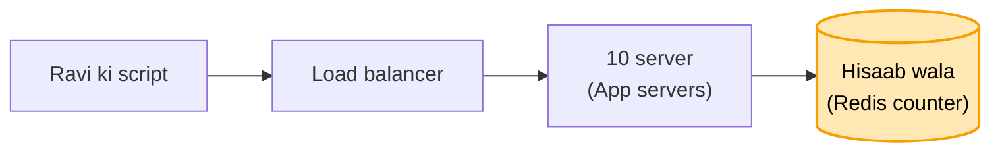
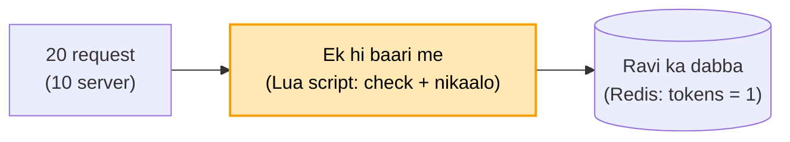
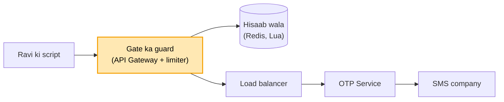
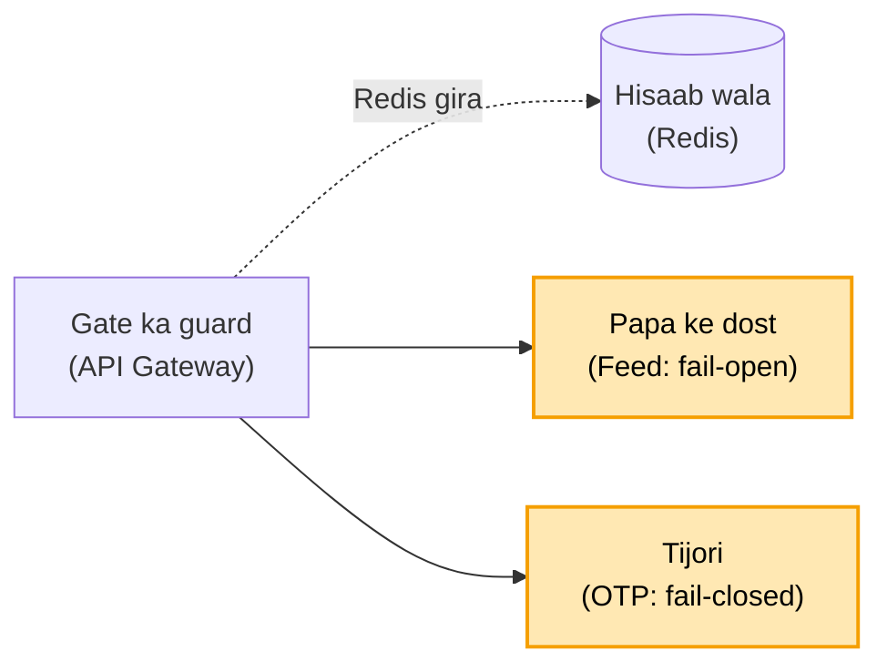
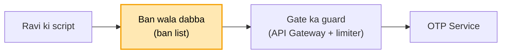
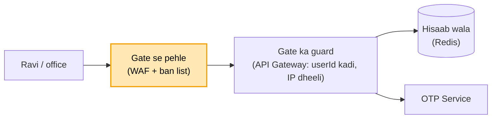
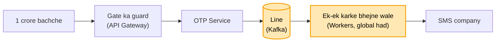
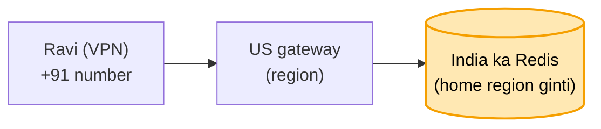

# Rate limiter: Arpan aur Ravi ke "OTP bhejo" button ki kahani

Arpan ki app me "OTP bhejo" ka button hai, aur har OTP pe SMS company ka bill. Ravi ne mazaak me script chala di jo
har second 1000 baar button dabati hai. Kaam: ek bande ki ek had, paar ho to mana, asli log na atkein, aur limiter
khud site ko dheema na kare.

Har kadam = **kahani** (dikkat aur hal, bolne wali bhasha) -> **Asli naam** (interview me yahi shabd) -> tasveer
(kahani ka shabd, bracket me asli naam).

---

## FR / NFR / Numbers (interview me pehle 2 minute)

```
FR      har user ki had (OTP 10 minute me 5, login 5 / minute, baaki API 100 / minute) · paar ho to 429 + Retry-After
NFR     tez: har request ke aage, ~1 ms me haan / na · ginti EK: 10 server hon tab bhi ek jagah · limiter gire to site na gire
Numbers ~1 crore user, bheed me ~10,000 request / sec · har user ke 2 chhote number = ~500 MB
        -> dikkat jagah ki nahi, speed ki: RAM wala Redis, DB nahi
```

---

## 1. Ravi ki script, dhadadhad SMS (ek bande ki had)

Mera ek app hai, ek service hai jiska main roz bill de raha. Ravi ne aake script chala di, ab dhadadhad SMS ja rahe,
bematlab, server dab gaya aur SMS company ka bill chadh raha. To limit lagao. Aisa nahi ki 1000 hai, 10,000 hai, 20,000
chal le; ek bande ke liye ek threshold hona chahiye. Rate limit ka kaam yahi hai, limit lagana.

**Asli naam:** ek bande ka threshold = rate limit per user, had paar to mana = 429 (saath me Retry-After: kitni der
baad aao).

## 2. 10 server, har ek ke paas ginti alag (hisaab main rakhunga)

Ginti server apni memory me rakh raha tha. App 10 server pe, load balancer Ravi ki requests baant deta. Har server ke
paas Ravi ki ginti kam, har server sochta "had me hai", aur Ravi 5 ki jagah 50 OTP le gaya. Maan le mere paas 5 aadmi
khade, har ek bol raha "abhi had me hai, ek aur bhej sakta". Ye to galat bata rahe. To main inko kahunga: tu chhod, tu
mujhe bata, phir main bataunga kitni request hain. Ek ne bataya 1, doosre ne 2, main count karta rahunga 1 + 2 + 3 +
4. Hisaab-kitaab main apne paas rakhunga.

**Asli naam:** hisaab main rakhunga = central counter (Redis), har request pe ek hi jagah ginti +1. Redis isliye ki
RAM me hai, ~1 ms, aur data sirf 500 MB.



## 3. Khaata badla, 3 second me 10 OTP (token ka dabba)

Ginti ka khaata ghadi se tha: 10:00-10:10 ek khaata, 10:10-10:20 agla, har khaate me 5. Ravi ne 10:09:58 pe 5 liye,
khaata badla, 10:10:01 pe phir 5, 3 second me 10. To had ek dabbe me rakh lo, har bande ka apna dabba: is dabbe se
token nikaalo aur aage badho. Dabbe ki ek raftaar hoti hai, itne second me ek token. Dabba apni raftaar se bharta,
user apni raftaar se aata, khaata badalne se kuch reset nahi hota. User der tak nahi aaya to uska dabba poora bhara
(had tak, 5 token), to ek saath 5 le sakta, koi dikkat nahi.

**Asli naam:** ghadi ka khaata = fixed window (kinare pe dugni), token ka dabba = token bucket, apni raftaar se bhare =
refill rate (OTP: max 5, har 2 minute me 1, aam raftaar 10 min me 5, request aane pe hi hisaab = lazy refill), der baad aaya to bahut token =
burst allow. Sirf 2 number rakhne padte (kitne bache, aakhri baar kab), wahi 500 MB.

## 4. Ek token, 20 request ek saath (ek hi baari me, Lua)

Ravi ke dabbe me 1 token. Script ne ek pal me 20 request maari, 10 server pe. Har server ne Redis se padha "tokens =
1", har ek ne ek nikaala, 20 andar ghus gayi. Pehle socha Ravi ko 10 alag server pe jaane hi mat do, uska ek home
server ho. Par asli baat ye: Redis single thread hai, ek waqt me ek hi kaam chalata. To padhna, jaanchna aur nikaalna
teeno ek hi baari me kar do, beech me koi ghus hi na paaye. Jaise banking me check aur update ek hi me karte hain.

**Asli naam:** Redis ek command ek waqt (single thread), par alag-alag GET aur DECR ke beech doosra server ghus sakta,
isliye single thread akela kaafi nahi. Sab ek hi baari me, andar koi ghus na paaye = Lua script (check + nikaalna
atomic), banking wala check aur update ek me = wahi atomic check-and-update. 20 line me lagti hain: 1 ko token mila,
baaki 19 ko 429.



## 5. Guard andar kamre me baitha (guard ko gate pe bithao)

Limiter OTP Service ke andar tha. Script ki 1000 request LB se, login check karke OTP Service tak pahunchti, wahan mana.
SMS nahi gaya, par raaste ke saare server bojh utha rahe. Mere ghar me ek security guard hai jo kehta 10,000 log andar
nahi aa sakte, par wo main gate pe nahi, andar kamre me baitha hai. Ghar ke andar to 1000 log ghus gaye. To use bahar
gate pe bitha do, ghar me koi ghuse hi nahi, gate pe hi hata do.

**Asli naam:** guard andar kamre me = limiter service ke andar, guard gate pe = limiter API Gateway pe (mana wali request
app tak pahunchti hi nahi, aur har service ko apna limiter nahi likhna).



## 6. Guard ka Redis gira (papa ke dost aane do, chor roko)

Gate ka guard ginti Redis se dekhta, aur Redis gir gaya. Ab ya sabko jaane do ya sabko roko? Mere papa ke kuch khaas
dost hain, unko andar aane do, wo dekh ke chale jaayenge, koi nuksaan nahi. "Papa ji namaste, chalte hain."
Par beech me kuch chor bhi hain jo hamari tijori lootne aa rahe, unhe rok do.

**Asli naam:** papa ke dost, dekh ke chale jaayenge = feed / home page fail-open (kuch der bina had ke chalna chhota
nuksaan, site band hona bada), tijori ke chor = OTP fail-closed (yahan har request pe SMS ka paisa jaata).



## 7. Script ruki nahi, din-raat maarti (alag dabba, permanent band)

Script gate pe rukti, 429 khaati, par ruki nahi. Din-raat har second maarti, gate ko roz karodon "mana", aur Ravi ko
koi farak nahi. Ek baar mana kiya, do baar mana kiya, teesri baar bhi aaya. To "Ravi bhai, tum yahan aao, mere is
dabbe se jaake baat karo, wo kuch samjhaayega, chhoti si toffee dega." Us dabbe me Ravi ka gala pakad ke wahin bitha
denge: tu ab kahin nahi ja sakta, yahan se hil hi nahi sakta, is site ke liye tu permanent band.

**Asli naam:** ek baar, do baar, teesri baar = baar-baar had todne ka pattern, alag dabba, yahan se hil nahi sakta =
ban list, permanent band = ban wala gate pe bina gine lautta.



## 8. Har baar naya number, aur office atka (login ke baad kadi, login se pehle dheeli had)

OTP login se pehle hai, to had phone number pe lagai, par Ravi ki script har baar naya number daalti, har number ki
ginti 1. Had IP pe lagai to subah 9 baje office ke 500 log ek hi WiFi (IP) se aaye, aur 5 OTP ke baad poora office
atka. User login ho gaya to uski saari information aa jaati, userId hamare paas, wahan koi dikkat nahi, kuch kare to
ban kar do. Dikkat login se pehle ki hai, to login pe thodi dheeli had chhod do, par itni dheeli nahi ki koi script
hazaar baar chala de. Google pe password kitni baar guess karega, 2, 3, 5 baar. Hazaar baar koi haath se type nahi
karta, karega to intention theek nahi. Ek banda roz hazaar baar password reset kar raha, kal dekha phir hazaar, ye
insaan ke liye possible nahi, to us IP ko WAF me daal do. Office me hazaar log hain par hazaar log ek saath password
nahi bhoolte, bhoole bhi to ek-do din, isliye pattern notice karte hain. Ek second me login button pe 10,000 request
ek office WiFi bhi nahi kar sakta. Aur 1 lakh me 50,000 bhool gaye to aisa to main har design tod dun, perfect design
koi nahi, aaj bhi Google, YouTube toot-te hain.

**Asli naam:** login ke baad userId hamare paas = userId pe kadi had, login pe dheeli had = login se pehle IP pe
dheeli had, insaan hazaar baar nahi, pattern notice = script pattern pakadna, IP ko WAF me daal do = WAF block.



## 9. Result ka din, sab had me, phir bhi SMS company giri (line lagwao)

Result ka din, subah 10 baje 1 crore bachche OTP maangte. Har bachcha apni had me, phir bhi OTP Service aur SMS company
dono gire. Mere paas 2-3 log hain jo 10,000 logon ka kaam kar rahe, koi na koi girega hi. To apne log badha do, server
badha do. Aur SMS company ko utni bheed mat jaane do, wo apne hisaab se kaam kar rahi. Line lagwa, aaram-aaram se:
"jaao beta, ek-ek karke; tu nikal, ab tu nikal." Hamare aur SMS company ke beech ek cheez fit kar do jo spike rok le,
aur SMS ab ek ja, ek ja, dheela-dheela, aaram se.

**Asli naam:** log badha do, server badha do = apne server scale, line lagwa, ek-ek karke = queue (Kafka, OTP Service
turant "OTP aa raha" bol deta), beech me cheez jo spike rok le = worker SMS company ki raftaar se bhejte, saare worker
ek saanjhi had se (global had, Redis ka ek token bucket).



## 10. VPN se 3 region, 15 OTP (ghar ka region)

App 3 region me: Mumbai, US, Europe, har region ka apna Redis. Ravi VPN badal-badal ke teeno se OTP maangta, har Redis
sochta "5 hi hue", aur wo 15 OTP le gaya. VPN se aa raha ho to uska ek particular region decide kar lo. Suppose uska
region Mumbai, India ke servers. 3 se maara ya 10 se, uska main region India hai to count India ke Redis pe hoga, US
aur Europe pe nahi. Wahi se count karo, wahi se dekho, uske hisaab se aage badhenge.

**Asli naam:** ek particular region decide = home region, count India ke Redis pe = ginti ghar region ke Redis me. Bahar se aaye to gateway ghar ke
Redis se poochhta, thoda dheema, par asli user zyadatar apne hi region se aata, uske liye 1 ms hi rehta.

**Maan lo OTP login se pehle hai, sirf phone number aata, aur Ravi VPN se US gateway pe, US ko kaise pata is number ka
ghar Mumbai:** phone number har desh ka alag hota hai, hamara +91 se shuru. VPN IP badal sakta hai, number nahi; VPN
chala ke call karun to bhi +91 hi jaata. To +91 dekh ke ghar India, ginti India ke Redis me. Ravi sach me US shift hua
aur wahan ka number liya, to uska ghar US hi hai.
**Asli naam:** +91 se pata = phone number ke country code se home region (koi alag register nahi chahiye), IP badle,
number nahi = VPN se bachav.



---

Notes (Arpan ke shabd) = [RATE_LIMITER_HAND_NOTES.md](RATE_LIMITER_HAND_NOTES.md)
