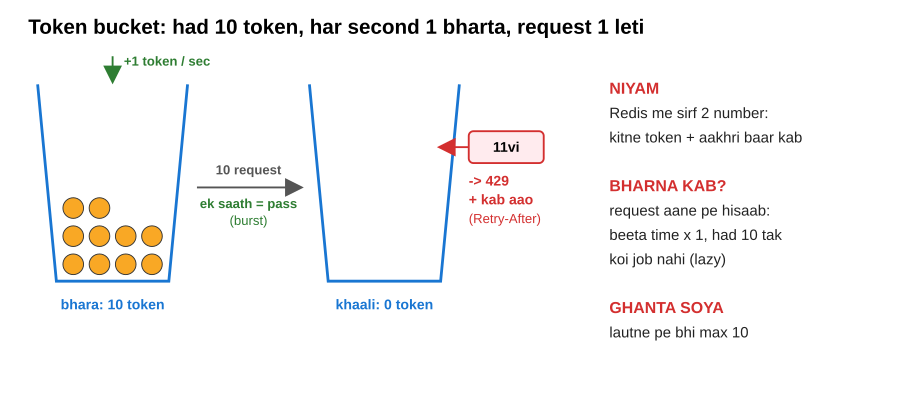

# Rate Limiter

> Ek user / IP ek tay samay me kitni request bhej sakta hai, uski had. Had paar -> 429 (Too Many Requests).
> Misaal: "ek IP se ek minute me 5 login". Is design ka dil teen cheezein hain:
> **har request ke saamne baitha hai, isliye ~1 ms** · **ginti saari machines pe EK** · **limiter khud gire to site na gire**.

```
SEEDHI BAAT: ek banda had se zyada request bheje to baaki users ke liye server khaali nahi bachta.
             Niyam lagao "itne se zyada nahi" = RATE LIMITING.
             API pe: ek bot ek second me 10,000 baar login try karta
                     (password guess) -> "ek IP, ek minute, 5".
```

---

## KAHANI (ek din, mera login aur ek bot; har dikkat se design me ek dabba judta)

```
   KYA HUA                                     ILAAJ                                DABBA JUDA
1  password bhoola, 9 login, sab andar      -> Redis me EK ginti, 60 sec umar       Redis (LB + App x2 pehle)
2  bot ke 20 login ek pal me, 6 ghuse       -> ATOMIC: INCR / LUA script            (Redis atomic)
3  bot ki 429 wali bhi App tak ghoomi       -> LIMITER GATEWAY pe, sabse aage       API Gateway
4  dopahar Redis gira, limiter andha        -> REPLICA + FAIL-OPEN / FAIL-CLOSED    Redis Cluster + R53 + ALB
5  meri script 3 region se, 150 nikli       -> HOME REGION me ginti                 (ginti ghar wale Redis me)
6  bot har 60 sec phir aa jaata             -> KAFKA -> PATTERN -> WAF BAN          Kafka + Pattern Svc + WAF
7  shaam sale, sab limit me, server gira    -> GLOBAL CAP + LOAD SHEDDING (503)     (gateway pe system ki had)
8  raat attack, Redis gira, API khuli      -> LOCAL COUNTER FALLBACK               (gateway ki memory)
9  office ka ek IP, 1000 log block          -> KEY = USER_ID (JWT), IP sirf login   (key badli)

POORA DESIGN (upar ke dabbe kram se):
   User -> Route 53 -> WAF -> ALB -> API Gateway (limiter) -> Redis Cluster (token bucket Lua) -> App
   baar-baar wala: Gateway -> Kafka -> Pattern Svc -> WAF ban
```

---

## TASVEER (ByteByteGo / Alex Xu · CC BY-NC-ND 4.0)


Source: [How Does Redis Persist Data?](https://bytebytego.com/guides/how-does-redis-persist-data/)
(HANDS-ON #3 CASE C: Redis ka disk pe save band tha, restart hua to saari ginti gayab. RDB / AOF yahi save karte hain.)

---

## SHURU: pehle poocho, phir numbers

```
POOCHO:  limit kis pe? IP / user_id / API key. Har endpoint ki alag (login 5 / min, search 60 / min)?
         plan ke hisaab se (free / pro / enterprise)?
         ★ sabse zaroori: maqsad SERVER BACHANA hai ya PAISA / SECURITY?
           server bachana -> thoda zyada nikal jaaye to chalta
           · paisa / OTP / login -> bilkul sahi ginti chahiye

MISAALEIN: login 5 / min ek IP se · password reset 3 / ghanta ek email pe · public API 100 / min ek key pe ·
           signup 10 / din ek IP se · search 60 / min ek user ka

ZAROORI KAAM (FR):   niyam (kitni) · ginti (kitni ho gayi) · samay (kis minute / ghante me) · paar -> 429
KAISA CHALE (NFR):   ~1 ms (har request iske saamne se jaati hai, ye dheema = poora API dheema)
                     limiter mare to aam API khuli rahe (FAIL-OPEN),
                     par login / payment / OTP band (FAIL-CLOSED)
                     kai machine pe bhi ginti sahi

NUMBERS:  jagah ka hisaab bekaar hai: har user ki ek ginti + expiry, bas.
          asli number = kitni baar poocha jaata hai. Ye har request ke aage hai -> poore system me sabse zyada
          chalne wala dabba (laakhon / second). Isliye ye jagah ka
          nahi, SPEED ka sawaal hai -> RAM me (Redis), DB nahi.
          Aur ginti badhana ek jhatke me (atomic) hona chahiye.
```

---

## ════ MOCK SE PEHLE: SIRF YE CARD PADHO ════

> Har card: pehle PEELA DABBA dekho (scene + ilaaj). Yaad aa gaya -> aage. Nahi aaya -> neeche
> Heading = dikkat, KIYA = jawab, tasveer dekho. AAGE POOCHEGA sirf jab interviewer aage poochhe.

#### DABBA 0: SABSE SIMPLE (yahan se shuru, phir "kahan tootega")
```
App ki memory me ek ginti. Har request pe ginti + 1. Had paar -> 429.
```


#### SHURU: TOKEN BUCKET KAISE CHALTA
```
DIKKAT     Har user ki had chahiye, par asli traffic jhatke me aata (10 request ek saath).
           Had bhi pakki rahe, aur jhatka bhi nikle.
HAL        TOKEN BUCKET: max 10 token, har second 1 bharta, har request 1 leti; khaali -> 429.
           Redis me sirf 2 number; bharne ka koi job nahi, request aane pe hisaab (lazy).
```


```
AAGE POOCHEGA:
  NIYAM: bucket = do number (kitne token, aakhri baar kab); bharna request aane pe hisaab se, koi job nahi.
         Jhatka bucket jitna nikalta, phir speed se; khaali -> user ko 429 + kab aao.
  SAFAR (Arpan ki ek request, har mod pe kya):
  sab theek              -> tokens 7 -> beeta time jodo -> 1 ghatao -> ALLOW
  10 request ek saath    -> bucket bhara tha -> 10 nikal gayi (burst): asli traffic aisa hi
  11vi request           -> bucket khaali -> 429 + Retry-After (agla token kab)
  ghanta bhar soya       -> lautne pe hisaab: beeta time x 1, par had 10 se upar nahi
```

#### 1 Password bhool gaya, 9 baar login kiya, saari andar chali gayi
KIYA: sab App ek hi Redis key gine (rate:Arpan:login)



```
AAGE POOCHEGA:
  NIYAM: had tabhi sahi jab ginti EK jagah ho, aur wo har request ke saamne RAM-tez ho (Redis, DB nahi);
         umar = window. Had paar -> 429; ginti App ke paas rahi to App badalte hi had toot jaati.
  SAFAR (ek login request, har mod pe kya):
  sab theek              -> App-1, App-2 dono ek Redis key (rate:Arpan:login) pe +1, had ke andar -> aage
  pehli request          -> umar 60 sec (EXPIRE): minute khatam, key khud mitti, ginti 0
  6thi request           -> ginti 5 se upar -> 429
  minute ke kinare 5 + 5 -> 2 sec me 10 andar (fixed window ki kamzori): isliye asli token bucket
```

#### 2 Bot ne mere account pe 20 login ek saath bheje, 6 ghus gaye
KIYA: dekhna + ghatana ek hi kadam me, beech me koi nahi ghusta (Lua)



```
AAGE POOCHEGA:
  NIYAM: dekhna + badalna ek hi kadam, Redis ke andar (INCR / Lua); beech me koi request nahi ghus sakti.
         Do kadam hue to do request ek hi purana number padh ke dono andar.
  SAFAR (20 login ek saath, har mod pe kya):
  sab theek              -> INCR: padhna + badhana ek command, Redis ek line me -> beech me koi nahi
  INCR ke baad crash     -> INCR + EXPIRE ek Lua me: warna key bina umar, user hamesha block
  token bucket           -> dekhna + ghatana ek Lua me: tokens + aakhri waqt; bharna request pe (lazy)
  Lua dheema / atka      -> poora Redis rukta (ek line me chalta): script chhota, koi loop nahi
```

#### 3 Bot ki 429 wali request bhi App tak ghoom ke aayi
KIYA: ginti darwaze pe, had paar = wahin 429 (limiter gateway pe)



```
AAGE POOCHEGA:
  NIYAM: jitna aage roko (gateway / edge), utna kam kaam bekaar; client ko batao kab aaye (Retry-After) aur
         sab ek saath na aayein (jitter). Rokne wala khud bhi akela nahi.
  SAFAR (bot ki request, har mod pe kya):
  sab theek              -> gateway sabse aage Redis se poochhe, had ke andar -> App
  had paar               -> wahin 429, LB / App tak pahunchti hi nahi
  429 ke saath           -> kab aao + kitni bachi (Retry-After: 30, X-RateLimit-Remaining)
  sab 30 sec baad saath  -> nayi laher: Retry-After alag-alag (28, 33) (jitter)
  gateway hi gira        -> 2+ machine, aage LB: darwaza bhi akela nahi
```

#### 4 Dopahar Redis gira, limiter andha ho gaya
KIYA: copy taiyaar; poora gaya to feed khuli, login band (replica + fail-open / closed)



```
AAGE POOCHEGA:
  NIYAM: Redis gira to kya karna, wo PEHLE se tay, endpoint ke hisaab se (feed khula, login band); copy =
         bachav + padhne ka bojh, shard = likhne ka bojh. Copy pe switch me thodi ginti khoti, chalta.
  SAFAR (Redis gira, request aayi, har mod pe kya):
  sab theek              -> Redis Cluster zinda, gine aur aage
  main mara              -> copy main (Cluster khud): aakhri thodi ginti khoi, rate limit me chalta
  gira, pata kaise       -> Redis call pe chhota timeout (~5 ms) = gira maano, ruko mat
  poora Cluster gaya     -> pehle se tay: feed / search khula (fail-open), login / OTP band (fail-closed)
  gira nahi, CPU full    -> tukde (shard), copy nahi: INCR = likhna, sirf main pe
```

#### 5 Meri script 3 region se chali, 100 ki jagah 150 nikal gayi
KIYA: meri ginti mere ghar region me (home region)



```
AAGE POOCHEGA:
  NIYAM: ek user ki ek ginti, ek ghar me (home region); door jaane ka kharcha sirf zaroori endpoint pe
         (paisa / login), baaki apni ginti + sync, ~1 sec ki dheel chalti.
  SAFAR (meri request, 3 region se, har mod pe kya):
  sab theek              -> mera ghar India: Frankfurt ki request bhi wahin gine -> 100
  ghar door (100-200 ms) -> sirf paisa / login ghar tak; baaki apni ginti + har second sync
  sync ke beech          -> ~1 sec tak har region poori had de sakta: halki had me chalta
  ghar region gira       -> Route 53 doosra region, ginti 0 se: ek minute dheela, chalta
```

#### 6 Wahi bot har 60 sec baad phir aa jaata, din bhar
KIYA: har 429 Kafka me, Pattern Svc gine, zyada = WAF me ban



```
AAGE POOCHEGA:
  NIYAM: limit maafi wali (429, phir aao); ban sirf pakke gunde pe, pattern dekh ke (Kafka -> WAF), aur apne
         aap hatne wala, kyunki galat ban = asli user bahar.
  SAFAR (bot baar-baar, har mod pe kya):
  sab theek              -> had paar -> 429, maafi wali: phir aao
  har 429                -> Kafka me daal ke bhool jao: gateway se seedha call = dheema
  10 min me 500+ 429     -> Pattern Svc pakde -> WAF block list, edge pe hi ruka
  Kafka peeche           -> ban kuch minute late; tab tak rate limit rok hi raha
  galat ban (office IP)  -> "kuch der": ban ki umar ~24 ghante, apne aap hate + haath se hatao
```

#### 7 Shaam ki sale, har koi limit me, phir bhi server gira
KIYA: poore system ki bhi had, kam zaroori pehle chhodo (load shedding)



```
AAGE POOCHEGA:
  NIYAM: user ki had aur system ki had alag cheez, dono chahiye: sab user had me hon phir bhi system bhar
         sakta -> kam zaroori pehle chhodo, login / payment bachao.
  SAFAR (sale ki bheed, har mod pe kya):
  sab theek              -> har user had me, system bhi had me -> sab chalta
  system bhar gaya       -> gateway pe system ki had (5,000 / sec), CPU 90% paar -> kuch 503
  kya chhodo             -> kam zaroori pehle (recommendation / analytics), login / payment bachao
```

#### 8 Raat ko attack, usi waqt poora Redis Cluster gira (copy bhi), aam API khuli
KIYA: har server apni memory me gine, had baant do (local fallback)



```
AAGE POOCHEGA:
  NIYAM: thodi galat had, bina had se behtar: Redis poora gaya to fail-open wale (feed) pe bhi har machine
         apni memory me gine; login ab bhi fail-closed. User ko had thodi dheeli, attack khula nahi.
  SAFAR (Redis + copy gayi, attack chalu, har mod pe kya):
  sab theek              -> Redis zinda, sabki ek ginti
  Redis + copy gaye      -> har server apni memory me gine: had baanto, 100 / 4 server = 25 har ek
  ek user alag server    -> motamoti, exact nahi: thodi galat had, bina had se behtar
  server badh gaye       -> ginti config / service discovery se lo, dobara baanto
  Redis wapas            -> phir sabki ek ginti
```

#### 9 Office ki night shift: ek IP block, 1000 log atke
KIYA: login ke baad ginti user_id pe (key = user_id)



```
AAGE POOCHEGA:
  NIYAM: had us pehchaan pe jo ek insaan ki ho (user_id / username); IP sirf tab jab aur kuch na ho (login se
         pehle), kyunki ek IP pe 1000 log aur ek botnet ke 1000 IP.
  SAFAR (login ki request, har mod pe kya):
  sab theek              -> login ke baad JWT se user_id: 1000 log = 1000 alag ginti
  office NAT, ek ki galti -> key = user_id: sirf uski ginti bhari, baaki 999 chalte
  login se pehle         -> user_id hai hi nahi: IP pe dheeli had + WAF (botnet ke 1000 IP)
```

---

## AAKHRI DABBA + WRAP (ek hi baar)

```
User -> Route 53 (kaunsa LB zinda) -> WAF (ban list) -> ALB (kai data center)
-> API Gateway me limiter (sabse aage, jaldi mana · global cap + load shedding · Redis gire to local ginti)
-> Redis Cluster (token bucket ek Lua script me: tokens + last, key = user + endpoint, copy + shard)
   -> had ke andar? App : 429 + Retry-After
baar-baar wala -> Kafka -> Pattern Svc -> WAF ban

DB:  Redis = ginti ki ek hi sachchi jagah, 1 ms, key ki umar
     = window (umar khatam = ginti reset, safai ka job nahi)
     user ka plan (free / pro) DB se, Redis me usi limit se milao
```
```
JAWAB:    Limiter darwaze (API gateway) pe, mana hui request andar jaati hi nahi.
          Ginti Redis me, sab servers ki ek jagah, ek kadam me (token bucket ki Lua script).
          Key = kaun user + kaunsa kaam, umar = window.
          Token bucket isliye ki asli user jhatke me request bhejta. Had paar = 429 + kitni der baad aao.
          Redis ki copy. Redis poora band: har server apni ginti, login / OTP band.
          Baar-baar wale hamlawar ko WAF se block, aur badi asli bheed ke liye poore system ki had.
```


---

## 10 GUNA TRAFFIC — har dabba alag se

```
API Gateway   -> har request pe limiter chalta -> RAM me + ek jhatke me (atomic). Gateway machine badhao
Redis         -> SHARD (user / region ke hisaab se) + COPY (switch ke saath) + fail-open + local fallback
kai region    -> har user ka HOME region
gunda         -> Kafka -> Pattern service -> WAF ban
asli bheed    -> global cap + load shedding + line (queue) + pehle se scale

POOCHEGA: "Kahan se sab gir sakta?"   -> Redis (cluster + switch; aam API fail-open, login / OTP
                                         fail-closed) · LB (Route 53)
POOCHEGA: "Chal raha, kaise pata?"    -> limiter ka time (p99) · kitne 429 · Redis ki galtiyan · alert
```

---

## POOCHE TO (gehra sawaal aaye tab)

```
JAWAB KE HEADER:
   theek hai -> aage bhejo + X-RateLimit-Limit: 100 · X-RateLimit-Remaining: 47 · X-RateLimit-Reset: <kab>
   had paar  -> 429 + Retry-After: 30 + Remaining: 0
   sirf "na" mat bolo, "kitna bacha" aur "kab aao" bhi batao, warna client turant phir maarta.
   Retry-After me thoda aage-peeche (28, 33), warna sab ek saath lautte hain.

ULTA SAWAAL ("tumhe kisi aur ne 429 diya, ab?"):
   "I respect Retry-After, back off exponentially with jitter, and throttle my own sends."

REDIS KEY:  rate:<user>:<endpoint> -> ginti · umar = window (60 sec) -> umar khatam = reset, safai ka job nahi
            rate:192.168.1.5:login -> 4 · rate:user_456:signup -> 2 · rate:apikey_xyz:search -> 47

EK LINE:   User -> Route 53 -> ALB -> Gateway limiter -> Redis (token bucket Lua, ek jhatke me)
           -> had ke andar? App | paar? 429 + Retry-After | baar-baar? Kafka -> WAF ban

SLIDING WINDOW:
   niyam: "pichhle 1 ghante me 5 se zyada nahi".
   11:00 pe aaye -> 10:00 ke baad 5 aa chuke -> mana.
   11:10 pe aaye -> ab 10:10 ke baad gino, Ramesh 10:05 wala bahar ho gaya -> 4 -> andar.
   window request aane pe khisakti hai, koi timer / job nahi.

KAUN KAISA:   token = burst haan, memory kam · leaky = burst nahi,
              smooth · fixed = sabse sasta, kinare pe double · sliding log = sabse sahi, memory zyada

GINTI vs BOJH:
   100 chhoti request (5 ms) = 0.5 second kaam. 100 bhaari report (30 second) = 50 MINUTE kaam.
   Limiter ke liye dono "100". Bhaari endpoint pe kadi limit,
   ya request ka WAZAN (report = 50 token, login = 1),
   ya "ek user ki ek waqt me 2 hi bhaari query".

PLAN:  bina login 60 / ghanta · free 5,000 · pro 10,000 ·
       enterprise apni · plan DB se, Redis me usi limit se milao

EK HI SHAKAL (poore HLD me ghoomti):
   LB me      bachane wali cheez ne hi maara (health check / retry / sticky)
   cache me   tez karne wali cheez ne raasta roka (dheema Redis, timeout nahi)
   limiter me rokne wali cheez ne bheed roki hi nahi (per-user
   vs poora system) + attack me khud gayab (fail-open)

CARD SE AAYE SAWAAL (safar ke bahar):
  ginti DB me kyun nahi?        -> har request pe disk + lock = dheema; Redis RAM = tez
  Redis ek line me, dheema nahi? -> RAM: ek machine ~lakh command / sec (andaza); zyada chahiye to shard
  sirf gateway pe ya service me? -> dono: gateway pe sabke liye moti had, service ke andar apni baarik
  LB / gateway bhi akela?       -> ALB kai zone me, Route 53 zinda pe bheje
  machine khud nahi badh jaati? -> minute lagte, bheed second me aati; pata ho to pehle badhao
  line (queue) me rok lo?       -> chhota (~2 sec): user chala gaya to uska kaam bekaar
  limit badalni ho?             -> niyam config me (DB / AppConfig), gateway har ~30 sec padhe; naya code nahi
  Lua ki 2 key, cluster me?     -> {Arpan} hash tag: rate:{Arpan}:min + :day ek machine pe
  429 ya 503?                   -> user ki had = 429 · system ki had = 503
  API key chori?                -> nuksaan seemit (had key pe), key badlo / band karo
  (c9) 5 galat password?        -> username pe lock nahi, CAPTCHA / der: warna attacker tujhe hi lock kare
  (SHURU) fixed window kyun nahi?     -> sasta, par kinare pe double (59th + 61st second)
  (SHURU) sliding log?                -> har request ka time, pichhle 60 sec gino: sahi, par memory bahut
  (SHURU) sliding counter?            -> is minute ki + pichhle ka hissa (jaise 70%): 2 number, lagbhag sahi
  (SHURU) leaky bucket?               -> line me, fixed speed se nikalti: smooth, par burst nahi nikalne deta
  (SHURU) token bucket hi kyun?       -> burst chahiye + memory kam + Redis me 2 number (AWS / Stripe yahi)
  (SHURU) do request ek saath hisaab? -> padhna + hisaab + likhna EK Lua (HMGET -> HSET); time ek jagah se
```

---

## HANDS-ON #1 — Nginx limiter LIVE (21-Aug, isi folder ki `nginx.conf`)

```
docker run -d --name rl -p 8080:80 -v "<path>\nginx.conf:/etc/nginx/nginx.conf:ro" nginx
   -d background · --name rl · -p laptop 8080 -> container 80 · -v apni conf andar MOUNT (ro) · nginx = image

nginx.conf ki 2 asli line:
   limit_req_zone $binary_remote_addr zone=mylimit:10m rate=1r/m;    <- har IP ka bucket, refill 1 / min
   limit_req zone=mylimit burst=5 nodelay;                           <- bucket SIZE 5, burst turant serve
   rate = kis speed se nikalti · burst = kitni ruk sakti
   + location / { ... root /usr/share/nginx/html; index index.html; }  <- content serve
   koi program NAHI likha — sirf ready tool (Nginx, rate limiter built-in) on kiya + config + hammer -> 503
   SACH: nginx docs isko LEAKY BUCKET kehte; nodelay se bartaav
         token bucket JAISA. 503 = limit_req_status default.

HAMMER:  for /L %i in (1,1,30) do @curl -s -o nul -w "%{http_code} " http://localhost:8080
         (1,1,30) = 30 baar · -s -o nul = chup, body phenk do · -w = sirf status code
DIKHA:   200 200 200 200 200 200 503 503 503 ...
LOG:     (Docker Desktop -> Containers -> rl -> Logs) "GET / HTTP/1.1" 503 197
         [error] limiting requests, excess: 5.774 by zone "mylimit", client: 172.17.0.1
         (excess = bucket se kitna upar · client = Docker gateway IP, sab ek IP = ek bucket)

GOTCHA:  1. 503 tabhi jab ARRIVAL > rate (rate=2r/s pe dheere loop -> sab 200, refill pakad leta)
         2. burst=N -> spike me N+1 pass (burst=5 -> 6, 100 ->
            101); textbook N, nginx N+1, timing se 21 / 22 bhi
         3. 1 IP = 1 bucket
         4. config badla -> docker restart rl
CHALAO:  docker start rl · curl http://localhost:8080 · docker logs rl · docker restart rl · docker stop rl
```

---

## HANDS-ON #2 — App ke andar fixed window (usercrud, 26-Aug)

```java
@RestController
public class RateLimitController {
    private int LIMIT = 5;
    private long windowStart = 0;
    private int count = 0;

    @GetMapping("/rate-demo")
    public synchronized ResponseEntity<String> hit() {          // synchronized: shared counter
        long now = System.currentTimeMillis();
        if (now - windowStart > 1000) { windowStart = now; count = 0; }   // window reset
        count++;
        if (count > LIMIT)
            return ResponseEntity.status(HttpStatus.TOO_MANY_REQUESTS).body("429 - limit paar");
        return ResponseEntity.ok("OK - request #" + count);
    }
}
// SecurityConfig: .requestMatchers("/rate-demo").permitAll()
// ResponseEntity KYUN: status-code (200/429) khud set karne ko
```
```
LIVE:  1..10 | % { curl.exe -s http://localhost:8080/rate-demo; "" }
       OK #1..#5 · 429 (6..10) · 1 sec baad window reset -> phir OK
EDGE:  fixed window boundary: 999ms pe 5 + 1001ms pe 5 = ~2ms me 10
PROD:  single node memory -> restart pe reset + har server apna count -> Redis INCR + EXPIRE
       per user / IP -> map<key, counter> · lib: Bucket4j (token bucket) / Redis + Lua
JAWAB:    usercrud me khud banaya: 5 request theek, chhathi pe 429.
          Asli system me token bucket (Bucket4j library) + sab servers ka saanjha Redis counter. Nginx
          bhi ye kaam sabse aage kar sakta (limit_req).
```

---

## HANDS-ON #3 — Redis KHUD maara: kaise tootta

CODE: `04_HLD/HANDS_ON/01_rate_limiter_redis/RateLimiterDemo.java` · `04_HLD/HANDS_ON/02_incr_expire_crash/IncrExpireCrash.java`
(koi library nahi, socket se Redis, `java File.java`)

```
docker run -d --name demo-redis -p 6390:6379 redis:7 redis-server --save "" --appendonly no
   (RDB + AOF band -> sirf memory, restart = sab gaya, jaan-boojh ke)
docker stop / start demo-redis · docker exec demo-redis redis-cli TTL rl:user:1 · ... DEL rl:user:1

CODE KA DIL (user:1 ko 60 sec me 5):
   count = INCR KEY · if count == 1 -> EXPIRE KEY 60 · count <= 5 ALLOW else 429
   catch IOException -> FAIL_OPEN ? ALLOW : BLOCK
```
```
CASE A  chalta kaise  req 1..9:  count 1 TTL 60 ALLOW · 2/57 ALLOW · 3/56 ALLOW · 4/49 ALLOW · 5/48 ALLOW ·
                                 6/47 429 · 7/45 429 · 8/45 429 · 9/44 429     (window PEHLI request se)

CASE B  docker stop   "REDIS SE BAAT NAHI HUI: Connection refused" -> FAIL_OPEN = true -> ALLOW (2 baar)
                      fail-open = site chale, limit nahi · fail-closed = abuse nahi, site band
                      ("server ne haath khade kar diye, sab jao")

CASE C  docker start  GET rl:user:1 -> khaali · user (pehle count 7, BLOCK) -> count 1 ALLOW, 2 ALLOW
                      persistence band -> ginti gayab -> blocked ko 5 nayi mil gayi

CASE D  INCR ke baad, EXPIRE se pehle crash (USE_LUA = false)
                      RUN 1: count 1, CRASH · TTL -> -1
                      RUN 2: count 2..5 ALLOW, 6..7 429, har baar TTL
                             -1 -> key KABHI nahi mitegi, HAMESHA block
FIX D   USE_LUA = true   req 10..14: count 10 TTL 58 · 11/57 · 12/56 · 13/56 · 14/55 -> 1 min me free

TTL:  -1 = key hai, timer nahi · -2 = key hi nahi · 58 = 58 sec baaki
```
```
FIX:  B -> faisla pehle se: fail-open (aam API) / fail-closed (login, OTP) + replica
      C -> replica / AOF on. limiter me aksar chalne do (1 min ki ginti, paisa nahi). paisa hota to nahi.
      D -> Lua: INCR + EXPIRE ek command, Redis single-thread -> script beech me nahi rukti
           (EXPIRE NX se nahi bachta: wo bhi alag call hai, beech me crash wahi)
           pehle:  app --INCR--> Redis  [crash]  app --EXPIRE--> Redis
           Lua:    app --EVAL(INCR + EXPIRE)--> Redis
```
```lua
local c = redis.call('INCR', KEYS[1])
if c == 1 then redis.call('EXPIRE', KEYS[1], ARGV[1]) end
return c
```
```
JAWAB:    Docker Redis khud band karke teen cheez dekhi:
          1) Redis band: aam API chalti rahi, login / OTP ruk gaye.
          2) Redis restart: saari ginti zero ho gayi. Limiter me chalta hai, copy rakho to kam hota.
          3) Ginti +1 aur 'umar lagao' alag-alag bheje aur beech me crash hua: key bina umar ke reh
          gayi, user hamesha ke liye block. Isliye dono ek Lua script me ek saath.
```

ARCHETYPE F · CONCEPTS: [caching/Redis](../../FOUNDATIONS/04_caching.md) · [load-balancing](../../FOUNDATIONS/03_load_balancing.md) · [SPOF](../../FOUNDATIONS/11_reliability_spof_cloud.md) · [← MASTER SHEET](../../00_MASTER_SHEET.md)
