# Rate limiter: Arpan aur Ravi ke "OTP bhejo" button ki kahani

Arpan ki app me "OTP bhejo" ka button hai, aur har OTP pe SMS company ka bill. Ravi ne mazaak me script chala di jo
har second 1000 baar button dabati hai. Kaam: ek bande ki ek had, paar ho to mana, asli log na atkein, aur limiter
khud site ko dheema na kare.

Har kadam = **kahani** (dikkat aur hal, bolne wali bhasha) -> **Asli naam** (interview me yahi shabd) -> tasveer
(kahani ka shabd, bracket me asli naam).

---

**Ek nazar: dhaancha + dikkat chain (round me sabse pehle ye, phir FR / NFR isi se):**
```
Ravi / script
     |
     v
[ GATE: API gateway pe guard ]  <-- ban list: baar-baar todne wala yahin se wapas
     |   har request pe poochhe: "Ravi ke dabbe me token hai?"
     v
[ Redis: har user ka dabba (token bucket) ]
     |   check + token nikaalna EK saath (Lua script); 10 server hon tab bhi ginti ek jagah
     |   had paar -> 429 + "itne second baad aana"
     v
[ OTP Service ] (kai server)
     |
     v
[ Line (queue) ] -> worker / consumer SMS company ki raftaar se bhejta; umar khatam wala OTP phenk do
     |
     v
[ SMS company ]

saath me: Redis gira -> dono khule (OTP + feed), gateway apni kachchi ginti se 5-5 karke (local fallback)
          login se pehle dheeli had (IP / number), login ke baad userId pe kadi
          3 region -> ginti ghar region ke Redis me (+91 = India)

 1  script har second 1000 OTP, bill chadha     ->  ek bande ki had (rate limit, 429)
 2  10 server, har ek ki alag ginti             ->  ginti ek jagah (central counter, Redis)
 3  khaata badla, 3 second me 10 OTP            ->  dabbe se token, apni raftaar se (token bucket)
 4  20 request ek saath, "tokens = 1"           ->  check + nikaalna ek baari me (Lua script)
 5  guard andar kamre me, 1000 ghus gaye        ->  guard gate pe (API gateway)
 6  guard ka Redis gira                         ->  dono khule, bouncer 5-5 karke (fail-open + local fallback)
 7  script 429 khaati, phir bhi maarti          ->  pattern dekho, ban / WAF
 8  naya number har baar, office ek WiFi        ->  login se pehle dheeli had, baad me userId pe kadi
 9  result ka din, SMS company giri             ->  line lagwao, ek-ek karke (queue, Kafka)
10  VPN se 3 region, 15 OTP                     ->  ek ghar region, ginti wahin (home region, +91)
11  feed ka cache usi Redis, Ravi ka dabba gaya ->  alag Redis; ek me ho to LRU hatao + cache ka TTL chhota (noeviction)
```

**FR / NFR kahan se:** hawa se nahi aate. Upar ki dikkat chain dekh ke nikale; har FR / NFR line ke aage likha hai wo kis kadam ki dikkat se aayi.

## FR / NFR / Numbers (interview me pehle 2 minute)

```
FR      1  had me hai to jaane do, paar to 429, thodi der baad dobara       -> kadam 1, 3
        2  office ke ek IP se 500 log aa rahe, unhe bhi sambhalo            -> kadam 8

NFR     1  ginti consistent rahe, request kisi bhi server pe jaaye          -> kadam 2, 4
        2  hamesha available: limiter / Redis gira to site na gire, failover -> kadam 6
        3  VPN se region badle to bhi had ek hi rahe                        -> kadam 10

Numbers nahi: yahan koi faisla nahi badalte.
```

---

## 1. Ravi ki script, dhadadhad SMS (ek bande ki had)

Mera ek app hai, ek service hai jiska main roz bill de raha. Ravi ne aake script chala di, ab dhadadhad SMS ja rahe,
bematlab, server dab gaya aur SMS company ka bill chadh raha. To limit lagao. Aisa nahi ki 1000 hai, 10,000 hai, 20,000
chal le; ek bande ke liye ek threshold hona chahiye. Rate limit ka kaam yahi hai, limit lagana.

**Asli naam:** ek bande ka threshold = rate limit per user, had paar to mana = 429 (saath me Retry-After: kitni der
baad aao).

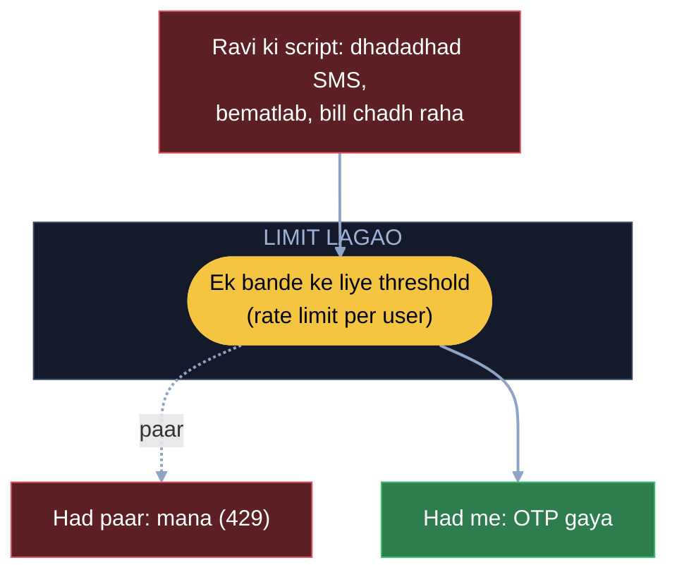

## 2. 10 server, har ek ke paas ginti alag (hisaab main rakhunga)

Ginti server apni memory me rakh raha tha. App 10 server pe, load balancer Ravi ki requests baant deta. Har server ke
paas Ravi ki ginti kam, har server sochta "had me hai", aur Ravi 5 ki jagah 50 OTP le gaya. Maan le mere paas 5 aadmi
khade, har ek bol raha "abhi had me hai, ek aur bhej sakta". Ye to galat bata rahe. To main inko kahunga: tu chhod, tu
mujhe bata, phir main bataunga kitni request hain. Ek ne bataya 1, doosre ne 2, main count karta rahunga 1 + 2 + 3 +
4. Hisaab-kitaab main apne paas rakhunga.

**Asli naam:** hisaab main rakhunga = central counter (Redis), har request pe ek hi jagah ginti +1. Redis isliye ki
RAM me hai, ~1 ms, aur data sirf 500 MB.

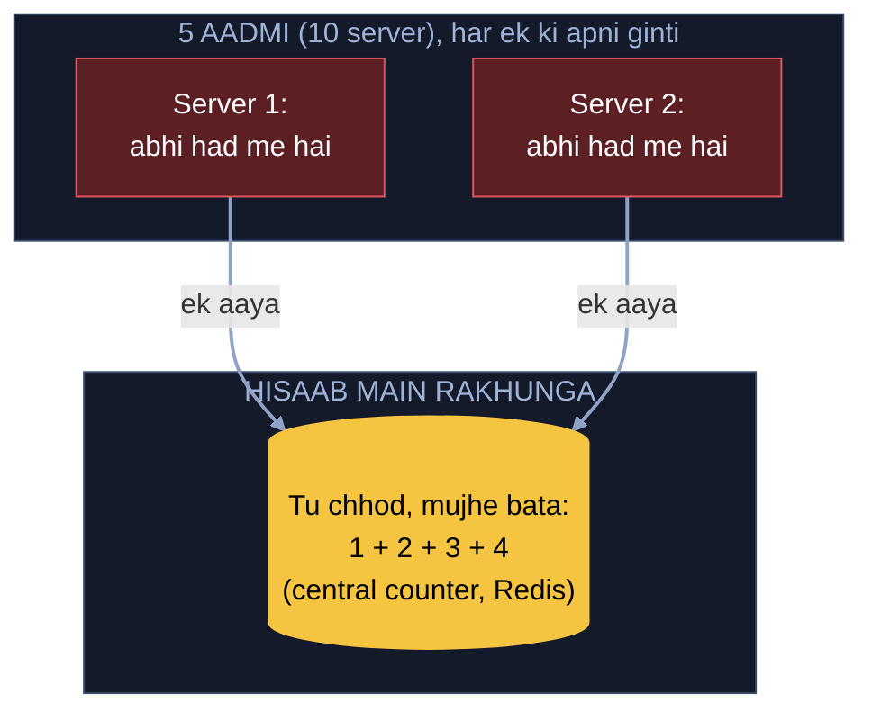

## 3. Khaata badla, 3 second me 10 OTP (token ka dabba)

Ginti ka khaata ghadi se tha: 10:00-10:10 ek khaata, 10:10-10:20 agla, har khaate me 5. Ravi ne 10:09:58 pe 5 liye,
khaata badla, 10:10:01 pe phir 5, 3 second me 10. To had ek dabbe me rakh lo, har bande ka apna dabba: is dabbe se
token nikaalo aur aage badho. Dabbe ki ek raftaar hoti hai, itne second me ek token. Dabba apni raftaar se bharta,
user apni raftaar se aata. User der tak nahi aaya to uska dabba poora bhara
(had tak, 5 token), to ek saath 5 le sakta, koi dikkat nahi.

**Asli naam:** ghadi ka khaata = fixed window (kinare pe dugni), token ka dabba = token bucket, apni raftaar se bhare =
refill rate (OTP: max 5, har 2 minute me 1, aam raftaar 10 min me 5, request aane pe hi hisaab = lazy refill), der baad aaya to bahut token =
burst allow. Sirf 2 number rakhne padte (kitne bache, aakhri baar kab), wahi 500 MB.

**Maan lo aur tareeke:** fixed window, sliding window, leaky bucket bhi hain; token bucket popular, burst allow, simple.
**Asli naam:** fixed / sliding window, leaky bucket, token bucket.

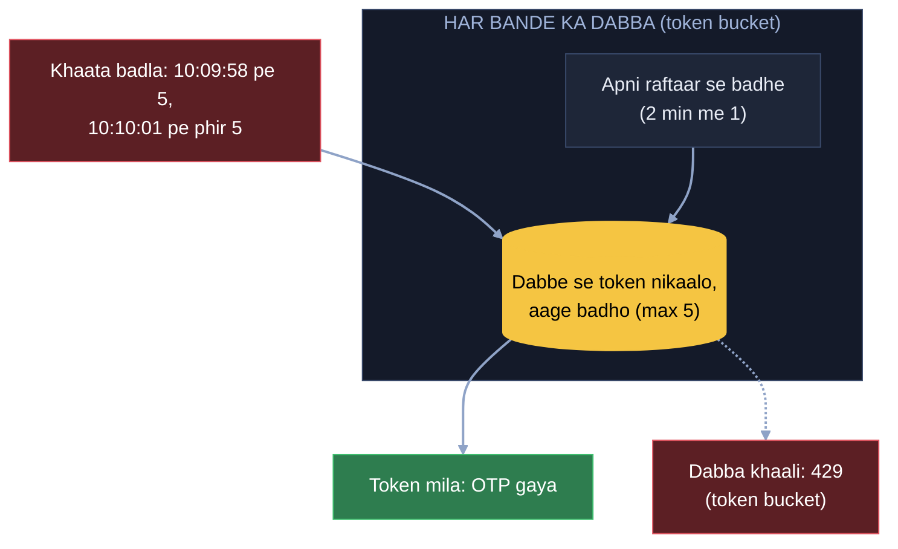

## 4. Ek token, 20 request ek saath (ek hi baari me, Lua)

Ravi ke dabbe me 1 token. Script ne ek pal me 20 request maari, 10 server pe. Har server ne Redis se padha "tokens =
1", har ek ne ek nikaala, 20 andar ghus gayi. Pehle socha Ravi ko 10 alag server pe jaane hi mat do, uska ek home
server ho. Par asli baat ye: Redis single thread hai, ek waqt me ek hi kaam chalata. To padhna, jaanchna aur nikaalna
teeno ek hi baari me kar do, beech me koi ghus hi na paaye. Jaise banking me check aur update ek hi me karte hain.

**Asli naam:** Redis ek command ek waqt (single thread), par alag-alag GET aur DECR ke beech doosra server ghus sakta,
isliye single thread akela kaafi nahi. Sab ek hi baari me, andar koi ghus na paaye = Lua script (check + nikaalna
atomic), banking wala check aur update ek me = wahi atomic check-and-update. 20 line me lagti hain: 1 ko token mila,
baaki 19 ko 429.

**Maan lo counter wala tareeka:** har request pe +1, pehli pe 60 sec ki umar. Ravi ki pehli request pe +1 ho gaya aur umar lagane se pehle server
gira. Counter bina umar ke pada rahega, Ravi hamesha ke liye atka. Isliye +1 aur umar ek hi kaam: ya dono likhe jaayein ya kuch nahi, phir dobara try.
**Asli naam:** INCR + EXPIRE ek Lua script me (atomic); bina umar ki key kabhi expire nahi hoti (HANDS_ON 02_incr_expire_crash).

**Maan lo Lua hi atki:** Lua chalte waqt poora Redis atakta, isliye script chhoti, loop nahi; ek machine lakh command /
sec, zyada to shard.
**Asli naam:** Lua atomic par blocking, Redis cluster.

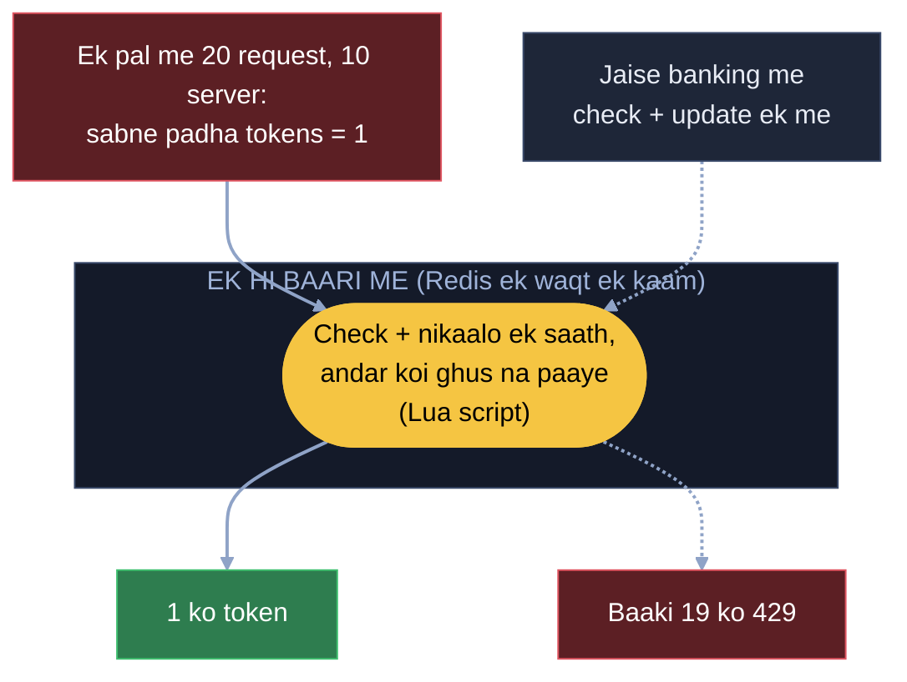

## 5. Guard andar kamre me baitha (guard ko gate pe bithao)

Limiter OTP Service ke andar tha. Script ki 1000 request LB se, beech ke server se hote hue OTP Service tak pahunchti, wahan mana.
SMS nahi gaya, par raaste ke saare server bojh utha rahe. Mere ghar me ek security guard hai jo kehta 10,000 log andar
nahi aa sakte, par wo main gate pe nahi, andar kamre me baitha hai. Ghar ke andar to 1000 log ghus gaye. To use bahar
gate pe bitha do, ghar me koi ghuse hi nahi, gate pe hi hata do.

**Asli naam:** guard andar kamre me = limiter service ke andar, guard gate pe = limiter API Gateway pe (mana wali request
app tak pahunchti hi nahi, aur har service ko apna limiter nahi likhna).

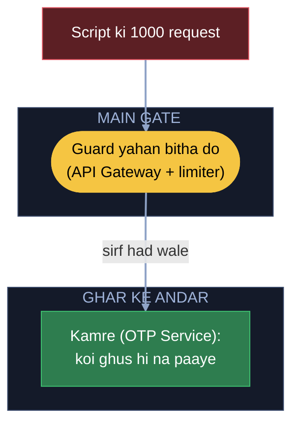

## 6. Guard ka Redis gira (dono khule, bouncer 5-5 karke bheje)

Gate ka guard ginti Redis se dekhta, aur Redis gir gaya. Pehle to Redis ki copy (replica) hai, wo sambhal legi. Worst case
sab gira. Ab ya sabko jaane do ya sabko roko? Redis gira hai, API gateway (bouncer) thodi gira. OTP band nahi kar sakte:
kisi ka zaroori bank transfer ho raha, OTP nahi aaya to wo kya karega, rate limiter ka kaam ye nahi. Feed band karna bhi
galat, koi zaroori reel upload kar raha ho. To dono khule rakho, aur bahar khade bouncer ko bol do "ek saath 1000 andar mat
bhejna, 5-5 karke bhejna". OTP band karna ho to sabka nahi, sirf shaq wale ka: jisne 2-3 second me 5 OTP
maang liye, sirf uske liye gate band; apni range me maangne wale ke liye khula.
Chor wo jo mask pehen ke aaya (1 second me 5-6 OTP); bhala aadmi "papa ka dost" bole to papa se verify karao, phir andar.
Aur suspicious kaun, ye dekhna rate limiter ka kaam nahi: limiter ne apna kaam kar diya (OTP bhi chalu, feed bhi), suspicious
kaun ye system ka alag hissa dekhe.

**Asli naam:** dono khule = fail-open; bouncer 5-5 karke bheje = har gateway apni memory me kachchi ginti se had lagaye
(local fallback limiter: Redis jitni sahi nahi, thodi dheeli, par darwaza poora khula nahi). Redis ki replica pehle bachav. Shaq wala (2-3 sec me 5 OTP) = sirf us user pe block, sab pe nahi.

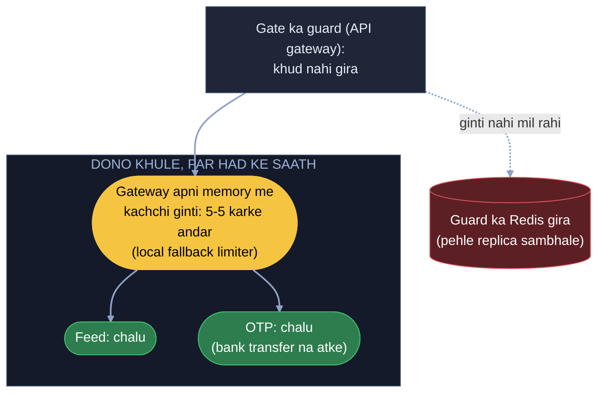

## 7. Script ruki nahi, din-raat maarti (alag dabba, permanent band)

Script gate pe rukti, 429 khaati, par ruki nahi. Din-raat har second maarti, gate ko roz karodon "mana", aur Ravi ko
koi farak nahi. Ek baar mana kiya, do baar mana kiya, teesri baar bhi aaya. To "Ravi bhai, tum yahan aao, mere is
dabbe se jaake baat karo, wo kuch samjhaayega, chhoti si toffee dega." Us dabbe me Ravi ka gala pakad ke wahin bitha
denge: tu ab kahin nahi ja sakta, yahan se hil hi nahi sakta, is site ke liye tu permanent band.

**Asli naam:** ek baar, do baar, teesri baar = baar-baar had todne ka pattern, alag dabba, yahan se hil nahi sakta =
ban list, permanent band = ban wala gate pe bina gine lautta.

**Aur neeche (bouncer bhi roz 1000 se uljha, to pattern dekho):** pehle 1-2 baar chot khaayi to bouncer API gateway pe khada kiya. Ab bouncer bhi roz
1000 logon se uljha hai. To pattern dekho: ye banda roz-roz aa ke yahi kar raha? Haan to ban karo, WAF me daal do,
block, kahani khatam.
**Asli naam:** roz ka pattern = abuse pattern, WAF me daal do = WAF block list (gateway tak bhi nahi pahunchta).

**Maan lo pattern kaise pakdein:** peeche Kafka se dekho kitni baar aaya, kaunse endpoint jhaanke, us pattern se WAF me.
Ban kuch der ka, kyunki IP badalte rehte; pakka pakda gaya user / account permanent band.
**Asli naam:** request events -> Kafka -> abuse detection consumer -> WAF block list; IP ban = TTL, account ban = permanent.

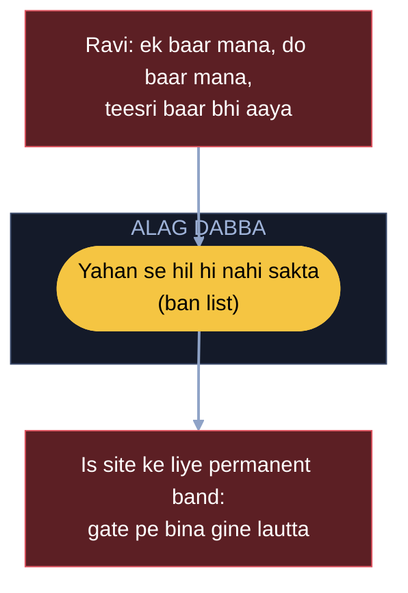

## 8. Har baar naya number, aur office atka (login ke baad kadi, login se pehle dheeli had)

OTP login se pehle hai, to had phone number pe lagai, par Ravi ki script har baar naya number daalti, har number ki
ginti 1. Had IP pe lagai to subah 9 baje office ke 500 log ek hi WiFi (IP) se aaye, aur 5 OTP ke baad poora office
atka. User login ho gaya to uski saari information aa jaati, userId hamare paas, wahan koi dikkat nahi, kuch kare to
ban kar do. Dikkat login se pehle ki hai, to login pe thodi dheeli had chhod do, par itni dheeli nahi ki koi script
hazaar baar chala de. Google pe password kitni baar guess karega, 2, 3, 5 baar. Hazaar baar koi haath se type nahi
karta, karega to intention theek nahi. Ek banda roz hazaar baar password reset kar raha, kal dekha phir hazaar, ye
insaan ke liye possible nahi, to us IP ko WAF me daal do. Office me hazaar log hain par hazaar log ek saath password
nahi bhoolte, bhoole bhi to ek-do din, isliye pattern notice karte hain. Ek second me login button pe 10,000 request
ek office WiFi bhi nahi kar sakta. Aur 1 lakh me 50,000 bhool gaye to aisa to main har design tod dun, perfect design
koi nahi, aaj bhi Google, YouTube toot-te hain.

**Asli naam:** login ke baad userId hamare paas = userId pe kadi had, login pe dheeli had = login se pehle IP pe
dheeli had, insaan hazaar baar nahi, pattern notice = script pattern pakadna, IP ko WAF me daal do = WAF block.

**Maan lo login aur baaki ki had:** login ki apni had, baaki ki alag; paar hui to 429. **Maan lo had asli user pe bhaari
(JP Morgan me 5 galat password pe khud atka):** permanent hal nahi; sabse achha passkeys / Authenticator, bot ke paas code hi nahi.
**Asli naam:** per-endpoint limit, false positive lockout, MFA / passkeys.

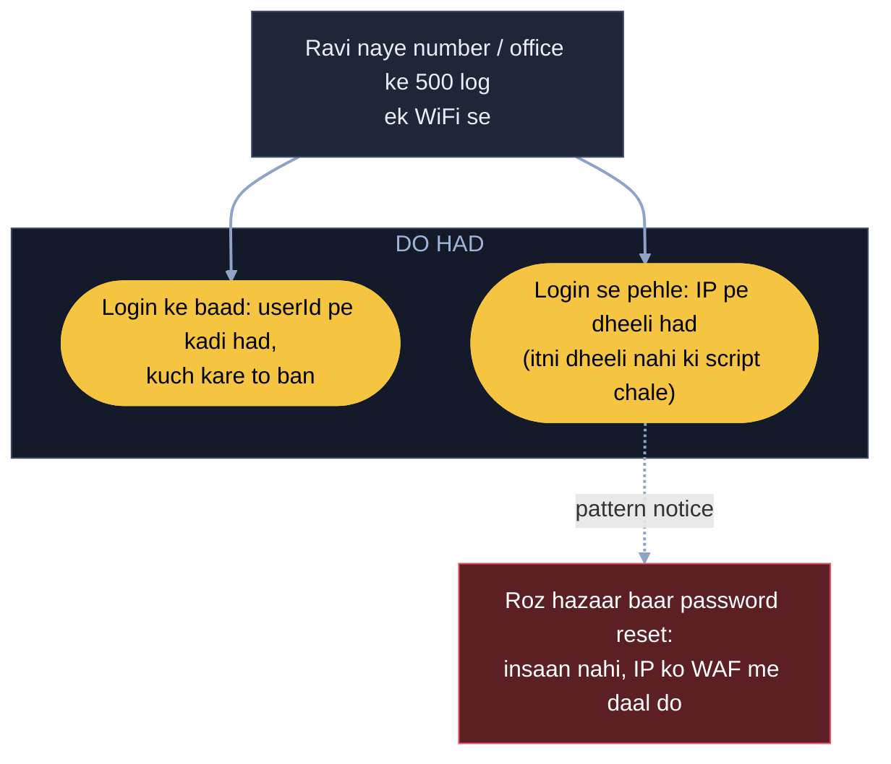

## 9. Result ka din, sab had me, phir bhi SMS company giri (line lagwao)

Result ka din, subah 10 baje 1 crore bachche OTP maangte. Har bachcha apni had me, phir bhi OTP Service aur SMS company
dono gire. Mere paas 2-3 log hain jo 10,000 logon ka kaam kar rahe, koi na koi girega hi. To apne log badha do, server
badha do. Aur SMS company ko utni bheed mat jaane do, wo apne hisaab se kaam kar rahi. Line lagwa, aaram-aaram se:
"jaao beta, ek-ek karke; tu nikal, ab tu nikal." Hamare aur SMS company ke beech ek cheez fit kar do jo spike rok le,
aur SMS ab ek ja, ek ja, dheela-dheela, aaram se.

**Asli naam:** log badha do, server badha do = apne server scale, line lagwa, ek-ek karke = queue (Kafka, OTP Service
turant "OTP aa raha" bol deta), beech me cheez jo spike rok le = worker / consumer SMS company ki raftaar se bhejte, saare worker / consumer
ek saanjhi had se (global had, Redis ka ek token bucket).

**Maan lo OTP line me atka, der se nikla, tab tak bekaar:** Line me har OTP pe uski umar likh do. Line se nikalte waqt dekho, umar khatam to phenk do, bhejo mat; bachcha naya OTP maang lega.
**Asli naam:** umar = message TTL / expiry (line se nikalte waqt jaancho), purana OTP SMS company tak jaata hi nahi.

**Isi pe ek aur raasta (upar ek had: global cap, 503):** sab apni had me, phir bhi server bhar gaya: apne server ki global cap, upar 503 ("thodi der baad aana"),
kam zaroori kaam pehle hatao, login / paisa chalta rahe.
**Asli naam:** global limit + 503, load shedding (priority).

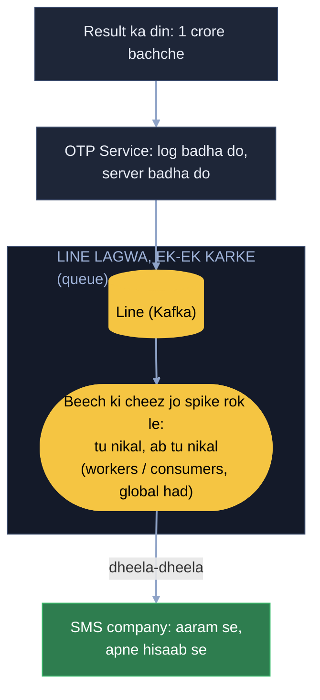

## 10. VPN se 3 region, 15 OTP (ghar ka region)

App 3 region me: Mumbai, US, Europe, har region ka apna Redis. Ravi VPN badal-badal ke teeno se OTP maangta, har Redis
sochta "5 hi hue", aur wo 15 OTP le gaya. VPN se aa raha ho to uska ek particular region decide kar lo. Suppose uska
region Mumbai, India ke servers. 3 se maara ya 10 se, uska main region India hai to count India ke Redis pe hoga, US
aur Europe pe nahi. Wahi se count karo, wahi se dekho, uske hisaab se aage badhenge.

**Asli naam:** ek particular region decide = home region, count India ke Redis pe = ginti ghar region ke Redis me. Bahar se aaye to gateway ghar ke
Redis se poochhta, thoda dheema, par asli user zyadatar apne hi region se aata, uske liye 1 ms hi rehta.

**Maan lo OTP login se pehle hai, sirf phone number aata, aur Ravi VPN se US gateway pe, US ko kaise pata is number ka
ghar Mumbai:** phone number har desh ka alag hota hai, hamara +91 se shuru. VPN IP badal sakta hai, number nahi; VPN
chala ke call karun to bhi +91 hi jaata. To +91 dekh ke ghar India, ginti India ke Redis me. Ravi sach me US shift hua
aur wahan ka number liya, to uska ghar US hi hai.
**Asli naam:** +91 se pata = phone number ke country code se home region (koi alag register nahi chahiye), IP badle,
number nahi = VPN se bachav.

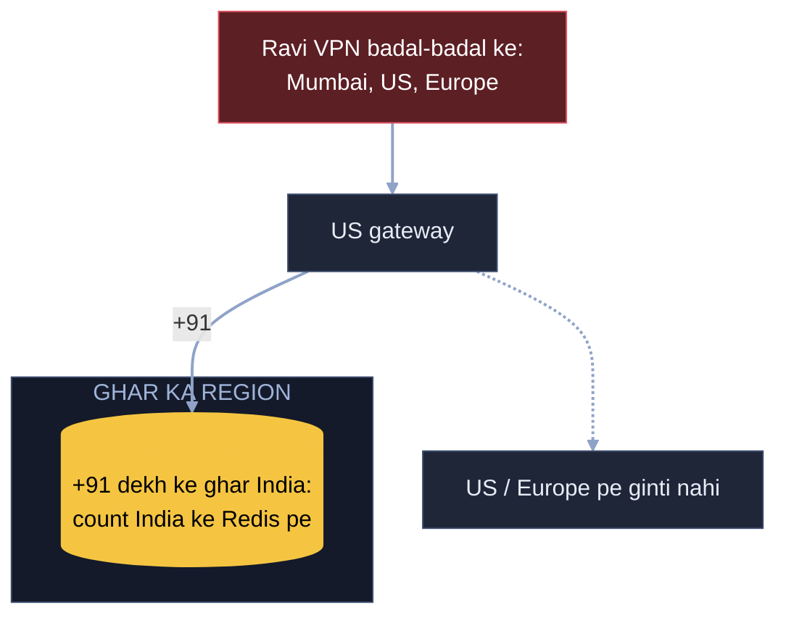

## 11. Feed ka cache usi Redis me, Ravi ka dabba phenka gaya (alag Redis, ya LRU hatao)

Ye app sirf OTP login nahi, ek dukaan bhi hai: home page (feed, kadam 6 wala) aur product page. Ravi ka dabba Redis me, abhi
khaali. Kharcha bachane ko company ne usi Redis me home page / product page ka cache bhi daal
diya. Diwali ki raat cache badhta gaya, memory bhar gayi, Redis jagah banane ko purani keys phenkne laga (LRU) aur Ravi ka
dabba bhi chala gaya. Bouncer ko dabba mila nahi, naya Ravi samajh ke bhara dabba bana diya, script 5 OTP aur le gayi.
Pehli baat: feed / product page alag Redis me, Ravi ka dabba alag Redis me, to ye dikkat aati hi nahi. Ek me hi rakhna hai
(kharcha) to LRU nahi laga sakte, kyunki Ravi ke token evict karne ke nahi, wo use honge: LRU hatao, kuch mat phenko. Product
page Diwali ke baad thanda hoga, tab TTL se nikal jaayega.

**Maan lo ek hi Redis, LRU hata diya, aur Diwali ki raat TTL khatam hone se pehle hi memory bhar gayi:** raaste kam ho gaye,
kyunki Redis ko bol diya kuch mat phenk. Ravi ka dabba nahi phenk sakte, to product page me kuch karo. Team pehle se soche:
jo product page dekh liya uska TTL kam kar do, wo jaldi nikal jaayega, Redis balance rahega; jo nahi dekha wo apne TTL pe.
Product page DB se bhi aa sakta, thodi loading zyada, par Redis theek chalega. Phir bhi zyada dikkat hui to sabse baad me
Redis tod do: product page ka alag, OTP ka alag.

**Asli naam:** feed alag Redis, Ravi ka alag = sach (limiter ka dabba) aur cache alag Redis · LRU hatao = `maxmemory-policy
noeviction` (Redis kuch nahi phenkta; bhar gaya to naya likhna error deta, isliye bharne hi mat do) · dekh liya to TTL kam
= cache pe chhota TTL · DB se thodi loading = cache miss pe DB, thoda dheema (graceful degradation). Foundations 04 caching
ka "Redis = ek cheez, teen kaam": limiter ka dabba SACH hai, cache nahi, isliye phenkna mana.

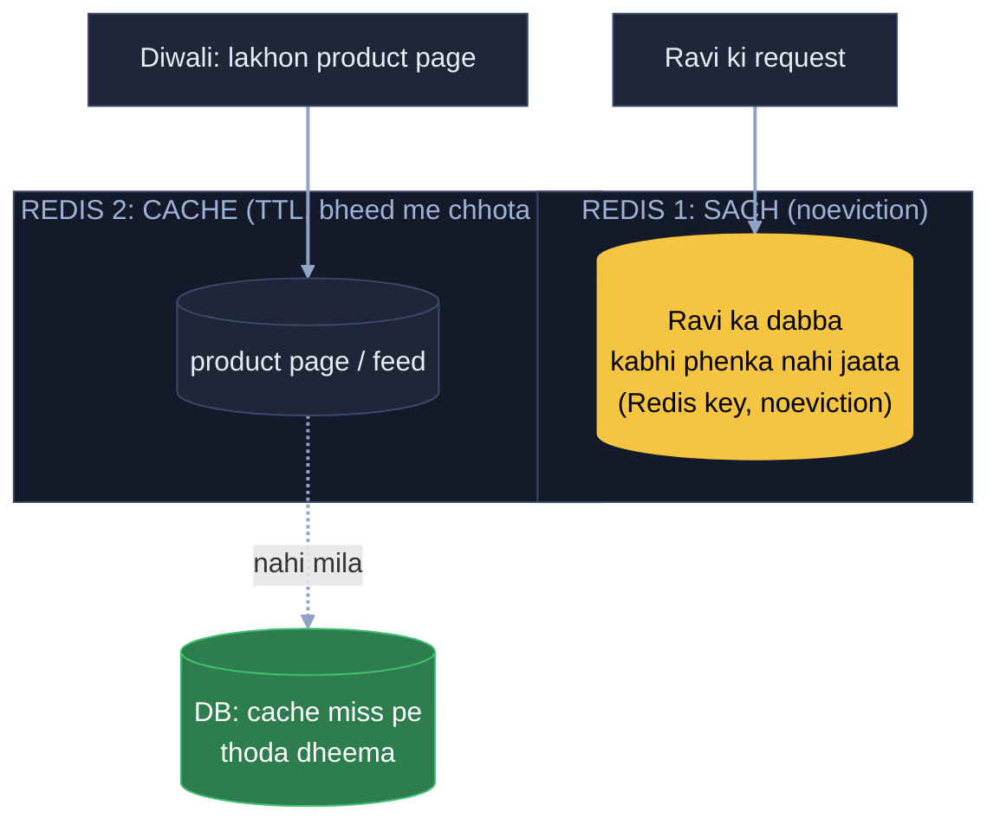

---

## Poora dhaancha ek nazar me

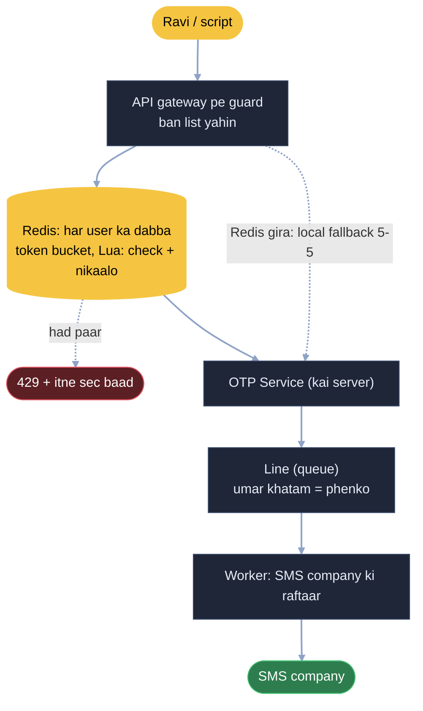

---

Notes (Arpan ke shabd) = [RATE_LIMITER_HAND_NOTES.md](RATE_LIMITER_HAND_NOTES.md)
