# Rate Limiter

> Ek user ek tay samay me kitni request bhej sakta hai, uski had. Had paar to 429.
> Teen cheez: har request ke aage baitha (~1 ms) · ginti saari machines pe EK · limiter gire to site na gire.
>
> Mock me sirf heading + Cue + kahani ki tasveer. Neeche har card ek block: HAL (↳ agar = cross-Q) · KYUN · NAHI (doosra kyun nahi).
> Cross-Q: hal ke har bade shabd pe socho -> gira? · dheema / bheed? · do ek saath? · galat hua? · kaise / kitna?

---

## Poori tasveer (aakhir me design aisa banta hai)



---

## Shuru

```
FR      har user / endpoint ki had (login 5 / min, API 100 / min). Had paar to 429 aur Retry-After.
        Plan ke hisaab se alag had (free / pro)
NFR     har request ke aage baitha hai, to ~1 ms me jawab. Ginti saari machines pe ek.
        Limiter gire to site na gire
NUMBERS ~1 crore user, peak ~10,000 request / sec. Jagah ka nahi, speed ka sawaal hai,
        isliye RAM (Redis), DB nahi
```

---

## Kaunsa algo

```
TOKEN   bucket me max 10 token. Har second 1 token bharta, har request 1 leti. Khaali hua to 429
REDIS   Redis me sirf 2 number: kitne tokens, aur aakhri baar kab dekha (lastTime).
        Request aane pe bharo: tokens + (now - last) x rate, par 10 se zyada nahi. Koi background job nahi
AGAR    bucket bhara tha, 10 request ek saath aayi
        -> 10 nikal gayi (burst). Asli user aise hi jhatke me bhejta hai
        bucket khaali, 11vi aayi
        -> 429 aur Retry-After
        user ghanta bhar soya, phir aaya
        -> beeta time x rate jitne token jude, par 10 se upar nahi (bucket ki had)
        sliding log lagate to?
        -> sabse sahi, par har request ka time rakhna padta, memory bahut
        sliding counter lagate to?
        -> is minute ki ginti + pichhle minute ka hissa, 2 number, lagbhag sahi
        leaky bucket lagate to?
        -> smooth chalta hai, par burst nahi nikalne deta
        token bucket hi kyun?
        -> burst chalta hai, sirf 2 number, AWS / Stripe yahi lagate
```

---

*ab tootega kahan? kai App hain, har App apni ginti gin raha*

## 1. 9 baar login kiya, do App ne alag-alag gina, saari andar

Cue: Redis me EK ginti, 60 sec umar

<details><summary>kahani dekho (3 scene)</summary>


</details>

```
HAL     sab App ek hi Redis ginti dekhte hain (rate:Arpan:login, umar 60 sec). 6thi request pe 429
        ↳ agar window ke kinare pe 5 + 5 aayi? -> 2 sec me 10 andar
          Ye fixed window ki kamzori hai, isliye asli me token bucket
KYUN    ginti ek hi jagah hai aur RAM jitni tez hai. Key ki umar hi window hai, minute khatam to key mit jaati
NAHI    ginti DB me     -> DHEEMA: har request pe disk aur lock lagta, bahut dheema ho jaata
        sticky LB       -> GIRA: ek user ek hi App pe jaata, wo App gira to uski ginti bhi gayi
```

---

*ab ginti ek jagah hai, par ek saath 20 aayi to?*

## 2. Bot ne mere account pe 20 login ek saath bheje, 6 ghus gaye

Cue: ATOMIC: INCR / LUA script

<details><summary>kahani dekho (3 scene)</summary>


</details>

```
HAL     INCR se padhna aur badhana ek hi kadam me ho jaata hai. Redis ek ke baad ek chalata hai
        ↳ agar ginti badhi, par "60 sec baad mita dena" bolne se pehle crash? -> hamesha block
          key ban gayi par uski expiry kabhi lagi hi nahi. Isliye INCR aur EXPIRE ek hi Lua script me
        ↳ agar Lua atak gayi? -> poora Redis ruk jaata, kyunki ek hi line hai
          Isliye script chhoti rakho, loop mat daalo
        ↳ agar Redis sab kuch ek line me karta hai, to dheema nahi hoga?
          -> nahi, RAM me hai, ek machine ~lakh command / sec (andaza). Aur chahiye to shard
        ↳ agar Lua me 2 key hain aur Redis cluster hai?
          -> dono key alag machine pe ja sakti. {Arpan} hash tag lagao, dono ek hi machine pe aayengi
KYUN    Redis ek hi line me chalta hai, beech me koi doosri request ghus hi nahi sakti
NAHI    pehle GET phir SET  -> RACE: do kadam hue, dono ne 4 padha, dono andar aa gaye
        App me synchronized -> CHHOTA: wo sirf ek machine ke andar chalta hai, doosri App ko pata hi nahi
```

---

*ab ginti sahi hai, par mana wali request bhi andar tak aa rahi*

## 3. Bot ki 429 wali request bhi App tak ghoom ke aayi

Cue: LIMITER GATEWAY pe, sabse aage

<details><summary>kahani dekho (3 scene)</summary>


</details>

```
HAL     limiter API Gateway pe hai, sabse aage. Had paar hui to wahin 429, request LB / App tak jaati hi nahi
        ↳ agar 429 bheja, uske saath kya bhejte ho?
          -> Retry-After: 30 (kab aao) aur X-RateLimit-Remaining (kitni bachi)
        ↳ agar sabko Retry-After 30 diya? -> 30 sec baad sab ek saath. Alag-alag do (jitter)
          isse sab ek saath nahi lautte (jitter)
        ↳ agar gateway gir gaya? -> 2+ machine pe, aage LB, darwaza akela nahi
        ↳ agar had sirf gateway pe lagana kaafi hai?
          -> dono jagah: gateway pe sabke liye moti had, aur service ke andar apni baarik had
KYUN    jitna aage roko, utna kam kaam bekaar jaata hai
NAHI    ginti App me rakho -> BHARA: mana hone wali request bhi andar aati, App usi me bhar gaya
```

---

*ab sab kuch Redis pe tika hai, wo gira to?*

## 4. Dopahar Redis gira, limiter andha ho gaya

Cue: REPLICA + FAIL-OPEN / FAIL-CLOSED

<details><summary>kahani dekho (3 scene)</summary>


</details>

```
HAL     Redis ki copy taiyaar rehti hai. Main gira to copy main ban jaati hai (Redis Cluster)
        ↳ agar Redis gira, ye pata kaise chalega?
          -> Redis ki call pe chhota timeout (~5 ms). Jawab nahi aaya to gira maano, ruko mat
        ↳ agar copy main ban rahi thi, beech ki ginti? -> kuch second ki kho gayi
          rate limit me itna chalta hai
        ↳ agar CPU full, copy laga du? -> nahi, INCR = likhna, likhna sirf main pe
          Redis gira nahi, bas CPU full tha. Isliye SHARD, har user ki key alag Redis pe
        copy bhi gayi to pehle se tay hai: login band (fail-closed), feed khula (fail-open)
        ↳ agar sab fail-open? -> login khula, koi bhi bina had password guess karega
        ↳ agar login band hai, user ko kya dikhe?
          -> 503 aur "thodi der baad try karo", chup-chaap fail nahi
        ↳ agar feed khuli chhodi, kab tak?
          -> Redis wapas aate hi band. Tab tak har gateway apni ginti rakhta hai (card 8)
KYUN    Redis gire to kya karna hai, ye pehle se tay hai, endpoint ke hisaab se
NAHI    sab fail-open kar do -> KHULA: login khula reh gaya, koi bhi bina had password guess karega
```

---

*ab ek region me sab theek, par user kai region se aaye to?*

## 5. Meri script 3 region se chali, 100 ki jagah 150 nikal gayi

Cue: HOME REGION me ginti

<details><summary>kahani dekho (3 scene)</summary>


</details>

```
HAL     meri ginti mere ghar region (India) me hoti hai. US / Europe ki request bhi wahin gini jaati
        ↳ agar ghar door hai? -> sirf login / paisa ghar tak, baaki apni ginti, har second sync
          ghar region door hai (100-200 ms), to har request wahan nahi jaati. Baaki apni ginti rakhte
        ↳ agar do sync ke beech koi request aayi?
          -> ~1 second tak thodi dheel milti hai, halki had me ye chalta hai
        ↳ agar ghar region gir gaya? -> Route 53 doosre region pe, ginti 0 se
KYUN    ek user ki ek hi ginti, ek hi ghar me. Isliye 100 hi nikalti hain
NAHI    har region apni ginti rakhe -> TOOTA: 50 + 50 + 50 = 150, had har region me alag lagi, user pe nahi
```

---

*ab had lag rahi, par wahi bot roz wapas aa jaata*

## 6. Wahi bot har 60 sec baad phir aa jaata, din bhar

Cue: KAFKA -> PATTERN -> WAF BAN

<details><summary>kahani dekho (3 scene)</summary>


</details>

```
HAL     har 429 Kafka me jaata hai. Pattern Svc dekhta: 10 min me 500+ 429 aaye
        ↳ agar Kafka peeche chal raha? -> ban kuch minute late, rate limit rok raha
        to WAF block list me daal deta, edge pe hi rok deta
        ↳ agar office ka IP (200 log, ek IP)? -> ban nahi, captcha. Ban bhi 24 ghante me hat jaata
          haath se bhi hata sakte. Bheed wale IP pe ban ki jagah captcha
        ↳ agar userId pe ban lagana hai, kahan lagega?
          -> gateway pe, JWT se userId milta. WAF edge pe baitha hai, wo sirf IP dekhta hai
KYUN    429 maafi wala hai (phir aao). Ban sirf pakke gunde pe lagta, aur wo khud hat jaata hai
NAHI    turant ban kar do -> GALAT: asli user bhi tez click karta, office NAT, sale ki bheed,
        sab bahar ho jaate
        gateway seedha Pattern Svc ko call kare -> DHEEMA: har request ruk ke jaayegi,
        isliye Kafka me daal ke aage badho
```

---

*ab har user had me hai, phir bhi system bhar gaya to?*

## 7. Shaam ki sale, har koi limit me, phir bhi server gira

Cue: GLOBAL CAP + LOAD SHEDDING (503)

<details><summary>kahani dekho (3 scene)</summary>


</details>

```
HAL     gateway pe poore system ki had (5,000 / sec). CPU 90% paar gaya to kam zaroori request ko 503,
        login / payment bachao
        ↳ agar had paar hui, 429 bhejoge ya 503? -> user ki had = 429, system ki had = 503
KYUN    user ki had aur system ki had alag cheez hain. Sab apni had me hon, phir bhi system bhar sakta hai
NAHI    machine khud badh jaayegi -> DER: machine badhne me minute lagte, bheed second me aati
        line (queue) me rok lo    -> BEKAAR: sirf ~2 second chalta, user chala gaya to kaam bekaar
```

---

*ab sabse bura waqt: attack aur Redis ek saath gaya*

## 8. Raat ko attack, usi waqt poora Redis Cluster gira (copy bhi), aam API khuli

Cue: LOCAL COUNTER FALLBACK

<details><summary>kahani dekho (3 scene)</summary>


</details>

```
HAL     har gateway apni memory me ginta hai. Had 100, 4 gateway -> har ek ki had 25 (local fallback)
        ↳ agar had baanti hi nahi, har gateway ne 100 di? -> 4 x 100 = 400 mil gayi
          had 4 guna dheeli
        ↳ agar bilkul exact had chahiye?
          -> LB userId ke hash se ek user ko hamesha ek hi gateway pe bheje (sticky by userId)
        ↳ agar gateway badh gaye? -> N config se lo, aur had dobara baanto
          N config / service discovery se aata hai
        ↳ agar Redis wapas aa gaya? -> phir se sabki ek hi ginti Redis me
KYUN    thodi galat had, bina had se behtar hai. Login ab bhi fail-closed rehta hai
NAHI    Redis gaya to sab andar aane do -> KHULA: attacker ke liye site khul gayi, server bhar ke band
```

---

*ab had sahi jagah lagi, par kis naam pe?*

## 9. Office ki night shift: ek IP block, 1000 log atke

Cue: KEY = USER_ID (JWT), IP sirf login

<details><summary>kahani dekho (3 scene)</summary>


</details>

```
HAL     login ke baad ginti user_id pe hoti hai (JWT se). Ravi ki galti sirf Ravi pe padti hai
        ↳ agar login se pehle, jab userId hai hi nahi?
          -> wahan IP pe dheeli had aur WAF
        ↳ agar 5 galat password pe account lock? -> attacker tujhe hi lock kar dega
          isliye username pe lock nahi, CAPTCHA ya thodi der ruko
        ↳ agar API key chori ho gayi?
          -> nuksaan seemit hai, kyunki had key pe hai. Key badlo ya band karo
KYUN    had us pehchaan pe lagao jo ek insaan ki ho. Ek IP pe 1000 log hote, ek botnet ke 1000 IP
NAHI    IP ki had badha do (5 se 500) -> CHHOOT: office bach gaya, par botnet ko bhi utni hi chhoot mil gayi
```

---

## Poora design ek saans me

```
User -> Route 53 (kaunsa LB zinda) -> WAF (ban list) -> ALB (kai data center)
-> API Gateway me limiter (sabse aage, jaldi mana · global cap + load shedding · Redis gire to local ginti)
-> Redis Cluster (token bucket ek Lua script me: tokens + last, key = user + endpoint, copy + shard)
   -> had ke andar? App : 429 + Retry-After
baar-baar wala -> Kafka -> Pattern Svc -> WAF ban
DB:  Redis = ginti ki ek hi sachchi jagah, 1 ms, key ki umar = window (umar khatam = reset, safai ka job nahi)
     user ka plan (free / pro) DB se, Redis me usi limit se milao
```

Bolne ke liye: limiter darwaze (API gateway) pe, mana hui request andar jaati hi nahi. Ginti Redis me, sab servers ki
ek jagah, ek kadam me (token bucket ki Lua script). Key = kaun user + kaunsa kaam, umar = window. Token bucket isliye
ki asli user jhatke me request bhejta. Had paar = 429 + kitni der baad aao. Redis ki copy. Redis poora band: har
server apni ginti, login / OTP band. Baar-baar wale hamlawar ko WAF se block, aur badi asli bheed ke liye poore system
ki had.

---

## 10 guna traffic

- **API Gateway**: har request pe limiter chalta, to RAM me + ek jhatke me (atomic). Gateway machine badhao.
- **Redis**: shard (user / region ke hisaab se) + copy (switch ke saath) + fail-open + local fallback.
- **Kai region**: har user ka home region.
- **Gunda**: Kafka -> Pattern service -> WAF ban.
- **Asli bheed**: global cap + load shedding + line (queue) + pehle se scale.

**Pooche: kahan se sab gir sakta?** Redis (cluster + switch; aam API fail-open, login / OTP fail-closed). LB (Route 53).

**Pooche: chal raha hai, kaise pata?** Limiter ka time (p99), kitne 429, Redis ki galtiyan, alert.

---

## Pooche to (kisi card me nahi baitha)

Jawab ke header: theek hai to aage bhejo + X-RateLimit-Limit: 100, X-RateLimit-Remaining: 47, X-RateLimit-Reset: kab.
Had paar to 429 + Retry-After: 30 + Remaining: 0. Sirf "na" mat bolo, "kitna bacha" aur "kab aao" bhi batao, warna
client turant phir maarta. Retry-After me thoda aage-peeche (28, 33), warna sab ek saath lautte hain.

Ulta sawaal, "tumhe kisi aur ne 429 diya, ab?": "I respect Retry-After, back off exponentially with jitter, and
throttle my own sends."

Redis key: `rate:<user>:<endpoint>` me ginti, umar = window (60 sec). Umar khatam = reset, safai ka job nahi. Jaise
rate:192.168.1.5:login = 4, rate:user_456:signup = 2, rate:apikey_xyz:search = 47.

Limit badalni ho? Niyam config me (DB / AppConfig), gateway har ~30 sec padhe. Naya code nahi.

LB ya gateway bhi akela hai? Nahi, ALB kai zone me chalta hai, aur Route 53 zinda wale pe bhejta hai.

Sliding window: niyam "pichhle 1 ghante me 5 se zyada nahi". 11:00 pe aaye, 10:00 ke baad 5 aa chuke, mana. 11:10 pe
aaye, ab 10:10 ke baad gino, Ramesh 10:05 wala bahar ho gaya, 4, andar. Window request aane pe khisakti hai, koi timer
/ job nahi.

Kaun kaisa: token = burst haan, memory kam. Leaky = burst nahi, smooth. Fixed = sabse sasta, kinare pe double. Sliding
log = sabse sahi, memory zyada.

Ginti vs bojh: 100 chhoti request (5 ms) = 0.5 second kaam. 100 bhaari report (30 second) = 50 MINUTE kaam. Limiter ke
liye dono "100". Isliye bhaari endpoint pe kadi limit, ya request ka wazan (report = 50 token, login = 1), ya "ek user
ki ek waqt me 2 hi bhaari query".

Plan: bina login 60 / ghanta, free 5,000, pro 10,000, enterprise apni. Plan DB se, Redis me usi limit se milao.

Ek hi shakal (poore HLD me ghoomti): LB me bachane wali cheez ne hi maara (health check / retry / sticky). Cache me tez
karne wali cheez ne raasta roka (dheema Redis, timeout nahi). Limiter me rokne wali cheez ne bheed roki hi nahi
(per-user vs poora system), aur attack me khud gayab (fail-open).

---

## HANDS-ON #1 — Nginx limiter LIVE (21-Aug, isi folder ki `nginx.conf`)

```
docker run -d --name rl -p 8080:80 -v "<path>\nginx.conf:/etc/nginx/nginx.conf:ro" nginx
   -d background · --name rl · -p laptop 8080 -> container 80 · -v apni conf andar MOUNT (ro) · nginx = image

nginx.conf ki 2 asli line:
   limit_req_zone $binary_remote_addr zone=mylimit:10m rate=1r/m;    <- har IP ka bucket, refill 1 / min
   limit_req zone=mylimit burst=5 nodelay;                           <- bucket SIZE 5, burst turant serve
   rate = kis speed se nikalti · burst = kitni ruk sakti
   + location / { ... root /usr/share/nginx/html; index index.html; }  <- content serve
   koi program NAHI likha — sirf ready tool (Nginx, rate limiter built-in) on kiya + config + hammer -> 503
   SACH: nginx docs isko LEAKY BUCKET kehte; nodelay se bartaav
         token bucket JAISA. 503 = limit_req_status default.

HAMMER:  for /L %i in (1,1,30) do @curl -s -o nul -w "%{http_code} " http://localhost:8080
         (1,1,30) = 30 baar · -s -o nul = chup, body phenk do · -w = sirf status code
DIKHA:   200 200 200 200 200 200 503 503 503 ...
LOG:     (Docker Desktop -> Containers -> rl -> Logs) "GET / HTTP/1.1" 503 197
         [error] limiting requests, excess: 5.774 by zone "mylimit", client: 172.17.0.1
         (excess = bucket se kitna upar · client = Docker gateway IP, sab ek IP = ek bucket)

GOTCHA:  1. 503 tabhi jab ARRIVAL > rate (rate=2r/s pe dheere loop -> sab 200, refill pakad leta)
         2. burst=N -> spike me N+1 pass (burst=5 -> 6, 100 ->
            101); textbook N, nginx N+1, timing se 21 / 22 bhi
         3. 1 IP = 1 bucket
         4. config badla -> docker restart rl
CHALAO:  docker start rl · curl http://localhost:8080 · docker logs rl · docker restart rl · docker stop rl
```

---

## HANDS-ON #2 — App ke andar fixed window (usercrud, 26-Aug)

```java
@RestController
public class RateLimitController {
    private int LIMIT = 5;
    private long windowStart = 0;
    private int count = 0;

    @GetMapping("/rate-demo")
    public synchronized ResponseEntity<String> hit() {          // synchronized: shared counter
        long now = System.currentTimeMillis();
        if (now - windowStart > 1000) { windowStart = now; count = 0; }   // window reset
        count++;
        if (count > LIMIT)
            return ResponseEntity.status(HttpStatus.TOO_MANY_REQUESTS).body("429 - limit paar");
        return ResponseEntity.ok("OK - request #" + count);
    }
}
// SecurityConfig: .requestMatchers("/rate-demo").permitAll()
// ResponseEntity KYUN: status-code (200/429) khud set karne ko
```
```
LIVE:  1..10 | % { curl.exe -s http://localhost:8080/rate-demo; "" }
       OK #1..#5 · 429 (6..10) · 1 sec baad window reset -> phir OK
EDGE:  fixed window boundary: 999ms pe 5 + 1001ms pe 5 = ~2ms me 10
PROD:  single node memory -> restart pe reset + har server apna count -> Redis INCR + EXPIRE
       per user / IP -> map<key, counter> · lib: Bucket4j (token bucket) / Redis + Lua
JAWAB:    usercrud me khud banaya: 5 request theek, chhathi pe 429.
          Asli system me token bucket (Bucket4j library) + sab servers ka saanjha Redis counter. Nginx
          bhi ye kaam sabse aage kar sakta (limit_req).
```

---

## HANDS-ON #3 — Redis KHUD maara: kaise tootta

CODE: `04_HLD/HANDS_ON/01_rate_limiter_redis/RateLimiterDemo.java` · `04_HLD/HANDS_ON/02_incr_expire_crash/IncrExpireCrash.java`
(koi library nahi, socket se Redis, `java File.java`)

```
docker run -d --name demo-redis -p 6390:6379 redis:7 redis-server --save "" --appendonly no
   (RDB + AOF band -> sirf memory, restart = sab gaya, jaan-boojh ke)
docker stop / start demo-redis · docker exec demo-redis redis-cli TTL rl:user:1 · ... DEL rl:user:1

CODE KA DIL (user:1 ko 60 sec me 5):
   count = INCR KEY · if count == 1 -> EXPIRE KEY 60 · count <= 5 ALLOW else 429
   catch IOException -> FAIL_OPEN ? ALLOW : BLOCK
```
```
CASE A  chalta kaise  req 1..9:  count 1 TTL 60 ALLOW · 2/57 ALLOW · 3/56 ALLOW · 4/49 ALLOW · 5/48 ALLOW ·
                                 6/47 429 · 7/45 429 · 8/45 429 · 9/44 429     (window PEHLI request se)

CASE B  docker stop   "REDIS SE BAAT NAHI HUI: Connection refused" -> FAIL_OPEN = true -> ALLOW (2 baar)
                      fail-open = site chale, limit nahi · fail-closed = abuse nahi, site band
                      ("server ne haath khade kar diye, sab jao")

CASE C  docker start  GET rl:user:1 -> khaali · user (pehle count 7, BLOCK) -> count 1 ALLOW, 2 ALLOW
                      persistence band -> ginti gayab -> blocked ko 5 nayi mil gayi

CASE D  INCR ke baad, EXPIRE se pehle crash (USE_LUA = false)
                      RUN 1: count 1, CRASH · TTL -> -1
                      RUN 2: count 2..5 ALLOW, 6..7 429, har baar TTL
                             -1 -> key KABHI nahi mitegi, HAMESHA block
FIX D   USE_LUA = true   req 10..14: count 10 TTL 58 · 11/57 · 12/56 · 13/56 · 14/55 -> 1 min me free

TTL:  -1 = key hai, timer nahi · -2 = key hi nahi · 58 = 58 sec baaki
```
```
FIX:  B -> faisla pehle se: fail-open (aam API) / fail-closed (login, OTP) + replica
      C -> replica / AOF on. limiter me aksar chalne do (1 min ki ginti, paisa nahi). paisa hota to nahi.
      D -> Lua: INCR + EXPIRE ek command, Redis single-thread -> script beech me nahi rukti
           (EXPIRE NX se nahi bachta: wo bhi alag call hai, beech me crash wahi)
           pehle:  app --INCR--> Redis  [crash]  app --EXPIRE--> Redis
           Lua:    app --EVAL(INCR + EXPIRE)--> Redis
```
```lua
local c = redis.call('INCR', KEYS[1])
if c == 1 then redis.call('EXPIRE', KEYS[1], ARGV[1]) end
return c
```
```
JAWAB:    Docker Redis khud band karke teen cheez dekhi:
          1) Redis band: aam API chalti rahi, login / OTP ruk gaye.
          2) Redis restart: saari ginti zero ho gayi. Limiter me chalta hai, copy rakho to kam hota.
          3) Ginti +1 aur 'umar lagao' alag-alag bheje aur beech me crash hua: key bina umar ke reh
          gayi, user hamesha ke liye block. Isliye dono ek Lua script me ek saath.
```

ARCHETYPE F · CONCEPTS: [caching/Redis](../../FOUNDATIONS/04_caching.md) · [load-balancing](../../FOUNDATIONS/03_load_balancing.md) · [SPOF](../../FOUNDATIONS/11_reliability_spof_cloud.md) · [← MASTER SHEET](../../00_MASTER_SHEET.md)
