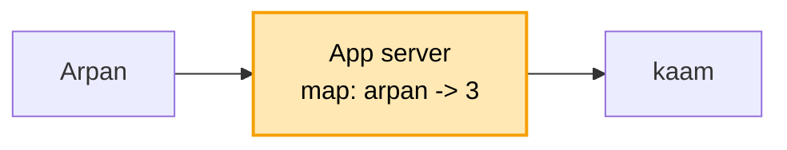
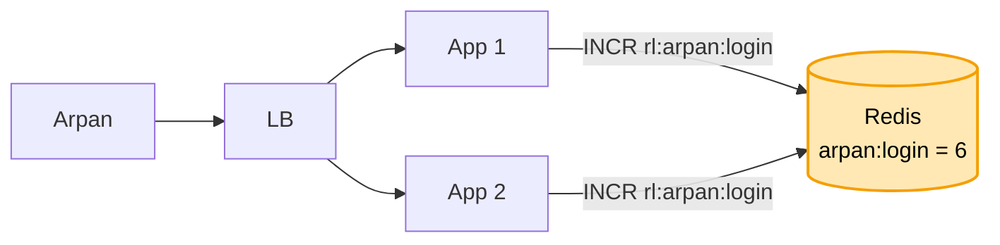
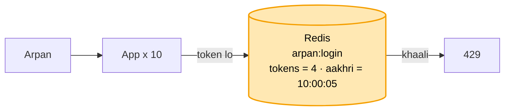
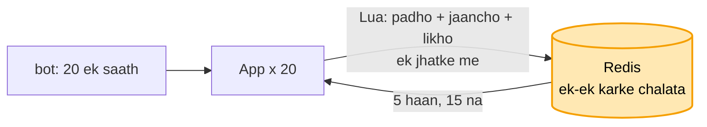
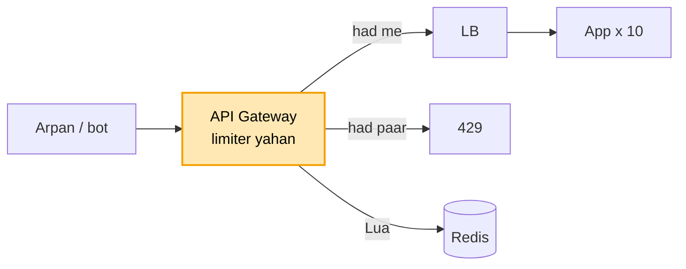
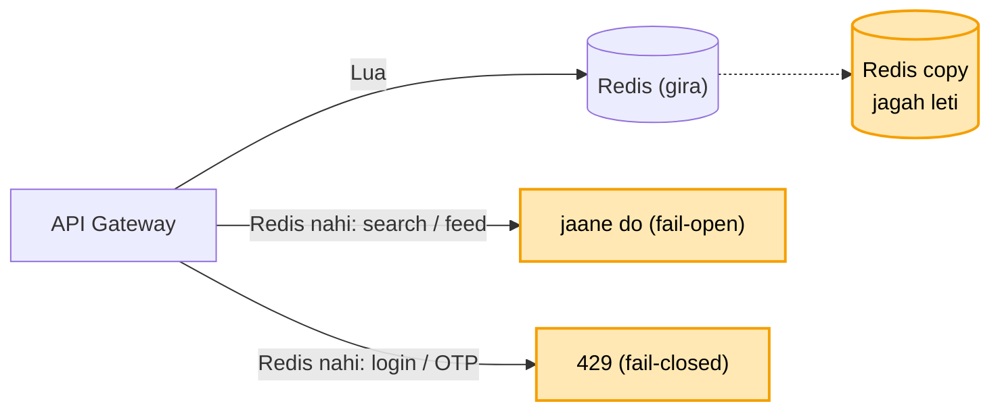
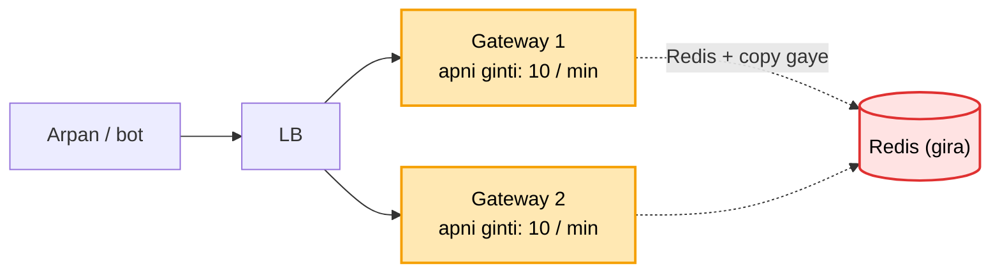
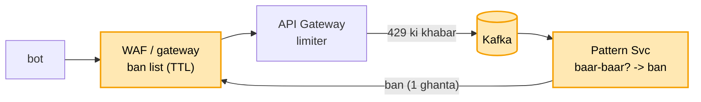
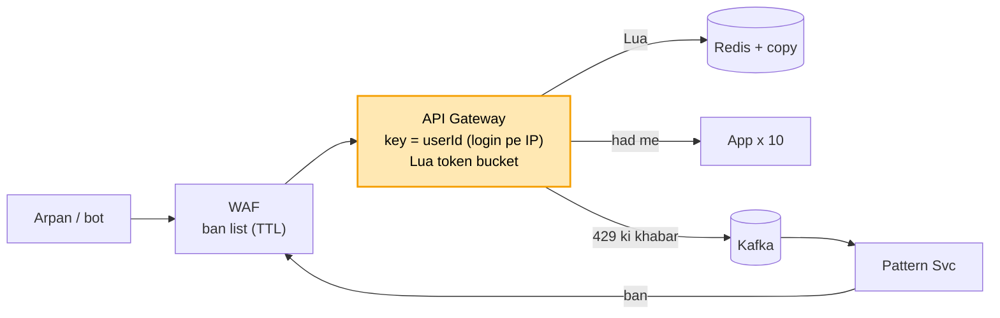
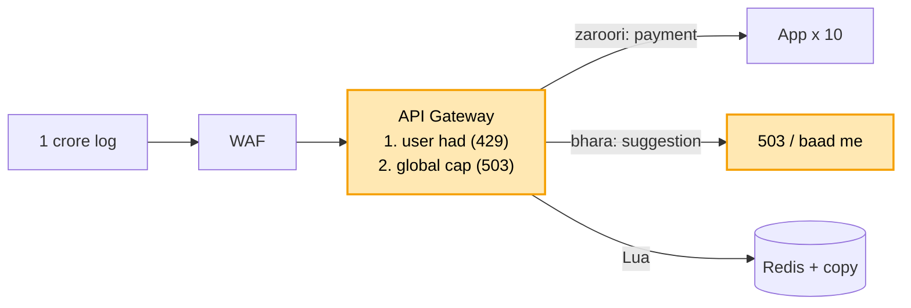

# Rate limiter: shuru se, ek kahani

Kram: **FR -> NFR -> numbers -> design**. Design sabse seedhe dabbe se shuru, har dikkat pe ek dabba judta.
Peela = abhi juda. Kahani ek hi: Arpan ka app, login pe ek bot.

---

## 1. FR: kya karna hai

```
1. har user ki had: login 5 / min, baaki API 100 / min
2. had paar -> 429 (Too Many Requests) + "kitni der baad aao" (Retry-After)
scope ke bahar (poochh ke hatao): plan ke hisaab se alag had (free / pro)
```

## 2. NFR: kaisa chalna chahiye

```
- TEZ           : har request ke aage baitha, ~1 ms me haan / na. Dheema = poori site dheemi
- ginti EK      : 10 server hon, ginti sabki ek hi jagah
- limiter gire to site na gire
```

## 3. Numbers

```
- ~1 crore user, peak ~10,000 request / sec
- har user ke 2 chhote number (kitne bache, aakhri baar kab) -> 1 crore x ~50 byte = ~500 MB
```

Dikkat jagah ki nahi, SPEED ki. 500 MB ek machine ki RAM me aa jaata, isliye aage RAM wala Redis, DB nahi.

---

## 4. Design

### Kadam 1: sabse seedha (server ke andar ginti)

App server ki memory me ek map: `user -> is minute kitni request`.

```
request aayi -> map[arpan]++ -> 5 se zyada? -> 429
                                nahi        -> aage jaane do
minute badla -> map saaf
```



Ek server tak chalta: tez, aur sab ek hi jagah gina ja raha.

Par bheed badhi, 10 App server lage, aage LB. Arpan ki 5 login App 1 pe, 5 App 2 pe. Dono ne alag gina
("5 hi to hain"), 10 andar. Had toot gayi.

### Kadam 2: kai server, ginti ek jagah (Redis)

Ilaaj: ginti sabki EK jagah, **Redis**. Har App har request pe Redis se poochhe.

```
key   = rl:arpan:login          (kaun user + kaunsa kaam)
INCR  -> 1, 2, 3 ...            (Redis me +1, nayi ginti wapas)
umar  = 60 sec (TTL)            -> minute khatam, key khud gayab = ginti reset, safai ka job nahi
6 aayi -> 429
```



Redis kyun, DB kyun nahi? NFR: ~1 ms, 10,000 / sec. DB disk pe, har baar kai ms, site dheemi.
Redis RAM me ~1 ms, aur data sirf 500 MB, RAM me aa jaata.

Par "har minute 5" = ghadi ka minute (10:00 - 10:01). Bot ne 10:00:59 pe 5 bheji, 10:01:00 pe phir 5.
Ek second me 10 andar, kyunki minute badalte hi ginti 0.

### Kadam 3: minute ke kinare pe dugni (kaunsa tareeka gine)

Ab tak ghadi ka minute (**fixed window**): 10:00:59 pe 5 + 10:01:00 pe 5 = ek second me 10.

```
SLIDING LOG     har request ka time likho, nayi aaye to pichhle 60 sec wale gino
                -> sabse sahi, par har request ka time = memory bahut (1 crore user)
SLIDING COUNTER is minute ki ginti + pichhle minute ka bacha hissa (2 number)
                -> lagbhag sahi, sasta
LEAKY BUCKET    request line me, fix raftaar se nikalti (nal se boond)
                -> smooth, par jhatka (burst) nahi nikalne deta
TOKEN BUCKET    baalti me max 5 token, har 12 sec 1 bharta, har request 1 leti, khaali -> 429
                -> ISLIYE YE
```

```
token bucket kyun?  -> sirf 2 number (tokens, aakhri baar) = wahi 500 MB
                    -> jhatka chalta: 1 ghanta baad aaya to 5 ek saath (asli user aise hi)
                    -> kinara nahi: khaali hui to agla token 12 sec baad, minute se reset nahi
                    -> AWS / Stripe yahi
bharta kaun?        -> koi job nahi. Request aane pe hisaab (lazy refill):
                       tokens = min(5, tokens + (abhi - aakhri baar) x raftaar)
                       1 ghanta baad: 300 bante, par baalti 5 ki -> 5
```



Par bot ne ek saath 20 login bheje. 20 App ne ek saath padha "tokens = 5",
sabne socha "bache hain", sabne 1 ghata ke likha.
20 andar, jabki 5 jaane the.

### Kadam 4: 20 ek saath aaye, sab andar (atomic, Lua script)

Har request 3 kaam: padho -> jaancho -> likho. 20 ek saath:

```
App 1:  padha 5 -> "bache hain" -> likha 4
App 2:  padha 5 -> "bache hain" -> likha 4      (App 1 ka likha abhi dikha hi nahi)
...
App 20: padha 5 -> "bache hain" -> likha 4      -> 20 andar, had 5
```

Ilaaj: teeno kaam EK kadam me (**atomic**). Redis me **Lua script**: refill + jaanch + ghatao, ek jhatke me.
Redis ek baar me ek hi command chalata (single thread), script ke beech koi ghus nahi sakta.
20 line me: pehli 5 ko token, baaki 15 ko 429.



```
lock lagao?   -> har request pe lock lo + chhodo = 2 extra chakkar, lock wala atka to sab ruke. 1 ms toota
sirf INCR?    -> atomic hai par sirf ginti. Token bucket me refill phir ghatana = do kaam, isliye Lua
```

Par limiter App ke andar. Bot ki 15 mana wali bhi LB se App tak aayi, App ne Redis poochha, tab 429.
Mana karne me bhi hamare App ka time aur machine kharch.

### Kadam 5: mana wali bhi andar tak aayi (limiter darwaze pe)

Ilaaj: limiter **sabse aage, API Gateway** pe. Mana wali App tak pahunchti hi nahi.

```
pehle:  bot -> LB -> App (Redis poochha) -> 429      App ka time gaya
ab:     bot -> API Gateway (Redis poochha) -> 429    App tak pahunchi hi nahi
```



```
har App me library kyun nahi?  -> har service (login, payment, search) apna code likhe.
                                  Gateway = ek jagah, sab pe chale, aur bot ka bojh App pe nahi
AWS pe                         -> API Gateway me throttling pehle se. Har user ki alag had = apna limiter +
                                  Redis (ElastiCache)
```

Par sab Redis pe tika. Dopahar Redis gira. Limiter haan bole ya na? Sabko 429 = poori site band.

### Kadam 6: Redis gira (copy + fail-open / fail-closed)

Ilaaj 1: **Redis ki copy**. Redis gira to copy jagah leti (ElastiCache khud, kuch second me).

Un kuch second me?

```
FAIL-OPEN    Redis nahi -> sabko jaane do    -> site chalti, bas kuch second bina had
FAIL-CLOSED  Redis nahi -> sabko 429         -> bot nahi ghusa, par site band

aam API (search, feed) -> fail-open. Bina had chhota nuksaan, site band bada
                          (NFR: limiter gire to site na gire)
login / OTP            -> fail-closed. Yahin bot password ka andaza lagata, OTP pe SMS ka paisa
```



Par raat ko attack, aur usi waqt Redis + copy dono gaye. Fail-open se aam API bina had, bot andar.

### Kadam 7: Redis + copy dono gaye (har gateway apni ginti)

Ilaaj: Redis wapas aane tak har gateway machine **apni memory me ginti**, had baant ke:

```
asli had = 100 / min, gateway = 10 machine  ->  har machine 100 / 10 = 10 / min   (had / N)
LB barabar baantta, to kul milaake lagbhag 100. Poori sahi nahi, lagbhag sahi
fail-open    -> site chalti, had hi nahi (bot ghusa)
local had/N  -> site chalti, had lagbhag sahi    <- ISLIYE YE
Redis wapas  -> sab phir Redis se
```



Par wahi bot har 60 sec baad wapas: 429 khaata, minute khatam, phir aata. Din bhar.

### Kadam 8: wahi bot baar-baar (pattern -> ban)

Ilaaj: har 429 ki khabar **Kafka** me. Peeche ek Pattern Svc dekhta:
"ye 1 ghante me 50 baar had paar kar chuka" -> **ban**.
Ban list gateway / WAF pe, ban wala darwaze pe hi ruk jaata (Redis tak bhi nahi).

```
Kafka kyun?      -> 429 dena tez rahe (1 ms). Pattern dhoondhna peeche, gateway ruke bina
ban kitni der?   -> hamesha nahi, kuch der (TTL, jaise 1 ghanta, baar-baar aaya to badhao)
IP pe kyun der?  -> IP badalte rehte / ek IP pe kai log (office, mobile network). Hamesha ka ban
                    = kal wahi IP kisi asli user ko mila to wo atka
```



Par had IP pe lagayi thi. Office ki night shift: 1,000 log ek hi IP se (office ka internet).
Sab milke 100 / min paar, poora office atka.

### Kadam 9: had kis naam pe (IP ya userId)

IP pe had: office ke 1,000 log ek IP, sab atke. Ulta, bot har request alag IP se, had kabhi nahi lagti.

Ilaaj: had **userId** pe (login ke baad JWT se). Har insaan ki apni had, IP ek ho ya hazaar.

```
login se pehle   -> IP + jis account pe koshish   (rl:ip:1.2.3.4:login, rl:acct:arpan:login)
                    login ki had chhoti (5 / min), office ke log alag-alag login karte nikal jaate
login ke baad    -> userId                       (rl:arpan:search)
ban (kadam 8)    -> userId pe lamba, IP pe chhota (TTL)
```



Par shaam ki sale: har user apni had ke andar, par 1 crore log ek saath.
Sab "had me", phir bhi server bhar ke gira.

### Kadam 10: sab had me, phir bhi server gira (global cap + 503)

Ilaaj: **poore system ki ek had (global cap)**. Servers maan lo 50,000 / sec jhelte.
Gateway pe ek aur ginti: is second KUL kitni aayi. Upar wali ko **503** (abhi bhare hain, baad me aao).

```
user ki had   (429)  -> "TU zyada bhej raha"     ek insaan ko rokta
global cap    (503)  -> "HUM abhi bhare hain"    poore system ko bachata

kaun pehle kate (load shedding):
  pehle kato    -> search suggestion, recommendation, analytics
  aakhri tak    -> payment, order, login
aur             -> sale ka time pata, to pehle se server badhao (pre-scale)
                   phir bhi zyada -> line / waiting room ("aap line me 2,000ve")
```



Par Arpan ki script 3 region se chali (Mumbai, Singapore, US). Har region ka apna Redis, har ek ne 100 gine.
Had 100, nikal gayi 300.
