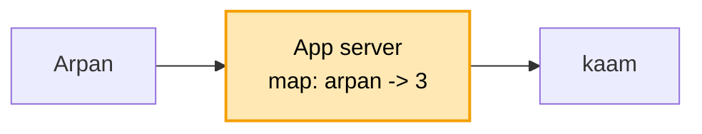
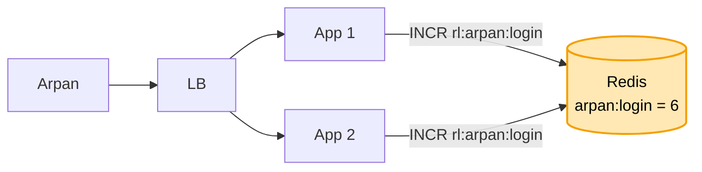
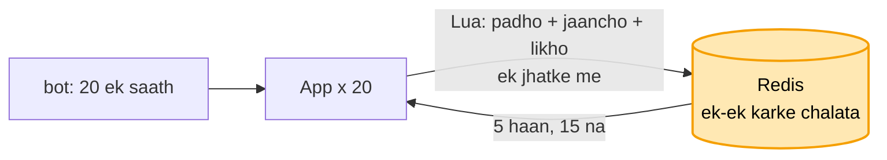

# Rate limiter: shuru se, ek kahani

Kram: **FR -> NFR -> numbers -> design**. Design sabse seedhe dabbe se shuru, har dikkat pe ek dabba judta.
Peela = abhi juda. Kahani ek hi: Arpan ka app, login pe ek bot.

---

## 1. FR: kya karna hai

```
1. har user ki had: login 5 / min, baaki API 100 / min
2. had paar -> 429 (Too Many Requests) + "kitni der baad aao" (Retry-After)
scope ke bahar (poochh ke hatao): plan ke hisaab se alag had (free / pro)
```

## 2. NFR: kaisa chalna chahiye

```
- TEZ           : har request ke aage baitha, ~1 ms me haan / na. Dheema = poori site dheemi
- ginti EK      : 10 server hon, ginti sabki ek hi jagah
- limiter gire to site na gire
```

## 3. Numbers

```
- ~1 crore user, peak ~10,000 request / sec
- har user ke 2 chhote number (kitne bache, aakhri baar kab) -> 1 crore x ~50 byte = ~500 MB
```

Dikkat jagah ki nahi, SPEED ki. 500 MB ek machine ki RAM me aa jaata, isliye aage RAM wala Redis, DB nahi.

---

## 4. Design

### Kadam 1: sabse seedha (server ke andar ginti)

App server ki memory me ek map: `user -> is minute kitni request`.

```
request aayi -> map[arpan]++ -> 5 se zyada? -> 429
                                nahi        -> aage jaane do
minute badla -> map saaf
```



Ek server tak chalta: tez, aur sab ek hi jagah gina ja raha.

Par bheed badhi, 10 App server lage, aage LB. Arpan ki 5 login App 1 pe, 5 App 2 pe. Dono ne alag gina
("5 hi to hain"), 10 andar. Had toot gayi.

### Kadam 2: kai server, ginti ek jagah (Redis)

Ilaaj: ginti sabki EK jagah, **Redis**. Har App har request pe Redis se poochhe.

```
key   = rl:arpan:login          (kaun user + kaunsa kaam)
INCR  -> 1, 2, 3 ...            (Redis me +1, nayi ginti wapas)
umar  = 60 sec (TTL)            -> minute khatam, key khud gayab = ginti reset, safai ka job nahi
6 aayi -> 429
```



Redis kyun, DB kyun nahi? NFR: ~1 ms, 10,000 / sec. DB disk pe, har baar kai ms, site dheemi.
Redis RAM me ~1 ms, aur data sirf 500 MB, RAM me aa jaata.

Par "har minute 5" = ghadi ka minute (10:00 - 10:01). Bot ne 10:00:59 pe 5 bheji, 10:01:00 pe phir 5.
Ek second me 10 andar, kyunki minute badalte hi ginti 0.

### Kadam 3: minute ke kinare pe dugni (kaunsa tareeka gine)

Ab tak ghadi ka minute (**fixed window**): 10:00:59 pe 5 + 10:01:00 pe 5 = ek second me 10.

```
SLIDING LOG     har request ka time likho, nayi aaye to pichhle 60 sec wale gino
                -> sabse sahi, par har request ka time = memory bahut (1 crore user)
SLIDING COUNTER is minute ki ginti + pichhle minute ka bacha hissa (2 number)
                -> lagbhag sahi, sasta
LEAKY BUCKET    request line me, fix raftaar se nikalti (nal se boond)
                -> smooth, par jhatka (burst) nahi nikalne deta
TOKEN BUCKET    baalti me max 5 token, har 12 sec 1 bharta, har request 1 leti, khaali -> 429
                -> ISLIYE YE
```

```
token bucket kyun?  -> sirf 2 number (tokens, aakhri baar) = wahi 500 MB
                    -> jhatka chalta: 1 ghanta baad aaya to 5 ek saath (asli user aise hi)
                    -> kinara nahi: khaali hui to agla token 12 sec baad, minute se reset nahi
                    -> AWS / Stripe yahi
bharta kaun?        -> koi job nahi. Request aane pe hisaab (lazy refill):
                       tokens = min(5, tokens + (abhi - aakhri baar) x raftaar)
                       1 ghanta baad: 300 bante, par baalti 5 ki -> 5
```

Par bot ne ek saath 20 login bheje. 20 App ne ek saath padha "tokens = 5",
sabne socha "bache hain", sabne 1 ghata ke likha.
20 andar, jabki 5 jaane the.

### Kadam 4: 20 ek saath aaye, sab andar (atomic, Lua script)

Har request 3 kaam: padho -> jaancho -> likho. 20 ek saath:

```
App 1:  padha 5 -> "bache hain" -> likha 4
App 2:  padha 5 -> "bache hain" -> likha 4      (App 1 ka likha abhi dikha hi nahi)
...
App 20: padha 5 -> "bache hain" -> likha 4      -> 20 andar, had 5
```

Ilaaj: teeno kaam EK kadam me (**atomic**). Redis me **Lua script**: refill + jaanch + ghatao, ek jhatke me.
Redis ek baar me ek hi command chalata (single thread), script ke beech koi ghus nahi sakta.
20 line me: pehli 5 ko token, baaki 15 ko 429.



```
lock lagao?   -> har request pe lock lo + chhodo = 2 extra chakkar, lock wala atka to sab ruke. 1 ms toota
sirf INCR?    -> atomic hai par sirf ginti. Token bucket me refill phir ghatana = do kaam, isliye Lua
```

Par limiter App ke andar. Bot ki 15 mana wali bhi LB se App tak aayi, App ne Redis poochha, tab 429.
Mana karne me bhi hamare App ka time aur machine kharch.
