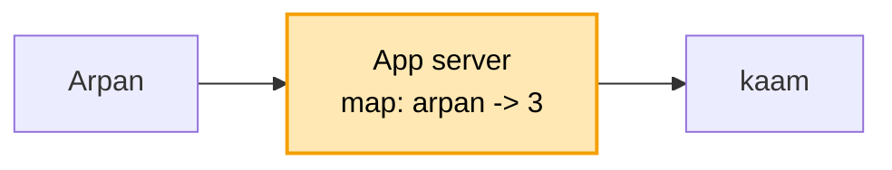

# Rate limiter: shuru se, ek kahani

Kram: **FR -> NFR -> numbers -> design**. Design sabse seedhe dabbe se shuru, har dikkat pe ek dabba judta.
Peela = abhi juda. Kahani ek hi: Arpan ka app, login pe ek bot.

---

## 1. FR: kya karna hai

```
1. har user ki had: login 5 / min, baaki API 100 / min
2. had paar -> 429 (Too Many Requests) + "kitni der baad aao" (Retry-After)
scope ke bahar (poochh ke hatao): plan ke hisaab se alag had (free / pro)
```

## 2. NFR: kaisa chalna chahiye

```
- TEZ           : har request ke aage baitha, ~1 ms me haan / na. Dheema = poori site dheemi
- ginti EK      : 10 server hon, ginti sabki ek hi jagah
- limiter gire to site na gire
```

## 3. Numbers

```
- ~1 crore user, peak ~10,000 request / sec
- har user ke 2 chhote number (kitne bache, aakhri baar kab) -> 1 crore x ~50 byte = ~500 MB
```

Dikkat jagah ki nahi, SPEED ki. 500 MB ek machine ki RAM me aa jaata, isliye aage RAM wala Redis, DB nahi.

---

## 4. Design

### Kadam 1: sabse seedha (server ke andar ginti)

App server ki memory me ek map: `user -> is minute kitni request`.

```
request aayi -> map[arpan]++ -> 5 se zyada? -> 429
                                nahi        -> aage jaane do
minute badla -> map saaf
```



Ek server tak chalta: tez, aur sab ek hi jagah gina ja raha.

Par bheed badhi, 10 App server lage, aage LB. Arpan ki 5 login App 1 pe, 5 App 2 pe. Dono ne alag gina
("5 hi to hain"), 10 andar. Had toot gayi.
