# Twitter Feed

> App kholo -> HOME TIMELINE: jinhe tum follow karte ho unke tweet, sabse naye upar. Tweet daalna (POST) bhi.
> Misaal: Arpan ne app khola -> Virat "Match great" · Sachin "Watching IPL" · Dhoni "Practice".
> Is design ka dil do cheezein hain: **feed padhna sasta ho** (log 50 baar padhte hain, 1 baar likhte hain, isliye feed pehle se bana ke rakho)
> aur **celebrity ka tweet** (10 crore follower).

```
DABBE (poori file me yahi naam):
   Redis inbox = har user ki taiyaar feed      · Fanout service = naya tweet followers ki feed me daale
   Tweet store (Cassandra) = saare tweet       · Tweet service = tweet likhe
   Timeline service = feed padhe               · Follow store = kaun kise follow karta
   Kafka = tweet service se fanout tak khabar
```

---

## KAHANI (ek din, meri feed aur mere tweet; har dikkat se design me ek dabba judta)

```
    KYA HUA                                    ILAAJ                                DABBA JUDA
1   subah app khola, 200 ka jod, feed dheemi -> PUSH: tweet hote hi INBOX me id     Fanout + Redis inbox
2   maine tweet kiya, button 5 sec ghooma    -> KAFKA, fanout peeche                Kafka + Fanout workers
3   Bieber ka tweet = 10 crore inbox         -> HYBRID: aam push, celeb pull        (celeb skip, merge)
4   match khatam, Virat ka tweet, DB gira    -> HOT-TWEET CACHE (RAM)               Hot-tweet cache
5   Redis alert: 50 crore inbox, RAM bhari   -> AAKHRI 800 + soye hue hatao         (inbox chhota)
6   5,000 tweet / sec, 0.5 PB                -> CASSANDRA, user_id se baanto        Cassandra
7   main Bangalore, data US, 300 ms          -> REGION-WISE + Route 53              Route 53
8   akeli App machine giri, sab band         -> STATELESS App x N + ALB             ALB + App x N
9   padhne ki bheed, tweet daalna dheema     -> ALAG SERVICE (likhna/padhna)       Tweet/Timeline/User/Follow
10  maine video daali, sabko dheemi          -> S3 + CDN                            S3 + CDN

POORA DESIGN (upar ke dabbe kram se):
   LIKHNA: Route 53 -> ALB -> Tweet Svc -> Cassandra + Kafka -> Fanout workers -> Redis inbox (celeb skip)
   PADHNA: Timeline Svc -> Redis inbox (push) + Hot-tweet cache (celeb pull) -> milao -> top 50
   follow = User Svc + Follow store · photo / video = S3 + CDN
```

---

## TASVEER (ByteByteGo / Alex Xu · CC BY-NC-ND 4.0)


Source: [Twitter Architecture 2022 vs. 2012](https://bytebytego.com/guides/twitter-architecture-2022-vs-2012/)
(asli Twitter ka naksha: timeline service, fan-out, cache. Ye design uska chhota roop hai.)

---

## SHURU: pehle poocho, phir numbers

```
POOCHO:  "Timeline, post, search, trending, DM, notification — kis
         pe dhyaan? Main home timeline + post pe chalta hoon."
         ~50 crore user maan lun? · celebrity (10 crore follower) sambhalna hai?  <- design yahin mudta hai
         feed bilkul usi second ki chahiye, ya 2 second purani chalegi? (chalegi -> pehle se banana possible)
         photo / video bhi, ya sirf text?

ZAROORI KAAM (FR):   tweet daalo · home timeline (follow kiye logon ke, naye upar) · profile ke tweet
                     bahar: search · trending · DM · notification
KAISA CHALE (NFR):   feed 200 ms se tez · padhna bahut zyada · 50 crore user · 2 second purani feed chalegi

NUMBERS (andaaza):
   50 crore tweet / din -> din me ~1 lakh second -> ~5,000 tweet har second
   ek aadmi ~200 ko follow karta · celeb ke 10 crore follower · padhna : likhna ~50 : 1

NUMBER SE FAISLA:
   50 : 1        -> har baar feed khulne pe jodna mat, PEHLE se bana ke rakho
   celeb         -> ek tweet pe 10 crore jagah likhna? -> asli dikkat
   2 sec chalega -> pehle se banana + cache chal jaayega
```
```
POOCHEGA: "Consistency or availability — which do you pick?"
          (Consistency ya availability, kya chunoge?)

JAWAB:    Feed ke liye: chalta rahe, chahe thoda purana ho.
          Arpan ko 2 second purani feed dikhi to koi farak nahi. Par feed khuli hi nahi to wo app band
          kar dega.
          Isliye network toote to bhi jo hai wo dikhao, sahi wala thodi der me aa jaayega.
```

---

## ════ MOCK SE PEHLE: SIRF YE CARD PADHO ════

> Har card: pehle PEELA DABBA dekho (scene + ilaaj). Yaad aa gaya -> aage. Nahi aaya -> neeche
> DIKKAT / NAHI padho. AAGE POOCHEGA sirf jab interviewer aage kuch poochhe.

#### DABBA 0: SABSE SIMPLE (yahan se shuru, phir "kahan tootega")
```
Do table: tweets (kisne kya likha) + follows (kaun kisko follow karta).
Feed = jinko follow karta unke tweet nikaalo, time se sort karo, upar ke 50 do.
```


#### 1 Subah app khola, feed ghoomti rahi (har baar 200 logon ka jod)
```
DIKKAT     Subah 8 baje maine app khola. Main 200 ko follow karta -> 200 logon ke tweet laao, jodo, sort,
           upar ke 50. Har user ke saath, har baar app kholne pe 200 ka jod -> feed dheemi.
```

```
NAHI       DB pe index / read replica: thoda tez, par har khulne pe 200 ka jod wahi ka wahi.
```
```
AAGE POOCHEGA:
  NIYAM: padhna 50 guna zyada -> mehnat likhte waqt (inbox me tweet_id), app khole to sirf inbox padho;
         jo inbox me nahi (poora tweet, unfollow) wo padhte waqt jodo / chhaanto.
  SAFAR (ek feed khulna, har mod pe kya):
  app khola              -> apna inbox padho (tweet_id list): bana hua, jodna nahi
  id se poora tweet      -> 50 id ek saath cache / store se (batch): ek-ek = 50 chakkar
  kisi ko unfollow kiya  -> padhte waqt follow list se chhaanto: poora inbox badalna mehnga;
                            safai peeche
```

#### 2 Maine tweet kiya, button 5 sec ghoomta raha
```
DIKKAT     9 baje maine tweet kiya (5,000 follower) -> usi request me 5,000 inbox, ~1 ms har -> 5+ sec,
           timeout, "fail" dikha, par tweet DB me ban chuka tha.
```

```
NAHI       App me peeche ek thread: App crash = thread ka kaam gaya; Kafka disk pe, dobara padh sakte.
```
```
AAGE POOCHEGA:
  NIYAM: user ko 'ho gaya' tab jab tweet DB me save; inbox bharna Kafka se peeche, dobara chale to bhi tweet
         ek hi baar dikhe (sorted set); apna tweet apni feed me turant.
  SAFAR (ek tweet daalna, har mod pe kya):
  tweet bheja            -> DB me save -> 'ho gaya'; inbox bharna Kafka se peeche
  DB save, Kafka fail    -> dono ek saath nahi hote: outbox / retry; dobara aaye to sorted set me ek hi
  apni hi feed           -> apna tweet seedha jodo: fanout peeche, apna turant
  worker 60/100 pe gira  -> Kafka ko 'ho gaya' bola hi nahi (commit nahi): khabar phir aayegi
  wahi 60 dobara likhe   -> tweet ek hi baar: sorted set me same tweet_id ek hi rehta
  ek worker kam pade     -> worker badhao, Kafka ki lines (partition) aapas me bat jaati
```

#### 3 Bieber ka ek tweet = 10 crore inbox, line ghanton atki
```
DIKKAT     11 baje Bieber (10 crore follower) ne tweet kiya -> fanout ko 10 crore inbox. Uski Kafka line
           ghanton atki; usi line ke baaki logon ke tweet bhi peeche khade.
```

```
NAHI       sabke liye pull: har feed khulna phir 200 ka jod, mehnga.
```
```
AAGE POOCHEGA:
  NIYAM: likhai ka bojh follower ginti se: aam = push (inbox me), celeb = pull (padhte waqt laao + milao);
         feed hamesha dono ka mel, user ko farak nahi dikhta.
  SAFAR (ek tweet ka fanout, har mod pe kya):
  aam banda tweet kare   -> har follower ke inbox me (push): feed turant
  celeb (10 crore) kare  -> inbox me nahi, padhte waqt laao (pull): likhne ka toofan bacha
  feed khuli             -> inbox + follow kiye celebs ke naye tweet milao (hybrid)
  10,000 ke aas-paas     -> 12,000 upar pull, 8,000 neeche tabhi push: line pe baar-baar na palte
  50 celeb follow kiye   -> celeb ke tweet alag se rakhe, 50 pull bhi sasta
```

#### 4 Match khatam, Virat ka tweet, crore log ek saath, DB gira
```
DIKKAT     Dopahar ka match 4:30 pe khatam, Virat ne tweet kiya. Virat pull pe -> har feed me DB se. Crore log
           ek saath app khole -> crore read DB pe -> DB gira.
```

```
NAHI       DB ki copies badha do: wo bhi disk se (ms), ek garam hisse ki copies crore read nahi jhelti.
```
```
AAGE POOCHEGA:
  NIYAM: garam cheez RAM me, DB tak sirf ek request; ek key = ek machine garam -> copies; badla to key hatao.
  SAFAR (Virat ka ek tweet, har mod pe kya):
  crore log padhein      -> RAM cache se, DB tak sirf ek request
  ek key, machine garam  -> copies tweet:123#1..#5, kisi se padho + App memory 1-2 sec
  Virat ne edit / delete -> cache se key hatao: agla read DB se naya
```

#### 5 Shaam ko Redis alert: 50 crore inbox, RAM bhar rahi
```
DIKKAT     Shaam 5 baje Redis alert: har inbox me saare id, kabhi kaate nahi, soye users ke bhi
           -> RAM bhar rahi.
```

```
NAHI       Redis me machine jodte jao: soye 40 crore ka inbox bhi RAM khaata, kharcha badhta, dikkat wahi.
```
```
AAGE POOCHEGA:
  NIYAM: RAM me sirf id aur sirf zinda log; jo RAM me nahi wo DB se bana lo (ek baar dheema, galat nahi).
  SAFAR (ek inbox RAM me, har mod pe kya):
  naya tweet aaya        -> inbox me sirf number + score (~60-100 byte): poora tweet nahi
  soya user lauta        -> inbox nahi -> pehli baar pull se banao, phir bharo: RAM sirf zinda ki
  800 ke aage scroll     -> wahan se store (DB) se: bahut kam log itna neeche
  Redis gira             -> copy (replica): warna har feed DB se = mehnga
  copy bhi gayi          -> kuch request mana, har inbox ek request, dheere bharo
```

#### 6 DB alert: har second 5,000 tweet, 5 saal me 0.5 PB
```
DIKKAT     6 baje DB alert: har second ~5,000 naye tweet, 5 saal me ~0.5 PB. Ek DB na itna rakh sakta,
           na itna likh sakta.
```

```
NAHI       MySQL: har tweet pe har index disk pe dhoondh ke badalna, dheema; join / transaction chahiye nahi.
```
```
AAGE POOCHEGA:
  NIYAM: jis cheez se padhte (user_id), usi se baanto; likhna sirf aakhir me jodo (tez); 3 copy, 2 me likho
         2 se padho -> naya mil hi jaata.
  SAFAR (ek tweet DB me, har mod pe kya):
  tweet aaya             -> user_id ki machine pe (Cassandra): ek user ke tweet ek jagah
  RAM bhar gayi          -> commit log ke aakhir jodo, badlo nahi; RAM ki nayi file disk pe: likhai tez
  files bahut ho gayi    -> padhna dheema -> peeche milao (compaction) + bloom filter
  meri machine giri      -> 3 copy, 2 me likho, 2 se padho -> naya mil hi jaata (quorum)
  famous, machine garam  -> user_id se baantna phir bhi theek; garam tweet alag RAM cache
  famous ke bahut tweet  -> key me mahina jodo (user_id, mahina): ek machine na bhare
```

#### 7 Main Bangalore me, data US me, har feed 300 ms
```
DIKKAT     Main Bangalore me, saara data aur App US me. Har feed refresh pe request samundar paar US jaati
           aur aati -> sirf raaste me 300 ms, feed har baar atak ke khulti.
```

```
AAGE POOCHEGA:
  NIYAM: data user ke paas wale region me; doosre region ki copy thodi peeche -> region gira to feed thodi
         purani, par chalti.
  SAFAR (meri feed, region ke paar, har mod pe kya):
  feed maangi            -> paas wala region (Route 53 pata deta): 300 ms nahi, tez
  US celeb ka tweet      -> garam tweet India cache me bhi
  main US ghooma         -> request India bhejo, ya paas ki copy se (thoda purana)
  poora region gira      -> Route 53 zinda region pe palte; copy peeche thi -> feed thodi purani
  dono region me likha   -> baad wala jeete (last write wins): tweet aksar naya, takraav kam
```

#### 8 Raat ko har region me ek hi App machine; India wali giri, India band
```
DIKKAT     Raat ko har region me ek hi App machine thi. India wali machine giri -> India ke saare user ke
           liye feed, tweet sab band, jab tak machine wapas na uthe.
```

```
AAGE POOCHEGA:
  NIYAM: machine kuch yaad nahi rakhti (sab Redis / DB me) -> koi bhi gire, jude, badle, user ko farak nahi.
  SAFAR (ek request, har mod pe kya):
  request aayi           -> koi bhi machine (stateless): yaad sab Redis / DB me
  machine giri           -> ALB har ~10 sec 'zinda?': chup = bahar, theek = wapas (Route 53 bhi)
  naya code, App band    -> ek-ek karke nikaalo, daalo, jodo (rolling): baaki bheed sambhaalti
  nayi machine judi      -> pehli request dheemi kam: apna data nahi; ALB dheere traffic de
```

#### 9 Highlights ki bheed ne mera tweet daalna dheema kar diya
```
DIKKAT     Match ke highlights aaye, crore log feed scroll kar rahe. Wahi App machine tweet likhti bhi thi
           -> padhne ki bheed me mera tweet button 10 sec ghooma, likhna dheema.
```

```
AAGE POOCHEGA:
  NIYAM: har kaam alag service -> jiski bheed badhi sirf wahi badhao; ek ka dheema doosre ko nahi rokta.
  SAFAR (ek request, kaunsi service, har mod pe kya):
  POST /tweet            -> ALB path se Tweet Svc; GET /feed -> Timeline Svc
  feed ki bheed badhi    -> sirf Timeline badhao: Tweet Svc pe asar nahi
  feed ko follow list    -> User / Follow store se, par Redis me rakhi: har feed pe chahiye
  Suresh, 5,000 follower -> Follow store se 1000-1000 padh ke inbox likho: ek baar me bhaari
```

#### 10 Maine match ki video daali, sabko dheemi aur mehngi
```
DIKKAT     Maine match ki 50 MB video daali. Har dekhne wala use US ke server se khinchta -> door walon
           ko buffering, aur har baar poori video hamare server se, bandwidth ka bill bhaari.
```

```
AAGE POOCHEGA:
  NIYAM: bhaari maal S3 me, user tak CDN se (paas, sasta); tweet me sirf link -> link badlo = nayi file,
         link pe hastakshar = sirf jisko mila wahi dekhe.
  SAFAR (ek video, har mod pe kya):
  video daali            -> seedha S3 (presigned link), App beech me nahi; tweet me sirf CDN link
  koi dekhe              -> CDN paas se; uske paas nahi -> S3 se laake kuch der rakhe
  photo hatayi, CDN pe dikhe -> CDN ko 'hatao' (invalidation), ya link me version -> nayi file
  private photo          -> link pe hastakshar + expiry (signed URL): sirf jisko mila, thodi der
```

---

## AAKHRI DABBA + WRAP (ek hi baar)

```
LIKHNA: Route 53 -> ALB -> Tweet Svc -> Cassandra me save -> Kafka -> Fanout workers
        -> aam followers ke Redis inbox me sirf tweet number (aakhri 800 rakho), celeb skip
PADHNA: Timeline Svc -> Redis inbox (push) + celebs ke tweet celeb cache se (pull)
        -> milao + sort -> number se poora tweet laao -> upar ke 50 · photo / video S3 me, user tak CDN se
FOLLOW: User Svc + Follow store

DB:  Tweet = Cassandra (bahut zyada, seedha kaam, likhna bahut, user_id + time se baanta)
     Inbox = har user ka Redis sorted set, sirf number (poora tweet 200 jagah copy kiya to RAM phategi)
     Follow store = ek table / Cassandra (followers / following); Neo4j zaroori nahi
```
```
JAWAB:    Likhna: tweet Cassandra me save, aur 'naya tweet' Kafka me. Worker aam followers ke Redis inbox
          me tweet id daalte.
          Padhna: Arpan ka inbox lo, famous logon ke naye tweet alag cache se lo, dono milao, time se
          sort, top 50 bhejo.
          Famous ke liye 'padhte waqt laao', baaki ke liye 'pehle se daal do'. Cassandra user id + time
          se baanta, doosre desh me copy.
          Aage: ML se ranking, trending, search.
```


---

## 10 GUNA TRAFFIC — har dabba alag se

```
Timeline Svc   -> har baar 200 logon ka jodna? -> inbox pehle se bana (ho gaya) · machine badhao
Redis inbox    -> 50 crore inbox -> aakhri 800 + soye hue hatao · cluster + copy
celeb ke read  -> celeb cache 95% · garam key ki kai copy + App ka chhota cache
Cassandra      -> user_id (+ time) se baanta · Bieber ki machine garam -> uska data aur copy
doosre desh    -> region + garam data har region me copy
Kafka          -> partition badhao · fanout workers badhao
IPL final      -> 10 guna: likhai Kafka line me rukti; pata ho to machine + cache pehle garam
ASLI TWITTER   = sab ek saath: user_id se baanta + time ke tukde + region copy + garam data sab jagah cache

POOCHEGA: "Kahan se gir sakta?"       -> har dabbe pe "ye gira to?"
POOCHEGA: "Chal raha, kaise pata?"    -> feed ka time (p99) · galtiyan · Kafka me kitna pending (fanout
                                         peeche?) · alert
```

---

## POOCHE TO (gehra sawaal aaye tab)

```
API:      POST /tweet { content } -> tweetId · GET /feed?limit=50 -> home timeline · GET /user/{id}/tweets

DB:       TWEET  -> Cassandra (bahut zyada, seedha, likhna bahut, user_id se baanta)
          INBOX  -> har user ka Redis SORTED SET (score = time): naya jodo (ZADD, same id dobara = ek hi)
                    padho (ZREVRANGE 0 49) · 800 ke baad kaato (ZREMRANGEBYRANK)
                    sirf number. Poora tweet daala to ek tweet 200 jagah copy, RAM phategi
          FOLLOW -> ek table / Cassandra (followers / following)

SAWAAL:   celeb cache kitna bada? -> chhota: ~5 lakh tweet x 500 byte = ~250 MB, sirf garam
          tweet_id se kyun nahi baanta? -> bojh barabar, par profile ke liye saari machine poochni padti
          Graph DB (Neo4j) chahiye? -> nahi: follow list ek table / Cassandra; Neo4j tab jab 'dost ke dost'
          API bhi CDN se? -> nahi: CDN sirf media ke raaste
          region ka fayda? -> tez · Europe ka data Europe me (GDPR) · har region ki bheed ka time
          alag · ek gira to baaki chalein
          (c3) tweet pe laakhon like? -> ginti 10 tukde (tweet123#0..#9), padhte waqt jodo: ek key ek machine

LIKHNA:   Suresh -> Tweet Svc -> Cassandra me save (tweet_id, user_id, content, time)
                             -> Kafka -> Fanout: followers nikaalo, celeb
                                chhodo, har aam follower ke inbox me tweet_id
PADHNA:   Timeline Svc -> Redis inbox (push) + celebs ke tweet (cache / Cassandra, pull)
                       -> milao + sort -> number se poora tweet -> upar ke 50
```

---

ARCHETYPE A (read-heavy/feed) · CONCEPTS: [caching](../../FOUNDATIONS/04_caching.md) · [sharding](../../FOUNDATIONS/06_database_sharding.md) · [replication](../../FOUNDATIONS/05_database_replication.md) · [← MASTER SHEET](../../00_MASTER_SHEET.md)
