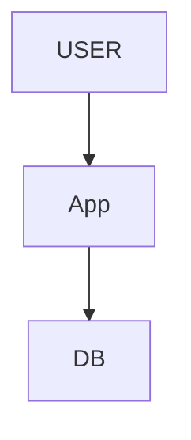
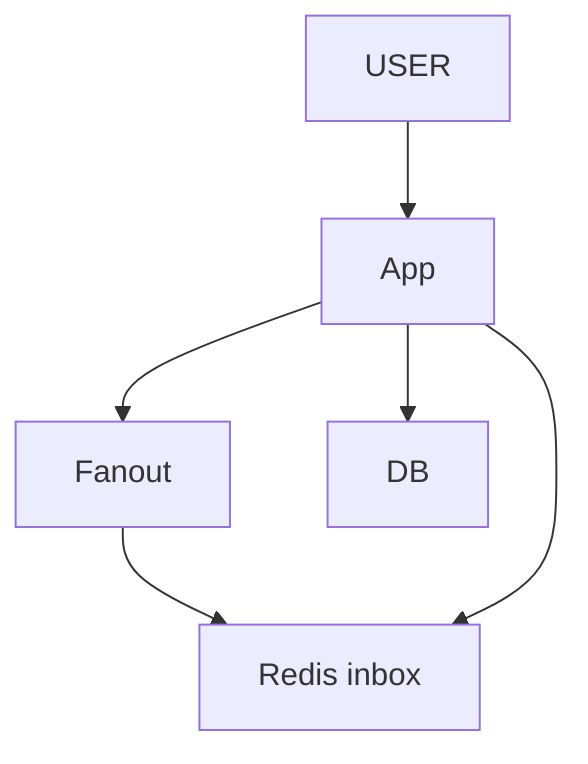
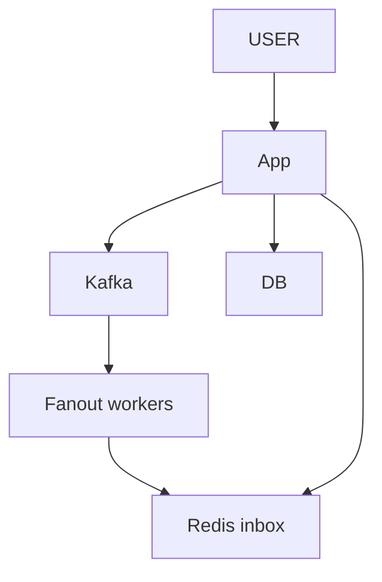
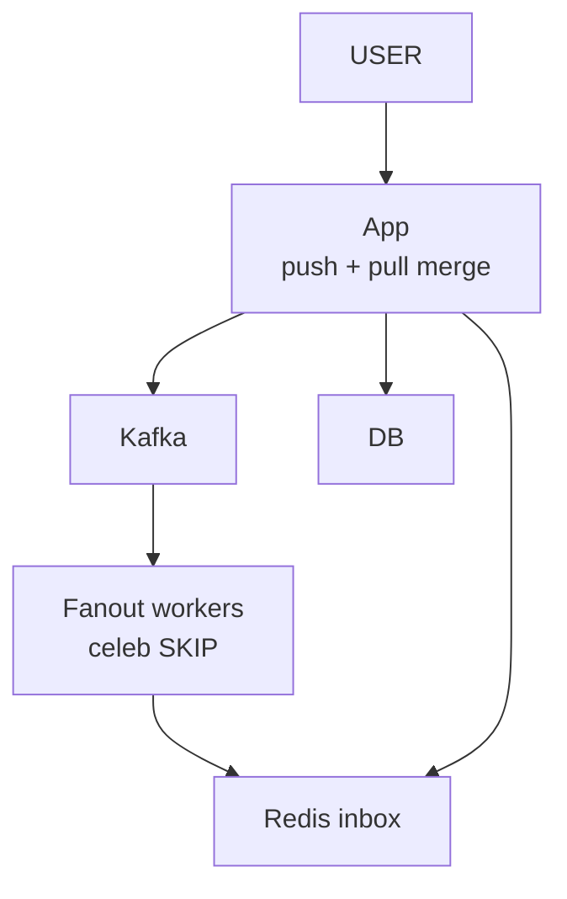
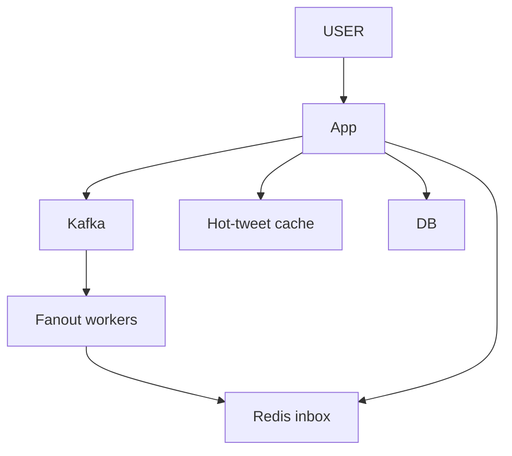
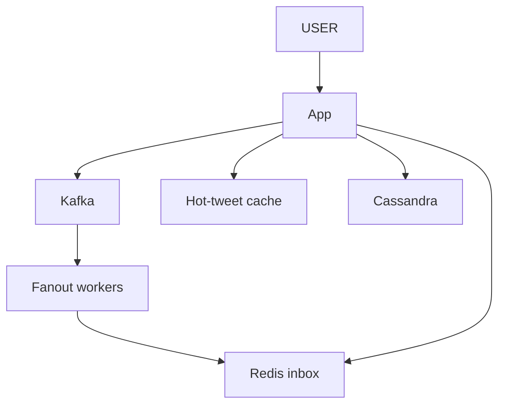
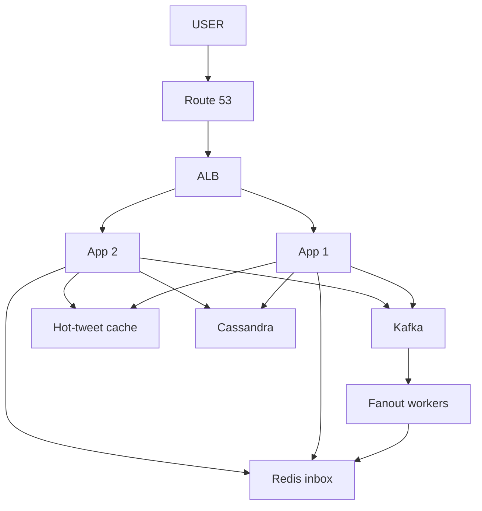
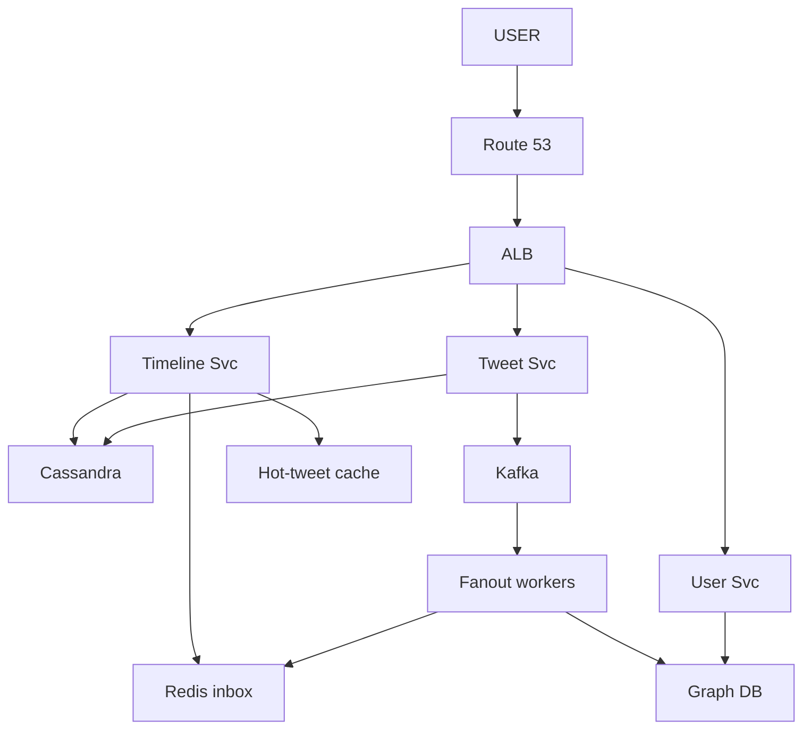
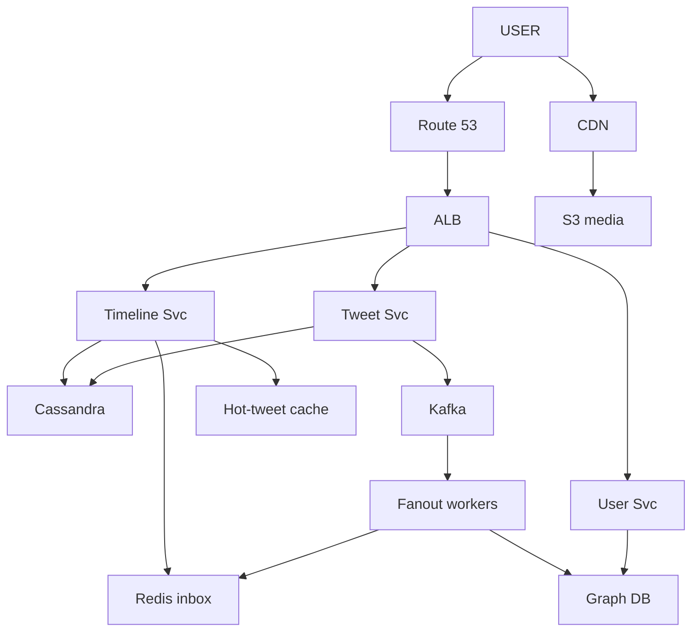

# Twitter Feed

> App kholo -> HOME TIMELINE: jinhe tum follow karte ho unke tweet, sabse naye upar. Tweet daalna (POST) bhi.
> Misaal: Arpan ne app khola -> Virat "Match great" · Sachin "Watching IPL" · Dhoni "Practice".
> Is design ka dil do cheezein hain: **feed padhna sasta ho** (log 50 baar padhte hain, 1 baar likhte hain, isliye feed pehle se bana ke rakho)
> aur **celebrity ka tweet** (10 crore follower).

```
RAJA KA RAJYA (poori file isi se yaad rakho):
   har aadmi ka apna notice board = Redis inbox      · dhindhora peetne wala = Fanout service
   mahal ka bada register         = tweet store (Cassandra) · likhne wala munshi = Tweet service
   akhbaar padhne wala            = Timeline service  · kaun kiska chela register = Graph DB
   akhbaar ka truck               = Kafka
```

---

## TASVEER (ByteByteGo / Alex Xu · CC BY-NC-ND 4.0)


Source: [Twitter Architecture 2022 vs. 2012](https://bytebytego.com/guides/twitter-architecture-2022-vs-2012/)
(asli Twitter ka naksha: timeline service, fan-out, cache. Ye design uska chhota roop hai.)

---

## SHURU: pehle poocho, phir numbers

```
POOCHO:  "Timeline, post, search, trending, DM, notification — kis
         pe dhyaan? Main home timeline + post pe chalta hoon."
         ~50 crore user maan lun? · celebrity (10 crore follower) sambhalna hai?  <- design yahin mudta hai
         feed bilkul usi second ki chahiye, ya 2 second purani chalegi? (chalegi -> pehle se banana possible)
         photo / video bhi, ya sirf text?

ZAROORI KAAM (FR):   tweet daalo · home timeline (follow kiye logon ke, naye upar) · profile ke tweet
                     bahar: search · trending · DM · notification
KAISA CHALE (NFR):   feed 200 ms se tez · padhna bahut zyada · 50 crore user · 2 second purani feed chalegi

NUMBERS (andaaza):
   50 crore tweet / din -> din me ~1 lakh second -> ~5,800 tweet har second
   ek aadmi ~200 ko follow karta · celeb ke 10 crore follower · padhna : likhna ~50 : 1

NUMBER SE FAISLA:
   50 : 1        -> har baar feed khulne pe jodna mat, PEHLE se bana ke rakho
   celeb         -> ek tweet pe 10 crore jagah likhna? -> asli dikkat
   2 sec chalega -> pehle se banana + cache chal jaayega
```
```
POOCHEGA: "Consistency or availability — which do you pick?"
          (Consistency ya availability, kya chunoge?)

JAWAB:    Feed ke liye: chalta rahe, chahe thoda purana ho.
          Arpan ko 2 second purani feed dikhi to koi farak nahi. Par feed khuli hi nahi to wo app band
          kar dega.
          Isliye network toote to bhi jo hai wo dikhao, sahi wala thodi der me aa jaayega.
```

---

## ════ MOCK SE PEHLE: SIRF YE CARD PADHO ════

> Har card: DIKKAT 1 (kya toota) -> HAL (kya kiya) -> diagram -> DIKKAT 2, 3 ... (interviewer ke
> agle sawaal) har ek ke neeche uska HAL. Revise: sirf baayein column padho.

#### DABBA 0: SABSE SIMPLE (yahan se shuru, phir "kahan tootega")
```
Do table: tweets (kisne kya likha) + follows (kaun kisko follow karta).
Feed = jinko follow karta unke tweet nikaalo, time se sort karo, upar ke 50 do.
```


#### 1 HAR BAAR APP KHOLNE PE 200 LOGON KA DATA JODNA
```
DIKKAT 1   Arpan 200 logon ko follow karta hai. Usne app khola -> App ko 200 logon ke tweet laane pade,
           jodne pade, time se sort karne pade, phir upar ke 50.
           Aur ye har user ke saath, har baar app kholne pe.
           Log 50 baar padhte hain, 1 baar likhte hain -> feed dheemi.
HAL        Log feed padhte zyada hain, tweet kam karte hain (50 baar padhna, 1 baar likhna).
           Isliye feed padhte waqt nahi banate, tweet hote hi bana dete hain: Virat ne tweet kiya to uski
           tweet id har follower ke Redis inbox (sorted set) me daal do.
           Arpan ne app khola to bas uska inbox padho aur un id ke tweet ek saath le aao. Kaam
           pehle ho chuka, khulna turant.
           Virat ne tweet kiya -> Fanout service Virat ke har follower ke inbox me us tweet
           ka number (tweet_id) daalti hai.
           Arpan ka inbox = [t9, t7, t3, ...]. Sirf number, poora tweet nahi.
           Inbox = Redis SORTED SET: tweet_id, score = tweet ka time. Same id dobara aaye to ek hi rehta.
           Tweet ek baar likha jaata hai aur 50 baar padha jaata hai -> mehnat likhte waqt karo, padhna sasta.
```

```
DIKKAT 2   Inbox me sirf number hai, poora tweet kahan se aayega?
HAL        50 number ek saath, ek hi chakkar me tweet store / cache se mangao (batch). Ek-ek karke nahi.

DIKKAT 3   Arpan ne kisi ko unfollow kiya, uske tweet inbox me pade hain?
HAL        Padhte waqt follow list se chhaan do, ya peeche se saaf karo. Turant poora inbox nahi badalte.

DIKKAT 4   Arpan ne khud tweet kiya, apni feed me nahi dikha?
HAL        Fanout peeche chal raha hai. Apna tweet seedha apni feed me jod do. Ye
           bug nahi, aisa hi banate hain.
```

#### 2 TWEET BUTTON 3 SEC GHOOMTA RAHA
```
DIKKAT 1   Arpan ne tweet dabaya. Usi request me 200 followers ke inbox likhe ja rahe the
           -> button 3 second ghoomta raha.
           Ek din Redis dheema tha -> tweet ban chuka tha, par user ko "fail" dikha.
HAL        Tweet DB me save karo + ek khabar KAFKA me daalo -> user ko turant "ho gaya".
           FANOUT WORKERS peeche se Kafka padh ke inbox bharte rahein.
           Kafka me khabar author ke naam (author_id) ke hisaab se jaati hai -> ek aadmi
           ke tweet ek hi line me, kram se.
           Kai worker ye lines aapas me baant lete hain. Worker gira -> khabar
           Kafka me padi hai, wahin se dobara.
```

```
DIKKAT 2   Worker 100 me se 60 inbox likh ke gir gaya?
HAL        Kafka ko "ho gaya" nahi bola tha -> khabar dobara aayegi, phir se likhega.
           Ek tweet do baar inbox me na aaye: inbox ko aisa set rakho jisme ek number ek hi baar aa sake
           (Redis sorted set: same tweet_id dobara daalo to ek hi rehta, time ke hisaab se sajta).

DIKKAT 3   Kafka kyun, App me peeche ek thread chala do?
HAL        App crash = thread ka kaam gaya. Kafka disk pe hai, dobara padh sakte hain.
```

#### 3 BIEBER = 10 CRORE INBOX (CELEBRITY)
```
DIKKAT 1   Bieber ke 10 crore follower hain. Usne ek tweet kiya -> fanout ko 10 crore inbox me likhna pada.
           Fanout atak gaya, aur uske peeche baaki sabke tweet bhi atak gaye.
HAL        Aam log (jinke kam follower): tweet aate hi followers ke inbox me daal do (push).
           Bieber jaise famous: 10 crore inbox me mat daalo. Jab Arpan feed khole, Bieber ke naye tweet alag
           se laake uske inbox ke saath mila do (pull).
           Ise HYBRID kehte hain: aam ke liye push, famous ke liye pull.
           10,000 se kam follower = push, zyada = pull.
           Arpan ki feed: dost Suresh ke tweet inbox se, Virat ke tweet celeb cache se.
           Milana Timeline service me: inbox ke 50 + 10-20 celebs ke naye tweet -> sort. Chhota kaam.
```

```
DIKKAT 2   Koi 9,999 aur 10,001 ke beech baar-baar palat raha?
HAL        Beech me jagah chhodo: 12,000 se upar gaya to pull, 8,000 se neeche aaye tabhi wapas push.

DIKKAT 3   Celeb ko alag server do, ya user_id pe baantna hi galat hai?
HAL        Nahi. Baantna baaki crore logon ke liye theek hai. Dikkat sirf EK bahut garam aadmi ki hai, aur
           consistent hashing ek garam key ko nahi bachata.

DIKKAT 4   Like ki ginti jaisa garam LIKHNA (ek tweet pe laakhon like)?
HAL        Ginti ko 10 tukdon me baant do (tweet123#0 se #9), har like kisi ek tukde me, padhte waqt sab jodo.
```

#### 4 VIRAT KA TWEET CRORE LOG EK SAATH PADH RAHE
```
DIKKAT 1   Virat pull pe hai, to uska tweet har feed me DB se aata hai.
           Match khatam, Virat ne tweet kiya, crore log ek saath app khole -> crore
           read seedha DB pe -> DB gir gaya.
HAL        HOT-TWEET CACHE: celebs ke naye tweet RAM me rakho (~1 ghanta), sab wahin
           se padhein. Purane tweet DB se.
           Jaise dukaan me bestseller kitaab godown me nahi, counter pe rakhte hain.
           ~100 me se 95 read cache se.
           Cache me nahi mila -> sirf EK request DB jaaye (taala), baaki ruk ke wahi jawab le lein.
```

```
DIKKAT 2   Ek hi tweet ki key ek Redis machine pe, wo machine garam?
HAL        Us tweet ki 5 copy rakho (tweet:123#1 se #5), har read kisi bhi copy se.
           Saath me App ki apni memory me 1-2 second ka chhota cache.

DIKKAT 3   Virat ne tweet edit / delete kiya?
HAL        Cache se wo key hatao, agla read DB se naya laayega.

DIKKAT 4   Cassandra ki copies badha do?
HAL        Wo bhi disk se padhti hain (ms), aur ek garam hisse ki copies crore read nahi
           jhel paati. Cache RAM (<1 ms).

DIKKAT 5   IPL final me achanak 10 guna?
HAL        Fanout ka toofan Kafka pakad leta hai. Pata ho kab aayega -> pehle se
           machine badhao aur cache garam karo.
```

#### 5 50 CRORE INBOX, MEMORY PHATEGI
```
DIKKAT 1   Har user ka poora feed Redis (RAM) me rakha -> 50 crore user, RAM bhar jaayegi.
HAL        Inbox me SIRF tweet ka number, aur sirf aakhri ~800. Purane kaat do.
           Jo mahine bhar se nahi aaya, uska inbox hata do.
           Ek number 8 byte, 800 number = ~6.4 KB ek user ka. 50 crore x 6.4 KB
           = ~3.2 TB -> kai Redis machine.
           Celeb cache chhota hai: ~5 lakh tweet x 500 byte = ~250 MB.
```

```
DIKKAT 2   Mahino baad koi wapas aaya, uska inbox to hai hi nahi?
HAL        Pehli baar feed purane tareeke se (pull) bana do, phir inbox bhar do. Ek baar dheema, phir tez.

DIKKAT 3   Koi 800 ke aage scroll kar raha?
HAL        Wahan se DB se lao. Bahut kam log itna neeche jaate hain.

DIKKAT 4   Redis hi gir gaya?
HAL        Har feed DB se banana padega, bahut mehnga. Isliye Redis ki copies.
           Phir bhi gira -> kuch request mana karo, har inbox ko ek hi request
           banaye, dheere-dheere wapas bharo.
```

#### 6 SAARE TWEET EK DB ME NAHI
```
DIKKAT 1   Har second ~5,800 naye tweet, saalon ka data petabytes me. Ek DB na itna
           rakh sakta, na itna likh sakta.
HAL        User id ke hisaab se baanto: Arpan ke saare tweet ek hi jagah, to Arpan ki
           profile ek jagah se khul jaati.
           Famous banda ho to uska data ek jagah bahut bhaari: key me time bhi jod do (user + mahina), taaki
           uske tweet alag jagah bat jaayein. Uske tweet padhne ke liye copy bhi.
           Cassandra likhne me tez kyun: naya tweet pehle ek diary (commit log) ke aakhir me jodta hai aur
           RAM me rakhta hai -> "ho gaya". Kuch purana dhoondh ke badalna nahi padta.
           RAM bhari -> ek nayi file disk pe. Peeche chhoti files mila ke badi bana leta hai.
           (user_id + mahina) se tay hota hai kaunsi machine, aur andar tweet
           time se ulte kram me (naya pehle).
```

```
DIKKAT 2   MySQL kyun nahi?
HAL        MySQL me har tweet ke saath har index (user_id, time...) bhi disk pe sahi jagah dhoondh ke
           badalna padta (idhar-udhar likhna). Itne likhne pe dheema.
           Aur yahan join / transaction ki zaroorat hi nahi.

DIKKAT 3   Cassandra me padhna dheema kab hota hai?
HAL        Ek user ka data kai chhoti files me bikhra ho to sab dekhni padti hain.
           Peeche files milana (compaction) + "is file me hai ya nahi" ka jaldi
           check (bloom filter) se kam hota.

DIKKAT 4   tweet_id pe kyun nahi baanta?
HAL        Bojh barabar ho jaata, par profile page (ek aadmi ke saare tweet) ke
           liye saari machine poochni padti.

DIKKAT 5   Cassandra me padhne / likhne ki alag copy hoti hai?
HAL        Nahi, koi main copy nahi. Har copy padh bhi sakti, likh bhi. Bolo: "3
           copy, 2 me likho, 2 se padho".
```

#### 7 INDIA USER, US SE PADH RAHA (200 MS)
```
DIKKAT 1   Arpan Bangalore me hai, par data US me. Har request US jaati hai -> 200 ms. Paas se hota to 5 ms.
HAL        Region-wise rakho (India / Europe / US). User paas wale region se baat kare.
           Route 53 user ko paas wale region ka pata deta hai.
           Cassandra ek region ka likha hua doosre regions me thoda baad copy kar deta hai.
           US celebs ke garam tweet India ke cache me bhi.
           Fayde: tez · Europe ka data Europe me (GDPR) · har region
                  ka bheed ka time alag · ek gira to baaki chalein.
```

```
DIKKAT 2   Arpan US ghoomne gaya?
HAL        Uska data India me. Request India bhejo, ya paas wali copy se padh lo (thoda purana chalega).

DIKKAT 3   Poora region gira?
HAL        Route 53 paas wale zinda region pe bhejta. Copy thodi peeche thi -> feed thodi
           purani. Ye pehle hi maana tha.

DIKKAT 4   Do region me ek hi cheez ek saath likhi gayi?
HAL        Tweet aksar naya hi banta hai, badalta kam. Takraav ho to jiska time baad
           ka, wo jeeta (last write wins).
```

#### 8 EK APP BOX: BOJH BHI, SPOF BHI
```
DIKKAT 1   Sab kuch ek App machine pe. Laakhon log nahi jhelta, aur wahi gira to sab band (SPOF).
HAL        App server kuch yaad nahi rakhte, koi bhi request kahin bhi jaa sakti. Aage load balancer har
           server se 'zinda ho?' poochhta rehta, mara hua list se bahar.
           Naya code ek-ek server pe daalte, sab ek saath nahi, to site kabhi band nahi hoti.
           ALB har ~10 second har machine se poochta "zinda?" -> jawab nahi = bahar, theek = wapas.
           Route 53 isi tarah region / ALB ko dekhta hai.
```

```
DIKKAT 2   Naya code daalna hai, saari machine restart?
HAL        Ek-ek karke: ek nikaalo, naya daalo, wapas jodo (rolling deploy). Site kabhi band nahi.

DIKKAT 3   Nayi machine judi, pehli request dheemi?
HAL        Machine me apna data nahi (sab Redis me), to farak kam. ALB nayi
           machine ko dheere-dheere traffic de.
```

#### 9 PADHNA AUR LIKHNA EK HI BOX ME
```
DIKKAT 1   Feed padhne wale laakhon, tweet likhne wale hazaron. Dono ek hi service me.
           Padhne ki bheed ne tweet daalna bhi dheema kar diya.
HAL        Kaam alag-alag service me: tweet likhne wali, feed padhne wali, user wali, aur
           'kaun kisko follow karta' wali.
           Padhna 50 guna zyada hai, to sirf feed wali service ki machines bahut zyada rakho, baaki kam.
           Follow list Redis me, baar-baar chahiye hoti hai.
           Gateway raasta dekh ke bhejta: POST /tweet -> Tweet Svc · GET /feed -> Timeline Svc.
           Dono ki apni machines, apna LB, apna autoscale. Feed ki bheed badhi -> sirf Timeline ki machine
           badhti, Tweet Svc pe koi asar nahi.
```

```
DIKKAT 2   Timeline ko "Arpan kisko follow karta" kahan se pata?
HAL        Graph / User service se, par har baar call nahi. Follow list Redis me cache.

DIKKAT 3   Fanout ko 10,000 followers ki list kaise milegi?
HAL        Graph store se 1000-1000 ke panne me padh ke inbox likho.

DIKKAT 4   Graph DB (Neo4j) zaroori hai?
HAL        Seedhi follow list ke liye ek table / Cassandra kaafi.
           Graph DB tab jab "dost ke dost" jaise sawaal hon.
```

#### 10 PHOTO / VIDEO BHAARI
```
DIKKAT 1   Photo / video duniya bhar se, har baar hamare server se jaa rahi hain -> dheema bhi, mehnga bhi.
HAL        Photo / video S3 me rakho, user tak CDN se pahunche (uske paas wale server se,
           tez). Tweet me sirf uska link.
           Photo delete ki to CDN se bhi hatwao, ya link me version badal do. Private photo ke liye link
           jo kuch minute me band ho jaaye.
           Tweet me photo ka CDN wala link. CDN ke paas hai -> wahin se. Nahi hai -> CDN S3 se laata hai,
           kuch der rakhta hai, phir sabko wahin se deta hai.
           CDN sirf photo / video ke raaste pe hai, API ke nahi.
```

```
DIKKAT 2   Photo delete ki, CDN pe abhi bhi dikh rahi?
HAL        CDN ko "ye hatao" bolo (invalidation), ya link me version daalo
           (abc_v2.jpg) -> naya link = nayi file.

DIKKAT 3   Private photo CDN se sabko dikh jaayegi?
HAL        Link pe hastakshar aur expiry (signed URL): sirf jisko link mila, thodi der ke liye.
```

#### PUSH YA PULL? (end me pakka poochega)
```
PUSH (likhte waqt sabke inbox me): feed turant khulti, par celeb ke tweet pe likhne ka toofan.
PULL (padhte waqt jodo):           likhna sasta, par har feed khulna mehnga.
HYBRID: aam log push, celeb pull, padhte waqt dono milao. Consistency
        ya availability -> availability (2 second purani feed chalegi).
```

```
AAKHRI DABBE (sab dikkat ke baad):
  LIKHNA: Route 53 -> ALB -> Tweet Svc -> Cassandra me save -> Kafka -> Fanout workers
          -> aam followers ke Redis inbox me sirf tweet number (aakhri 800 rakho), celeb skip
  PADHNA: Timeline Svc -> Redis inbox (push) + celebs ke tweet celeb cache se (pull)
          -> milao + sort -> number se poora tweet laao -> upar ke 50 · photo / video S3 me, user tak CDN se
  FOLLOW: User Svc + Graph DB

DB:  Tweet = Cassandra (bahut zyada, seedha kaam, likhna bahut, user_id + time se baanta)
     Inbox = har user ka Redis sorted set, sirf number (poora tweet 200 jagah copy kiya to RAM phategi)
     Graph = Neo4j ya Cassandra (followers / following)

END ME POOCHEGA:
  "Push ya pull?"     -> HYBRID: aam push, celeb pull, padhte waqt milao
  "10 guna?"          -> inbox pehle se + aakhri 800 + soye hue hatao · celeb
  cache + App ka chhota cache · Cassandra baanto + region · Kafka partition
  "Kahan se gir sakta?" -> har dabbe pe "ye gira to?"
  "Chal raha, kaise pata?" -> feed ka time (p99) · galtiyan · Kafka me kitna pending (fanout peeche?) · alert
```

AAKHRI DABBE ki tasveer:


---

## 10 GUNA TRAFFIC — har dabba alag se

```
Timeline Svc   -> har baar 200 logon ka jodna? -> inbox pehle se bana (ho gaya) · machine badhao
Redis inbox    -> 50 crore inbox -> aakhri 800 + soye hue hatao · cluster + copy
celeb ke read  -> celeb cache 95% · garam key ki kai copy + App ka chhota cache
Cassandra      -> user_id (+ time) se baanta · Bieber ki machine garam -> uska data aur copy
doosre desh    -> region + garam data har region me copy
Kafka          -> partition badhao · fanout workers badhao
ASLI TWITTER   = sab ek saath: user_id se baanta + time ke tukde + region copy + garam data sab jagah cache
```

---

## POOCHE TO (gehra sawaal aaye tab)

```
API:      POST /tweet { content } -> tweetId · GET /feed?limit=50 -> home timeline · GET /user/{id}/tweets

DB:       TWEET  -> Cassandra (bahut zyada, seedha, likhna bahut, user_id se baanta)
          INBOX  -> har user ka Redis SORTED SET (score = time): naya jodo (ZADD, same id dobara = ek hi)
                    padho (ZREVRANGE 0 49) · 800 ke baad kaato (ZREMRANGEBYRANK)
                    sirf number. Poora tweet daala to ek tweet 200 jagah copy, RAM phategi
          GRAPH  -> Neo4j ya Cassandra (followers / following)

LIKHNA:   Virat -> Tweet Svc -> Cassandra me save (tweet_id, user_id, content, time)
                             -> Kafka -> Fanout: followers nikaalo, celeb
                                chhodo, har aam follower ke inbox me tweet_id
PADHNA:   Timeline Svc -> Redis inbox (push) + celebs ke tweet (cache / Cassandra, pull)
                       -> milao + sort -> number se poora tweet -> upar ke 50
```

---

## AAKHRI DABBA + WRAP

```
Route 53 = kaunsa region zinda · CDN = photo / video · ALB · Tweet Svc = likhna · Kafka = fanout peeche se
Fanout workers = aam logon ke inbox, celeb chhodo · Redis
inbox = sirf number, aakhri 800 · celeb cache = celeb ke read
Timeline Svc = push + pull milao · Cassandra = saare tweet,
user_id + time + region · User Svc + Graph DB = follow
```
```
JAWAB:    Likhna: tweet Cassandra me save, aur 'naya tweet' Kafka me. Worker aam followers ke Redis inbox
          me tweet id daalte.
          Padhna: Arpan ka inbox lo, famous logon ke naye tweet alag cache se lo, dono milao, time se
          sort, top 50 bhejo.
          Famous ke liye 'padhte waqt laao', baaki ke liye 'pehle se daal do'. Cassandra user id + time
          se baanta, doosre desh me copy.
          Aage: ML se ranking, trending, search.
```


ARCHETYPE A (read-heavy/feed) · CONCEPTS: [caching](../../FOUNDATIONS/04_caching.md) · [sharding](../../FOUNDATIONS/06_database_sharding.md) · [replication](../../FOUNDATIONS/05_database_replication.md) · [← MASTER SHEET](../../00_MASTER_SHEET.md)
