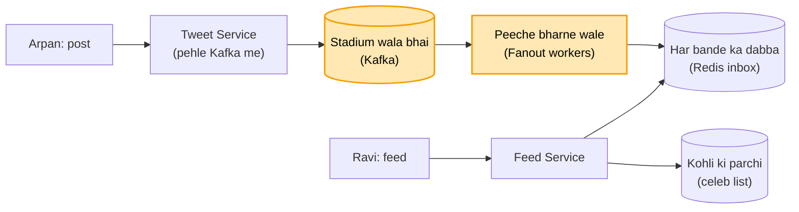
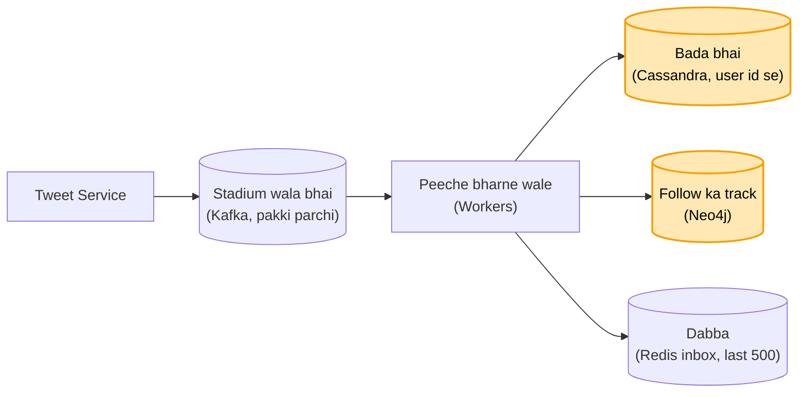
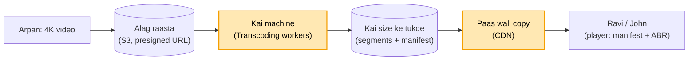

# Twitter feed: Arpan, Ravi aur King Kohli ki kahani

Arpan ne tweet kiya "aaj ka mock 5/5". Ravi Arpan ko follow karta hai, aur King Kohli ko bhi (27 crore followers).
Kaam: Ravi app khole to home feed pe sabke naye tweet, naye pehle, turant; Kohli ka tweet bhi, aur stadium se aaya
video bhi har net pe chale.

Har kadam = **kahani** (dikkat aur hal, bolne wali bhasha) -> **Asli naam** (interview me yahi shabd) -> tasveer
(kahani ka shabd, bracket me asli naam).

---

## FR / NFR / Numbers (interview me pehle 2 minute)

```
FR      tweet post (text, photo / video) · home feed: jinko follow karta unke naye tweet, naye upar
NFR     feed ~200 ms me · 2-5 sec purani chalegi (isliye pehle se bana sakte) · 27 crore wale celeb ka tweet bhi sambhle
Numbers ~50 crore user, 50 crore tweet / din = ~5,000 / sec · ek aadmi ~500 ko follow · shaam 8 baje 5 crore ek saath
        -> padhna : likhna ~50 : 1, isliye feed pehle se taiyaar rakho
```

---

## 1. Feed 6-7 second ghoome (har bande ka taiyaar dabba)

Ravi app khole to server dhoondhe wo kis-kis ko follow karta (500 log), sabke tweet DB se nikaale, milaye, sort kare.
Shaam 8 baje 5 crore log ek saath, feed 6-7 second ghoome, DB hil jaaye. Baar-baar DB jaana padta. Mere 10 dost hain,
roz apna hisaab maang rahe, har baar unke paas kyun jaun jab roz yahi karna hai? Main kahunga: tum idhar aao, apna
mujhe de do, main apne paas rakhunga aur apne paas se bhej dunga. Unhone app khola, turant mila, mote register me nahi
jaana pada.

**Asli naam:** apne paas rakhunga = har user ka pehle se bana inbox (Redis sorted set, naya upar), dost apna mujhe de do
= tweet aate hi followers ke inbox me (fanout on write), dobara DB hit nahi = feed seedha inbox se.

## 2. Kohli ke 27 crore dabbe (Kohli ki ek parchi + sab milake sort)

Kohli ne tweet kiya "Century for India". 27 crore dabbon me daalna, ghanton lagte, Ravi ko 2 ghante baad dikha, match
khatam, aur baaki sabke tweet bhi line me atke. Kal 28 crore, 29 crore, dikkat nahi rukegi. 100-200, 2,000-3,000 ke
liye dabba theek, 27 crore pe system thak jaayega. To Kohli ki century ek chhoti parchi pe likh di, 27 crore yahin se
padh lenge. Par Ravi ke dabbe me doston ke tweet, aur Kohli, Dhoni, SRK ki parchiyan alag, aur use ek hi feed chahiye.
To sabko ek saath lao aur sort karo jaise DSA me karte: "le Ravi, ye tera aaj ka poora samachar."

**Asli naam:** 27 crore dabbe = fanout on write (celeb pe nahi chalta), followers ki had se do raaste, ek chhoti parchi
= celeb ka tweet uski apni list me, feed khulne pe wahan se (fanout on read). Dono saath = hybrid fanout. Sab milake
sort = merge at read (inbox + follow kiye celeb ki list, time se).

## 3. Arpan ke 8,000 followers, "Post" ghoomta rahe (had + stadium wala bhai)

Arpan ke 8,000 followers, abhi bhi chhota user. "Post" dabaya, server ek-ek karke 8,000 dabbe bhar raha, button
ghoomta rahe. 3,000 pe server gira, baaki 5,000 ko kabhi nahi mila, Arpan ko pata bhi nahi. Sabse pehle ek threshold
rakho: itne followers paar gaye to dabbe me push nahi, Kohli wala tareeka. Aur bheed sambhalne ke liye beech me mera
favourite stadium wala bhai Kafka. Maine post dabaya to "tera post ho gaya, nikal", peeche Kafka sab karta rahega. Kuch
gira to outbox me ek parchi pe likha hai. Wo dabba gira to replica hai, copiyan hain.

**Asli naam:** threshold = had ke upar celeb raasta, stadium wala bhai = Kafka (async fanout, peeche fanout workers),
post ho gaya, nikal = turant OK, parchi pe likha = outbox ki soch; yahan Kafka hi pakki parchi: Tweet Service pehle
Kafka me daale (acks=all), peeche workers tweet Cassandra me aur inbox me likhein. Dabba gira to = Kafka ki copy (replica).



## 4. Six ke baad 5 crore ek parchi pe (parchi ki 10-15 copy)

Kohli ne 99 se six maara aur tweet kiya. 1 minute me 5 crore log refresh, sabko wahi ek parchi chahiye. Wo parchi ek
machine pe, wo machine hil gayi, Dhoni-SRK ki parchiyan bhi atki. Us waqt wo cheez famous ho gayi to log aayenge hi.
Main dekh raha lakhon log is parchi ko padhne aa rahe, to iski 10-15 copy bana dunga, alag-alag machine pe: le tu bhi
ye copy le, sabko padhwa. Bheed badh rahi to baant do, clone kar do.

**Asli naam:** famous parchi = hot key, 10-15 copy alag machine pe = key ki replicas, padhai unme bant-ti.

**Maan lo Kohli ne "Inida" likh ke 10 second me "India" kar diya, kuch copies purana dikha rahi:** thodi der galat
dikhega na. Peeche ek ladka laga do, wo jaldi-jaldi sabko theek information pass kar dega, kuch second lagenge. System
rok nahi sakte, ye nahi keh sakte ki nahi dekhne denge.
**Asli naam:** thodi der galat = eventual consistency, peeche ladka = background job copies update kare.

## 5. Memory ka bill aasmaan pe (aakhri 500 + 30 din wala)

Har account ka dabba memory me, Ravi ke dabbe me 3 saal ke tweet, aur 30 crore log mahino se app nahi khol rahe, par
unke dabbe bhi roz bhar rahe. To parchi chhoti karo: bas last 500, itna koi scroll nahi karta, karega to DB se laake
Redis me rakh denge. 3-4 saal purana alag permanent diary me. Aur jo 30 din se aa hi nahi rahe, unki parchi taiyaar
karna bekaar ki mehnat, to kuch taiyaar nahi. 40 din baad aaya to "thodi der ruk, 2 second me teri parchi la raha", DB
se laake Redis me daal denge.

**Asli naam:** last 500 = inbox ki had (trim), DB se laake = cache miss pe DB, permanent diary = purana data S3
(archive), 30 din wala = inactive user ka inbox nahi banta, lautne pe DB se Redis me = on-demand inbox.

## 6. Din me 50 crore tweet, SQL hil gaya (bada bhai Cassandra + follow ka Neo4j)

Saare tweet ek SQL DB me, din me 50 crore naye, likhne ki line itni lambi ki machine hile, aur har baar "Arpan ke naye
500" poori table me dhoondhna. Likhai bahut hai to mera bada bhai Cassandra: "bhai, mera system bahut likh raha, tu
dekh le", replica bhi wo khud kar leta. Kaun kisko follow kar raha, uske liye ek aur bada bhai Neo4j: "iska track
rakhna." Aur Arpan ke saare tweet ek jagah: naam se todo to doosra Arpan bhi ho sakta, to id se baanto, meri id har baar
same, to mera saara data ek jagah.

**Asli naam:** bada bhai = Cassandra (write-heavy, na join na transaction chahiye, khud kai machine me baant-ta + apni
copy), id se baanto = partition key = user id (author ke saare tweet ek partition, time ke kram me), follow ka track =
graph DB Neo4j.

**Maan lo tweet Cassandra me likha aur parchi likhne se pehle server gira:** Cassandra me tweet aur parchi do alag
table me ek saath (dono ya koi nahi) nahi likhe jaate. Isliye ulta karo: Tweet Service pehle Kafka me daalta hai, aur
Kafka "likh liya" bole tabhi "post ho gaya". Kafka hi pakki parchi hai. Peeche workers tweet Cassandra me aur followers
ke inbox me likhte; worker gira to Kafka wahi khabar dobara deta, tweet_id same, to dobara likhna bhi upar hi likhta.
**Asli naam:** outbox ki jagah Kafka (durable log, acks=all), consumer Cassandra + inbox likhe, tweet_id se idempotent.



## 7. Server America me, Ravi Delhi me (Lajpat Nagar me branch + branches ki baat)

Saare server America me, Ravi Delhi me, har kaam me aadha second upar se, aur IPL pe India ke 10 crore America ki
machine hila rahe. Ye bank jaisa hai: Lajpat Nagar ke log doosri branch jaa rahe, us pe dabaav. To Lajpat Nagar me hi
branch khol do. Par Arpan ne India branch me tweet kiya aur follower John New York me America branch se padhta, use pata
hi nahi. Do register ek-doosre ko nahi jaante, to unhe baat karni padegi: likha to us register pe bhi bhejo jahan se
doosra padhta. Jaise SBI ki do branch: dost ne Mumbai me 500 daale, Delhi wali bata deti kyunki branches baat karti.

**Asli naam:** Lajpat Nagar me branch = user ke paas wala region (India region), branches ki baat = cross-region
replication (tweet doosre region ko copy).

**Maan lo dono branch ki baat 10 minute ruki aur Arpan ne beech me 5 tweet kiye:** ek banda bithao jo pal-pal dekhe,
"America wala aaya?" Nahi, nahi, ab aa gaya: "le, Arpan ke 5 tweet, teri feed me push kar diye."
**Asli naam:** banda = queue me pending, pal-pal dekhta = retry, judte hi bheje = link wapas aane pe replay.

## 8. Stadium se 1 GB ka 4K video (alag raasta + Ferrari / Alto + 51wa page)

Arpan stadium se Kohli ke six ka 1 GB 4K video daalta hai, saath me 50,000 log, sab Tweet Service se guzarte, text tweet
bhi atke. To video apne server pe mat la: tu alag raaste se ja, phir ek URL se access kar lenge. Phir John WiFi pe mast,
Ravi gaon me 3G pe 1 GB kheench nahi paata. To thoda-thoda kuch second ka kheencho, aur chhote size bhi rakho: net
bekaar to 240p, achha to 4K. Ferrari highway ke liye, Alto gaon ke liye. Aur Ravi 2:00 pe khiskata hai six dekhne, par
phone 0 se 2:00 tak kheench raha. Kisi ne copy di "seedha 51wa page dikha", to copy dekh ke seedha 51 khol dunga.

**Asli naam:** alag raasta = video seedha S3 me (presigned URL), tweet me sirf link. Kai size = transcoding, thoda-thoda
= segments (kuch second ke tukde), phone net dekh ke maange = ABR (adaptive bitrate), copy me kaunsa page kahan =
manifest (tukdon ki list), seedha 51 = seek (time se tukda number).

**Maan lo 1 crore log, har ek ke ~150 tukde, kya har tukda hamare server se jaayega:** tukda bas file hai. Har reader
ke paas ek bachcha khada karun jo yaad rakhe kaunse page pe hai? 1 crore bachche. Book me bookmark hota hai: 50 pe hoon
to 51 khud palat leta. Kaam wahan karo jahan aasaan, yahan phone pe.
**Asli naam:** bas file = tukde CDN se (static), bookmark = phone ka player khud yaad rakhta, server sirf shuru me ek
baar (manifest + link).

## 9. Ek machine, 20 minute, 50,000 video peeche (kai machine + id ki parchi)

Ek machine 4K se 4 size banaye, 20 minute, aur 50,000 video usi ke peeche. To kai machine, kaam baant do. Video ki id
parchi pe likh do taaki repeat na ho, 10 log isi id ke hisse karein. Phir 9 ka hissa bana, worker 7 gira, video
"processing" ghanton se. To har worker ka status: 9 ne bata diya, ek nahi to heartbeat, "tu hai kya?" Jawab nahi to
naya banda, aur parchi pe "maine yahan tak kar liya", naya wahin se uthaye. Save se pehle gira to shuru se.

**Asli naam:** kai machine = transcoding workers (parallel), id ki parchi = video id + hissa number, status = DB me
hisson ki ginti, tu hai kya = heartbeat, naya banda = retry, yahan tak parchi = checkpoint.

**Maan lo worker 7 zinda, heartbeat aa rahi, par 1 ghante se ek hissa bana raha, baaki 2 minute me khatam:** "tu thoda
rest le, ye tera replacement, bata kahan tak chhoda, ye wahin se karke dega."
**Asli naam:** atka to replacement = timeout pe slow worker ka hissa doosre ko, checkpoint se.

## 10. Six viral, saare tukde US me (copy paas me + taala-chaabi)

Six viral, 1 crore log India, US, Australia se, aur saare tukde US ke S3 me, samundar paar, bill aasmaan pe. Europe
wala dost bole "video mere Europe me aa jaaye". To copy bana do, tu apne paas rakh, tu apne paas, jo jahan se dekhe
paas se khule.
**Asli naam:** copy paas me = CDN (edge cache), S3 tak sirf pehli baar.

**Maan lo private video (10 dost), Ravi ne CDN link bade WhatsApp group me daal diya:** taala-chaabi mere paas. Kamra
mera, 10 log hi aa sakte, 11wa dost ka dost ho to bhi access nahi.
**Asli naam:** har request pe access check, 10 log hi = allow list (sirf link kaafi nahi).

**Maan lo tukde CDN se seedha jaate, CDN allow list nahi jaanta, aur link leak ho gaya:** CDN ke paas bhi taala ho. Link sirf
un 10 user id ko do, aur umar 5 minute. Leak hua to 11wa nahi ghusega, 5 minute baad link kisi ke liye nahi khulega.
**Asli naam:** signed URL / cookie (CDN mohar jaanchta, AWS ka kaam), server allow list dekh ke hi deta, short expiry.



---

Notes (Arpan ke shabd) = [TWITTER_HAND_NOTES.md](TWITTER_HAND_NOTES.md) · [<- MASTER SHEET](../../00_MASTER_SHEET.md)
