# Twitter Feed

> App kholo to home timeline: jinhe tum follow karte ho unke tweet, sabse naye upar. Tweet daalna (POST) bhi. Misaal: Arpan ne app khola, Virat "Match great", Sachin "Watching IPL", Dhoni "Practice".
> Dil do cheezein: feed padhna sasta ho (log 50 baar padhte, 1 baar likhte, isliye feed pehle se bana ke rakho), aur celebrity ka tweet (10 crore follower).
>
> Mock me sirf heading + Cue + kahani ki tasveer. Neeche har card ek block: HAL (↳ agar = cross-Q) · KYUN · NAHI (doosra kyun nahi).
> Cross-Q: hal ke har bade shabd pe socho -> gira? · dheema / bheed? · do ek saath? · galat hua? · kaise / kitna?

---

## Poori tasveer (aakhir me design aisa banta hai)


---

## Shuru

```
FR      home timeline aur tweet post karna, dhyaan inhi do pe. Photo / video bhi aate hain.
        Bahar rakha: search, trending, DM, notification
NFR     feed 200 ms se tez khulni chahiye. Feed 2 sec purani bhi chalegi, isliye pehle se bana sakte hain.
        Celebrity (10 crore follower) ko sambhalna hai, design yahin mudta hai
NUMBERS ~50 crore user. 50 crore tweet / din, din me ~1 lakh sec, to ~5,000 tweet / sec.
        Ek aadmi ~200 ko follow karta hai, celeb ke 10 crore follower. Padhna : likhna ~50 : 1
PEHLE   sabse simple: do table, tweets (kisne kya likha) aur follows (kaun kisko follow karta hai).
        Feed = follow walon ke tweet nikaalo, time se sort, upar ke 50. Har baar 200 logon ka jod, dheema
NAAM    Redis inbox = har user ki taiyaar feed. Fanout service = naya tweet followers ki feed me daalti hai
```

---

*ab tootega kahan? sabse pehle padhne pe, kyunki padhna 50 guna*

## 1. Subah app khola, feed ghoomti rahi (har baar 200 logon ka jod)

Cue: PUSH: tweet hote hi INBOX me id

<details><summary>kahani dekho (3 scene)</summary>


</details>

```
HAL     tweet hote hi follower ke inbox me uski id chali jaati hai (fanout).
        App kholo to bas apna inbox padho, ek hi read
        Ravi ne t9 tweet kiya, wo turant mere inbox me aa gaya. Inbox = tweet_id ki list, pehle se bani hui
        ↳ agar inbox me sirf id, poora tweet? -> 50 id ek saath laao (batch)
          cache / store se ek saath. Ek-ek laaye to 50 chakkar lagenge
        ↳ agar unfollow, tweet inbox me pade? -> padhte waqt follow list se chhaanto
          Poora inbox badalna mehnga hai, safai peeche hoti hai
        ↳ agar abhi follow kiya? -> uske aakhri 20 tweet id mere inbox me daal do
          ya padhte waqt uske tweet milao. Warna naya follow tab dikhega jab wo agla tweet karega
KYUN    padhna 50 guna hai, to mehnat likhte waqt karo, har baar khulne pe jodna mat.
        2 sec purani feed chalegi, isliye pehle se banana aur cache chal jaata hai.
        Jo inbox me nahi hai (poora tweet, unfollow), wo padhte waqt jodo ya chhaanto
NAHI    DB pe index  -> WAHI: thoda tez hota, par har khulne pe 200 ka jod wahi ka wahi
        read replica -> WAHI: thoda tez hota, par har khulne pe 200 ka jod wahi ka wahi
```

---

*ab padhna tez, par inbox bharne ka kaam likhne pe aa gaya*

## 2. Maine tweet kiya, button 5 sec ghoomta raha

Cue: KAFKA, fanout peeche

<details><summary>kahani dekho (3 scene)</summary>


</details>

```
HAL     tweet DB me save hota hai aur khabar Kafka me jaati hai, mujhe turant "ho gaya" dikhta hai.
        ↳ agar tweet DB me save, Kafka me khabar fail? -> Outbox ya retry lagao
          dono ek saath nahi hote. Dobara aaya to sorted set me ek hi rehta
        ↳ agar fanout peeche, mera tweet meri feed me kab? -> seedha apni feed me
          apna tweet seedha apni feed me jodo. Fanout peeche, apna turant
        Workers peeche Kafka se padh ke 5,000 inbox bharte hain
        ↳ agar worker 100 me se 60 bhar ke gira? -> commit nahi, khabar phir aayegi
          worker ne Kafka ko "ho gaya" bola hi nahi (commit nahi kiya), to khabar phir aayegi
        ↳ agar worker dobara chala aur wahi 60 phir likh diye, to tweet do baar dikhega?
          -> nahi, ek hi baar. Sorted set me same tweet_id ek hi baar rehta hai
        ↳ agar bheed me workers kam pad gaye? -> worker badhao, partition bat jaati
          Kafka ki lines (partition) workers me aapas me bat jaati hain
        ↳ agar inbox pe bheed: 5,000 tweet/sec x 200 follower = 10 lakh likhai/sec. Redis jhelega?
          -> ek Redis ~1 lakh/sec jhelta hai, isliye Redis Cluster ke 10-20 tukde, inbox user_id se bate
NAAM    Kafka = tweet service se fanout tak khabar le jaata hai
KYUN    pehle usi request me 5,000 inbox ek-ek karke bharte the: 5+ sec, timeout, "fail" dikha,
        par tweet ban chuka tha. Ab "ho gaya" tab, jab tweet DB me save. Inbox bharna Kafka se peeche.
        Dobara chale to bhi tweet ek hi baar dikhta hai (sorted set). Apna tweet apni feed me turant
NAHI    App me peeche ek thread -> KHOYA: App crash hua to thread ka kaam gaya.
           Kafka disk pe hai, wahan se dobara padh sakte
```

---

*ab aam tweet theek, par celeb ka ek tweet?*

## 3. Bieber ka ek tweet = 10 crore inbox, line ghanton atki

Cue: HYBRID: aam push, celeb pull

<details><summary>kahani dekho (3 scene)</summary>


</details>

```
HAL     aam user ka tweet push hota hai (inbox me), celeb ka pull. Bieber ka tweet celeb cache me rehta hai,
        feed khule tab dono milate hain
        ↳ agar user had (~10,000) pe? -> 12,000 upar pull, 8,000 neeche tabhi push
          Had pe baar-baar push / pull nahi palta
        ↳ agar 50 celeb follow kiye, 50 pull mehnge? -> chhote cache me, saste
          celeb ke tweet alag chhote cache me hain, to 50 pull bhi saste
        ↳ agar celeb tweet pe laakhon like? -> ginti ke 10 tukde, padhte waqt jodo
          tweet123#0..#9. Ek key ek hi machine pe hoti hai
        ↳ agar celeb cache kitna bada hoga?
          -> chhota: ~5 lakh tweet x 500 byte = ~250 MB, sirf garam tweet
KYUN    likhai ka bojh follower ki ginti se aata hai. Celeb ka ek tweet 10 crore jagah likhna, yahi dikkat.
        Push kiya to Kafka line me 10 crore kaam, mera tweet peeche, ghanton der.
        Feed hamesha dono ka mel hai: mera inbox + follow kiye celebs ke naye tweet, time se milao.
        User ko farak nahi dikhta, aur line khaali rehti
NAHI    sabke liye pull -> MEHNGA: har feed khulne pe phir 200 ka jod
```

---

*ab ek tweet pe crore log ek saath*

## 4. Match khatam, Virat ka tweet, crore log ek saath, DB gira

Cue: HOT-TWEET CACHE (RAM)

<details><summary>kahani dekho (3 scene)</summary>


</details>

```
HAL     garam tweet RAM me rakho (hot-tweet cache). Miss hua to sirf ek request DB jaati hai (lock),
        baaki sab usi ka jawab lete hain
        ↳ agar ek key pe bheed, machine garam? -> key ki kai copy, kisi se bhi padho
          (tweet:123#1..#5). Saath me App ki memory me 1-2 sec
        ↳ agar Virat ne edit kiya, cache me purana? -> cache se key hata do
          edit / delete dono me. Agla read DB se naya laayega
KYUN    pehle har feed Virat ka tweet DB se la rahi thi. Ab garam cheez RAM me hai, DB tak sirf ek request,
        DB aaram se rehta hai
NAHI    DB ki copies badha do -> DHEEMA: wo bhi disk se padhti hain (ms).
           Ek garam hisse ki copies crore read nahi jhel paati
```

---

*ab Redis hi bhar raha*

## 5. Shaam ko Redis alert: 50 crore inbox, RAM bhar rahi

Cue: AAKHRI 800 + soye hue hatao

<details><summary>kahani dekho (3 scene)</summary>


</details>

```
HAL     naya tweet upar judta hai, 800 se neeche wale kaat do (trim). Soye hue user ka inbox 30 din me
        mit jaata hai (TTL)
        ↳ agar aakhri 800 ke aage scroll kiya? -> wahan se store (DB) se laao
          Bahut kam log itna neeche jaate hain
        ↳ agar neeche scroll, agla page? -> aakhri dikhe tweet ka time (cursor)
          page number nahi: "isse purane 50". Beech me naya tweet aaya to bhi page nahi khiskta
        ↳ agar Redis gira, feed ka kya? -> copy (replica) sambhalti hai
          Warna har feed DB se banegi, mehnga
        ↳ agar Redis ki copy bhi gayi? -> kuch request mana, inbox dheere bharo
          har inbox ek request se dheere-dheere bharo
        ↳ agar soya hua user wapas aaya, uska inbox to hai hi nahi?
          -> pehli baar pull se banao, phir bharo. RAM sirf zinda logon ki
        ↳ agar inbox chhota rakhna hai, to usme kya rakhte ho?
          -> sirf number aur score (~60-100 byte), poora tweet nahi
KYUN    pehle har inbox me saare id the, soye users ke bhi. Ab RAM me sirf id, aur sirf zinda logon ki.
        Jo 1 mahine se nahi aaya, uska inbox hi nahi. Jo RAM me nahi, wo DB se bana lo:
        ek baar dheema hoga, par galat nahi
NAHI    Redis me machine jodte jao -> MEHNGA: soye 40 crore ka inbox bhi RAM khaata.
           Kharcha badhta hai, dikkat wahi rehti
```

---

*ab tweet itne ho gaye*

## 6. DB alert: har second 5,000 tweet, 5 saal me 0.5 PB

Cue: CASSANDRA, user_id se baanto

<details><summary>kahani dekho (7 scene)</summary>

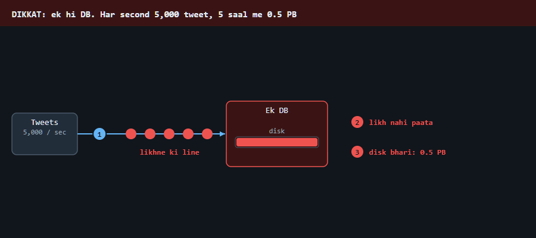

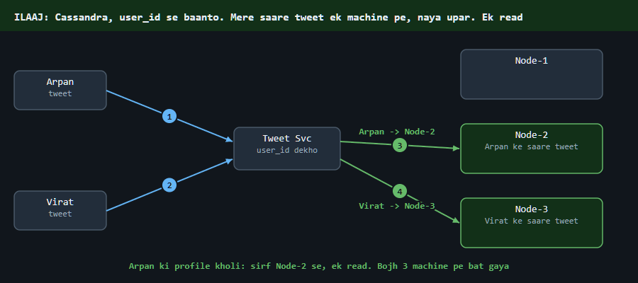

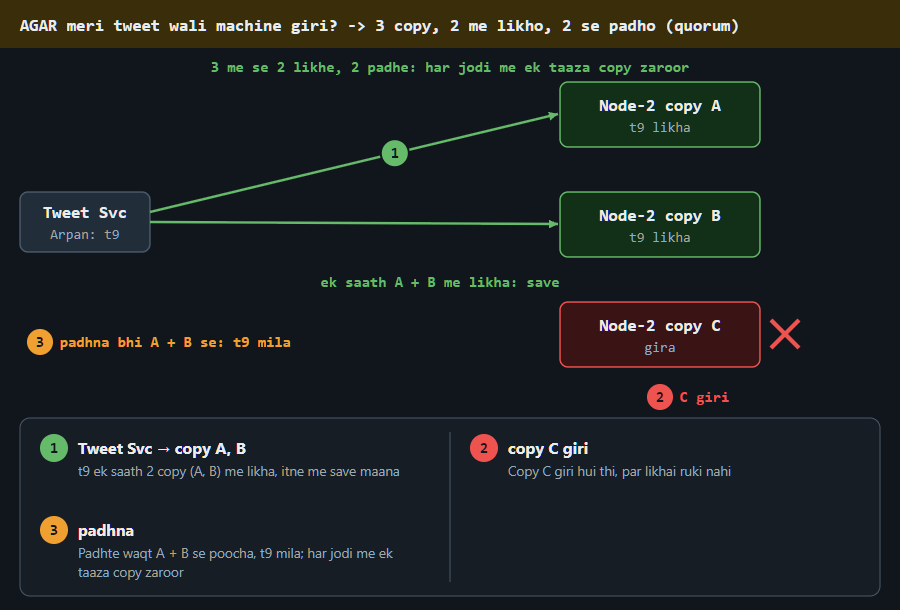

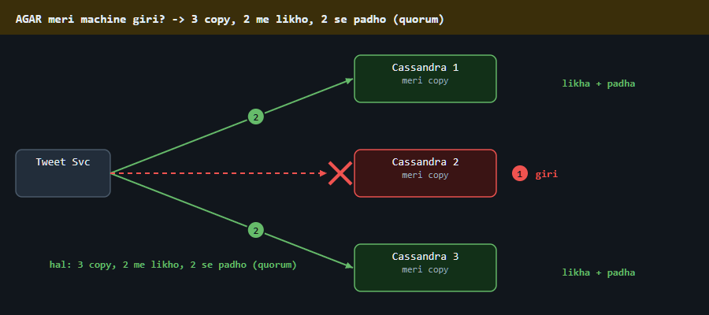

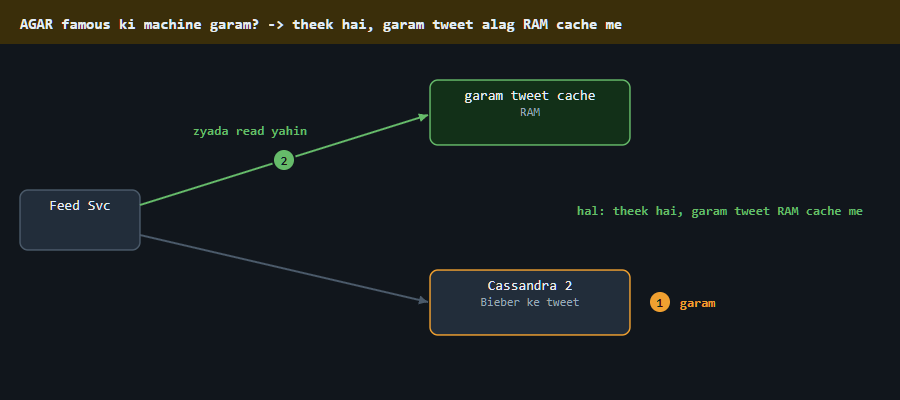

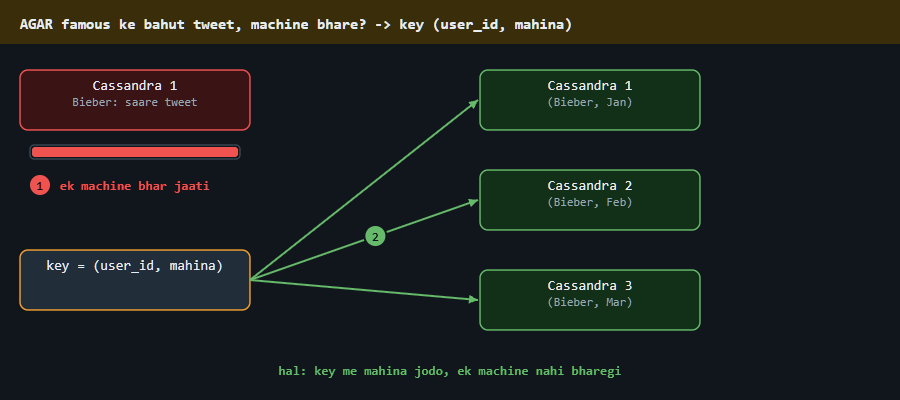

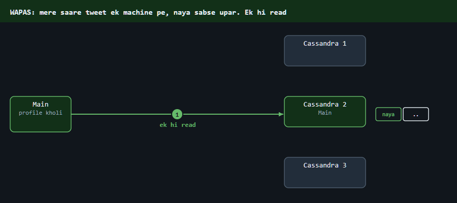

</details>

```
HAL     Cassandra lagao, user_id se baanto. Mere saare tweet ek machine pe, naya sabse upar. Ek hi read
        ↳ agar Cassandra pe itni likhai tez kaise hoti hai?
          -> commit log ke aakhir me jodta hai, badalta nahi. RAM bhar gayi to RAM ki nayi file disk pe
        ↳ agar Cassandra me files bahut? -> padhna dheema. Peeche milao (compaction)
          aur bloom filter lagao
        ↳ agar meri machine giri? -> 3 copy, 2 me likho, 2 se padho (quorum)
          naya mil hi jaata hai
        ↳ agar famous ki machine garam? -> theek hai, garam tweet alag RAM cache me
          user_id se baantna phir bhi theek hai
        ↳ agar famous ke bahut tweet, machine bhare? -> key (user_id, mahina)
          key me mahina jodo. Phir ek machine nahi bharegi
NAAM    Tweet store (Cassandra) = saare tweet yahan rehte hain
KYUN    ek DB na itna rakh sakta, na itna likh sakta. Jis cheez se padhte ho (user_id), usi se baanto.
        Likhna sirf aakhir me jodna hai, isliye tez. 3 copy, 2 me likho 2 se padho, naya mil hi jaata hai
NAHI    MySQL -> DHEEMA: har tweet pe har index disk pe dhoondh ke badalna. Join / transaction chahiye hi nahi
        tweet_id se baanto -> BIKHRA: bojh barabar, par profile ke liye saari machine poochni padti
```

---

*ab data ek desh me, user doosre me*

## 7. Main Bangalore me, data US me, har feed 300 ms

Cue: REGION-WISE + Route 53

<details><summary>kahani dekho (7 scene)</summary>

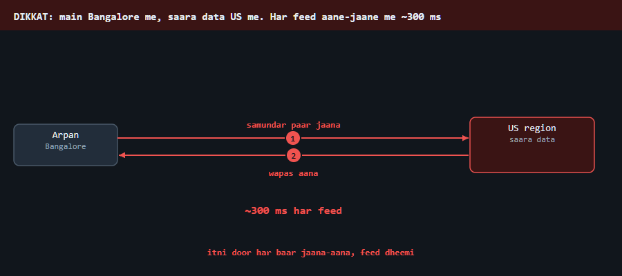

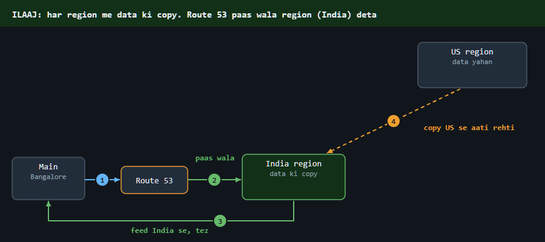

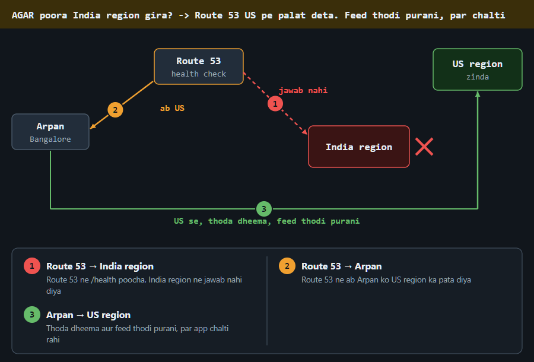

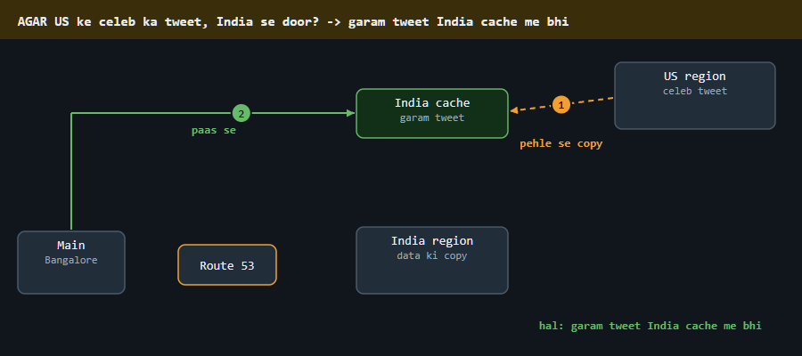

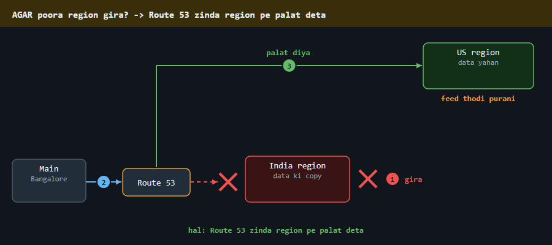

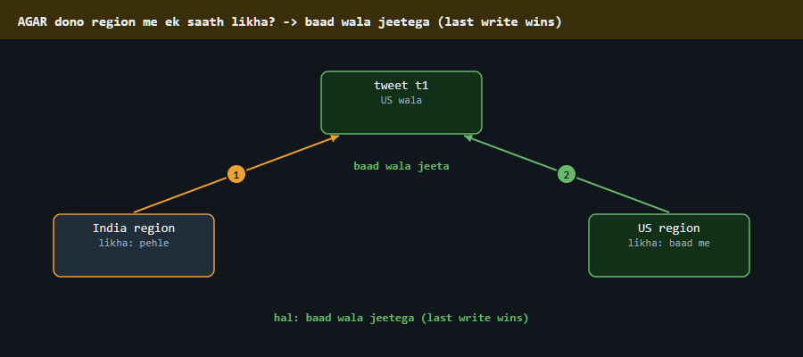

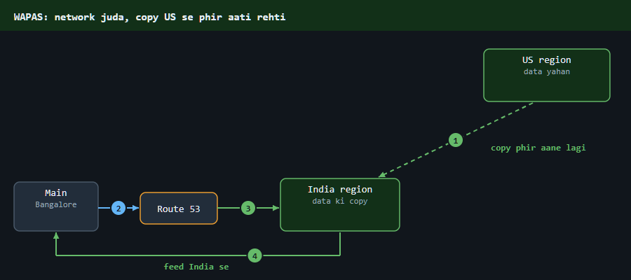

</details>

```
HAL     har region me data ki copy rakho (multi-region). Route 53 paas wale region (India) ka pata deta hai
        ↳ agar regions ka network toota? -> feed chalta rahe, chahe thoda purana
          consistency nahi, availability: 2 sec purani feed se farak nahi,
          par feed khuli hi nahi to app band. Jo hai wo dikhao, sahi wala thodi der me
        ↳ agar US ke celeb ka tweet, India se door? -> garam tweet India cache me bhi
        ↳ agar poora region gira? -> Route 53 zinda region pe palat deta
          Copy peeche thi, to feed thodi purani
        ↳ agar dono region me ek saath likha? -> baad wala jeetega (last write wins)
          Tweet aksar naya hota hai, takraav kam
        ↳ agar main US ghoomne gaya, mera data kahan se aayega?
          -> request India bhejo, ya paas wali copy se do (thoda purana)
        ↳ agar multi-region ka fayda kya hai?
          -> tez. Europe ka data Europe me (GDPR). Har region ki bheed ka time alag. Ek gira to baaki chalein
KYUN    data user ke paas wale region me hai, to feed India region se aati. Copy US se aati rehti hai.
        Doosre region ki copy thodi peeche, to region gira to feed thodi purani, par chalti rehti
NAHI    sab US se hi do -> DHEEMA: har request samundar paar, 300 ms aana-jaana, har feed atak ke aati
```

---

*ab har region me App hi ek hai*

## 8. Raat ko har region me ek hi App machine; India wali giri, India band

Cue: STATELESS App x N + ALB

<details><summary>kahani dekho (6 scene)</summary>

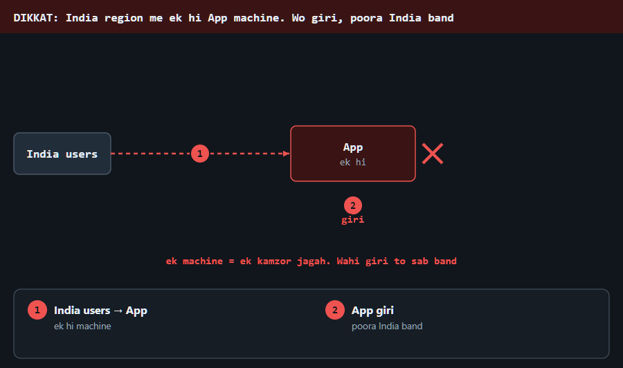

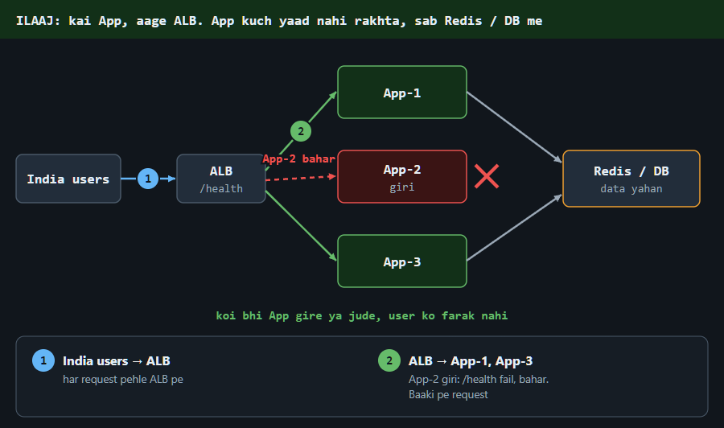

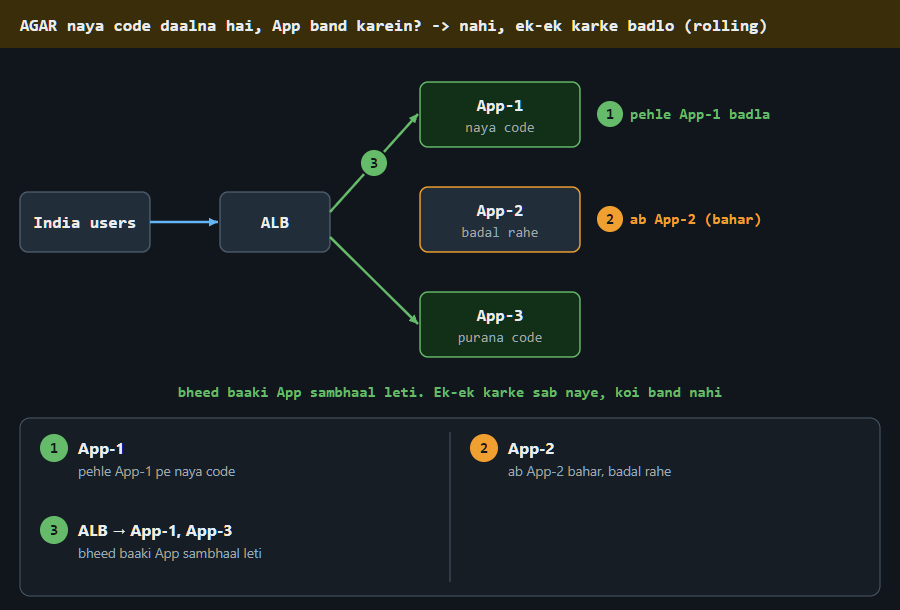

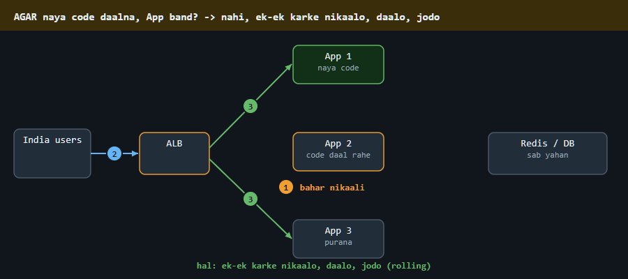

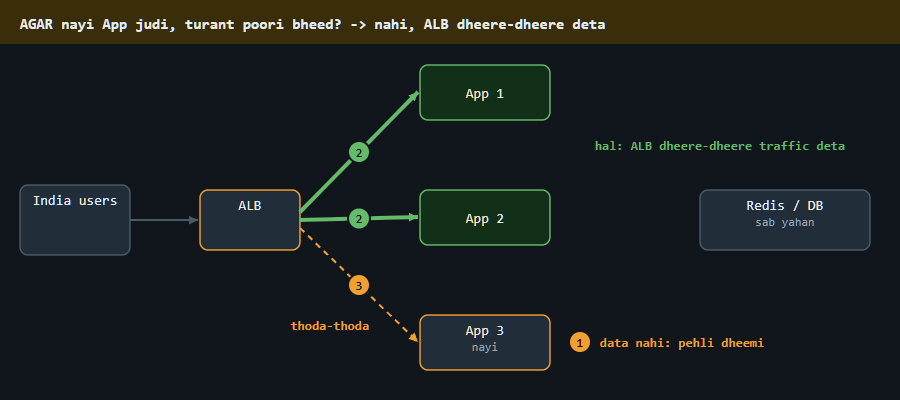

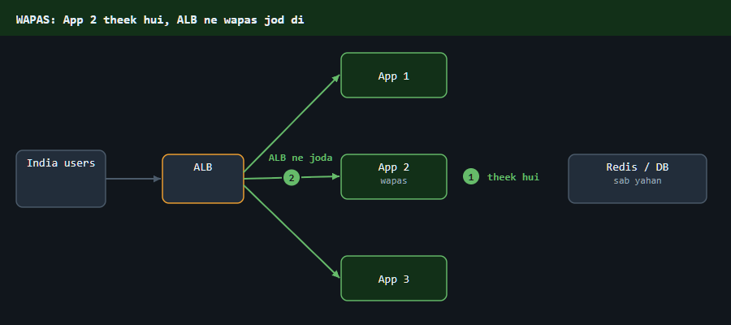

</details>

```
HAL     kai App hain, aage ALB baant-ta hai. App kuch yaad nahi rakhta (stateless x N).
        App 2 giri to wo bahar, baaki chalu rehte hain
        ↳ agar App 2 giri, pata kaise? -> ALB har ~10 sec poochta "zinda ho?"
          Chup raha to bahar, theek hua to wapas (Route 53 bhi)
        ↳ agar naya code daalna, App band? -> nahi, ek-ek karke nikaalo, daalo, jodo
          (rolling). Baaki App bheed sambhaal leti hain
        ↳ agar nayi App judi, turant poori bheed? -> nahi, ALB dheere-dheere deta
          pehli request dheemi hoti hai, uske paas apna data nahi
KYUN    machine kuch yaad nahi rakhti, sab Redis / DB me. Koi bhi gire, jude, badle, user ko farak nahi
NAHI    ek hi App -> GIRA: wo giri to poora region band
```

---

*ab padhne ki bheed likhne ko daba rahi*

## 9. Highlights ki bheed ne mera tweet daalna dheema kar diya

Cue: ALAG SERVICE (likhna/padhna)

<details><summary>kahani dekho (5 scene)</summary>

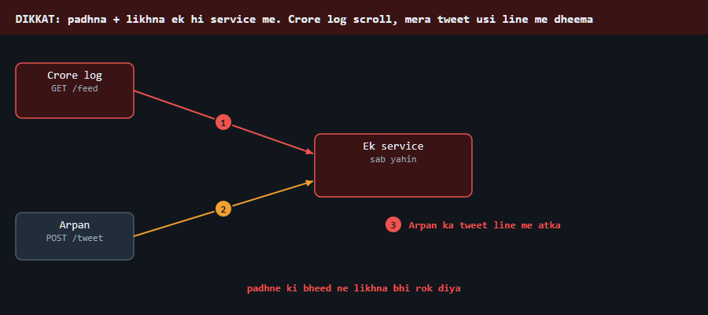

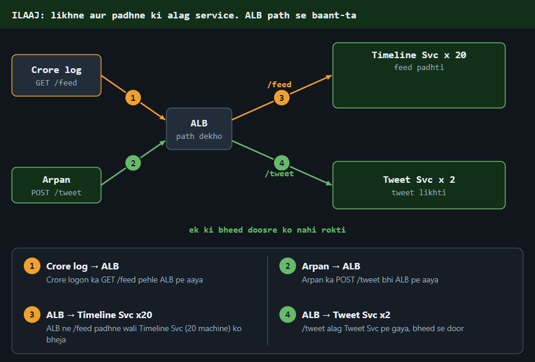

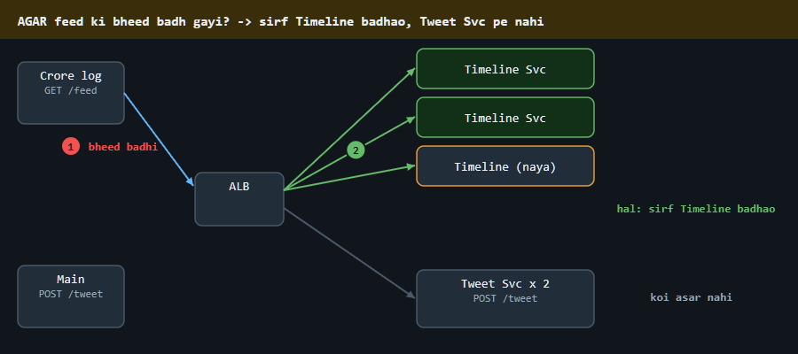

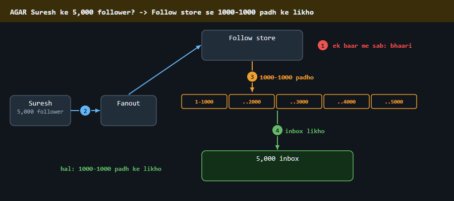

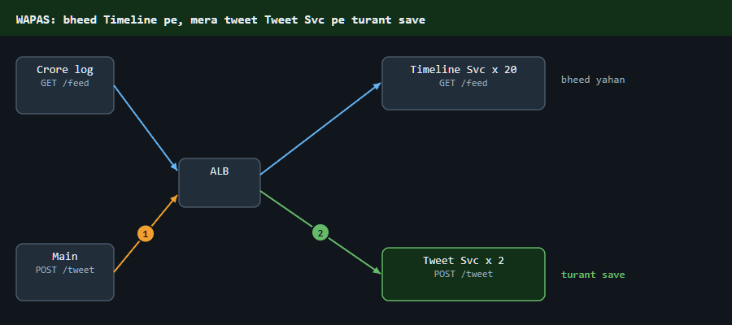

</details>

```
HAL     likhne aur padhne ki alag service. ALB path se baant-ta hai. Jahan bheed hai, wahi badhao
        ↳ agar feed ki bheed badh gayi? -> sirf Timeline badhao, Tweet Svc pe nahi
          Tweet Svc pe koi asar nahi
        ↳ agar Suresh ke 5,000 follower? -> Follow store se 1000-1000 padh ke likho
          inbox likho. Ek baar me sab padhna bhaari hai
        ↳ agar Timeline ko follow list chahiye, wo kahan se laayega?
          -> User / Follow store se, par wo Redis me rakhi hoti hai, kyunki har feed pe chahiye
PATH    POST /tweet -> Tweet Svc (x 2), GET /feed -> Timeline Svc (x 20)
NAAM    Tweet service = tweet likhti. Timeline service = feed padhti. Follow store = kaun kise follow karta
KYUN    pehle padhna aur likhna ek service me tha. Crore log scroll kar rahe the,
        mera tweet usi bheed me dheema ho gaya.
        Ab jiski bheed badhi sirf wahi badhao, ek ka dheemapan doosre ko nahi rokta
NAHI    ek hi service -> DHEEMA: padhne ki bheed me likhna bhi dheema hota hai, wahi hua
```

---

*ab bhaari maal: photo, video*

## 10. Maine match ki video daali, sabko dheemi aur mehngi

Cue: S3 + CDN

<details><summary>kahani dekho (6 scene)</summary>

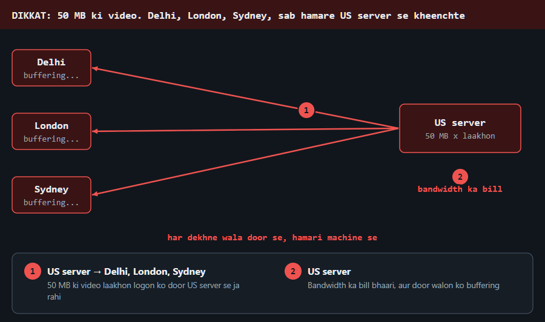

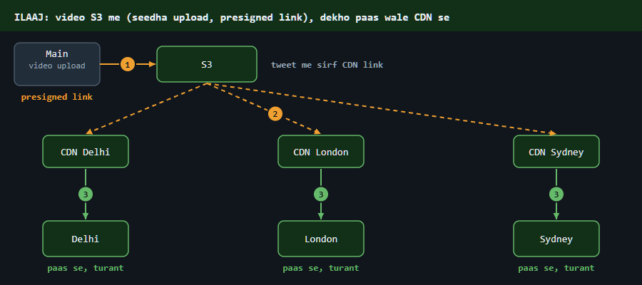

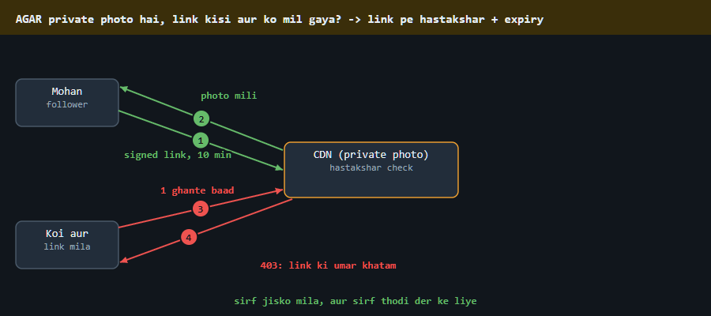

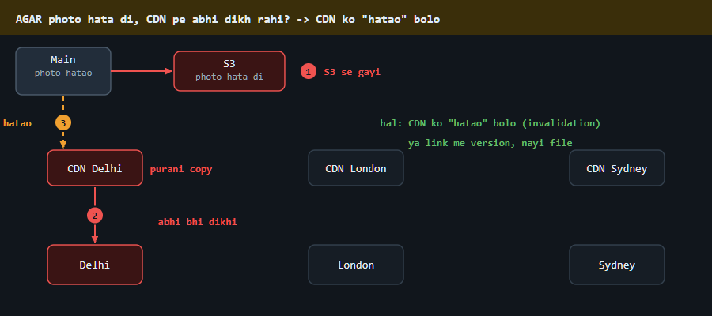

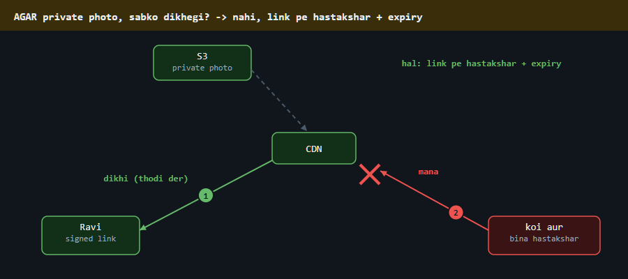

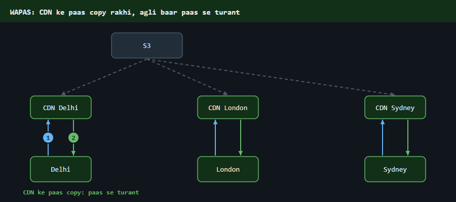

</details>

```
HAL     video S3 me rakho (seedha upload, presigned link), dekhne wale ko paas wale CDN se do
        ↳ agar CDN ke paas video nahi, koi dekhne aaya? -> CDN S3 se laake rakh leta
          kuch der apne paas rakh leta hai
        ↳ agar photo hata di, CDN pe abhi dikh rahi? -> CDN ko "hatao" bolo
          (invalidation), ya link me version daalo, nayi file
        ↳ agar private photo, sabko dikhegi? -> nahi, link pe hastakshar + expiry
          (signed URL). Sirf jisko mila, thodi der ke liye
KYUN    pehle 50 MB ki video Delhi, London, Sydney, har dekhne wala hamare US server se khinchta:
        buffering aur bandwidth ka bill. Ab bhaari maal S3 me, user tak CDN se: paas bhi, sasta bhi.
        Upload me App beech me nahi aata. Tweet me sirf CDN ka link, link badla = nayi file.
        Link pe hastakshar = sirf jisko mila wahi dekhe
NAHI    API bhi CDN se -> GALAT: CDN sirf media ke raaste pe hai
```

---

## Poora design ek saans me

```
LIKHNA: Route 53 -> ALB -> Tweet Svc -> Cassandra me save -> Kafka -> Fanout workers
        -> aam followers ke Redis inbox me sirf tweet number (aakhri 800 rakho), celeb skip
PADHNA: Timeline Svc -> Redis inbox (push) + celebs ke tweet celeb cache se (pull)
        -> milao + sort -> number se poora tweet laao -> upar ke 50
MEDIA:  photo / video S3 me, user tak CDN se
FOLLOW: User Svc + Follow store
```

Bolne ke liye: likhna, tweet Cassandra me save, aur "naya tweet" Kafka me. Worker aam followers ke Redis inbox me tweet
id daalte. Padhna, Arpan ka inbox lo, famous logon ke naye tweet alag cache se lo, dono milao, time se sort, top 50
bhejo. Famous ke liye "padhte waqt laao", baaki ke liye "pehle se daal do". Cassandra user id + time se baanta, doosre
desh me copy. Aage: ML se ranking, trending, search.

---

## 10 guna traffic

- **Timeline Svc**: har baar 200 logon ka jodna nahi, inbox pehle se bana (ho gaya). Machine badhao.
- **Redis inbox**: 50 crore inbox, to aakhri 800 + soye hue hatao. Cluster + copy.
- **Celeb ke read**: celeb cache 95%. Garam key ki kai copy + App ka chhota cache.
- **Cassandra**: user_id (+ time) se baanta. Bieber ki machine garam, to uska data aur copy.
- **Doosre desh**: region + garam data har region me copy.
- **Kafka**: partition badhao, fanout workers badhao.
- **IPL final**: 10 guna, likhai Kafka line me rukti. Pata ho to machine + cache pehle garam.
- **Asli Twitter**: sab ek saath. user_id se baanta + time ke tukde + region copy + garam data sab jagah cache.

**Pooche: kahan se gir sakta?** Har dabbe pe "ye gira to?"

**Pooche: chal raha hai, kaise pata?** Feed ka time (p99), galtiyan, Kafka me kitna pending (fanout peeche?), alert.

---

## Pooche to (kisi card me nahi baitha)

API: POST /tweet { content } -> tweetId. GET /feed?limit=50 -> home timeline. GET /user/{id}/tweets.

Tweet DB: Cassandra (bahut zyada, seedha kaam, likhna bahut, user_id + time se baanta).

Inbox: har user ka Redis sorted set (score = time). Naya jodo (ZADD, same id dobara = ek hi). Padho (ZREVRANGE 0 49).
800 ke baad kaato (ZREMRANGEBYRANK). Sirf number. Poora tweet daala to ek tweet 200 jagah copy, RAM phategi.

Follow store: ek table / Cassandra (followers / following). Neo4j zaroori nahi.

Follow store ke liye Graph DB (Neo4j) chahiye? Nahi. Follow list ek table / Cassandra me. Neo4j tab, jab "dost ke dost" chahiye.

Tweet row: tweet_id, user_id, content, time.

---

ARCHETYPE A (read-heavy/feed) · CONCEPTS: [caching](../../FOUNDATIONS/04_caching.md) · [sharding](../../FOUNDATIONS/06_database_sharding.md) · [replication](../../FOUNDATIONS/05_database_replication.md) · [← MASTER SHEET](../../00_MASTER_SHEET.md)
