# Twitter Feed

> App kholo to home timeline: jinhe tum follow karte ho unke tweet, sabse naye upar. Tweet daalna (POST) bhi. Misaal: Arpan ne app khola, Virat "Match great", Sachin "Watching IPL", Dhoni "Practice".
> Dil do cheezein: feed padhna sasta ho (log 50 baar padhte, 1 baar likhte, isliye feed pehle se bana ke rakho), aur celebrity ka tweet (10 crore follower).
>
> Mock me sirf heading + Cue + GIF. Neeche har card: **hal** · **kyun** · **nahi** (doosra kyun nahi) · **agar ...:** (cross-Q).
> Cross-Q: hal ke har bade shabd pe socho -> gira? · dheema / bheed? · do ek saath? · galat hua? · kaise / kitna?

---

## Poori tasveer (aakhir me design aisa banta hai)


---

## Shuru

- **FR:** home timeline + tweet post pe dhyaan · photo / video bhi · bahar: search, trending, DM, notification
- **NFR:** feed 200 ms se tez · feed 2 sec purani chalegi (to pehle se banana possible) · celebrity (10 crore follower) sambhalna, design yahin mudta
- **numbers:** ~50 crore user · 50 crore tweet / din, din me ~1 lakh sec -> ~5,000 tweet / sec · ek aadmi ~200 ko follow · celeb ke 10 crore follower · padhna : likhna ~50 : 1

---

*ab tootega kahan? sabse pehle padhne pe, kyunki padhna 50 guna*

## 1. Subah app khola, feed ghoomti rahi (har baar 200 logon ka jod)

**Cue:** PUSH: tweet hote hi INBOX me id · dabba: Fanout + Redis inbox

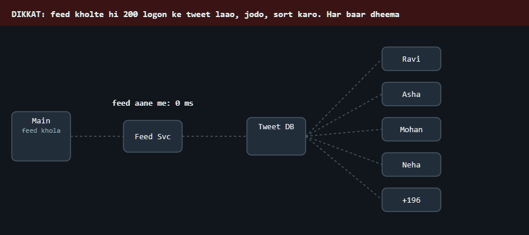

- **pehle:** sabse simple: do table, tweets (kisne kya likha) + follows (kaun kisko follow karta). Feed = follow walon ke tweet nikaalo, time se sort, upar ke 50. Kholte waqt 200 logon ka jod, har baar dheema.
- **naam:** Redis inbox = har user ki taiyaar feed. Fanout service = naya tweet followers ki feed me daale.
- **hal:** tweet hote hi follower ke inbox me uski id (fanout). Ravi ne t9 kiya, turant mere inbox me. App khola to bas apna inbox (tweet_id list), bana hua, ek read.
- **kyun:** padhna 50 guna, to mehnat likhte waqt karo, har baar khulne pe jodna mat. 2 sec purani feed chalegi, isliye pehle se banana + cache chal jaata.
- **kyun:** jo inbox me nahi (poora tweet, unfollow), wo padhte waqt jodo / chhaanto
- **nahi:** DB pe index -> thoda tez, par har khulne pe 200 ka jod wahi ka wahi
- **nahi:** read replica -> thoda tez, par har khulne pe 200 ka jod wahi ka wahi
- **agar inbox me sirf id:** poora tweet kaise? -> 50 id ek saath cache / store se (batch). Ek-ek laaye to 50 chakkar.
- **agar maine unfollow kiya:** inbox me uske tweet? -> padhte waqt follow list se chhaanto. Poora inbox badalna mehnga, safai peeche.
- **agar maine abhi follow kiya:** inbox me uske tweet? -> uske aakhri 20 tweet id mere inbox me, ya padhte waqt uske tweet milao. Warna naya follow tab dikhe jab wo agla tweet kare.

---

*ab padhna tez, par inbox bharne ka kaam likhne pe aa gaya*

## 2. Maine tweet kiya, button 5 sec ghoomta raha

**Cue:** KAFKA, fanout peeche · dabba: Kafka + Fanout workers

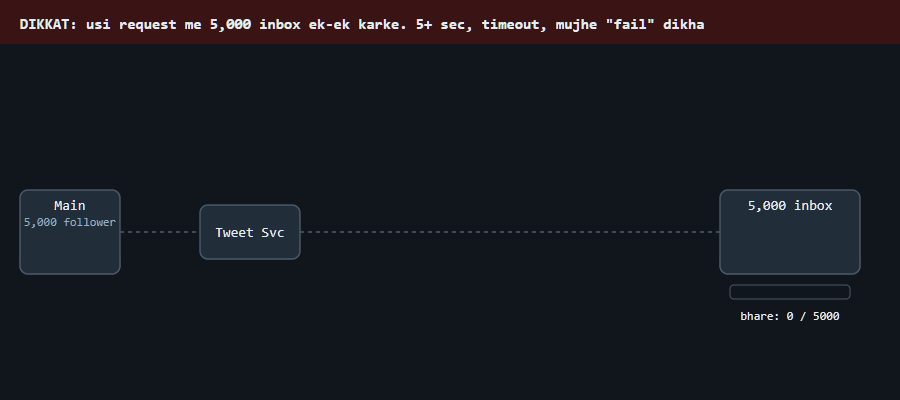

- **naam:** Kafka = tweet service se fanout tak khabar
- **hal:** tweet DB me save + khabar Kafka me, user ko turant "ho gaya". Workers peeche Kafka se padh ke 5,000 inbox bharte.
- **kyun:** pehle usi request me 5,000 inbox ek-ek, 5+ sec, timeout, "fail" dikha par tweet ban chuka tha. Ab "ho gaya" tab jab tweet DB me save, inbox bharna Kafka se peeche.
- **kyun:** dobara chale to bhi tweet ek hi baar dikhe (sorted set). Apna tweet apni feed me turant.
- **nahi:** App me peeche ek thread -> App crash to thread ka kaam gaya. Kafka disk pe, dobara padh sakte.
- **agar DB me save hua, Kafka fail:** khabar? -> dono ek saath nahi hote. Outbox / retry. Dobara aaya to sorted set me ek hi.
- **agar fanout peeche (der):** apna tweet apni feed me? -> seedha jodo. Fanout peeche, apna turant.
- **agar worker 60/100 pe gira:** baaki 40? -> Kafka ko "ho gaya" bola hi nahi (commit nahi). Khabar phir aayegi.
- **agar worker dobara chala, wahi 60 phir likhe:** do baar dikhega? -> tweet ek hi baar. Sorted set me same tweet_id ek hi rehta.
- **agar workers kam pade (bheed):** kya karo? -> worker badhao, Kafka ki lines (partition) aapas me bat jaati
- **agar inbox pe bheed (5,000 tweet/sec x 200 follower = 10 lakh likhai/sec):** Redis jhelega? -> ek Redis ~1 lakh/sec, isliye Redis Cluster 10-20 tukde, inbox user_id se bate

---

*ab aam tweet theek, par celeb ka ek tweet?*

## 3. Bieber ka ek tweet = 10 crore inbox, line ghanton atki

**Cue:** HYBRID: aam push, celeb pull · dabba: (celeb skip, merge)

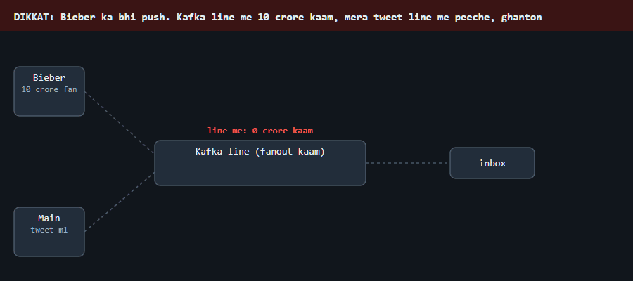

- **hal:** aam user = push, celeb = pull (hybrid). Celeb ka tweet inbox me nahi, celeb cache me. Feed khuli to mera inbox + follow kiye celebs ke naye tweet, time se milao.
- **kyun:** likhai ka bojh follower ginti se. Celeb ka ek tweet 10 crore jagah likhna, yahi asli dikkat; push kiya to Kafka line me 10 crore kaam, mera tweet peeche, ghanton der.
- **kyun:** feed hamesha dono ka mel, user ko farak nahi dikhta. Line khaali.
- **nahi:** sabke liye pull -> har feed khulna phir 200 ka jod, mehnga
- **agar celeb ki had pe (~10,000 follower):** baar-baar palte? -> 12,000 upar to pull, 8,000 neeche aaye tabhi push. Line pe baar-baar na palte.
- **agar kisi ne 50 celeb follow kiye:** 50 pull mehnga? -> celeb ke tweet alag chhote cache me, 50 pull bhi sasta
- **agar celeb cache:** kitna bada? -> chhota: ~5 lakh tweet x 500 byte = ~250 MB, sirf garam
- **agar celeb tweet pe laakhon like:** ginti kahan? -> ginti 10 tukde (tweet123#0..#9), padhte waqt jodo. Ek key ek machine pe hoti.

---

*ab ek tweet pe crore log ek saath*

## 4. Match khatam, Virat ka tweet, crore log ek saath, DB gira

**Cue:** HOT-TWEET CACHE (RAM) · dabba: Hot-tweet cache

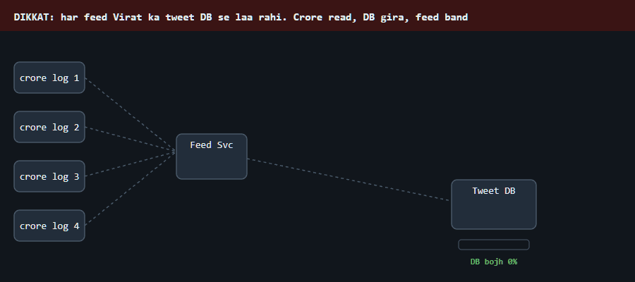

- **hal:** garam tweet RAM me (hot-tweet cache). Miss hua to sirf ek request DB jaaye (lock), baaki uska jawab lein.
- **kyun:** pehle har feed Virat ka tweet DB se la rahi thi. Ab garam cheez RAM me, DB tak sirf ek request, DB aaram se.
- **nahi:** DB ki copies badha do -> wo bhi disk se (ms). Ek garam hisse ki copies crore read nahi jhelti.
- **agar hot-tweet cache ki ek key pe bheed:** wo machine garam? -> key ki kai copy (tweet:123#1..#5), kisi se bhi padho. Saath me App memory me 1-2 sec.
- **agar Virat ne edit / delete kiya:** cache me purana? -> cache se key hatao. Agla read DB se naya.

---

*ab Redis hi bhar raha*

## 5. Shaam ko Redis alert: 50 crore inbox, RAM bhar rahi

**Cue:** AAKHRI 800 + soye hue hatao · dabba: (inbox chhota)

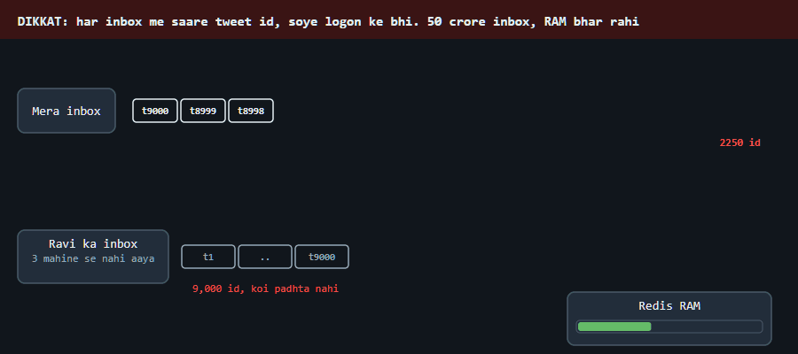

- **hal:** inbox me sirf aakhri kuch sau (800), aur sirf zinda logon ka inbox (trim). Purane hatao. Jo 1 mahine se nahi aaya, uska inbox hi nahi.
- **kyun:** pehle har inbox me saare id, soye users ke bhi. Ab RAM me sirf id aur sirf zinda log. Jo RAM me nahi, DB se bana lo: ek baar dheema, galat nahi.
- **nahi:** Redis me machine jodte jao -> soye 40 crore ka inbox bhi RAM khaata. Kharcha badhta, dikkat wahi.
- **agar inbox chhota rakhna:** kya rakhte? -> sirf number + score (~60-100 byte), poora tweet nahi
- **agar soya user lauta:** inbox? -> nahi hai. Pehli baar pull se banao, phir bharo. RAM sirf zinda ki.
- **agar aakhri 800 ke aage scroll kiya:** kahan se? -> wahan se store (DB) se. Bahut kam log itna neeche jaate.
- **agar Redis gira:** feed? -> copy (replica). Warna har feed DB se, mehnga.
- **agar Redis ki copy bhi gayi:** kya karo? -> kuch request mana, har inbox ek request, dheere bharo
- **agar feed me neeche scroll (agla page):** kaise? -> page number nahi, aakhri dikhe tweet ka time (cursor): "isse purane 50". Beech me naya tweet aaya to page nahi khiskta.

---

*ab tweet itne ho gaye*

## 6. DB alert: har second 5,000 tweet, 5 saal me 0.5 PB

**Cue:** CASSANDRA, user_id se baanto · dabba: Cassandra

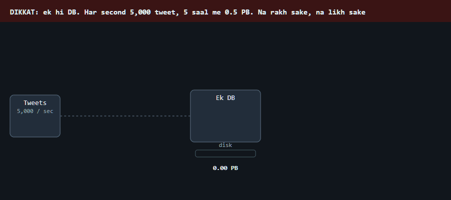

- **naam:** Tweet store (Cassandra) = saare tweet
- **hal:** ek DB na rakh sake na likh sake, isliye Cassandra, user_id se baanta (shard by user_id). Mere saare tweet ek machine pe, naya sabse upar. Ek read.
- **kyun:** jis cheez se padhte ho (user_id), usi se baanto. Likhna sirf aakhir me jodo, tez. 3 copy, 2 me likho 2 se padho, naya mil hi jaata.
- **nahi:** MySQL -> har tweet pe har index disk pe dhoondh ke badalna, dheema. Join / transaction chahiye nahi.
- **nahi:** tweet_id se baanto -> bojh barabar, par profile ke liye saari machine poochni padti
- **agar Cassandra pe likhai:** tez kaise? -> commit log ke aakhir jodo, badlo nahi. RAM bhari to RAM ki nayi file disk pe.
- **agar Cassandra me files bahut ho gayi:** kya hoga? -> padhna dheema. Peeche milao (compaction) + bloom filter.
- **agar meri machine giri:** tweet? -> 3 copy, 2 me likho, 2 se padho, naya mil hi jaata (quorum)
- **agar user_id se baanta, famous ki machine garam:** phir bhi theek? -> user_id se baantna phir bhi theek. Garam tweet alag RAM cache me.
- **agar famous ke bahut tweet:** ek machine bharegi? -> key me mahina jodo (user_id, mahina). Ek machine na bhare.

---

*ab data ek desh me, user doosre me*

## 7. Main Bangalore me, data US me, har feed 300 ms

**Cue:** REGION-WISE + Route 53 · dabba: Route 53

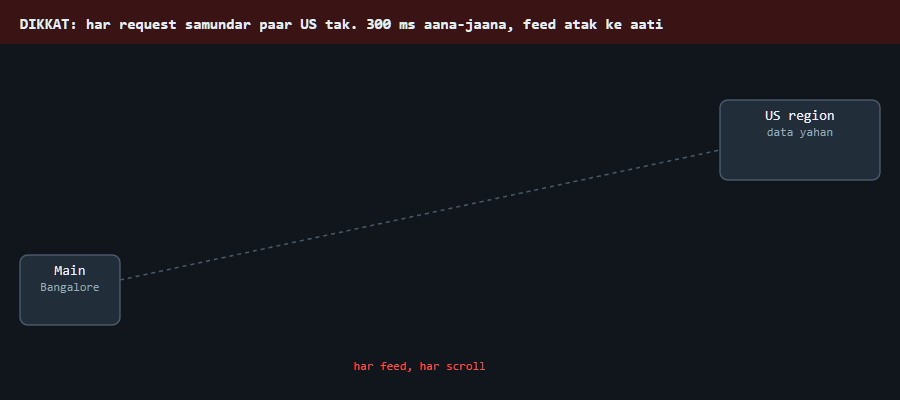

- **hal:** har region me data ki copy (multi-region). Route 53 paas wale region ka pata deta, India region se feed. Copy US se aati rehti.
- **kyun:** data user ke paas wale region me. Doosre region ki copy thodi peeche, to region gira to feed thodi purani, par chalti.
- **nahi:** sab US se hi do -> har request samundar paar, 300 ms aana-jaana, har feed atak ke
- **agar region ke beech network toota:** consistency ya availability? -> feed ke liye chalta rahe, chahe thoda purana. 2 sec purani feed se farak nahi, par feed khuli hi nahi to app band. Network toote to bhi jo hai wo dikhao, sahi wala thodi der me.
- **agar US celeb ka tweet:** India me door? -> garam tweet India cache me bhi
- **agar main US ghooma:** data kahan se? -> request India bhejo, ya paas ki copy se (thoda purana)
- **agar poora region gira:** feed? -> Route 53 zinda region pe palte. Copy peeche thi, to feed thodi purani.
- **agar dono region me ek saath likha:** kaun jeete? -> baad wala jeete (last write wins). Tweet aksar naya hota, takraav kam.
- **agar multi-region:** fayda kya? -> tez. Europe ka data Europe me (GDPR). Har region ki bheed ka time alag. Ek gira to baaki chalein.

---

*ab har region me App hi ek hai*

## 8. Raat ko har region me ek hi App machine; India wali giri, India band

**Cue:** STATELESS App x N + ALB · dabba: ALB + App x N

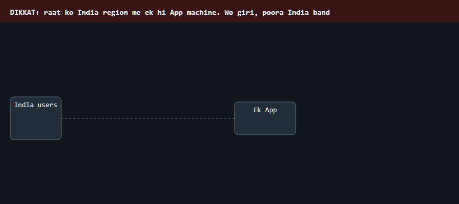

- **hal:** kai App, aage ALB baante. App kuch yaad nahi rakhta (stateless x N). App 2 giri to bahar, baaki chalte rahe.
- **kyun:** machine kuch yaad nahi rakhti, sab Redis / DB me. Koi bhi gire, jude, badle, user ko farak nahi.
- **nahi:** ek hi App -> wo giri to poora region band
- **agar App 2 giri:** pata kaise? -> ALB har ~10 sec poochta "zinda?". Chup = bahar, theek = wapas (Route 53 bhi).
- **agar naya code daalna:** App band karni? -> ek-ek karke nikaalo, daalo, jodo (rolling). Baaki bheed sambhaalti.
- **agar nayi App machine judi:** turant poori bheed? -> pehli request dheemi, apna data nahi. ALB dheere traffic de.

---

*ab padhne ki bheed likhne ko daba rahi*

## 9. Highlights ki bheed ne mera tweet daalna dheema kar diya

**Cue:** ALAG SERVICE (likhna/padhna) · dabba: Tweet/Timeline/User/Follow

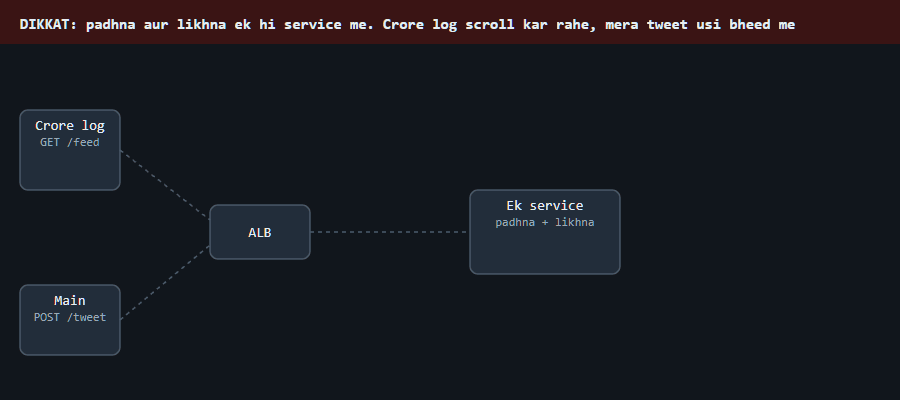

- **naam:** Tweet service = tweet likhe. Timeline service = feed padhe. Follow store = kaun kise follow karta.
- **hal:** likhne aur padhne ki alag service. ALB path se: POST /tweet to Tweet Svc (x 2), GET /feed to Timeline Svc (x 20). Jahan bheed, wahi badhao.
- **kyun:** pehle padhna + likhna ek service me, crore log scroll kar rahe, mera tweet usi bheed me dheema. Ab jiski bheed badhi sirf wahi badhao, ek ka dheema doosre ko nahi rokta.
- **nahi:** ek hi service -> padhne ki bheed me likhna bhi dheema. Wahi hua.
- **agar feed ki bheed badhi:** kya badhao? -> sirf Timeline badhao. Tweet Svc pe asar nahi.
- **agar Timeline ko follow list chahiye:** kahan se? -> User / Follow store se, par Redis me rakhi, har feed pe chahiye
- **agar Suresh ke 5,000 follower:** inbox kaise likhe? -> Follow store se 1000-1000 padh ke inbox likho. Ek baar me bhaari.
- **agar Follow store ke liye Graph DB (Neo4j):** chahiye? -> nahi. Follow list ek table / Cassandra me. Neo4j tab jab "dost ke dost" chahiye.

---

*ab bhaari maal: photo, video*

## 10. Maine match ki video daali, sabko dheemi aur mehngi

**Cue:** S3 + CDN · dabba: S3 + CDN

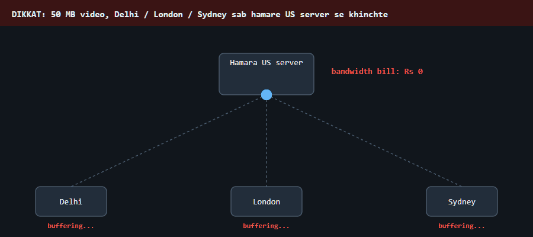

- **hal:** video S3 me, user tak paas wale CDN se. Upload seedha S3 pe (presigned link), App beech me nahi. Tweet me sirf CDN link.
- **kyun:** pehle 50 MB ki video, Delhi, London, Sydney, har dekhne wala hamare US server se 50 MB khinche: buffering + bandwidth bill. Ab bhaari maal S3 me, user tak CDN se: paas, sasta.
- **kyun:** tweet me sirf link, link badlo = nayi file. Link pe hastakshar = sirf jisko mila wahi dekhe.
- **nahi:** API bhi CDN se -> nahi, CDN sirf media ke raaste
- **agar CDN ke paas video nahi:** koi dekhe to? -> S3 se laake kuch der rakhe
- **agar photo hatayi, CDN pe abhi bhi dikhe:** kya karo? -> CDN ko "hatao" bolo (invalidation), ya link me version, nayi file
- **agar private photo:** sabko dikhe? -> link pe hastakshar + expiry (signed URL). Sirf jisko mila, thodi der.

---

## Poora design ek saans me

```
LIKHNA: Route 53 -> ALB -> Tweet Svc -> Cassandra me save -> Kafka -> Fanout workers
        -> aam followers ke Redis inbox me sirf tweet number (aakhri 800 rakho), celeb skip
PADHNA: Timeline Svc -> Redis inbox (push) + celebs ke tweet celeb cache se (pull)
        -> milao + sort -> number se poora tweet laao -> upar ke 50
MEDIA:  photo / video S3 me, user tak CDN se
FOLLOW: User Svc + Follow store
```

Bolne ke liye: likhna, tweet Cassandra me save, aur "naya tweet" Kafka me. Worker aam followers ke Redis inbox me tweet
id daalte. Padhna, Arpan ka inbox lo, famous logon ke naye tweet alag cache se lo, dono milao, time se sort, top 50
bhejo. Famous ke liye "padhte waqt laao", baaki ke liye "pehle se daal do". Cassandra user id + time se baanta, doosre
desh me copy. Aage: ML se ranking, trending, search.

---

## 10 guna traffic

- **Timeline Svc**: har baar 200 logon ka jodna nahi, inbox pehle se bana (ho gaya). Machine badhao.
- **Redis inbox**: 50 crore inbox, to aakhri 800 + soye hue hatao. Cluster + copy.
- **Celeb ke read**: celeb cache 95%. Garam key ki kai copy + App ka chhota cache.
- **Cassandra**: user_id (+ time) se baanta. Bieber ki machine garam, to uska data aur copy.
- **Doosre desh**: region + garam data har region me copy.
- **Kafka**: partition badhao, fanout workers badhao.
- **IPL final**: 10 guna, likhai Kafka line me rukti. Pata ho to machine + cache pehle garam.
- **Asli Twitter**: sab ek saath. user_id se baanta + time ke tukde + region copy + garam data sab jagah cache.

**Pooche: kahan se gir sakta?** Har dabbe pe "ye gira to?"

**Pooche: chal raha hai, kaise pata?** Feed ka time (p99), galtiyan, Kafka me kitna pending (fanout peeche?), alert.

---

## Pooche to (kisi card me nahi baitha)

API: POST /tweet { content } -> tweetId. GET /feed?limit=50 -> home timeline. GET /user/{id}/tweets.

Tweet DB: Cassandra (bahut zyada, seedha kaam, likhna bahut, user_id + time se baanta).

Inbox: har user ka Redis sorted set (score = time). Naya jodo (ZADD, same id dobara = ek hi). Padho (ZREVRANGE 0 49).
800 ke baad kaato (ZREMRANGEBYRANK). Sirf number. Poora tweet daala to ek tweet 200 jagah copy, RAM phategi.

Follow store: ek table / Cassandra (followers / following). Neo4j zaroori nahi.

Tweet row: tweet_id, user_id, content, time.

---

ARCHETYPE A (read-heavy/feed) · CONCEPTS: [caching](../../FOUNDATIONS/04_caching.md) · [sharding](../../FOUNDATIONS/06_database_sharding.md) · [replication](../../FOUNDATIONS/05_database_replication.md) · [← MASTER SHEET](../../00_MASTER_SHEET.md)
