# Twitter feed: Arpan, Ravi aur King Kohli ki kahani

Arpan ne tweet kiya "aaj ka mock 5/5". Ravi Arpan ko follow karta hai, aur King Kohli ko bhi (27 crore followers).
Kaam: Ravi app khole to home feed pe sabke naye tweet, naye pehle, turant; Kohli ka tweet bhi, aur stadium se aaya
video bhi har net pe chale.

Har kadam = **kahani** (dikkat aur hal, bolne wali bhasha) -> **Asli naam** (interview me yahi shabd) -> tasveer
(kahani ka shabd, bracket me asli naam).

---

## FR / NFR / Numbers (interview me pehle 2 minute)

```
FR      tweet post (text, photo / video) · home feed: jinko follow karta unke naye tweet, naye upar · scroll pe agla page, dekha hua dobara nahi
        · video har net pe chale (tukde, kai quality, beech se dekhna, paas ka CDN)
NFR     feed ~200 ms me (40 din baad aaya to thodi der chalegi) · 2-5 sec purani chalegi (isliye pehle se bana sakte) · 27 crore wale celeb ka tweet bhi sambhle
Numbers ~50 crore user, 50 crore tweet / din = ~5,000 / sec · ek aadmi ~500 ko follow · shaam 8 baje 5 crore ek saath
        -> padhna : likhna ~50 : 1, isliye feed pehle se taiyaar rakho
```

---

## 1. Feed 6-7 second ghoome (apne paas rakhunga, apne paas se bhejunga)

Ravi app khole to server dhoondhe wo kis-kis ko follow karta (500 log), sabke tweet DB se nikaale, milaye, sort kare.
Shaam 8 baje 5 crore log ek saath, feed 6-7 second ghoome aur DB hil jaaye, kyunki baar-baar DB jaana padta. Mere 10
dost hain, roz apna hisaab maang rahe, to har baar unke paas kyun jaun jab roz yahi karna hai? Main kahunga: tum idhar
aao, apna mujhe de do, main apne paas rakhunga aur apne paas se bhej dunga. Unhone app khola, unhe turant mila, mote
register me nahi jaana pada, dobara DB hit nahi.

**Asli naam:** apne paas rakhunga, apne paas se bhej dunga = har user ka pehle se bana inbox (Redis sorted set, naya
upar), dost apna mujhe de do = tweet aate hi followers ke inbox me (fanout on write), dobara DB hit nahi = feed seedha
inbox se.

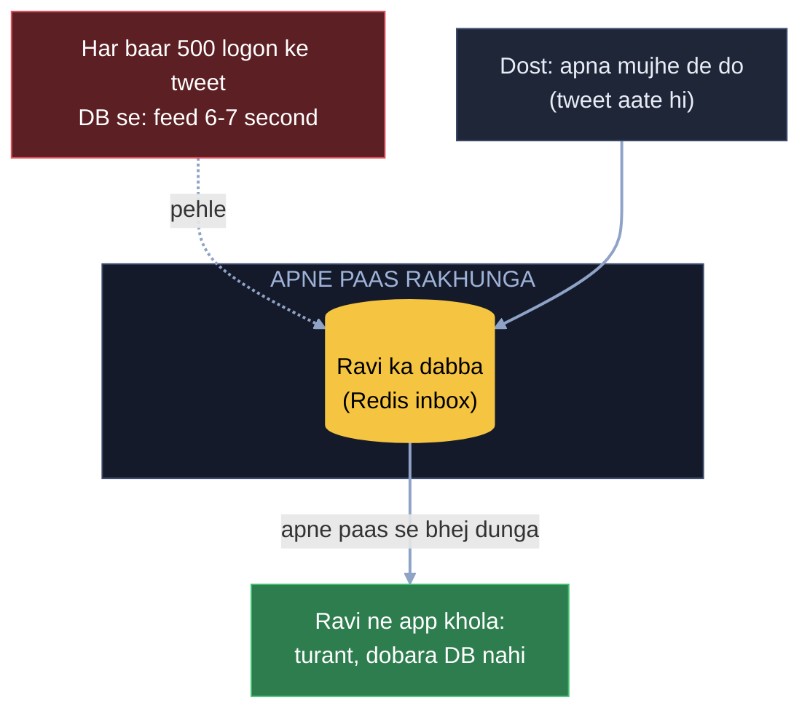

## 2. Kohli ke 27 crore dabbe (Kohli ki ek chhoti parchi)

Kohli ne tweet kiya "Century for India". 27 crore dabbon me daalna, ghanton lagte, Ravi ko 2 ghante baad dikha, match
khatam, aur tab tak baaki sabke tweet bhi line me peeche atke. Agli baar 28 crore, 29 crore honge, dabbe badhte
rahenge, dikkat nahi rukegi. 100-200, 2,000-3,000 ke liye dabba theek hai, par 27 crore bahut bada number hai,
daalte-daalte system thak jaayega. To Kohli ne century banayi aur likh di, maine ek chhoti parchi pe likh di aur yahan laga
di. Na DB, na kuch, 27 crore yahin se padh lenge.

**Asli naam:** 27 crore dabbe = fanout on write (celeb pe nahi chalta), 100-200 ke liye theek, 27 crore ke liye nahi =
followers ki had se do raaste, ek chhoti parchi, sab yahin se padhein = celeb ka tweet uski apni list me, feed khulne
pe wahan se (fanout on read). Dono saath = hybrid fanout.

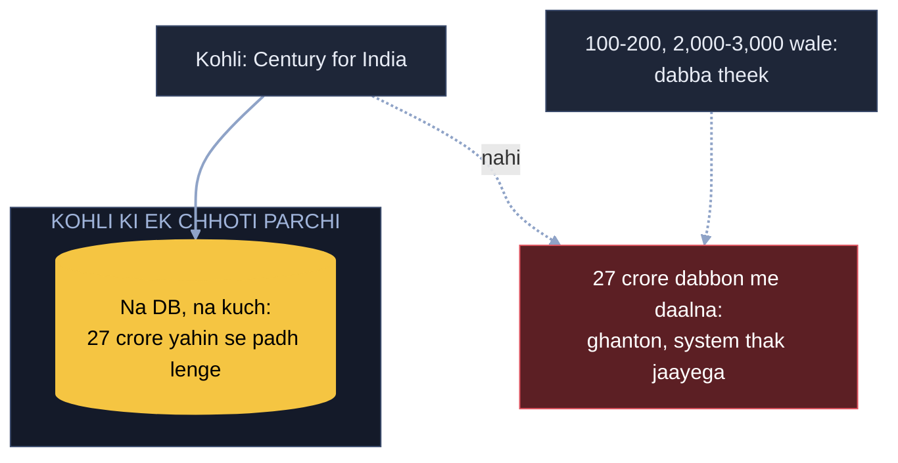

## 3. Dabba alag, 15 bade logon ki parchiyan alag (sab ek saath lao, sort karo)

Ravi ke dabbe me doston ke tweet hain, par Kohli, Dhoni, SRK, aise 15 bade logon ki parchiyan alag hain, aur Ravi ko
ek hi feed chahiye, sab apne time ke kram me. To sabko ek saath lao. Ek parchi pe likh diya: ye Dhoni ka, ye Kohli
ka, ye Arpan ka. Ab sabko sort karte hain, jaise DSA me sort karte, aur Ravi ki feed pe push. Ravi ne app khola: "le,
ye tera aaj ka poora twitter ka samachar, jinko tune follow kar rakha tha, sort kar diya hai, dekh le."

**Asli naam:** sabko ek saath lao, ek parchi pe = inbox + follow kiye celeb ki list, DSA jaisa sort = time se merge,
Ravi ki feed pe push = merge at read.

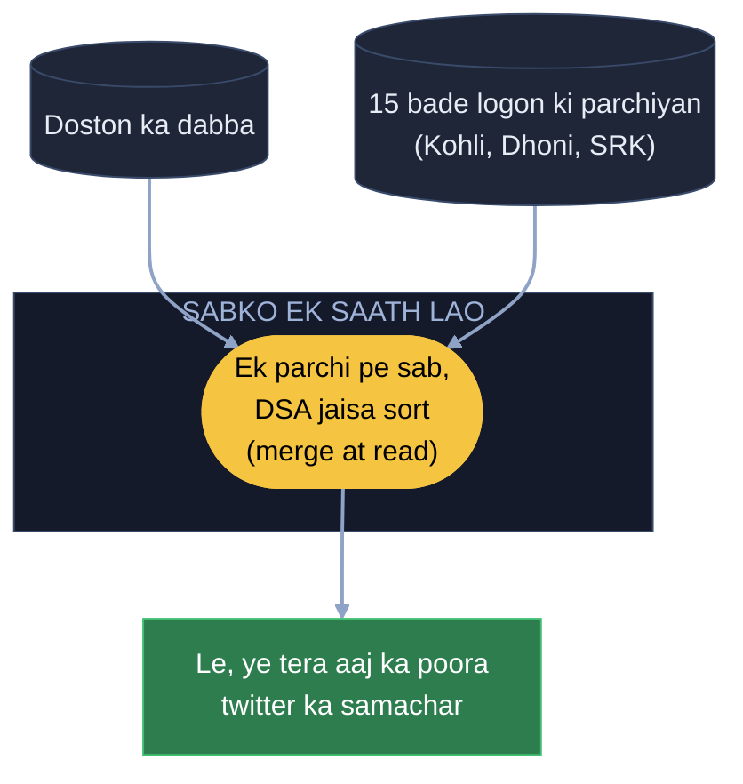

## 4. Arpan ke 8,000 followers, "Post" ghoomta rahe (threshold + stadium wala bhai)

Arpan ke 8,000 followers, abhi bhi chhota user. "Post" dabaya, server ek-ek karke 8,000 dabbe bhar raha, button
ghoomta rahe. 3,000 pe server gira, baaki 5,000 ko kabhi nahi mila, aur Arpan ko pata bhi nahi. Sabse pehle ek
threshold rakho: itne followers paar gaye to inbox me push nahi, Kohli wala tareeka. Aur bheed sambhalne ke liye ek
dabba laga do, mera favourite stadium wala bhai Kafka. Maine post dabaya to "tera post ho gaya, nikal", peeche Kafka
sab karta rahega. Kuch gira to outbox me rakh lo, ek parchi pe likha hai.

**Asli naam:** threshold, Kohli wala tareeka = had ke upar celeb raasta, stadium wala bhai = Kafka (async fanout, peeche fanout workers),
post ho gaya, nikal = turant OK, parchi pe likha = outbox ki soch. Yahan tweet Cassandra me jaata, aur wahan tweet +
outbox ek transaction me nahi likhe jaate, isliye Kafka hi pakki parchi: Tweet Service pehle Kafka me daale
(acks=all), peeche workers tweet Cassandra me aur inbox me likhein (tweet_id se idempotent, dobara aaye to do baar nahi).

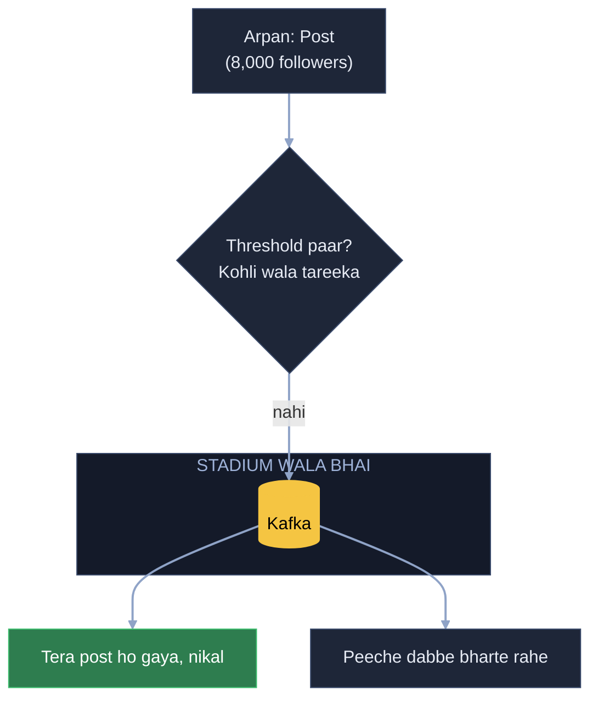

## 5. Six ke baad 5 crore ek parchi pe (parchi ki 10-15 copy)

Kohli ne 99 se six maara aur tweet kiya. 1 minute me 5 crore log refresh, sabko wahi ek parchi chahiye. Wo parchi ek
machine pe, wo machine hil gayi, aur Dhoni-SRK ki parchiyan bhi atki. Us waqt wo cheez famous ho gayi to log aayenge
hi. Main dekh raha lakhon log is parchi ko padhne aa rahe, to iski 10-15 copy bana dunga, alag-alag machine pe: le tu
bhi ye copy le, sabko padhwa. Bheed badh rahi to baant do, copiyan bana do, clone kar do.

**Asli naam:** famous ho gayi, log aayenge = hot key, 10-15 copy alag machine pe = key ki replicas, baant do = read
unme bant-ta.

**Maan lo Kohli ne "Inida" likh ke 10 second me "India" kar diya, aur kuch copies purana dikha rahi:** thodi der galat
dikhega na. Peeche ek job chala do, ek ladka laga do, wo jaldi-jaldi sabko theek information pass kar dega, kuch second
lagenge. System rok nahi sakte, ye nahi keh sakte ki nahi dekhne denge.
**Asli naam:** thodi der galat = eventual consistency, peeche ek job = background job copies update kare.

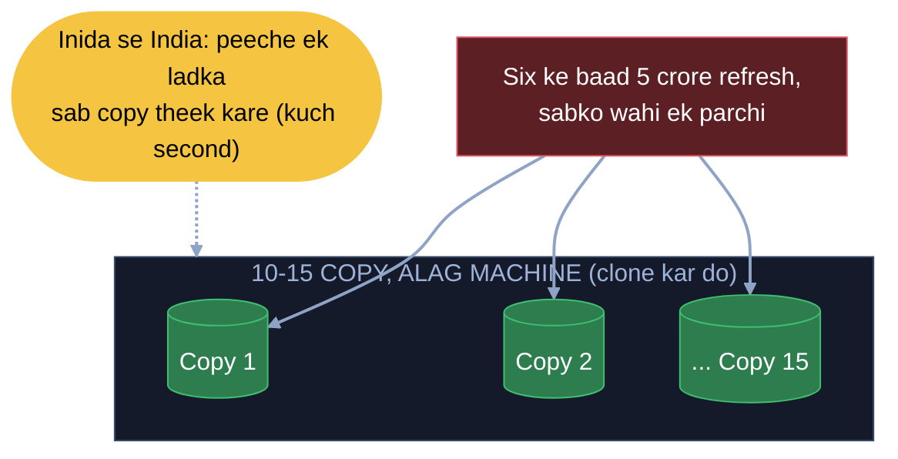

## 6. Memory ka bill aasmaan pe (aakhri 500 + 30 din wala)

Har account ka dabba memory me, Ravi ke dabbe me 3 saal ke tweet, aur 30 crore log mahino se app nahi khol rahe, par
unke dabbe bhi roz bhar rahe. To parchi chhoti karo: bas last 500. Itna koi scroll nahi karta, karega bhi to DB se
query karke Redis me rakhne me koi bada teer nahi lagta. 3-4 saal purana mote register me mat rakho, alag permanent
diary me, jise aam bhasha me S3 kehte, archive. Aur jo 30 crore log aa hi nahi rahe, unki parchi taiyaar karna bekaar
ki mehnat, wo 10 din, 20 din, 30 din se aa nahi rahe. Threshold: 30 din se app nahi khola to Redis me kuch taiyaar
nahi. 40 din baad aaya to "thodi der ruk, 2 second me teri parchi la raha", DB se laake Redis me daal denge, thodi
loading chalegi.

**Asli naam:** last 500 = inbox ki had (trim), DB se query karke Redis me = cache miss pe DB, permanent diary, S3,
archive = purana data S3, 30 din se nahi khola to kuch taiyaar nahi = inactive user ka inbox nahi, lautne pe DB se
Redis me = on-demand inbox banana.

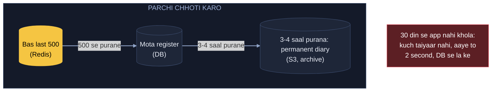

## 7. Din me 50 crore tweet, SQL hil gaya (bada bhai Cassandra + follow ka Neo4j)

Saare tweet ek SQL DB me, din me 50 crore naye, likhne ki line itni lambi ki machine hile. Aur dabba banane ke liye har
baar "Arpan ke naye 500" poori table me dhoondhna. Likhai bahut zyada hai to alag machine, mera bada bhai Cassandra:
"bhai Cassandra, mera system bahut likh raha, tu bada bhai hai, dekh le." Replica bhi wo khud kar leta. Kaun kisko
follow kar raha, wo Cassandra me rakhne ka matlab nahi, uske liye ek aur bada bhai Neo4j: "ye aadmi isko follow kar
raha, iska track rakhna." Aur Arpan ke saare tweet ek jagah chahiye: naam se todo to doosra Arpan bhi ho sakta, isliye
id se baanto. Meri id har baar same, to mera saara data ek jagah.

**Asli naam:** likhai bahut, bada bhai = Cassandra (write-heavy, na join na transaction chahiye, khud kai machine me baant-ta, andar ring = consistent hashing: nayi machine jude to sirf paas ka hissa hile), replica bhi wo kar leta = Cassandra ki apni copy,
naam se nahi, id se baant do = partition key = user id, mera saara data ek jagah = ek partition (author ke saare tweet, time ke kram me),
follow ka track = graph DB Neo4j.

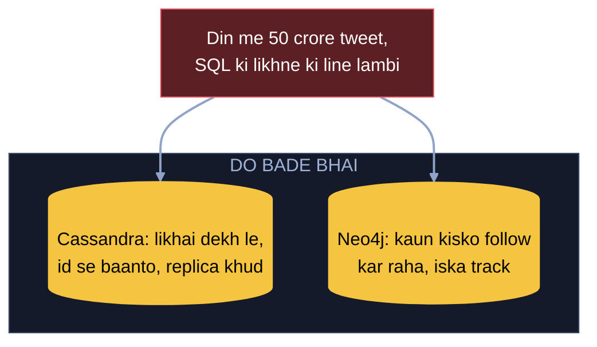

## 8. Server America me, Ravi Delhi me (Lajpat Nagar me branch)

Saare server America me, Ravi Delhi me, har request samundar paar, har kaam me aadha second upar se, aur IPL pe India
ke 10 crore America ki machine hila rahe. Ravi India se kar raha to har baar America kyun bhejna, bekaar ka travel.
India me hai to baatcheet India me rakh. Ye bank jaisa hai: Lajpat Nagar ke log doosri branch me aa rahe, us bank pe
dabaav. Lajpat Nagar me branch nahi hai? To wahan branch khol do, wo wahi chale jaayenge.

**Asli naam:** baatcheet India me rakh = India region, Lajpat Nagar me branch khol do = user ke paas wala region.

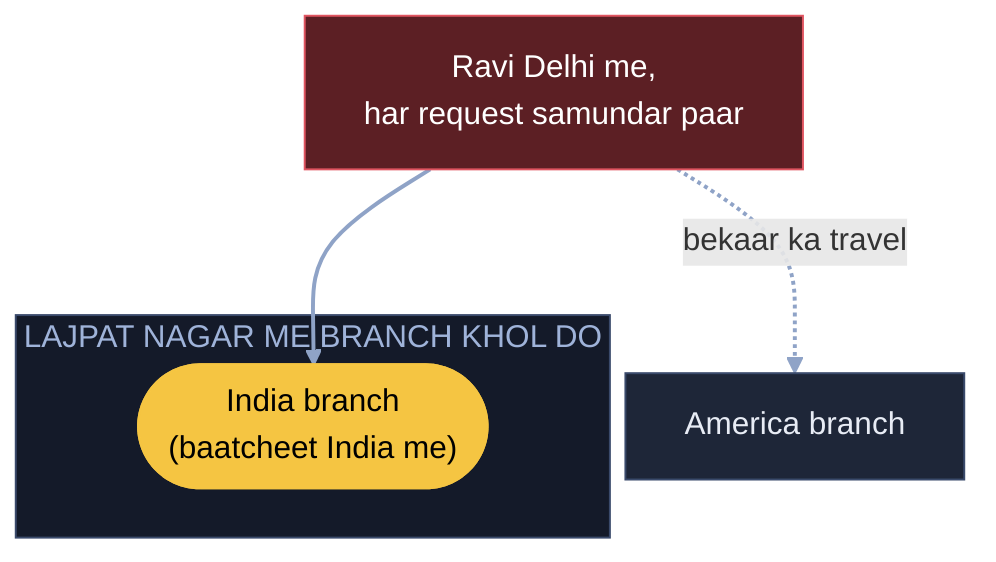

## 9. John ko Arpan ka tweet nahi dikhta (branches aapas me baat karein)

Arpan ne India branch me tweet kiya. Follower John New York me America branch se baat karta, use pata hi nahi. Ulta
Kohli America se tweet kare to Ravi ko nahi dikhta. Do register hain, mera is wale se baat karta, John us wale se, par
dono register ek-doosre ko nahi jaante. To unhe bhi baat karni padegi: jab ye kuch likhe to apne register me to theek,
aur us register pe bhi bhej do jahan se Arpan padhta. Jaise SBI ki do branch: dost ne Mumbai wali me 500 daale, main
Delhi wali me jaake poochhta "mere liye kuch aaya?", branches aapas me baat karti hain to bata deti.

**Asli naam:** register aapas me baat karein = cross-region replication, us register pe bhi bhej do = tweet doosre
region ko copy.

**Maan lo dono branch ki baat 10 minute ruki aur Arpan ne beech me 5 tweet kiye:** ek banda bithao jo pal-pal dekhta
rahe: "America wala dost aaya?" Nahi aaya, nahi aaya, ab aa gaya. "Le, Arpan ke 5 tweet, teri feed me push kar diye."
Mujhe bas dekhna tha ki tu hai ya nahi, tu aa gaya to le tera kaam.
**Asli naam:** banda sambhal ke rakhe = queue me pending, pal-pal dekhta = retry, judte hi bhej = link wapas aane pe
replay.

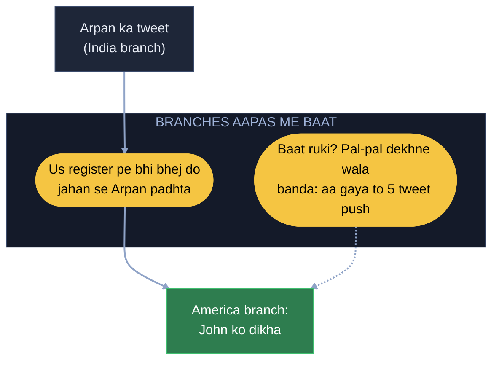

---

**Video: Arpan stadium se King Kohli ke six ka 1 GB 4K video daalta hai.**

## 10. 50,000 log 1 GB ke video daal rahe (alag raasta, URL se access)

Stadium se 50,000 log 1 GB ke video daal rahe, sab Tweet Service se guzarte, server ki memory aur net bhari, aur text
tweet bhi atke. To jo video aa rahi hai use kahin aur bhej do, apne server pe mat lao: bhai tu yahan apne server se
nahi, alag is route pe chala ja, tujhe phir ek URL se access kar lenge.

**Asli naam:** kahin aur bhej, apne server pe na la = video seedha S3 me (presigned URL), URL se access = tweet me sirf
link.

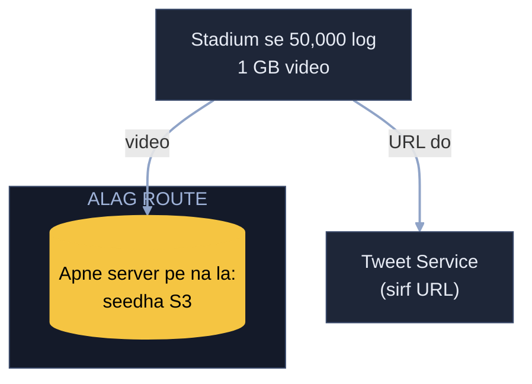

## 11. Ravi gaon me 3G pe, 1 GB nahi kheench paata (Ferrari aur Alto)

S3 me ek hi 4K file hai. John WiFi aur TV pe mast, par Ravi gaon me 3G phone pe, 1 GB kheench nahi paata, video chalta
hi nahi. 1 GB ek saath kyun kheench rahe, thoda-thoda kheench lo, kuch-kuch second ka. Aur chhote size bhi rakho.
Phone bole "mera net bekaar, 240p de", net achha to 4K. Ferrari highway ke liye, Alto gaon ke liye: 4K achhe net pe,
240p-360p kharab net pe.

**Asli naam:** kai size = transcoding, thoda-thoda kuch second ka = segments (chhote tukde), phone net dekh ke maange =
ABR (adaptive bitrate).

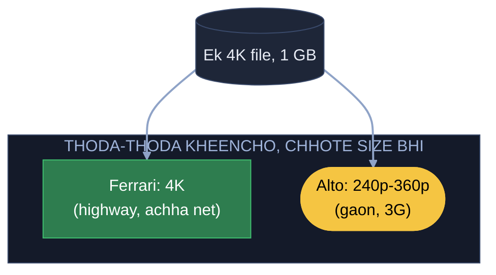

## 12. Ek machine, 20 minute, 50,000 video peeche (kai machine + id ki parchi)

Ek machine 4K se 4 size banaye, 20 minute lagte, Arpan ka tweet atka, aur 50,000 video usi ek machine ke peeche. Ek
machine kyun, kai machine kar do, kaam baant do. Video ki ek id rakh lo, parchi pe likh do, taaki repeat na ho. 10 log
isi id pe kaam karein, aur kisi id pe nahi.

**Asli naam:** kai machine, kaam baanto = video ke hisse, transcoding workers (parallel), id ki parchi = har hissa
video id + hissa number se.

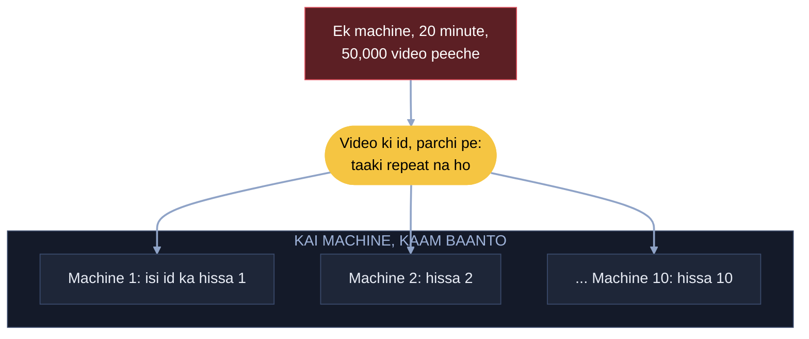

## 13. Worker 7 beech me gira, "processing" ghanton se (tu hai kya + yahan tak parchi)

10 worker, 9 ka hissa bana, worker 7 beech me gira, aur video na taiyaar na koi batata, "processing" ghanton se. To har
worker ka status rakho. 9 ne bata diya, ek nahi bata paaya to dekhunga, heartbeat: "tu hai kya?" Jawab nahi to ise
ghar bhejo, naya banda lao. Uske paas parchi: "maine yahan tak kar liya", naya wahin se uthaye. Save se pehle gira to
shuru se.

**Asli naam:** har worker ka status = DB me hisson ki ginti, tu hai kya = heartbeat, naya banda = job dobara (retry),
yahan tak parchi = checkpoint.

**Maan lo worker 7 zinda hai, heartbeat aa rahi, par 1 ghante se ek hissa bana raha, baaki 2 minute me khatam:** uski
wajah se mera kaam ruk raha. "Tu thoda rest le, ye tera replacement, bata kahan tak chhoda, ye wahin se karke dega."
**Asli naam:** atka to replacement = timeout pe slow worker ka hissa doosre ko, kahan tak chhoda = checkpoint.

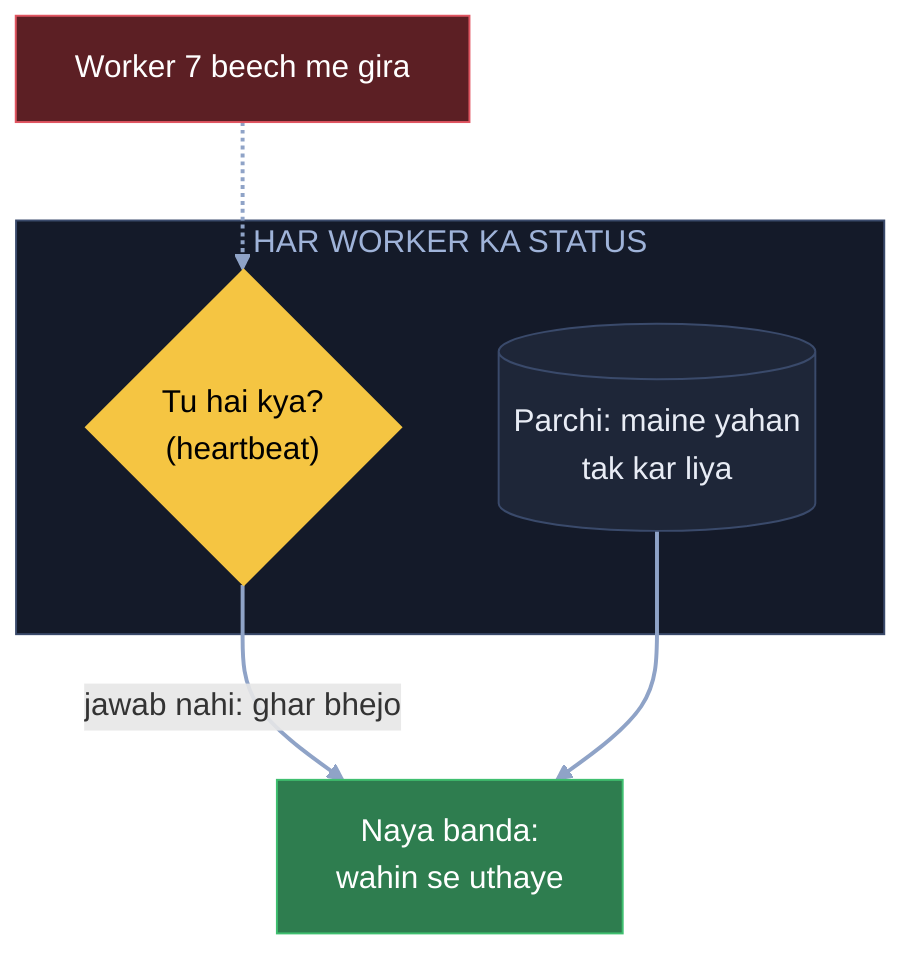

## 14. Ravi 2:00 pe khiskata, phone 0 se kheench raha (copy dekh ke seedha 51wa page)

Ravi 2:00 pe khiskata hai six dekhne, par phone 0:00 se 2:00 tak sab kheench raha, faaltu data, aur six late. 0 se 2
dikhane ka fayda nahi. Kisi ne copy di aur bola seedha 51wa page dikha. Main copy dekhunga, kahan 50 khatam, 51 kahan
shuru, hisaab lagaunga, aur seedha 51 khol dunga.

**Asli naam:** copy me kaunsa page kahan = manifest (tukdon ki list), hisaab, seedha 51 = seek: time se tukda number,
seedha wahi tukda.

**Maan lo 1 crore log dekh rahe, har ek ke ~150 tukde, to kya har tukda hamare server ki API se jaayega:** tukda dene me
sochna kuch nahi, bas file hai, to CDN pe rakh do. Pehle socha har reader ke paas ek bachcha khada karun jo yaad rakhe
kaunse page pe hai, par 1 crore log = 1 crore bachche. Book me koi bachcha nahi hota, mere paas bookmark hota: 50 pe
hoon to 51 khud palat leta. Sab client side, server pe aane ki zaroorat hi nahi.
**Asli naam:** bas file = tukde CDN se seedhe (static), bookmark = phone ka player khud yaad rakhta kahan hai, 51 khud
palto = manifest se agle tukde ka link, server sirf shuru me ek baar (manifest + link).

Baat 10-20 crore ki nahi, AWS jaise server bahut kuch sambhal lete hain, dikkat wo nahi. Baat ye hai ki kaam kahan
aasaan ho sakta hai. Yahan phone pe aasaan ho gaya to wahin kar diya. Kisi ne phone ka socha hi na hota to wahi bachche
wala tareeka chal raha hota. Dikkat aayi, solution ban gaya.
**Asli naam:** kahan aasaan = kaam wahan karo jahan sabse sasta aur seedha (yahan client), server pe bojh aur kharcha
bina wajah nahi.

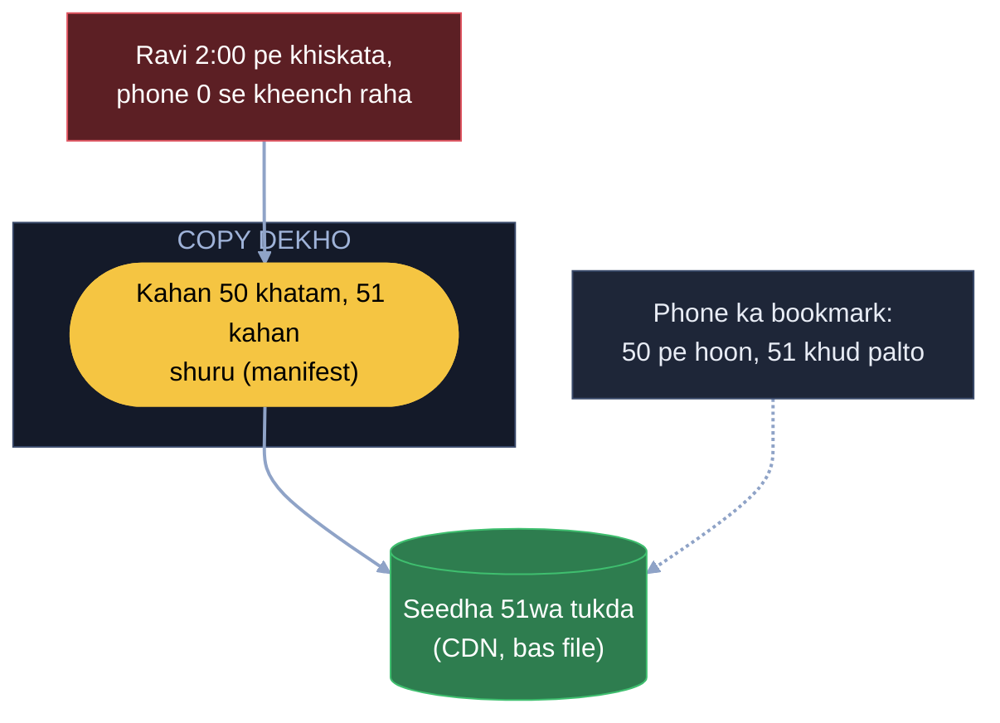

## 15. Six viral, saare tukde US me (copy paas me + taala-chaabi)

Six viral, 1 crore log India, US, Australia se, aur saare tukde US ke S3 me, samundar paar, bill aasmaan pe, India me
atke. Samundar paar kyun? Europe wala dost bole "video mere Europe me aa jaaye". To iski copy bana do, tu apne paas
rakh, tu apne paas, teeno copy same, jo jahan se dekhe paas se khule.

**Asli naam:** copy paas me rakho = CDN (edge cache), S3 tak sirf pehli baar.

**Maan lo private video (10 dost), Ravi ne CDN link bade WhatsApp group me daal diya:** taala-chaabi mere paas. Kamra
mera, 10 log hi aa sakte. 11wa aaye, dost ka dost ho, to bhi access nahi.
**Asli naam:** taala-chaabi maalik ke paas = har request pe access check, 10 log hi = allow list (sirf link kaafi
nahi).

**Maan lo tukde CDN se seedha jaate hain, CDN ko allow list pata hi nahi, aur link leak ho gaya:** CDN ke paas bhi
taala-chaabi ho, har request US tak nahi jaayegi. In 10 ki user id do: ye 10 aayein to link do, nahi to mat do. Aur
link ki umar 5 minute, uske baad kisi ke liye nahi khulega. Leak bhi hua to 11wa nahi ghusega. Mohar kaise jaanchi
jaati, wo AWS ka kaam.
**Asli naam:** CDN ke paas bhi taala = CDN signature jaanchta (signed URL / cookie, AWS ka kaam), 10 user id = server allow list dekh
ke hi link deta, 5 minute umar = short expiry. Hamara faisla: kisko aur kitni der ka.

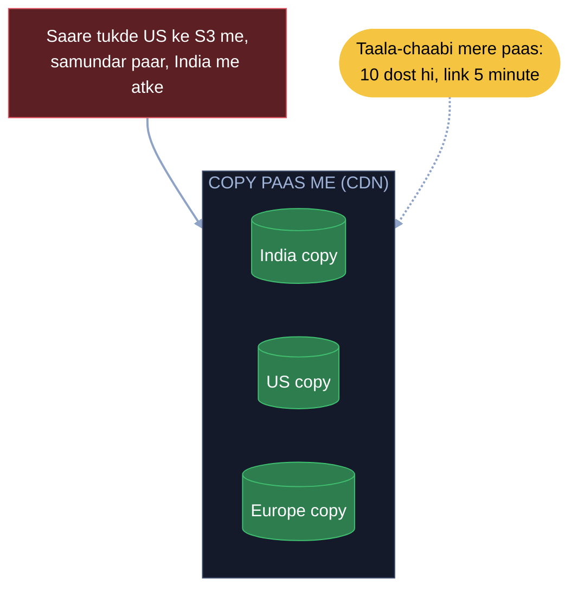

## 16. Dabbe me sirf number, screen pe poora tweet (ID se seedha page)

Ravi ke dabbe me sirf tweet ke number pade hain: #905, #902, #899. Par screen pe number nahi chahiye, chahiye kisne
likha, photo, kitne like. Mere paas ek mota register hai, sab likha hua. 1,00,000 page me dhoondhna time lega, main
baawla thodi hoon. Par mere paas ID hain, to seedha wahi page kholunga. Register 1 crore page ka ho ya 10 crore, ID ho
to kaam aasaan. Photo / video CDN se aa jaayegi, baaki mote register se.

**Asli naam:** ID se seedha page = hydration (ID se poori post, key se lookup), photo CDN se = post me CDN link, mota
register = tweet store (Cassandra), like count saath me. Dabbe me sirf ID isliye, taaki dabba chhota rahe (kadam 7).

**Maan lo Arpan ne tweet delete kar diya, par 8000 logon ke dabbe me uska number (ID) abhi bhi pada hai:** 8000 dabbe ek-ek karke saaf karna bhaari hai, zaroorat bhi nahi. Kadam 16 me screen pe dikhane se pehle hum ID se mote register ka page kholte hi hain. Page pe likha mile "ye tweet delete ho gaya", to bas use dikhao mat, chhod do. Dabbe me pada number apne aap purana hokar khisak jaayega.
**Asli naam:** page pe deleted = tweet store me deleted flag (soft delete), dikhate waqt chhod do = hydration pe filter, 8000 dabbe saaf nahi karne padte.

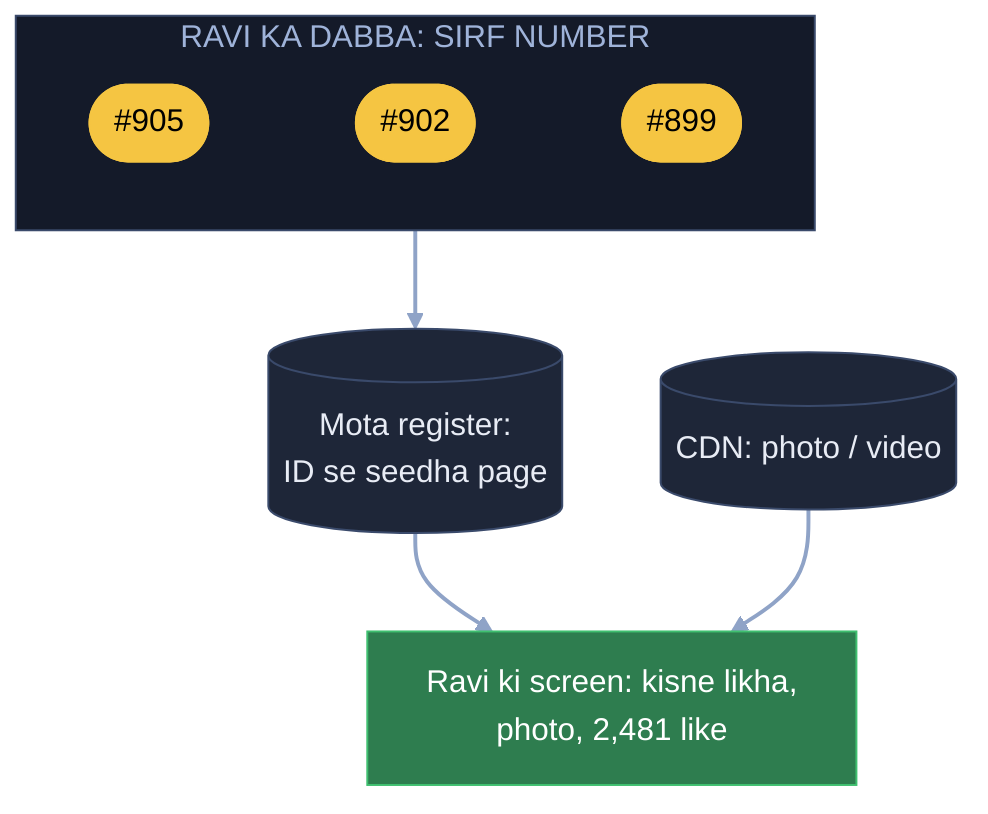

## 17. Amit ka tweet 40 ke neeche dab gaya (jisse judta wo pehle)

Ravi roz dost Amit ke tweet pe like / comment karta. Amit ka tweet 3 ghante pehle aaya, uske baad 40 aur, Amit ka
neeche dab gaya; upar wo jinhe Ravi kholta bhi nahi. Ye ek tarah recommendation hi hai. Peeche kaunsa algorithm /
machine learning, wo design ka hissa nahi. Par main roz Amit ki photo like kar raha, baaki 40 ko bas dekh ke chhod
deta. Instagram roz dekh raha ki ye ladka Amit ko like karta, to pehli photo Amit ki dikhayega. YouTube me bhi same:
MrBeast ki video roz dekhun to wahi suggest karega. Unka kaam hi yahi: main jitni der rahun, unki kamaai badhe.

**Asli naam:** jisse zyada judta wo pehle = ranking (kisse baat karta, post kitni nayi, likes), algorithm design ka
hissa nahi = ranking model alag; hum dabbe ki list dete, ranked list lete, phir kadam 16 se poori post. Netflix kadam
6 ("tere liye") se juda.

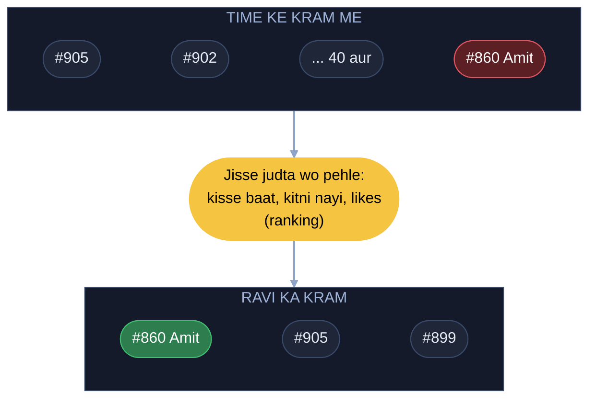

## 18. Scroll ke beech upar 5 naye, wahi 5 dobara (kahan tak padha yaad rakh)

Ravi scroll kar raha, 20 dekhe, agle 20 maange. Beech me upar 5 naye aa gaye, to neeche wale 5 khisak ke agle page me
chale gaye; isliye wahi 5 dobara. Hal: Arpan ne kahan tak padha, thodi der ke liye yaad rakh lo. "Arpan ne yahan tak
padh liya, ab iske baad wale do." Naye 5 upar hain, upar scroll karega to dikhenge. Refresh pe purani post dobara aa
sakti hai, Instagram ka kaam hi engage rakhna, wo chalta hai.

**Asli naam:** page number se agle 20 = offset pagination (isi se khisakta), kahan tak padha yaad rakh = cursor (har
page ke saath aakhri dikhayi post lautao, agla uske theek baad se), thodi der yaad = ranked feed (kadam 17) me ranked
list thodi der save, cursor usi list me aage.

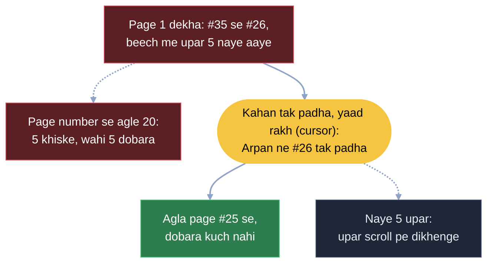

---

Notes (Arpan ke shabd) = [TWITTER_HAND_NOTES.md](TWITTER_HAND_NOTES.md)
