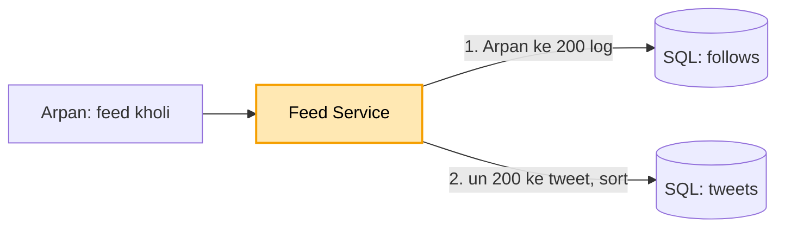
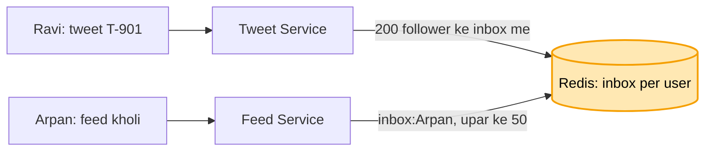
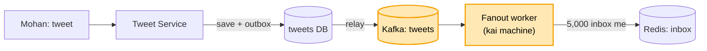
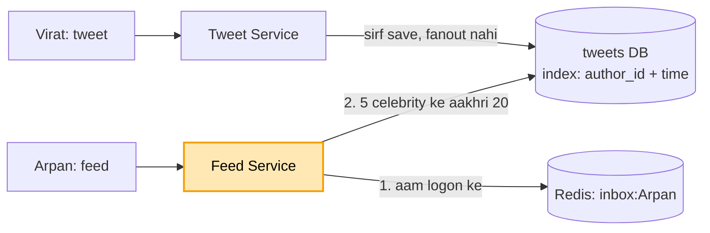
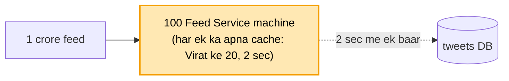
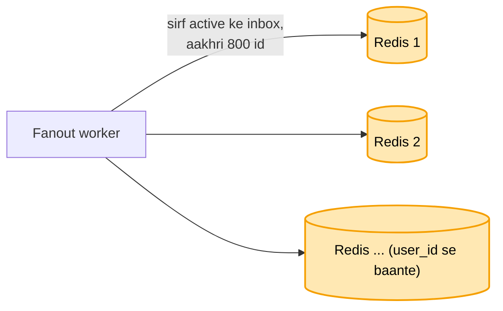
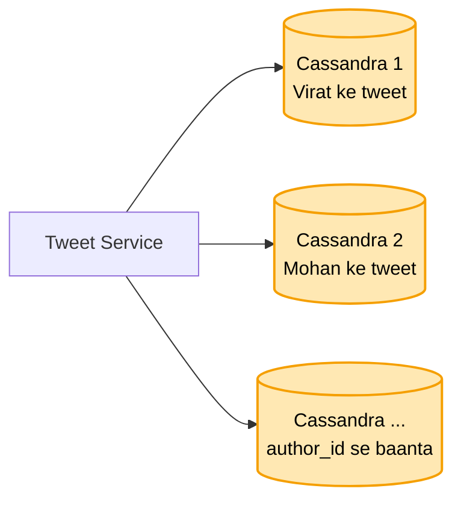
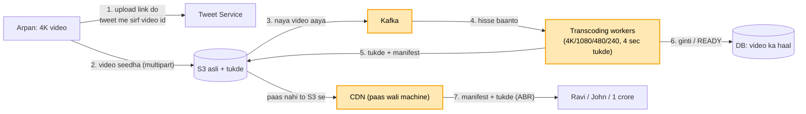
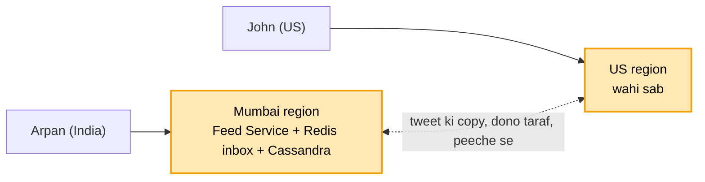

# Twitter feed: shuru se, ek kahani

Kram wahi jo interview me hota hai: **FR, phir NFR, phir numbers, phir design**. Design sabse seedhe dabbe
se shuru hota hai, aur har dikkat aane pe ek naya dabba judta hai. Diagram me peela dabba = abhi juda. Poori
file me ek hi kahani hai: Arpan 200 logon ko follow karta hai (Virat Kohli bhi), subah app khol ke feed dekhta
hai, kabhi khud tweet karta hai.

Zyadatar tukde pehle se padhe hue: Kafka worker ([notification](../04_notification_system/04_notification_system.md)),
Redis ([URL](../01_url_shortener/01_url_shortener.md)), Cassandra + S3 ([chat](../14_chat_messaging/14_chat_messaging.md)).
Iska apna: ek tweet laakhon logon ki feed me kaise pahunche (fanout), aur celebrity pe wo kaise mudta hai.

**Arpan (Ravi + King Kohli wala scene, [hand notes](TWITTER_HAND_NOTES.md)):** taiyaar dabba = inbox · Kohli ki ek parchi = celeb pe fanout nahi · sab milake sort = merge at read · stadium wala bhai = Kafka + outbox · parchi ki 15 copy = hot key replicas · aakhri 500 + 30 din wala = inbox chhota · bada bhai = Cassandra, user id se · apni branch = region · branches ki baat = cross-region copy · Ferrari / Alto = kai size + ABR · copy ka 51wa page = manifest + seek · kai machine + id ki parchi = transcoding workers · copy dekhne walon ke paas = CDN

**CUE (yahi shabd yaad rakhne hain, kram se):**
do table, har feed pe jod -> inbox pehle se (fanout) -> Kafka + fanout worker (+ outbox)
-> celebrity: fanout nahi, padhte waqt DB se (hybrid) -> viral: har server ka apna cache
-> inbox chhota (id, 800, sirf active: worker last_active dekhe) -> tweets Cassandra (author_id) + Kafka pehle (outbox gaya)
-> video: S3 seedha + kai size ke 4 sec tukde (manifest, ABR) + kai workers + CDN -> India region (Kafka topic ki copy, har region apne inbox bhare)

---

## 1. FR: kya karna hai

```
1. tweet post karna (text, photo / video)
2. home feed: jinko follow karta, unke naye tweet, naye upar
scope ke bahar: search, trending, DM, notification
```

## 2. NFR: kaisa chalna chahiye

```
- feed 200 ms me khule
- feed 2-5 sec purani dikhe to chalega (isliye pehle se bana sakte hain)
- celebrity (10 crore follower) ka tweet bhi sambhale
```

## 3. Numbers

```
- ~50 crore user, 50 crore tweet / din -> ~5,000 tweet / sec
- ek aadmi ~200 ko follow karta, celebrity ke 10 crore follower
- padhna : likhna ~50 : 1 (feed dekhne wale bahut zyada)
```

---

## 4. Design

### Kadam 1: sabse seedha (do table, har feed pe jod)

Do table: `tweets` (kisne kya likha, kab) aur `follows` (kaun kisko follow karta). Arpan feed kholta hai, to
har baar:

```
feed = follows se Arpan ke 200 log nikaalo
       -> tweets me se un 200 ke tweet nikaalo
       -> time se sort -> upar ke 50 dikhao
```



Par har feed kholne pe 200 logon ke tweet DB se nikaal ke sort karna. Feed dekhne wale likhne walon se 50
guna zyada, to DB har second laakhon baar yahi bhaari jod. Feed 3 sec me khulti, DB thak ke baith gaya.
Ek line: feed padhte waqt banti hai, aur padhne wale bahut zyada hain.

### Kadam 2: har user ka pehle se bana inbox (fanout on write)

**Arpan:** Har baar DB kyun khodna. Dost apna mujhe de do, main apne paas rakhunga, Ravi aaye to turant de dunga.

Har user ka Redis me ek **inbox** = uski taiyaar feed (sorted set, naya sabse upar). Koi tweet kare to wo
tweet usi waqt uske saare followers ke inbox me daal do. Isi ko **fanout** kehte hain: ek tweet, kai inbox me
bikhra.

```
Ravi ne tweet kiya (T-901) --> Ravi ke 200 follower kaun? --> har ek ke inbox me T-901 daalo
                                                                inbox:Arpan = [T-901, T-880, T-850 ...]
                                                                inbox:Mohan = [T-901, ...]

Arpan ne feed kholi --> Redis: inbox:Arpan se upar ke 50 --> turant (koi jod nahi, koi sort nahi)
```



Ab kya theek hua: feed kholna sirf ek Redis read, 200 ms se bahut kam. Bhaari kaam (kis-kis ke tweet nikaalo)
ab tweet karte waqt ek baar, har feed pe nahi. Dekhne wale 50 guna zyada, to kaam likhne wali taraf khiskana
sahi.

Inbox me poora tweet nahi, sirf tweet id (`T-901`). Text ek baar tweets table me; 200 jagah poora text rakhte
to jagah 200 guna. Feed pe un 50 id ka poora tweet DB se ek saath aata.

Read replica laga dete? Copy pe bhi har feed wahi 200 logon ka jod hota, bas bant jaata. Jod hi dikkat hai,
fanout hi jawab.

Par Arpan ka dost Mohan chhota influencer hai, 5,000 follower. Mohan ne tweet dabaya, aur Tweet Service 5,000
inbox me likh raha, uske baad hi "tweet ho gaya" bolega. Mohan ka button 5 second ghoomta raha.

### Kadam 3: tweet turant, fanout peeche se (Kafka + fanout worker)

**Arpan:** 8,000 dabbe bharne tak "Post" ghoome. Beech me stadium wala bhai Kafka, "ho gaya" bolo, peeche bharta rahe; gira to outbox ki parchi.

Dikkat: tweet karne wala ruke nahi, 5,000 inbox me likhna peeche se ho, aur beech me kuch khoye nahi. Yahi
notification kadam 2 wali dikkat hai, to wahi ilaaj.

```
Mohan: tweet --> Tweet Service --1. tweets DB me save--> "tweet ho gaya" (turant)
                           --2. khabar "T-950 by Mohan"--> [Kafka: tweets]
                                                              |
                                          fanout worker (kai machine) uthata
                                          -> Mohan ke 5,000 follower nikaalo
                                          -> har inbox me T-950 daalo
```



Kafka yahan isliye, ki dikkat khud maang rahi: likhne wala ruke nahi, peeche ka kaam khoye nahi, aur bheed
aaye to worker badha sakein.

Ab kya theek hua:
- Mohan ka button turant ruk jaata hai.
- 5,000 inbox me likhna worker peeche se karte. 2-3 sec lagein to chalega (NFR: feed 2-5 sec purani chalegi).
- worker gira to khabar Kafka me padi, wapas aake wahin se uthata.
- 5,000 tweet / sec ki bheed: worker badha do.

Ek chhed: Tweet Service ne DB me tweet save kiya, aur Kafka ko bhejne se pehle gira. Tweet DB me hai, par kisi ke
inbox me nahi. Ilaaj wahi **outbox** ([Kafka file kadam 7](../12_message_queue_kafka/12_message_queue_kafka.md#kadam-7-bhejne-wala-gira-outbox)): khabar bhi usi transaction me outbox table me,
relay use Kafka me daale.

**AWS pe:** Kafka ki machines hum khud nahi chalate, AWS ka **MSK** (Managed Kafka) lete hain. Broker, copy, gira to naya leader, ye AWS sambhalta hai. Topic aur partition hum tay karte hain.

Par Virat Kohli ne match ke baad tweet kiya, 10 crore follower. Fanout worker 10 crore inbox me likhne baitha,
ghanton lag gaye. Uske peeche Arpan, Mohan, sabke tweet line me atke.

### Kadam 4: celebrity ka alag raasta (hybrid fanout, twitter ka apna)

**Arpan:** 27 crore dabbe nahi. Kohli ki ek parchi, sab wahi se padhein; Ravi aaye to dabba + parchiyan milao, time se sort.

Do tarah ke log, do raaste:

```
aam log (jaise Mohan, 5,000 follower)  -> fanout on WRITE: tweet sabke inbox me (Kadam 2-3)
celebrity (jaise Virat, 10 crore)      -> fanout NAHI. Tweet bas tweets DB me (jaise har tweet jaata)

Arpan ne feed kholi:
  1. inbox:Arpan se aam logon ke tweet                         (pehle se bane, Redis)
  2. Arpan jin 5 celebrity ko follow karta, tweets DB se unke aakhri 20 (abhi padhe;
     tweets table me author_id + time ka index, to ye saada query)
  3. dono milao -> time se sort -> upar ke 50
```



Ab kya theek hua: Virat ka tweet ek hi jagah likha, 10 crore jagah nahi, to fanout line nahi atakti. Arpan ki
feed me bas 5 celebrity ke tweet padhte waqt jodne, 200 logon ke nahi, to feed tez rehti.

Doosra kyun nahi (asli choice):
- sabke liye fanout on write: Virat ka ek tweet = 10 crore likhai, line ghanton atakti (Kadam 3 wali).
- sabke liye fanout on read: har feed pe 200 logon ka jod, Kadam 1 wapas, feed dheemi.
- dono ka mel (hybrid): kam follower wale ka likhte waqt baanto, bahut wale ka padhte waqt jodo.

To kaun kahan se?

```
aam logon ke tweet  -> Redis (inbox:Arpan, pehle se bana)
celebrity ke tweet  -> tweets DB (padhte waqt), unke liye koi Redis nahi
```

Celebrity kaun? Ek had tay hoti (jaise 1 lakh se zyada follower). Ye faisla hai, pakka niyam nahi.

Par match khatam, Virat ke tweet pe 1 crore log ek saath feed
khol rahe. Sabki feed tweets DB se wahi ek query chala rahi: "Virat ke aakhri 20". DB pe ek hi jagah crore
padhai, DB garam.

### Kadam 5: crore log, sab DB se "Virat ke aakhri 20" (har server ka apna cache)

**Arpan:** Six ke baad 5 crore ek parchi pe. Us parchi ki 10-15 copy, padhne wale bant jaayein; edit hua to ladka (job) sab copy theek kare.

Ilaaj: har Feed Service machine ye jawab **apni memory me** 2 second rakhti hai (local cache). Matlab har server
ka apna chhota cache, uske andar hi; koi alag Redis nahi.

```
pehle: 1 crore feed --> sab tweets DB pe "Virat ke aakhri 20"          --> DB garam
ab:    1 crore feed --> 100 Feed Service machine
                        har machine ki memory me "Virat ke 20" (umar 2 sec)
                        --> DB tak har machine 2 sec me sirf 1 baar = 100 sawaal / 2 sec, crore nahi
```



Crore sawaal machine ki memory se nipat jaate, DB tak sirf 100 machine x 2 sec me ek baar.

2 sec purana chalega? Haan, NFR: feed 2-5 sec purani chalegi. Virat ka naya tweet kisi ko 2 sec der se dikhe,
to chalega.

Beech me Redis kyun nahi? Local cache akela hi DB ko bacha leta. Celebrity gine-chune (kuch hazaar), to unke
aakhri 20 tweet har machine ki memory me aaraam se aa jaate. Redis is design me sirf inbox ke liye (Kadam 2).

Ye [URL kadam 8](../01_url_shortener/01_url_shortener.md#kadam-8-ek-link-viral-local-cache) wala viral link hi hai: wahan ek link, yahan ek celebrity.

Par Redis me 50 crore logon ka inbox, har inbox me hazaron tweet id. Redis ki RAM bhar rahi, aur Redis RAM
mehngi hai.

### Kadam 6: inbox chhota rakho (3 chhoti baatein)

**Arpan:** Dabbe me aakhri 500, purana S3 me. 30 din se nahi aaya to dabba nahi, lauta to DB se bana do.

**1. Inbox me sirf tweet id** (ye Kadam 2 me ho chuka), poora tweet nahi.

**2. Har inbox me sirf aakhri 800 tweet.** Koi 800 se neeche scroll nahi karta. Naya tweet aaya to sabse
purana kaat do (sorted set trim).

**3. Sirf active logon ka inbox.** Jo 30 din se app nahi khola, uska inbox Redis me rakhte hi nahi (umar / TTL
se mit jaata). Par sirf TTL kaafi nahi: fanout worker har naye tweet pe `inbox:X` me likhta rahega to key phir
ban jaati, TTL taaza. Isliye worker likhne se pehle follower ka `last_active` dekhe:

```
fanout worker: follower X ke inbox me likhun?
   X 30 din se nahi aaya -> chhodo (inbox nahi banta)
   X active hai          -> likho
```

Wo wapas aaya to pehli baar uski feed Kadam 1 wale tareeke se ek baar banao (200 logon ka jod), aur inbox phir
se bhar do. Bas pehli feed thodi dheemi khulti.

```
sirf active log ke inbox, aakhri 800 id -> phir bhi kai TB, ek Redis machine me nahi samata
-> user_id se kai Redis machine me baanto (jaise URL me shard kiya)
```



**Ab kya theek hua:** Redis me sirf wahi jo sach me dekha jaata hai, aur wo kai Redis machine me bata hua,
jaise [URL me shard](../01_url_shortener/01_url_shortener.md#kadam-5-data-bahut-bada-db-ke-tukde--shard) kiya tha.

Par roz 50 crore naye tweet tweets DB me jaate: 5,000 likhai / sec, saal bhar me sau TB. Ek SQL DB machine ye
likhai aur jagah nahi jhel paayegi.

### Kadam 7: tweets DB pe likhai bahut (Cassandra, author_id se baanto)

**Arpan:** Likhai bahut to bada bhai Cassandra. Naam se nahi, user id se todo, Arpan ka sab ek jagah. Follow ka hisaab Neo4j.

Pehle tweets ka kaam dekho:
- tweet ek baar likha jaata, phir badalta nahi.
- padhai seedhi: "ye 50 id ke tweet do" ya "Virat ke aakhri 20".
- koi jod nahi chahiye, bank jaisa transaction bhi nahi.

Ilaaj: tweets ko **Cassandra** me rakho, aur `author_id` se baanto. Virat ke saare tweet ek hi machine pe,
time ke kram me. "Virat ke aakhri 20" ek hi jagah se seedha.

```
Tweet Service --likho--> [Cassandra: kai machine, author_id se baanta]
                        machine 1: Virat ke tweet (time ke kram me)
                        machine 2: Mohan ke tweet
                        ...
```

Par inbox me abhi sirf tweet id hai (`inbox:Arpan = [T-901, ...]`). Cassandra machine tab dhoondhta hai jab
baantne wali cheez, yaani `author_id`, pata ho. Sirf `T-901` se pata nahi chalta kis author ka hai, to ye bhi
nahi pata kis machine pe jaana hai. Saari machine me dhoondhna padega, bahut dheema.

```
inbox:Arpan = [T-901, ...]
Feed: "T-901 do" -> Cassandra: author kaun? pata nahi -> kis machine pe? pata nahi
```

Isliye inbox me tweet id ke saath author bhi rakho:

```
inbox:Arpan = [T-901 by Ravi, T-880 by Mohan, ...]
Feed: "Ravi ka T-901 do" -> Ravi wali machine -> seedha mil gaya
```

Kadam 3 me fanout worker ko Kafka se khabar pehle se "T-950 by Mohan" aati hai, author uske paas hai hi. Bas
inbox me daalte waqt saath rakhna hai. Jagah me farak chhota, ek id aur.

Ek cheez aur tooti: kadam 3 ka **outbox**. Wahan tweet aur outbox ki khabar ek hi transaction me likhte the.
Ab tweets DB Cassandra hai, wahan ye transaction aur outbox me "abhi nahi bheje" wali dhoondh, dono theek se
nahi chalte. Isliye ab **Kafka pehle**:

```
Arpan ka tweet -> Tweet Service -> Kafka "tweets" me likho (acks=all, saari copy ne li) -> tab Arpan ko "ho gaya"
                                   Kafka "tweets" --> consumer 1: Cassandra me save
                                                  --> consumer 2: fanout (followers ke inbox)
```

Kafka hi pehli aur pakki jagah jahan tweet likha jaata. Ek hi jagah likha, to "DB me gaya par khabar nahi
gayi" wali dikkat hoti hi nahi, outbox ki zaroorat khatam.



Ye [chat kadam 5](../14_chat_messaging/14_chat_messaging.md#kadam-5-roz-12-tb-cassandra-chat-ke-hisaab-se-baanto) wala hi faisla: wahan message `chat_id` se baante, yahan tweet `author_id` se.

SQL kyun nahi, Cassandra kyun? SQL ki taakat jod aur transaction hai, yahan dono nahi chahiye. 5,000 likhai /
sec aur saal bhar me sau TB, ye SQL ko kai machine me haath se baantna padta. Cassandra likhai ke liye hi bana
hai, khud kai machine me baant leta hai. Isliye Cassandra.

**Maan lo Arpan ne Ravi ko unfollow kiya:** inbox me author hai (kadam 7), to worker peeche se inbox:Arpan se
"by Ravi" wale hata deta. Tab tak feed banate waqt follow list se filter: jise follow nahi karta, uska mat dikhao.

**Maan lo tweet delete hua:** 5,000 inbox se dhoondh ke hatana mehnga. Cassandra me tweet pe "deleted" nishaan.
Feed banate waqt poora tweet laate hain, wahi nishaan dikha to chhod do.

**Maan lo apna tweet turant nahi dikha:** Kafka pehle hai (kadam 7), Cassandra tak ek pal lagta. App apna naya
tweet khud upar laga deta, server ka intezaar nahi.

**AWS pe:** Cassandra AWS ka **Keyspaces** (machine, copy AWS sambhalta), ya EC2 pe khud chalao (tab sab hamara sar-dard).

Par Arpan ne stadium se King Kohli ke six ka 1 GB 4K video daala. Video Tweet Service aur Cassandra ke raaste gaya to
dono bhar jaayenge, saath me sabke tweet atkenge. Aur 1 crore log dekhenge, kuch WiFi pe, kuch gaon ke 3G pe.

### Kadam 8: King Kohli ke six ka 1 GB video (S3 seedha, kai size, tukde, workers, CDN)

**Arpan:** Video apne server pe mat la, alag raaste se. Ferrari highway ke liye, Alto gaon ke liye. Kai machine, kaam baanto, id ki parchi. Copy dekhne walon ke paas.

Arpan stadium se six ka 4K video daalta hai, 1 GB. Video pe paanch dikkat aati hain, har ek ka hal:

**1. Video Tweet Service se mat guzaaro.** Match ke din 50,000 log bhaari video daalte hain; agar sab Tweet Service se jaaye
to uski memory aur net bhar jaate, chhote text tweet bhi atak jaate. Isliye app pehle Tweet Service se ek S3 link maangta
(presigned URL, 10 min ka), aur video seedha S3 me tukdon me (multipart) daalta. Tweet me sirf video ki id / link.

**2. Ek file nahi, kai size (transcoding).** John New York me WiFi + TV pe, Ravi gaon me 3G phone pe. Sirf 4K file ho to
Ravi ka phone 1 GB kheench hi nahi paata. Isliye video 4K, 1080p, 480p, 240p me banta hai, aur har size 4-4 second ke
tukdon (segments) me kat-ta hai. Saath me ek list (manifest, HLS `.m3u8`): kaunsa size, kaunsa tukda kis link pe.

**3. Phone khud chunta hai (ABR).** Ravi ka phone poora video nahi, pehle manifest, phir tukda-tukda maangta. Pichhla tukda
jaldi aaya to agla bada size, net gira to chhota. Server kuch nahi sochta: wo karodon logon ka hisaab rakh sakta hai, par jab phone khud yaad rakh sakta hai to server pe bojh aur kharcha kyun. Ravi 2:00 pe khiskaye to phone hisaab lagata:
120 / 4 = tukda #31, seedha wahi maangta, 0 se 2:00 tak kuch nahi (seek).

**4. Bhaari kaam kai workers pe.** Ek machine pe 4 size banana 20 minute, aur 50,000 video line me. Isliye S3 me video
aate hi event -> Kafka -> video ko hisson me kaato -> kai transcoding worker ek saath, har hissa `video id + hissa number`
ki parchi ke saath, S3 me usi naam ke raste pe (`videos/v-555/480p/seg_031`). DB me ginti: "20 me se 17 hisse bane".
Sab ban gaye to manifest + DB me `READY`. Tab tak tweet pe "processing...", aur 240p pehle bana ke chalu kar do.
**Maan lo worker 7 gira:** heartbeat band, uska hissa naye worker ko, uski parchi (checkpoint) se wahin se. Same naam se
likhta, to double nahi (idempotent). **Maan lo worker 7 zinda par atka (1 ghanta, baaki 2 min):** timeout pe hissa
replacement ko, wo checkpoint se uthaye.

**5. Dekhne wale paas se (CDN).** Six viral, 1 crore log India, US, Australia se. Har tukda US ke S3 se samundar paar
mangana = bill aasmaan pe aur India me atkna. Isliye tukde CDN pe (paas wali machine), S3 tak sirf pehli baar.
**Maan lo private video (10 dost) aur Ravi ne CDN link WhatsApp group me daal diya:** sirf link kaafi nahi. Har request
pe access check (allow list: sirf wo 10), link signed + thodi der ka, video id random.



Ab kya theek hua: bhaari video kabhi Tweet Service / Cassandra se nahi guzarti, har net pe chalti (kai size + ABR),
skip turant (manifest + seek), lamba video bhi jaldi taiyaar (kai worker), aur crore log paas se dekhte (CDN).
Upload ka hissa [chat kadam 10](../14_chat_messaging/14_chat_messaging.md#kadam-10-200-mb-ka-video-s3-me-message-me-sirf-link) aur file upload jaisa hi hai.

**AWS pe:** video **S3** me, transcoding **AWS Elemental MediaConvert** (ya apne workers ECS / EC2 pe), log tak **CloudFront** (CDN, signed URL / cookie).

Par Arpan Bangalore me, aur saare server, Redis, Cassandra US me. Har feed ko US jaana aur aana, akela safar
hi ~300 ms. NFR "feed 200 ms" toot gaya.

### Kadam 9: Arpan India me, server US me (India me apna region)

**Arpan:** Lajpat Nagar me hi branch khol do. Branches aapas me baat karein; baat ruki to banda sambhal ke rakhe, judte hi bheje.

```
India region (Mumbai):  Feed Service + Tweet Service + Redis inbox + Cassandra ki copy
US region:              wahi sab, apne logon ke liye

Arpan (India) --feed--> Mumbai region -> inbox:Arpan Mumbai ke Redis me -> ~50 ms
Virat ne tweet kiya (India) -> Mumbai Cassandra me likha -> peeche se US Cassandra me copy (kuch second)
```



Kiska inbox kahan: har user ka inbox uske apne region me banta, jaise [rate limiter](../02_rate_limiter/02_rate_limiter.md#kadam-10-3-region-se-300-nikal-gayi-home-region) me "home region".
Fanout worker Arpan ka inbox Mumbai ke Redis me bharta.

India ka tweet, US ka follower? Mohan (India) ne tweet kiya, uska follower John US me, John ka inbox US Redis
me. Har tweet pe samundar paar ke Redis me likhna dheema aur toot sakta. Isliye tweets wale Kafka topic ki copy
doosre region me bhi jaati (Kafka ka tool, MirrorMaker), aur har region ka apna fanout worker sirf apne region
ke followers ke inbox bharta:

```
Mohan (India) tweet --> Mumbai Kafka: tweets --copy--> US Kafka: tweets
                           |                              |
                   Mumbai worker                     US worker
                   -> India wale followers ke inbox  -> John (US) ka inbox
```

Copy peeche se (US tak kuch second) kyun chalta: NFR, feed 2-5 sec purani chalegi. US wale ko Virat ka tweet
2 sec baad dikhe to dikkat nahi; bank jaisa "abhi ka abhi pakka" yahan nahi chahiye.

---

## Wrap: 30 sec me poora design

```
Tweet aaya: Tweet Service use Kafka "tweets" me likhta (acks=all), turant "ho gaya". Ek consumer Cassandra
me save karta (author_id se baanta), fanout worker aam logon ke tweet ki id unke active followers ke Redis inbox me daalte
(aakhri 800, soye hue ko chhod ke). Celebrity ka fanout nahi: feed padhte waqt unke aakhri tweet DB se, har
server ke apne cache se 2 sec. Feed = inbox ki 50 id + celebrity ke tweet, milao, poora tweet DB se. Video
seedha S3, kai workers kai size ke 4 sec tukde banate (manifest), phone net dekh ke tukda chunta (ABR), dekhne wale CDN se. Har desh ka apna region; Kafka topic ki copy doosre region jaati, wahan ka worker
wahan ke inbox bhare.
```
