# Twitter Feed

> App kholo -> HOME TIMELINE: jinhe tum follow karte ho unke tweet, sabse naye upar. Tweet daalna (POST) bhi.
> Misaal: Arpan ne app khola -> Virat "Match great" · Sachin "Watching IPL" · Dhoni "Practice".
> Is design ka dil do cheezein hain: **feed padhna sasta ho** (log 50 baar padhte hain, 1 baar likhte hain, isliye feed pehle se bana ke rakho)
> aur **celebrity ka tweet** (10 crore follower).

```
RAJA KA RAJYA (poori file isi se yaad rakho):
   har aadmi ka apna notice board = Redis inbox      · dhindhora peetne wala = Fanout service
   mahal ka bada register         = tweet store (Cassandra) · likhne wala munshi = Tweet service
   akhbaar padhne wala            = Timeline service  · kaun kiska chela register = Graph DB
   akhbaar ka truck               = Kafka
```

---

## KAHANI (ek din, meri feed aur mere tweet; har dikkat se design me ek dabba judta)

```
    KYA HUA                                    ILAAJ                                DABBA JUDA
1   subah app khola, 200 ka jod, feed dheemi -> PUSH: tweet hote hi INBOX me id     Fanout + Redis inbox
2   maine tweet kiya, button 3 sec ghooma    -> KAFKA, fanout peeche                Kafka + Fanout workers
3   Bieber ka tweet = 10 crore inbox         -> HYBRID: aam push, celeb pull        (celeb skip, merge)
4   match khatam, Virat ka tweet, DB gira    -> HOT-TWEET CACHE (RAM)               Hot-tweet cache
5   Redis alert: 50 crore inbox, RAM bhari   -> SIRF ID, aakhri 800                 (inbox chhota)
6   5,000 tweet / sec, 0.5 PB                -> CASSANDRA, user_id se baanto        Cassandra
7   main Bangalore, data US, 200 ms          -> REGION-WISE + Route 53              Route 53
8   akeli App machine giri, sab band         -> STATELESS App x N + ALB             ALB + App x N
9   padhne ki bheed, tweet daalna dheema     -> ALAG SERVICE (likhna/padhna)       Tweet/Timeline/User + Graph
10  maine video daali, sabko dheemi          -> S3 + CDN                            S3 + CDN

POORA DESIGN (upar ke dabbe kram se):
   LIKHNA: Route 53 -> ALB -> Tweet Svc -> Cassandra + Kafka -> Fanout workers -> Redis inbox (celeb skip)
   PADHNA: Timeline Svc -> Redis inbox (push) + Hot-tweet cache (celeb pull) -> milao -> top 50
   follow = User Svc + Graph DB · photo / video = S3 + CDN
```

---

## TASVEER (ByteByteGo / Alex Xu · CC BY-NC-ND 4.0)


Source: [Twitter Architecture 2022 vs. 2012](https://bytebytego.com/guides/twitter-architecture-2022-vs-2012/)
(asli Twitter ka naksha: timeline service, fan-out, cache. Ye design uska chhota roop hai.)

---

## SHURU: pehle poocho, phir numbers

```
POOCHO:  "Timeline, post, search, trending, DM, notification — kis
         pe dhyaan? Main home timeline + post pe chalta hoon."
         ~50 crore user maan lun? · celebrity (10 crore follower) sambhalna hai?  <- design yahin mudta hai
         feed bilkul usi second ki chahiye, ya 2 second purani chalegi? (chalegi -> pehle se banana possible)
         photo / video bhi, ya sirf text?

ZAROORI KAAM (FR):   tweet daalo · home timeline (follow kiye logon ke, naye upar) · profile ke tweet
                     bahar: search · trending · DM · notification
KAISA CHALE (NFR):   feed 200 ms se tez · padhna bahut zyada · 50 crore user · 2 second purani feed chalegi

NUMBERS (andaaza):
   50 crore tweet / din -> din me ~1 lakh second -> ~5,000 tweet har second
   ek aadmi ~200 ko follow karta · celeb ke 10 crore follower · padhna : likhna ~50 : 1

NUMBER SE FAISLA:
   50 : 1        -> har baar feed khulne pe jodna mat, PEHLE se bana ke rakho
   celeb         -> ek tweet pe 10 crore jagah likhna? -> asli dikkat
   2 sec chalega -> pehle se banana + cache chal jaayega
```
```
POOCHEGA: "Consistency or availability — which do you pick?"
          (Consistency ya availability, kya chunoge?)

JAWAB:    Feed ke liye: chalta rahe, chahe thoda purana ho.
          Arpan ko 2 second purani feed dikhi to koi farak nahi. Par feed khuli hi nahi to wo app band
          kar dega.
          Isliye network toote to bhi jo hai wo dikhao, sahi wala thodi der me aa jaayega.
```

---

## ════ MOCK SE PEHLE: SIRF YE CARD PADHO ════

> Har card: pehle PEELA DABBA dekho (scene + ilaaj). Yaad aa gaya -> aage. Nahi aaya -> neeche
> DIKKAT / HAL / NAHI padho. AAGE POOCHEGA sirf jab interviewer aage kuch poochhe.

#### DABBA 0: SABSE SIMPLE (yahan se shuru, phir "kahan tootega")
```
Do table: tweets (kisne kya likha) + follows (kaun kisko follow karta).
Feed = jinko follow karta unke tweet nikaalo, time se sort karo, upar ke 50 do.
```
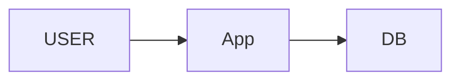

#### 1 Subah app khola, feed ghoomti rahi (har baar 200 logon ka jod)
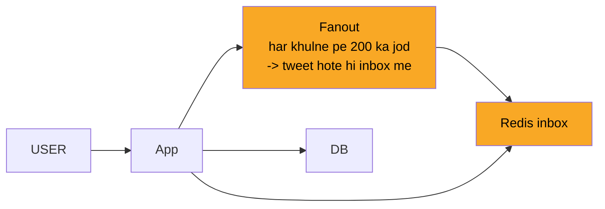
```
DIKKAT     Subah 8 baje maine app khola. Main 200 ko follow karta -> 200 logon ke tweet laao, jodo, sort,
           upar ke 50. Har user ke saath, har baar app kholne pe 200 ka jod -> feed dheemi.
HAL        PUSH (FANOUT): tweet hote hi feed bana do. Suresh ne tweet kiya -> Fanout har follower ke INBOX
           me tweet_id. Inbox = Redis SORTED SET (score = time); app khola -> bas inbox padho.
NAHI       har baar khulne pe jodo: padhna 50 guna zyada, har khulna mehnga.
```
```
AAGE POOCHEGA:
  NIYAM: padhna 50 guna zyada -> mehnat likhte waqt, padhna sirf inbox se.
  "Inbox me sirf number, tweet?"   -> 50 number ek saath, ek chakkar me tweet store / cache se (batch).
  "Unfollow kiya, tweet pade?"     -> padhte waqt follow list se chhaan do, ya peeche se saaf karo;
                                      turant poora inbox nahi badalte.
```

#### 2 Maine tweet kiya, button 3 sec ghoomta raha
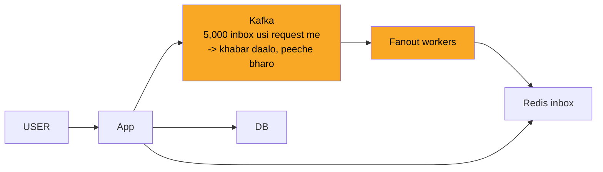
```
DIKKAT     9 baje maine tweet kiya (5,000 follower) -> usi request me 5,000 inbox. Redis dheema (~10 ms har)
           -> 50 second, timeout, "fail" dikha, par tweet DB me ban chuka tha.
HAL        KAFKA + FANOUT WORKERS: tweet DB me + khabar Kafka me -> turant "ho gaya". Workers peeche inbox
           bharte; key = author_id -> ek aadmi ke tweet ek line me, kram se.
NAHI       App me peeche ek thread: App crash = thread ka kaam gaya; Kafka disk pe, dobara padh sakte.
```
```
AAGE POOCHEGA:
  NIYAM: user sirf save ka intezaar kare; baaki kaam Kafka se peeche, dobara chalne layak.
  "Worker 100 me 60 likh ke gira?" -> Kafka ko "ho gaya" nahi bola -> khabar dobara, phir se likhega.
  "Tweet do baar inbox me?"        -> nahi; sorted set me same tweet_id dobara daalo to ek hi rehta.
  "Apna tweet apni feed me nahi?"  -> fanout peeche hai; apna tweet seedha apni feed me jodo. Bug nahi,
                                      aisa hi banate hain.
  "Kai worker kaise?"              -> Kafka ki lines (partition) aapas me baant lete.
```

#### 3 Bieber ka ek tweet = 10 crore inbox, line ghanton atki
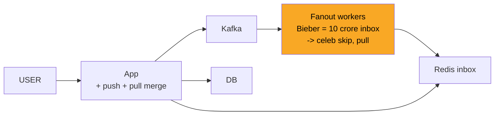
```
DIKKAT     11 baje Bieber (10 crore follower) ne tweet kiya -> fanout ko 10 crore inbox. Uski Kafka line
           ghanton atki; usi line ke baaki logon ke tweet bhi peeche khade.
HAL        HYBRID: 10,000 se kam follower = PUSH; zyada = PULL, Bieber ke tweet inbox me nahi. Main feed
           kholun tab uske naye tweet alag se laao, mere inbox ke 50 ke saath milao + sort.
NAHI       sabke liye pull: har feed khulna phir 200 ka jod, mehnga.
```
```
AAGE POOCHEGA:
  NIYAM: aam log push, celeb pull, padhte waqt dono milao.
  "Push ya pull?"                  -> push: feed turant, celeb pe likhne ka toofan · pull: likhna sasta,
                                      khulna mehnga -> HYBRID.
  "9,999 / 10,001 pe palat raha?"  -> beech me jagah: 12,000 upar -> pull, 8,000 neeche tabhi wapas push.
  "Celeb garam, user_id pe baantna galat?" -> nahi, baaki crore logon ke liye theek; ek garam key ko
                                      consistent hashing nahi bachata -> uske tweet ka alag RAM cache.
  "Ek tweet pe laakhon like?"      -> ginti 10 tukde (tweet123#0 se #9), like kisi ek me, padhte waqt jodo.
```

#### 4 Match khatam, Virat ka tweet, crore log ek saath, DB gira
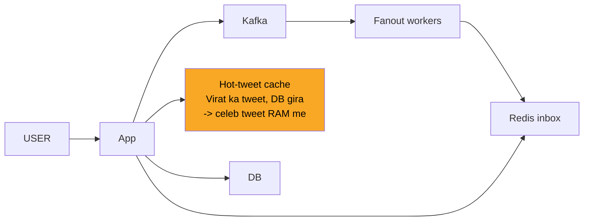
```
DIKKAT     3:30 wala IPL match khatam, Virat ne tweet kiya. Virat pull pe -> har feed me DB se. Crore log
           ek saath app khole -> crore read DB pe -> DB gira.
HAL        HOT-TWEET CACHE: celebs ke naye tweet RAM me (~1 ghanta), ~100 me 95 read wahin se; purane DB se.
           Cache me nahi mila -> sirf EK request DB jaaye (taala), baaki ruk ke wahi jawab lein.
NAHI       DB ki copies badha do: wo bhi disk se (ms), ek garam hisse ki copies crore read nahi jhelti.
```
```
AAGE POOCHEGA:
  NIYAM: bestseller kitaab counter pe, godown me nahi: garam tweet RAM me (<1 ms).
  "Ek tweet ki key, machine garam?" -> us tweet ki 5 copy (tweet:123#1 se #5), read kisi bhi copy se;
                                      saath me App ki memory me 1-2 second ka chhota cache.
  "Virat ne edit / delete kiya?"   -> cache se wo key hatao, agla read DB se naya laayega.
  "IPL final me achanak 10 guna?"  -> toofan Kafka pakad leta; pata ho to pehle machine + cache garam
  "Celeb cache kitna bada?"        -> chhota: ~5 lakh tweet x 500 byte = ~250 MB.
```

#### 5 Shaam ko Redis alert: 50 crore inbox, RAM bhar rahi
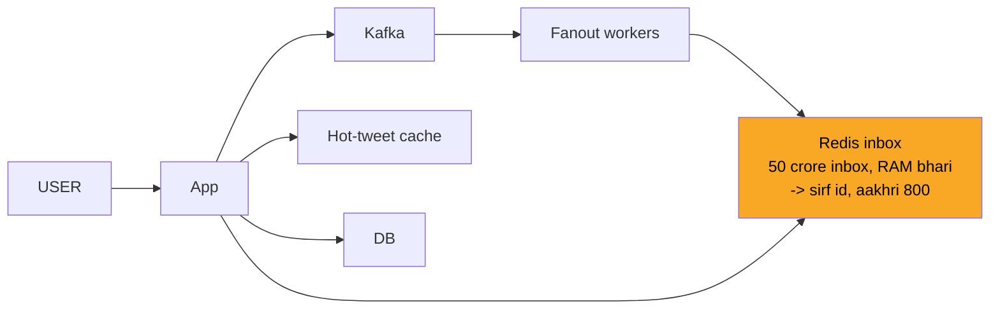
```
DIKKAT     Shaam 5 baje Redis alert: har user ka poora feed RAM me rakha tha -> 50 crore user, RAM bhar rahi.
HAL        SIRF ID, AAKHRI 800: inbox me sirf tweet number, aakhri ~800, purane kaat. 800 = ~60 KB, 50 crore
           x 60 KB = ~30 TB -> sirf jo mahine me aaye unka inbox, baaki hata do.
NAHI       inbox me poora tweet: ek tweet 200 jagah copy, RAM phategi.
```
```
AAGE POOCHEGA:
  NIYAM: RAM me sirf number aur sirf zinda log; baaki zaroorat pe DB se bana lo.
  "Ek entry kitni?"                -> ~60-100 byte (number + score + Redis ka apna kharcha).
  "Mahino baad wapas aaya?"        -> pehli baar purane tareeke se (pull), phir inbox bharo; ek baar dheema.
  "800 ke aage scroll?"            -> wahan se DB se lao; bahut kam log itna neeche jaate.
  "Redis hi gira?"                 -> har feed DB se = bahut mehnga, isliye Redis ki copies. Phir bhi gira
                                      -> kuch request mana, har inbox ek hi request banaye, dheere bharo.
```

#### 6 DB alert: har second 5,000 tweet, 5 saal me 0.5 PB
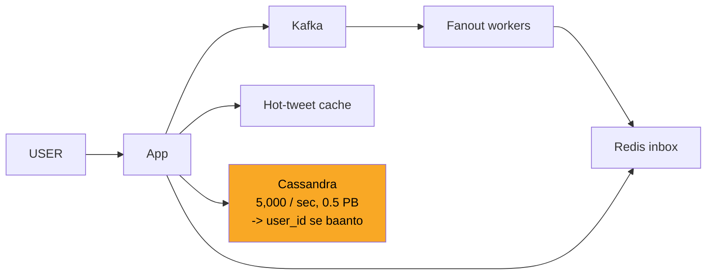
```
DIKKAT     6 baje DB alert: har second ~5,000 naye tweet, 5 saal me ~0.5 PB. Ek DB na itna rakh sakta,
           na itna likh sakta.
HAL        CASSANDRA, user_id se baanto: mere saare tweet ek jagah -> profile ek jagah se. Famous = key me
           mahina bhi (user + mahina). Andar time ulta (naya pehle). Likhna = commit log ke aakhir + RAM.
NAHI       MySQL: har tweet pe har index disk pe dhoondh ke badalna, dheema; join / transaction chahiye nahi.
```
```
AAGE POOCHEGA:
  NIYAM: jis cheez se padhte (ek user ka profile), usi se baanto; likhna sirf aakhir me jodna.
  "Likhna itna tez kaise?"         -> diary ke aakhir + RAM -> "ho gaya"; purana dhoondh ke badalna nahi.
                                      RAM bhari -> nayi file disk pe, peeche chhoti files mila leta.
  "Padhna dheema kab?"             -> ek user ka data kai chhoti files me; compaction + bloom filter se kam.
  "tweet_id pe kyun nahi?"         -> bojh barabar, par profile page ke liye saari machine poochni padti.
  "Padhne / likhne ki alag copy?"  -> nahi, koi main copy nahi; "3 copy, 2 me likho, 2 se padho".
```

#### 7 Main Bangalore me, data US me, har feed 200 ms
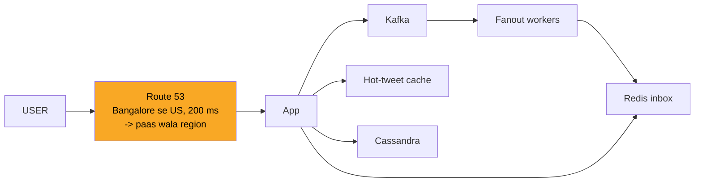
```
DIKKAT     Shaam 7 baje India me sab online. Main Bangalore me, data US me -> har request 200 ms (paas 5 ms).
HAL        REGION-WISE (India / Europe / US): Route 53 paas wale region ka pata deta. Cassandra ek region ka
           likha doosre me thoda baad copy; US celebs ke garam tweet India ke cache me bhi.
```
```
AAGE POOCHEGA:
  NIYAM: data user ke paas; copy thodi peeche chalegi (2 second purani feed chalti).
  "Fayde kya?"                     -> tez · Europe ka data Europe me (GDPR) · har region ki bheed ka time
                                      alag · ek gira to baaki chalein.
  "Main US ghoomne gaya?"          -> data India me; request India bhejo, ya paas ki copy se (thoda purana).
  "Poora region gira?"             -> Route 53 paas wale zinda region pe; copy peeche -> feed thodi purani.
  "Do region me ek saath likha?"   -> tweet aksar naya banta; takraav -> jiska time baad ka (last write wins).
```

#### 8 Raat ko akeli App machine giri, sab band
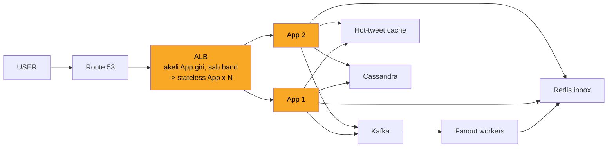
```
DIKKAT     Raat 8 baje: sab kuch ek App machine pe. Laakhon log nahi jhelti, aur wahi giri -> sab band (SPOF).
HAL        STATELESS App x N + ALB: machine kuch yaad nahi rakhti, koi bhi request kahin bhi. ALB har ~10 sec
           "zinda?": jawab nahi = bahar, theek = wapas. Route 53 isi tarah region / ALB ko dekhta.
```
```
AAGE POOCHEGA:
  NIYAM: machine kuch yaad nahi rakhti, isliye koi bhi hate ya jude, farak nahi.
  "Naya code, saari restart?"      -> ek-ek karke (rolling deploy): nikaalo, naya daalo, jodo; site band nahi.
  "Nayi machine, pehli dheemi?"    -> apna data nahi (sab Redis me), farak kam; ALB use dheere traffic de.
```

#### 9 Highlights ki bheed ne mera tweet daalna dheema kar diya
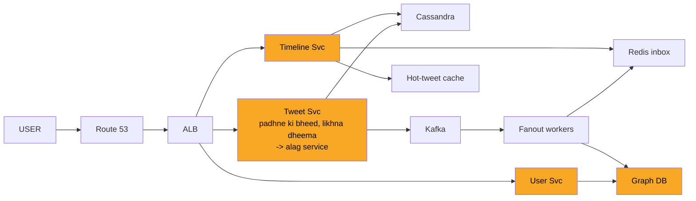
```
DIKKAT     Raat 9 baje highlights ki bheed: feed padhne wale laakhon, likhne wale hazaron, dono ek service me
           -> padhne ki bheed ne mera tweet daalna bhi dheema kar diya.
HAL        ALAG SERVICE: Tweet Svc (likhna), Timeline Svc (feed), User Svc, Graph (follow). Gateway raasta:
           POST /tweet -> Tweet Svc · GET /feed -> Timeline Svc. Har ek ki apni machine, LB, autoscale.
```
```
AAGE POOCHEGA:
  NIYAM: jiski bheed badhi, sirf wahi badhao; doosre pe asar nahi.
  "Feed ki bheed badhi?"           -> sirf Timeline ki machine badhti, Tweet Svc pe asar nahi.
  "Main kisko follow, kahan se?"   -> Graph / User service se, par har baar call nahi; follow list Redis me.
  "Fanout ko 10,000 followers?"    -> Graph store se 1000-1000 ke panne me padh ke inbox likho.
  "Graph DB (Neo4j) zaroori?"      -> seedhi follow list ko ek table / Cassandra kaafi; Graph DB tab jab
                                      "dost ke dost" jaise sawaal hon.
```

#### 10 Maine match ki video daali, sabko dheemi aur mehngi
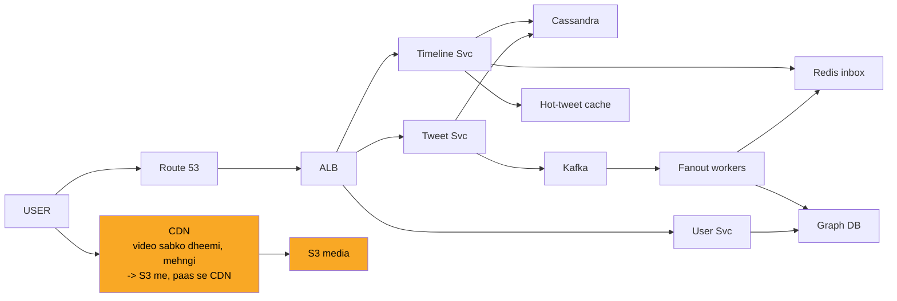
```
DIKKAT     Raat 10 baje maine match ki video daali. Duniya bhar ko har baar hamare server se -> dheema bhi,
           mehnga bhi.
HAL        S3 + CDN: video S3 me, user tak CDN se (uske paas wala server); tweet me sirf CDN link. CDN ke paas
           nahi -> S3 se laata, kuch der rakhta, phir sabko wahin se. CDN sirf media ke raaste, API ke nahi.
```
```
AAGE POOCHEGA:
  NIYAM: bhaari maal S3 me, user ke paas CDN se; tweet me sirf link.
  "Photo delete, CDN pe dikh rahi?" -> CDN ko "ye hatao" (invalidation), ya link me version (abc_v2.jpg)
                                      -> naya link = nayi file.
  "Private photo sabko dikhegi?"   -> link pe hastakshar + expiry (signed URL): sirf jisko mila, thodi der.
```

---

## AAKHRI DABBA + WRAP (ek hi baar)

```
LIKHNA: Route 53 -> ALB -> Tweet Svc -> Cassandra me save -> Kafka -> Fanout workers
        -> aam followers ke Redis inbox me sirf tweet number (aakhri 800 rakho), celeb skip
PADHNA: Timeline Svc -> Redis inbox (push) + celebs ke tweet celeb cache se (pull)
        -> milao + sort -> number se poora tweet laao -> upar ke 50 · photo / video S3 me, user tak CDN se
FOLLOW: User Svc + Graph DB

DB:  Tweet = Cassandra (bahut zyada, seedha kaam, likhna bahut, user_id + time se baanta)
     Inbox = har user ka Redis sorted set, sirf number (poora tweet 200 jagah copy kiya to RAM phategi)
     Graph = Neo4j ya Cassandra (followers / following)
```
```
JAWAB:    Likhna: tweet Cassandra me save, aur 'naya tweet' Kafka me. Worker aam followers ke Redis inbox
          me tweet id daalte.
          Padhna: Arpan ka inbox lo, famous logon ke naye tweet alag cache se lo, dono milao, time se
          sort, top 50 bhejo.
          Famous ke liye 'padhte waqt laao', baaki ke liye 'pehle se daal do'. Cassandra user id + time
          se baanta, doosre desh me copy.
          Aage: ML se ranking, trending, search.
```
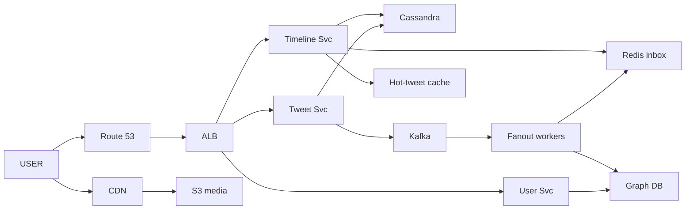

---

## 10 GUNA TRAFFIC — har dabba alag se

```
Timeline Svc   -> har baar 200 logon ka jodna? -> inbox pehle se bana (ho gaya) · machine badhao
Redis inbox    -> 50 crore inbox -> aakhri 800 + soye hue hatao · cluster + copy
celeb ke read  -> celeb cache 95% · garam key ki kai copy + App ka chhota cache
Cassandra      -> user_id (+ time) se baanta · Bieber ki machine garam -> uska data aur copy
doosre desh    -> region + garam data har region me copy
Kafka          -> partition badhao · fanout workers badhao
ASLI TWITTER   = sab ek saath: user_id se baanta + time ke tukde + region copy + garam data sab jagah cache

POOCHEGA: "Kahan se gir sakta?"       -> har dabbe pe "ye gira to?"
POOCHEGA: "Chal raha, kaise pata?"    -> feed ka time (p99) · galtiyan · Kafka me kitna pending (fanout
                                         peeche?) · alert
```

---

## POOCHE TO (gehra sawaal aaye tab)

```
API:      POST /tweet { content } -> tweetId · GET /feed?limit=50 -> home timeline · GET /user/{id}/tweets

DB:       TWEET  -> Cassandra (bahut zyada, seedha, likhna bahut, user_id se baanta)
          INBOX  -> har user ka Redis SORTED SET (score = time): naya jodo (ZADD, same id dobara = ek hi)
                    padho (ZREVRANGE 0 49) · 800 ke baad kaato (ZREMRANGEBYRANK)
                    sirf number. Poora tweet daala to ek tweet 200 jagah copy, RAM phategi
          GRAPH  -> Neo4j ya Cassandra (followers / following)

LIKHNA:   Suresh -> Tweet Svc -> Cassandra me save (tweet_id, user_id, content, time)
                             -> Kafka -> Fanout: followers nikaalo, celeb
                                chhodo, har aam follower ke inbox me tweet_id
PADHNA:   Timeline Svc -> Redis inbox (push) + celebs ke tweet (cache / Cassandra, pull)
                       -> milao + sort -> number se poora tweet -> upar ke 50
```

---

ARCHETYPE A (read-heavy/feed) · CONCEPTS: [caching](../../FOUNDATIONS/04_caching.md) · [sharding](../../FOUNDATIONS/06_database_sharding.md) · [replication](../../FOUNDATIONS/05_database_replication.md) · [← MASTER SHEET](../../00_MASTER_SHEET.md)
