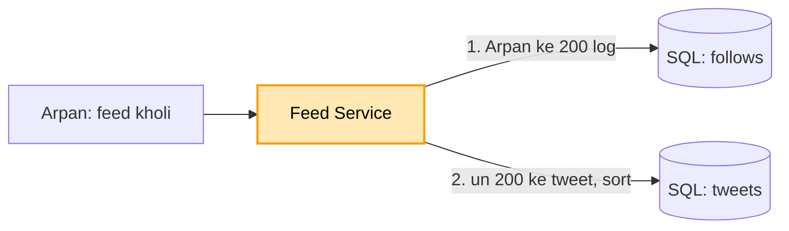
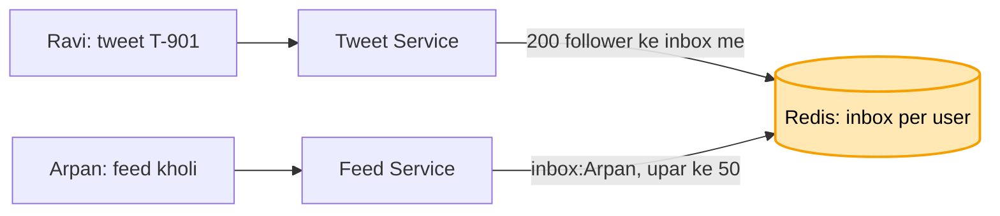
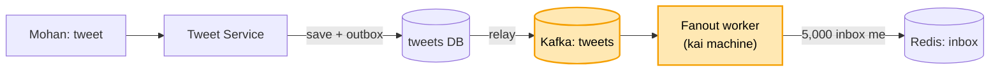
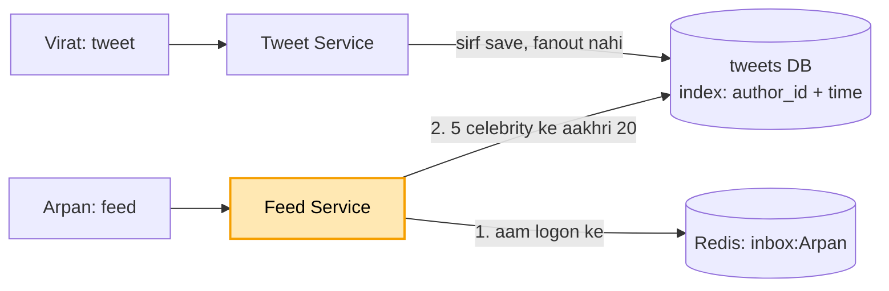
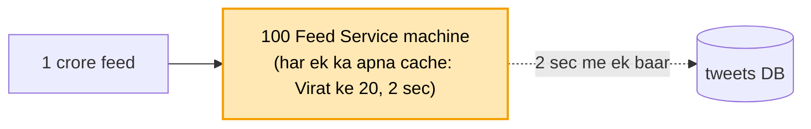
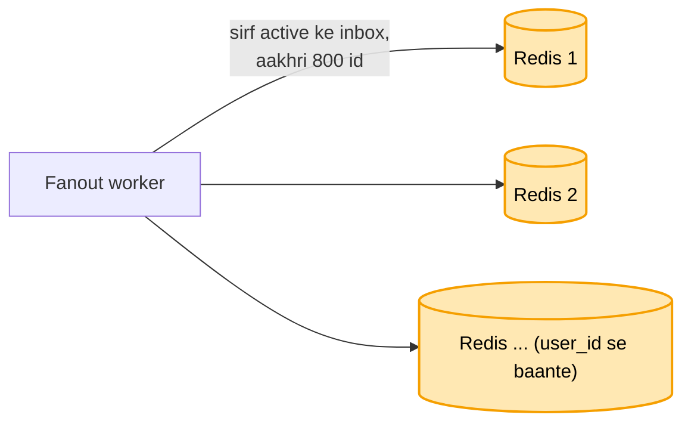
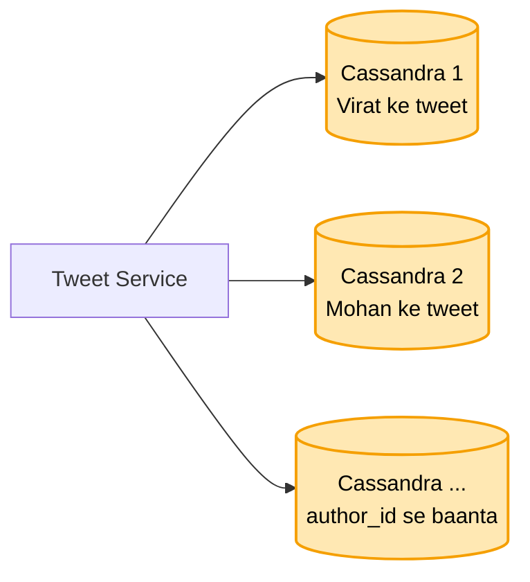
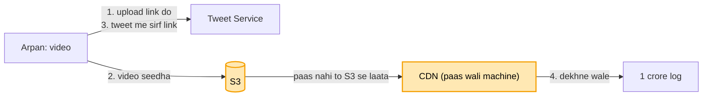
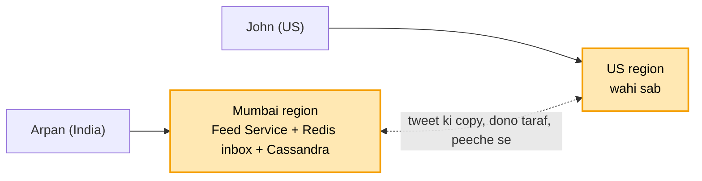

# Twitter feed: shuru se, ek kahani

Kram wahi jo interview me hota hai: **FR, phir NFR, phir numbers, phir design**. Design sabse seedhe dabbe
se shuru hota hai, aur har dikkat aane pe ek naya dabba judta hai. Diagram me peela dabba = abhi juda. Poori
file me ek hi kahani hai: Arpan 200 logon ko follow karta hai (Virat Kohli bhi), subah app khol ke feed dekhta
hai, kabhi khud tweet karta hai.

Zyadatar tukde pehle se padhe hue: Kafka worker ([notification](../04_notification_system/04_notification_system.md)),
Redis ([URL](../01_url_shortener/01_url_shortener.md)), Cassandra + S3 ([chat](../14_chat_messaging/14_chat_messaging.md)).
Iska apna: ek tweet laakhon logon ki feed me kaise pahunche (fanout), aur celebrity pe wo kaise mudta hai.

**CUE (yahi shabd yaad rakhne hain, kram se):**
do table, har feed pe jod -> inbox pehle se (fanout) -> Kafka + fanout worker (+ outbox)
-> celebrity: fanout nahi, padhte waqt DB se (hybrid) -> viral: har server ka apna cache
-> inbox chhota (id, 800, sirf active: worker last_active dekhe) -> tweets Cassandra (author_id)
-> video S3 + CDN -> India region (Kafka topic ki copy, har region apne inbox bhare)

> **Baad me padhna (abhi mock me nahi): video upload ke peeche kya hota hai (media converter / transcoding)**
> Arpan ki 100 MB video S3 me aa gayi, par wo ek hi quality me hai. Dheeme net wale ke liye wo atkegi.
> Isliye upload hote hi peeche ek kaam chalta hai: S3 khabar deta hai ("nayi video aayi") -> ek worker
> (FFmpeg ya AWS MediaConvert) video ko alag-alag quality me badalta hai (360p, 720p, 1080p) aur har ek ko
> chhote tukdon (kuch second ke) me kaatta hai -> ye sab wapas S3 me, CDN se bante hain.
> Tab tak tweet pe "video process ho rahi" dikhta hai; kaam khatam hone pe READY. Dekhne wale ka player net
> dekh ke apne aap quality badalta hai: net dheema to 360p ke tukde, tez to 1080p.

---

## 1. FR: kya karna hai

```
1. tweet post karna (text, photo / video)
2. home feed: jinko follow karta, unke naye tweet, naye upar
scope ke bahar: search, trending, DM, notification
```

## 2. NFR: kaisa chalna chahiye

```
- feed 200 ms me khule
- feed 2-5 sec purani dikhe to chalega (isliye pehle se bana sakte hain)
- celebrity (10 crore follower) ka tweet bhi sambhale
```

## 3. Numbers

```
- ~50 crore user, 50 crore tweet / din -> ~5,000 tweet / sec
- ek aadmi ~200 ko follow karta, celebrity ke 10 crore follower
- padhna : likhna ~50 : 1 (feed dekhne wale bahut zyada)
```

---

## 4. Design

### Kadam 1: sabse seedha (do table, har feed pe jod)

Do table: `tweets` (kisne kya likha, kab) aur `follows` (kaun kisko follow karta). Arpan feed kholta hai, to
har baar:

```
feed = follows se Arpan ke 200 log nikaalo
       -> tweets me se un 200 ke tweet nikaalo
       -> time se sort -> upar ke 50 dikhao
```



Par har feed kholne pe 200 logon ke tweet DB se nikaal ke sort karna. Feed dekhne wale likhne walon se 50
guna zyada, to DB har second laakhon baar yahi bhaari jod. Feed 3 sec me khulti, DB thak ke baith gaya.
Ek line: feed padhte waqt banti hai, aur padhne wale bahut zyada hain.

### Kadam 2: har user ka pehle se bana inbox (fanout on write)

Har user ka Redis me ek **inbox** = uski taiyaar feed (sorted set, naya sabse upar). Koi tweet kare to wo
tweet usi waqt uske saare followers ke inbox me daal do. Isi ko **fanout** kehte hain: ek tweet, kai inbox me
bikhra.

```
Ravi ne tweet kiya (T-901) --> Ravi ke 200 follower kaun? --> har ek ke inbox me T-901 daalo
                                                                inbox:Arpan = [T-901, T-880, T-850 ...]
                                                                inbox:Mohan = [T-901, ...]

Arpan ne feed kholi --> Redis: inbox:Arpan se upar ke 50 --> turant (koi jod nahi, koi sort nahi)
```



Ab kya theek hua: feed kholna sirf ek Redis read, 200 ms se bahut kam. Bhaari kaam (kis-kis ke tweet nikaalo)
ab tweet karte waqt ek baar, har feed pe nahi. Dekhne wale 50 guna zyada, to kaam likhne wali taraf khiskana
sahi.

Inbox me poora tweet nahi, sirf tweet id (`T-901`). Text ek baar tweets table me; 200 jagah poora text rakhte
to jagah 200 guna. Feed pe un 50 id ka poora tweet DB se ek saath aata.

Read replica laga dete? Copy pe bhi har feed wahi 200 logon ka jod hota, bas bant jaata. Jod hi dikkat hai,
fanout hi jawab.

Par Arpan ka dost Mohan chhota influencer hai, 5,000 follower. Mohan ne tweet dabaya, aur Tweet Service 5,000
inbox me likh raha, uske baad hi "tweet ho gaya" bolega. Mohan ka button 5 second ghoomta raha.

### Kadam 3: tweet turant, fanout peeche se (Kafka + fanout worker)

Dikkat: tweet karne wala ruke nahi, 5,000 inbox me likhna peeche se ho, aur beech me kuch khoye nahi. Yahi
notification kadam 2 wali dikkat hai, to wahi ilaaj.

```
Mohan: tweet --> Tweet Service --1. tweets DB me save--> "tweet ho gaya" (turant)
                           --2. khabar "T-950 by Mohan"--> [Kafka: tweets]
                                                              |
                                          fanout worker (kai machine) uthata
                                          -> Mohan ke 5,000 follower nikaalo
                                          -> har inbox me T-950 daalo
```



Kafka yahan isliye, ki dikkat khud maang rahi: likhne wala ruke nahi, peeche ka kaam khoye nahi, aur bheed
aaye to worker badha sakein.

Ab kya theek hua:
- Mohan ka button turant ruk jaata hai.
- 5,000 inbox me likhna worker peeche se karte. 2-3 sec lagein to chalega (NFR: feed 2-5 sec purani chalegi).
- worker gira to khabar Kafka me padi, wapas aake wahin se uthata.
- 5,000 tweet / sec ki bheed: worker badha do.

Ek chhed: Tweet Service ne DB me tweet save kiya, aur Kafka ko bhejne se pehle gira. Tweet DB me hai, par kisi ke
inbox me nahi. Ilaaj wahi **outbox** ([Kafka file kadam 7](../12_message_queue_kafka/12_message_queue_kafka.md#kadam-7-bhejne-wala-gira-outbox)): khabar bhi usi transaction me outbox table me,
relay use Kafka me daale.

Par Virat Kohli ne match ke baad tweet kiya, 10 crore follower. Fanout worker 10 crore inbox me likhne baitha,
ghanton lag gaye. Uske peeche Arpan, Mohan, sabke tweet line me atke.

### Kadam 4: celebrity ka alag raasta (hybrid fanout, twitter ka apna)

Do tarah ke log, do raaste:

```
aam log (jaise Mohan, 5,000 follower)  -> fanout on WRITE: tweet sabke inbox me (Kadam 2-3)
celebrity (jaise Virat, 10 crore)      -> fanout NAHI. Tweet bas tweets DB me (jaise har tweet jaata)

Arpan ne feed kholi:
  1. inbox:Arpan se aam logon ke tweet                         (pehle se bane, Redis)
  2. Arpan jin 5 celebrity ko follow karta, tweets DB se unke aakhri 20 (abhi padhe;
     tweets table me author_id + time ka index, to ye saada query)
  3. dono milao -> time se sort -> upar ke 50
```



Ab kya theek hua: Virat ka tweet ek hi jagah likha, 10 crore jagah nahi, to fanout line nahi atakti. Arpan ki
feed me bas 5 celebrity ke tweet padhte waqt jodne, 200 logon ke nahi, to feed tez rehti.

Doosra kyun nahi (asli choice):
- sabke liye fanout on write: Virat ka ek tweet = 10 crore likhai, line ghanton atakti (Kadam 3 wali).
- sabke liye fanout on read: har feed pe 200 logon ka jod, Kadam 1 wapas, feed dheemi.
- dono ka mel (hybrid): kam follower wale ka likhte waqt baanto, bahut wale ka padhte waqt jodo.

To kaun kahan se?

```
aam logon ke tweet  -> Redis (inbox:Arpan, pehle se bana)
celebrity ke tweet  -> tweets DB (padhte waqt), unke liye koi Redis nahi
```

Celebrity kaun? Ek had tay hoti (jaise 1 lakh se zyada follower). Ye faisla hai, pakka niyam nahi.

Par match khatam, Virat ke tweet pe 1 crore log ek saath feed
khol rahe. Sabki feed tweets DB se wahi ek query chala rahi: "Virat ke aakhri 20". DB pe ek hi jagah crore
padhai, DB garam.

### Kadam 5: crore log, sab DB se "Virat ke aakhri 20" (har server ka apna cache)

Ilaaj: har Feed Service machine ye jawab **apni memory me** 2 second rakhti hai (local cache). Matlab har server
ka apna chhota cache, uske andar hi; koi alag Redis nahi.

```
pehle: 1 crore feed --> sab tweets DB pe "Virat ke aakhri 20"          --> DB garam
ab:    1 crore feed --> 100 Feed Service machine
                        har machine ki memory me "Virat ke 20" (umar 2 sec)
                        --> DB tak har machine 2 sec me sirf 1 baar = 100 sawaal / 2 sec, crore nahi
```



Crore sawaal machine ki memory se nipat jaate, DB tak sirf 100 machine x 2 sec me ek baar.

2 sec purana chalega? Haan, NFR: feed 2-5 sec purani chalegi. Virat ka naya tweet kisi ko 2 sec der se dikhe,
to chalega.

Beech me Redis kyun nahi? Local cache akela hi DB ko bacha leta. Celebrity gine-chune (kuch hazaar), to unke
aakhri 20 tweet har machine ki memory me aaraam se aa jaate. Redis is design me sirf inbox ke liye (Kadam 2).

Ye [URL kadam 8](../01_url_shortener/01_url_shortener.md#kadam-8-ek-link-viral-local-cache) wala viral link hi hai: wahan ek link, yahan ek celebrity.

Par Redis me 50 crore logon ka inbox, har inbox me hazaron tweet id. Redis ki RAM bhar rahi, aur Redis RAM
mehngi hai.

### Kadam 6: inbox chhota rakho (3 chhoti baatein)

**1. Inbox me sirf tweet id** (ye Kadam 2 me ho chuka), poora tweet nahi.

**2. Har inbox me sirf aakhri 800 tweet.** Koi 800 se neeche scroll nahi karta. Naya tweet aaya to sabse
purana kaat do (sorted set trim).

**3. Sirf active logon ka inbox.** Jo 30 din se app nahi khola, uska inbox Redis me rakhte hi nahi (umar / TTL
se mit jaata). Par sirf TTL kaafi nahi: fanout worker har naye tweet pe `inbox:X` me likhta rahega to key phir
ban jaati, TTL taaza. Isliye worker likhne se pehle follower ka `last_active` dekhe:

```
fanout worker: follower X ke inbox me likhun?
   X 30 din se nahi aaya -> chhodo (inbox nahi banta)
   X active hai          -> likho
```

Wo wapas aaya to pehli baar uski feed Kadam 1 wale tareeke se ek baar banao (200 logon ka jod), aur inbox phir
se bhar do. Bas pehli feed thodi dheemi khulti.

```
sirf active log ke inbox, aakhri 800 id -> phir bhi kai TB, ek Redis machine me nahi samata
-> user_id se kai Redis machine me baanto (jaise URL me shard kiya)
```



**Ab kya theek hua:** Redis me sirf wahi jo sach me dekha jaata hai, aur wo kai Redis machine me bata hua,
jaise [URL me shard](../01_url_shortener/01_url_shortener.md#kadam-5-data-bahut-bada-db-ke-tukde--shard) kiya tha.

Par roz 50 crore naye tweet tweets DB me jaate: 5,000 likhai / sec, saal bhar me sau TB. Ek SQL DB machine ye
likhai aur jagah nahi jhel paayegi.

### Kadam 7: tweets DB pe likhai bahut (Cassandra, author_id se baanto)

Pehle tweets ka kaam dekho:
- tweet ek baar likha jaata, phir badalta nahi.
- padhai seedhi: "ye 50 id ke tweet do" ya "Virat ke aakhri 20".
- koi jod nahi chahiye, bank jaisa transaction bhi nahi.

Ilaaj: tweets ko **Cassandra** me rakho, aur `author_id` se baanto. Virat ke saare tweet ek hi machine pe,
time ke kram me. "Virat ke aakhri 20" ek hi jagah se seedha.

```
Tweet Service --likho--> [Cassandra: kai machine, author_id se baanta]
                        machine 1: Virat ke tweet (time ke kram me)
                        machine 2: Mohan ke tweet
                        ...
```



Ye [chat kadam 5](../14_chat_messaging/14_chat_messaging.md#kadam-5-roz-12-tb-cassandra-chat-ke-hisaab-se-baanto) wala hi faisla: wahan message `chat_id` se baante, yahan tweet `author_id` se.

SQL kyun nahi, Cassandra kyun? SQL ki taakat jod aur transaction hai, yahan dono nahi chahiye. 5,000 likhai /
sec aur saal bhar me sau TB, ye SQL ko kai machine me haath se baantna padta. Cassandra likhai ke liye hi bana
hai, khud kai machine me baant leta hai. Isliye Cassandra.

Par Arpan ne match ki 100 MB video daali. Video Tweet Service aur Cassandra ke raaste gayi to dono bhar jaayenge,
saath me sabke tweet atkenge. Aur 1 crore log dekhenge, to har baar wahi 100 MB humare server se jaayega.

### Kadam 8: 100 MB ki video (S3 + CDN, tweet me sirf link)

```
1. app Tweet Service se poochhta: "upload kahan karun?"
   -> Tweet Service deta: S3 ka ek link, 10 min ke liye (presigned URL)
2. app video seedha S3 pe daalta (humare server ke beech se nahi)
3. tweet me sirf link: "T-990: Arpan: 'kya catch!' + video: s3/.../v1.mp4"
4. dekhne wale video CDN se lete (paas wali machine se), S3 / humare server se nahi
```



Ab kya theek hua: bhaari video kabhi Tweet Service / Cassandra se nahi guzarti, tweet chhota (sirf link),
crore log CDN se dekhte. Ye bilkul [chat kadam 10](../14_chat_messaging/14_chat_messaging.md#kadam-10-200-mb-ka-video-s3-me-message-me-sirf-link) wala: wahan bhi message me sirf link, video S3 me.

Par Arpan Bangalore me, aur saare server, Redis, Cassandra US me. Har feed ko US jaana aur aana, akela safar
hi ~300 ms. NFR "feed 200 ms" toot gaya.

### Kadam 9: Arpan India me, server US me (India me apna region)

```
India region (Mumbai):  Feed Service + Tweet Service + Redis inbox + Cassandra ki copy
US region:              wahi sab, apne logon ke liye

Arpan (India) --feed--> Mumbai region -> inbox:Arpan Mumbai ke Redis me -> ~50 ms
Virat ne tweet kiya (India) -> Mumbai Cassandra me likha -> peeche se US Cassandra me copy (kuch second)
```



Kiska inbox kahan: har user ka inbox uske apne region me banta, jaise [rate limiter](../02_rate_limiter/02_rate_limiter.md#kadam-10-3-region-se-300-nikal-gayi-home-region) me "home region".
Fanout worker Arpan ka inbox Mumbai ke Redis me bharta.

India ka tweet, US ka follower? Mohan (India) ne tweet kiya, uska follower John US me, John ka inbox US Redis
me. Har tweet pe samundar paar ke Redis me likhna dheema aur toot sakta. Isliye tweets wale Kafka topic ki copy
doosre region me bhi jaati (Kafka ka tool, MirrorMaker), aur har region ka apna fanout worker sirf apne region
ke followers ke inbox bharta:

```
Mohan (India) tweet --> Mumbai Kafka: tweets --copy--> US Kafka: tweets
                           |                              |
                   Mumbai worker                     US worker
                   -> India wale followers ke inbox  -> John (US) ka inbox
```

Copy peeche se (US tak kuch second) kyun chalta: NFR, feed 2-5 sec purani chalegi. US wale ko Virat ka tweet
2 sec baad dikhe to dikkat nahi; bank jaisa "abhi ka abhi pakka" yahan nahi chahiye.

---

## Wrap: 30 sec me poora design

```
Tweet aaya: Tweet Service use Cassandra me save karta (author_id se baanta), outbox se Kafka me khabar,
turant "ho gaya". Fanout worker aam logon ke tweet ki id unke active followers ke Redis inbox me daalte
(aakhri 800, soye hue ko chhod ke). Celebrity ka fanout nahi: feed padhte waqt unke aakhri tweet DB se, har
server ke apne cache se 2 sec. Feed = inbox ki 50 id + celebrity ke tweet, milao, poora tweet DB se. Video
S3 me, dekhne wale CDN se. Har desh ka apna region; Kafka topic ki copy doosre region jaati, wahan ka worker
wahan ke inbox bhare.
```
