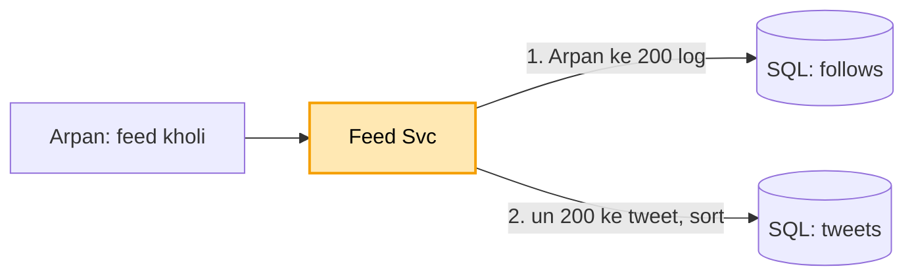
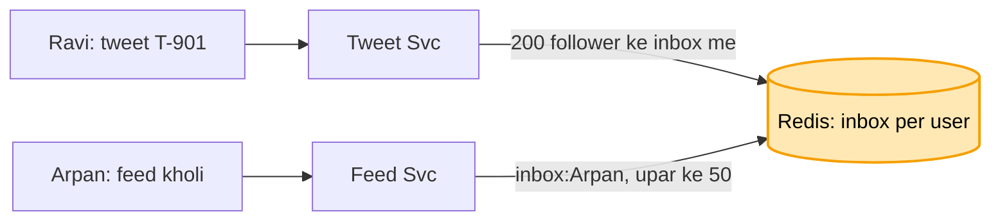
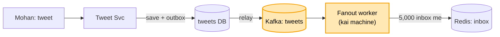
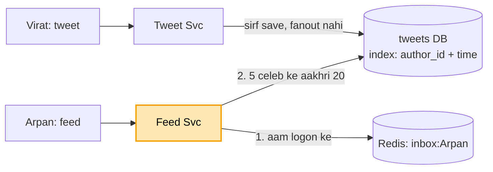
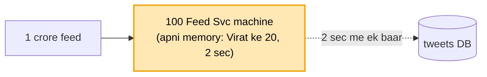

# Twitter feed: shuru se, ek kahani

Kram wahi jo interview me hota hai: **FR, phir NFR, phir numbers, phir design**. Design sabse seedhe dabbe
se shuru hota hai, aur har dikkat aane pe ek naya dabba judta hai. Diagram me peela dabba = abhi juda. Poori
file me ek hi kahani hai: Arpan 200 logon ko follow karta hai (Virat Kohli bhi), subah app khol ke feed dekhta
hai, kabhi khud tweet karta hai.

Zyadatar tukde pehle se padhe hue: Kafka worker ([notification](../04_notification_system/04_notification_system.md)),
Redis ([URL](../01_url_shortener/01_url_shortener.md)), Cassandra + S3 ([chat](../14_chat_messaging/14_chat_messaging.md)).
Iska apna: ek tweet laakhon logon ki feed me kaise pahunche (fanout), aur celebrity pe wo kaise mudta hai.

---

## 1. FR: kya karna hai

```
1. tweet post karna (text, photo / video)
2. home feed: jinko follow karta, unke naye tweet, naye upar
scope ke bahar: search, trending, DM, notification
```

## 2. NFR: kaisa chalna chahiye

```
- feed 200 ms me khule
- feed 2-5 sec purani dikhe to chalega (isliye pehle se bana sakte hain)
- celebrity (10 crore follower) ka tweet bhi sambhale
```

## 3. Numbers

```
- ~50 crore user, 50 crore tweet / din -> ~5,000 tweet / sec
- ek aadmi ~200 ko follow karta, celebrity ke 10 crore follower
- padhna : likhna ~50 : 1 (feed dekhne wale bahut zyada)
```

---

## 4. Design

### Kadam 1: sabse seedha (do table, har feed pe jod)

Do table: `tweets` (kisne kya likha, kab) aur `follows` (kaun kisko follow karta). Arpan feed kholta hai, to
har baar:

```
feed = follows se Arpan ke 200 log nikaalo
       -> tweets me se un 200 ke tweet nikaalo
       -> time se sort -> upar ke 50 dikhao
```



Par har feed kholne pe 200 logon ke tweet DB se nikaal ke sort karna. Feed dekhne wale likhne walon se 50
guna zyada, to DB har second laakhon baar yahi bhaari jod. Feed 3 sec me khulti, DB thak ke baith gaya.

### Kadam 2: har user ka pehle se bana inbox (fanout on write)

Har user ka Redis me ek **inbox** = uski taiyaar feed (sorted set, naya sabse upar). Koi tweet kare to wo
tweet usi waqt uske saare followers ke inbox me daal do. Isi ko **fanout** kehte hain: ek tweet, kai inbox me
bikhra.

```
Ravi ne tweet kiya (T-901) --> Ravi ke 200 follower kaun? --> har ek ke inbox me T-901 daalo
                                                                inbox:Arpan = [T-901, T-880, T-850 ...]
                                                                inbox:Mohan = [T-901, ...]

Arpan ne feed kholi --> Redis: inbox:Arpan se upar ke 50 --> turant (koi jod nahi, koi sort nahi)
```



Ab kya theek hua: feed kholna sirf ek Redis read, 200 ms se bahut kam. Bhaari kaam (kis-kis ke tweet nikaalo)
ab tweet karte waqt ek baar, har feed pe nahi. Dekhne wale 50 guna zyada, to kaam likhne wali taraf khiskana
sahi.

Inbox me poora tweet nahi, sirf tweet id (`T-901`). Text ek baar tweets table me; 200 jagah poora text rakhte
to jagah 200 guna.

Par Arpan ka dost Mohan chhota influencer hai, 5,000 follower. Mohan ne tweet dabaya, aur Tweet Svc 5,000
inbox me likh raha, uske baad hi "tweet ho gaya" bolega. Mohan ka button 5 second ghoomta raha.

### Kadam 3: tweet turant, fanout peeche se (Kafka + fanout worker)

Dikkat: tweet karne wala ruke nahi, 5,000 inbox me likhna peeche se ho, aur beech me kuch khoye nahi. Yahi
notification kadam 2 wali dikkat hai, to wahi ilaaj.

```
Mohan: tweet --> Tweet Svc --1. tweets DB me save--> "tweet ho gaya" (turant)
                           --2. khabar "T-950 by Mohan"--> [Kafka: tweets]
                                                              |
                                          fanout worker (kai machine) uthata
                                          -> Mohan ke 5,000 follower nikaalo
                                          -> har inbox me T-950 daalo
```



Ab kya theek hua:
- Mohan ka button turant ruk jaata hai.
- 5,000 inbox me likhna worker peeche se karte. 2-3 sec lagein to chalega (NFR: feed 2-5 sec purani chalegi).
- worker gira to khabar Kafka me padi, wapas aake wahin se uthata.
- 5,000 tweet / sec ki bheed: worker badha do.

Ek chhed: Tweet Svc ne DB me tweet save kiya, aur Kafka ko bhejne se pehle gira. Tweet DB me hai, par kisi ke
inbox me nahi. Ilaaj wahi **outbox** ([Kafka file kadam 7](../12_message_queue_kafka/12_message_queue_kafka.md#kadam-7-bhejne-wala-gira-outbox)): khabar bhi usi transaction me outbox table me,
relay use Kafka me daale.

Par Virat Kohli ne match ke baad tweet kiya, 10 crore follower. Fanout worker 10 crore inbox me likhne baitha,
ghanton lag gaye. Uske peeche Arpan, Mohan, sabke tweet line me atke.

### Kadam 4: celebrity ka alag raasta (hybrid fanout, twitter ka apna)

Do tarah ke log, do raaste:

```
aam log (jaise Mohan, 5,000 follower)  -> fanout on WRITE: tweet sabke inbox me (Kadam 2-3)
celebrity (jaise Virat, 10 crore)      -> fanout NAHI. Tweet bas tweets DB me (jaise har tweet jaata)

Arpan ne feed kholi:
  1. inbox:Arpan se aam logon ke tweet                         (pehle se bane, Redis)
  2. Arpan jin 5 celebrity ko follow karta, tweets DB se unke aakhri 20 (abhi padhe;
     tweets table me author_id + time ka index, to ye saada query)
  3. dono milao -> time se sort -> upar ke 50
```



Ab kya theek hua: Virat ka tweet ek hi jagah likha, 10 crore jagah nahi, to fanout line nahi atakti. Arpan ki
feed me bas 5 celebrity ke tweet padhte waqt jodne, 200 logon ke nahi, to feed tez rehti.

Doosra kyun nahi (asli choice):
- sabke liye fanout on write: Virat ka ek tweet = 10 crore likhai, line ghanton atakti (Kadam 3 wali).
- sabke liye fanout on read: har feed pe 200 logon ka jod, Kadam 1 wapas, feed dheemi.
- dono ka mel (hybrid): kam follower wale ka likhte waqt baanto, bahut wale ka padhte waqt jodo.

Celebrity kaun? Ek had tay hoti (jaise 1 lakh se zyada follower). Ye faisla hai, pakka niyam nahi.

Par match khatam, Virat ke tweet pe 1 crore log ek saath feed khol rahe. Sabki feed tweets DB se wahi ek query
chala rahi: "Virat ke aakhri 20". DB pe ek hi jagah crore padhai, DB garam.

### Kadam 5: Virat viral, DB pe ek hi query crore baar (local cache)

Ilaaj: har Feed Svc machine "Virat ke aakhri 20" ka jawab **apni memory me** 2 second rakh leti (local cache).

```
pehle: 1 crore feed --> sab tweets DB se "Virat ke aakhri 20" --> DB garam
ab:    1 crore feed --> 100 Feed Svc machine, har ek ki memory me Virat ke 20 (umar 2 sec)
                        --> DB tak har machine 2 sec me ek baar = 100 / 2 sec, crore nahi
```



2 second purana chalega? Haan, NFR: feed 2-5 sec purani chalegi. Ye bilkul [URL kadam 8](../01_url_shortener/01_url_shortener.md#kadam-8-ek-link-viral-local-cache) hai: wahan viral
link, yahan viral celebrity. Ilaaj wahi, apni memory me thodi der.

Beech me Redis kyun nahi? Local cache akela hi DB ko bacha leta. Redis is design me sirf inbox ke liye hai
(Kadam 2): wahan har user ki alag feed pehle se banake rakhni hai.

Par Redis me 50 crore logon ka inbox, har inbox me hazaron tweet id. Redis ki RAM bhar rahi, aur Redis RAM
mehngi hai.
