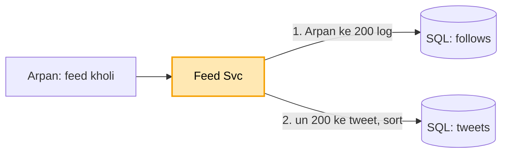

# Twitter feed: shuru se, ek kahani

Kram wahi jo interview me hota hai: **FR, phir NFR, phir numbers, phir design**. Design sabse seedhe dabbe
se shuru hota hai, aur har dikkat aane pe ek naya dabba judta hai. Diagram me peela dabba = abhi juda. Poori
file me ek hi kahani hai: Arpan 200 logon ko follow karta hai (Virat Kohli bhi), subah app khol ke feed dekhta
hai, kabhi khud tweet karta hai.

Zyadatar tukde pehle se padhe hue: Kafka worker ([notification](../04_notification_system/04_notification_system.md)),
Redis ([URL](../01_url_shortener/01_url_shortener.md)), Cassandra + S3 ([chat](../14_chat_messaging/14_chat_messaging.md)).
Iska apna: ek tweet laakhon logon ki feed me kaise pahunche (fanout), aur celebrity pe wo kaise mudta hai.

---

## 1. FR: kya karna hai

```
1. tweet post karna (text, photo / video)
2. home feed: jinko follow karta, unke naye tweet, naye upar
scope ke bahar: search, trending, DM, notification
```

## 2. NFR: kaisa chalna chahiye

```
- feed 200 ms me khule
- feed 2-5 sec purani dikhe to chalega (isliye pehle se bana sakte hain)
- celebrity (10 crore follower) ka tweet bhi sambhale
```

## 3. Numbers

```
- ~50 crore user, 50 crore tweet / din -> ~5,000 tweet / sec
- ek aadmi ~200 ko follow karta, celebrity ke 10 crore follower
- padhna : likhna ~50 : 1 (feed dekhne wale bahut zyada)
```

---

## 4. Design

### Kadam 1: sabse seedha (do table, har feed pe jod)

Do table: `tweets` (kisne kya likha, kab) aur `follows` (kaun kisko follow karta). Arpan feed kholta hai, to
har baar:

```
feed = follows se Arpan ke 200 log nikaalo
       -> tweets me se un 200 ke tweet nikaalo
       -> time se sort -> upar ke 50 dikhao
```



Par har feed kholne pe 200 logon ke tweet DB se nikaal ke sort karna. Feed dekhne wale likhne walon se 50
guna zyada, to DB har second laakhon baar yahi bhaari jod. Feed 3 sec me khulti, DB thak ke baith gaya.
