# Notification System

> Koi ghatna hui (order, OTP, offer), to sahi user ko, sahi raaste (push / email / SMS) se, sahi waqt pe khabar.
> Dil teen cheezein: ek ghatna, kai raaste, kai log (fanout). Khabar kabhi khoye nahi, do baar jaaye nahi. OTP turant.
>
> Mock me sirf heading + Cue + GIF. Neeche har card ek block: HAL (GIF ka ILAAJ) · KYUN · NAHI (doosra kyun nahi) · AGAR (cross-Q).
> Cross-Q: hal ke har bade shabd pe socho -> gira? · dheema / bheed? · do ek saath? · galat hua? · kaise / kitna?

---

## Poori tasveer (aakhir me design aisa banta hai)


---

## Shuru

```
FR      EK ghatna, KAI raaste: push / email / SMS / app ke andar (Amazon order = sab)
        user ki pasand + message ke saanche (template) bhi
MISAAL  order = push + email, OTP = SMS turant, sale offer = push (ruk sakta) · bahar: analytics dashboard
NFR     ek ghatna kai log / raaste · bhejne wala ruke nahi (async) · khoye nahi (dobara koshish + DLQ)
        bheed jhele (~1 lakh / sec) · OTP ki alag tez line · user ki pasand maano
NUMBERS 10 crore user x ~5 / din = 50 crore / din, din me ~1 lakh sec -> ~5,800 / sec aam din
        sale ke din 10 guna ~58,000 / sec, har ek 3 raaste se -> ~1.75 lakh / sec Kafka me
        machines sale ke hisaab se: ek worker ~1000 / sec -> sale pe ~175 worker (raaste ke hisaab se bante)
        hisaab (kya gaya kya nahi) ~90 TB / saal · Kafka me 7 din ki khabar ~3 TB
PEHLE   sabse simple tha: Order Svc khud seedha email company (Email API) ko call kare.
        Order email ke jawab ka intezaar karta tha, company band to order hi fail
```

---

*ab tootega kahan? order seedha company ke bharose hai*

## 1. Maine order kiya, email company band thi, order hi fail

Cue: KAFKA (async), order turant jawab

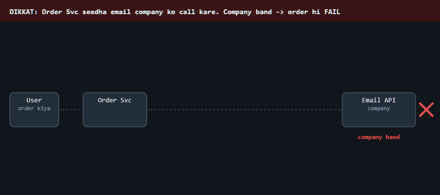

```
HAL     order aur khabar ek hi DB txn me likhte hain (outbox), relay use Kafka me daalta hai.
        Order ko turant OK milta hai, Notification Svc peeche Kafka se padh ke email bhejti hai
KYUN    order kabhi khabar ka intezaar nahi karta. Khabar disk ke log (Kafka) me padi rehti hai,
        padhne wala yaad rakhta hai kahan tak padha. Company band ho to bhi khabar padi hai,
        wapas aate hi wahin se
        bheed jhatke me aati hai, isliye beech me ek line (Kafka) chahiye
NAHI    Order Svc me hi retry -> ATAKTA: request utni der atki rehti hai, aur Order Svc gira to retry bhi gaya
AGAR    Kafka tak pahunchne se pehle hi service gir gayi
        -> khabar outbox ki row me padi hai, relay baad me bhej deta hai, khabar khoti nahi
        email company band ho gayi
        -> khabar Kafka ke log me ~7 din padi rehti hai, padhne wala offset se yaad rakhta hai kahan tak padha
        email company 2 din baad wapas aayi
        -> wahin se aage chalta hai. Order kabhi email ki wajah se fail nahi hota
        Notification Svc dheemi pad gayi
        -> machine badhao (consumer group). Har line ek machine ko milti hai, lines bat jaati hain
        Kafka ki ek machine gir gayi -> log ki 3 copy hain, baaki copy se chalta hai, khabar nahi khoti
        Kafka pe traffic achanak 10 guna ho gaya
        -> saari khabar pehle Kafka ki line me jaati hai, jhatka line sambhaalti hai, worker apni speed se.
           Sale ka time pata hai (12 baje), to 11:50 tak worker badha do; machine apne aap badhne me minute
           leti hai, jhatka second me aata hai. Par worker utne hi jitna DB aur SMS / email company jhel sake,
           warna wahan atkega
```

---

*ab sab raaste ek hi line me, ek dheema to?*

## 2. SMS company dheemi, mera push aur email bhi atke

Cue: har raaste ki ALAG LINE + worker

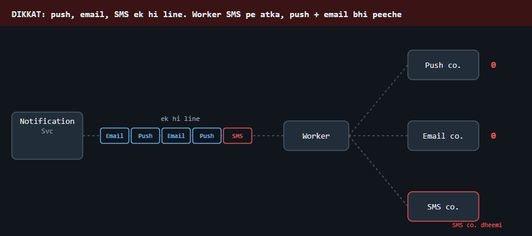

```
HAL     har raaste ki alag line aur alag worker hota hai. SMS dheema ho to sirf SMS rukta hai.
        Ghatna aayi to teen chhote message bante hain (ghatna id + raasta), har raasta apni line me jaata hai
KYUN    pehle push, email, SMS ek hi line me the, worker SMS pe atka to sab atak gaye.
        Ab har raasta apni line me, apni speed se chalta hai. SMS ruka, par push + email aa gaye
NAHI    SMS ke worker badha do -> BEKAAR: company khud dheemi hai, line phir bhi ek, push / email peeche
AGAR    SMS ki line lambi ho gayi -> sirf SMS ke worker badhao, push / email pe koi asar nahi
        push ki line se bhejna hai, par kis phone pe jaaye?
        -> device token pe, jo install pe user ke saath save hota hai. Token bekaar nikla to hata do
```

---

*ab worker beech me mare to?*

## 3. Worker mara, mujhe do email aaye

Cue: KEY (SET NX, khabar ki apni id)

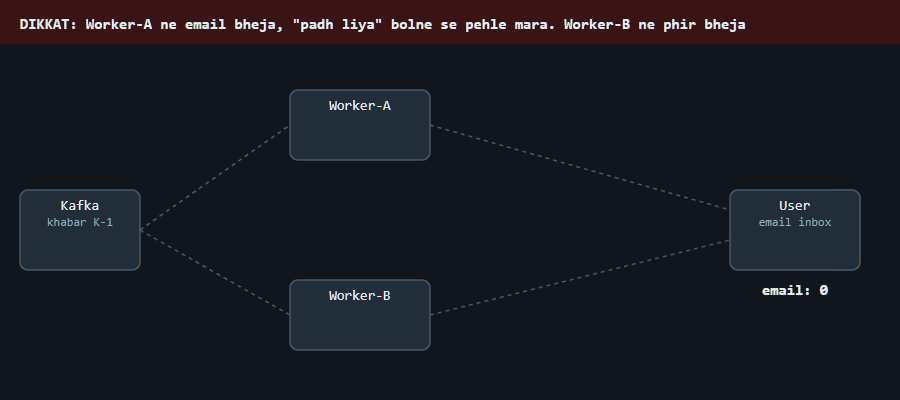

```
HAL     bhejne se pehle khabar ki apni key (khabar_id + raasta) Redis me dekhte hain.
        Key mili to skip, ek hi email jaata hai
KYUN    pehle Worker-A ne email bheja aur "padh liya" bolne se pehle mar gaya, khabar dobara aayi, Worker-B ne
        phir bheja. Ab pakki id hai, to dobara aayi khabar pehchaan ke skip ho jaati hai
        Redis tez raasta hai, aur DB me (khabar_id, raasta) ek hi baar lag sakta hai, wo aakhri deewar hai
NAHI    har baar naya random id -> BEKAAR: dohraav kabhi pakda hi nahi jaata
AGAR    key wala Redis gir gaya
        -> DB me (khabar_id, raasta) UNIQUE hai, ek hi baar lagta hai, pakka wahi rokta hai
        Redis ki key 24 ghante me mit gayi -> DB ki row nahi bhoolti, wo phir bhi rokegi
        DB me ek hi baar kaise lagta hai?
        -> Cassandra me INSERT IF NOT EXISTS (khabar_id, raasta), yaani LWT
```

---

*ab key lagi, par galat waqt pe*

## 4. Key lag gayi, par mera OTP gaya hi nahi

Cue: SENDING / SENT (do haal)

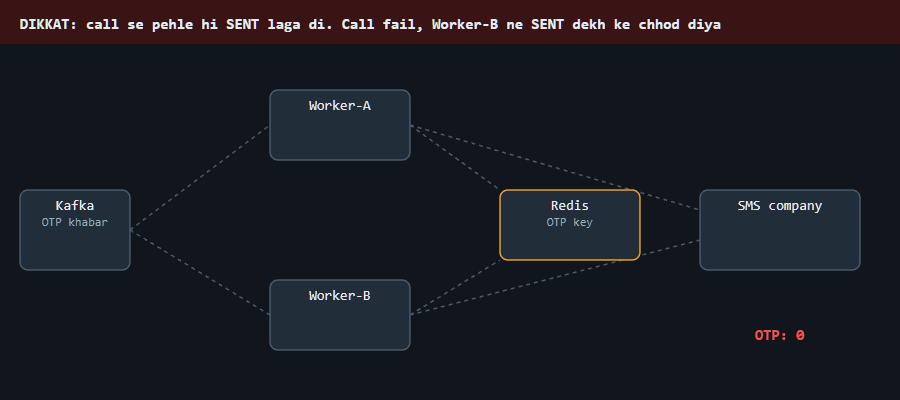

```
HAL     bhejte waqt key SENDING rakhte hain (chhoti umar, ~60 sec), company OK bole tab SENT.
        Chhodna sirf SENT pe
KYUN    pehle koshish se pehle hi SENT laga di, call fail hui, Worker-B ne SENT dekh ke chhod diya,
        OTP kho gaya.
        SENDING matlab adhoora, chhoti umar se khud mit jaata hai, to khabar khoti nahi
        kabhi do baar chali jaaye to chalega: OTP do baar aana, na aane se behtar hai
NAHI    key hi hata do -> DOHRAAV: worker mara to Kafka dobara deta hai, OTP / email do baar, card 3 wapas
AGAR    SENDING laga ke bhej diya, par jawab aane se pehle worker mar gaya
        -> ye maana hua risk hai, do baar ja sakta hai. OTP do baar aana, na aane se behtar
        call fail hui par worker zinda hai
        -> worker khud key hata deta hai. Koshish adhoori thi, agli chal jaaye
        SENDING lagane wala worker hi mar gaya
        -> hatane wala koi nahi, par SENDING ki umar (60 sec) khatam hote hi key khud mit jaati hai
        Worker-B ko SENDING mili -> thoda ruko, phir dekho. Chhodna sirf SENT pe
        SENDING ki umar kitni rakhein?
        -> call (~2-3 sec) se lambi, 60 sec. Umar pehle khatam ho gayi to do log bhej denge
```

---

*ab fail hua to dobara kaise maarein?*

## 5. SMS company pehle se pareshaan, hum har second dobara maar rahe

Cue: BACKOFF + JITTER, had ke baad DLQ

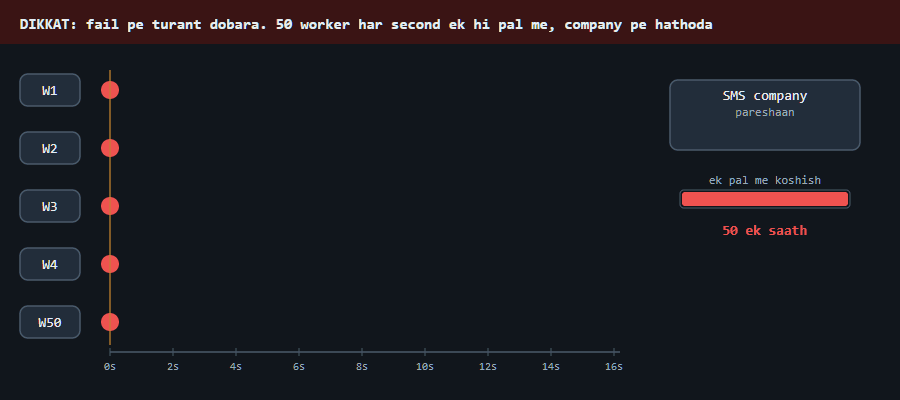

```
HAL     har baar zyada der rukte hain (1, 2, 4, 8 sec) aur thoda random jodte hain (backoff + jitter).
        Had paar ho gayi to khabar alag line (DLQ) me jaati hai + alert
KYUN    pehle fail pe turant dobara, 50 worker har second ek saath, company pe aur hathoda,
        wo kabhi theek nahi hoti. Ab ruk-ruk ke maarte hain,
        aur random thoda sa jodne se sab worker ek hi pal me wapas nahi aate
        khabar phenkna kabhi nahi. Had ke baad DLQ + alert, theek karke wapas
NAHI    retry band, ek fail = chhodo -> KHOYA: company 2 sec hili to OTP hamesha ke liye gaya
AGAR    backoff me lamba rukna ho (10 min)
        -> alag lines banao (retry-1m, retry-10m), worker dekhta hai "kab chalana hai"
        DLQ me khabar pahunch gayi, ab uska kya? -> dashboard pe dikhti hai, theek karke main line me wapas
        khabar khoye hi nahi, ye kaise pakka?
        -> saari copy ne li tab hi OK (acks=all), aur offset kaam ke BAAD
```

---

*ab company band nahi, bas dheemi*

## 6. SMS company band nahi, dheemi: saare worker 30 sec me phanse

Cue: TIMEOUT + CIRCUIT BREAKER

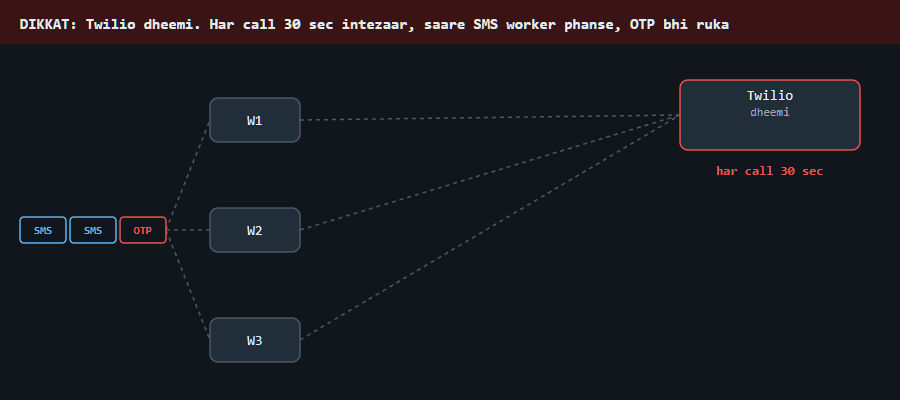

```
HAL     2-3 sec me chhod do (timeout). Baar-baar fail hua to circuit breaker khul jaata hai:
        Twilio ko call band, OTP SNS se jaata hai. Thodi der baad Twilio ko ek test call, theek hai to wapas
KYUN    pehle har call 30 sec tak intezaar karti thi, saare SMS worker Twilio pe phanse, OTP bhi ruka.
        Dheema matlab band maano
        har company ka apna circuit breaker hai, to uske band hone se baaki raaste chalte rehte hain.
        Khabar line me rukti hai, phenki nahi jaati
NAHI    worker badha do -> PHANSE: naye worker bhi 30 sec me phans jaate, dheemi company pe aur bojh
AGAR    Twilio ka circuit breaker khula, push / email pe asar?
        -> nahi. Har company ka apna circuit breaker hai, aur worker alag line pe
        SNS bhi band ho gaya -> khabar line me rukti hai, backoff se koshish, phenko nahi. OTP ka alert
        circuit breaker har process ka apna hai ya saanjha?
        -> har process ka apna (Resilience4j), ya Redis me saanjha
        push bhi doosri company se bhej do?
        -> ye hota nahi. Android = FCM, iPhone = APNs, phone ka OS tay karta hai
```

---

*ab sale aayi, bheed me OTP kahan?*

## 7. 12 baje sale shuru, mera OTP 50,000 offer ke peeche

Cue: OTP ki ALAG TEZ LINE

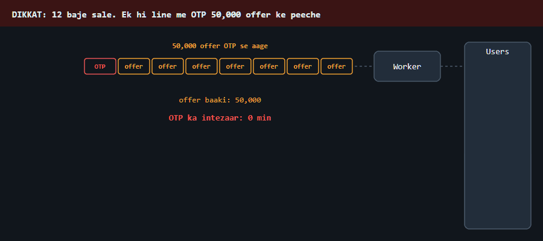

```
HAL     OTP ki apni tez line aur apne worker (priority).
        High line me OTP, beech wali me order update, low line me offer
KYUN    sab barabar zaroori nahi: OTP turant chahiye, offer ruk sakta hai.
        Ek hi line me sab daala to OTP 10 min late, time khatam, login fail, yahi asli fail hai
        zaroori (OTP) kabhi kisi ke peeche nahi: apni line, apne worker, company me apna account
NAHI    ek line me "zaroori" tag laga do -> BEKAAR: Kafka me "ye pehle bhejo" jaisa kuch hota hi nahi
AGAR    order update kis line me jaaye (medium)? -> beech wali line me. OTP se peeche, offer se aage
        OTP wali tez line khaali padi hai -> uske worker beech wali line padh lein. Ulta kabhi nahi
        offer wale OTP ki company had kha jaayein -> OTP ka alag account / number. Had wala card 8
```

---

*ab bheed itni ki company hi mana kare*

## 8. Sale me laakhon message ek saath, company ne 429 diya

Cue: SAANJHA TOKEN BUCKET (Redis)

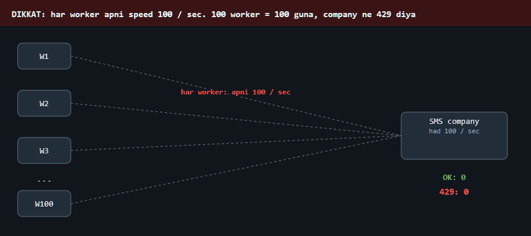

```
HAL     sab worker ka ek saanjha token bucket (Redis me), har second 100 token. Pehle token lo, mila to bhejo
KYUN    had company ki hai (100 / sec, baaki 429), worker ki nahi. Sab worker ek hi bucket se token lete hain.
        Token nahi mila to ruko, khabar phenko nahi
NAHI    har worker apni speed 100 / sec -> 429: 100 worker matlab 100 guna, company phir 429 degi
AGAR    bucket se token nahi mila -> line me intezaar karo. Ye fail nahi hai, retry ki ginti nahi badhti
        worker badh gaye -> speed wahi rehti hai. Bucket saanjha hai, kul 100 / sec
        1 lakh email bhejne hain, had kam hai
        -> had badhwao + kai account lo. Tab tak line dheere khaali hogi, warna 429
        bucket wala Redis gir gaya
        -> har worker apni chhoti local had pe chalta hai (fail-closed). Company ki had paar nahi hoti
        bucket ki had kitni hoti hai?
        -> company ki had: SES shuru me ~14 / sec (sandbox 1 / sec), Twilio short code ~100 / sec
```

---

*ab bhej diya, par pahuncha?*

## 9. Company ne "bhej diya" bola, par mere phone tak pahuncha?

Cue: WEBHOOK + company ka message id

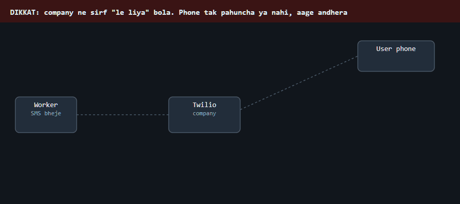

```
HAL     worker company ka message no. (SID-9) save karta hai. Company baad me khud batati hai (webhook):
        "SID-9 pahuncha" aaya, to Webhook Svc ne Tracking DB me SID-9 DELIVERED likha
KYUN    company ne sirf "le liya" bola, aage andhera. "Bheja" aur "mila" alag haal hain.
        "Mila" tab likho jab company (asli, signed webhook) bataye
NAHI    baar-baar khud poochte raho -> MEHENGA: laakhon message x har kuch second = had + kharcha
AGAR    webhook aaya hi nahi
        -> sirf ghanton se atke message ko ek baar poochho (Twilio SID se).
           SES me poll nahi, sirf event (SNS / Firehose)
        nakli webhook aa gaya -> hastakshar jaancho: Twilio HMAC, SES/SNS certificate, SendGrid public key
        Tracking DB me hisaab kahan rakhte hain?
        -> Cassandra me. Likhna bahut hai, isliye NoSQL: seedhi row, jodna kuch nahi
```

---

*ab ek ke liye nahi, 1 crore ke liye*

## 10. Shaam ko "Diwali offer sabko": 1 crore log

Cue: 1000 ke TUKDE + campaign row

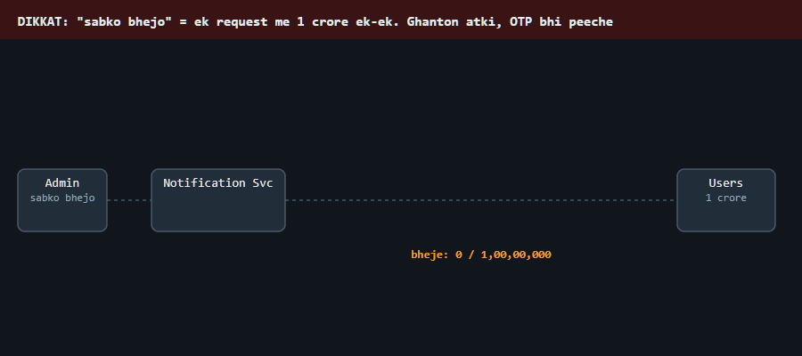

```
HAL     1000-1000 ke tukde banao, low priority line me. Har tukde ke baad campaign row me likho kahan tak
        pahunche (aakhri_id = 3000)
KYUN    pehle admin ne "sabko bhejo" dabaya, ek request me 1 crore ek-ek, ghanton atki, OTP bhi peeche.
        Ab bada kaam chhote tukdon me: gira to wahin se, galat chala to beech me roko. Ek user ko ek hi baar
NAHI    1 crore ko ek bada "sabko bhejo" message -> ATKA: ek worker pe atka, gira to shuru se
        1 crore alag-alag message -> BOJH: 1000 ka tukda = saath bhi, aur dobara karna pade to chhota
AGAR    tukde me 600 bhej ke worker gir gaya
        -> poora tukda dobara, par (campaign_id, user_id) se pehle wale 600 chhoot jaate hain
        galat offer chal gaya -> campaign row pe CANCELLED likho. Worker har tukde se pehle ye dekhta hai
        1 crore ke tukde bhejne me kitni der?
        -> ~17 min (10,000 / sec). Jaan-boojh ke phailaya, had + OTP line bachi
        sabko ek hi push bhejna hai -> FCM topic: ek call. Topic me sirf pasand wale (pasand se sync)
```

---

*ab bheja to sahi, par user chahta tha?*

## 11. Raat 2 baje offer ka SMS, jabki maine band kiya tha

Cue: PASAND + SHAANTI + SAANCHA (cache)

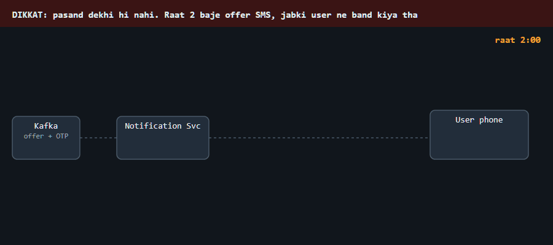

```
HAL     bhejne se pehle user ki pasand + shaanti ka waqt dekho (preference + quiet hours): offer SMS band,
        raat 10 se subah 8 ghanti nahi. Shaanti me offer aaya to roko,
        subah 8 baje bhejo (scheduled_at + job), phenko nahi
KYUN    pehle pasand dekhi hi nahi, ghanti baji, user gussa. Ab bhejne se pehle pasand dekhte hain.
        Offer pasand / shaanti ke neeche, zaroori alert (OTP) upar
NAHI    pasand sirf Campaign Svc me check -> ADHOORA: order / OTP wali khabar bina check nikal jaati
AGAR    shaanti ke waqt OTP / login aaya -> bhejo. Zaroori alert pasand se upar hai
        pasand badli, par cache purana hai
        -> badalte hi cache delete + chhoti umar. Bhejne se pehle sahi chahiye
```

---

## Poora design ek saans me

```
Order / Campaign Svc -> Kafka (tez / beech / dheemi) -> Notification Svc (pasand + saancha, cache)
-> push / email / SMS ki line
-> worker (key BHEJ RAHA / BHEJ DIYA · ruk ke dobara · circuit breaker · speed limit)
-> 2 company -> user · webhook -> Tracking DB · fail -> DLQ
DB:  Tracking = Cassandra (likhna bahut, seedhi row, pakki consistency nahi chahiye, aaram se badhta)
     Pasand / saancha = chhota, har ghatna pe padha jaata -> cache
```

Bolne ke liye: services "kuch hua" ki khabar Kafka me daalti. Notification service user ki pasand dekhti, message
bharti, aur push / email / SMS ki alag line me daal deti. Worker key (BHEJ RAHA / BHEJ DIYA) se do baar nahi bhejte, fail pe
ruk-ruk ke dobara, company ki had me. Company dheemi to circuit breaker + doosri company, had ke baad DLQ. OTP ki alag
line. Ek user ki khabar ek hi line me, to kram sahi. Company ke webhook se "mila / fail" update. Aage: raat ka shaant
time, kai bhasha, khola / click ginti.

---

## 10 guna traffic

- **Kafka**: sale pe 10 guna, to lines (partition) pehle se zyada. Line user_id se.
- **Notification Svc**: pasand / saancha cache. Machine badhao.
- **Raaste ki line**: alag line (ho gaya) + tez / dheemi line.
- **Worker**: sale pe badhao (ek worker ~1000 / second). Circuit breaker + do company. Speed limit.
- **Tracking DB**: 90 TB / saal, to Cassandra + row ki umar, purana sasti jagah (cold storage). Umar se jagah ghatti
  hai, baantne se bojh, dono alag cheez.

**Pooche: data badhta ja raha, 3 saal baad?** Kis message ka kya hua (bheja / mila / khola), uski row ki umar rakho
(jaise 90 din), purani rows sasti jagah chali jaayein. Roz wali table chhoti rehti hai.

**Pooche: kahan se gir sakta?** Company (do company), Kafka (copies), Redis (Cassandra LWT peeche).

**Pooche: chal raha hai, kaise pata?** Webhook se delivered / failed, Kafka me kitna pending, DLQ kitna bhara, alert.

---

## Pooche to (kisi card me nahi baitha)

Khabar: Kafka pe { event: "ORDER_PLACED", userId: 123, orderId: 999 }. Andar ke liye REST bhi: POST /notify { userId,
type, channel?, payload }.

Raaste: Push = FCM (Android) / APNs (iPhone). Email = SES / SendGrid / Mailgun. SMS = Twilio / SNS / MSG91. App ke
andar = DB + WebSocket. Phone call = Twilio. Slack webhook.

Pasand: user_id -> kaunse raaste, shaanti ka waqt, kya band kiya. Saancha: template_id -> format, bhasha, khaali jagah
{{name}} {{orderId}}. Hisaab: bheja / mila / khola / click / fail, Cassandra me (bahut likhna, seedhi row, ACID nahi
chahiye).

1 lakh / second: ~100 worker. Line "notifications" P0 -> W1 ... P99 -> W100. Line user_id se, to ek user ki saari
khabar ek line me, kram bana rehta. Warna "ship hua" pehle aur "order hua" baad me.

Poora raasta ek baar: order, Order Svc Kafka me { ORDER_PLACED, 123, 999 }, Notification Svc uthaye, pasand dekhe (push
chalu, email chalu, SMS band), saancha bhare, push + email ki line, worker, company, user, webhook, Tracking DB. Fail to
dobara, phir DLQ.

---

## HANDS-ON — provider ne 429 diya: chala ke dekha

Grill me galti: 429 pe "fail-open" bola. Fail-open HUMARE limiter ka faisla (Redis gira to); yahan limiter
PROVIDER ka, uska darwaza hum nahi khol sakte -> dheema HUMEIN hona padega.

CODE: `04_HLD/HANDS_ON/03_provider_429/Sms429Demo.java` (Docker nahi, time nakli) · line 21 `SMART = false / true` -> `java Sms429Demo.java`

```
SETUP:  1000 SMS ek saath · provider 100 / sec · t=3,4 pe 50 / sec
NAIVE:  sab ek saath, 429 pe agle second turant retry, 3 fail -> PHENK DO
SMART:  apni taraf 100 / sec (token bucket) · 429 pe 1s, 2s, 4s · kabhi phenko mat
```
```
NAIVE      t | provider | queue | bheje | 200 | 429 | chhode | pahunche
           0 |  100/sec |  1000 |  1000 | 100 | 900 |      0 | 100
           1 |  100/sec |   900 |   900 | 100 | 800 |      0 | 200
           2 |  100/sec |   800 |   800 | 100 | 700 |    700 | 300
           PAHUNCHE 300 / 1000 · CHHODE 700 · call 2700 (429 = 2400)

SMART      t | provider | queue | bheje | 200 | 429 | chhode | pahunche
           0 |  100/sec |  1000 |   100 | 100 |   0 |      0 | 100
           1 |  100/sec |   900 |   100 | 100 |   0 |      0 | 200
           2 |  100/sec |   800 |   100 | 100 |   0 |      0 | 300
           3 |   50/sec |   700 |   100 |  50 |  50 |      0 | 350
           4 |   50/sec |   650 |   100 |  50 |  50 |      0 | 400
           5 |  100/sec |   600 |   100 | 100 |   0 |      0 | 500
           6 |  100/sec |   500 |   100 | 100 |   0 |      0 | 600
           7 |  100/sec |   400 |   100 | 100 |   0 |      0 | 700
           8 |  100/sec |   300 |   100 | 100 |   0 |      0 | 800
           9 |  100/sec |   200 |   100 | 100 |   0 |      0 | 900
          10 |  100/sec |   100 |   100 | 100 |   0 |      0 | 1000
           PAHUNCHE 1000 / 1000 · CHHODE 0 · call 1100 (429 = 100)

           NAIVE 3 sec, jaldi par 700 kabhi nahi milenge · SMART 11 sec, dheere par sab pahunche
DARWAZA:   1 sec me 100 nikal sakte · 1000 dhakka maarein -> 100 nikle, baaki 3 dhakke ke baad ghar
           SMART = line lagwao, 100-100
```
```
THROTTLE  raftaar provider ki limit pe baandho
BACKOFF   429 pe 1s, 2s, 4s · Retry-After aaye to wahi
JITTER    thoda random farak (simulation me nahi, time poore second me)
QUEUE     jo abhi nahi ja sakta wo queue me ruke · max try ke baad DLQ, drop nahi

JAWAB:    Chala ke dekha: company ki had ka dhyaan na rakha aur turant dobara bheja to 1000 me se 700
          gaye hi nahi.
          Had me bheja aur ruk-ruk ke dobara koshish ki to poore 1000 pahunche.
```

ARCHETYPE B (ingest) · CONCEPTS: [message-queues](../../FOUNDATIONS/07_message_queues.md) · [ms-communication](../../FOUNDATIONS/10_ms_communication.md) · saath: [12 message-queue](../12_message_queue_kafka/12_message_queue_kafka.md) · [← MASTER SHEET](../../00_MASTER_SHEET.md)
