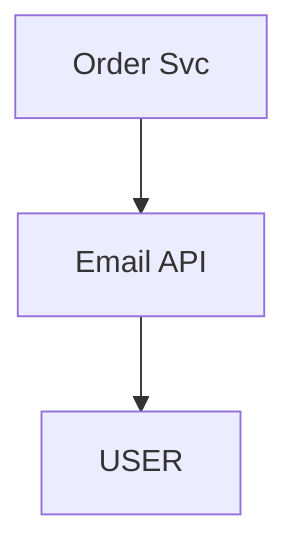
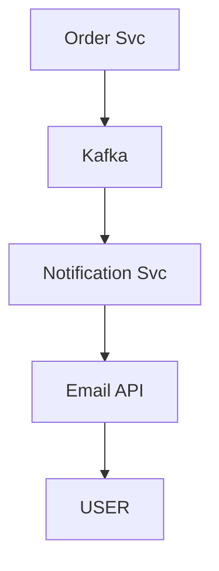
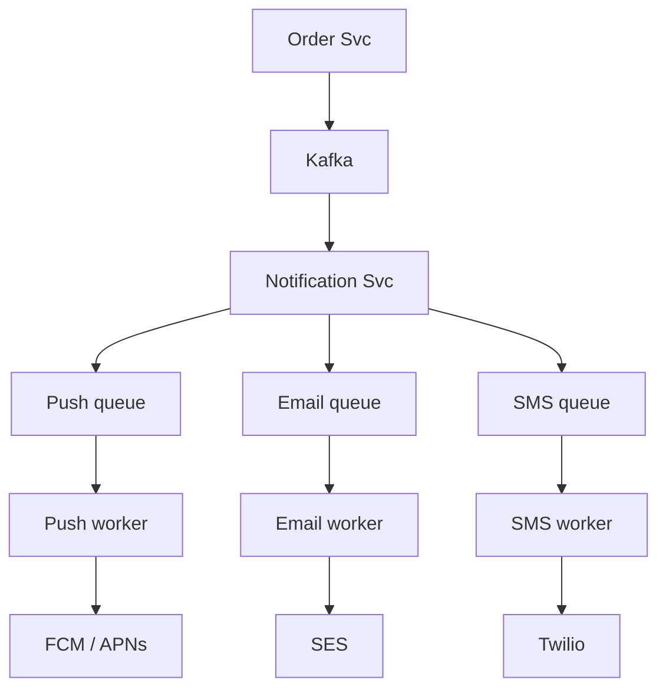
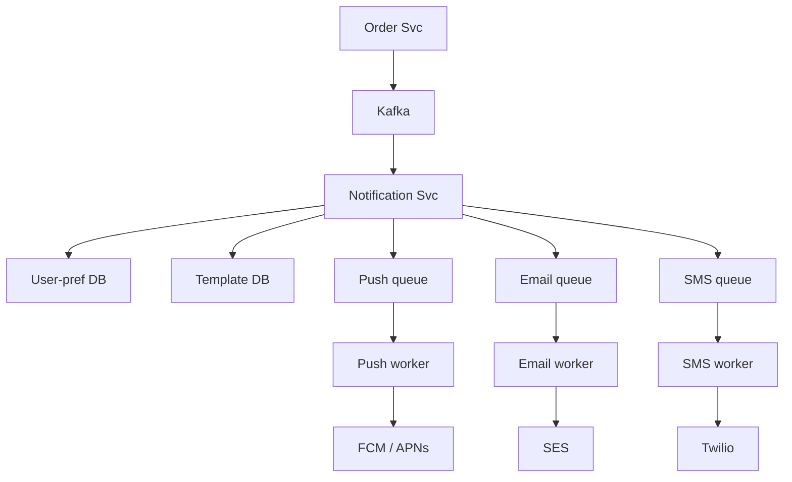
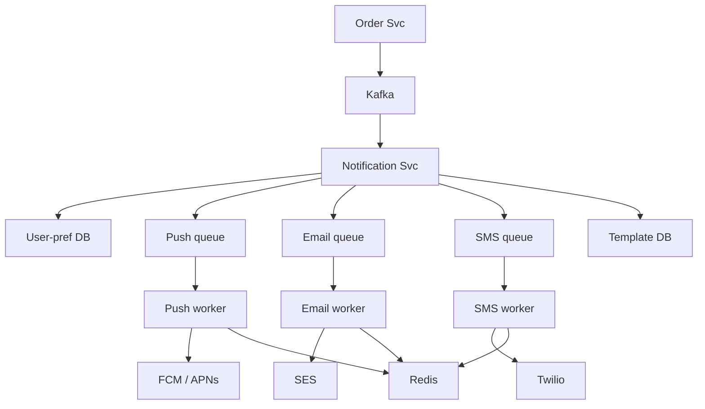
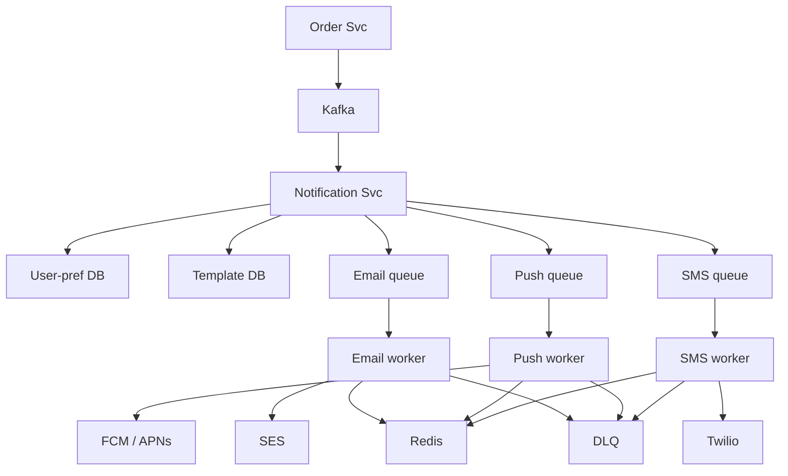
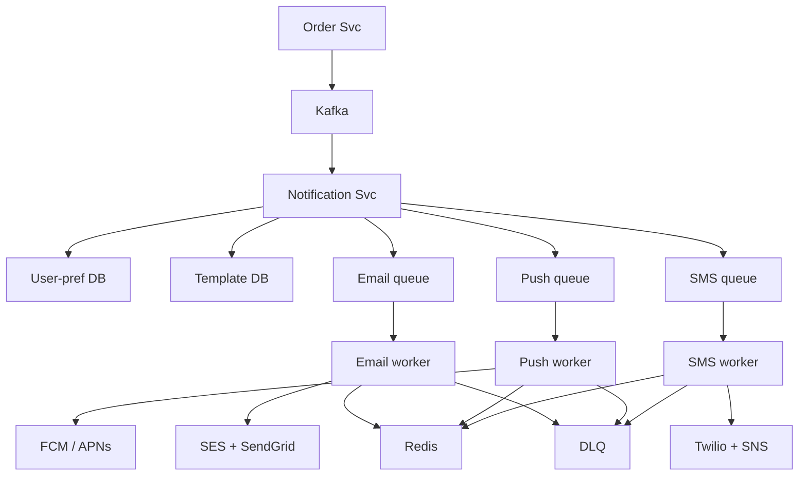
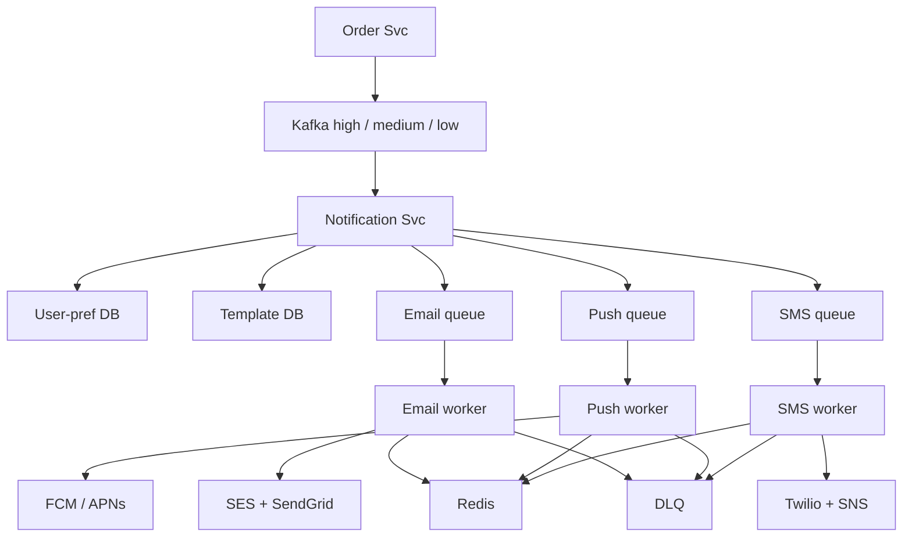
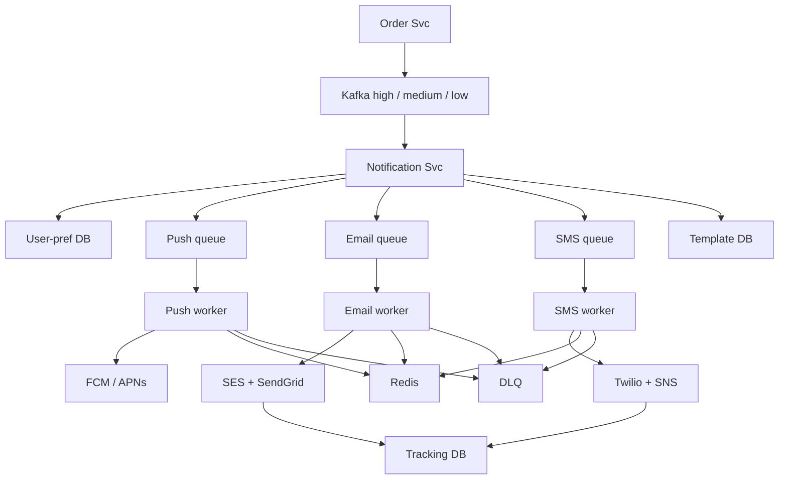
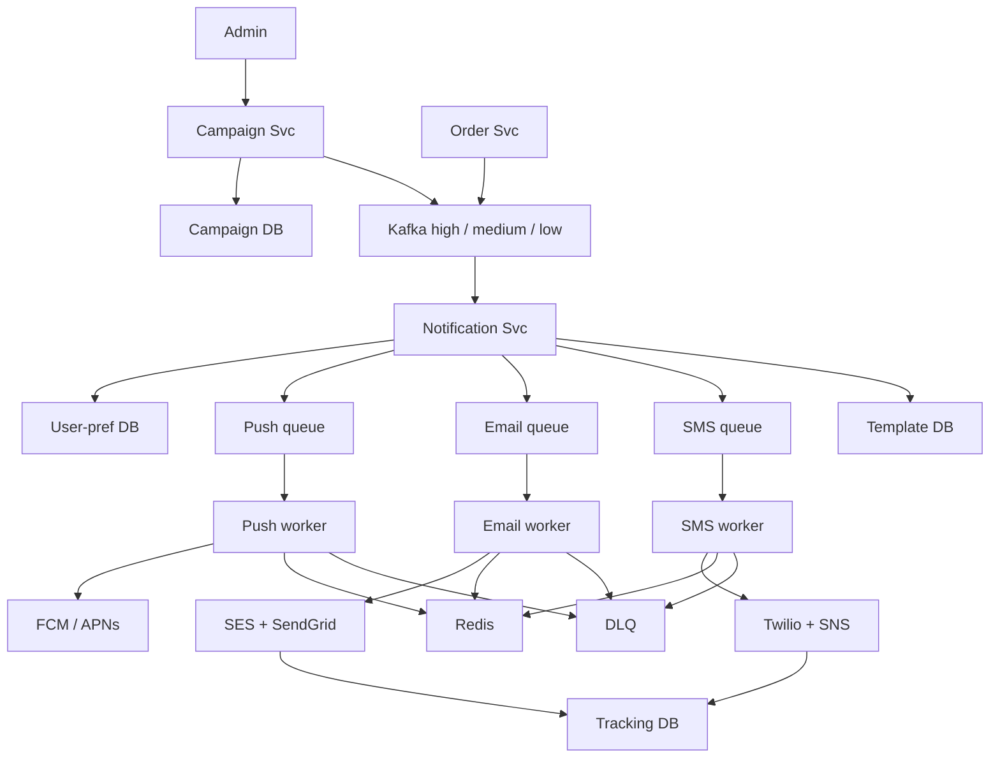

# Notification System

> Koi ghatna hui (order, OTP, offer) -> sahi user ko, sahi raaste (push / email / SMS) se, sahi waqt pe khabar.
> Is design ka dil teen cheezein hain: **ek ghatna -> kai raaste, kai log (fanout)** · **khabar kabhi khoye nahi, do baar jaaye nahi** · **OTP turant**.

```
Amazon pe order -> phone pe push + email + SMS + app ke andar = EK ghatna, KAI raaste.
SHAADI KA CARD: ek shaadi, 500 mehmaan, sabko alag raaste se nyota:
   ghar wale = WhatsApp · office wale = email · padosi = chhapa card · VIP = phone karke
   notification system = shaadi ka planner
```

---

## TASVEER (ByteByteGo / Alex Xu · CC BY-NC-ND 4.0)


Source: [How Does a Typical Push Notification System Work?](https://bytebytego.com/guides/how-does-a-typical-push-notification-system-work/)
(poora naksha: ghatna -> notification service -> queue -> worker -> bhejne wali company FCM / APNs / SMS)

---

## SHURU: pehle poocho, phir numbers

```
POOCHO:  "Sirf bhejne ki line banani hai, ya user ki pasand + message ke saanche (template) bhi?"
         kaunse raaste? push / email / SMS / app ke andar · ek user ko din me kitne? (~5)
         kya sab barabar zaroori? (OTP turant, offer ruk sakta)
         <- ek hi line me sab = OTP 10 minute late = asli fail
         turant chahiye ya thodi der chalegi?

MISAAL:  order hua -> push + email · OTP -> SMS turant · sale offer -> push, ruk sakta hai
         bahar: analytics dashboard

KAISA CHALE (NFR, 6 cheez):
   ek ghatna kai log / raaste · bhejne wala ruke nahi (async) · khoye nahi (dobara koshish + DLQ)
   bheed jhele (~1 lakh / second) · OTP ki alag tez line · user ki pasand maano

NUMBERS (andaaza):
   10 crore user x 5 / din = 50 crore / din -> din me ~1 lakh second -> ~5,800 har second (aam din)
   sale ke din 10 guna -> ~58,000 har second
   har ek 3 raaste se -> ~1.75 lakh / second Kafka me. Machines aam din ke hisaab se nahi, sale ke hisaab se.
   ek worker ~1000 / second bhejta -> sale pe ~175 worker (raaste ke hisaab se bante)
   kya gaya kya nahi ka hisaab ~90 TB / saal (Cassandra) · Kafka me 7 din ki khabar ~3 TB
   bheed jhatke me aati -> beech me line (Kafka) · hisaab me likhna bahut -> NoSQL
```
```
POOCHEGA: "What if traffic suddenly spikes 10x?"
          (Traffic achanak 10 guna ho gaya to?)

JAWAB:    Sale ke time saari khabar pehle Kafka ki line me jaati, to jhatka line sambhaal leti, worker
          apni speed se bhejte.
          Sale ka time pata hai (12 baje), to 11:50 tak worker badha do. Machine apne aap badhne me
          minute lagte, jhatka second me.
          Par worker utne hi badhao jitna DB aur SMS / email company jhel sake, warna wahan atak
          jaayega.
```

---

## ════ MOCK SE PEHLE: SIRF YE CARD PADHO ════

> Har dikkat ek card: KAHANI (kya hua, kaun, kitna) -> ILAAJ -> ANDAR KAISE (ilaaj kyun kaam karta) ->
> ISKE BAAD KYA TOOTEGA (interviewer yahin ghusta hai: dabba lagaya, ab kya?).

#### DABBA 0: SABSE SIMPLE (yahan se shuru, phir "kahan tootega")
```
Order service khud seedha email bhejne wali company (Email API) ko call kare.
```


<a id="d1"></a>

#### [1](#d1) ORDER EMAIL KE INTEZAAR ME RUKA, EMAIL DOWN = ORDER FAIL
```
KAHANI:  Arpan ne order kiya. Order service ne email bheja aur jawab ka intezaar karti rahi.
         Ek din email company band thi -> order hi fail ho gaya. Aur email dobara bhejne wala koi nahi.

ILAAJ:   Order service email ka intezaar nahi karti: 'order hua' ki khabar Kafka me daali aur turant user
         ko jawab de diya.
         Notification service peeche se khabar padh ke email bhejti. Email company band ho to bhi order ho
         jaata, email baad me chala jaata.
         Ek dikkat: order DB me likha aur Kafka me daalne se pehle service giri to khabar kho jaati.
         Isliye order aur khabar dono DB me ek saath likho (outbox table), ek relay baad me khabar Kafka
         bhej deta.

ANDAR KAISE:
         Kafka ek diary hai jo disk pe rehti hai. Notification
         service yaad rakhti hai kahan tak padha (offset).
         Email band hai -> wo aage nahi badhti. Email wapas aaya
         -> wahin se shuru. Khabar ~7 din diary me padi rehti hai.

ISKE BAAD KYA TOOTEGA:
  - Order DB me ban gaya, par Kafka me likhne se PEHLE Order service gir gayi?
      -> khabar gayi hi nahi. Ilaaj OUTBOX: order aur khabar EK hi DB transaction me (outbox table),
         ek relay baad me outbox se Kafka bheje.
  - Notification service ki kai machine hain, Kafka kaise baante?
      -> sab ek team (consumer group) me, har line (partition)
         ek machine ko. Machine badhao, lines bat jaati hain.
  - Order service me hi dobara koshish (retry) kyun nahi?
      -> order ki request utni der atki rehti. Aur Order service giri to retry bhi gaya.
```


<a id="d2"></a>

#### [2](#d2) TEEN RAASTE, SMS DHEEMA TO PUSH / EMAIL BHI ATKE
```
KAHANI:  Push, email, SMS teeno ek hi line me khade the. SMS company dheemi hui ->
         SMS wale atke, aur unke peeche push aur email bhi khade reh gaye.

ILAAJ:   Push, email, SMS teeno ki alag line aur alag worker.
         SMS company dheemi hui to sirf SMS ki line lambi hogi, push aur email apni speed se chalte
         rahenge.
         Jis raaste pe zyada kaam, sirf uske worker badhao.

ANDAR KAISE:
         SMS dheema -> sirf SMS ki line lambi hui. Email worker apni speed se chalte rahe.
         Worker alag ginti me (email ke 10, SMS ke 3) -> jiski zaroorat ho wahi badhao.

ISKE BAAD KYA TOOTEGA:
  - Ek ghatna ke liye teeno raaste chahiye, to teen baar banegi?
      -> Notification service ek ghatna se teen chhote message banati hai, har line me ek.
         Har message ki pehchaan = ghatna ki id + raasta.
  - Push kis phone pe bhejein?
      -> app install hote hi phone ka pata (device token) user ke saath save. Pata bekaar nikla -> hata do.
```


<a id="d3"></a>

#### [3](#d3) SMS BAND THA, PHIR BHI RAAT 2 BAJE BHEJA
```
KAHANI:  Arpan ne SMS band kiya tha aur raat 10 se subah 8 "mat
         bhejo" lagaya tha. Phir bhi raat 2 baje SMS aaya.

ILAAJ:   Bhejne se pehle dekho Arpan ne kya chuna hai: SMS band kiya? raat 11 se 7 'disturb mat karo'?
         Phir uski bhasha me message bharo ('Hi {naam}, order {id} aa gaya'). Ye dono cheez cache me,
         baar-baar DB nahi.
         Offer wala message subah tak ruke, par OTP aur 'koi aur login kar raha' wala alert raat ko bhi
         jaaye.

ANDAR KAISE:
         Arpan = push chalu, email chalu, SMS band, raat 10-8 shaanti -> sirf push + email, SMS chhodo.
         Pasand aur saancha har ghatna pe chahiye -> unhe cache me rakho.

ISKE BAAD KYA TOOTEGA:
  - Shaanti ke waqt me khabar aayi, to phenk doge?
      -> nahi. Offer ko subah tak rok lo. OTP / security wali shaanti me bhi jaati hai.
  - Arpan ne pasand badli, cache purana hai?
      -> pasand badalte hi cache se hatao, aur cache ki umar chhoti rakho.
```


<a id="d4"></a>

#### [4](#d4) JAWAB KHO GAYA, DOBARA BHEJA, USER KO DO EMAIL
```
KAHANI:  Worker ne email company ko bheja. Company ne email bhej bhi diya, par uska "ho gaya" wala jawab
         raaste me kho gaya. Worker ko laga fail hua -> dobara bheja -> Arpan ko DO email.

ILAAJ:   Kafka kabhi ek khabar do baar bhi de deta hai. Isliye worker bhejne se pehle Redis me khabar ki
         id ke saath parchi lagata: 'SET NX' matlab sirf tab lagao jab pehle se na ho.
         Parchi pehle se lagi mili = ye khabar pehle aa chuki, skip. Arpan ko do email nahi jaayenge.
         Ye wahi hai jo usercrud me /pay pe banaya tha: key pehle aayi to dobara kaam nahi.

ANDAR KAISE:
         Kafka ek khabar kabhi-kabhi do baar de deta hai. Isliye parchi khabar ki APNI id se lagti hai,
         jo har baar wahi rehti hai. Har baar naya random id banaya to dohraav kabhi pakda hi nahi jaayega.

ISKE BAAD KYA TOOTEGA:
  - Redis hi gira?
      -> DB me bhi niyam: (khabar_ki_id, raasta) ek hi baar (UNIQUE). Redis tez raasta, DB pakka.
  - Parchi 24 ghante me mit gayi, aur wahi khabar phir aa gayi?
      -> dobara chali jaayegi. Pakka rokna DB ka UNIQUE niyam karta hai.
```


<a id="d5"></a>

#### [5](#d5) PARCHI LAGA DI, PAR BHEJNA FAIL HO GAYA
```
KAHANI:  Arpan ka OTP bhejna hai. Worker-A ne Redis me parchi lagayi
         "OTP-123: bhej diya", phir SMS company ko call kiya.
         Call FAIL ho gayi (ya Worker-A beech me hi mar gaya). OTP gaya hi nahi.
         Kafka ne khabar dobara di, Worker-B aaya, parchi dekhi "bhej diya" -> chhod diya.
         OTP kabhi nahi gaya, aur system soch raha hai bhej diya. KHABAR KHO GAYI.

DIKKAT KI JAD:  parchi ek hi baat bolti thi, "bhej diya". Par asal me Worker-A ne sirf KOSHISH shuru ki thi.

ILAAJ:   Parchi pe do alag baatein likho:
           bhejne se PEHLE:      "BHEJ RAHA HOON" (SENDING) + chhoti umar, 60 second
           company ne OK bola:   "BHEJ DIYA" (SENT) + lambi umar, 1 din

ANDAR KAISE (har haalat me kya hota):
   Worker-A ka call fail, par Worker-A zinda   -> wo khud parchi hata deta hai -> agli koshish chal jaati hai.
   Worker-A beech me hi MAR gaya               -> "BHEJ RAHA HOON"
   60 second me khud mit jaati hai -> agli koshish chal jaati hai.
   Worker-B ko "BHEJ RAHA HOON" mila           -> koi abhi bhej raha hai, thoda ruko, phir dekho.
   Worker-B ko "BHEJ DIYA" mila                -> pakka chala gaya -> chhodo.
   Ek line me: CHHODNA sirf "BHEJ DIYA" pe. "BHEJ RAHA HOON" = adhoora, pata nahi gaya ya nahi.

ISKE BAAD KYA TOOTEGA:
  - "Fail hua to parchi hata do" itna kaafi kyun nahi?
      -> worker hi mar gaya to hatane wala koi nahi bacha.
         Isliye "BHEJ RAHA HOON" ki umar chhoti, khud mit jaaye.
  - 60 second chhote pad gaye (company 70 second me jawab de)?
      -> umar hamesha company ke timeout se lambi rakho (timeout 10 second -> umar 60 second).
  - Company ne bhej diya tha, bas jawab aane se pehle worker mara?
      -> tab do baar ja sakta hai. SES / Twilio aisi parchi khud nahi rakhte, to ye chhota risk maana hua hai.
         OTP do baar aana chalega, par na aana nahi chalega.
```


<a id="d6"></a>

#### [6](#d6) COMPANY GIR RAHI, HUM TURANT DOBARA MAAR RAHE
```
KAHANI:  SMS company pehle se pareshaan hai, aur hum har second
         dobara bhej ke uspe aur hathoda maar rahe hain.

ILAAJ:   Dobara bhejne me har baar zyada ruko (1, 2, 4, 8 second = BACKOFF) + thoda random (JITTER).
         Had paar -> DLQ me daalo + alert.

ANDAR KAISE:
         Rukne ka time = shuru ka time x 2^koshish + thoda
         random. Random isliye ki sab worker ek saath na lautein.
         Kafka ko "padh liya" (offset) KAAM HONE KE BAAD bolo:
         worker beech me mara to khabar dobara aayegi, khoyegi nahi.
         Kafka me likhte waqt "saari copies ne le liya tabhi OK" (acks=all).

ISKE BAAD KYA TOOTEGA:
  - Kafka me "10 minute baad chalana" hota hi nahi, to ruk ke dobara kaise?
      -> alag lines banao (retry-1m, retry-10m). Worker message
         pe likha "kab chalana" dekhe, abhi nahi to ruke.
  - DLQ me padi khabaron ka kya?
      -> alert + dashboard, aur theek karke wapas main line me daalne ka tool.
  - Khabar kabhi khoye nahi, kaise pakka?
      -> saari copies ne liya tabhi OK + kaam ke baad offset + parchi + DLQ. Phenkna kabhi nahi.
```


<a id="d7"></a>

#### [7](#d7) COMPANY DHEEMI, SAARE WORKER 30 SEC ME PHANSE
```
KAHANI:  SMS company band nahi hui, bas dheemi ho gayi. Har call 30 second atki.
         Saare worker usi me phans gaye, baaki kaam ruk gaya. Dheemi company band company se bhi buri.

ILAAJ:   Company ko call karte waqt 2-3 second se zyada intezaar nahi (timeout).
         Baar-baar fail ho rahi hai to us company ko kuch der call karna hi band (fuse uda), aur doosri
         company se bhejo. Worker atke nahi rehte.
         Thodi der baad ek test call: chal gayi to pehli wali wapas.

ISKE BAAD KYA TOOTEGA:
  - Dono company band?
      -> khabar line me ruki rahe (phenko nahi), backoff se koshish. OTP ke liye alert.
  - Push ki doosri company?
      -> nahi hoti. Android = FCM, iPhone = APNs, alag-alag.
```


<a id="d8"></a>

#### [8](#d8) OTP OFFER KE 50,000 MESSAGE KE PEECHE
```
KAHANI:  Ek hi line me sab. Usi waqt 50,000 offer wale message
         line me the. Arpan ka OTP unke peeche khada raha,
         10 minute baad aaya. Tab tak login ka time khatam.

ILAAJ:   OTP ki apni alag line aur apne worker. Offer wale 1 crore message apni line me khade rahein, OTP
         unke peeche kabhi nahi lagta, turant jaata.

ANDAR KAISE:
         Kafka me "ye zaroori hai, pehle bhejo" hota hi nahi -> isliye alag line.
         Raaste ki line bhi alag: sms-tez / sms-dheemi.

ISKE BAAD KYA TOOTEGA:
  - Tez line khaali, dheemi me bheed -> tez wale worker baithe rahenge?
      -> haan, thoda bekaar. Khaali hon to beech wali bhi padh lein (par ulta kabhi nahi).
  - OTP bhi company ki limit me phans gaya?
      -> OTP ke liye company ka alag account / alag number, offer use kha na sake.
```


<a id="d9"></a>

#### [9](#d9) EK SAATH BAHUT, COMPANY NE 429 DIYA
```
KAHANI:  Sale shuru, ek saath laakhon message. SMS company bolti "itna nahi" (429) -> sab fail.

ILAAJ:   Company keh rahi hai 'second me 100 se zyada mat bhejo'. To worker khud apni speed 100 / second
         pe rakhte (har second 100 token, ek message = ek token).
         429 aaya to ruk ke dobara, company jitni der bole utni der ruko. Message line me intezaar karte,
         had ke baad DLQ me, phenke nahi.

ANDAR KAISE:
         100 worker, har ek ne poori limit li = 100 guna -> phir 429.
         Isliye Redis me EK saanjhi baalti, har worker bhejne se pehle usse token le (Lua, ek jhatke me).
         Limits: FCM ~10,000 / second · SES naya account ~14 / second · Twilio short code ~100 / second.

ISKE BAAD KYA TOOTEGA:
  - Worker apne aap badh gaye?
      -> baalti saanjhi hai: kitne bhi worker ho, kul speed wahi.
  - Limit hi kam hai (SES 14 / second) aur 1 lakh email bhejne hain?
      -> limit badhwao + kai account / company. Tab tak line dheere-dheere khaali.
```


<a id="d10"></a>

#### [10](#d10) "BHEJ DIYA" KA MATLAB "MIL GAYA" NAHI
```
KAHANI:  SMS company ne message le liya. Par Arpan ke phone tak pahuncha ya nahi, humein pata hi nahi.

ILAAJ:   Company 'bhej diya' bolti hai, par user tak pahuncha ya nahi wo baad me batati hai (webhook:
         company khud hamein call karti).
         Isliye har message ke saath company ki message id rakho. Webhook aaya ('mila' / 'fail') to wahi
         row update karo, pehle check karo ki call sach me company ki hai (signature).
         Jo message ghanton se 'bheja' pe atka, uska ek baar khud company se haal poochh lo.

ANDAR KAISE:
         Bhejte waqt company ka message number (SES MessageId / Twilio SID) apne notification ke saath save.
         Webhook aaya -> us number se row dhoondho -> haalat
         badlo. Hisaab = Cassandra (likhna bahut, seedhi row).

ISKE BAAD KYA TOOTEGA:
  - Webhook aaya hi nahi?
      -> kuch ghante baad jo "bhej diya" pe atke hain, sirf unke liye ek baar company se poochho.
  - Koi nakli webhook bhej de?
      -> company ka hastakshar (HMAC signature) jaancho, warna mana.
  - Webhook ki jagah baar-baar khud poochte raho?
      -> laakhon message x har kuch second = limit + kharcha. Webhook tabhi aata jab kuch badla.
```


<a id="d11"></a>

#### [11](#d11) 1 CRORE LOGON KO EK SAATH OFFER
```
KAHANI:  "Diwali offer sabko" = 1 crore user. Ek-ek karke bheja -> request ghanton atki, OTP bhi peeche,
         company ki limit tooti.

ILAAJ:   API turant 'shuru ho gaya' bol de, 1 crore ek saath nahi bhejte.
         Ek job users ko 1000-1000 ke packet me padhe aur har packet Kafka me daale. Worker har user ki
         pasand dekhe, message bhare, aur dheemi (offer wali) line pe company ki had me bheje.
         Push ke liye FCM topic: sab subscribed phones ko ek hi call me.

ANDAR KAISE:
         "id > aakhri_id, 1000 lao" (cursor), har tukde ke baad aakhri_id campaign row me save
         -> job gira to wahin se shuru. 10,000 / second ki speed
            se 1 crore ~17 minute (jaan-boojh ke phailaya).
         Push me sabko ek hi message -> FCM ka TOPIC: ek call, aage Google sabko pahunchata hai.

ISKE BAAD KYA TOOTEGA:
  - Worker 1000 me se 600 bhej ke gira?
      -> tukda dobara aayega, (campaign_id, user_id) se pehle ke 600 chhoot jaayenge.
  - Galat offer chala gaya, rokna hai?
      -> campaign row pe "CANCELLED". Worker har tukde se pehle dekhe.
  - 1000 ka tukda hi kyun?
      -> 1 crore alag khabar = bojh. 1 bahut bada message = ek
         worker pe atka. 1000 = saath-saath bhi, dobara bhi chhota.
  - Ek user ke message ka kram ("order hua" ke baad "ship hua")?
      -> line ka chunaav user_id se -> ek user ki saari khabar ek line me, kram se.
```


```
AAKHRI DABBE (sab dikkat ke baad):
  Order / Campaign Svc -> Kafka (tez / beech / dheemi) -> Notification Svc (pasand + saancha, cache)
  -> push / email / SMS ki line -> worker (parchi · ruk ke dobara · fuse · speed limit)
  -> 2 company -> user · webhook -> Tracking DB · fail -> DLQ

DB:  Tracking = Cassandra -> likhna bahut, seedhi row, pakki consistency nahi chahiye, aaram se badhta
     Pasand / saancha = chhota, har ghatna pe padha jaata -> cache (dikkat 3)

END ME POOCHEGA:
  "10 guna?"              -> Kafka ki lines pehle se zyada · worker badhao · company ki limit pe speed
  "Kahan se gir sakta?"   -> company (do company), Kafka (copies), Redis (DB ka UNIQUE peeche)
  "Chal raha, kaise pata?" -> webhook se delivered / failed · Kafka me kitna pending · DLQ kitna bhara · alert
  "Ek user ka kram?"      -> line user_id se -> "order hua" kabhi "ship hua" ke baad nahi
```

AAKHRI DABBE ki tasveer:


---

## 10 GUNA TRAFFIC — har dabba alag se

```
Kafka            -> sale pe 10 guna -> lines (partition) pehle se zyada · line user_id se
Notification Svc -> pasand / saancha cache · machine badhao
raaste ki line   -> alag line (ho gaya) + tez / dheemi line
worker           -> sale pe badhao (ek worker ~1000 / second) · fuse + do company · speed limit
Tracking DB      -> 90 TB / saal -> Cassandra + row ki umar, purana sasti jagah (cold storage)
                    (umar se jagah ghatti hai, baantne se bojh — dono alag cheez)

POOCHEGA: "Data keeps growing — what happens in 3 years?"
          (Data badhta ja raha, 3 saal baad?)

JAWAB:    Kis message ka kya hua (bheja / mila / khola), uski row ki umar rakho (jaise 90 din), purani
          rows sasti jagah chali jaayein. Roz wali table chhoti rehti hai.
```

---

## POOCHE TO (gehra sawaal aaye tab)

```
KHABAR:   Kafka pe { event: "ORDER_PLACED", userId: 123, orderId: 999 }
          (andar ke liye REST bhi: POST /notify { userId, type, channel?, payload })

RAASTE:   Push: FCM (Android) / APNs (iPhone) · Email: SES / SendGrid / Mailgun · SMS: Twilio / SNS / MSG91
          App ke andar: DB + WebSocket · Phone call: Twilio · Slack webhook

DB:       PASAND:  user_id -> kaunse raaste · shaanti ka waqt · kya band kiya
          SAANCHA: template_id -> format · bhasha · khaali jagah {{name}} {{orderId}}
          HISAAB:  bheja / mila / khola / click / fail -> Cassandra
                   (bahut likhna, seedhi row, ACID nahi chahiye)

1 LAKH / SECOND:  ~100 worker · line "notifications" P0 -> W1 ... P99 -> W100
          line user_id se -> ek user ki saari khabar ek line me -> kram bana rehta
          (warna "ship hua" pehle aur "order hua" baad me)

POORA RAASTA EK BAAR:
          order -> Order Svc Kafka me { ORDER_PLACED, 123, 999 } -> Notification Svc uthaye -> pasand dekhe
          (push chalu, email chalu, SMS band) -> saancha bhare -> push + email ki line -> worker -> company
          -> user -> webhook -> Tracking DB · fail -> dobara -> DLQ
```

---

## AAKHRI DABBA + WRAP

```
Kafka = order se alag + bheed jhele + zaroorat ki alag line · Notification Svc = pasand + saancha + fanout
raaste ki line = apni speed · worker = parchi (BHEJ RAHA / BHEJ DIYA) + ruk ke dobara + fuse + speed limit
DLQ = kharab khabar baaki ko na roke · Tracking DB = "bheja" vs "mila"
```
```
JAWAB:    Services 'kuch hua' ki khabar Kafka me daalti. Notification service user ki pasand dekhti,
          message bharti, aur push / email / SMS ki alag line me daal deti.
          Worker parchi (BHEJ RAHA / BHEJ DIYA) se do baar nahi bhejte, fail pe ruk-ruk ke dobara,
          company ki had me, company dheemi to fuse + doosri company, had ke baad DLQ. OTP ki alag line.
          Ek user ki khabar ek hi line me, to kram sahi. Company ke webhook se 'mila / fail' update.
          Aage: raat ka shaant time, kai bhasha, khola / click ginti.
```


---

## HANDS-ON — provider ne 429 diya: chala ke dekha

> Grill me galti: 429 pe "fail-open" bola. Fail-open HUMARE limiter ka faisla (Redis gira to); yahan limiter
> PROVIDER ka, uska darwaza hum nahi khol sakte -> dheema HUMEIN hona padega.
> CODE: `04_HLD/HANDS_ON/03_provider_429/Sms429Demo.java` (Docker nahi, time nakli) · line 21 `SMART = false / true` -> `java Sms429Demo.java`

```
SETUP:  1000 SMS ek saath · provider 100 / sec · t=3,4 pe 50 / sec
NAIVE:  sab ek saath, 429 pe agle second turant retry, 3 fail -> PHENK DO
SMART:  apni taraf 100 / sec (token bucket) · 429 pe 1s, 2s, 4s · kabhi phenko mat
```
```
NAIVE      t | provider | queue | bheje | 200 | 429 | chhode | pahunche
           0 |  100/sec |  1000 |  1000 | 100 | 900 |      0 | 100
           1 |  100/sec |   900 |   900 | 100 | 800 |      0 | 200
           2 |  100/sec |   800 |   800 | 100 | 700 |    700 | 300
           PAHUNCHE 300 / 1000 · CHHODE 700 · call 2700 (429 = 2400)

SMART      t | provider | queue | bheje | 200 | 429 | chhode | pahunche
           0 |  100/sec |  1000 |   100 | 100 |   0 |      0 | 100
           1 |  100/sec |   900 |   100 | 100 |   0 |      0 | 200
           2 |  100/sec |   800 |   100 | 100 |   0 |      0 | 300
           3 |   50/sec |   700 |   100 |  50 |  50 |      0 | 350
           4 |   50/sec |   650 |   100 |  50 |  50 |      0 | 400
           5 |  100/sec |   600 |   100 | 100 |   0 |      0 | 500
           6 |  100/sec |   500 |   100 | 100 |   0 |      0 | 600
           7 |  100/sec |   400 |   100 | 100 |   0 |      0 | 700
           8 |  100/sec |   300 |   100 | 100 |   0 |      0 | 800
           9 |  100/sec |   200 |   100 | 100 |   0 |      0 | 900
          10 |  100/sec |   100 |   100 | 100 |   0 |      0 | 1000
           PAHUNCHE 1000 / 1000 · CHHODE 0 · call 1100 (429 = 100)

           NAIVE 3 sec, jaldi par 700 kabhi nahi milenge · SMART 11 sec, dheere par sab pahunche
DARWAZA:   1 sec me 100 nikal sakte · 1000 dhakka maarein -> 100 nikle, baaki 3 dhakke ke baad ghar
           SMART = line lagwao, 100-100
```
```
THROTTLE  raftaar provider ki limit pe baandho
BACKOFF   429 pe 1s, 2s, 4s · Retry-After aaye to wahi
JITTER    thoda random farak (simulation me nahi, time poore second me)
QUEUE     jo abhi nahi ja sakta wo queue me ruke · max try ke baad DLQ, drop nahi

JAWAB:    Chala ke dekha: company ki had ka dhyaan na rakha aur turant dobara bheja to 1000 me se 700
          gaye hi nahi.
          Had me bheja aur ruk-ruk ke dobara koshish ki to poore 1000 pahunche.
```

ARCHETYPE B (ingest) · CONCEPTS: [message-queues](../../FOUNDATIONS/07_message_queues.md) · [ms-communication](../../FOUNDATIONS/10_ms_communication.md) · saath: [12 message-queue](../12_message_queue_kafka/12_message_queue_kafka.md) · [← MASTER SHEET](../../00_MASTER_SHEET.md)
