# Notification System

> Koi ghatna hui (order, OTP, offer) -> sahi user ko, sahi raaste (push / email / SMS) se, sahi waqt pe khabar.
> Is design ka dil teen cheezein hain: **ek ghatna -> kai raaste, kai log (fanout)** · **khabar kabhi khoye nahi, do baar jaaye nahi** · **OTP turant**.

```
Amazon pe order -> phone pe push + email + SMS + app ke andar = EK ghatna, KAI raaste.
SHAADI KA CARD: ek shaadi, 500 mehmaan, sabko alag raaste se nyota:
   ghar wale = WhatsApp · office wale = email · padosi = chhapa card · VIP = phone karke
   notification system = shaadi ka planner
```

---

## KAHANI (ek din, Diwali sale, mera phone; har dikkat se design me ek dabba judta)

```
    KYA HUA                                    ILAAJ                                DABBA JUDA
1   subah order kiya, email company band     -> KAFKA (async), order turant jawab     Kafka + Notification Svc
2   SMS dheema, push / email bhi atke        -> har raaste ki ALAG LINE + worker      Push / Email / SMS queue
3   worker mara, mujhe do email              -> PARCHI (SET NX, khabar ki apni id)    Redis
4   OTP ki parchi lagi, call fail, OTP gayab -> SENDING / SENT (do haal)              (Redis parchi)
5   SMS company pareshaan, hum hathoda maare -> BACKOFF + JITTER, had ke baad DLQ     DLQ
6   SMS company dheemi, worker 30 sec phanse -> TIMEOUT + FUSE, doosri company        Twilio + SNS, SendGrid
7   12 baje sale, OTP 50,000 offer ke peeche -> OTP ki ALAG TEZ LINE                  Kafka high / med / low
8   sale me laakhon message, company ne 429  -> SAANJHI BAALTI (token bucket)         (Redis baalti)
9   "bheja", par phone tak pahuncha?         -> WEBHOOK + company ka message id       Webhook + Tracking DB
10  shaam "Diwali offer sabko", 1 crore      -> 1000 ke TUKDE + campaign row          Campaign Svc + DB
11  raat 2 baje offer SMS, maine band kiya   -> PASAND + SHAANTI + SAANCHA (cache)    User-pref + Template DB

POORA DESIGN (upar ke dabbe kram se):
   Order / Campaign Svc -> Kafka (tez / beech / dheemi) -> Notification Svc (pasand + saancha)
   -> push / email / SMS line -> worker (parchi, backoff, fuse, baalti) -> 2 company -> user
   webhook -> Tracking DB · fail -> DLQ
```

---

## TASVEER (ByteByteGo / Alex Xu · CC BY-NC-ND 4.0)


Source: [How Does a Typical Push Notification System Work?](https://bytebytego.com/guides/how-does-a-typical-push-notification-system-work/)
(poora naksha: ghatna -> notification service -> queue -> worker -> bhejne wali company FCM / APNs / SMS)

---

## SHURU: pehle poocho, phir numbers

```
POOCHO:  "Sirf bhejne ki line banani hai, ya user ki pasand + message ke saanche (template) bhi?"
         kaunse raaste? push / email / SMS / app ke andar · ek user ko din me kitne? (~5)
         kya sab barabar zaroori? (OTP turant, offer ruk sakta)
         <- ek hi line me sab = OTP 10 minute late = asli fail
         turant chahiye ya thodi der chalegi?

MISAAL:  order hua -> push + email · OTP -> SMS turant · sale offer -> push, ruk sakta hai
         bahar: analytics dashboard

KAISA CHALE (NFR, 6 cheez):
   ek ghatna kai log / raaste · bhejne wala ruke nahi (async) · khoye nahi (dobara koshish + DLQ)
   bheed jhele (~1 lakh / second) · OTP ki alag tez line · user ki pasand maano

NUMBERS (andaaza):
   10 crore user x 5 / din = 50 crore / din -> din me ~1 lakh second -> ~5,800 har second (aam din)
   sale ke din 10 guna -> ~58,000 har second
   har ek 3 raaste se -> ~1.75 lakh / second Kafka me. Machines aam din ke hisaab se nahi, sale ke hisaab se.
   ek worker ~1000 / second bhejta -> sale pe ~175 worker (raaste ke hisaab se bante)
   kya gaya kya nahi ka hisaab ~90 TB / saal (Cassandra) · Kafka me 7 din ki khabar ~3 TB
   bheed jhatke me aati -> beech me line (Kafka) · hisaab me likhna bahut -> NoSQL
```
```
POOCHEGA: "What if traffic suddenly spikes 10x?"
          (Traffic achanak 10 guna ho gaya to?)

JAWAB:    Sale ke time saari khabar pehle Kafka ki line me jaati, to jhatka line sambhaal leti, worker
          apni speed se bhejte.
          Sale ka time pata hai (12 baje), to 11:50 tak worker badha do. Machine apne aap badhne me
          minute lagte, jhatka second me.
          Par worker utne hi badhao jitna DB aur SMS / email company jhel sake, warna wahan atak jaayega.
```

---

## ════ MOCK SE PEHLE: SIRF YE CARD PADHO ════

> Har card: pehle PEELA DABBA dekho (scene + ilaaj). Yaad aa gaya -> aage. Nahi aaya -> neeche
> DIKKAT / HAL / NAHI padho. AAGE POOCHEGA sirf jab interviewer aage kuch poochhe.

#### DABBA 0: SABSE SIMPLE (yahan se shuru, phir "kahan tootega")
```
Order service khud seedha email bhejne wali company (Email API) ko call kare.
```
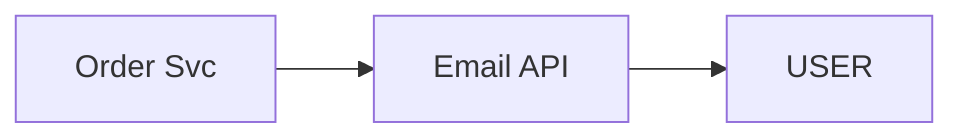

#### 1 Maine order kiya, email company band thi, order hi fail
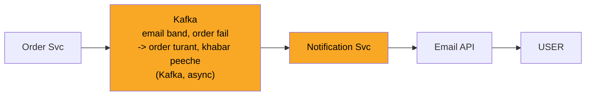
```
DIKKAT     Diwali subah maine order kiya. Order service email bhej ke jawab ka intezaar karti rahi; email
           company band thi -> order hi fail. Aur email dobara bhejne wala koi nahi.
HAL        order turant, khabar peeche (KAFKA = disk pe diary): "order hua" Kafka me daal ke turant jawab.
           Notification service peeche se padh ke bheje; email band -> wapas aaye to wahin se (offset yaad).
NAHI       Order service me hi retry: request utni der atki, aur Order service giri to retry bhi gaya.
```
```
AAGE POOCHEGA:
  NIYAM: order kabhi khabar ka intezaar nahi karta: khabar disk ki diary (Kafka) me, padhne wala yaad rakhe
         kahan tak -> company band ho to bhi khabar padi rehti, wapas aate hi wahin se.
  SAFAR (ek order ki khabar, har mod pe kya):
  order bana             -> 'order hua' Kafka me daalo, turant jawab; khabar peeche
  Kafka se pehle Svc giri -> khabar gayi hi nahi: order + khabar EK DB txn (outbox), relay bheje
  email company band     -> khabar Kafka diary me ~7 din padi, padhne wala kahan tak yaad (offset)
  company 2 din baad     -> wahin se aage: order kabhi email se fail nahi
  Notification Svc dheemi -> machine badhao (consumer group): har line ek machine, lines bat jaati
  Kafka ki machine giri  -> diary ki 3 copy: baaki copy se chalta, khabar nahi khoti
```

#### 2 SMS company dheemi, mera push aur email bhi atke
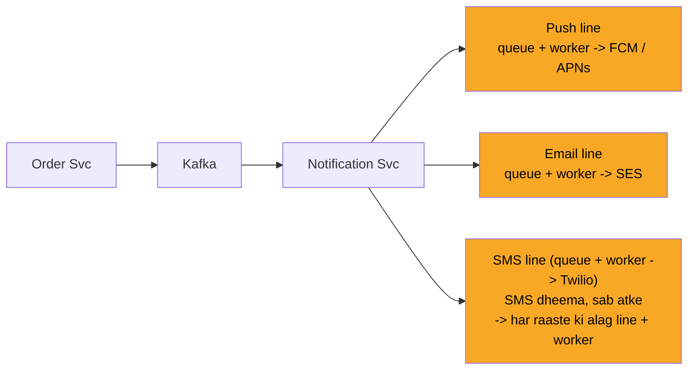
```
DIKKAT     Usi order ki khabar push, email, SMS teeno se. Teeno ek line me; SMS company dheemi hui -> SMS
           atke, unke peeche mera push aur email bhi khade.
HAL        har raaste ki apni line (ALAG QUEUE): teeno raaste ki alag line aur alag worker. SMS dheema -> sirf
           SMS ki line lambi. Worker alag ginti me (email ke 10, SMS ke 3) -> jis raaste pe kaam, wahi badhao.
NAHI       SMS worker badha do: company khud dheemi, line phir bhi ek, push / email phir bhi peeche.
```
```
AAGE POOCHEGA:
  NIYAM: har raasta (push / email / SMS) apni line, apni speed; ek ka dheema ya band hona doosre pe nahi aata.
  SAFAR (ek ghatna, teen raaste, har mod pe kya):
  ghatna aayi            -> teen chhote message (ghatna id + raasta), har raasta apni line
  SMS dheema / band      -> sirf SMS ki line rukti: push / email apni speed chalte
  SMS line lambi         -> sirf SMS ke worker badhao: push / email pe asar nahi
```

#### 3 Worker mara, mujhe do email aaye
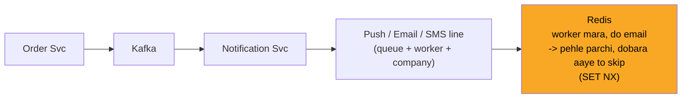
```
DIKKAT     Worker ne mera email bheja, par Kafka ko "padh liya" (offset) bolne se pehle mar gaya. Kafka ne
           wahi khabar doosre worker ko di -> dobara bheja -> mujhe DO email.
HAL        dobara aaye to skip (PARCHI): bhejne se pehle Redis me khabar ki APNI id se parchi (SET NX).
           Parchi pehle se mili = khabar pehle aa chuki -> skip.
NAHI       har baar naya random id: dohraav kabhi pakda nahi jaata.
```
```
AAGE POOCHEGA:
  NIYAM: khabar ki apni pakki id -> dobara aaye to pehchaan ke skip; Redis tez raasta, Cassandra me
         INSERT IF NOT EXISTS (LWT) aakhri deewar.
  SAFAR (ek khabar, dobara aayi, har mod pe kya):
  khabar aayi            -> pehle dekho: ye khabar_id + raasta bheja? (Redis parchi, tez)
  wahi dobara aayi       -> parchi mili -> skip: do email nahi
  Redis gira             -> Cassandra INSERT IF NOT EXISTS (khabar_id, raasta) (LWT): pakka wahi
  parchi 24 ghante me mitti -> Cassandra row nahi bhoolti, IF NOT EXISTS phir rokega
```

#### 4 Parchi lag gayi, par mera OTP gaya hi nahi
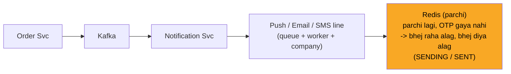
```
DIKKAT     Login ka OTP: Worker-A ne parchi "bhej diya" lagayi, SMS call FAIL (ya Worker-A mara). Kafka ne
           dobara di, Worker-B ne "bhej diya" dekh ke chhoda -> OTP kho gaya. Koshish ko pakka maan liya.
HAL        do haal rakho (SENDING / SENT): bhejne se PEHLE "BHEJ RAHA HOON" (SENDING, 60 sec umar), company OK
           pe "BHEJ DIYA" (SENT, 1 din). CHHODNA sirf SENT pe; SENDING = adhoora.
NAHI       parchi hi hata do: worker mara to Kafka dobara deta -> OTP / email do baar (card 3 wapas).
```
```
TASVEER: SENDING / SENT
Worker-A: parchi SENDING (60 sec) -> call FAIL: A khud hataye · A mara: 60 sec me khud mit-ti
Kafka dobara deta -> Worker-B: SENDING mila -> thoda ruko · kuch nahi -> SENDING lagao, bhejo
company OK -> SENT (1 din)  ->  koi bhi SENT dekhe -> chhodo
```
```
AAGE POOCHEGA:
  NIYAM: chhodo sirf pakke SENT pe; SENDING = adhoora, chhoti umar se khud mit jaaye -> khabar khoti nahi;
         kabhi do baar chali jaaye to chalega (OTP do baar > na aana).
  SAFAR (ek OTP ki parchi, har mod pe kya):
  worker ne uthaya       -> parchi SENDING (chhoti umar, ~60 sec) -> company ko call
  call hua               -> parchi SENT: ab koi dobara nahi bhejega
  bheja, jawab se pehle mara -> maana hua risk: do baar ja sakta; OTP do baar > na aana
  call fail, worker zinda -> khud parchi hatao: koshish adhoori, agli chal jaaye
  worker hi mara         -> hatane wala koi nahi -> SENDING ki umar (60 sec) khatam, khud mit jaati
  Worker-B ko SENDING mili -> thoda ruko, phir dekho: chhodna sirf SENT pe
```

#### 5 SMS company pehle se pareshaan, hum har second dobara maar rahe
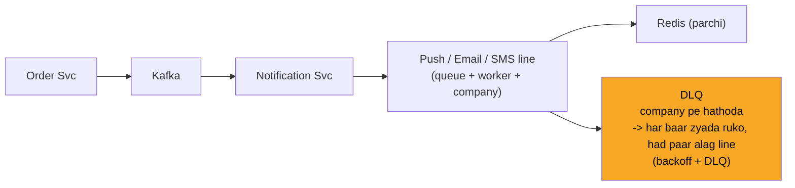
```
DIKKAT     Usi waqt SMS company pareshaan, aur hum har second dobara bhej ke uspe aur hathoda maar rahe.
HAL        har baar zyada ruko (BACKOFF + JITTER): 1, 2, 4, 8 sec + thoda random (ek saath na lautein).
           Had paar -> DLQ (fail khabaron ki alag line) + alert.
NAHI       retry band, ek fail = chhodo: company 2 sec hili to OTP hamesha ke liye gaya.
```
```
TASVEER: backoff + jitter
fail -> 1 s (+random) -> 2 s -> 4 s -> 8 s ... -> had paar -> DLQ + alert
bina random: saare worker ek saath lautein -> company pe phir ek saath hathoda
random ke saath: lautna bikhar jaata
```
```
AAGE POOCHEGA:
  NIYAM: fail pe ruk-ruk ke dobara (1, 2, 4 .. + random), khabar phenkna kabhi nahi; had ke baad DLQ + alert,
         theek karke wapas.
  SAFAR (ek fail khabar, har mod pe kya):
  bheja                  -> company ne liya, khatam
  company ne mana kiya   -> ruk-ruk ke dobara (1, 2, 4 .. + random): sab ek saath na maarein
  lamba rukna (10 min)   -> alag lines (retry-1m, retry-10m), worker 'kab chalana' dekhe
  had paar               -> alag line me daalo (DLQ) + alert: phenkna kabhi nahi
  DLQ wali khabar        -> dashboard pe dikhe, theek karke main line me wapas
```

#### 6 SMS company band nahi, dheemi: saare worker 30 sec me phanse
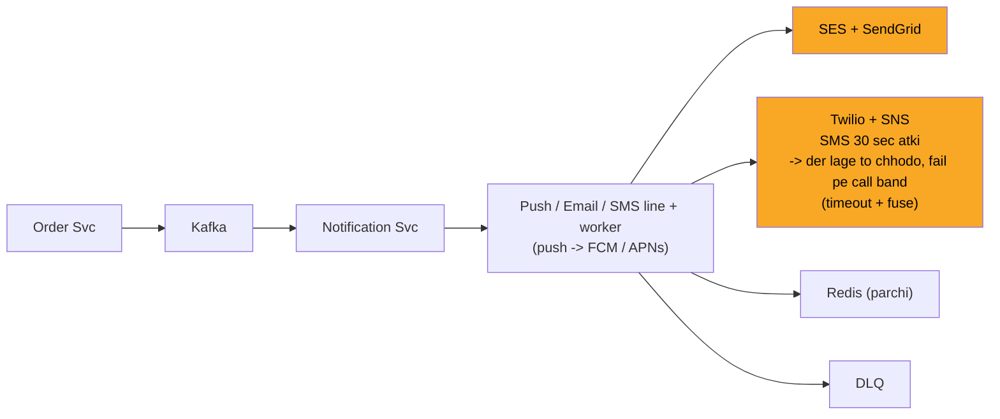
```
DIKKAT     SMS company abhi bhi dheemi: line alag ho gayi, par har call 30 sec atki. Saare SMS worker
           usi me phanse, OTP bhi ruka. Dheemi company band company se bhi buri.
HAL        2-3 sec me chhodo, fail pe call band (TIMEOUT + FUSE): har company alag, 5 fail -> OPEN, SNS pe.
           30 sec baad HALF-OPEN (ek test call) -> chali to CLOSED. FUSE = circuit breaker.
NAHI       worker badha do: naye worker bhi 30 sec me phanse, dheemi company pe aur bojh.
```
```
TASVEER: fuse (circuit breaker)
CLOSED (call chalti)  -- 5 fail -->  OPEN (call band, SNS pe)
OPEN  -- 30 sec -->  HALF-OPEN (ek test call)  -- chali --> CLOSED  ·  fail --> OPEN
har call 2-3 sec me chhodo (timeout), 30 sec phansna nahi
```
```
AAGE POOCHEGA:
  NIYAM: dheema = band maano (2-3 sec timeout); har company ka apna fuse -> uske band hone se baaki raaste
         chalte, khabar line me rukti, phenki nahi jaati.
  SAFAR (ek SMS, company dheemi, har mod pe kya):
  call bheja             -> 2-3 sec me jawab, khatam
  jawab nahi aaya        -> 2-3 sec pe band maano (timeout): worker phanse nahi
  baar-baar fail         -> fuse khula: call band, SNS pe; thodi der baad ek test call
  push / email pe asar?  -> nahi: har company ka apna fuse, worker alag line pe
  SNS bhi band           -> khabar line me rukti, backoff se koshish, phenko nahi; OTP ka alert
```

#### 7 12 baje sale shuru, mera OTP 50,000 offer ke peeche
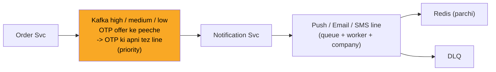
```
DIKKAT     12 baje sale. Line me 50,000 offer message the, mera OTP unke peeche khada raha, 10 minute baad
           aaya. Tab tak login ka time khatam.
HAL        OTP ki apni tez line (PRIORITY): Kafka me OTP ki apni line (high), offer dheemi (low), beech wali
           medium; har line ke apne worker.
NAHI       ek line me "zaroori" tag: Kafka me "ye pehle bhejo" hota hi nahi.
```
```
AAGE POOCHEGA:
  NIYAM: zaroori (OTP) kabhi kisi ke peeche nahi: apni line, apne worker, company me apna account.
  SAFAR (mera OTP, sale ki bheed me, har mod pe kya):
  OTP aaya, 50,000 offer pehle -> OTP apni high line, apne worker: kisi ke peeche nahi
  order update (medium)  -> beech wali line: OTP se peeche, offer se aage
  OTP line khaali        -> uske worker beech wali padh lein, ulta kabhi nahi
```

#### 8 Sale me laakhon message ek saath, company ne 429 diya
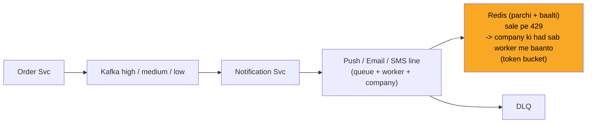
```
DIKKAT     Sale shuru, ek saath laakhon message. SMS company bolti "itna nahi" (429) -> sab fail.
HAL        sab worker ki ek baalti (TOKEN BUCKET, Redis): company ki had 100 / sec = har sec 100 token.
           Har worker pehle token le (Lua, ek jhatke me), nahi -> ruko. 429 phir bhi -> Retry-After tak ruko.
NAHI       har worker apni speed 100 / sec: 100 worker = 100 guna -> phir 429.
```
```
AAGE POOCHEGA:
  NIYAM: had company ki hai, worker ki nahi: sab worker ek baalti se token lein; token nahi = ruko, khabar
         phenko nahi.
  SAFAR (ek message, company ki had, har mod pe kya):
  bhejna hai             -> saanjhi baalti se token mila -> bhejo (had company ki, worker ki nahi)
  token nahi mila        -> line me intezaar: ye fail nahi, retry ginti nahi badhti
  worker badh gaye       -> speed wahi: baalti saanjhi, kul 100 / sec
  1 lakh email, had kam  -> had badhwao + kai account; tab tak line dheere khaali, warna 429
  baalti wala Redis gira -> har worker chhoti local had (fail-closed): company ki had paar nahi
```

#### 9 Company ne "bhej diya" bola, par mere phone tak pahuncha?
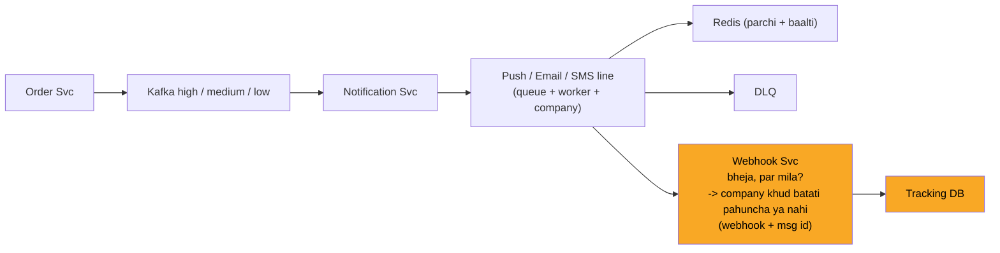
```
DIKKAT     SMS company ne message le liya. Par mere phone tak pahuncha ya nahi, humein pata hi nahi.
HAL        company khud batati (WEBHOOK): baad me hamein call karti "pahuncha / fail". Bhejte waqt company
           ka message number (SES MessageId / Twilio SID) save; webhook aaya -> us number se haal badlo.
NAHI       baar-baar khud poochte raho: laakhon message x har kuch second = had + kharcha.
```
```
AAGE POOCHEGA:
  NIYAM: 'bheja' aur 'mila' alag haal; 'mila' tab likho jab company (asli, signed webhook) bataye.
  SAFAR (ek SMS ka haal, har mod pe kya):
  company ne liya        -> 'bheja' likho; 'mila' tab jab company webhook se bataye
  webhook aaya hi nahi   -> sirf ghanton atke ko ek baar poochho (Twilio SID se); SES me sirf SNS
  nakli webhook          -> hastakshar jaancho: Twilio HMAC · SES/SNS certificate · SendGrid public key
```

#### 10 Shaam ko "Diwali offer sabko": 1 crore log
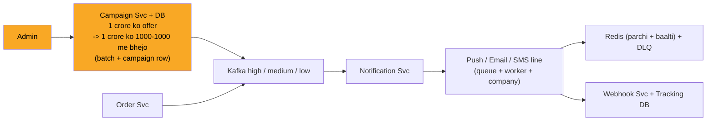
```
DIKKAT     Shaam ko admin ne "Diwali offer sabko" chalaya = 1 crore user. Ek-ek karke bheja -> request ghanton
           atki, OTP bhi peeche, company ki had tooti.
HAL        1000-1000 ke tukde (BATCH): API turant "shuru ho gaya"; job "id > aakhri_id, 1000 lao", har tukda
           Kafka me, aakhri_id campaign row me -> job gira to wahin se. Dheemi (offer) line, had me.
NAHI       1 crore ko ek bada "sabko bhejo" message: ek worker pe atka, gira to shuru se.
```
```
AAGE POOCHEGA:
  NIYAM: bada kaam chhote tukdon me, har tukde ke baad 'kahan tak' likha -> gira to wahin se, galat chala to
         beech me roko; ek user ko ek hi baar.
  SAFAR (1 crore ka offer, har mod pe kya):
  campaign shuru         -> 1000-1000 ke tukde, har tukde ke baad 'kahan tak' likho
  sabko ek hi push       -> FCM topic: ek call; topic me sirf pasand wale (subscription pasand se sync)
  600 bhej ke worker gira -> tukda dobara; (campaign_id, user_id) se pehle ke 600 chhootein
  galat offer chala      -> campaign row pe CANCELLED; worker har tukde se pehle dekhe
```

#### 11 Raat 2 baje offer ka SMS, jabki maine band kiya tha
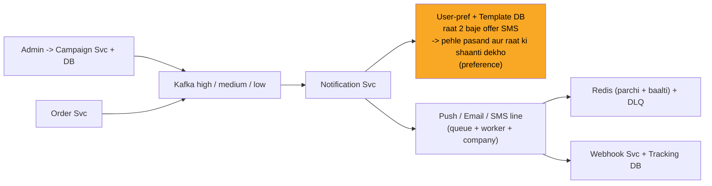
```
DIKKAT     Maine "offer SMS band" kiya tha aur raat 10 se subah 8 shaanti lagayi thi. Phir bhi raat 2 baje
           "Diwali sale 70% off" ka SMS aaya, aur push se phone baj gaya.
HAL        pehle pasand dekho (PREFERENCE + QUIET HOURS): SMS band -> chhodo; 10-8 -> koi ghanti nahi.
           Phir meri bhasha me SAANCHA bharo ("Hi {naam}, order {id} aa gaya"). Pasand + saancha cache me.
NAHI       pasand sirf Campaign Svc me check: order / OTP wali khabar bina check nikal jaati.
```
```
AAGE POOCHEGA:
  NIYAM: bhejne se pehle user ki pasand dekho; offer pasand / shaanti ke neeche, zaroori alert (OTP) upar.
  SAFAR (ek offer SMS, raat 2 baje, har mod pe kya):
  bhejne se pehle        -> user ki pasand dekho (shaanti ka waqt, kya band)
  shaanti me offer       -> roko, subah 8 baje bhejo (scheduled_at + job); phenko nahi
  shaanti me OTP / login -> bhejo: zaroori alert pasand se upar
  pasand badli, cache purana -> badalte hi cache delete + chhoti umar: bhejne se pehle sahi chahiye
```

---

## AAKHRI DABBA + WRAP (ek hi baar)

```
Order / Campaign Svc -> Kafka (tez / beech / dheemi) -> Notification Svc (pasand + saancha, cache)
-> push / email / SMS ki line -> worker (parchi BHEJ RAHA / BHEJ DIYA · ruk ke dobara · fuse · speed limit)
-> 2 company -> user · webhook -> Tracking DB · fail -> DLQ

DB:  Tracking = Cassandra -> likhna bahut, seedhi row, pakki consistency nahi chahiye, aaram se badhta
     Pasand / saancha = chhota, har ghatna pe padha jaata -> cache
```
```
JAWAB:    Services 'kuch hua' ki khabar Kafka me daalti. Notification service user ki pasand dekhti,
          message bharti, aur push / email / SMS ki alag line me daal deti.
          Worker parchi (BHEJ RAHA / BHEJ DIYA) se do baar nahi bhejte, fail pe ruk-ruk ke dobara,
          company ki had me, company dheemi to fuse + doosri company, had ke baad DLQ. OTP ki alag line.
          Ek user ki khabar ek hi line me, to kram sahi. Company ke webhook se 'mila / fail' update.
          Aage: raat ka shaant time, kai bhasha, khola / click ginti.
```
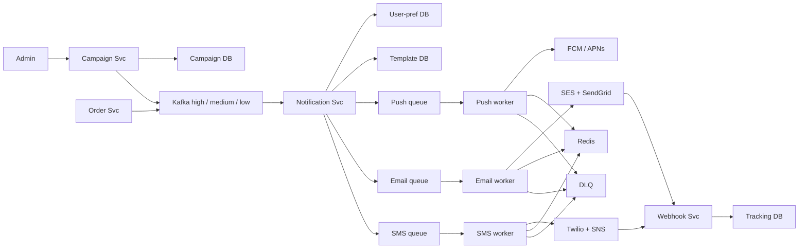

---

## 10 GUNA TRAFFIC — har dabba alag se

```
Kafka            -> sale pe 10 guna -> lines (partition) pehle se zyada · line user_id se
Notification Svc -> pasand / saancha cache · machine badhao
raaste ki line   -> alag line (ho gaya) + tez / dheemi line
worker           -> sale pe badhao (ek worker ~1000 / second) · fuse + do company · speed limit
Tracking DB      -> 90 TB / saal -> Cassandra + row ki umar, purana sasti jagah (cold storage)
                    (umar se jagah ghatti hai, baantne se bojh — dono alag cheez)

POOCHEGA: "Data keeps growing — what happens in 3 years?"
          (Data badhta ja raha, 3 saal baad?)

JAWAB:    Kis message ka kya hua (bheja / mila / khola), uski row ki umar rakho (jaise 90 din), purani
          rows sasti jagah chali jaayein. Roz wali table chhoti rehti hai.

POOCHEGA: "Kahan se gir sakta?"     -> company (do company), Kafka (copies), Redis (Cassandra LWT peeche)
POOCHEGA: "Chal raha, kaise pata?"  -> webhook se delivered / failed · Kafka me kitna pending
                                       · DLQ kitna bhara · alert
```

---

## POOCHE TO (gehra sawaal aaye tab)

```
KHABAR:   Kafka pe { event: "ORDER_PLACED", userId: 123, orderId: 999 }
          (andar ke liye REST bhi: POST /notify { userId, type, channel?, payload })

RAASTE:   Push: FCM (Android) / APNs (iPhone) · Email: SES / SendGrid / Mailgun · SMS: Twilio / SNS / MSG91
          App ke andar: DB + WebSocket · Phone call: Twilio · Slack webhook

DB:       PASAND:  user_id -> kaunse raaste · shaanti ka waqt · kya band kiya
          SAANCHA: template_id -> format · bhasha · khaali jagah {{name}} {{orderId}}
          HISAAB:  bheja / mila / khola / click / fail -> Cassandra
                   (bahut likhna, seedhi row, ACID nahi chahiye)

1 LAKH / SECOND:  ~100 worker · line "notifications" P0 -> W1 ... P99 -> W100
          line user_id se -> ek user ki saari khabar ek line me -> kram bana rehta
          (warna "ship hua" pehle aur "order hua" baad me)

POORA RAASTA EK BAAR:
          order -> Order Svc Kafka me { ORDER_PLACED, 123, 999 } -> Notification Svc uthaye -> pasand dekhe
          (push chalu, email chalu, SMS band) -> saancha bhare -> push + email ki line -> worker -> company
          -> user -> webhook -> Tracking DB · fail -> dobara -> DLQ
SAWAAL:   push doosri company se? -> hota nahi: Android = FCM, iPhone = APNs, phone ka OS tay karta
          had kitni? -> company ki: SES shuru ~14 / sec (sandbox 1 / sec) · Twilio short code ~100 / sec
          1 crore kitni der? -> ~17 min (10,000 / sec): jaan-boojh ke phailaya, had + OTP line bachi
          1000 ka tukda kyun? -> 1 crore alag = bojh · 1 bada = ek worker atka · 1000 = saath + dobara chhota
          (c2) push kis phone pe? -> device token (install pe user ke saath save); bekaar nikla -> hatao
          (c4) SENDING ki umar kitni? -> call (~2-3 sec) se lambi, 60 sec: pehle khatam = do log bhejenge
          (c5) khabar khoye hi nahi? -> saari copy ne li tab OK (acks=all), offset kaam ke BAAD
          (c6) fuse har process apna ya saanjha? -> har process apna (Resilience4j) ya Redis me saanjha
          (c7) offer OTP ki company had kha jaaye? -> OTP ka alag account / number (had = card 8)
          (c9) hisaab kahan? -> Cassandra (Tracking): likhna bahut, seedhi row, jodna kuch nahi
```

---

## HANDS-ON — provider ne 429 diya: chala ke dekha

> Grill me galti: 429 pe "fail-open" bola. Fail-open HUMARE limiter ka faisla (Redis gira to); yahan limiter
> PROVIDER ka, uska darwaza hum nahi khol sakte -> dheema HUMEIN hona padega.
> CODE: `04_HLD/HANDS_ON/03_provider_429/Sms429Demo.java` (Docker nahi, time nakli) · line 21 `SMART = false / true` -> `java Sms429Demo.java`

```
SETUP:  1000 SMS ek saath · provider 100 / sec · t=3,4 pe 50 / sec
NAIVE:  sab ek saath, 429 pe agle second turant retry, 3 fail -> PHENK DO
SMART:  apni taraf 100 / sec (token bucket) · 429 pe 1s, 2s, 4s · kabhi phenko mat
```
```
NAIVE      t | provider | queue | bheje | 200 | 429 | chhode | pahunche
           0 |  100/sec |  1000 |  1000 | 100 | 900 |      0 | 100
           1 |  100/sec |   900 |   900 | 100 | 800 |      0 | 200
           2 |  100/sec |   800 |   800 | 100 | 700 |    700 | 300
           PAHUNCHE 300 / 1000 · CHHODE 700 · call 2700 (429 = 2400)

SMART      t | provider | queue | bheje | 200 | 429 | chhode | pahunche
           0 |  100/sec |  1000 |   100 | 100 |   0 |      0 | 100
           1 |  100/sec |   900 |   100 | 100 |   0 |      0 | 200
           2 |  100/sec |   800 |   100 | 100 |   0 |      0 | 300
           3 |   50/sec |   700 |   100 |  50 |  50 |      0 | 350
           4 |   50/sec |   650 |   100 |  50 |  50 |      0 | 400
           5 |  100/sec |   600 |   100 | 100 |   0 |      0 | 500
           6 |  100/sec |   500 |   100 | 100 |   0 |      0 | 600
           7 |  100/sec |   400 |   100 | 100 |   0 |      0 | 700
           8 |  100/sec |   300 |   100 | 100 |   0 |      0 | 800
           9 |  100/sec |   200 |   100 | 100 |   0 |      0 | 900
          10 |  100/sec |   100 |   100 | 100 |   0 |      0 | 1000
           PAHUNCHE 1000 / 1000 · CHHODE 0 · call 1100 (429 = 100)

           NAIVE 3 sec, jaldi par 700 kabhi nahi milenge · SMART 11 sec, dheere par sab pahunche
DARWAZA:   1 sec me 100 nikal sakte · 1000 dhakka maarein -> 100 nikle, baaki 3 dhakke ke baad ghar
           SMART = line lagwao, 100-100
```
```
THROTTLE  raftaar provider ki limit pe baandho
BACKOFF   429 pe 1s, 2s, 4s · Retry-After aaye to wahi
JITTER    thoda random farak (simulation me nahi, time poore second me)
QUEUE     jo abhi nahi ja sakta wo queue me ruke · max try ke baad DLQ, drop nahi

JAWAB:    Chala ke dekha: company ki had ka dhyaan na rakha aur turant dobara bheja to 1000 me se 700
          gaye hi nahi.
          Had me bheja aur ruk-ruk ke dobara koshish ki to poore 1000 pahunche.
```

ARCHETYPE B (ingest) · CONCEPTS: [message-queues](../../FOUNDATIONS/07_message_queues.md) · [ms-communication](../../FOUNDATIONS/10_ms_communication.md) · saath: [12 message-queue](../12_message_queue_kafka/12_message_queue_kafka.md) · [← MASTER SHEET](../../00_MASTER_SHEET.md)
