# Notification system: shuru se, ek kahani

Kram wahi jo interview me hota hai: **FR, phir NFR, phir numbers, phir design**. Design sabse seedhe dabbe
se shuru hota hai, aur har dikkat aane pe ek naya dabba judta hai. Diagram me peela dabba = abhi juda. Poori
file me ek hi kahani hai: Arpan ne Amazon pe order kiya, use push bhi aana chahiye aur email bhi, aur login
ke waqt OTP ka SMS turant.

**CUE (yahi shabd yaad rakhne hain, kram se):**
seedha call -> Kafka + Notification Service -> har raaste ki line + worker -> key BHEJ_RAHA / BHEJ_DIYA (Redis)
-> retry line + DLQ -> timeout + circuit breaker + doosri company -> OTP ki tez line -> saanjha token bucket
-> webhook + Tracking DB (Cassandra) -> campaign tukde -> pasand + saancha cache

---

## 1. FR: kya karna hai

```
1. ek ghatna (order hua) -> kai raaste: push / email / SMS / app ke andar
2. user ki pasand maano (SMS band kiya to SMS nahi) + message ka saancha (template: "Hi {{name}}")
3. OTP turant, offer ruk sakta hai
scope ke bahar: analytics dashboard
```

## 2. NFR: kaisa chalna chahiye

```
- bhejne wala (Order Service) ruke nahi
- khabar khoye nahi, do baar jaaye nahi
- sale ki bheed jhele, OTP us bheed me phanse nahi
```

## 3. Numbers

```
- 10 crore user x 5 khabar / din = 50 crore / din -> ~5,800 / sec aam din
- sale = 10 guna ~58,000 / sec, har ek 3 raaste -> ~1.75 lakh / sec
- ek worker ~1000 / sec -> sale pe ~175 worker
```

---

## 4. Design

### Kadam 1: sabse seedha (Order Service seedha email company ko call kare)

Arpan ne order kiya. Order Service order banata hai, phir khud seedha email company (SendGrid) ki API call karta
hai, uske jawab ka intezaar karta hai, aur tab jaake Arpan ko "order ho gaya" bolta hai.

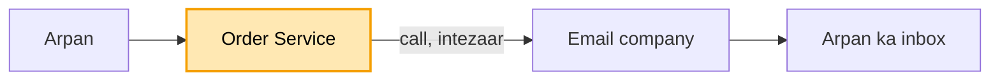

Dikkat: email company dheemi hai to Arpan ka order bhi dheema. Email company band hui to order hi fail, jabki
order ka email se koi lena-dena nahi. Aur kal SMS aur push bhi jodne hain, to Order Service ke code me teen
company ki call aa jaayengi.

Par Order Service ko kisi ka intezaar nahi karna. Wo bas khabar kahin daal de aur aage badh jaaye.

### Kadam 2: khabar Kafka me daalo, Notification Service uthaye

Ab Order Service order banata hai, ek chhoti khabar `{ ORDER_PLACED, userId: Arpan, orderId: 999 }` Kafka ke
topic me daalta hai, aur turant Arpan ko "order ho gaya" bol deta hai. Kisi company ka intezaar nahi.

Ek naya dabba judta hai: **Notification Service**. Ye Kafka se khabar uthata hai, Arpan ki pasand dekhta hai
(push chalu, email chalu, SMS band), saancha bharta hai ("Hi Arpan, order 999 ho gaya"), phir email aur push
company ko call karta hai.

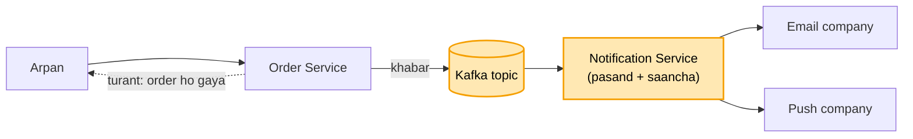

Kafka kyun:
- khabar disk pe likhi jaati hai, to Notification Service gira ho tab bhi khabar khoti nahi. Wo wapas aake wahin
  se padh leta hai.
- sale me 58,000 khabar / sec aayein to Kafka unhe pakad ke rakhta hai, Notification Service apni raftaar se
  nikalta hai.

Ab kya theek hua: email company band hai to bhi order chal jaata hai. SMS jodna ho to sirf Notification Service
badalta hai, Order Service nahi.

Par Notification Service ek hi line me teeno raaste bhej raha hai. SMS company dheemi hui to uske peeche Arpan
ka push aur email bhi atak jaata hai.

### Kadam 3: har raaste ki alag line (topic) aur apne worker

Notification Service ab company ko khud call nahi karta. Wo bas tay karta hai ki Arpan ko kis raaste bhejna hai,
aur har raaste ki **alag Kafka line** me khabar daal deta hai: push wali line, email wali line, SMS wali line.
Har line ke apne **worker** hain: push worker sirf push company ko bhejte, email worker sirf email company
ko, SMS worker sirf SMS company ko.

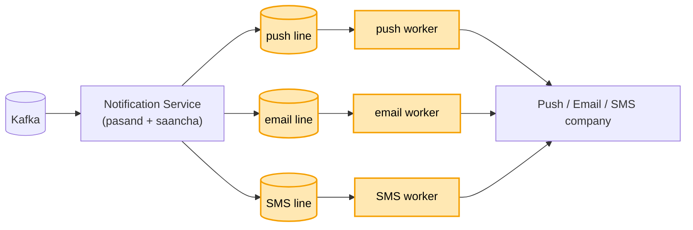

Ab SMS company dheemi hui to sirf SMS line ruki. Arpan ka push aur email apni-apni line me aage nikal gaye.

Ek fayda aur: har line ke worker alag-alag badha sakte hain. Sale me push zyada jaata hai, to push worker 100
kar do, SMS ke 20 hi rehne do. Numbers wala "~175 worker" yahin baithta hai.

Par email worker ne Arpan ko email bheja, aur Kafka ko "ho gaya" (commit) bolne se pehle hi wo machine mar
gayi. Naya worker wahi khabar dobara uthata hai aur dobara bhejta hai.
Arpan ko ek order ke do email aate hain.

### Kadam 4: key se ek hi baar (Redis me khabar ki id + haal)

Har khabar ki apni id hoti hai: order 999 ka email = `999:email`. Worker bhejne se pehle **Redis** me is id
ki key likhta hai: `SET 999:email BHEJ_RAHA NX` (NX = sirf tab likho jab key pehle se na ho).

- key nahi thi, likh di gayi = ye worker pehla hai. Wo email bhejta hai, phir key ko `BHEJ_DIYA` kar deta hai.
- machine mari, naya worker wahi khabar uthata hai, Redis me dekhta hai `BHEJ_DIYA`, to chhod deta hai.
  Arpan ko ek hi email aata hai.

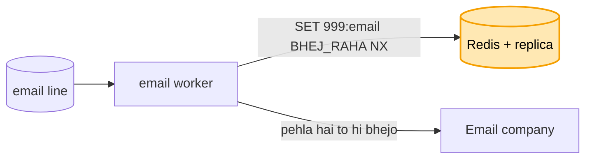

Do haal kyun, ek kyun nahi: maan lo worker ne bhejne se pehle hi seedha `BHEJ_DIYA` likh diya aur bhejne se
pehle mar gaya. Naya worker dekhega "bhej diya" aur chhod dega, Arpan ka OTP kabhi aayega hi nahi. Isliye
pehle `BHEJ_RAHA` likho, uspe 60 sec ki umar (TTL), aur bhejne ke baad hi `BHEJ_DIYA`. Worker beech me mara to
60 sec baad `BHEJ_RAHA` mit jaata hai aur naya worker dobara bhej deta hai. Kabhi-kabhar do email ho sakte
hain, par OTP khoyega nahi. Khona dohraav se bura hai.

Redis hi mar gaya to? Uski replica (copy) primary ban jaati hai (Sentinel / ElastiCache Multi-AZ). Copy
thodi peeche chalti hai, to aakhri kuch key shayad pahunchi na hon, aur un khabron ke do message ja
sakte hain.
Aur dono gaye to bhi worker bhejna band nahi karte: do message chalenge, khoya hua OTP nahi.

Par SMS company ne fail lauta diya. Worker turant dobara bhejta hai, phir fail, phir turant. Wo pehle se
pareshaan company ko har second dhakka maar raha hai.

### Kadam 5: ruk-ruk ke dobara, phir bhi na jaaye to DLQ

SMS company ne fail lauta diya. Worker ab turant dobara nahi maarta. Khabar ko ek **retry line** me daal deta
hai, wait ke saath: pehli baar 1 sec baad, phir 2, phir 4, phir 8. Har baar wait dugna, aur usme thoda random
(jitter), taaki saare worker ek hi second pe company pe toot ke na padein. 5 baar ke baad bhi fail, to khabar
**DLQ** (dead letter queue) me: wahan alert bajta hai aur koi insaan dekhta hai. Khabar khoti nahi, aur SMS
line bhi nahi rukti.

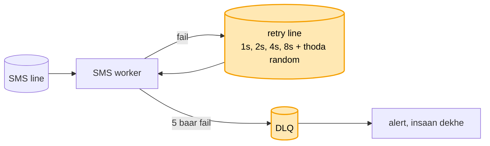

Retry line alag kyun: worker wahin baith ke wait kare to uske peeche Arpan ke baaki SMS bhi atak jaate hain.

Par SMS company band nahi, bas dheemi hai: har call 30 sec me jawab de rahi hai. Saare SMS worker usi intezaar
me phanse baithe hain.

### Kadam 6: timeout + circuit breaker + doosri company

**Timeout:** worker SMS company ko sirf 2 sec deta hai. Jawab nahi aaya to call chhod ke khabar retry line
(Kadam 5) me. Ab koi worker 30 sec phansa nahi rehta.

**Circuit breaker:** 100 me se 50 call fail / timeout ho rahi hain, to worker samajh jaata hai company abhi
bimaar hai, aur kuch der us company ko call karna hi band (breaker OPEN). Har call pe 2 sec barbaad nahi.
30 sec baad 2-4 call test ki tarah bhejta hai (HALF-OPEN). Chal gayi to wapas CLOSED, normal kaam.

**Doosri company:** breaker open hai to SMS kahan jaaye? Ek doosri SMS company rakhte hain. Twilio bimaar,
to MSG91 se bhejo. Arpan ka OTP rukta nahi.

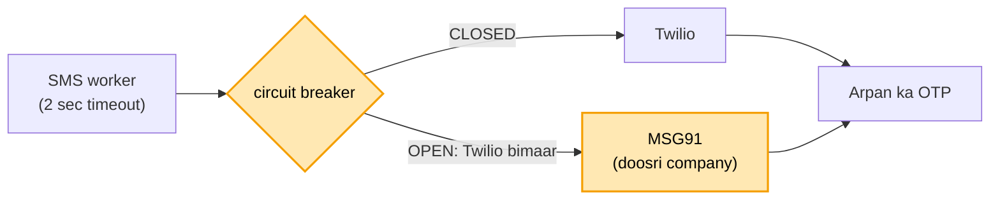

Par 12 baje sale shuru hui, aur 50,000 offer SMS line me pehle se khade hain. Arpan ka login OTP unke peeche
lag gaya. OTP 5 min me bekaar ho jaata hai, offer 1 ghanta baad bhi chalega.

### Kadam 7: OTP ki alag tez line

Notification Service har khabar ko ek darja deta hai: **TEZ** (OTP, password reset), **BEECH** (order hua, ship
hua), **DHEEMI** (offer, sale ki khabar). Har darje ki apni alag line, aur **apne alag worker**.
OTP wale worker kabhi offer nahi uthate. Sale me 50,000 offer DHEEMI line me khade rehte hain,
Arpan ka OTP TEZ line se turant nikal jaata hai.

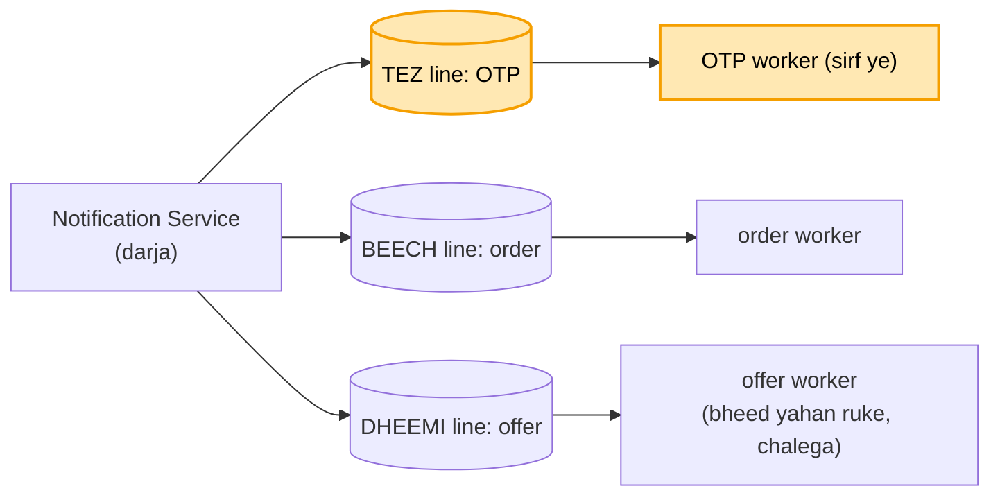

Ek line + priority kyun nahi: Kafka line me aage-peeche nahi karta, jo pehle aaya wahi pehle nikalta hai.
Isliye alag line hi raasta hai.

OTP ki umar: OTP me 5 min ki expiry likhi hoti hai. Kisi wajah se 5 min baad worker tak pahuncha, to wo
bhejta hi nahi, kyunki bekaar OTP bhejna faltu hai.

Par sale me ek saath laakhon SMS. Humare worker tez hain, par SMS company ki had hai: 1000 / sec. Usse zyada
bheja to wo **429** (Too Many Requests) lauta deti hai.

### Kadam 8: company ki had, saanjha token bucket (Redis)

SMS company ki had 1000 / sec hai, aur humare 20 SMS worker hain. Har worker apne hisaab se bhejega to milake
1000 se upar chala jaayega, aur company **429** (Too Many Requests) lauta degi.

Isliye Redis me ek **saanjha token bucket**. Wahi token bucket jo rate limiter me padha, bas ulta: wahan had
humari thi, yahan had company ki.
- bucket me har second 1000 token bharte hain.
- har worker SMS bhejne se pehle Redis se ek token leta hai (Lua script me, taaki do worker ek hi token na le
  lein).
- token mila to bhejo. Nahi mila to thoda ruko, khabar line me hi rehti hai, khoti nahi.

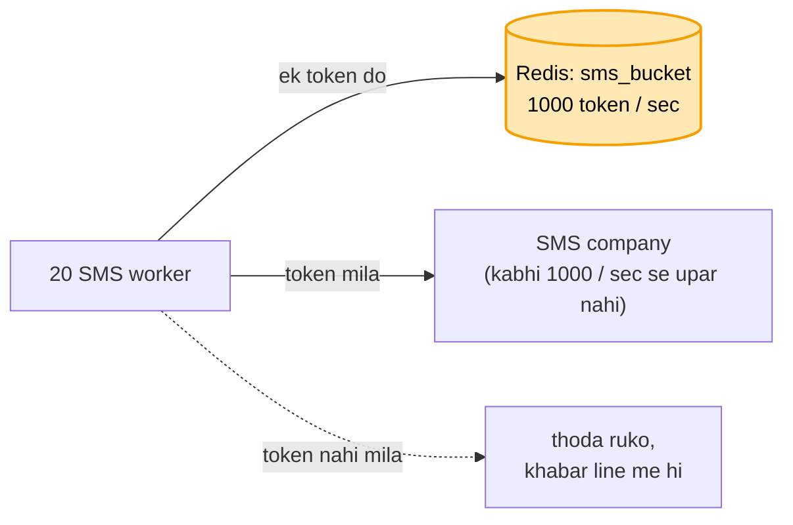

**Doosra tareeka kyun nahi: "har worker apni had"**

Ek seedha tareeka ye ho sakta tha: Redis mat lagao, bas har worker ko pehle se bol do "tu 50 / sec se zyada
mat bhejna". 20 x 50 = 1000, hisaab barabar. Par isme do dikkat hain:

- Dikkat 1, worker badhe to hisaab toota: sale aayi, worker 20 se 60 kar diye. Har worker abhi bhi 50 / sec
  bhej raha hai. 60 x 50 = 3000 / sec, jabki company ki had 1000. Company 429 dene lagti hai. Har baar worker
  badhao to sabko naya number batana padega ("ab tu 1000 / 60 = 16 bhej").
- Dikkat 2, khaali worker ka hissa barbaad: 20 me se 10 worker ke paas abhi koi SMS hi nahi. Unka 50-50 ka
  hissa yunhi pada hai. Baaki 10 ke paas SMS ka dher hai, par wo bhi sirf 50-50 bhej sakte hain. Kul gaye
  10 x 50 = 500 / sec, jabki company 1000 le sakti thi. Aadha hissa bekaar.

Saanjha bucket me dono dikkat nahi: Redis me ek hi bucket, 1000 token / sec. Worker 20 hon ya 60, sab usi ek
bucket se lete hain, to kul kabhi 1000 se upar nahi. Aur jiske paas kaam hai wahi token leta hai, to khaali
worker ka hissa barbaad nahi hota.

```
har worker apni had (50):            saanjha bucket (Redis, 1000 / sec):
 60 worker x 50 = 3000  -> 429        60 worker, ek hi bucket -> kul 1000, kabhi upar nahi
 10 khaali, 10 x 50 = 500 gaye        jiske paas kaam, wahi le -> poore 1000 gaye
```

**Phir bhi 429 aaya to?**

Hum 1000 / sec ki had me bhej rahe the, par company ne beech me khud apni had 500 kar di (unke yahan load
tha). To kuch SMS pe 429 aayega. Tab Kadam 5 wala tareeka: khabar retry line me, 1, 2, 4 sec ruk ke dobara.
Company jawab me `Retry-After: 3` bheje ("3 sec baad aana") to utna hi ruko.

Chala ke dekha (`04_HLD/HANDS_ON/03_provider_429/Sms429Demo.java`): had ka dhyaan na rakha aur turant dobara
maara to 1000 me se 700 SMS gaye hi nahi. Had me bheja aur ruk ke dobara koshish ki to poore 1000 pahunche.

Par company ne "bhej diya" (200) bola. Kya Arpan ke phone tak pahuncha? Number band ho, ya phone off ho, to
humein pata hi nahi chalta.

### Kadam 9: company se "pahuncha ya nahi" (webhook + Tracking DB)

Worker ne SMS company ko bheja, company ne turant 200 bola = "le liya". Par 200 ka matlab "Arpan ke phone
tak pahunch gaya" nahi. Company abhi bhejegi. Arpan bole "OTP aaya hi nahi", to humare paas koi jawab nahi.

Ilaaj, 3 hisse:

1. **Company ki id rakho.** Company 200 ke saath apni id bhi deti hai: `msgId: TW-555`. Worker ise **Tracking
   DB** me likhta hai: "order 999 ka SMS, company id TW-555, haal = BHEJA".
2. **Webhook.** Baad me company khud humein call karti hai:
   `POST /webhook { msgId: TW-555, status: DELIVERED }`.
   Hum TW-555 dhoondh ke haal badal dete hain: BHEJA se MILA, ya FAIL.
   Phone off hai to SMS fail nahi hota: operator use rakh leta hai aur koshish karta rehta hai, phone on hote
   hi SMS pahunchta hai, tab DELIVERED aata hai. FAILED tab aata hai jab number band / galat ho, DND ho, ya
   phone kai din (aksar 1-3 din) off raha aur operator ne koshish band kar di.
3. **Hastakshar (signature) jaancho.** Webhook bahar se aata hai, koi bhi nakli "DELIVERED" bhej sakta hai.
   Company har webhook pe apni secret key se signature lagati hai. Hum check karte hain, match nahi to phenko.

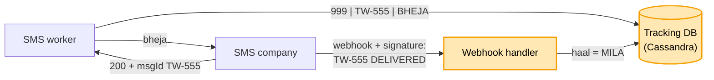

**Tracking DB = Cassandra, MySQL kyun nahi (asli choice):**
- har message ki row likhni hai, aur har webhook pe ek update. 50 crore message / din = likhna hi likhna.
- saal bhar me ~90 TB.
- padhna seedha: "message 999 ka haal kya?", koi JOIN nahi.
- ek row thodi der purani dikhe to chalega, paise ka hisaab nahi hai.

Cassandra isi kaam ke liye bana: bahut likhna, machine jodte jao aur jagah badhti jaaye. MySQL ek machine pe
90 TB / saal ke likhne me ghut jaayega, aur use todna (shard) humein khud karna padega.

Ab kya theek hua: Arpan bole "OTP nahi aaya", to support dekh sakta hai: BHEJA tha, company ne FAIL bola,
number DND pe tha.

Par ab ek message nahi bhejna. Shaam ko "Diwali offer sabko" = 1 crore log. Campaign Service ek hi baar me 1 crore
khabar Kafka me daalne baitha, aur beech me gir gaya. Kisko gaya, kisko nahi, kuch pata nahi.

### Kadam 10: 1 crore ka campaign, 1000 ke tukdon me

PEHLE (tukde nahi): ek hi baar me 1 crore

```
Campaign Service:  user 1, 2, 3 ... 40,00,000  X gir gaya
                                          |
               kisko gaya? kisko nahi? -> PATA NAHI
               shuru se chalao -> 40 lakh ko DO offer
```

AB: 1000-1000 ke tukde, har tukde pe tick

```
1 crore user  =  10,000 tukde (har tukde me 1000 user)

campaign 77 ki DB row (register):
 +---------+-----------------+-----------+
 | tukda   | user            | haal      |
 +---------+-----------------+-----------+
 | 1       | 1 - 1000        | HO GAYA   |  <- worker A ne kiya
 | 2       | 1001 - 2000     | HO GAYA   |  <- worker B ne kiya
 | 3       | 2001 - 3000     | ...       |  <- worker C beech me MARA (400 ko gaya)
 | 4       | 3001 - 4000     | BAAKI     |
 | ...     | ...             | ...       |
 | 10,000  | ... - 1 crore   | BAAKI     |
 +---------+-----------------+-----------+
```

Worker C mara, to:

```
tukda 3 pe tick nahi laga -> doosra worker tukda 3 dobara uthata
     |
     +-- pehle 400 user: Redis key "BHEJ_DIYA" (Kadam 4) -> chhod do, dohra nahi
     +-- baaki 600 user: bhejo -> tukda 3 pe tick
tukda 1, 2 ko koi chhoota bhi nahi (tick laga hai)
```

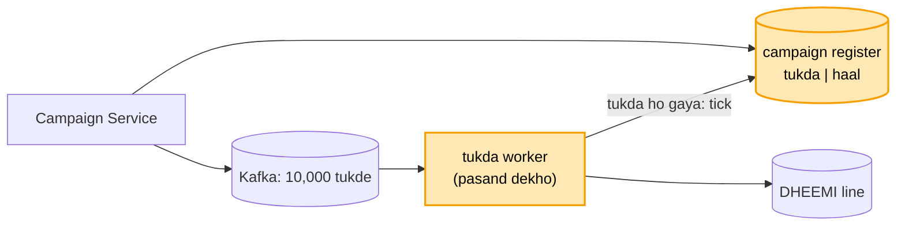

Ek line: 1 crore ka kaam 10,000 chhote tukdon me baanto, har tukda khatam hone pe register me tick. Koi gira
to sirf uska adhoora tukda dobara chalta hai, aur dohra jaane se Redis key rokti hai.

**Redis me 1 crore key? Itni jagah?** Ek key chhoti si, jaise `77:Arpan:sms = BHEJ_DIYA`, lagbhag 100 byte
(andaza, Redis thoda extra bhi leta hai). 1 crore x 100 byte = ~1-2 GB, Redis ke liye kuch nahi. Aur har key
pe umar (TTL) 1 din: campaign khatam, 1 din baad saari key apne aap mit jaati hain, Redis bharta nahi rehta.

**Redis gir gaya to?**

```
Redis gira
   |
   +-- pehle: replica (copy) primary ban jaati (Kadam 4 wala)
   |
   +-- dono gaye? -> darja dekho:
         OTP (TEZ)      -> bhejte raho. do OTP chalenge, khoya OTP nahi
         offer (DHEEMI) -> campaign ROKO jab tak Redis wapas na aaye
                           offer 1 ghanta ruk sakta, par 1 crore ko do-do offer = bura
```

Ek hi dikkat, par faisla darje se badalta: OTP me khona bura (bhejte raho), offer me dohraav bura (ruk jao).

Par offer ka SMS raat 2 baje chala gaya, jabki Arpan ne offer wale SMS band kiye the. Aur har khabar pe
Notification Service DB se pasand + saancha padh raha hai: 1.75 lakh / sec padhna, DB ghut raha hai.

### Kadam 11: pasand + saancha, aur unka cache

Notification Service bhejne se pehle 2 cheez dekhta hai:

```
khabar --> [1 pasand]  Arpan: push chalu, email chalu, offer SMS BAND
       --> [2 saancha] "Hi {{name}}, {{offer}}" bharo

   OTP / order (transactional) -> hamesha bhejo, Arpan ne khud maanga
   offer SMS (promotional)     -> Arpan ne BAND kiya / DND pe hai -> bhejo hi mat
                                  (ye kanoon hai: unsubscribe ke baad bheja to jurmana)
```

Ab bheed: har khabar pe pasand aur saancha DB se padhna, sale me 1.75 lakh / sec padhna, DB ghut jaata hai.

```
Notification Service --pasand padho--> [Redis cache] --mila--> turant (DB tak gaye hi nahi)
                                       | nahi mila
                                       +--> Pasand DB -> cache me rakho -> agli baar cache se

Arpan ne pasand badli (offer SMS chalu) -> DB update + cache ki key DELETE
                                        -> agli khabar pe naya padha jaata
```

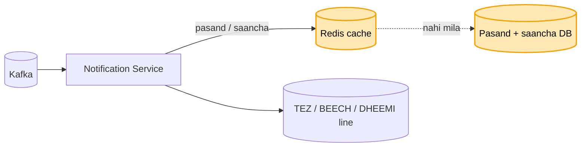

Cache kyun chalta yahan: pasand aur saancha bahut baar padhe jaate (har khabar pe), par badalte kabhi-kabhi
(Arpan mahine me ek baar setting chhoota). Aisa data cache ke liye sabse sahi.

---

## Wrap: 30 sec me poora design

```
Order Service khabar Kafka me daal ke aage badh jaata (ruke nahi). Notification Service pasand + saancha
(cache se) dekh ke khabar ko darje (TEZ / BEECH / DHEEMI) aur raaste (push / email / SMS) ki alag line me
daalta. Har line ke apne worker: Redis key (BHEJ_RAHA -> BHEJ_DIYA) se do baar nahi, fail pe ruk-ruk ke
dobara phir DLQ (khoye nahi), 2 sec timeout + circuit breaker + doosri company, saanjha token bucket se
company ki had me. Company ka webhook Tracking DB (Cassandra) me "mila / fail" likhta. 1 crore ka campaign
1000 ke tukdon me, register me tick. OTP ki alag tez line, sale ki bheed me nahi phansta.
```

---

## Pooche to (design nahi badalta, bas ek baar dekh lo)

```
API?
  -> Kafka pe { event: "ORDER_PLACED", userId: 123, orderId: 999 }. Andar ke liye REST bhi:
     POST /notify { userId, type, channel?, payload }

Raaste kaunse?
  -> Push = FCM (Android) / APNs (iPhone). Email = SES / SendGrid. SMS = Twilio / MSG91.
     App ke andar = DB + WebSocket.

Arpan ki "order hua" aur "ship hua" ulti kram me na pahunche?
  -> Kafka key = userId. Ek user ki saari khabar ek hi tukde (partition) me,
     aur tukde ke andar kram bana rehta.

Kafka me khabar khoye hi nahi, pakka?
  -> saari copy ne li tab hi OK (acks=all), aur worker offset kaam ke BAAD commit karta.

Raat 2 baje offer ka SMS?
  -> kanoon (TRAI) kehta offer wala (promotional) SMS sirf din me, OTP / order kabhi bhi. Asal me loopholes
     hain: push / WhatsApp pe koi rok nahi, company "pehle schedule kiya tha, der se gaya" bol sakti.
     Pakka sirf itna: unsubscribe / DND ke baad offer bheja to jurmana, isliye Kadam 11 me pasand check.

10 guna traffic?
  -> Kafka me tukde (partition) pehle se zyada · Notification Service ki machine badhao · worker badhao
     (ek ~1000 / sec) · pasand / saancha cache · company ki had saanjha bucket se.

Data 3 saal baad (Tracking DB ~90 TB / saal)?
  -> har row ki umar (jaise 90 din), purani rows sasti jagah (cold storage). Roz wali table chhoti rehti.

Chal raha hai, kaise pata?
  -> webhook se delivered / failed ginti, Kafka me kitna pending (lag), DLQ kitna bhara -> alert.

AWS pe naam?
  -> Tracking (Cassandra) = Amazon Keyspaces (ya EC2 pe khud) · Redis = ElastiCache · Kafka = MSK.
```

---

## HANDS-ON: company ne 429 diya, chala ke dekha

Galti jo hui thi: 429 pe "fail-open" bola. Fail-open HUMARE limiter ka faisla hai (Redis gira to). Yahan had
COMPANY ki hai, uska darwaza hum nahi khol sakte, dheema HUMEIN hona padega.

CODE: `04_HLD/HANDS_ON/03_provider_429/Sms429Demo.java` (Docker nahi, time nakli)
· line 21 `SMART = false / true`
-> `java Sms429Demo.java`

```
SETUP:  1000 SMS ek saath · company 100 / sec · t=3,4 pe 50 / sec
NAIVE:  sab ek saath, 429 pe agle second turant dobara, 3 fail -> PHENK DO
SMART:  apni taraf 100 / sec (token bucket) · 429 pe 1s, 2s, 4s · kabhi phenko mat

NAIVE   PAHUNCHE 300 / 1000 · CHHODE 700 · call 2700 (429 = 2400) · 3 sec me khatam
SMART   PAHUNCHE 1000 / 1000 · CHHODE 0 · call 1100 (429 = 100) · 11 sec, dheere par sab pahunche
```

Jawab: chala ke dekha, company ki had ka dhyaan na rakha aur turant dobara bheja to 1000 me se 700 gaye hi
nahi. Had me bheja aur ruk-ruk ke dobara koshish ki to poore 1000 pahunche.

CONCEPTS: [message-queues](../../FOUNDATIONS/07_message_queues.md) ·
[ms-communication](../../FOUNDATIONS/10_ms_communication.md) ·
saath: [12 message-queue](../12_message_queue_kafka/12_message_queue_kafka.md) ·
[<- MASTER SHEET](../../00_MASTER_SHEET.md)
