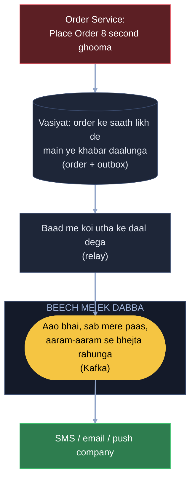
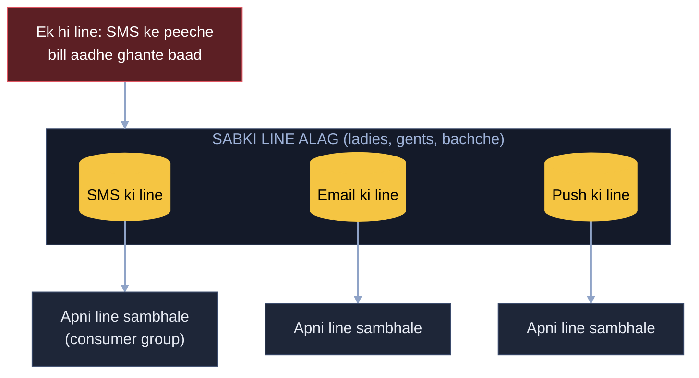
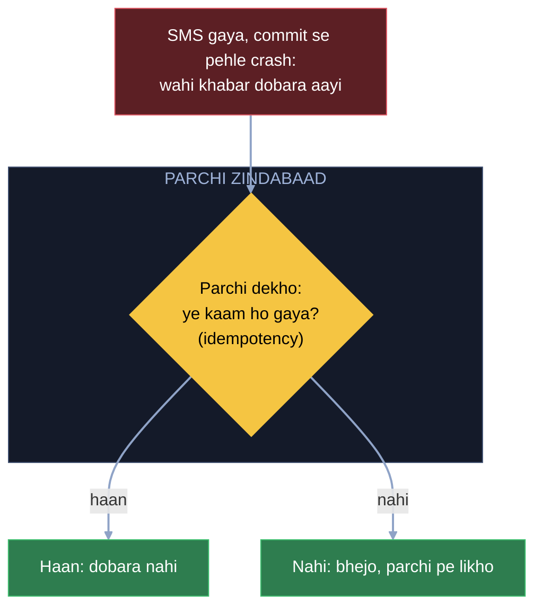
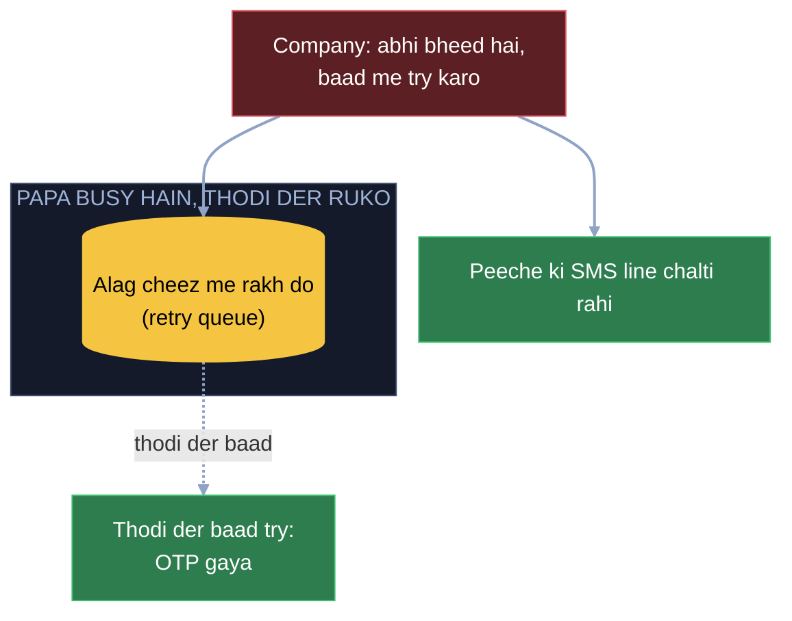
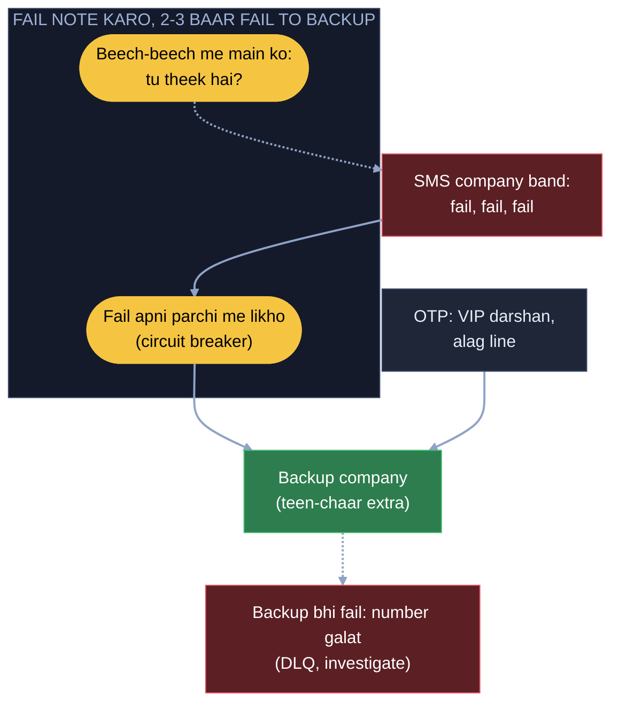
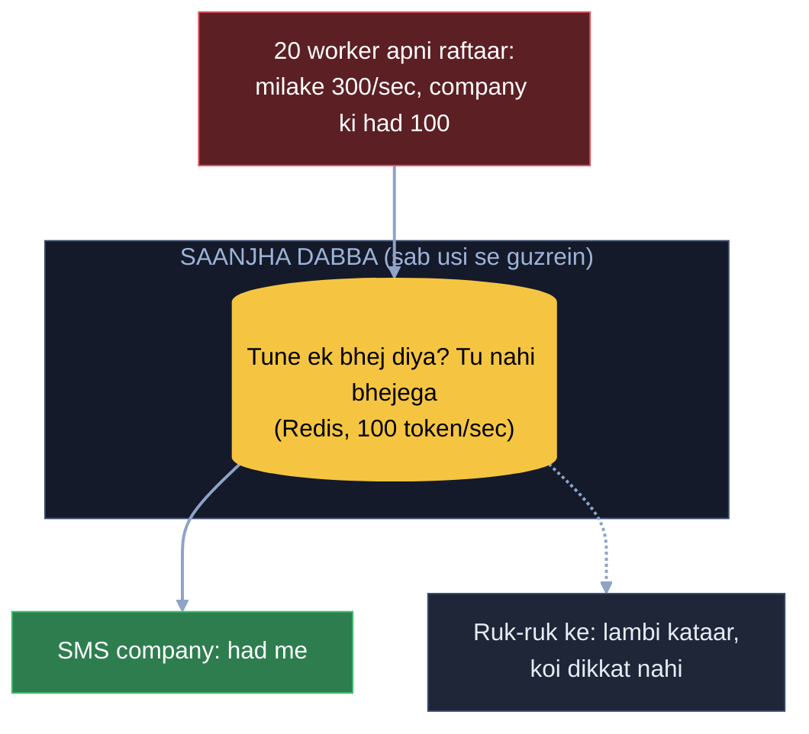
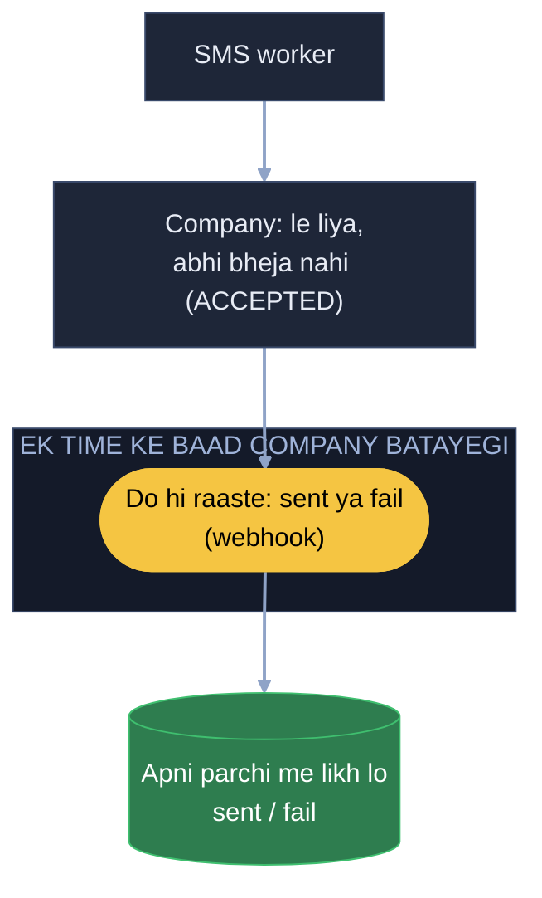
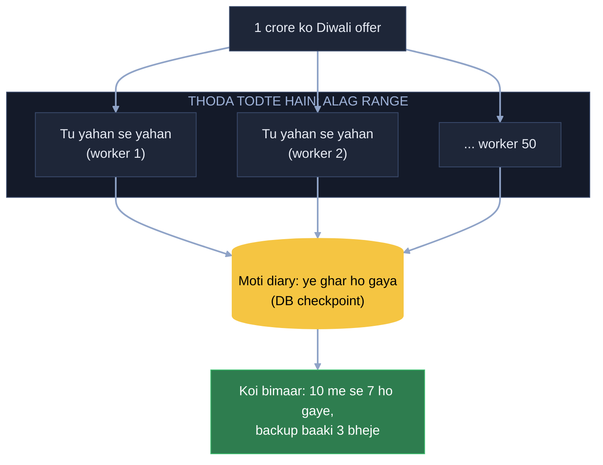
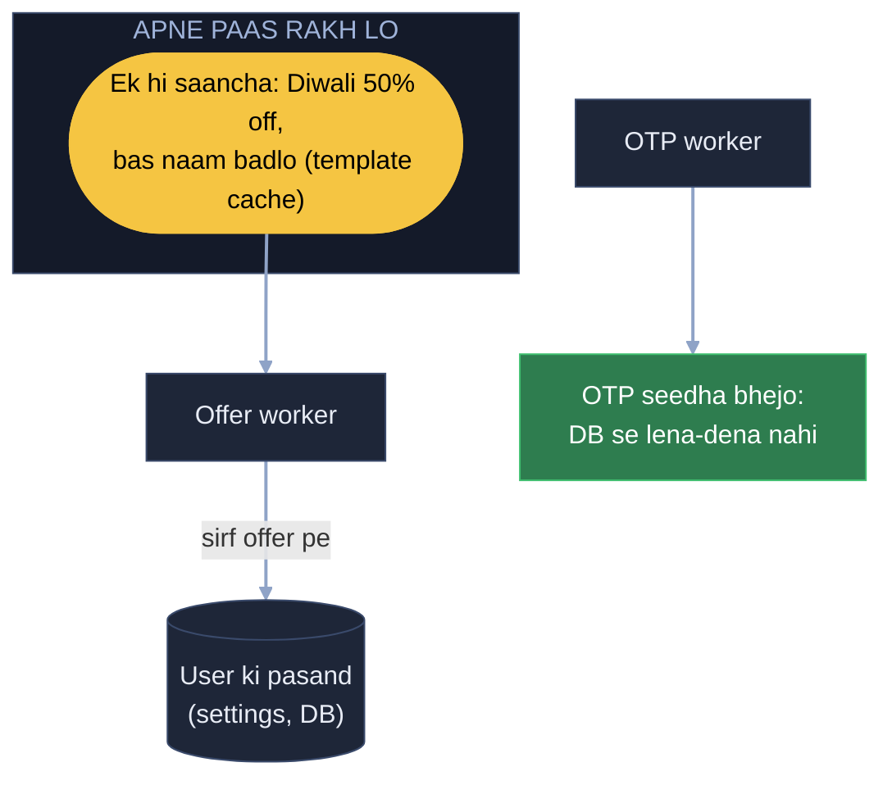

# Notification system: Arpan ke order ki kahani

Arpan ek shopping app se order karta hai. Order hote hi app use teen jagah khabar bhejti hai: SMS ("order placed"),
email (bill) aur phone pe push ("shipped"). Ye khabar bhejne wala system main bana raha hoon. Kaam: order turant ho,
khabar khoye nahi, do baar na jaaye, aur OTP kabhi bheed me na phanse.

Har kadam = **kahani** (dikkat aur hal, bolne wali bhasha) -> **Asli naam** (interview me yahi shabd) -> tasveer
(kahani ka shabd, bracket me asli naam).

---

## FR / NFR / Numbers (interview me pehle 2 minute)

```
FR      ek ghatna (order hua) -> SMS / email / push · user ki pasand maano · message ka saancha ("Hi {naam}")
NFR     Order Service ruke nahi · khabar khoye nahi · do baar na jaaye (kabhi-kabhar dohra ho to ek hi OTP code, dohra pakdo)
        · OTP turant, offer ruk sakta · SMS pahuncha ya nahi, pata ho
Numbers 10 crore user x 5 khabar = 50 crore roz, ~5,800 / sec · sale pe 10 guna
        SMS company ki had 100 / sec · Diwali campaign = 1 crore log ek saath
```

---

## 1. "Place Order" 8 second ghooma (beech ka dabba)

Order Service khud DB me order likhta, phir khud SMS, email, push company ko call karta. SMS company dheemi, har call
8 second, to button 8 second ghoomta. Aur SMS company band ho to order hi fail dikhta, jabki DB me likha ja chuka. To
beech me ek dabba rakh lo. Wo dabba kahe: aao bhai aao, sab mere paas aa jao, koi dikkat nahi. Main sabko store kar
lunga aur dheere-dheere aaram se sabko bhejta rahunga. Order Service khabar dabbe me daal ke turant "order ho gaya"
bol deta.

**Asli naam:** beech ka dabba = queue (Kafka, khabar disk pe, worker gira tab bhi khoti nahi), aaram se bhejna =
async, order turant.

**Maan lo DB me order likh diya, Kafka me daalne se pehle server gira:** order ho gaya, SMS kabhi nahi aayega. To Kafka
wala outbox: order ke saath hi likh do "ye khabar daalni hai", jaise baap marne se pehle vasiyat likh jaata. Beech me
gira to baad me koi utha ke Kafka me daal dega.
**Asli naam:** outbox (order + khabar ek hi DB transaction me), relay (runner) outbox se Kafka ko bhejta.



## 2. SMS ke peeche bill atka (sabki alag line)

Dabbe me ek hi line thi, SMS, email, push sab ek ke peeche ek, aur ek worker. SMS company 8 second le rahi, to email
aur push company theek hote hue bhi bill aadhe ghante baad mila. To line alag-alag kar do, sabki apni line. Jaise
ladies ki alag line, gents ki alag, bachchon ki alag; airport security, mandiron me bhi aise hi hota. Har line apne
log khud sambhal le. Ab SMS dheema hua to sirf SMS line rukti, bill apni line se nikal jaata.

**Asli naam:** sabki alag line = SMS, email, push ka alag topic (beech me ek Notification Service: order ki khabar Kafka
se utha ke teen line me daalta), apni line sambhalna = har topic ka apna consumer group (worker alag-alag badha sakte:
sale me push ke 100, SMS ke 20).



## 3. Ek "order placed" do baar (parchi)

SMS worker ne khabar uthayi, SMS Arpan ke phone pe pahunch gaya, par Kafka ko commit karne se theek pehle crash.
Dobara chala, Kafka ne wahi khabar phir di, SMS do baar. OTP ya "5000 debited" pe hua to banda ghabra jaayega. To
parchi rakh lo apne paas. Kaam ho gaya to likh liya aur kahin rakh liya. 10 din baad wahi khabar dobara aayi, parchi
dekhi: ye to ho chuka, chhod do. Kabhi bhi kuch ho jaaye, parchi hai.

**Asli naam:** parchi = idempotency. Khabar ki id (jaise 999:sms) ka "ho gaya" record Tracking DB me (id pe `IF NOT EXISTS`, wahi row jisme baad me ACCEPTED / DELIVERED), bhejne se
pehle check, mila to skip. Ek chhoti khidki fir bhi bachti: SMS chala gaya aur "ho gaya" likhne se pehle hi crash, to wo
ek baar dobara ja sakta. Parchi is khidki ko bahut chhota kar deti, poora band nahi karti; ye kabhi-kabhar wala dohra
maan ke chalte.



## 4. "Abhi bheed hai, baad me aana" (thodi der baad dobara)

Company ne OTP pe error lautaya: "abhi bheed hai, baad me try karo". Chhod do to OTP kabhi nahi milega, aur turant
baar-baar bhejo to company pe bojh aur peeche ki saari SMS line ruki. To use alag rakh do, thodi der baad try karenge;
zaroori kaam hai to rakh lunga, 3 ghante baad bhi.
Jaise main papa se 100 rupaye maangne gaya aur papa busy hain, to thodi der ruk jaata hoon, baad me jaata hoon. Pattern
yahi: koi bhi dikkat aayi to likh lo, kahin daal do, line mat roko. Par galat number pe 3 ghante baad bhi kuch nahi
hoga, use dobara ghumaana bekaar. Wo kaise pehchanein, agle kadam me.

**Asli naam:** alag rakh ke thodi der baad = retry queue (ruk ke dobara, wait badhta jaata), main line nahi rukti.
Dikkat aayi to likh lo, kahin daal do = queue / parchi / retry ka ek hi pattern.

**Maan lo "Order placed" SMS bheed me atka (retry line), "Shipped" push pehle pahunch gaya, Arpan ko pehle Shipped dikha:** Ek parchi rakhunga: Arpan ka order placed, chhotu ko bheja. Chhotu wapas nahi aaya, to parchi pe likha SMS abhi gaya nahi. Order pack hokar ship hua, parchi pe likha, par mujhe pata hai placed abhi gaya nahi. Chhotu aaya, bola SMS company bheed me hai. To ek saath bhej do: "aapka order placed aur ship ho gaya". Interviewer bole alag-alag dikhao, to retry mat karwao, placed wala doosri SMS company ko de do, phir shipped. SMS nahi ja raha to bagal me email wala khada hai, confirmation ek baar to chala jaayega.
**Asli naam:** "order ki parchi" = har order ka status (order id pe), "pehle wala gaya nahi to dono saath" = khabar milana (coalesce, kram bachao), "doosri SMS company" = failover (kadam 5), "email wala" = channel fallback.

**Maan lo OTP line me atka, der se nikla, tab tak bekaar:** Wahi "30 second me nahi bheja to mat bhejna" apni line pe bhi. Har khabar ke saath uski umar likho; line se nikalte waqt umar khatam ho to phenk do, bhejo mat (OTP ki umar chhoti, order wali lambi). Aur pehle se pata hai OTP late nahi hona chahiye, to use VIP line me daalo, wo sabse pehle nikle.
**Asli naam:** umar = message TTL / expiry (line se nikalte waqt jaancho), VIP line = OTP ki alag tez priority line.



## 5. SMS company poori band (teen-chaar company + VIP line)

Har call 30 second latki phir fail, saare worker atke, retry line phoolti ja rahi, Arpan ka OTP nahi aaya. To ek
company nahi, teen-chaar company rakh lo, ek band to doosri. Aur OTP important hai: bank OTP, transfer OTP, Uber ka
OTP. Unki priority alag kar do, jaise mandir me VIP darshan, VIP ko jaldi.

Band hai kaise samjhun: SMS bheja, fail, apni parchi me note kiya. Doosra fail, teesra fail. Ab jo fail hue unhe backup
se bhejo. Backup se chal gaye aur main pe 2-3, 5-6 baar fail, matlab main company band hai: ab traffic backup se guzaaro.
Beech-beech me main ko try karo: "tu theek hai? chal raha?" Nahi chala to backup chalta rahega, chal gaya to wapas
main pe. Aur backup bhi wahi fail bole, to dikkat company me nahi, phone number me hai: use seedha alag dabbe me daal
do, retry me nahi, koi dekhe, number galat hai to hatao.

**Asli naam:** teen-chaar company = failover (backup provider), VIP darshan = OTP ki alag priority line (topic),
2-3 / 5-6 baar fail to backup = circuit breaker OPEN, "tu theek hai?" = HALF-OPEN, chal gaya = CLOSED, backup bhi fail =
DLQ (dead letter queue).

**Maan lo SMS company 30 second tak chup (timeout), backup se bheja, par pehli ne bhi bhej diya tha:** timeout = pata
nahi gaya ya nahi, error nahi. Company se pehle hi tay: 30 second me haan / na, uptime kitna; kam hai to doosri company,
aur backup. Phir bhi timeout to faisla lo: OTP hai to turant backup se, 2 OTP chale gaye to chalega, bas dono me ek hi
code. Sale ka message hai to thoda ruk jao, 15-30 second late se kiska kya chhoota.
Aur pakka ek hi OTP chahiye to company se terms me tay: "30 second me nahi bheja to apni taraf fail maan lo, mat bhejna,
aur hume fail wapas bata do", phir hum turant doosri company pe.
**Asli naam:** SLA + timeout threshold, failover, idempotent OTP (same code dono SMS me), priority ke hisaab se retry;
ek hi OTP chahiye = message validity period (TTL, Twilio me `validity_period`, 1 se 36,000 sec) + failure callback. Par ye rok sirf
company ki line tak: SMS Jio / Airtel tak chala gaya to wapas nahi, wo hamara area nahi; isliye "ek hi code" bhi saath.



## 6. Company ki had 100 / sec (saanjha dabba)

20 worker apni raftaar se, sab milake 300 / sec, company 429 de rahi aur block ki dhamki. Har worker ko sirf apni
ginti pata. Main company ko nahi bol sakta ki had badha do, unhe baaki bhi dekhna hai, aur apni SMS company banana
impossible. To ruk-ruk ke bhejo, peeche lambi kataar lage to koi dikkat nahi, burst ek saath na jaaye. Aur ginti
saanjha kar lo: 10 log apna-apna kaam kar rahe, tumne kitna kara? +2, tumne +3. Ek dabba jisme ye ginti likhi ho, sab
usi se guzrein. Main beech me baitha hoon: tune bhej diya, tu bhi bhej raha? Nahi, tu ruk.

**Asli naam:** had apni taraf se = rate limit, saanjha dabba = shared token bucket (Redis, 100 token / sec, sab worker
wahi se token lete), token nahi mila = khabar line me wait, khoti nahi.



## 7. Company ne "le liya" bola, SMS pahuncha hi nahi (le liya ke baad)

Company ne turant OK bola, maine record me SENT likha. Par Arpan ka phone network se bahar, SMS pahuncha hi nahi, aur
support bolta "humne to bhej diya tha". Asal me company ka OK matlab: tera SMS le liya, abhi bheja nahi. Phir company
dheere-dheere aage badhegi aur kuch der baad khud batayegi: bhej diya ya nahi bheja. Do hi raaste, teesra nahi. Sent
hua to apni parchi me "sent", fail hua to "fail".

**Asli naam:** le liya = ACCEPTED (SENT nahi), company baad me batati = webhook (signature jaanch ke), sent ya fail =
DELIVERED / FAILED, apni parchi = Tracking DB (Cassandra: har message ek row, bahut likhna, JOIN nahi).

**Maan lo company ne "le liya" bola, phir DELIVERED / FAILED kabhi aaya hi nahi:** Payment wala beech ka banda, cron job jaisa. Ek chhotu ACCEPTED pe atke record dekhta rahe; kuch der baad bhi jawab nahi aaya to company se khud poochhe "is SMS ka kya hua". Wahan se bhi kuch na mile to FAILED maan ke backup se bhej do.
**Asli naam:** "beech ka banda, cron job" = status poll job (har kuch minute, ACCEPTED + purane record utha ke company ki status API se poochhe), "kuch na mile to FAILED" = timeout ke baad fail maan ke failover (kadam 5). Payment kadam 3 jaisa.



## 8. Diwali: 1 crore ko offer (tukde + moti diary)

Ek khabar "1 crore users ko offer bhejo". Ek worker ne list nikaali, loop me bhejne laga, 40 lakh pe crash. Dobara
chala to loop shuru se, 40 lakh ko do baar, aur kaam ek worker pe atka, baaki khaali. To thoda todo. 20, 30, 50 worker
me baant do, sabko alag range: tu yahan se yahan tak. Jo bheje gaye unhe turant DB me mark karo. 1 crore Redis me
nahi rakhunga, Redis ko befaltu nahi bharna, apni moti diary hai, usme karte jao. Jaise 10 logon ko kaam diya: tu iske
ghar ja, tu iske ghar, parchi pe likhte raho ye ghar ho gaya. Kal koi bimaar pada to parchi dekho: 10 me se 7 ho gaye,
backup tu aa ja, baaki 3 tu bhej de.

**Asli naam:** tod ke range = campaign tukde (chunks), turant DB me mark = checkpoint (DB), baaki 3 backup = crash pe
wahin se. Mark ke baad aur marne ke beech wale kuch log dobara aa jaayein, to kadam 3 wali parchi (idempotency)
rokti: isko bhej diya tha? Haan, to dobara nahi.

**Maan lo 5 crore promo usi line me, aur ek user ka OTP uske peeche, 40 minute late:** hospital jaisa, serious patient
100 logon ki line me peeche khada. Serious ki line alag karo, parchi wale apni line me aaram se aate rahein. Asli naam:
OTP / order ki alag priority line (topic + apne worker), promo alag topic; promo kitna bhi lamba ho, OTP pe asar nahi
(kadam 5 wali VIP line).



## 9. Har SMS pe DB, OTP dheema (ek saancha apne paas)

Arpan ne settings me chuna "offer wale SMS mat bhejo". Har SMS se pehle worker DB se user ki pasand aur message ka
saancha padhta. 1 crore SMS = 1 crore query, DB ki saans phooli. Wo baar-baar wahi cheez padh raha hai, use apne paas
rakh lo. Diwali pe sabko ek hi offer, "Diwali 50% off". Mote register pe baar-baar kyun jaun? Ek saancha apne paas,
bas naam badalna hai, bhejta ja. Par user ki pasand uski settings hai, wo DB me hai, DB se hi uthayenge; crore users
ki setting cache me kaise rakhenge. OTP itna late nahi hoga, kyunki OTP ki apni line, apne worker aur rate limit
pehle se hain. Baad me naap ke lage ki faltu queries bahut badh gayi, tab sochunga pasand bhi cache me rakhun.

**Asli naam:** ek saancha apne paas = template cache (saancha badla to key DELETE), pasand = user preference DB se
(taazi, cache nahi), queries badhi tab = naap ke hi preference cache. OTP ki apni line = OTP ki alag priority line (kadam 5).

**Maan lo Diwali ki bheed se DB ki saans phooli, aur OTP worker bhi pasand padhne usi DB pe gaya, OTP 40 second late:**
OTP ka worker DB me pasand padhne jaaye kyun? Offer thodi bhej rahe. Seedha OTP bhejo. Pasand sirf offer pe dekho.
**Asli naam:** OTP pe preference check skip (OTP opt-out nahi hota), OTP path pe DB nahi, line ke saath DB se bhi alag.



---

Notes (Arpan ke shabd) = [NOTIFICATION_HAND_NOTES.md](NOTIFICATION_HAND_NOTES.md)
