# Notification System

> Koi ghatna hui (order, OTP, offer) -> sahi user ko, sahi raaste (push / email / SMS) se, sahi waqt pe khabar.
> Is design ka dil teen cheezein hain: **ek ghatna -> kai raaste, kai log (fanout)** · **khabar kabhi khoye nahi, do baar jaaye nahi** · **OTP turant**.

```
Amazon pe order -> phone pe push + email + SMS + app ke andar = EK ghatna, KAI raaste.
SHAADI KA CARD: ek shaadi, 500 mehmaan, sabko alag raaste se nyota:
   ghar wale = WhatsApp · office wale = email · padosi = chhapa card · VIP = phone karke
   notification system = shaadi ka planner
```

---

## KAHANI (ek din, Diwali sale, mera phone; har dikkat se design me ek dabba judta)

```
    KYA HUA                                    ILAAJ                                DABBA JUDA
1   subah order kiya, email company band     -> KAFKA (async), order turant jawab     Kafka + Notification Svc
2   SMS dheema, push / email bhi atke        -> har raaste ki ALAG LINE + worker      Push / Email / SMS queue
3   worker mara, mujhe do email              -> PARCHI (SET NX, khabar ki apni id)    Redis
4   OTP ki parchi lagi, call fail, OTP gayab -> SENDING / SENT (do haal)              (Redis parchi)
5   SMS company pareshaan, hum hathoda maare -> BACKOFF + JITTER, had ke baad DLQ     DLQ
6   SMS company dheemi, worker 30 sec phanse -> TIMEOUT + FUSE, doosri company        Twilio + SNS, SendGrid
7   12 baje sale, OTP 50,000 offer ke peeche -> OTP ki ALAG TEZ LINE                  Kafka high / med / low
8   sale me laakhon message, company ne 429  -> SAANJHI BAALTI (token bucket)         (Redis baalti)
9   "bheja", par phone tak pahuncha?         -> WEBHOOK + company ka message id       Webhook + Tracking DB
10  shaam "Diwali offer sabko", 1 crore      -> 1000 ke TUKDE + campaign row          Campaign Svc + DB
11  raat 2 baje offer SMS, maine band kiya   -> PASAND + SHAANTI + SAANCHA (cache)    User-pref + Template DB

POORA DESIGN (upar ke dabbe kram se):
   Order / Campaign Svc -> Kafka (tez / beech / dheemi) -> Notification Svc (pasand + saancha)
   -> push / email / SMS line -> worker (parchi, backoff, fuse, baalti) -> 2 company -> user
   webhook -> Tracking DB · fail -> DLQ
```

---

## TASVEER (ByteByteGo / Alex Xu · CC BY-NC-ND 4.0)


Source: [How Does a Typical Push Notification System Work?](https://bytebytego.com/guides/how-does-a-typical-push-notification-system-work/)
(poora naksha: ghatna -> notification service -> queue -> worker -> bhejne wali company FCM / APNs / SMS)

---

## SHURU: pehle poocho, phir numbers

```
POOCHO:  "Sirf bhejne ki line banani hai, ya user ki pasand + message ke saanche (template) bhi?"
         kaunse raaste? push / email / SMS / app ke andar · ek user ko din me kitne? (~5)
         kya sab barabar zaroori? (OTP turant, offer ruk sakta)
         <- ek hi line me sab = OTP 10 minute late = asli fail
         turant chahiye ya thodi der chalegi?

MISAAL:  order hua -> push + email · OTP -> SMS turant · sale offer -> push, ruk sakta hai
         bahar: analytics dashboard

KAISA CHALE (NFR, 6 cheez):
   ek ghatna kai log / raaste · bhejne wala ruke nahi (async) · khoye nahi (dobara koshish + DLQ)
   bheed jhele (~1 lakh / second) · OTP ki alag tez line · user ki pasand maano

NUMBERS (andaaza):
   10 crore user x 5 / din = 50 crore / din -> din me ~1 lakh second -> ~5,800 har second (aam din)
   sale ke din 10 guna -> ~58,000 har second
   har ek 3 raaste se -> ~1.75 lakh / second Kafka me. Machines aam din ke hisaab se nahi, sale ke hisaab se.
   ek worker ~1000 / second bhejta -> sale pe ~175 worker (raaste ke hisaab se bante)
   kya gaya kya nahi ka hisaab ~90 TB / saal (Cassandra) · Kafka me 7 din ki khabar ~3 TB
   bheed jhatke me aati -> beech me line (Kafka) · hisaab me likhna bahut -> NoSQL
```
```
POOCHEGA: "What if traffic suddenly spikes 10x?"
          (Traffic achanak 10 guna ho gaya to?)

JAWAB:    Sale ke time saari khabar pehle Kafka ki line me jaati, to jhatka line sambhaal leti, worker
          apni speed se bhejte.
          Sale ka time pata hai (12 baje), to 11:50 tak worker badha do. Machine apne aap badhne me
          minute lagte, jhatka second me.
          Par worker utne hi badhao jitna DB aur SMS / email company jhel sake, warna wahan atak jaayega.
```

---

## ════ MOCK SE PEHLE: SIRF YE CARD PADHO ════

> Har card: pehle PEELA DABBA dekho (scene + ilaaj). Yaad aa gaya -> aage. Nahi aaya -> neeche
> DIKKAT / HAL / NAHI padho. AAGE POOCHEGA sirf jab interviewer aage kuch poochhe.

#### DABBA 0: SABSE SIMPLE (yahan se shuru, phir "kahan tootega")
```
Order service khud seedha email bhejne wali company (Email API) ko call kare.
```
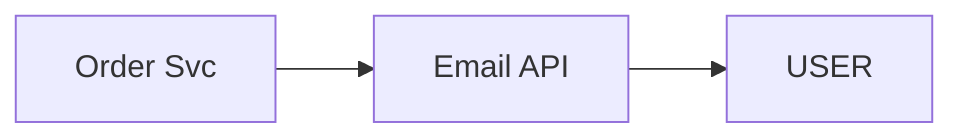

#### 1 Maine order kiya, email company band thi, order hi fail
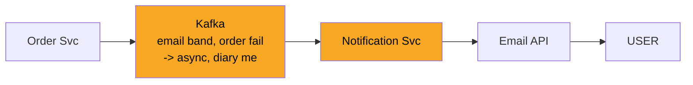
```
DIKKAT     Diwali subah maine order kiya. Order service email bhej ke jawab ka intezaar karti rahi; email
           company band thi -> order hi fail. Aur email dobara bhejne wala koi nahi.
HAL        KAFKA (disk pe diary, async): Order service "order hua" Kafka me daal ke turant jawab de;
           Notification service peeche se padh ke bheje. Email band -> wo ruki, wapas aayi -> wahin se,
           kyunki yaad hai kahan tak padha (offset).
NAHI       Order service me hi retry: request utni der atki, aur Order service giri to retry bhi gaya.
```
```
AAGE POOCHEGA:
  NIYAM: bhejne wala khabar likhe aur aage badhe; khabar disk ki diary me, padhne wala yaad rakhe kahan tak.
  "Kafka me khabar kitni der?"     -> ~7 din diary me padi rehti; order kabhi email ki wajah se fail nahi.
  "Order DB me bana, Kafka se pehle Order Svc giri?"
                                   -> khabar gayi hi nahi; OUTBOX: order aur khabar EK DB transaction me
                                      (outbox table), relay baad me outbox se Kafka bheje.
  "Notification ki kai machine?"   -> sab ek team (consumer group), har line (partition) ek machine ko;
                                      machine badhao, lines bat jaati.
```

#### 2 SMS company dheemi, mera push aur email bhi atke
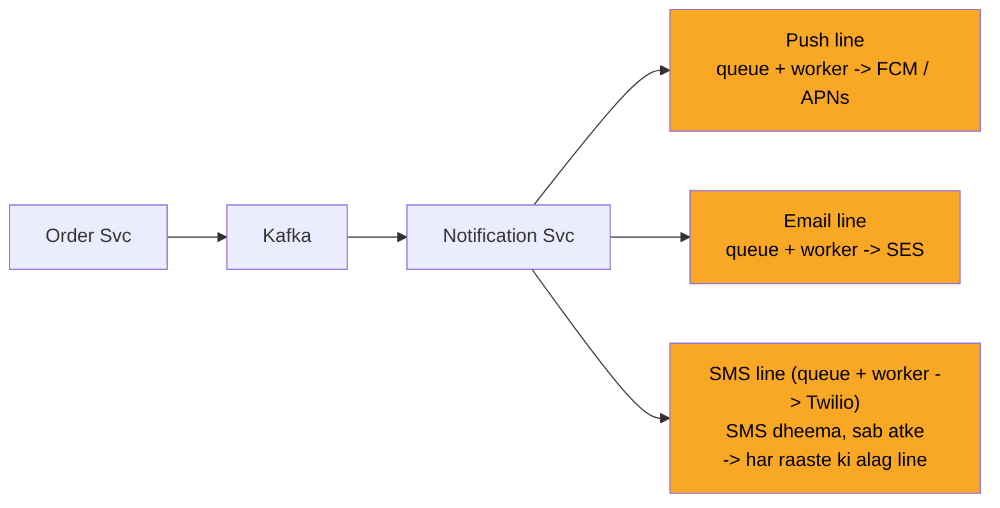
```
DIKKAT     Usi order ki khabar push, email, SMS teeno se. Teeno ek line me; SMS company dheemi hui -> SMS
           atke, unke peeche mera push aur email bhi khade.
HAL        ALAG LINE: teeno raaste ki alag line aur alag worker. SMS dheema -> sirf SMS ki line lambi.
           Worker alag ginti me (email ke 10, SMS ke 3) -> jis raaste pe kaam, wahi badhao.
NAHI       SMS worker badha do: company khud dheemi, line phir bhi ek, push / email phir bhi peeche.
```
```
AAGE POOCHEGA:
  NIYAM: har raasta apni speed se; ek ki dheemi chaal doosre pe nahi aati.
  "Ek ghatna, teen baar banegi?"   -> Notification Svc ek ghatna se teen chhote message, har line me ek;
                                      pehchaan = ghatna ki id + raasta.
  "Push kis phone pe?"             -> install pe device token user ke saath save; bekaar nikla -> hatao.
```

#### 3 Worker mara, mujhe do email aaye
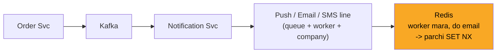
```
DIKKAT     Worker ne mera email bheja, par Kafka ko "padh liya" (offset) bolne se pehle mar gaya. Kafka ne
           wahi khabar doosre worker ko di -> dobara bheja -> mujhe DO email.
HAL        PARCHI: bhejne se pehle Redis me khabar ki APNI id se parchi, SET NX (sirf tab jab pehle na ho).
           Parchi pehle se mili = khabar pehle aa chuki -> skip. (usercrud /pay wala hi tareeka.)
NAHI       har baar naya random id: dohraav kabhi pakda nahi jaata.
```
```
AAGE POOCHEGA:
  NIYAM: id khabar ki apni; Redis tez raasta, DB pakka.
  "Redis hi gira?"                 -> DB me niyam: (khabar_id, raasta) ek hi baar (UNIQUE).
  "Parchi 24 ghante me mit gayi, wahi khabar phir aayi?"
                                   -> Redis se nahi rukegi; DB ka UNIQUE (khabar_id, raasta) rokega.
```

#### 4 Parchi lag gayi, par mera OTP gaya hi nahi
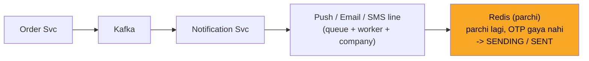
```
DIKKAT     Login ka OTP: Worker-A ne parchi "bhej diya" lagayi, SMS call FAIL (ya Worker-A mara). Kafka ne
           dobara di, Worker-B ne "bhej diya" dekh ke chhoda -> OTP kho gaya. Koshish ko pakka maan liya.
HAL        SENDING / SENT: bhejne se PEHLE "BHEJ RAHA HOON" (SENDING, 60 sec umar), company OK pe
           "BHEJ DIYA" (SENT, 1 din). CHHODNA sirf SENT pe; SENDING = adhoora.
NAHI       parchi hi hata do: worker mara to Kafka dobara deta -> OTP / email do baar (card 3 wapas).
```
```
AAGE POOCHEGA:
  NIYAM: chhodo sirf pakke "bhej diya" pe; adhoori koshish khud mit jaaye.
  "Worker-A ka call fail, zinda?"  -> khud parchi hata deta -> agli koshish chal jaati.
  "Worker-B ko SENDING mila?"      -> koi abhi bhej raha, thoda ruko, phir dekho. SENT mila -> chhodo.
  "Fail pe parchi hata do, kaafi?" -> worker hi mar gaya to hatane wala nahi; isliye SENDING ki umar chhoti.
  "60 sec chhote pad gaye?"        -> umar company ke call se lambi rakho (call ~2-3 sec, umar 60 sec).
  "Company ne bhej diya, jawab se pehle worker mara?"
                                   -> tab do baar ja sakta; SES / Twilio aisi parchi khud nahi rakhte, chhota
                                      risk maana hua. OTP do baar chalega, na aana nahi.
```

#### 5 SMS company pehle se pareshaan, hum har second dobara maar rahe
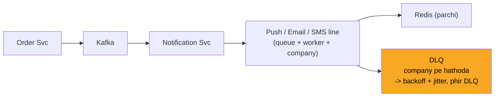
```
DIKKAT     Usi waqt SMS company pareshaan, aur hum har second dobara bhej ke uspe aur hathoda maar rahe.
HAL        BACKOFF + JITTER: har baar zyada ruko 1, 2, 4, 8 sec (shuru ka time x 2^koshish) + thoda random,
           taaki sab worker ek saath na lautein. Had paar -> DLQ (fail khabaron ki alag line) + alert.
NAHI       retry band, ek fail = chhodo: company 2 sec hili to OTP hamesha ke liye gaya.
```
```
AAGE POOCHEGA:
  NIYAM: ruk-ruk ke dobara, phenkna kabhi nahi; had ke baad DLQ.
  "Kafka me '10 min baad' nahi hota?" -> alag lines (retry-1m, retry-10m); worker message pe
                                      "kab chalana" dekhe, abhi nahi to ruke.
  "DLQ me padi khabaron ka kya?"   -> alert + dashboard, aur theek karke wapas main line me daalne ka tool.
  "Khabar kabhi khoye nahi, pakka?" -> Kafka me acks=all (saari copies ne liya tabhi OK); offset KAAM HONE KE
                                      BAAD -> worker mara to khabar dobara; + parchi + DLQ.
```

#### 6 SMS company band nahi, dheemi: saare worker 30 sec me phanse
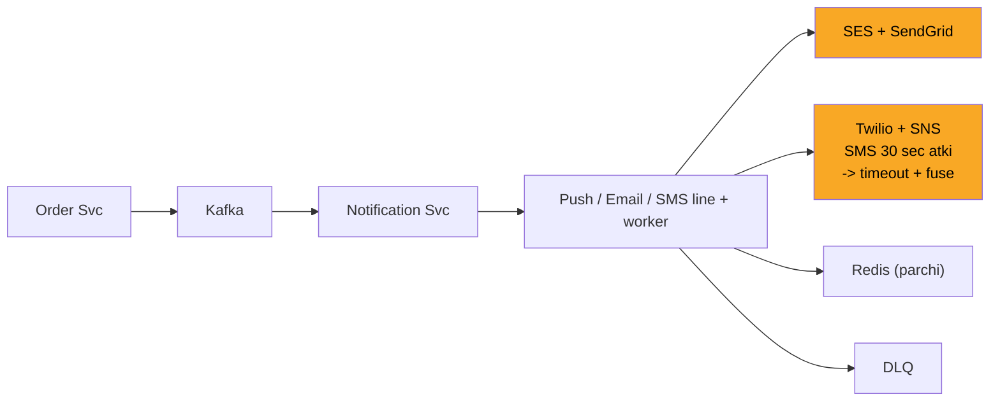
```
DIKKAT     SMS company abhi bhi dheemi: line alag ho gayi, par har call 30 sec atki. Saare SMS worker
           usi me phanse, OTP bhi ruka. Dheemi company band company se bhi buri.
HAL        TIMEOUT 2-3 sec + FUSE (circuit breaker) har company ka alag: 5 baar fail -> OPEN (call mat karo,
           seedha doosri company) -> 30 sec baad HALF-OPEN (ek test call) -> chali to CLOSED.
           Twilio ka fuse uda -> SNS.
NAHI       worker badha do: naye worker bhi 30 sec me phanse, dheemi company pe aur bojh.
```
```
AAGE POOCHEGA:
  NIYAM: dheema = band maano; har company ka apna fuse, apni line.
  "Push / email pe asar?"          -> nahi, unke worker alag line pe.
  "Dono company band?"             -> line me ruki rahe (phenko nahi), backoff se koshish; OTP ke liye alert.
  "Push ki doosri company?"        -> nahi hoti; Android = FCM, iPhone = APNs, alag-alag.
```

#### 7 12 baje sale shuru, mera OTP 50,000 offer ke peeche
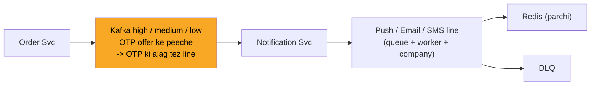
```
DIKKAT     12 baje sale. Line me 50,000 offer message the, mera OTP unke peeche khada raha, 10 minute baad
           aaya. Tab tak login ka time khatam.
HAL        ALAG TEZ LINE: Kafka me OTP ki apni line (high), offer dheemi (low), beech wali medium;
           har line ke apne worker.
NAHI       ek line me "zaroori" tag: Kafka me "ye pehle bhejo" hota hi nahi.
```
```
AAGE POOCHEGA:
  NIYAM: zaroori ko kabhi kisi ke peeche mat khada karo; alag line, alag worker.
  "Tez line khaali, worker baithe?" -> haan, thoda bekaar; khaali hon to beech wali bhi padh lein
                                      (ulta kabhi nahi).
  "OTP bhi company ki limit me?"   -> OTP ka company me alag account / alag number, offer use kha na sake.
```

#### 8 Sale me laakhon message ek saath, company ne 429 diya
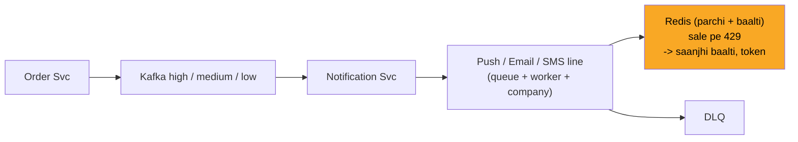
```
DIKKAT     Sale shuru, ek saath laakhon message. SMS company bolti "itna nahi" (429) -> sab fail.
HAL        SAANJHI BAALTI (token bucket) Redis me: company ki had (jaise 100 / sec) = har sec 100 token.
           Har worker pehle token le (Lua, ek jhatke me), nahi -> ruko. 429 phir bhi -> Retry-After tak ruko.
NAHI       har worker apni speed 100 / sec: 100 worker = 100 guna -> phir 429.
```
```
AAGE POOCHEGA:
  NIYAM: had company ki hai, worker ki nahi; ek baalti sab worker ke liye.
  "Token nahi mila, message ka kya?" -> line me intezaar, had ke baad DLQ, phenke nahi.
  "Worker apne aap badh gaye?"     -> saanjhi baalti me kitne bhi worker ho, kul speed wahi.
  "Had kitni hoti?"                -> SES production shuru ~14 / sec (naya sandbox 1 / sec)
                                      · Twilio short code ~100 / sec · FCM ki bhi apni had.
  "Had kam, 1 lakh email bhejne?"  -> had badhwao + kai account / company; tab tak line dheere-dheere khaali.
```

#### 9 Company ne "bhej diya" bola, par mere phone tak pahuncha?
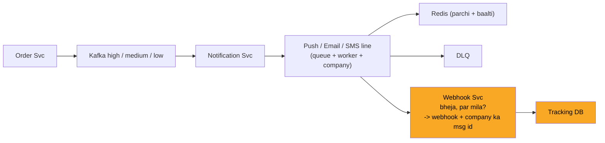
```
DIKKAT     SMS company ne message le liya. Par mere phone tak pahuncha ya nahi, humein pata hi nahi.
HAL        WEBHOOK: company baad me khud hamein call karti "pahuncha / fail". Bhejte waqt company ka message
           number (SES MessageId / Twilio SID) save; webhook aaya -> us number se row -> haalat badlo.
NAHI       baar-baar khud poochte raho: laakhon message x har kuch second = had + kharcha.
```
```
AAGE POOCHEGA:
  NIYAM: "bheja" aur "mila" alag haal; company jab bataye, tab badlo.
  "Hisaab kahan?"                  -> Tracking = Cassandra (likhna bahut, seedhi row).
  "Webhook aaya hi nahi?"          -> kuch ghante baad jo "bhej diya" pe atke, sirf unke liye
                                      ek baar company se poochho.
  "Koi nakli webhook bhej de?"     -> company ka hastakshar (HMAC signature) jaancho, warna mana.
```

#### 10 Shaam ko "Diwali offer sabko": 1 crore log
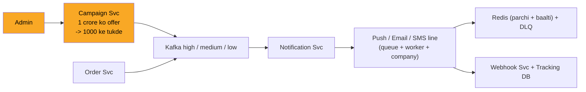
```
DIKKAT     Shaam ko admin ne "Diwali offer sabko" chalaya = 1 crore user. Ek-ek karke bheja -> request ghanton
           atki, OTP bhi peeche, company ki had tooti.
HAL        TUKDE: API turant "shuru ho gaya"; job users 1000-1000 me padhe ("id > aakhri_id, 1000 lao"), har
           tukda Kafka me, aakhri_id campaign row me -> job gira to wahin se. Dheemi (offer) line, had me.
NAHI       1 crore ko ek bada "sabko bhejo" message: ek worker pe atka, gira to shuru se.
```
```
AAGE POOCHEGA:
  NIYAM: bada kaam chhote tukdon me, har tukde ke baad "kahan tak" likha.
  "Kitni der?"                     -> 10,000 / sec pe 1 crore ~17 minute (jaan-boojh ke phailaya).
  "Push me sabko ek hi message?"   -> FCM ka TOPIC: ek call, aage Google sabko pahunchata.
  "1000 me se 600 bhej ke gira?"   -> tukda dobara aayega; (campaign_id, user_id) se pehle ke 600 chhootein.
  "Galat offer chala gaya?"        -> campaign row pe "CANCELLED"; worker har tukde se pehle dekhe.
  "1000 ka tukda hi kyun?"         -> 1 crore alag khabar = bojh; 1 bahut bada message = ek worker pe atka;
                                      1000 = saath-saath bhi, dobara bhi chhota.
  "Ek user ka kram?"               -> "order hua" ke baad "ship hua": line ka chunaav user_id se
                                   -> ek user ki saari khabar ek line me, kram se.
```

#### 11 Raat 2 baje offer ka SMS, jabki maine band kiya tha
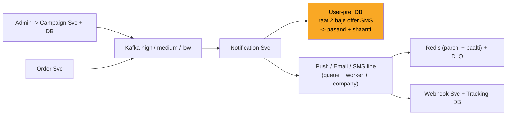
```
DIKKAT     Maine "offer SMS band" kiya tha aur raat 10 se subah 8 shaanti lagayi thi. Phir bhi raat 2 baje
           "Diwali sale 70% off" ka SMS aaya, aur push se phone baj gaya.
HAL        PASAND + SHAANTI: bhejne se pehle pasand: SMS band -> chhodo; 10-8 -> koi ghanti nahi. Phir meri
           bhasha me SAANCHA bharo ("Hi {naam}, order {id} aa gaya"). Pasand + saancha cache me, DB nahi.
NAHI       pasand sirf Campaign Svc me check: order / OTP wali khabar bina check nikal jaati.
```
```
AAGE POOCHEGA:
  NIYAM: user ki pasand bhejne se pehle; zaroori alert pasand / shaanti se upar.
  "Shaanti me aayi, phenk doge?"   -> nahi; offer subah 8 tak roko. OTP / "koi aur login kar raha"
                                      shaanti me bhi jaata.
  "Pasand badli, cache purana?"    -> pasand badalte hi cache se hatao, aur cache ki umar chhoti.
```

---

## AAKHRI DABBA + WRAP (ek hi baar)

```
Order / Campaign Svc -> Kafka (tez / beech / dheemi) -> Notification Svc (pasand + saancha, cache)
-> push / email / SMS ki line -> worker (parchi BHEJ RAHA / BHEJ DIYA · ruk ke dobara · fuse · speed limit)
-> 2 company -> user · webhook -> Tracking DB · fail -> DLQ

DB:  Tracking = Cassandra -> likhna bahut, seedhi row, pakki consistency nahi chahiye, aaram se badhta
     Pasand / saancha = chhota, har ghatna pe padha jaata -> cache
```
```
JAWAB:    Services 'kuch hua' ki khabar Kafka me daalti. Notification service user ki pasand dekhti,
          message bharti, aur push / email / SMS ki alag line me daal deti.
          Worker parchi (BHEJ RAHA / BHEJ DIYA) se do baar nahi bhejte, fail pe ruk-ruk ke dobara,
          company ki had me, company dheemi to fuse + doosri company, had ke baad DLQ. OTP ki alag line.
          Ek user ki khabar ek hi line me, to kram sahi. Company ke webhook se 'mila / fail' update.
          Aage: raat ka shaant time, kai bhasha, khola / click ginti.
```
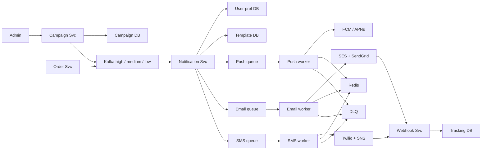

---

## 10 GUNA TRAFFIC — har dabba alag se

```
Kafka            -> sale pe 10 guna -> lines (partition) pehle se zyada · line user_id se
Notification Svc -> pasand / saancha cache · machine badhao
raaste ki line   -> alag line (ho gaya) + tez / dheemi line
worker           -> sale pe badhao (ek worker ~1000 / second) · fuse + do company · speed limit
Tracking DB      -> 90 TB / saal -> Cassandra + row ki umar, purana sasti jagah (cold storage)
                    (umar se jagah ghatti hai, baantne se bojh — dono alag cheez)

POOCHEGA: "Data keeps growing — what happens in 3 years?"
          (Data badhta ja raha, 3 saal baad?)

JAWAB:    Kis message ka kya hua (bheja / mila / khola), uski row ki umar rakho (jaise 90 din), purani
          rows sasti jagah chali jaayein. Roz wali table chhoti rehti hai.

POOCHEGA: "Kahan se gir sakta?"     -> company (do company), Kafka (copies), Redis (DB ka UNIQUE peeche)
POOCHEGA: "Chal raha, kaise pata?"  -> webhook se delivered / failed · Kafka me kitna pending
                                       · DLQ kitna bhara · alert
```

---

## POOCHE TO (gehra sawaal aaye tab)

```
KHABAR:   Kafka pe { event: "ORDER_PLACED", userId: 123, orderId: 999 }
          (andar ke liye REST bhi: POST /notify { userId, type, channel?, payload })

RAASTE:   Push: FCM (Android) / APNs (iPhone) · Email: SES / SendGrid / Mailgun · SMS: Twilio / SNS / MSG91
          App ke andar: DB + WebSocket · Phone call: Twilio · Slack webhook

DB:       PASAND:  user_id -> kaunse raaste · shaanti ka waqt · kya band kiya
          SAANCHA: template_id -> format · bhasha · khaali jagah {{name}} {{orderId}}
          HISAAB:  bheja / mila / khola / click / fail -> Cassandra
                   (bahut likhna, seedhi row, ACID nahi chahiye)

1 LAKH / SECOND:  ~100 worker · line "notifications" P0 -> W1 ... P99 -> W100
          line user_id se -> ek user ki saari khabar ek line me -> kram bana rehta
          (warna "ship hua" pehle aur "order hua" baad me)

POORA RAASTA EK BAAR:
          order -> Order Svc Kafka me { ORDER_PLACED, 123, 999 } -> Notification Svc uthaye -> pasand dekhe
          (push chalu, email chalu, SMS band) -> saancha bhare -> push + email ki line -> worker -> company
          -> user -> webhook -> Tracking DB · fail -> dobara -> DLQ
```

---

## HANDS-ON — provider ne 429 diya: chala ke dekha

> Grill me galti: 429 pe "fail-open" bola. Fail-open HUMARE limiter ka faisla (Redis gira to); yahan limiter
> PROVIDER ka, uska darwaza hum nahi khol sakte -> dheema HUMEIN hona padega.
> CODE: `04_HLD/HANDS_ON/03_provider_429/Sms429Demo.java` (Docker nahi, time nakli) · line 21 `SMART = false / true` -> `java Sms429Demo.java`

```
SETUP:  1000 SMS ek saath · provider 100 / sec · t=3,4 pe 50 / sec
NAIVE:  sab ek saath, 429 pe agle second turant retry, 3 fail -> PHENK DO
SMART:  apni taraf 100 / sec (token bucket) · 429 pe 1s, 2s, 4s · kabhi phenko mat
```
```
NAIVE      t | provider | queue | bheje | 200 | 429 | chhode | pahunche
           0 |  100/sec |  1000 |  1000 | 100 | 900 |      0 | 100
           1 |  100/sec |   900 |   900 | 100 | 800 |      0 | 200
           2 |  100/sec |   800 |   800 | 100 | 700 |    700 | 300
           PAHUNCHE 300 / 1000 · CHHODE 700 · call 2700 (429 = 2400)

SMART      t | provider | queue | bheje | 200 | 429 | chhode | pahunche
           0 |  100/sec |  1000 |   100 | 100 |   0 |      0 | 100
           1 |  100/sec |   900 |   100 | 100 |   0 |      0 | 200
           2 |  100/sec |   800 |   100 | 100 |   0 |      0 | 300
           3 |   50/sec |   700 |   100 |  50 |  50 |      0 | 350
           4 |   50/sec |   650 |   100 |  50 |  50 |      0 | 400
           5 |  100/sec |   600 |   100 | 100 |   0 |      0 | 500
           6 |  100/sec |   500 |   100 | 100 |   0 |      0 | 600
           7 |  100/sec |   400 |   100 | 100 |   0 |      0 | 700
           8 |  100/sec |   300 |   100 | 100 |   0 |      0 | 800
           9 |  100/sec |   200 |   100 | 100 |   0 |      0 | 900
          10 |  100/sec |   100 |   100 | 100 |   0 |      0 | 1000
           PAHUNCHE 1000 / 1000 · CHHODE 0 · call 1100 (429 = 100)

           NAIVE 3 sec, jaldi par 700 kabhi nahi milenge · SMART 11 sec, dheere par sab pahunche
DARWAZA:   1 sec me 100 nikal sakte · 1000 dhakka maarein -> 100 nikle, baaki 3 dhakke ke baad ghar
           SMART = line lagwao, 100-100
```
```
THROTTLE  raftaar provider ki limit pe baandho
BACKOFF   429 pe 1s, 2s, 4s · Retry-After aaye to wahi
JITTER    thoda random farak (simulation me nahi, time poore second me)
QUEUE     jo abhi nahi ja sakta wo queue me ruke · max try ke baad DLQ, drop nahi

JAWAB:    Chala ke dekha: company ki had ka dhyaan na rakha aur turant dobara bheja to 1000 me se 700
          gaye hi nahi.
          Had me bheja aur ruk-ruk ke dobara koshish ki to poore 1000 pahunche.
```

ARCHETYPE B (ingest) · CONCEPTS: [message-queues](../../FOUNDATIONS/07_message_queues.md) · [ms-communication](../../FOUNDATIONS/10_ms_communication.md) · saath: [12 message-queue](../12_message_queue_kafka/12_message_queue_kafka.md) · [← MASTER SHEET](../../00_MASTER_SHEET.md)
