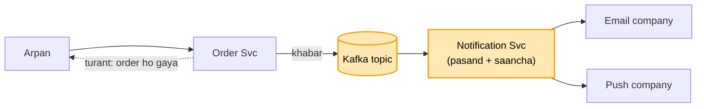
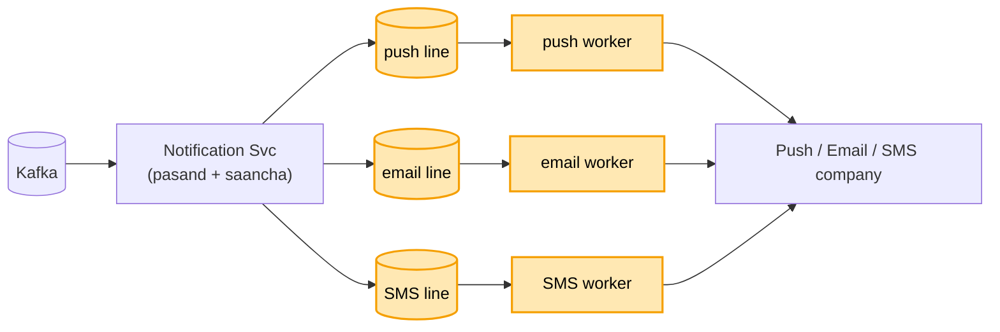
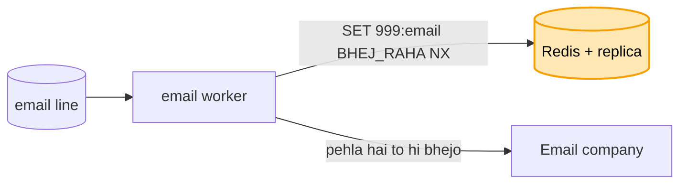
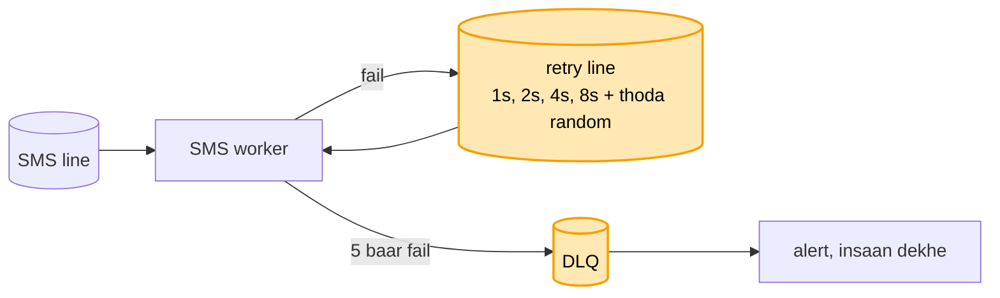
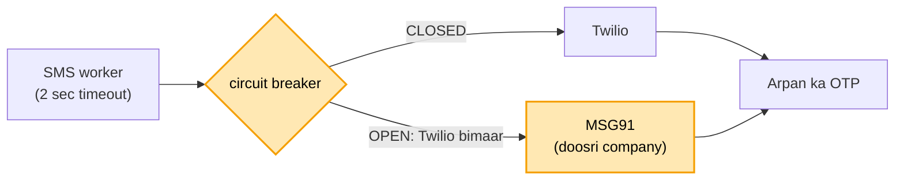
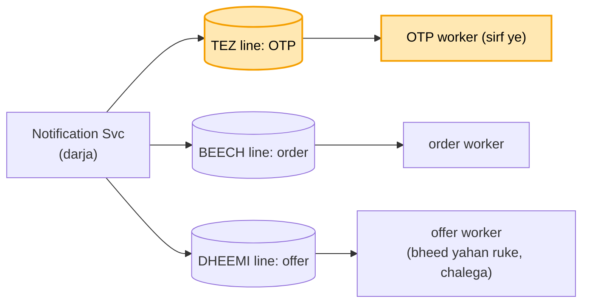

# Notification system: shuru se, ek kahani

Kram wahi jo interview me hota hai: **FR, phir NFR, phir numbers, phir design**. Design sabse seedhe dabbe
se shuru hota hai, aur har dikkat aane pe ek naya dabba judta hai. Diagram me peela dabba = abhi juda. Poori
file me ek hi kahani hai: Arpan ne Amazon pe order kiya, use push bhi aana chahiye aur email bhi, aur login
ke waqt OTP ka SMS turant.

---

## 1. FR: kya karna hai

```
1. ek ghatna (order hua) -> kai raaste: push / email / SMS / app ke andar
2. user ki pasand maano (SMS band kiya to SMS nahi) + message ka saancha (template: "Hi {{name}}")
3. OTP turant, offer ruk sakta hai
scope ke bahar: analytics dashboard
```

## 2. NFR: kaisa chalna chahiye

```
- bhejne wala (Order Svc) ruke nahi
- khabar khoye nahi, do baar jaaye nahi
- sale ki bheed jhele, OTP us bheed me phanse nahi
```

## 3. Numbers

```
- 10 crore user x 5 khabar / din = 50 crore / din -> ~5,800 / sec aam din
- sale = 10 guna ~58,000 / sec, har ek 3 raaste -> ~1.75 lakh / sec
- ek worker ~1000 / sec -> sale pe ~175 worker
```

---

## 4. Design

### Kadam 1: sabse seedha (Order Svc seedha email company ko call kare)

Arpan ne order kiya. Order Svc order banata hai, phir khud seedha email company (SendGrid) ki API call karta
hai, uske jawab ka intezaar karta hai, aur tab jaake Arpan ko "order ho gaya" bolta hai.


Dikkat: email company dheemi hai to Arpan ka order bhi dheema. Email company band hui to order hi fail, jabki
order ka email se koi lena-dena nahi. Aur kal SMS aur push bhi jodne hain, to Order Svc ke code me teen
company ki call aa jaayengi.

Par Order Svc ko kisi ka intezaar nahi karna. Wo bas khabar kahin daal de aur aage badh jaaye.

### Kadam 2: khabar Kafka me daalo, Notification Svc uthaye

Ab Order Svc order banata hai, ek chhoti khabar `{ ORDER_PLACED, userId: Arpan, orderId: 999 }` Kafka ke
topic me daalta hai, aur turant Arpan ko "order ho gaya" bol deta hai. Kisi company ka intezaar nahi.

Ek naya dabba judta hai: **Notification Svc**. Ye Kafka se khabar uthata hai, Arpan ki pasand dekhta hai
(push chalu, email chalu, SMS band), saancha bharta hai ("Hi Arpan, order 999 ho gaya"), phir email aur push
company ko call karta hai.



Kafka kyun:
- khabar disk pe likhi jaati hai, to Notification Svc gira ho tab bhi khabar khoti nahi. Wo wapas aake wahin
  se padh leta hai.
- sale me 58,000 khabar / sec aayein to Kafka unhe pakad ke rakhta hai, Notification Svc apni raftaar se
  nikalta hai.
- wahi khabar kal Analytics bhi padh sakta hai, kyunki padhne se khabar mitti nahi.

Ab kya theek hua: email company band hai to bhi order chal jaata hai. SMS jodna ho to sirf Notification Svc
badalta hai, Order Svc nahi.

Par Notification Svc ek hi line me teeno raaste bhej raha hai. SMS company dheemi hui to uske peeche Arpan
ka push aur email bhi atak jaata hai.

### Kadam 3: har raaste ki alag line (topic) aur apne worker

Notification Svc ab company ko khud call nahi karta. Wo bas tay karta hai ki Arpan ko kis raaste bhejna hai,
aur har raaste ki **alag Kafka line** me khabar daal deta hai: push wali line, email wali line, SMS wali line.
Har line ke apne **worker** hain: push worker sirf push company ko bhejte, email worker sirf email company
ko, SMS worker sirf SMS company ko.



Ab SMS company dheemi hui to sirf SMS line ruki. Arpan ka push aur email apni-apni line me aage nikal gaye.

Ek fayda aur: har line ke worker alag-alag badha sakte hain. Sale me push zyada jaata hai, to push worker 100
kar do, SMS ke 20 hi rehne do. Numbers wala "~175 worker" yahin baithta hai.

Par email worker ne Arpan ko email bheja, aur Kafka ko "ho gaya" (commit) bolne se pehle hi wo machine mar
gayi. Naya worker wahi khabar dobara uthata hai aur dobara bhejta hai.
Arpan ko ek order ke do email aate hain.

### Kadam 4: key se ek hi baar (Redis me khabar ki id + haal)

Har khabar ki apni id hoti hai: order 999 ka email = `999:email`. Worker bhejne se pehle **Redis** me is id
ki key likhta hai: `SET 999:email BHEJ_RAHA NX` (NX = sirf tab likho jab key pehle se na ho).

- key nahi thi, likh di gayi = ye worker pehla hai. Wo email bhejta hai, phir key ko `BHEJ_DIYA` kar deta hai.
- machine mari, naya worker wahi khabar uthata hai, Redis me dekhta hai `BHEJ_DIYA`, to chhod deta hai.
  Arpan ko ek hi email aata hai.



Do haal kyun, ek kyun nahi: maan lo worker ne bhejne se pehle hi seedha `BHEJ_DIYA` likh diya aur bhejne se
pehle mar gaya. Naya worker dekhega "bhej diya" aur chhod dega, Arpan ka OTP kabhi aayega hi nahi. Isliye
pehle `BHEJ_RAHA` likho, uspe 60 sec ki umar (TTL), aur bhejne ke baad hi `BHEJ_DIYA`. Worker beech me mara to
60 sec baad `BHEJ_RAHA` mit jaata hai aur naya worker dobara bhej deta hai. Kabhi-kabhar do email ho sakte
hain, par OTP khoyega nahi. Khona dohraav se bura hai.

Redis hi mar gaya to? Uski replica (copy) primary ban jaati hai (Sentinel / ElastiCache Multi-AZ). Copy
thodi peeche chalti hai, to aakhri kuch key shayad pahunchi na hon, aur un khabron ke do message ja
sakte hain.
Aur dono gaye to bhi worker bhejna band nahi karte: do message chalenge, khoya hua OTP nahi.

Par SMS company ne fail lauta diya. Worker turant dobara bhejta hai, phir fail, phir turant. Wo pehle se
pareshaan company ko har second dhakka maar raha hai.

### Kadam 5: ruk-ruk ke dobara, phir bhi na jaaye to DLQ

SMS company ne fail lauta diya. Worker ab turant dobara nahi maarta. Khabar ko ek **retry line** me daal deta
hai, wait ke saath: pehli baar 1 sec baad, phir 2, phir 4, phir 8. Har baar wait dugna, aur usme thoda random
(jitter), taaki saare worker ek hi second pe company pe toot ke na padein. 5 baar ke baad bhi fail, to khabar
**DLQ** (dead letter queue) me: wahan alert bajta hai aur koi insaan dekhta hai. Khabar khoti nahi, aur SMS
line bhi nahi rukti.



Retry line alag kyun: worker wahin baith ke wait kare to uske peeche Arpan ke baaki SMS bhi atak jaate hain.

Par SMS company band nahi, bas dheemi hai: har call 30 sec me jawab de rahi hai. Saare SMS worker usi intezaar
me phanse baithe hain.

### Kadam 6: timeout + circuit breaker + doosri company

**Timeout:** worker SMS company ko sirf 2 sec deta hai. Jawab nahi aaya to call chhod ke khabar retry line
(Kadam 5) me. Ab koi worker 30 sec phansa nahi rehta.

**Circuit breaker:** 100 me se 50 call fail / timeout ho rahi hain, to worker samajh jaata hai company abhi
bimaar hai, aur kuch der us company ko call karna hi band (breaker OPEN). Har call pe 2 sec barbaad nahi.
30 sec baad 2-4 call test ki tarah bhejta hai (HALF-OPEN). Chal gayi to wapas CLOSED, normal kaam.

**Doosri company:** breaker open hai to SMS kahan jaaye? Ek doosri SMS company rakhte hain. Twilio bimaar,
to MSG91 se bhejo. Arpan ka OTP rukta nahi.



Par 12 baje sale shuru hui, aur 50,000 offer SMS line me pehle se khade hain. Arpan ka login OTP unke peeche
lag gaya. OTP 5 min me bekaar ho jaata hai, offer 1 ghanta baad bhi chalega.

### Kadam 7: OTP ki alag tez line

Notification Svc har khabar ko ek darja deta hai: **TEZ** (OTP, password reset), **BEECH** (order hua, ship
hua), **DHEEMI** (offer, sale ki khabar). Har darje ki apni alag line, aur **apne alag worker**. OTP wale worker
kabhi offer nahi uthate. Sale me 50,000 offer DHEEMI line me khade rehte hain, Arpan ka OTP TEZ line se
turant nikal jaata hai.



Ek line + priority kyun nahi: Kafka line me aage-peeche nahi karta, jo pehle aaya wahi pehle nikalta hai.
Isliye alag line hi raasta hai.

OTP ki umar: OTP me 5 min ki expiry likhi hoti hai. Kisi wajah se 5 min baad worker tak pahuncha, to wo
bhejta hi nahi, kyunki bekaar OTP bhejna faltu hai.

Par sale me ek saath laakhon SMS. Humare worker tez hain, par SMS company ki had hai: 1000 / sec. Usse zyada
bheja to wo **429** (Too Many Requests) lauta deti hai.
