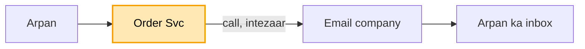
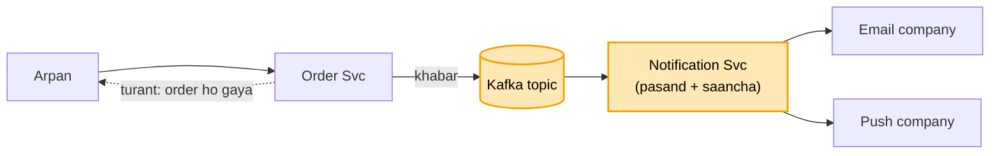

# Notification system: shuru se, ek kahani

Kram wahi jo interview me hota hai: **FR, phir NFR, phir numbers, phir design**. Design sabse seedhe dabbe
se shuru hota hai, aur har dikkat aane pe ek naya dabba judta hai. Diagram me peela dabba = abhi juda. Poori
file me ek hi kahani hai: Arpan ne Amazon pe order kiya, use push bhi aana chahiye aur email bhi, aur login
ke waqt OTP ka SMS turant.

---

## 1. FR: kya karna hai

```
1. ek ghatna (order hua) -> kai raaste: push / email / SMS / app ke andar
2. user ki pasand maano (SMS band kiya to SMS nahi) + message ka saancha (template: "Hi {{name}}")
3. OTP turant, offer ruk sakta hai
scope ke bahar: analytics dashboard
```

## 2. NFR: kaisa chalna chahiye

```
- bhejne wala (Order Svc) ruke nahi
- khabar khoye nahi, do baar jaaye nahi
- sale ki bheed jhele, OTP us bheed me phanse nahi
```

## 3. Numbers

```
- 10 crore user x 5 khabar / din = 50 crore / din -> ~5,800 / sec aam din
- sale = 10 guna ~58,000 / sec, har ek 3 raaste -> ~1.75 lakh / sec
- ek worker ~1000 / sec -> sale pe ~175 worker
```

---

## 4. Design

### Kadam 1: sabse seedha (Order Svc seedha email company ko call kare)

Arpan ne order kiya. Order Svc order banata hai, phir khud seedha email company (SendGrid) ki API call karta
hai, uske jawab ka intezaar karta hai, aur tab jaake Arpan ko "order ho gaya" bolta hai.



Dikkat: email company dheemi hai to Arpan ka order bhi dheema. Email company band hui to order hi fail, jabki
order ka email se koi lena-dena nahi. Aur kal SMS aur push bhi jodne hain, to Order Svc ke code me teen
company ki call aa jaayengi.

Par Order Svc ko kisi ka intezaar nahi karna. Wo bas khabar kahin daal de aur aage badh jaaye.

### Kadam 2: khabar Kafka me daalo, Notification Svc uthaye

Ab Order Svc order banata hai, ek chhoti khabar `{ ORDER_PLACED, userId: Arpan, orderId: 999 }` Kafka ke
topic me daalta hai, aur turant Arpan ko "order ho gaya" bol deta hai. Kisi company ka intezaar nahi.

Ek naya dabba judta hai: **Notification Svc**. Ye Kafka se khabar uthata hai, Arpan ki pasand dekhta hai
(push chalu, email chalu, SMS band), saancha bharta hai ("Hi Arpan, order 999 ho gaya"), phir email aur push
company ko call karta hai.



Kafka kyun:
- khabar disk pe likhi jaati hai, to Notification Svc gira ho tab bhi khabar khoti nahi. Wo wapas aake wahin
  se padh leta hai.
- sale me 58,000 khabar / sec aayein to Kafka unhe pakad ke rakhta hai, Notification Svc apni raftaar se
  nikalta hai.
- wahi khabar kal Analytics bhi padh sakta hai, kyunki padhne se khabar mitti nahi.

Ab kya theek hua: email company band hai to bhi order chal jaata hai. SMS jodna ho to sirf Notification Svc
badalta hai, Order Svc nahi.

Par Notification Svc ek hi line me teeno raaste bhej raha hai. SMS company dheemi hui to uske peeche Arpan
ka push aur email bhi atak jaata hai.
