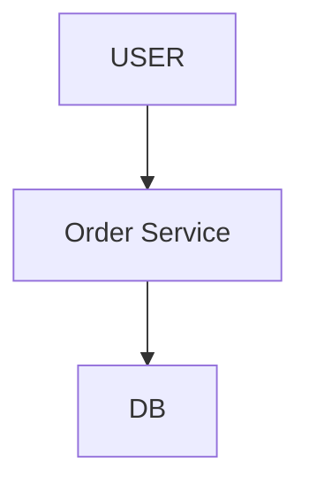
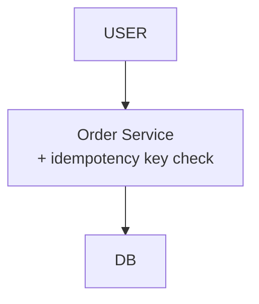
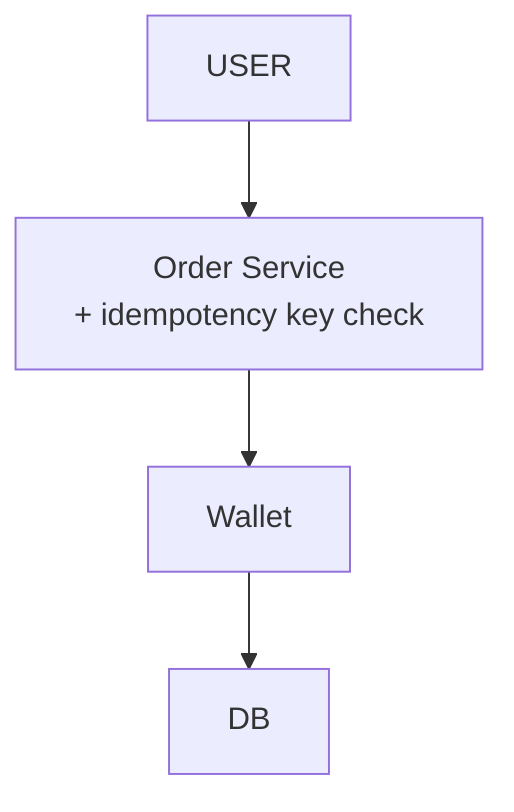
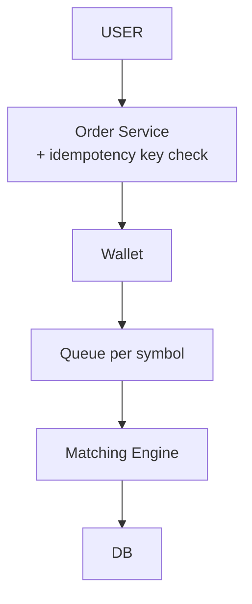
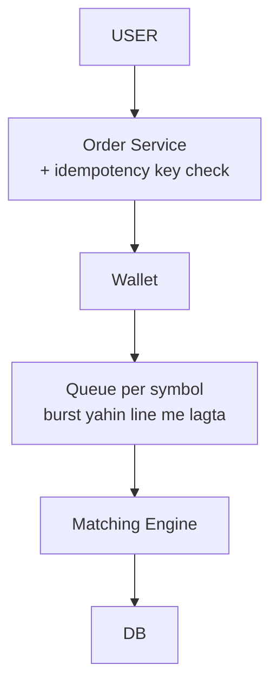
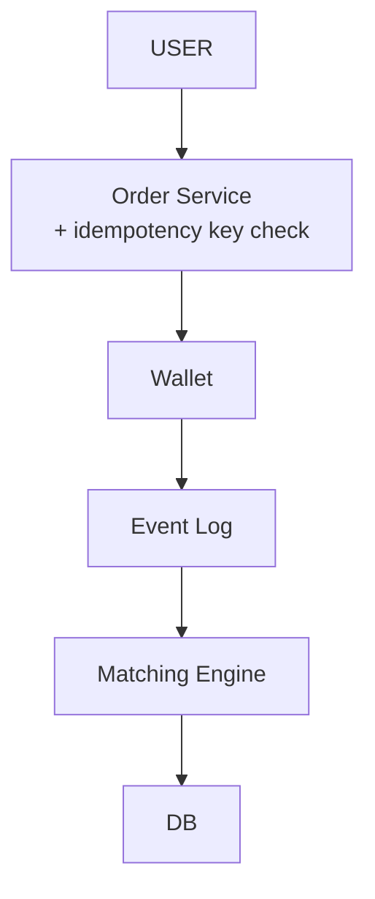
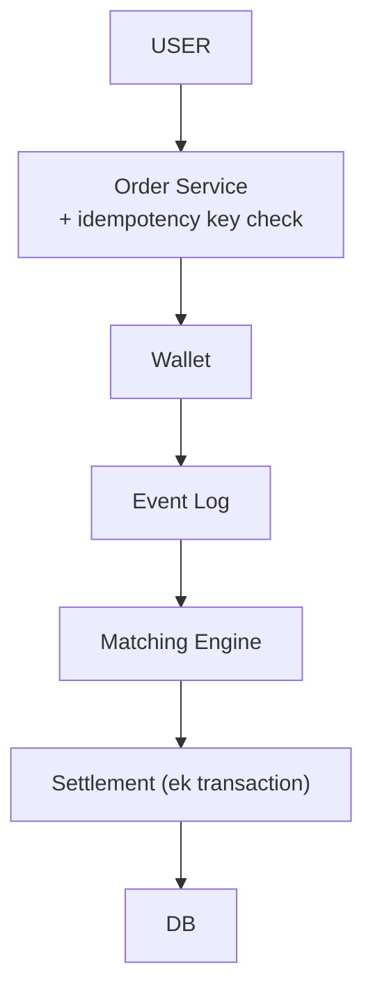
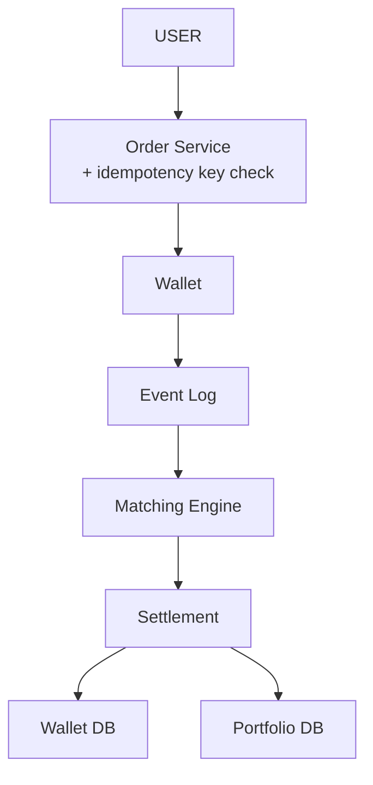
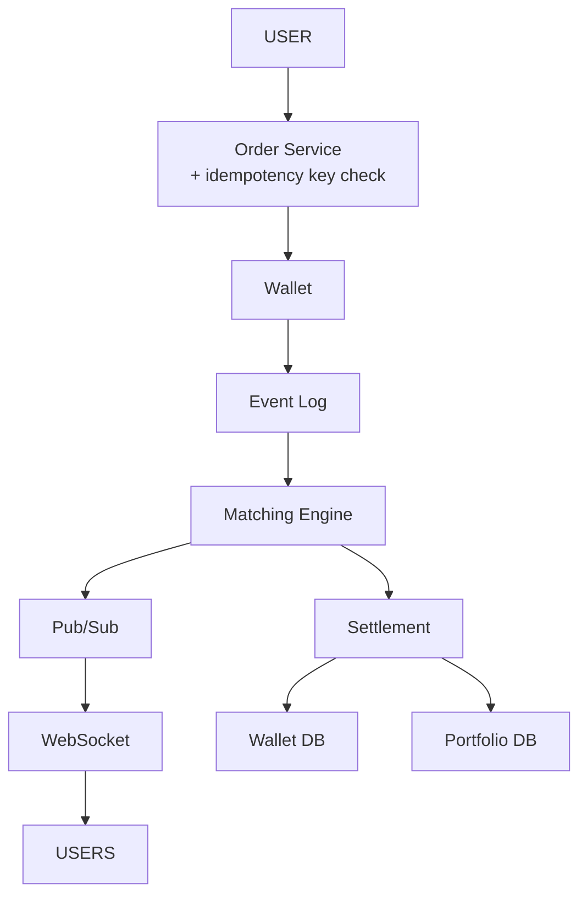
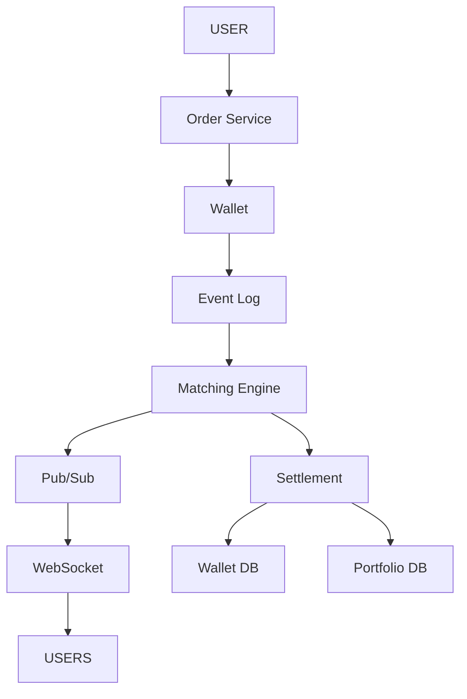

# Stock Broker / Trading Platform

> User BUY / SELL order deta hai -> system order MATCH karta hai -> paisa aur share sahi jagah pahunchte hain -> sabko live price dikhta hai.
> Is design ka dil: **paisa kabhi galat nahi (strong consistency)** + **matching bahut tez (RAM me, microseconds)**.
> Finance interview me (JP / GS) yahi poochte hain: consistency, ACID, idempotency, ledger, audit.

---

## KAHANI (ek din, mera ek TCS order, subah se shaam)

```
1  Maine ek baar dabaya, order do lag gaye
   CUE: order screen pe id bani, dobara bhejo to wahi id (idempotency key)
2  Mere paas 50k the, maine 60k ke order laga diye
   CUE: bank jaise: check aur block ek hi jhatke me (ek atomic query)
3  Suresh ke paas 10 the, mujhe aur Mohan dono ko 10 mil gaye
   CUE: TCS ka ek hi baabu; do baabu hote to Suresh ke 10 share do baar bik jaate (ek symbol ek thread)
4  9:15 baje sab TCS pe toot pade
   CUE: 9:15 ki bheed: baabu mat badhao, sabko token do; ek baabu lakhon / sec nipta leta
        (baanto mat, line me rakho)
5  Server gira, poori order book gayab
   CUE: scoreboard toota, scorer ka register bacha (log pehle, replay)
6  Mera paisa kat gaya, Suresh ko mila hi nahi
   CUE: chaaron entry ek saath ya koi nahi (ek transaction)
7  Paisa kat gaya, share aaye hi nahi (do alag DB)
   CUE: har kadam ka haal likho, aage badho, ulta nahi (step + forward)
8  10 lakh log ek saath price poochh rahe, server baith gaya
   CUE: TV ki tarah bhejo, har koi phone na kare (push, WebSocket)
```

---

## TASVEER (ByteByteGo / Alex Xu · CC BY-NC-ND 4.0)


Source: [Design Stock Exchange](https://bytebytego.com/guides/design-stock-exchange/)


Source: [Low Latency Stock Exchange](https://bytebytego.com/guides/low-latency-stock-exchange/)

---

## SHURU: pehle poocho, phir numbers

```
POOCHO:  "Trading bada hai: matching, price feed, risk, settlement. Kis pe focus karein?"
         -> order MATCHING + paise / share ka SETTLEMENT (len-den poora karna).
            Risk / margin / IPO / mutual fund scope me nahi.
         LIMIT aur MARKET dono order? · aadha bhara (partial fill) chalega?
         hum EXCHANGE hain (khud match karte) ya BROKER (exchange ko order bhejte)?
         Is design me: hum broker + apna matching (exchange jaisa). Asli India me Groww / Zerodha order
         NSE ko bhejte, matching NSE karta; wallet block broker ka kaam.

KYA KARE (FR):    buy / sell · order match · paisa + share move · live price · cancel / status
KAISA CHALE (NFR): paisa hamesha sahi (strong, kabhi "thodi der baad sahi" nahi) · tez
                   · imaandar (jo pehle aaya wo pehle) · har cheez ka record (audit)

NUMBERS (andaaza):
   ~50 lakh user · ~50 lakh order / din, market ~6 ghante (~20,000 second) khulta -> ~250 order / second
   9:15 baje market khulte hi jhatka: 10,000+ order / second
   price dekhne wale bahut zyada: ~10 lakh log app khula rakhte, har second naya price -> ~10 lakh / second
   -> matching RAM me · price PUSH karo (har user ka baar-baar poochhna nahi)
   -> jo tez chahiye aur thodi der ka hai (order book) = RAM
   -> jo paisa hai aur hamesha ka hai (wallet / ledger) = SQL DB + ACID
```

---

## 4 WAJAH -> 4 FIX (poori file ki chaabi)

> Interviewer kuch bhi poochhe, pehle pakdo "ye kaunsi WAJAH hai". Jawab us wajah ka FIX hai.
> 35 jawab yaad nahi rakhne, ye 4 rakhne hain.

```
WAJAH                                    FIX                                          CARD
A  do thread / server ek hi cheez ko     check + badlo EK atomic query me, ya ek     2, 3
   ek saath badal rahe (race)            stock ka ek hi thread (kram = lock)
B  cheez RAM me thi, server gira         pehle log me likho (sirf jodo), phir RAM;   5
   (sab gayab)                           gira to log se replay
C  do jagah likhna, beech me crash       ek transaction; alag DB ho to har step ka   6, 7
   (aadha likha)                         haal likho + aage badho, match ke baad ulta nahi
D  ek hi request do baar aayi            app ki id + server pe UNIQUE                1
   (duplicate)

SCALE ke 2 sawaal in 4 me nahi:
   9:15 ka jhatka = stocks ke BEECH baanto, ek stock ke andar nahi (card 4)
   price  = PUSH karo, har user ka poochhna (poll) nahi            (card 8)
```

---

## ════ MOCK SE PEHLE: SIRF YE CARD PADHO ════

> Har card bas: CUE -> DIKKAT -> HAL -> NAHI (jo galat jawab log pehle bolte). Diagram aur AAGE POOCHEGA
> abhi mat padho, wo sirf jab interviewer aage kuch poochhe.

#### DABBA 0: SABSE SIMPLE (yahan se shuru, phir "kahan tootega")
```
Order service har order DB me likhe, aur DB me milta-julta SELL dhoondh ke match kare.
```


#### 0 SHURU: ORDER BOOK KAISE MATCH KARTA
```
SCENE      TCS ka share. Kuch bechna chahte (SELL), kuch khareedna (BUY).

           Bechne wale   : sasta upar      3000, 3001, 3005 ...   (min-heap)
           Khareedne wale: mehnga upar     2999, 2998 ...         (max-heap)

           Match  -> jab top khareedar >= top bechne wala
           Daam   -> jo order pehle se book me tha, uska
           Tie    -> same daam pe jo pehle aaya (chhota number)

DIKKAT 1   Book DB me rakhi to (DABBA 0 jaisa)?
HAL        RAM me rakho. DB = milliseconds har order, RAM = microseconds.

DIKKAT 2   RAM me hai, server crash hua -> book gayi?
HAL        Har order match se PEHLE log me likho (sirf neeche jodo).
           Crash pe log shuru se chalao -> wahi book wapas (same kram = same nateeja).

DIKKAT 3   Mujhe 10 chahiye, bechne wale ke paas 6?
HAL        6 ka sauda. Mere baaki 4 book me pade rehte, un 4 ka paisa ruka rehta.
```

#### 1 Maine ek baar dabaya, order do lag gaye
```
CUE        order screen pe id bani, dobara bhejo to wahi id (idempotency key)

DIKKAT     9:15, maine TCS ka BUY dabaya. Network gaya, app ne khud dobara bheja -> do order lag gaye.
HAL        IDEMPOTENCY KEY: screen khulte id, dobara wahi id. Server pe UNIQUE -> doosri baar purana jawab.
```

```
AAGE POOCHEGA (wahi WAJAH D):
  "Button pehli tap pe band?"
     -> Haan, aur id order screen khulte banti. Pehli baar order + jawab save, doosri baar saved jawab.
  "Pehli request abhi chal hi rahi, dobara wali aa gayi?"
     -> Id ka haal IN_PROGRESS -> "thoda ruko" (409). DONE -> saved jawab.
  "Id kitne din rakhoge?"
     -> ~24 ghante, phir saaf.
```

#### 2 Mere paas 50k the, maine 60k ke order laga diye
```
CUE        bank jaise: check aur block ek hi jhatke me (ek atomic query)

DIKKAT     Order ek laga, ab paisa? Wallet me 50k. Laptop se 30k, phone se 30k, same second.
           Do server, dono ne 50k dekha, dono pass.
HAL        Check + block EK query: UPDATE wallet SET blocked = blocked + 30000
           WHERE user_id = 'Arpan' AND total - blocked >= 30000   (doosre ko 0 row -> reject)
NAHI       pehle SELECT, phir UPDATE: beech me doosra ghus jaata.
```

```
AAGE POOCHEGA (wahi WAJAH A, ya block ka hisaab):
  "Java me synchronized?"
     -> Sirf ek machine ke andar; yahan do server hain.
  "SELL pe? Mere paas 10 TCS, laptop aur phone dono se SELL 10."
     -> Wahi tareeka share pe, ek query me:
          UPDATE portfolio SET blocked_qty = blocked_qty + 10
          WHERE user_id = 'Arpan' AND stock = 'TCS' AND qty - blocked_qty >= 10
        Pehla -> 10 block. Doosra -> 0 row badli -> reject.
  "10 me se sirf 6 ka sauda hua?"
     -> 6 ka paisa kato, baaki 4 ka blocked rahe.
  "Paisa block, order 3 din pada raha?"
     -> Order ki umar (day order shaam ko khatam) -> khatam hote hi block hatao.
  "Maine CANCEL kiya, usi pal match ho raha tha?"
     -> Cancel bhi usi stock ki line me, order ke peeche jaata. Engine kram se dekhta:
        match ho chuka -> "pura ho gaya" · book me pada -> hatao + jo nahi bika uska block hatao.
  "MARKET BUY me daam pata hi nahi, kitna block karoge?"
     -> Aakhri bhav + thoda upar (buffer) block. Sauda hone ke baad jo bacha, wo block hatao.
```

#### 3 Suresh ke paas 10 the, mujhe aur Mohan dono ko 10 mil gaye
```
CUE        TCS ka ek hi baabu; do baabu hote to Suresh ke 10 share do baar bik jaate (ek symbol ek thread)

DIKKAT     Mera order book me pahuncha. Suresh 10 bech raha, usi pal Mohan ne bhi BUY 10.
           Do thread, dono ko "10 hai" dikha -> 20 bik gaye.
HAL        TCS ke saare order ek line, ek hi thread (TCS -> T3). Pehle main 10, phir Mohan ko 0.
NAHI       poore engine pe bada lock: TCS ke chakkar me INFY bhi ruka.
```

```
AAGE POOCHEGA (wahi WAJAH A):
  "Har order pe lock?"
     -> Race Suresh ke 10 share pe hai, order pe nahi; dono BUY apna-apna lock lete, dono ko 10 dikhte.
  "5000 stock = 5000 thread?"
     -> Nahi. Maan lo machine pe 8 thread (8 core). Stock ka naam -> number -> % 8 -> thread tay:
        TCS -> T3 · INFY -> T5 · WIPRO -> T3
        T3 pe TCS aur WIPRO dono, par TCS ka HAR order hamesha T3 pe hi -> kram pakka, lock nahi.
        5000 thread banate to zyadatar khaali baithe memory khaate, CPU unke beech switch karte thakta.
  "DB ka ACID ye rok dega?"
     -> Nahi. Matching DB me hai hi nahi, RAM me hai.
  "Wo thread atak gaya (Java ka GC pause)?"
     -> Us stock ke order line me ruk jaate. Kam GC wala Java setup + ek standby server jo log padh ke
        turant chal sake.
```

#### 4 9:15 baje sab TCS pe toot pade
```
CUE        9:15 ki bheed: baabu mat badhao, sabko token do; ek baabu lakhon / sec nipta leta
           (baanto mat, line me rakho)

DIKKAT     Usi 9:15 pe poora market TCS pe toot pada: hazaaron order / second.
HAL        Baanto mat: ek thread, RAM, lakhon / sec. Bheed log ki line me rukti;
           app me ACCEPTED turant, FILLED baad me.
NAHI       TCS ko do thread me baanto: do book = ek share do baar bike.
```

```
AAGE POOCHEGA:
  "Badhana kaise?"
     -> Stocks ke BEECH: TCS ek thread, INFY doosra. Ek stock ke andar nahi.
```

#### 5 Server gira, poori order book gayab
```
CUE        scoreboard toota, scorer ka register bacha (log pehle, replay)

DIKKAT     10:15 matching server gira. TCS ki book (4,000 order) RAM me thi -> gayab.
HAL        Har order PEHLE log me (number ke saath), PHIR book. Gira -> log #1 se replay, wahi book.
NAHI       RAM ki chalti copy (replica): do book = ek share do baar bike.
           Standby sirf log padhta, chalta nahi.
```

```
AAGE POOCHEGA (wahi WAJAH B):
  "Number kaun deta?"
     -> Log / sequencer (ek stock ki ek line, Kafka offset jaisa). Order Svc nahi, warna uski do
        machine same number de dein. Yahi log audit bhi.
  "Number ki jagah time se kram?"
     -> Nahi: do server ki ghadi alag, same millisecond me do order aa sakte. Number pakka.
  "Sirf har kuch minute RAM ki photo (snapshot) kaafi?"
     -> Nahi: photo ke baad ke order gaye, aur photo lete waqt crash = aadhi book.
  "Log me 1 crore order, shuru se padhne me der?"
     -> Har kuch minute book ki photo (snapshot). Gira -> photo + uske baad ka log.
  "Seconds me wapas chahiye?"
     -> Standby server saath-saath log padhta, book RAM me taiyaar, khud sauda nahi karta.
        Pehla gira, tab ye chalne lagta.
  "Crash pe kya-kya bachaoge?"
     -> Do jagah: matching (RAM) = log se replay · paisa (DB) = rollback / step ka likha haal.
```

#### 6 Mera paisa kat gaya, Suresh ko mila hi nahi
```
CUE        chaaron entry ek saath ya koi nahi (ek transaction)

DIKKAT     Mera sauda 9:15 pe match hua tha (Suresh se 10 TCS, 30k). Ab paisa-share hilana:
           mera 30k kata, Suresh ko milne se PEHLE crash.
HAL        Ek transaction: BEGIN Arpan -30k +10 share · Suresh +30k -10 share COMMIT. Crash -> rollback.
NAHI       chaar alag UPDATE: beech me gira to aadha likha.
```

```
AAGE POOCHEGA (wahi WAJAH C):
  "Sab likho, phir 'done' flag?"
     -> Flag se pehle gira to kitna likha pata hi nahi.
  "Ledger?"
     -> Khaate me 2 line: Arpan -30k, Suresh +30k -> jod hamesha 0.
  "Har baar balance ledger jod ke nikaloge?"
     -> Nahi, dheema. Balance alag column, usi transaction me badalta. Ledger = record + audit.
  "Paise me 'thodi der baad sahi' chalega?"
     -> Nahi. Balance kabhi galat number nahi dikhata (strong consistency).
        Alag DB wale step-step kaam me bhi beech ka haal "PENDING" dikhao, galat number nahi.
  "Asli market me paisa aur share usi pal milte?"
     -> Nahi. India me T+1: asli len-den agle din clearing house (NSE Clearing, purana naam NSCCL)
        karta. Hamara turant wala hisaab broker ke apne khaate me.
```

#### 7 Paisa kat gaya, share aaye hi nahi (do alag DB)
```
CUE        har kadam ka haal likho, aage badho, ulta nahi (step + forward)

DIKKAT     Paisa Wallet DB me, share Portfolio DB me ho to ek transaction nahi chalti.
           Mera 30k kata, share daalne se PEHLE crash.
HAL        Har step ka haal likho (WALLET_DONE -> PORTFOLIO_DONE), fail pe retry, aage hi badho.
           Match ke baad ulta nahi; ghanton fail -> PENDING + alert, ops share daalta.
NAHI       2PC: dono DB lock pakad ke rukte, coordinator gira = sab atke.
```

```
AAGE POOCHEGA (wahi WAJAH C):
  "Step-step ki keemat?"
     -> Beech me haal PENDING dikhta (galat number nahi). 2PC jaisa lamba lock nahi.
  "Mera paisa wapas kyun nahi?"
     -> Sauda pakka hai (Suresh bech chuka, use 30k mil chuke). Settlement gira -> likha haal dekh ke
        wahin se aage.
  "To ulta (SAGA) kabhi nahi?"
     -> Sirf match se PEHLE ke step pe: paisa block hua, par order book tak pahuncha hi nahi
        -> block hatao, paisa wapas. Match ke baad sirf aage.
  "Ek service sab chalaye (orchestration) ya har service agle ko bataye (choreography)?"
     -> Orchestration: paise me saaf dikhta kaunsa step kahan atka.
```

#### 8 10 lakh log ek saath price poochh rahe, server baith gaya
```
CUE        TV ki tarah bhejo, har koi phone na kare (push, WebSocket)

DIKKAT     Din bhar 10 lakh log har second "TCS ka price?" poochh rahe -> server baith gaya.
HAL        WebSocket: connection khula, price badla tabhi push (Redis pub/sub se servers tak).
NAHI       polling: 10 lakh bekaar sawaal / sec · Kafka: sab store karta, purana price bekaar.
```

```
AAGE POOCHEGA:
  "Price second me 1000 baar badla, sab bhejoge?"
     -> Nahi. Har ~100 ms sirf aakhri price, beech wale bekaar.
  "Connection toota, wapas juda?"
     -> Redis pub/sub kuch store nahi karta -> abhi ka price alag se de do.
  "Ek WebSocket server kitne user?"
     -> Lakh ke aas-paas. Zyada -> aur server, LB se baanto.
```

---

## AAKHRI DABBA + WRAP (ek hi baar)

```
User -> Order Svc (check + idempotency key) -> Wallet (paisa BLOCK)
-> Event Log / Kafka (number lagta, key = stock) -> Matching engine (ek stock ek thread, book RAM me)
-> Settlement (ek transaction, ya alag DB ho to step-step, aage hi) -> Wallet DB + Portfolio DB
price: Matching -> Pub/Sub -> WebSocket -> users

DB:  paisa / order = SQL + ACID · order book = RAM · ledger = append-only (sirf jodo)
     portfolio / history = read replica
```
```
JAWAB:    Order service check karti aur dobara order rokti (id se). Wallet paisa block karta. Order
          number ke saath log me, phir har stock ka ek-thread matching engine RAM wali book me match karta.
          Sauda = ek transaction, alag DB ho to step-step, match ke baad sirf aage. Price WebSocket se.
          Log se crash ke baad book wapas, aur hisaab ka record bhi.
          Aage: stop-loss, risk check, regulator ki report.
```


---

## 10 GUNA TRAFFIC — har dabba alag se

```
Order Service (stateless, kuch yaad nahi rakhta) -> machine badhao + LOAD BALANCER
Portfolio / history  -> READ REPLICA (padhne ke liye DB ki copy)
Matching (book RAM me, yaad rakhta) -> do CHALTI copy nahi (do book = ek share do baar bike);
                     standby log padhta khada rehta, sirf pehla gire tab chalta
                     -> stock ke hisaab se baanto: TCS ek engine pe, INFY doosre pe
Kafka                -> partition badhao (key = stock)
Price                -> WebSocket server badhao

POOCHEGA: "How would you scale this to 10x users?"
          (10 guna users ho gaye to kaise badhaoge?)

JAWAB:    Jo service kuch yaad nahi rakhti (order service), uski machine badhao + load balancer. Padhne
          wale data (portfolio, history) ki copy.
          Matching engine book yaad rakhta, do chalti copy nahi bana sakte (do book = gadbad). Standby
          bas khada rehta. Engine ko stock ke hisaab se baanto: TCS ek machine, INFY doosri.
```

---

## POOCHE TO (gehra sawaal aaye tab)

```
ORDER BOOK:  bechne wale: sasta upar (3001, 3003 ...) · khareedne wale: mehnga upar (2998, 2995 ...)
             sauda jab sabse mehnga khareedar >= sabse sasta bechne wala
             pehle behtar daam, same daam pe jo pehle aaya

LIMIT  = "3000 ya isse behtar, warna rukunga"  -> daam pakka
MARKET = "jo bhav hai, abhi do"                -> waqt pakka
kab kya: sahi daam chahiye, jaldi nahi -> LIMIT · turant ghusna / nikalna -> MARKET

AADHA BHARA: Maine BUY 10, mile 6 -> 6 ka sauda, 4 pade -> naya seller @3000 aaya -> 4 bhi bhar gaye
             status: FILLED / PARTIALLY FILLED / OPEN (Zerodha / Groww / NSE me yahi)

API: POST /order {stock, side, qty, price, type, idempotencyKey} · DELETE /order/{id} · GET /order/{id}
     WS /prices?symbol=
```

---

ARCHETYPE C (transactional) · CONCEPTS: [db-what-when](../../FOUNDATIONS/09_databases_what_when.md) · [CAP](../../FOUNDATIONS/08_cap_theorem.md) · saath: [payment](../06_payment_system/06_payment_system.md) · [← MASTER SHEET](../../00_MASTER_SHEET.md)
