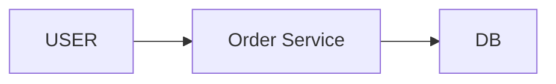
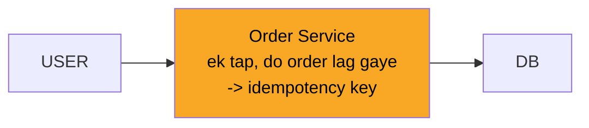
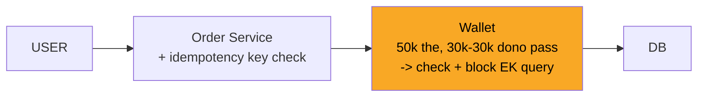
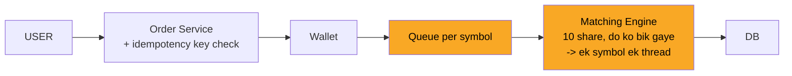
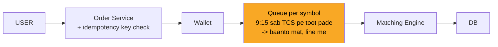
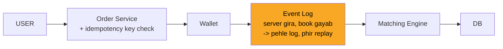
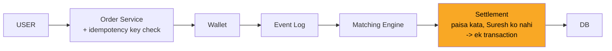
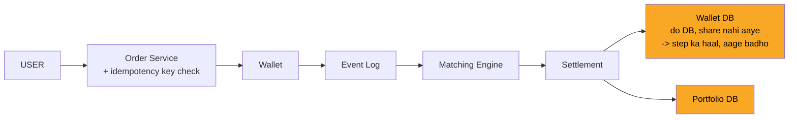
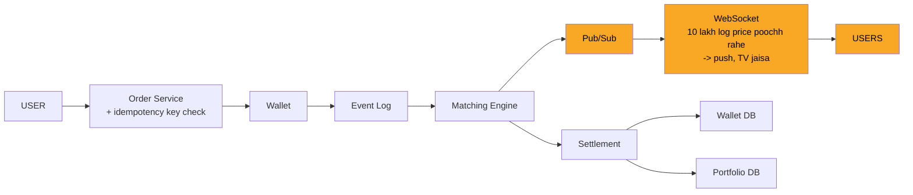
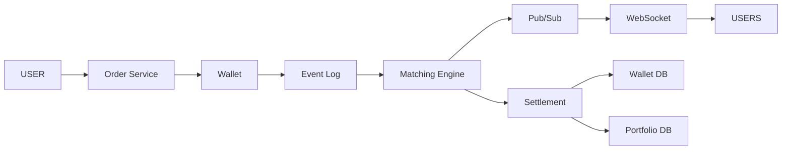

# Stock Broker / Trading Platform

> User BUY / SELL order deta hai -> system order MATCH karta hai -> paisa aur share sahi jagah pahunchte hain -> sabko live price dikhta hai.
> Is design ka dil: **paisa kabhi galat nahi (strong consistency)** + **matching bahut tez (RAM me, microseconds)**.
> Finance interview me (JP / GS) yahi poochte hain: consistency, ACID, idempotency, ledger, audit.

---

## KAHANI (ek din, mera ek TCS order; har dikkat se design me ek dabba judta)

```
   KYA HUA                                     ILAAJ                                DABBA JUDA
1  ek tap, network gaya, do order lag gaye  -> IDEMPOTENCY KEY (wahi id dobara)     Order Service
2  wallet 50k, 30k-30k dono order pass      -> check + block EK atomic query        Wallet
3  Suresh ke 10, mujhe aur Mohan dono ko    -> ek symbol ek thread, book RAM me     Matching Engine
4  9:15 sab TCS pe toot pade                -> baanto mat, ek thread kaafi, line    (line / queue)
5  10:15 server gira, book gayab            -> pehle log, phir book; gira = replay  Event Log
6  mera 30k kata, Suresh ko mila nahi       -> ek transaction: chaaron ya koi nahi  Settlement
7  paisa aur share alag DB me               -> har step ka haal, aage badho         Wallet DB + Portfolio DB
8  10 lakh log price poochh rahe            -> push (TV jaisa), WebSocket           Pub/Sub + WebSocket

POORA DESIGN (upar ke dabbe kram se):
   User -> Order Service (id) -> Wallet (block) -> Event Log -> Matching (ek stock ek thread)
        -> Settlement -> Wallet DB + Portfolio DB
   price: Matching -> Pub/Sub -> WebSocket -> users
```

---

## TASVEER (ByteByteGo / Alex Xu · CC BY-NC-ND 4.0)


Source: [Design Stock Exchange](https://bytebytego.com/guides/design-stock-exchange/)


Source: [Low Latency Stock Exchange](https://bytebytego.com/guides/low-latency-stock-exchange/)

---

## SHURU: pehle poocho, phir numbers

```
POOCHO:  "Trading bada hai: matching, price feed, risk, settlement. Kis pe focus karein?"
         -> order MATCHING + paise / share ka SETTLEMENT (len-den poora karna).
            Risk / margin / IPO / mutual fund scope me nahi.
         LIMIT aur MARKET dono order? · aadha bhara (partial fill) chalega?
         hum EXCHANGE hain (khud match karte) ya BROKER (exchange ko order bhejte)?
         Is design me: hum broker + apna matching (exchange jaisa). Asli India me Groww / Zerodha order
         NSE ko bhejte, matching NSE karta; wallet block broker ka kaam.

KYA KARE (FR):    buy / sell · order match · paisa + share move · live price · cancel / status
KAISA CHALE (NFR): paisa hamesha sahi (strong, kabhi "thodi der baad sahi" nahi) · tez
                   · imaandar (jo pehle aaya wo pehle) · har cheez ka record (audit)

NUMBERS (andaaza):
   ~50 lakh user · ~50 lakh order / din, market ~6 ghante (~20,000 second) khulta -> ~250 order / second
   9:15 baje market khulte hi jhatka: 10,000+ order / second
   price dekhne wale bahut zyada: ~10 lakh log app khula rakhte, har second naya price -> ~10 lakh / second
   -> matching RAM me · price PUSH karo (har user ka baar-baar poochhna nahi)
   -> jo tez chahiye aur thodi der ka hai (order book) = RAM
   -> jo paisa hai aur hamesha ka hai (wallet / ledger) = SQL DB + ACID
```

---

## ════ MOCK SE PEHLE: SIRF YE CARD PADHO ════

> Har card bas: CUE -> DIKKAT -> HAL -> NAHI (jo galat jawab log pehle bolte). Diagram aur AAGE POOCHEGA
> abhi mat padho, wo sirf jab interviewer aage kuch poochhe.

#### DABBA 0: SABSE SIMPLE (yahan se shuru, phir "kahan tootega")
```
Order service har order DB me likhe, aur DB me milta-julta SELL dhoondh ke match kare.
```


#### 0 SHURU: ORDER BOOK KAISE MATCH KARTA
```
SCENE      TCS ka share. Kuch bechna chahte (SELL), kuch khareedna (BUY).

           Bechne wale   : sasta upar      3000, 3001, 3005 ...   (min-heap)
           Khareedne wale: mehnga upar     2999, 2998 ...         (max-heap)

           Match  -> jab top khareedar >= top bechne wala
           Daam   -> jo order pehle se book me tha, uska
           Tie    -> same daam pe jo pehle aaya (chhota number)

DIKKAT 1   Book DB me rakhi to (DABBA 0 jaisa)?
HAL        RAM me rakho. DB = milliseconds har order, RAM = microseconds.

DIKKAT 2   RAM me hai, server crash hua -> book gayi?
HAL        Har order match se PEHLE log me likho (sirf neeche jodo).
           Crash pe log shuru se chalao -> wahi book wapas (same kram = same nateeja).

DIKKAT 3   Mujhe 10 chahiye, bechne wale ke paas 6?
HAL        6 ka sauda. Mere baaki 4 book me pade rehte, un 4 ka paisa ruka rehta.
```

#### 1 Maine ek baar dabaya, order do lag gaye
```
CUE        order screen pe id bani, dobara bhejo to wahi id (idempotency key)

DIKKAT     9:15, maine TCS ka BUY dabaya. Network gaya, app ne khud dobara bheja -> do order lag gaye.
HAL        IDEMPOTENCY KEY: screen khulte id, dobara wahi id. Server pe UNIQUE -> doosri baar purana jawab.
```

```
AAGE POOCHEGA:
  NIYAM: ek id = ek kaam; wahi id dobara aaye to kaam nahi, purana jawab.
  "Button pehli tap pe band?"      -> haan; id screen khulte bani, doosri baar saved jawab.
  "Pehli abhi chal rahi, dobara?"  -> process nahi; IN_PROGRESS -> "thoda ruko" (409), DONE -> saved jawab.
  "Id kitne din?"                  -> ~24 ghante, phir saaf.
```

#### 2 Wallet me 50k the, phir bhi 30k-30k ke dono order lag gaye
```
CUE        bank jaise: check aur block ek hi jhatke me (ek atomic query)

DIKKAT     Order ek laga, ab paisa? Wallet me 50k. Laptop se 30k, phone se 30k, same second.
           Do server, dono ne 50k dekha, dono pass.
HAL        Check + block EK query: UPDATE wallet SET blocked = blocked + 30000
           WHERE user_id = 'Arpan' AND total - blocked >= 30000   (doosre ko 0 row -> reject)
NAHI       pehle SELECT, phir UPDATE: beech me doosra ghus jaata.
```

```
AAGE POOCHEGA:
  NIYAM: 'blocked' ek number hai: naya order use badhata; sauda (paisa kata), cancel, umar khatam use ghatate.
  "Java synchronized?"             -> sirf ek machine ke andar; yahan do server hain.
  "SELL pe, laptop + phone?"       -> wahi query share pe:
       UPDATE portfolio SET blocked_qty = blocked_qty + 10
       WHERE user_id = 'Arpan' AND stock = 'TCS' AND qty - blocked_qty >= 10
  "10 me se 6 ka sauda?"           -> 6 ka paisa kata, baaki 4 ka blocked rahe.
  "Order 3 din pada?"              -> day order shaam ko khatam -> block hatao.
  "CANCEL, usi pal match?"         -> cancel bhi usi line me; jo nahi bika uska block hatao.
  "MARKET BUY, kitna block?"       -> aakhri bhav + thoda upar; sauda ke baad bacha hatao.
```

#### 3 Suresh ke paas 10 the, mujhe aur Mohan dono ko 10 mil gaye
```
CUE        ek symbol ek thread

DIKKAT     Mera order book me pahuncha. Suresh 10 bech raha, usi pal Mohan ne bhi BUY 10.
           Do thread, dono ko "10 hai" dikha -> 20 bik gaye.
HAL        TCS ke saare order ek line, ek hi thread (TCS -> T3). Pehle main 10, phir Mohan ko 0.
NAHI       poore engine pe bada lock: TCS ke chakkar me INFY bhi ruka.
```

```
AAGE POOCHEGA:
  NIYAM: TCS ki book ko ek waqt ek hi haath chhoota; doosra chahiye to line me ruke.
  "Har order pe lock?"             -> race share pe hai, order pe nahi; dono lock le ke dono ko 10 dikhte.
  "5000 stock = 5000 thread?"      -> nahi; 8 core = 8 thread, stock % 8 -> ek stock hamesha ek thread.
  "DB ka ACID?"                    -> matching DB me hai hi nahi, RAM me.
  "Thread atka (GC pause)?"        -> us stock ki line rukti; standby server log se taiyaar.
```

#### 4 9:15 baje sab TCS pe toot pade
```
CUE        baanto mat: ek thread kaafi (lakhon / sec), bheed line me

DIKKAT     Usi 9:15 pe poora market TCS pe toot pada: hazaaron order / second.
HAL        Baanto mat. Sab ek line me lago, ek-ek karke; ek thread RAM me lakhon / sec nipta leta.
           App me ACCEPTED turant (line me lag gaya), FILLED jab sauda ho.
NAHI       TCS ko do thread me baanto: do book = ek share do baar bike.
```

```
AAGE POOCHEGA:
  NIYAM: ek stock = ek line; badhana stocks ke BEECH, ek stock ke andar kabhi nahi.
  "Badhana kaise?"                 -> stocks ke BEECH: TCS ek thread, INFY doosra.
```

#### 5 Server gira, poori order book gayab
```
CUE        scoreboard toota, scorer ka register bacha (log pehle, replay)

DIKKAT     10:15 matching server gira. TCS ki book (4,000 order) RAM me thi -> gayab.
HAL        Har order PEHLE log me (number ke saath), PHIR book. Gira -> log #1 se replay, wahi book.
NAHI       doosra server saath chalao (replica): do book = ek share do baar bike.
           Sahi: STANDBY sirf log padhta, book taiyaar; pehla gire tab chalu.
```

```
AAGE POOCHEGA:
  NIYAM: register (log) hi sach hai, scoreboard (book) uski photo. Do chalte scoreboard = do sach = galat.
  "Number kaun deta?"              -> register wala (log) har order ko #501, #502; Order Service nahi.
  "Time se kram kyun nahi?"        -> do machine ki ghadi alag, ek second me do order, pehla kaun pata nahi.
  "Sirf photo kaafi?"              -> nahi; photo ke baad wale order kahin likhe hi nahi, gire to gaye.
  "Register 1 crore ka, der?"      -> shuru se nahi: aakhri photo + uske baad ke panne.
  "Seconds me wapas?"              -> doosra scorer saath register padhta, board taiyaar; pehla gire tab chalu.
  "Crash pe kya bachaoge?"         -> scoreboard register se wapas; paisa DB me, wahan rollback.
```

#### 6 Mera paisa kat gaya, Suresh ko mila hi nahi
```
CUE        chaaron entry ek saath ya koi nahi (ek transaction)

DIKKAT     Mera sauda 9:15 pe match hua tha (Suresh se 10 TCS, 30k). Ab paisa-share hilana:
           mera 30k kata, Suresh ko milne se PEHLE crash.
HAL        Ek transaction: BEGIN Arpan -30k +10 share · Suresh +30k -10 share COMMIT. Crash -> rollback.
NAHI       chaar alag UPDATE: beech me gira to aadha likha.
```

```
AAGE POOCHEGA:
  NIYAM: paisa ek jagah: chaaron likhai ek transaction me; ledger ka jod hamesha 0.
  "Sab likho, phir done flag?"     -> flag se pehle gira to kitna likha pata hi nahi.
  "Ledger?"                        -> 2 line: Arpan -30k, Suresh +30k; jod hamesha 0.
  "Balance ledger jod ke?"         -> nahi, dheema; balance alag column, usi transaction me.
  "Thodi der baad sahi chalega?"   -> paise me nahi; beech me PENDING dikhao, galat number nahi.
  "Asli me usi pal milte?"         -> nahi, T+1; NSE Clearing karta, ye broker ka apna khaata.
```

#### 7 Paisa kat gaya, share aaye hi nahi (do alag DB)
```
CUE        har kadam ka haal likho, aage badho, ulta nahi (step + forward)

DIKKAT     Paisa Wallet DB me, share Portfolio DB me ho to ek transaction nahi chalti.
           Mera 30k kata, share daalne se PEHLE crash.
HAL        STATUS LOG: wallet done -> portfolio done. Fail -> retry, aage hi badho (match ke baad ulta nahi).
           Ghanton fail -> PENDING + alert, ops share daalta.
NAHI       2PC: dono DB lock pakad ke rukte, coordinator gira = sab atke.
```

```
AAGE POOCHEGA:
  NIYAM: match ke baad sirf aage; ulta sirf match se pehle.
  "Step-step ki keemat?"           -> beech me PENDING dikhta; 2PC jaisa lamba lock nahi.
  "Mera paisa wapas kyun nahi?"    -> sauda pakka (Suresh ko 30k mil chuke); gira -> likha haal se aage.
  "To SAGA kabhi nahi?"            -> sirf match se pehle: block hua, book tak nahi pahuncha -> block hatao.
  "Orchestration ya choreography?" -> orchestration: paise me saaf dikhe kaunsa step atka.
```

#### 8 10 lakh log ek saath price poochh rahe, server baith gaya
```
CUE        Twitter feed jaisa: maango mat, khud aaye (push, WebSocket)

DIKKAT     Din bhar 10 lakh log har second "TCS ka price?" poochh rahe -> server baith gaya.
HAL        WebSocket: connection khula, price badla tabhi push (Redis pub/sub se servers tak).
NAHI       polling: 10 lakh bekaar sawaal / sec · Kafka: sab store karta, purana price bekaar.
```

```
AAGE POOCHEGA:
  NIYAM: price = sirf abhi ka; purana bekaar, isliye store nahi, push.
  "Second me 1000 baar badla?"     -> har ~100 ms sirf aakhri price.
  "Connection toota, wapas juda?"  -> pub/sub kuch store nahi karta -> abhi ka price alag se do.
  "Ek WebSocket server kitne?"     -> lakh ke aas-paas; zyada -> aur server + LB.
```

---

## AAKHRI DABBA + WRAP (ek hi baar)

```
User -> Order Svc (check + idempotency key) -> Wallet (paisa BLOCK)
-> Event Log / Kafka (number lagta, key = stock) -> Matching engine (ek stock ek thread, book RAM me)
-> Settlement (ek transaction, ya alag DB ho to step-step, aage hi) -> Wallet DB + Portfolio DB
price: Matching -> Pub/Sub -> WebSocket -> users

DB:  paisa / order = SQL + ACID · order book = RAM · ledger = append-only (sirf jodo)
     portfolio / history = read replica
```
```
JAWAB:    Order service check karti aur dobara order rokti (id se). Wallet paisa block karta. Order
          number ke saath log me, phir har stock ka ek-thread matching engine RAM wali book me match karta.
          Sauda = ek transaction, alag DB ho to step-step, match ke baad sirf aage. Price WebSocket se.
          Log se crash ke baad book wapas, aur hisaab ka record bhi.
          Aage: stop-loss, risk check, regulator ki report.
```


---

## 10 GUNA TRAFFIC — har dabba alag se

```
Order Service (stateless, kuch yaad nahi rakhta) -> machine badhao + LOAD BALANCER
Portfolio / history  -> READ REPLICA (padhne ke liye DB ki copy)
Matching (book RAM me, yaad rakhta) -> do CHALTI copy nahi (do book = ek share do baar bike);
                     standby log padhta khada rehta, sirf pehla gire tab chalta
                     -> stock ke hisaab se baanto: TCS ek engine pe, INFY doosre pe
Kafka                -> partition badhao (key = stock)
Price                -> WebSocket server badhao

POOCHEGA: "How would you scale this to 10x users?"
          (10 guna users ho gaye to kaise badhaoge?)

JAWAB:    Jo service kuch yaad nahi rakhti (order service), uski machine badhao + load balancer. Padhne
          wale data (portfolio, history) ki copy.
          Matching engine book yaad rakhta, do chalti copy nahi bana sakte (do book = gadbad). Standby
          bas khada rehta. Engine ko stock ke hisaab se baanto: TCS ek machine, INFY doosri.
```

---

## POOCHE TO (gehra sawaal aaye tab)

```
ORDER BOOK:  bechne wale: sasta upar (3001, 3003 ...) · khareedne wale: mehnga upar (2998, 2995 ...)
             sauda jab sabse mehnga khareedar >= sabse sasta bechne wala
             pehle behtar daam, same daam pe jo pehle aaya

LIMIT  = "3000 ya isse behtar, warna rukunga"  -> daam pakka
MARKET = "jo bhav hai, abhi do"                -> waqt pakka
kab kya: sahi daam chahiye, jaldi nahi -> LIMIT · turant ghusna / nikalna -> MARKET

AADHA BHARA: Maine BUY 10, mile 6 -> 6 ka sauda, 4 pade -> naya seller @3000 aaya -> 4 bhi bhar gaye
             status: FILLED / PARTIALLY FILLED / OPEN (Zerodha / Groww / NSE me yahi)

API: POST /order {stock, side, qty, price, type, idempotencyKey} · DELETE /order/{id} · GET /order/{id}
     WS /prices?symbol=
```

---

ARCHETYPE C (transactional) · CONCEPTS: [db-what-when](../../FOUNDATIONS/09_databases_what_when.md) · [CAP](../../FOUNDATIONS/08_cap_theorem.md) · saath: [payment](../06_payment_system/06_payment_system.md) · [← MASTER SHEET](../../00_MASTER_SHEET.md)
