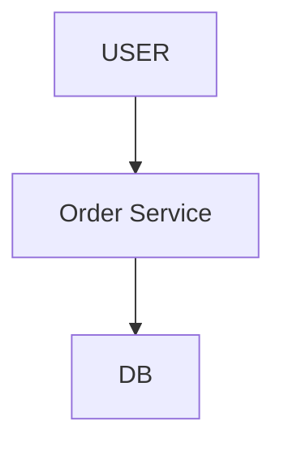
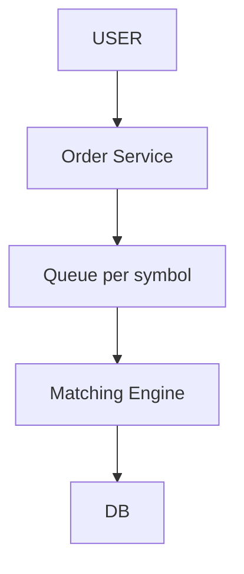
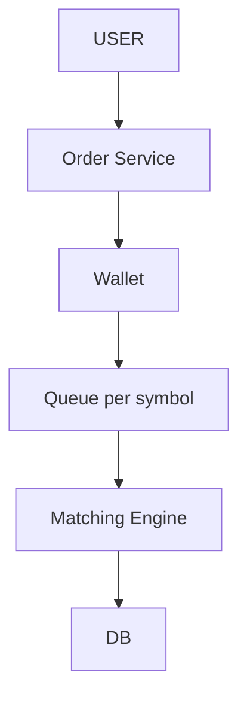
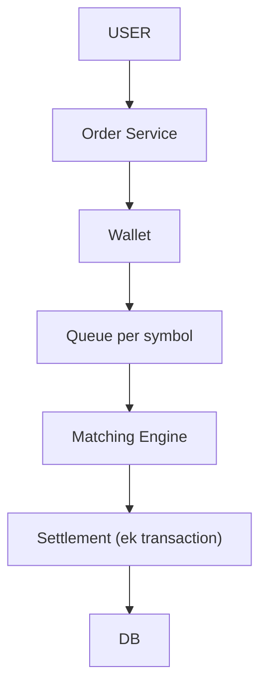
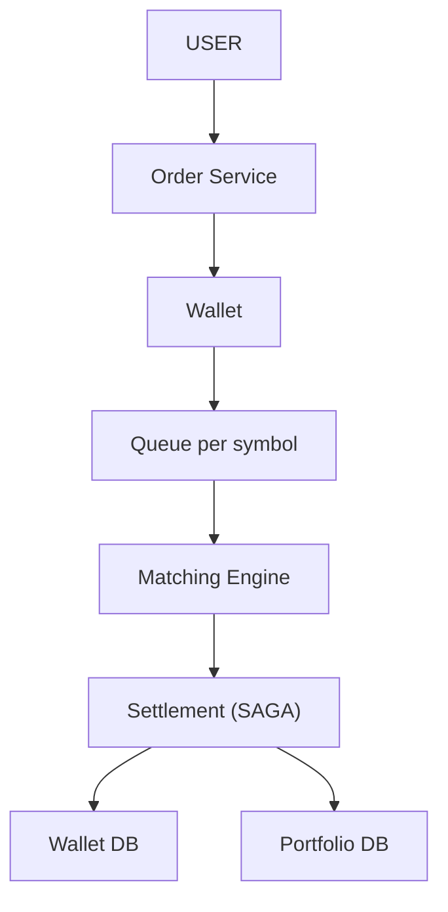
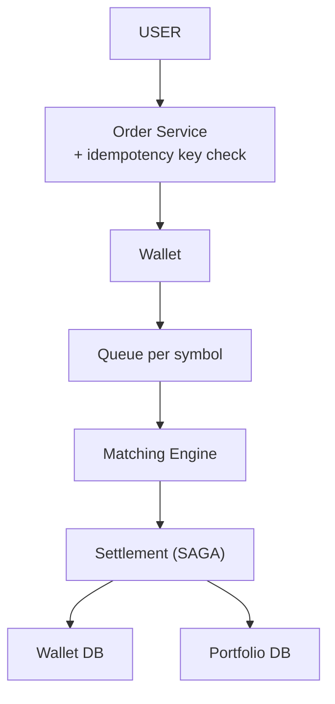
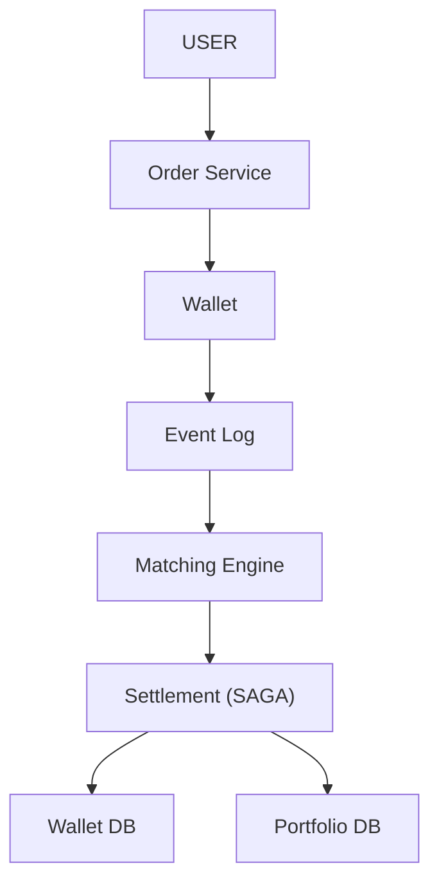
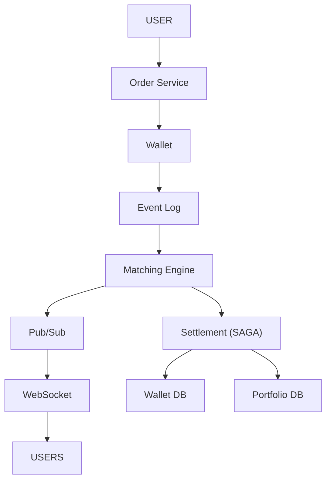
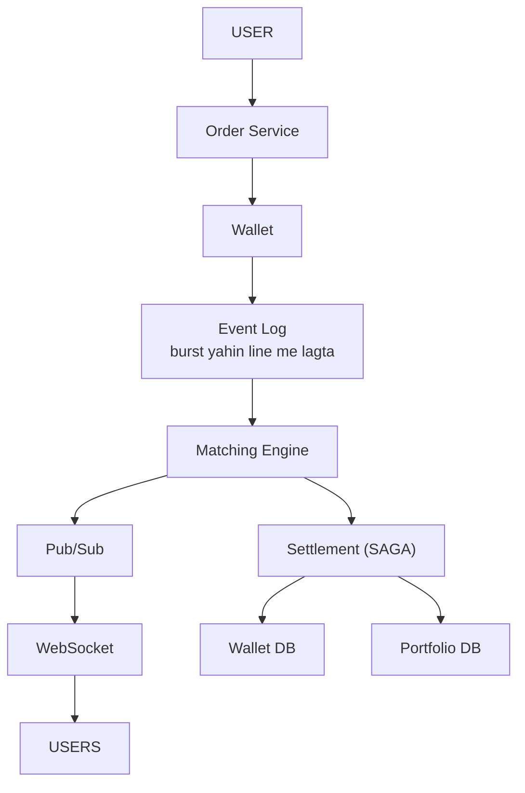

# Stock Broker / Trading Platform

> User BUY / SELL order deta hai -> system order MATCH karta hai -> paisa aur share sahi jagah pahunchte hain -> sabko live price dikhta hai.
> Is design ka dil: **paisa kabhi galat nahi (strong consistency)** + **matching bahut tez (RAM me, microseconds)**.
> Finance interview me (JP / GS) yahi poochte hain: consistency, ACID, idempotency, ledger, audit.

---

## TASVEER (ByteByteGo / Alex Xu · CC BY-NC-ND 4.0)


Source: [Design Stock Exchange](https://bytebytego.com/guides/design-stock-exchange/)


Source: [Low Latency Stock Exchange](https://bytebytego.com/guides/low-latency-stock-exchange/)

---

## SHURU: pehle poocho, phir numbers

```
POOCHO:  "Trading bada hai: matching, price feed, risk, settlement. Kis pe focus karein?"
         -> order MATCHING + paise / share ka SETTLEMENT (len-den poora karna).
            Risk / margin / IPO / mutual fund scope me nahi.
         LIMIT aur MARKET dono order? · aadha bhara (partial fill) chalega?
         hum EXCHANGE hain (khud match karte) ya BROKER (exchange ko order bhejte)?

KYA KARE (FR):    buy / sell · order match · paisa + share move · live price · cancel / status
KAISA CHALE (NFR): paisa hamesha sahi (strong, kabhi "thodi der baad sahi" nahi) · tez
                   · imaandar (jo pehle aaya wo pehle) · har cheez ka record (audit)

NUMBERS (andaaza):
   ~50 lakh user · ~50 lakh order / din -> aam din ~250 order / second
   9:15 baje market khulte hi jhatka: 10,000+ order / second
   price dekhne wale bahut zyada: crore baar / second "price kya hai"
   -> matching RAM me · price PUSH karo (har user ka baar-baar poochhna nahi)
   -> jo tez chahiye aur thodi der ka hai (order book) = RAM
   -> jo paisa hai aur hamesha ka hai (wallet / ledger) = SQL DB + ACID
```

---

## ════ MOCK SE PEHLE: SIRF YE CARD PADHO ════

> Har dikkat ek card: KAHANI (kya hua, kaun, kitna) -> ILAAJ -> ANDAR KAISE (ilaaj kyun kaam karta) ->
> ISKE BAAD KYA TOOTEGA (interviewer yahin ghusta hai: dabba lagaya, ab kya?).

#### DABBA 0: SABSE SIMPLE (yahan se shuru, phir "kahan tootega")
```
Order service har order DB me likhe, aur DB me milta-julta SELL dhoondh ke match kare.
```


#### 0 SHURU: ORDER BOOK KAISE MATCH KARTA
```
KAHANI:  TCS ka share. Kuch log bechna chahte (SELL), kuch khareedna (BUY). Kaun kisse milega?

ILAAJ:   ORDER BOOK: do line, aur "pehle daam, phir waqt" ka niyam (price-time priority).

ANDAR KAISE:
         Bechne walon ki line: sabse SASTA upar (3000, 3001, 3005 ...)
         Khareedne walon ki line: sabse MEHNGA upar (2999, 2998 ...)
         = tere DSA ke do heap: bechne wale min-heap (sasta top pe), khareedne wale max-heap (mehnga top pe).
         Jab sabse mehnga khareedar >= sabse sasta bechne wala -> sauda ho gaya.
         Do log same daam pe -> jo PEHLE aaya (uska number chhota) wo pehle.

ISKE BAAD KYA TOOTEGA:
  - Book kahan rakhoge, DB me?
      -> nahi, RAM me. DB me har order likhna-padhna milliseconds leta, matching dheema ho jaata.
         RAM me microseconds.
  - Ramesh ko 10 chahiye, bechne wale ke paas sirf 6?
      -> 6 ka sauda ho gaya, Ramesh ke baaki 4 book me pade rehte (aur un 4 ka paisa ruka rehta).
```

<a id="d1"></a>

#### [1](#d1) DO ORDER EK HI STOCK PE EK SAATH (RACE)
```
KAHANI:  Seller ke paas TCS ke sirf 10 share. Ramesh ne BUY 10 maara, usi pal Mohan ne bhi BUY 10.
         Do thread ne ek saath book dekhi, dono ko "10 available" dikha, dono ka sauda kar diya.
         20 share bik gaye, jabki the sirf 10.

ILAAJ:   TCS ke saare order ek hi line me lagte hain, aur us line ko sirf EK thread chalata hai.
         Ramesh aur Mohan ne ek saath BUY kiya, to bhi thread pehle Ramesh ka match karega, phir Mohan ka.
         Do order kabhi ek saath match nahi hote, isliye lock ki zaroorat hi nahi.

ANDAR KAISE:
         TCS ke saare order thread T1 pe, INFY ke T2 pe. Ramesh pehle aaya -> T1 ne 10 de diye.
         Phir Mohan -> book me 0 bache -> Mohan ka order line
         me pada rahe. Do thread ek stock ko chhoote hi nahi.

ISKE BAAD KYA TOOTEGA:
  - 5000 stock = 5000 thread?
      -> nahi. Thode thread, har thread kai stock sambhale (stock ke naam ka hash % thread ginti).
         Bas ek stock hamesha ek hi thread pe.
  - "DB ka ACID ye rok dega"?
      -> nahi. Matching DB me hai hi nahi (RAM me). Aur ACID
         akela "pehle padho, phir likho" wali race nahi rokta.
  - Wo thread atak gaya (Java ka GC pause)?
      -> us stock ke order line me ruk jaate. Ilaaj: kam GC wala
         Java setup + ek standby jo log padh ke uth sake (card 6).
```


<a id="d2"></a>

#### [2](#d2) WALLET ME 50K, 30K-30K KE DO ORDER (DOUBLE SPEND)
```
KAHANI:  Ramesh ke wallet me 50,000. Usne ek saath 30,000 ke DO order daal diye.
         Dono order ne wallet dekha, dono ko 50k dikha, dono pass. Dono match -> 60k kharch, the 50k.

ILAAJ:   Ramesh ke paas 50k hai. Order lagte hi uske paise block karo, aur check + block ek hi query me:
         'bacha paisa 30k se zyada hai to 30k block karo'.
         Pehle order ne 30k block kiya, ab bacha 20k. Doosre order ke liye 30k nahi bacha -> query ne kuch
         nahi badla -> order reject.

ANDAR KAISE:
         Pehla order: 30k block -> blocked = 30k, bacha 20k.
         Doosra order: 30k chahiye, bacha sirf 20k -> REJECT.
         Ye check aur block EK hi query me, taaki beech me koi ghus na sake:
           UPDATE wallet SET blocked = blocked + 30000 WHERE total - blocked >= 30000
           0 row badli = paisa nahi = order reject.
         Sauda hua -> paisa sach me kato · order cancel -> block hatao.

ISKE BAAD KYA TOOTEGA:
  - Pehle SELECT se balance padh ke phir UPDATE karein to?
      -> dono order ne ek saath 50k padha, dono pass ho gaye. Isliye check + update EK hi query me.
  - 10 me se sirf 6 ka sauda hua?
      -> 6 ka paisa kato, baaki 4 ka blocked rahe.
  - Paisa block kiya, order 3 din pada raha?
      -> order ki umar hoti hai (day order shaam ko khatam) -> khatam hote hi block hatao.
```


<a id="d3"></a>

#### [3](#d3) SAUDE KE BEECH CRASH (SETTLEMENT)
```
KAHANI:  Ramesh ne Suresh se 10 TCS khareede, 30,000 me. Ramesh ka 30k kata, aur Suresh ko milne se
         PEHLE server gir gaya. 30k na Ramesh ke paas, na Suresh ke paas. Hawa me.

ILAAJ:   Sauda hua to Ramesh se paisa kato aur Suresh ko do, share ulta. Ye sab ek hi transaction me:
         beech me crash hua to sab wapas, aadha kuch nahi.
         Khaate (ledger) me do line: Ramesh -30k, Suresh +30k. Saari line ka jod hamesha 0, matlab paisa
         na bana na gayab hua.

ANDAR KAISE:
         BEGIN
           Ramesh: -30k, +10 share · Suresh: +30k, -10 share
         COMMIT
         Beech me crash -> DB sab wapas pehle jaisa kar deta (rollback). Aadha kaam kabhi nahi bachta.
         Ledger me do line: Ramesh DEBIT 30k, Suresh CREDIT 30k. Saari line ka jod hamesha 0
         -> paisa na bana, na gayab hua.

ISKE BAAD KYA TOOTEGA:
  - Har baar balance ledger jod ke nikaloge?
      -> nahi, dheema hoga. Balance alag column me, usi
         transaction me badalta. Ledger = sach ka record + audit.
  - Paise me "thodi der baad sahi" (eventual) chalega, like count jaisa?
      -> nahi. Paisa hamesha turant sahi (strong consistency).
```


<a id="d4"></a>

#### [4](#d4) PAISA WALLET DB ME, SHARE PORTFOLIO DB ME (ALAG DB)
```
KAHANI:  System bada hua: paisa ab Wallet DB me, share Portfolio
         DB me. Do alag DB pe ek transaction nahi chalta.
         Ramesh ka 30k Wallet DB se kata, Portfolio DB me 10 share
         daalne se PEHLE crash. Paisa gaya, share nahi aaye.

ILAAJ:   Paisa ek DB me, share doosre DB me, to ek transaction dono pe nahi chalta.
         Ek service (Settlement) step-step chalati aur har step ke baad likh leti kahan tak hua: pehle
         paisa kata, phir share daale.
         Share daalna fail hua -> ulta kaam: Ramesh ko paisa wapas. Settlement khud gir gaya to uthke apna
         likha dekhta aur wahin se aage ya ulta.

ANDAR KAISE:
         Ek Settlement service (orchestrator, sab steps chalane wala) har step ka haal apne DB me likhta:
           STARTED -> WALLET_DONE -> PORTFOLIO_DONE
         Ramesh ka 30k kata (WALLET_DONE) -> share daalna fail -> Settlement Ramesh ko 30k wapas deta.
         Settlement khud gir gaya -> uthte hi DB me likha haal dekhta, wahin se aage ya ulta.

ISKE BAAD KYA TOOTEGA:
  - 2PC (two phase commit) kyun nahi?
      -> 2PC me dono DB lock pakad ke "commit karun?" ka intezaar karte. Coordinator gira = dono DB atke,
         aur har sauda dheema. SAGA me lamba lock nahi.
         Keemat: thodi der galat haalat dikh sakti (paisa kata, share abhi nahi aaye).
  - Ulta kaam (paisa wapas) bhi fail ho gaya?
      -> baar-baar koshish karo (step aisa ho ki do baar chale to bhi ek hi baar ka asar) + alert.
         Paisa wapas dena kabhi chhodna nahi.
  - Ek service sab chalaye (orchestration) ya har service agle ko bataye (choreography)?
      -> orchestration: paise me saaf dikhta kaunsa step kahan atka.
```


<a id="d5"></a>

#### [5](#d5) BUY DO BAAR DABA / NETWORK NE DOBARA BHEJA
```
KAHANI:  Ramesh ne BUY dabaya, app ghoomta raha, usne phir daba diya. Ya network ne khud dobara bhej diya.
         Server ko do request mili -> do order bane, paisa do baar block.

ILAAJ:   Ramesh ka app har order ke saath ek id bhejta (abc-123), dobara bhejne pe bhi wahi id.
         Server ke paas wo id pehle se hai -> naya order nahi, pehle wala jawab wapas. Pehla abhi chal hi
         raha ho to 'thoda ruko'.
         Ye wahi hai jo usercrud me /pay pe banaya tha.

ANDAR KAISE:
         App har order pe ek UUID banata (abc-123), dobara bhejne pe bhi WAHI abc-123.
         Server: idempotency table me abc-123 daalo (key UNIQUE).
           pehli baar -> daal diya -> order lagao -> jawab save.
           doosri baar -> UNIQUE ki wajah se daal nahi paaya -> saved jawab wapas, naya order nahi.
         Dono request bilkul ek saath aayi -> DB sirf ek ko daalne deta, doosri haar jaati.

ISKE BAAD KYA TOOTEGA:
  - Pehli request abhi chal hi rahi, aur dobara wali aa gayi?
      -> key ka haal IN_PROGRESS -> dobara wale ko "thoda ruko" (409). DONE ho gaya to saved jawab.
  - Key kitne din rakhoge?
      -> ~24 ghante (itne me hi koi dobara bhejta), phir saaf.
```


<a id="d6"></a>

#### [6](#d6) ORDER BOOK RAM ME, SERVER GIRA = SAB GAYAB
```
KAHANI:  10:15 baje matching server gir gaya. TCS ki book me 4,000 order pade the, sab RAM me.
         RAM gayi -> 4,000 order gayab. Logon ka paisa block hai par order ka koi pata nahi.

ILAAJ:   Har order PEHLE ek append-only LOG (sirf neeche jodte
         jao, kabhi badlo mat) me likho, number ke saath.
         PHIR book me daalo. Server gira -> naya server log shuru se padh ke book dobara bana leta (replay).
         Jaise cricket: scoreboard toot gaya, scorer ke register se poora score wapas.

ANDAR KAISE:
         SEQUENCER har order pe badhta number lagata: Ramesh #501, Mohan #502.
         Naya server log #1 se aakhri tak wahi kram me chalata.
         Thread ek hi hai, to book bilkul pehle jaisi banti.
         Log me key = stock ka naam -> ek stock ke order ek hi line (partition) me, kram me.
         Yahi log AUDIT bhi hai: regulator saalon baad bhi dekh sakta, isme kuch badla nahi ja sakta.

ISKE BAAD KYA TOOTEGA:
  - Number ki jagah time (timestamp) se kram kyun nahi?
      -> do server ki ghadi alag chalti, aur do order same millisecond me aa sakte. Number pakka hai.
  - Log me 1 crore order, shuru se padhne me kitna time?
      -> har kuch minute book ki photo (SNAPSHOT) lo. Gira to photo + uske baad ka log -> chhota replay.
  - Seconds me wapas chahiye?
      -> HOT STANDBY: doosra server saath-saath log padhta rehta,
         book RAM me taiyaar. Pehla gira, ye turant le leta.
  - Crash pe kya-kya bachaoge? (DO jagah bolna)
      -> matching (RAM) = log se replay · settlement (DB) = rollback / SAGA. Sirf ek bola to aadha jawab.
```


<a id="d7"></a>

#### [7](#d7) LAKHON LOG LIVE PRICE DEKH RAHE
```
KAHANI:  10 lakh log app khol ke baithe. Har app har second poochh raha "TCS ka price kya hai?" (polling).
         10 lakh sawaal har second -> server mar gaya, aur zyadatar baar jawab tha "wahi purana".

ILAAJ:   Ramesh ka app server se ek connection khula rakhta (WebSocket). TCS ka price badla -> matching
         engine Redis pe 'TCS = 3005' daalta -> jo server TCS dekhne walon se jude hain, wo apne users ko
         bhej dete.
         Price second me 1000 baar badle to sab nahi bhejte, har 100 ms sirf aakhri price.

ANDAR KAISE:
         Har stock ka ek channel (price:TCS). Ramesh TCS dekh raha, wo WebSocket server WS-1 se juda.
         WS-1 Redis me "price:TCS" SUBSCRIBE karta.
         Sauda hua, TCS 3005 -> Matching Redis pe PUBLISH -> Redis sab subscribed servers ko deta
         -> WS-1 Ramesh ko bhej deta.
         Redis pub/sub kuch store nahi karta -> Ramesh ka connection
         toota aur wapas juda to abhi ka price alag se do.

ISKE BAAD KYA TOOTEGA:
  - TCS ka price ek second me 1000 baar badla, sab bhejoge?
      -> nahi. CONFLATE: har ~100 ms sirf aakhri price bhejo. Beech wale kisi kaam ke nahi.
  - Kafka kyun nahi?
      -> Kafka sab store karta aur dobara padhne deta. Yahan purana price bekaar, sirf abhi wala chahiye.
  - SSE kyun nahi?
      -> SSE bhi chalta (sirf server -> app). WebSocket isliye ki order bhi isi connection pe bhej sakte.
  - Ek WebSocket server kitne user sambhale?
      -> lakh ke aas-paas. Zyada user -> aur server, LB se baanto.
```


<a id="d8"></a>

#### [8](#d8) 9:15 BAJE AKELE TCS PE LAKHON ORDER
```
KAHANI:  Market khulte hi akele TCS pe lakhon order aa gaye. Card 1 me niyam tha: ek stock = ek thread.
         To TCS ko do thread me baant bhi nahi sakte.

ILAAJ:   TCS ki book ko do thread me nahi baant-te, warna ek share do baar bik sakta. Ek hi thread, RAM
         me, bina lock ke second me lakhon order nikal leta.
         Bheed zyada to aage ka log order ko line me rok leta, koi phenka nahi jaata, bas thoda der se
         match.
         Badhana stocks ke beech: TCS ek thread, INFY doosra.

ANDAR KAISE:
         Ek thread, RAM me, bina lock -> lakhon order / second nikal leta (LMAX exchange ka design yahi).
         Scale stocks ke BEECH hota (TCS ek thread pe, INFY doosre pe), ek stock ke andar kabhi nahi.

ISKE BAAD KYA TOOTEGA:
  - Order line me pada hai, Ramesh ko app me kya dikhe?
      -> do status: "ACCEPTED" turant (order mil gaya), "FILLED" jab sauda ho jaaye.
```


```
AAKHRI DABBE (sab dikkat ke baad):
  User -> Order Svc (check + idempotency key) -> Wallet (paisa BLOCK)
  -> Event Log / Kafka (number lagta, key = stock) -> Matching engine (ek stock ek thread, book RAM me)
  -> Settlement (ek transaction, ya alag DB ho to SAGA) -> Wallet DB + Portfolio DB
  price: Matching -> Pub/Sub -> WebSocket -> users

DB:  paisa / order = SQL + ACID · order book = RAM · ledger = append-only (sirf jodo)
     portfolio / history = read replica

END ME POOCHEGA:
  "10x?"             -> Order Svc stateless (machine badhao + LB) · read replica
                        · Matching ki copy NAHI, stock ke hisaab se baanto (TCS ek engine, INFY doosra)
                        · Kafka partition badhao (key = stock) · WebSocket server badhao
  "Matching ek thread kyun?" -> do copy = do book = ek share do baar bike; ek stock ek engine pe
  "Engine gira?"     -> log se number ke kram me replay, book wapas (audit bhi wahi log)
  "Limit ya market?" -> LIMIT = daam pakka, waqt nahi · MARKET = turant, daam jo bhi
```

AAKHRI DABBE ki tasveer:


---

## 10 GUNA TRAFFIC — har dabba alag se

```
Order Service (stateless, kuch yaad nahi rakhta) -> machine badhao + LOAD BALANCER
Portfolio / history  -> READ REPLICA (padhne ke liye DB ki copy)
Matching (book RAM me, yaad rakhta) -> copy NAHI (do copy = do book = ek share do baar bike)
                     -> stock ke hisaab se baanto: TCS ek engine pe, INFY doosre pe
Kafka                -> partition badhao (key = stock)
Price                -> WebSocket server badhao

POOCHEGA: "How would you scale this to 10x users?"
          (10 guna users ho gaye to kaise badhaoge?)

JAWAB:    Jo service kuch yaad nahi rakhti (order service), uski machine badhao + load balancer. Padhne
          wale data (portfolio, history) ki copy.
          Matching engine book yaad rakhta, uski copy nahi bana sakte (do book = gadbad). Use stock ke
          hisaab se baanto: TCS ek machine, INFY doosri.
```

---

## POOCHE TO (gehra sawaal aaye tab)

```
ORDER BOOK:  bechne wale: sasta upar (3001, 3003 ...) · khareedne wale: mehnga upar (2998, 2995 ...)
             sauda jab sabse mehnga khareedar >= sabse sasta bechne wala
             pehle behtar daam, same daam pe jo pehle aaya

LIMIT  = "3000 ya isse behtar, warna rukunga"  -> daam pakka
MARKET = "jo bhav hai, abhi do"                -> waqt pakka
kab kya: sahi daam chahiye, jaldi nahi -> LIMIT · turant ghusna / nikalna -> MARKET

AADHA BHARA: Ramesh BUY 10, mile 6 -> 6 ka sauda, 4 pade -> naya seller @3000 aaya -> 4 bhi bhar gaye
             status: FILLED / PARTIALLY FILLED / OPEN (Zerodha / Groww / NSE me yahi)

DB:  paisa / order = SQL + ACID · order book = RAM · ledger = append-only

API: POST /order {stock, side, qty, price, type, idempotencyKey} · DELETE /order/{id} · GET /order/{id}
     WS /prices?symbol=
```

---

## AAKHRI DABBA + WRAP

```
Order Service = check + idempotency · Wallet = paisa BLOCK · Event Log = number + replay + audit
Matching = ek stock ek thread, book RAM me, stock ke hisaab
se baanto · Settlement = ek transaction / alag DB = SAGA
```
```
JAWAB:    Order service check karti aur dobara order rokti (id se). Wallet paisa block karta. Order
          number ke saath log me, phir har stock ka ek-thread matching engine RAM wali book me match
          karta.
          Sauda = ek transaction, alag DB ho to step-step + ulta kaam. Price WebSocket se. Log se crash
          ke baad book wapas, aur hisaab ka record bhi.
          Aage: stop-loss, risk check, regulator ki report.
```


ARCHETYPE C (transactional) · CONCEPTS: [db-what-when](../../FOUNDATIONS/09_databases_what_when.md) · [CAP](../../FOUNDATIONS/08_cap_theorem.md) · saath: [payment](../06_payment_system/06_payment_system.md) · [← MASTER SHEET](../../00_MASTER_SHEET.md)
