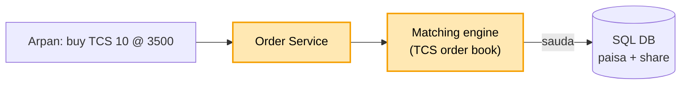
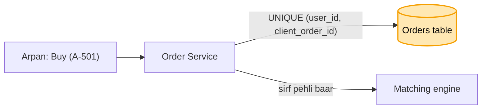
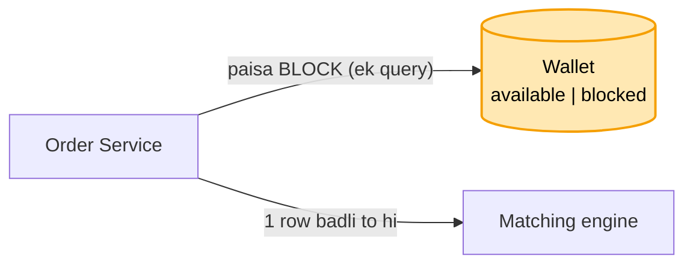
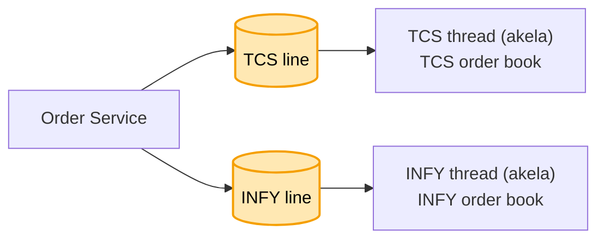
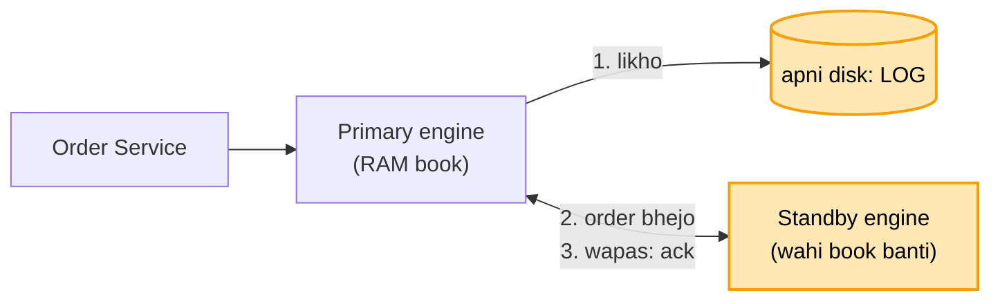
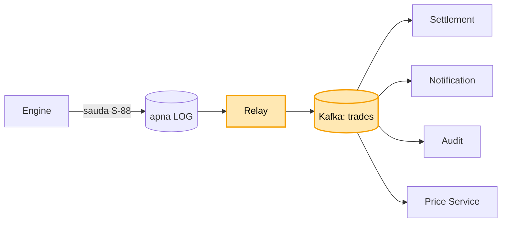
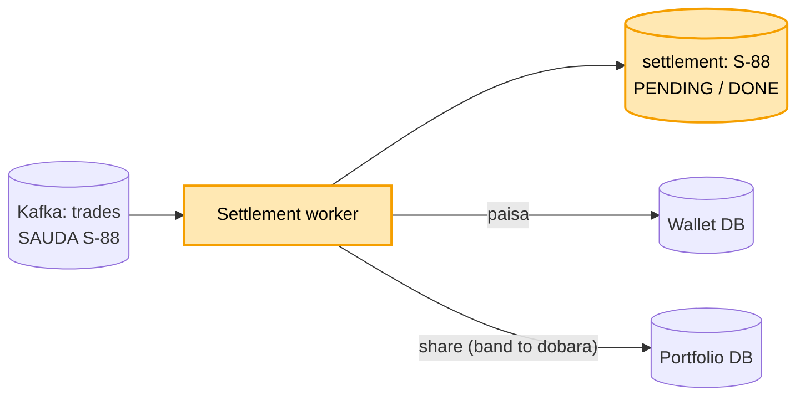
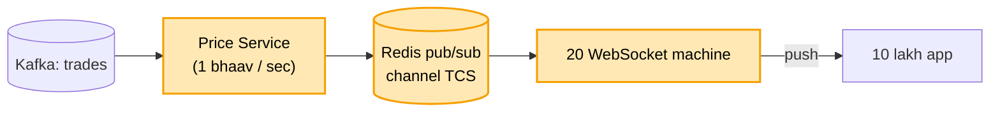

# Stock trading (Groww / Zerodha): shuru se, ek kahani

Kram wahi jo interview me hota hai: **FR, phir NFR, phir numbers, phir design**. Design sabse seedhe dabbe
se shuru hota hai, aur har dikkat aane pe ek naya dabba judta hai. Diagram me peela dabba = abhi juda. Poori
file me ek hi kahani hai: Arpan TCS ke 10 share 3500 pe kharidna chahta hai, Suresh apne 10 TCS 3500 pe
bechna chahta hai.

Ye paise wale designs me chautha design hai: jo [banking](../13_banking_system/13_banking_system.md),
[payment](../06_payment_system/06_payment_system.md) ya [BookMyShow](../09_bookmyshow/09_bookmyshow.md) me pehle
se hai, wahan bas ek line + link. Poora sirf wahi jo stock ka apna hai (order book, matching, 9:15 ki bheed).

**CUE (yahi shabd yaad rakhne hain, kram se):**
order book + matching engine -> (user_id, client_order_id) UNIQUE -> paisa / share BLOCK -> ek share ek thread
-> log + standby (ack ke baad milaan) -> Kafka trades (kai sunne wale) -> settlement (ulta nahi, PENDING)
-> Price Service + Redis pub/sub + WebSocket

---

## 1. FR: kya karna hai

```
1. buy / sell order dalna (LIMIT: "3500 pe hi", MARKET: "jo bhaav abhi hai")
2. order milana (Arpan ka buy + Suresh ka sell = sauda)
3. sauda hua to paisa Arpan se Suresh, share Suresh se Arpan
4. live price dikhana, order ka haal (cancel bhi)
scope ke bahar: margin / risk, IPO, mutual fund
```

## 2. NFR: kaisa chalna chahiye

```
- paisa aur share hamesha sahi ("thodi der baad sahi" nahi)
- imaandar: jo pehle aaya, wo pehle mile
- 9:15 ki bheed jhele, har cheez ka record (audit)
```

## 3. Numbers

```
- 50 lakh order / din, market ~6 ghante (~20,000 sec) -> ~250 order / sec aam
- 9:15 pe jhatka: 10,000+ order / sec
- live price: ~10 lakh logon ka app khula, har second naya bhaav -> poochhne ki jagah PUSH
```

---

## 4. Design

### Kadam 1: sabse seedha (Order Service + matching engine + DB)

Stock ka dil hai **order book**: har share ki do list.

```
TCS order book
  KHARIDNE WALE (buy)          BECHNE WALE (sell)
  Arpan  10 @ 3500             Suresh 10 @ 3500   <- bhaav mila -> SAUDA
  Mohan   5 @ 3490             Ravi    8 @ 3510
```

Arpan ne order dala. Order Service use **matching engine** ko deta hai. Engine dekhta hai: koi bechne wala 3500 ya
usse kam pe hai? Suresh hai, sauda ho gaya. Phir DB me likha jaata hai: Arpan ka paisa ghata, share badhe;
Suresh ka ulta. Kram ka niyam: ek hi bhaav pe do bechne wale hon, to jo pehle aaya usse pehle (price-time
priority).



**Maan lo poochhe LIMIT vs MARKET:** LIMIT = "3500 ya isse behtar, warna rukunga" (daam pakka). MARKET = "jo
bhaav hai, abhi do" (waqt pakka).

**API:** POST /order { stock, side, qty, price, type, clientOrderId } · DELETE /order/{id} · GET /order/{id}
· WS /prices (subscribe TCS, INFY)

**Maan lo BUY 3498 aaya, aur sabse sasta SELL 3500 hai:** sauda nahi, BUY book me khada rehta (kharidne wale:
sabse mehnga upar, bechne wale: sabse sasta upar).

**Maan lo poochhe "Zerodha sach me aise karta?":** mat bolo "Zerodha aise karta". Bolo "a common pattern for
matching engines", andar ka pata nahi. Asal me broker order exchange (NSE) ko bhejta hai, milaan wahan hota; ye
design wo milaan wala hissa hai.

### DB kaunsa: SQL ya NoSQL?

Data dekho: har user ka paisa aur share. Kaam: sauda hote hi chaar cheez ek saath badalti hain: Arpan ka paisa
ghata, share badhe, Suresh ke share ghate, paisa badha.

Ya to chaaron badlein ya koi nahi (ACID), ye SQL ka seedha kaam hai. Paisa aur share kabhi galat nahi ho
sakte, to NoSQL ki "thodi der baad sahi" chal hi nahi sakti. Isliye SQL. (Order book DB me nahi, RAM me hai,
wo kadam 4 me.)

**AWS pe:** SQL (Postgres) AWS ka **RDS** lete hain: machine, backup, copy AWS sambhalta hai, hum bas table aur query.

Dikkat: Arpan ne "Buy" dabaya, network atka, app ne dobara bheja (ya do baar tap). Order book me Arpan ke do
order lag gaye, 20 share kharid liye gaye, jabki use 10 chahiye the.

### Kadam 2: ek tap, ek order ([banking kadam 3](../13_banking_system/13_banking_system.md#kadam-3-network-gaya-app-ne-dobara-bheja-idempotency-key) wali key)

App har order ke saath apni ek id bhejta hai: `client_order_id = A-501`. Orders table me
`UNIQUE(user_id, client_order_id)`. Sirf client_order_id nahi, kyunki alag users ke app same id bana sakte hain.

```
pehla Buy  : A-501 -> table me nahi -> order likho -> order book me
dobara Buy : A-501 -> pehle se hai  -> "ho chuka", wahi purana order lautao. Book me dusra nahi
```



Ye bilkul [banking kadam 3](../13_banking_system/13_banking_system.md#kadam-3-network-gaya-app-ne-dobara-bheja-idempotency-key) hai, bas paise ki jagah order. Order book me jaane se pehle ye check, to dohra
order kabhi book tak pahunchta hi nahi.

Par Arpan ke wallet me 50,000 hain. Usne ek saath do order daale: TCS 35,000 ka aur INFY 30,000 ka. Dono
Order Service pe saath pahunche, dono ne dekha "50,000 hai, chalega", dono lag gaye. 65,000 ke order, paisa 50,000.

### Kadam 3: paisa BLOCK (BookMyShow ka seat HOLD, bas balance pe)

Wallet me do khaane: **available** (khula paisa) aur **blocked** (order ke liye ruka paisa). Engine tak
jaane se pehle us order ka paisa block, ek hi query me:

```sql
UPDATE wallet SET available = available - 35000, blocked = blocked + 35000
WHERE user = 'Arpan' AND available >= 35000;
```

```
shuru:  available 50,000 | blocked 0
TCS  :  50,000 >= 35,000 -> 1 row badli -> available 15,000 | blocked 35,000 -> order book me
INFY :  15,000 >= 30,000? nahi -> 0 row -> "paisa kam hai", order lagta hi nahi
```



Ye [BookMyShow kadam 3](../09_bookmyshow/09_bookmyshow.md#kadam-3-seat-hold-5-minute-umar-ke-saath-bms-ka-apna) jaisa: wahan seat HELD, yahan paisa BLOCKED. Query wahi
[banking kadam 4](../13_banking_system/13_banking_system.md#kadam-4-do-kataai-ek-saath-balance--400-check--kaato-ek-query-me) wali: "check + kaato ek query me".

Aage kya:
- sauda hua: blocked se paisa Suresh ko (Kadam 7).
- order cancel / din khatam, bika nahi: blocked wapas available (BookMyShow ka "hold mara to seat FREE").

Bechne wale pe bhi yahi: Suresh ke paas 10 TCS. Usne do jagah "sell 10" daala. Pehle pe 10 share block, doosre
pe "share kam hain". Ek share do baar nahi bik sakta.

**Maan lo aadha bhara (partial fill):** Arpan ko 10 chahiye, Suresh 6 bech raha: 6 ka sauda, Arpan ke 4 book me
khade. 6 share ka blocked paisa (21,000) Suresh ko gaya, baaki 4 ka (14,000) blocked hi rehta.

**Maan lo din khatam, order bika nahi:** order cancel, blocked paisa / share wapas available (Kadam 3).

**Maan lo MARKET order hai, kitna paisa block karein (bhaav pehle se pata nahi):** aakhri bhaav + thoda upar
(jaise 5%) block. Sauda ke baad jo bacha, wapas available. (kitna % = broker ka apna niyam, pakka nahi; design
ki baat sirf itni: andaze se block, baad me hisaab)

Par 9:15 baje market khula, 10,000 order / sec, aadhe sirf TCS pe. Ek hi TCS order book pe kai thread ek saath
haath daal rahe hain. Do thread ne ek hi Suresh ko do kharidne walon se mila diya, book bigad gayi.

### Kadam 4: ek share ki book, ek hi thread (stock ka apna)

Har share ki apni order book, aur har book ko **sirf ek thread** chalata hai. Us share ke saare order ek line
(queue) me lagte hain (abhi engine ki RAM me; Kadam 5 me yahi line log banegi: disk + standby), thread
unhe ek-ek karke uthata hai.

```
TCS ke order  --> [TCS line] --> TCS thread (akela) --> TCS order book
INFY ke order --> [INFY line] --> INFY thread (akela) --> INFY order book
RELIANCE ...  --> [RELIANCE line] --> RELIANCE thread --> ...

line me kram = jo pehle aaya wo pehle milta (imaandari, NFR wala)
```



Ab kya theek hua:
- ek book pe ek hi haath, to Suresh do logon se kabhi nahi milta. Lock bhi nahi chahiye.
- kram line se tay: jo pehle line me laga, wo pehle milega.
- alag share alag thread pe (ya alag machine pe), to TCS aur INFY saath-saath chalte hain.

Lock kyun nahi (asli choice): book pe lock bhi chal jaata, par 9:15 pe saare thread usi ek lock ki line me
khade honge, aur lock pehle kise mile ye tay nahi, to "pehle aaya pehle mila" toot jaata. Akela thread RAM me
bahut tez, aur kram apne aap sahi.

RAM matlab? Matching engine wali machine ki apni memory (Java program ka heap). Order book wahin ek data
structure: buy aur sell ki do sorted list (bhaav + time ke kram se). Redis ya DB nahi, warna har milaan pe
network ka chakkar, aur 9:15 pe wahi dheema. Isi wajah se machine giri to book bhi gayi (agla kadam).

Ek thread TCS ki bheed jhel lega? Haan. Book RAM me, ek order milana microseconds ka kaam. Ek thread ek second
me lakhon order nipta sakta (mera andaza, asli number exchange pe nirbhar). TCS ke 5,000 / sec usse bahut kam.

**Maan lo poochhe order book DB me kyun nahi:** DB = har order pe milli-second, RAM = micro-second. 9:15 ki
bheed me yahi farak.

**Maan lo Arpan ne cancel dabaya, usi pal kisi ne wahi share bech diya. Pehle kya, cancel ya sauda:** cancel bhi
usi TCS ki line me jaata, jise ek hi thread chalata (Kadam 4). Jo line me pehle aaya, wahi pehle: sauda pehle ->
cancel ka jawab "order bik chuka"; cancel pehle -> order book se hata, blocked paisa wapas.

Par order book RAM me hai. Dopahar 12 baje matching machine gir gayi, poori TCS order book gayab. Kisne kis
bhaav pe kharidne ka order dala tha, kuch nahi bacha.

### Kadam 5: engine giri (log + standby, ack ke baad milaan)

Dikkat: order book engine ki RAM me hai. Machine giri to book gayi, aur restart tak TCS ka trading ruka.

Ilaaj: engine har aane wala **order** (book nahi) pehle pakka karta hai, phir milata hai, isi kram me:

```
order 501 "Arpan buy 10 @ 3500"
  1. apni disk pe LOG me likho
  2. STANDBY machine ko bhejo
  3. standby bole "mil gaya" (ack)  <- iske BAAD hi milao
  4. milao
12:00 primary gira -> standby ke paas 1..501 sab, usi kram me -> book wahi -> standby primary ban gaya
```



Ack ka intezaar kyun: engine ne bheja aur turant gira, standby tak pahuncha hi nahi. Agar engine pehle hi
milaan kar chuka hota, to wo sauda standby ko pata hi nahi. Ack = standby ke paas order pakka.

Standby ko order kyun, book kyun nahi: standby wahi program chala raha, wahi order usi kram me milata hai, to
uski RAM me apne aap wahi book banti hai. Ye [banking kadam 7](../13_banking_system/13_banking_system.md#kadam-7-salary-ki-bheed--ek-hi-db-kai-machine--db-ki-sync-copy) ki sync copy jaisa hi.

Ek waqt me ek hi engine: heartbeat se tay hota hai ki primary mar gaya, tabhi standby kaam shuru karta hai.
Purana primary wapas aaye to wo standby ban ke baithta hai. Do engine ek book pe chal gaye to ek Suresh do
baar bik jaayega (**split brain**, sabse bada khatra).

Snapshot: naya standby subah 9:15 se poora log padhe to minute lagenge. Har minute book ki photo (snapshot);
naya standby aakhri photo + uske baad ka chhota log padhta hai.

Kafka kyun nahi yahan: Kafka me log rakhna bhi chalta, par har order pe uska chakkar milli-second ka hai, apna
log + seedha copy usse kahin tez (andaza: ~100 micro-second vs 2-5 ms). Exchange ke liye ye farak bada hai.

Par sauda S-88 ho gaya. Ab paisa, share, SMS, audit, bhaav: kai kaam baaki, aur TCS ki line kisi ka intezaar
nahi kar sakti.

### Kadam 6: sauda hua, kai logon ko batana (yahan Kafka asli wajah se)

Dikkat: sauda S-88 hua (Arpan ne Suresh se 10 TCS 3500 pe liye). Ab ek saath kai kaam baaki:

```
sauda S-88 --> 1. Arpan ka paisa kaato, Suresh ko do     (settlement)
           --> 2. Arpan ke portfolio me 10 TCS           (settlement)
           --> 3. Arpan ko "10 TCS mil gaye" SMS / push  (notification)
           --> 4. audit / record                         (NFR "har cheez ka record")
           --> 5. TCS ka naya bhaav 3500                 (aage)
```

TCS thread 9:15 pe in paanchon ka intezaar nahi kar sakta, warna milaan dheema. Par sauda khona bhi nahi.

Galat raaste:
- engine khud har kaam kare: har sauda pe 5 jagah call, thread wahin atka.
- engine seedha Kafka ko bheje: ms-ms ka intezaar, aur milaan ke baad bhejne se pehle gira to sauda kahin
  likha hi nahi.

Sahi: engine sauda bhi usi Kadam 5 wale log me likhta (jaise order likhta tha). Ek chhota **relay** log padh
ke sauda **Kafka** ke `trades` topic me daalta. Paanchon kaam karne wale wahin se padhte.



Kafka hi kyun: dikkat thi "ek baat, kai sunne wale, aur bolne wala ruke nahi". Kafka yahi karta: ek baar
likha, sab apni raftaar se padhte, padhne se khabar mitti nahi. Ye [banking kadam 6](../13_banking_system/13_banking_system.md#kadam-6-sms-service-giri-outbox) / Kafka file ka **outbox**
hi hai, bas outbox table ki jagah engine ka apna log.

**AWS pe:** Kafka ki machines hum khud nahi chalate, AWS ka **MSK** (Managed Kafka) lete hain. Broker, copy, gira to naya leader, ye AWS sambhalta hai. Topic aur partition hum tay karte hain.

Par settlement worker ne S-88 uthaya. Arpan ka paisa wallet DB me, share portfolio DB me. Paisa kat gaya, aur
share likhne se pehle portfolio DB band ho gaya. Arpan ke 35,000 gaye, share aaye nahi.

### Kadam 7: sauda ke baad paisa + share (settlement)

Pakka niyam: **sauda ho gaya to ulta nahi hota.** Exchange me Suresh ka share bik chuka. Humari taraf koi DB
band ho, tab bhi sauda cancel nahi karte, bas use poora karte hain.

Sabse seedha: wallet aur portfolio ek hi DB me. Tab paisa + share ek hi transaction me
([banking kadam 2](../13_banking_system/13_banking_system.md#kadam-2-beech-me-server-gira-paisa-gayab-ek-transaction)):

```sql
BEGIN
  wallet:    Arpan blocked -35,000      Suresh available +35,000
  portfolio: Arpan TCS +10              Suresh TCS (blocked) -10
  settlement: S-88 = DONE               -- sauda id UNIQUE, do baar nahi
COMMIT          -- ya sab hua, ya kuch nahi
```

Agar dono alag DB me (badi company me aksar):

```
Settlement worker: Kafka trades se "SAUDA S-88" uthaya
  1. settlement table: S-88 = PENDING
  2. wallet DB:    paisa move      -> S-88 paisa = DONE
  3. portfolio DB: share move      -> BAND hai!
       -> ruk-ruk ke dobara (1s, 2s, 4s) -- sauda ulta NAHI
       -> 10 min tak band -> ALERT, operations team dekhe
       -> Arpan ko app me: "share aa rahe hain (PENDING)"
  4. portfolio wapas -> share move -> S-88 = DONE
raat ka milaan: saare sauda vs wallet vs portfolio -> farak = alert
```



Har step `S-88` se pehchana jaata: worker beech me mara aur dobara chala, to "S-88 paisa = DONE" dekh ke paisa
dobara nahi kaatta. Wahi idempotency, bas key sauda id. Raat ka milaan [banking kadam 9](../13_banking_system/13_banking_system.md#kadam-9-balance-aur-khaata-alag-ho-gaye-raat-ka-milaan--reconciliation) wala hi.

Arpan ko "retry karo" kyun nahi: Arpan dobara Buy dabayega to wo naya order, 20 share aa jaayenge. Galti
humari taraf ki, to theek bhi hum karte: PENDING dikhao, khud poora karo.

Par 10 lakh logon ka app khula, sab ko har second TCS ka naya bhaav dekhna. Har app har second server se
poochh raha "TCS kitna?". 10 lakh sawaal / sec, server baith gaya.

### Kadam 8: bhaav 10 lakh logon tak (Price Service + Redis pub/sub + WebSocket)

Dikkat: 10 lakh app har second "TCS kitna?" poochh rahe, server baith gaya.

```
[Kafka: trades] --> Price Service --> [Redis pub/sub: channel "TCS"] --> 20 WebSocket machine --> 10 lakh app
                   (har share ka                                   (har machine apne logon ke
                    1 bhaav / sec)                                  share sunti, unhe push)
```

1. **Price Service:** Kadam 6 wala `trades` topic hi padhta. TCS ke ek second me 5,000 sauda, to bhi us second ka
   sirf aakhri bhaav, har share ka 1 bhaav / sec. Aankh ko itna hi chahiye.
2. **Redis pub/sub:** Price Service ko nahi pata Arpan 20 me se kis WebSocket machine pe juda hai. To bhaav ek
   channel pe chilla deta hai ("TCS 3502"). Har WebSocket machine sirf un share ke channel sunti jo uske log
   dekh rahe.
3. **WebSocket:** machine wo bhaav apne logon ko push karti. App ko poochhna hi nahi
   (chat file wala khula taar).



Yahan Kafka kyun nahi, Redis pub/sub kyun: ek bhaav kho gaya to koi baat nahi, agle second naya aa jaayega.
Bhaav ko disk pe pakka rakhne ki zaroorat nahi, bas tez pahunche. Redis pub/sub halka, tez, kuch yaad nahi
rakhta. Sauda (Kadam 6) khona mana tha, isliye wahan Kafka. Bhaav kho sakta hai, isliye yahan Redis. Faisla
is baat se: khabar khona chalega ya nahi.

**AWS pe:** Redis pub/sub ke liye AWS ka **ElastiCache** (machine aur copy AWS sambhalta). WebSocket server hum chalate hain.

---

## Wrap: 30 sec me poora design

```
Order Service: (user_id, client_order_id) UNIQUE (dohra nahi) + paisa / share BLOCK ek query me. Matching engine: har
share ki ek line, ek thread, RAM me order book (pehle aaya pehle mila, lock nahi). Har order pehle log +
standby ko, ack ke baad milaan; primary gira to standby (ek waqt ek hi, snapshot). Sauda log me -> relay ->
Kafka trades -> settlement (sauda ulta nahi, PENDING + dobara, trade_id se ek baar), notification, audit,
Price Service. Bhaav: 1 / sec, Redis pub/sub, WebSocket push.
```

**Chal raha kaise pata:** order se sauda tak ka time (p99 = 100 me se 99 order isse jaldi), Kafka trades ka
lag, settlement PENDING kitne, standby kitna peeche.

---

CONCEPTS: [db-what-when](../../FOUNDATIONS/09_databases_what_when.md) ·
[CAP](../../FOUNDATIONS/08_cap_theorem.md) · saath: [banking](../13_banking_system/13_banking_system.md) ·
[payment](../06_payment_system/06_payment_system.md) · [BookMyShow](../09_bookmyshow/09_bookmyshow.md) ·
[Kafka](../12_message_queue_kafka/12_message_queue_kafka.md) · [<- MASTER SHEET](../../00_MASTER_SHEET.md)
