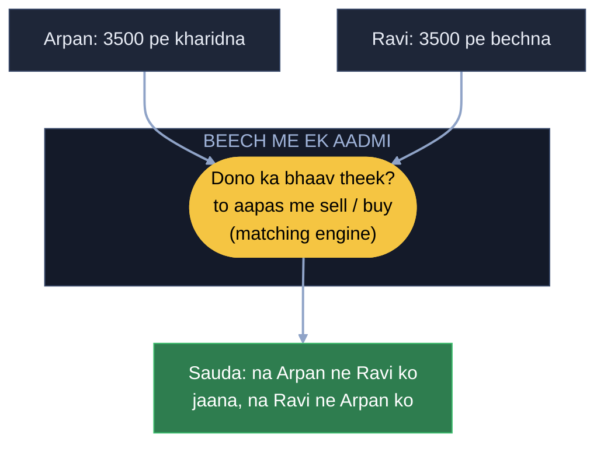
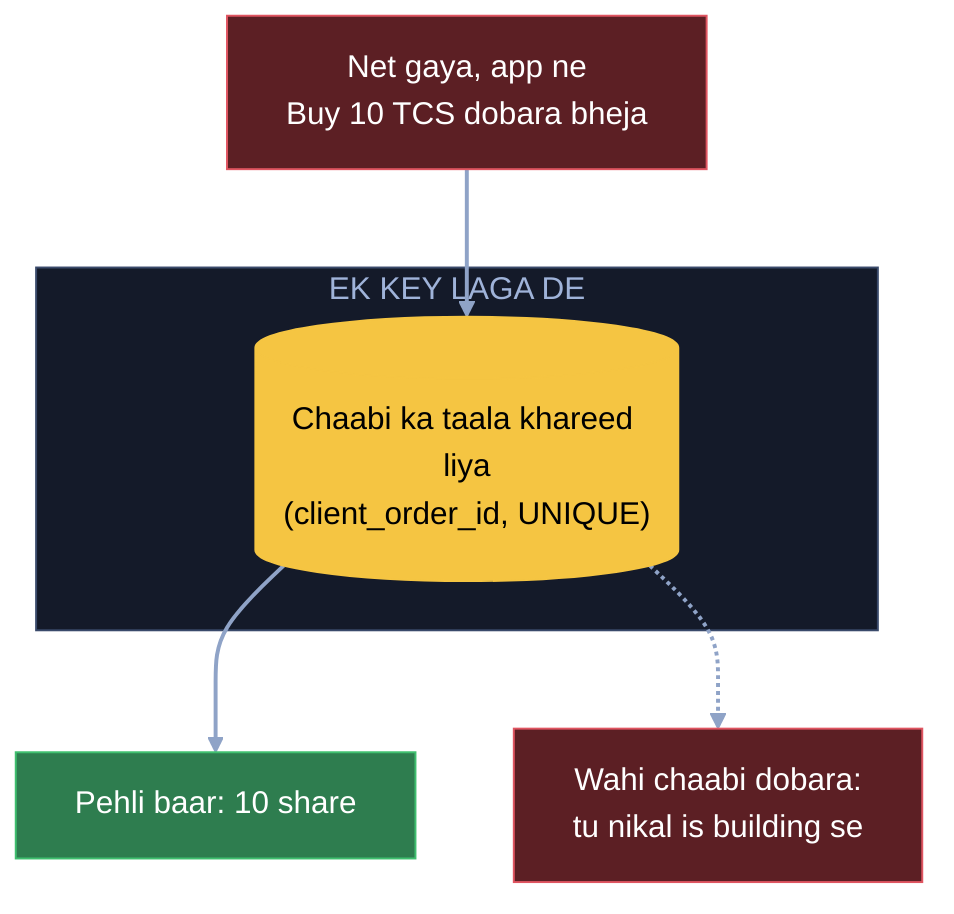
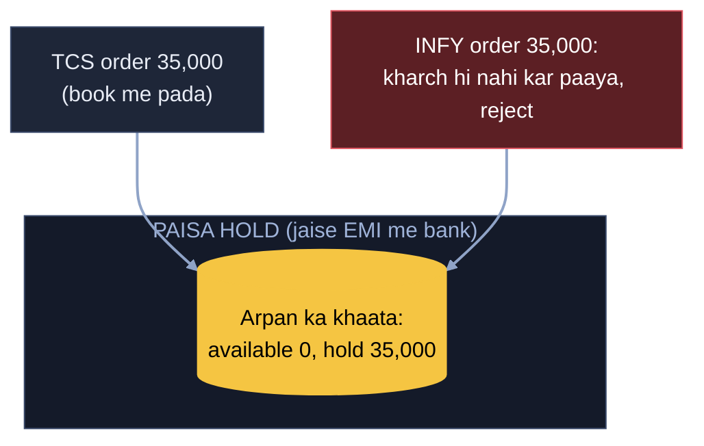
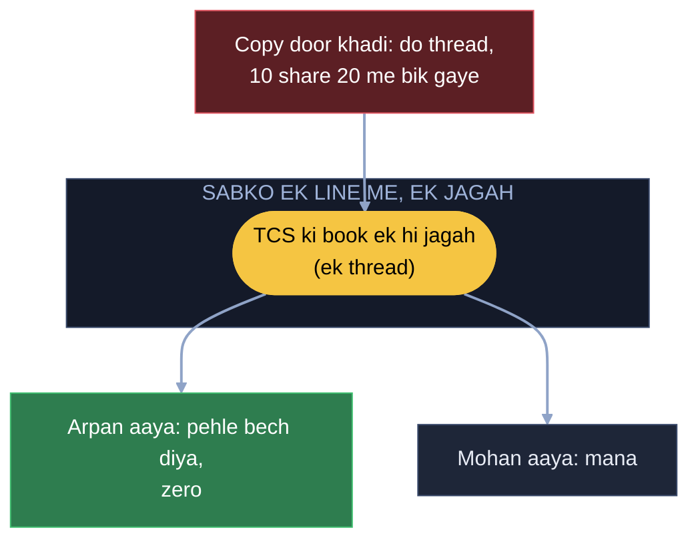
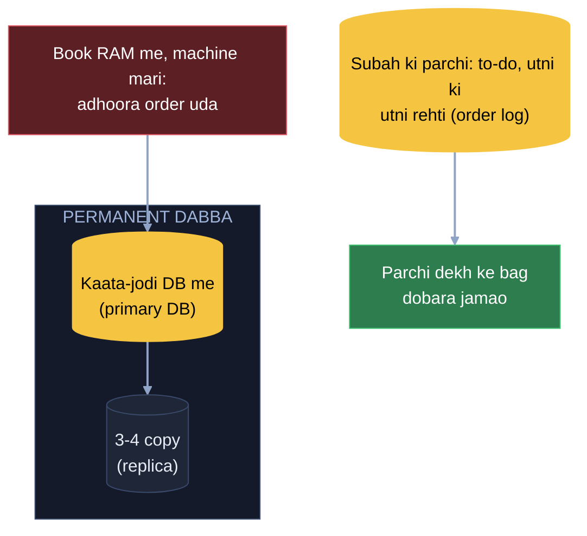
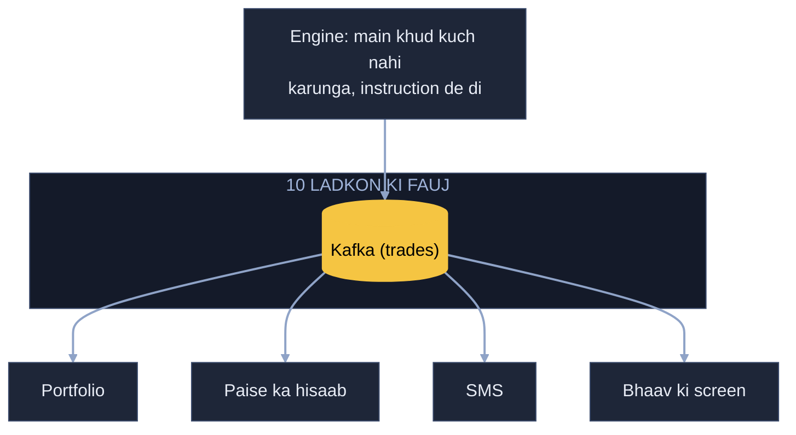
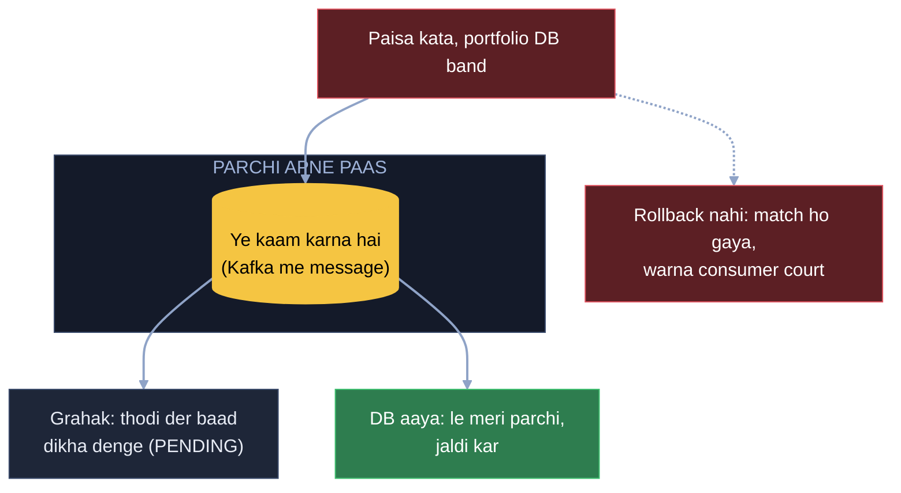
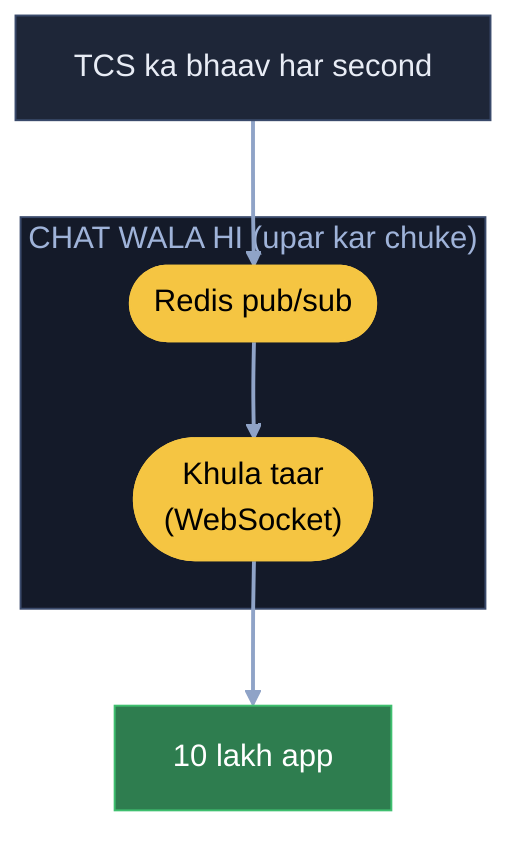
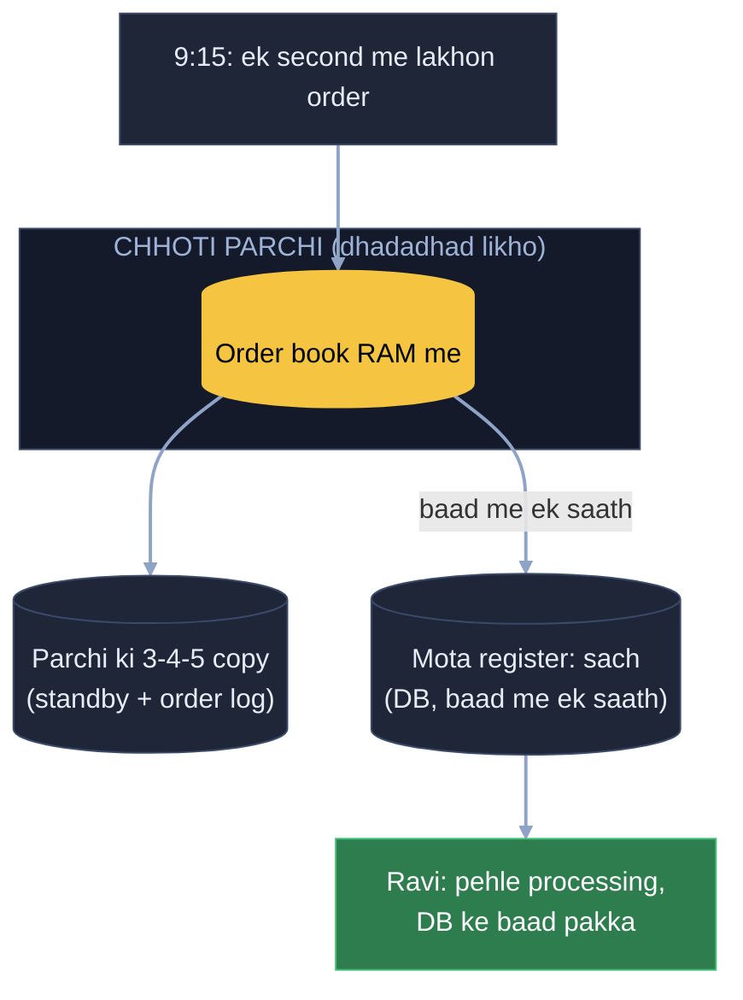

# Stock trading: Arpan aur Ravi ki kahani

Arpan TCS ke 10 share 3500 pe kharidna chahta hai, Ravi apne 10 TCS 3500 pe bechna chahta hai. Dono ek-doosre ko
jaante nahi, aur unke jaise lakhon log har second order daal rahe. Kaam: sahi log aapas me milein, paisa aur share
hamesha sahi, aur sauda ho gaya to sabko pata chale. (Chaabi wali baat banking jaisi, live bhaav chat jaisa.)

Har kadam = **kahani** (dikkat aur hal, bolne wali bhasha) -> **Asli naam** (interview me yahi shabd) -> tasveer
(kahani ka shabd, bracket me asli naam).

---

## FR / NFR / Numbers (interview me pehle 2 minute)

```
FR      buy / sell order dalo (apna bhaav likh ke) · bhaav mile to sauda · paisa aur share badlo · live bhaav dikhe · order cancel ho sake
        3:30 baje market band hua aur poore din order nahi bika, to kya hoga? Yahan do raaste hain:
          (1) order wahin khatam, aur 3:30 pe paisa / share user ko wapas
          (2) order agle din bhi khula rahe, aur paisa / share hum rok ke rakhein jab tak user khud cancel na kare
        Hamara FR = raasta (2). Isliye hold din badalne pe bhi rehta hai, aur cancel karne pe hi wapas jaata hai.
        Jitna mila utna abhi de do, baaki ke liye order khula rahe; user bole "sab ek saath chahiye, warna kuch nahi" to wahi karo.
        FR ne ye maanga, isliye design ye hai. FR raasta (1) maange, to 3:30 pe hold wapas, aur jawab bhi badlega.
NFR     paisa aur share hamesha sahi · jo pehle aaya wo pehle mile · 9:15 ki bheed jhele · har cheez ka record
Numbers 50 lakh order roz, market ~6 ghante -> ~250 / sec aam · 9:15 pe jhatka ~10,000 / sec, saare share me bata
        live bhaav: ~10 lakh app khule, har second naya bhaav -> poochhne ki jagah push
```

---

## 1. Arpan ka order Ravi se kaun milayega? (beech ka aadmi)

Arpan aur Ravi ek-doosre ko jaante hi nahi, aur unke jaise lakhon log: koi 3490 pe kharidna chahta, koi 3510 pe
bechna, har second hazaron naye order. To beech me ek aadmi bitha do. Kharidne wale ko behtar bhaav chahiye, bechne
wale ko bhi. Main beech me baitha hoon: Arpan ko is bhaav me chahiye, Ravi ko is bhaav me, dono ka bhaav theek hai to
dono ka sauda kar do. Khatam kahani. Na Arpan ne Ravi ko jaana na Ravi ne Arpan ko, bas beech me ek aadmi baitha tha.

**Asli naam:** beech ka aadmi = matching engine. Har share ki do list (kharidne wale, bechne wale) = order book, aur
dono ka bhaav theek = match (ek bhaav pe do log to jo pehle aaya wo pehle: price-time priority). Paisa aur hold = SQL
DB (Postgres; ek user ka paisa kaatna / hold ek transaction me = ACID). Portfolio (share dikhana) alag service ka DB,
sauda wahan Kafka se pahunchta (kadam 6-7).



## 2. Net gaya, 20 share kharid liye (chaabi)

Arpan ne "Buy 10 TCS" dabaya. Order engine tak pahuncha, par jawab aate waqt net gaya. App ne socha order gaya hi
nahi, dobara bhej diya, 20 share aa gaye, chahiye the 10. To order ke saath ek chaabi lagao, jisse wo dobara ho hi na.
Order server pe aaya, saath me chaabi laaya. Main server hoon, maine us chaabi ka taala khareeda, sab taale me band
kiya aur chaabi apne paas rakh li. 5 minute baad wahi chaabi leke "10 TCS" dobara aaya. Ye to wahi hai jo mere paas
hai, iska taala to main khareed chuka, ghapla hai. Bhai tu nikal, ye chaabi is building me nahi chalegi.

**Asli naam:** chaabi = idempotency key (client_order_id), taala khareeda = pehli baar wali key DB me save
(UNIQUE(user_id, client_order_id)), wahi chaabi dobara aayi = duplicate order reject, purana order hi lautao.



## 3. 35,000 se do order (paisa hold)

Arpan ke account me 35,000. TCS ka 35,000 ka order book me pada, abhi match nahi hua. Isi beech usi 35,000 se INFY
ka 35,000 ka order bhi daal diya, dono match ho gaye, chahiye 70,000. To Arpan ko ye paise kharch hi na karne do.
Jaise EMI me hota: log bolte "bank ne mera paisa hold kar rakha, na kharch kar sakta na kahin kar sakta", salary
account pe EMI daal rakhi to wo paisa hold ho jaata hai. Same yahan: order lagte hi paisa hold, ab wo kahin aur kharch
nahi kar paayega, INFY wala order lagta hi nahi.

**Asli naam:** paisa hold = funds block (available se ghata ke blocked me, check aur kaatna ek query me), kharch na kar
paaye = doosra order reject.

**Maan lo Arpan ko 10 TCS chahiye, 35,000 hold; Ravi sirf 4 bech raha, 4 mile, 6 baaki:** Main beech me baitha hoon. Arpan bola 10 TCS chahiye, Ravi sirf 4 bech raha. Yahan design choice hai, FR dekho: kya Arpan ko 10 abhi turant chahiye? Haan to 4 bhi mat do, sauda hi nahi, aur uska hold wapas kar do. Intezaar kar sakta hai to Ravi ke 4 abhi de do, baaki 6 ka hold rehne do; jab koi aur 6 bechne aayega, main use de dunga, Arpan ko kuch karna nahi.
**Asli naam:** "4 abhi, 6 baad me" = partial fill (order PARTIALLY_FILLED, baaki 6 order book me), "10 turant warna nahi" = all-or-nothing (Fill-or-Kill, hold wapas), FR tay kare. Partial me 4 ka paisa kata (14,000), baaki 6 ka hold (21,000) jaari.

**Maan lo Arpan ne 3500 pe 10 TCS ka order daala, TCS 3600 pe hi raha, 3:30 baje market band, order bika nahi, Arpan cancel bhool gaya:** Main beech me baitha hoon. Bechne wale sab TCS 3600 maang rahe, Arpan bola mujhe 3500 ka chahiye, jab koi 3500 pe bechne aaye mujhe de dena. Theek hai, par pehle paise de ja, warna har koi aake bolega "mere liye rakh lena". Din bhar koi 3500 pe nahi aaya, koi baat nahi, paisa hold pe hi rahega, kyunki app usi liye bana hai. Wo order daal ke so gaya to bhi theek. Agle din TCS 4000 pe chala gaya, to saaf baat: lena hai to le, nahi lena to order cancel kar, paisa wapas tere paas. 3500 pe koi bechne aaya to tab de dunga.
**Asli naam:** "jab tak cancel na kare order khula, paisa hold" = GTC (Good Till Cancelled) order, cancel pe hold wapas available me.

**Maan lo Ravi ke paas 10 TCS, usne 3600 pe 10 bechne ka order daala, bika nahi, phir 3650 pe 10 ka doosra order daal diya; dono bik gaye to 20 bech diye:** Ravi ke paas 10 hi share hain to wo 20 kaise bechega, ganit (maths) hi nahi baithta. Ravi mere paas aaya, bola mere 10 TCS bech de, 3600 chahiye; maine uska order likha 3600 ke 10. Ravi dobara aaya, bola bike nahi, 3650 kar de. To main naya order nahi banaunga, usi order ka bhaav 3600 se 3650 kar dunga. App me bhi yahi: bika nahi to Edit karo, bhaav badlo, peeche DB me wahi order update. Bhaav 3600 karo ya 7000, share 10 hi rahenge.
**Asli naam:** "10 share usi order se bandhe" = share hold (holdings block, free se blocked me; doosra sell order reject), "usi order ka bhaav badlo" = modify order (naya order nahi, wahi order update).



## 4. 4 thread, 10 share 20 me bik gaye (ek line, ek jagah)

9:15 baje bheed, engine tez karne ko 4 thread. Do thread ne ek saath TCS ki book dekhi, dono ko Ravi ke wahi 10 share
dikhe. Ek ne Arpan ko bech diye, doosre ne Mohan ko. Ye aisa hai: mere paas 10 share hain, maine apni ek copy bana di
aur thodi door khada kar diya. Ek ladka mere paas aaya, ek copy ke paas, dono ne 10 khareed liye, 20 bik gaye, galat
ho gaya. To copy ko apne paas kheench lo, mujhme mil ja, yahin khada ho ja. Arpan aaya, Mohan aaya: copy ko bola thodi
der ruk, pehle mujhe bechne de. Arpan ko bech diya, mere paas zero, copy ne bhi zero kar liya, ab Mohan ko mana.
Matlab sabko ek line me, ek hi jagah rakho, alag-alag mat baanto.

**Asli naam:** copy door khadi, dono ne bech diya = do thread ek book pe (race condition), ek line ek jagah = ek share
ki book ek hi thread (single-threaded per symbol). Lock nahi chahiye, aur line ka kram hi "pehle aaya pehle mila".
Cancel bhi isi line me: sauda pehle aaya to "bik chuka", cancel pehle to hold wapas.



## 5. Book RAM me thi, machine mari (permanent dabba + parchi)

Tez chalne ko TCS ki book RAM me rakhi. 10:30 baje machine mar gayi, saare order, Arpan ka adhoora 3500 wala order
bhi, RAM ke saath ud gaye. RAM me kyun rakh raha? Ye paise ki cheez hai, RAM udi to kya karoge. Sabko permanent dabbe
me rakho, kaata-jodi main DB me karunga, primary DB me. Wo dheema pade to uski 3-4 copy bana ke rakho, gira to doosri
ya teesri copy hai. Zyada bheed, zyada likhai ho to DB ko alag-alag shard kar do. Aur pehle numbers dekho: aam din
250 / sec, 9:15 pe bhi bheed saare share me bati hui, itni nahi ki ek shard ya ek thread jhel na paaye.

Aur adhoora order: bag pack kar raha, saara saamaan aaya nahi, to poora bag khaali karo aur dobara jamao. Subah ek
parchi banayi, Bangalore ja raha, 10 kapde rakhne hain, 5 ye, 3 ye, jo rakha us pe tick, to-do ki tarah. Bag khaali
kiya to bhi parchi utni ki utni hai, wo dekh ke dobara jama lo.

**Asli naam:** permanent dabba = DB (primary), 3-4 copy = replica / standby, tukde = shard (share ke hisaab se), pehle numbers =
numbers se RAM ya DB ka faisla (bahut kam traffic pe DB pe hi chal jaata; RAM + micro-second wala jhanjhat tab jab NSE
jaisi bheed ho), subah se parchi = order log (append-only, sirf jodna), parchi dekh ke bag dobara = log replay
se book wapas.



## 6. Sauda hua, sabko batana (10 ladkon ki fauj)

Arpan aur Ravi ka sauda ho gaya. Khabar kai jagah jaani: dono ke portfolio, paise ka hisaab, SMS, bhaav ki screen.
Engine khud ek-ek ko call kare to SMS dheema hua to engine bhi ruka, 9:15 ki line atki. To main apne paas 10 ladke
ikatthe karunga: tu aa, tu aa, le ye information, sab pakad ke aa ja. Main khud kuch nahi karunga, bas baith ke
instruction di. Tu ye kar, tu ye kar, jab sab ho jaaye to mujhe bata dena.

**Asli naam:** 10 ladkon ki fauj = Kafka (trades topic), har ladka apna kaam = har service ka alag consumer group
(settlement, notification, audit, Price Service), main khud kuch nahi = engine sauda ek baar daal ke aage, line nahi
rukti.



## 7. Paisa kata, share dikh nahi rahe (sauda ulta nahi, parchi pakdo)

Sauda pakka. Arpan ke portfolio me "10 TCS" likhna tha, us waqt portfolio wala DB band. Paisa kat chuka, share dikh
nahi rahe. Pehle kahin likh lo, hamare paas logs hain. Yahan rollback nahi kar sakte, matching engine ka poora system
hi ye hai ki tumhara match ho gaya. Ab kahein "match nahi hua tha" to wo case kar dega, baat consumer court jaayegi.
To use bata do: abhi service thodi dheeli hai, ghabrao nahi, mail pe ya app me dikha denge jab ho jaayega. Parchi
apne paas rakh lo. 10-15 minute baad DB wapas aaya: le ye meri parchi, ye kaam karna hai, jaldi kar, mere grahak
intezaar kar rahe.

**Asli naam:** rollback nahi = sauda ulta nahi hota, thodi der baad dikha denge = settlement PENDING, parchi apne paas
= message Kafka me pada, DB aate hi retry. Sauda id (trade_id) se pehchana, to dobara chale tab bhi paisa do baar nahi
katta.



## 8. TCS ka bhaav 10 lakh screen pe (chat wala khula taar)

TCS ka bhaav har second badal raha (3500, 3501, 3499), 10 lakh logon ki screen pe live chahiye. Har app har second
poochhe to 10 lakh request har second. Iska design chat me kar chuke, dobara bolne ka fayda nahi, ho gaya: chat wala hi, app ka taar khula
rakho aur bhaav khud bhejo.

**Asli naam:** chat wala hi: khula taar = WebSocket (push), bhaav sab machine tak = Redis pub/sub (channel "TCS"), Price Service = trades
se har share ka ek bhaav / sec. Bhaav kho bhi jaaye to agle second naya, isliye yahan Kafka nahi.



## 9. 9:15 ki bheed, book DB me, line atki (chhoti parchi + baad me mota register)

Subah 9:15 market khula, TCS pe ek second me lakhon order. Har order pe dono kaam: book me sabse achha bhaav dekhna
(padhna), aur naya order jodna ya match ke baad book badalna (likhna). Book DB me hai, har baar kuch millisecond, to
line badhti gayi aur 9:15:01 ka order 9:16 pe match hua. Itna bhaar mote register pe mat daalo, wo thak jaayega. Apne
paas ek chhoti parchi rakho aur dhadadhad usi pe likho: ye aaya, iska match hua, ye hat gaya. Sab ho jaaye to baad me
ek saath mote register pe likh do. Parchi kho gayi to? Uski 3-4-5 copy bana ke rakho, ek gayi to doosri se mil jaayegi.

**Maan lo Ravi ka sauda parchi pe match ho gaya, par DB me abhi gaya nahi:** sach mota register hi hai, parchi sirf
tezi ke liye. Ravi ke liye alag se mote register pe daudne ka fayda nahi. Parchi pe tabhi likho jab sach me maal hai,
koi bechne wala hai. Ravi ko turant "processing" dikha do, aur jab mote register me likh diya, tab app me pakka "sauda
ho gaya".

**Asli naam:** chhoti parchi = order book RAM me (in-memory, micro-second), baad me ek saath = DB me batch write, 3-4-5
copy = standby / replica + order log (append-only, gire to replay). Kam bheed ho to section 5 jaisa DB pe chal jaata;
NSE jaisi bheed pe RAM. Sach = DB (source of truth), "processing" = ACCEPTED / PENDING turant, DB commit ke baad FILLED.



---

Notes (Arpan ke shabd) = [STOCK_HAND_NOTES.md](STOCK_HAND_NOTES.md)
