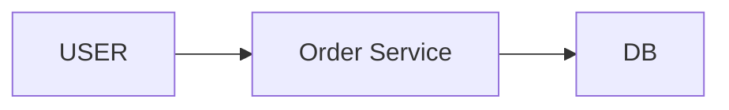
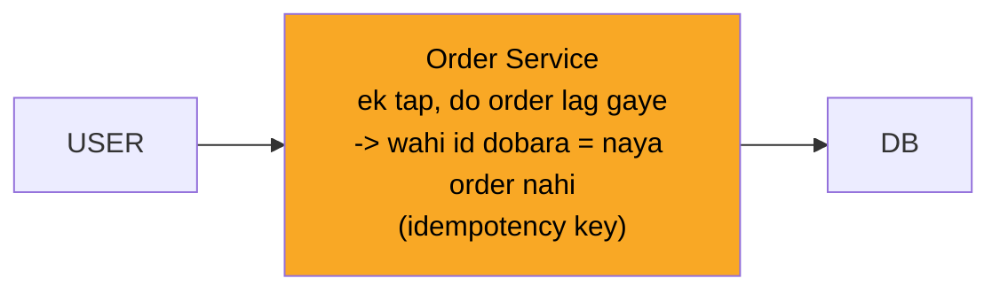
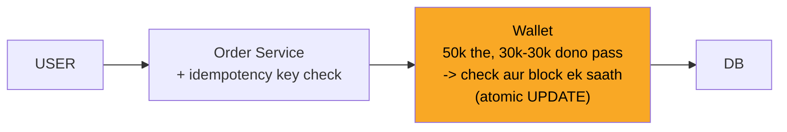
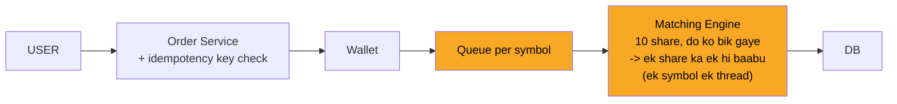
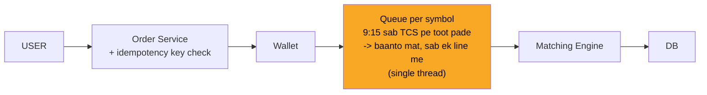
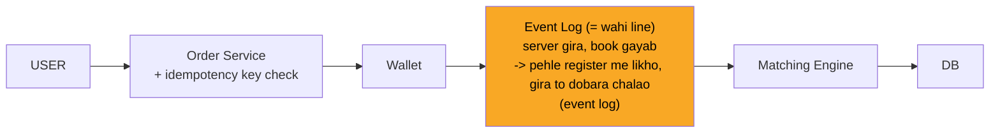
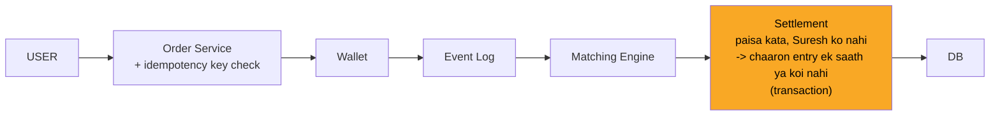
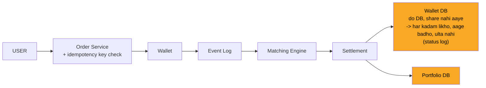
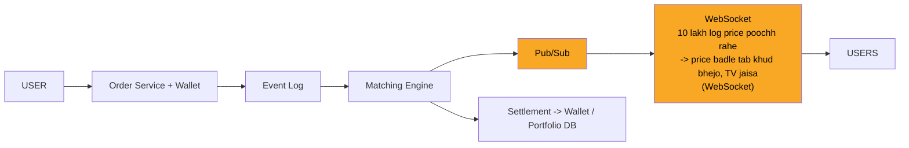
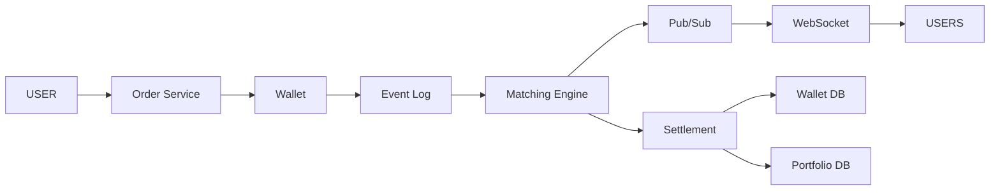

# Stock Broker / Trading Platform

> User BUY / SELL order deta hai -> system order MATCH karta hai -> paisa aur share sahi jagah pahunchte hain -> sabko live price dikhta hai.
> Is design ka dil: **paisa kabhi galat nahi (strong consistency)** + **matching bahut tez (RAM me, microseconds)**.
> Finance interview me (JP / GS) yahi poochte hain: consistency, ACID, idempotency, ledger, audit.

---

## KAHANI (ek din, mera ek TCS order; har dikkat se design me ek dabba judta)

```
   KYA HUA                                     ILAAJ                                DABBA JUDA
1  ek tap, network gaya, do order lag gaye  -> IDEMPOTENCY KEY (wahi id dobara)     Order Service
2  wallet 50k, 30k-30k dono order pass      -> check + block EK atomic query        Wallet
3  Suresh ke 10, mujhe aur Mohan dono ko    -> ek symbol ek thread, book RAM me     Queue + Matching Engine
4  9:15 sab TCS pe toot pade                -> baanto mat, ek thread kaafi, line    (line / queue)
5  10:15 server gira, book gayab            -> pehle log, phir book; gira = replay  Event Log (= wahi line)
6  mera 30k kata, Suresh ko mila nahi       -> ek transaction: chaaron ya koi nahi  Settlement
7  interviewer: paisa, share alag DB        -> har step ka haal, aage badho         Wallet DB + Portfolio DB
8  10 lakh log price poochh rahe            -> push (TV jaisa), WebSocket           Pub/Sub + WebSocket

POORA DESIGN (upar ke dabbe kram se):
   User -> Order Service (id) -> Wallet (block) -> Event Log -> Matching (ek stock ek thread)
        -> Settlement -> Wallet DB + Portfolio DB
   price: Matching -> Pub/Sub -> WebSocket -> users
```

---

## TASVEER (ByteByteGo / Alex Xu · CC BY-NC-ND 4.0)


Source: [Design Stock Exchange](https://bytebytego.com/guides/design-stock-exchange/)


Source: [Low Latency Stock Exchange](https://bytebytego.com/guides/low-latency-stock-exchange/)

---

## SHURU: pehle poocho, phir numbers

```
POOCHO:  "Trading bada hai: matching, price feed, risk, settlement. Kis pe focus karein?"
         -> order MATCHING + paise / share ka SETTLEMENT (len-den poora karna).
            Risk / margin / IPO / mutual fund scope me nahi.
         LIMIT aur MARKET dono order? · aadha bhara (partial fill) chalega?
         hum EXCHANGE hain (khud match karte) ya BROKER (exchange ko order bhejte)?
         Is design me: hum broker + apna matching (exchange jaisa). Asli India me Groww / Zerodha order
         NSE ko bhejte, matching NSE karta; wallet block broker ka kaam.

KYA KARE (FR):    buy / sell · order match · paisa + share move · live price · cancel / status
KAISA CHALE (NFR): paisa hamesha sahi (strong, kabhi "thodi der baad sahi" nahi) · tez
                   · imaandar (jo pehle aaya wo pehle) · har cheez ka record (audit)

NUMBERS (andaaza):
   ~50 lakh user · ~50 lakh order / din, market ~6 ghante (~20,000 second) khulta -> ~250 order / second
   9:15 baje market khulte hi jhatka: 10,000+ order / second
   price dekhne wale bahut zyada: ~10 lakh log app khula rakhte, har second naya price -> ~10 lakh / second
   -> matching RAM me · price PUSH karo (har user ka baar-baar poochhna nahi)
   -> jo tez chahiye aur thodi der ka hai (order book) = RAM
   -> jo paisa hai aur hamesha ka hai (wallet / ledger) = SQL DB + ACID
```

---

## ════ MOCK SE PEHLE: SIRF YE CARD PADHO ════

> Har card: pehle PEELA DABBA dekho (scene + ilaaj). Yaad aa gaya -> aage. Nahi aaya -> neeche
> DIKKAT / HAL / NAHI padho. AAGE POOCHEGA sirf jab interviewer aage kuch poochhe.

#### DABBA 0: SABSE SIMPLE (yahan se shuru, phir "kahan tootega")
```
Order service har order DB me likhe, aur DB me milta-julta SELL dhoondh ke match kare.
```


#### 0 SHURU: ORDER BOOK KAISE MATCH KARTA
```
SCENE      TCS ka share. Kuch bechna chahte (SELL), kuch khareedna (BUY).

           Bechne wale   : sasta upar      3000, 3001, 3005 ...   (min-heap)
           Khareedne wale: mehnga upar     2999, 2998 ...         (max-heap)

           Match  -> jab top khareedar >= top bechne wala
           Daam   -> jo order pehle se book me tha, uska
           Tie    -> same daam pe jo pehle aaya (chhota number)

DIKKAT 1   Book DB me rakhi to (DABBA 0 jaisa)?
HAL        RAM me rakho. DB = milliseconds har order, RAM = microseconds.

DIKKAT 2   RAM me hai, server crash hua -> book gayi?
HAL        Har order match se PEHLE log me likho (sirf neeche jodo).
           Crash pe log shuru se chalao -> wahi book wapas (same kram = same nateeja).

DIKKAT 3   Mujhe 10 chahiye, bechne wale ke paas 6?
HAL        6 ka sauda. Mere baaki 4 book me pade rehte, un 4 ka paisa ruka rehta.
```

#### 1 Maine ek baar dabaya, order do lag gaye

```
AAGE POOCHEGA:
  NIYAM: ek id = ek kaam; wahi id dobara aaye to kaam nahi, purana jawab.
  "Ek tap pe do order kaise lage?"           -> APP KA RETRY: network gaya, app ne dobara bheja; WAHI id
                                                (screen khulte bani) -> server pe UNIQUE, purana jawab.
  "Button pehli tap pe band kar do, bas?"    -> NAHI KAAFI: kyunki retry app khud karta, button nahi dabta;
                                                isliye key phir bhi chahiye.
  "Pehli abhi chal hi rahi, dobara aa gayi?" -> IN_PROGRESS -> "thoda ruko" (409): kyunki ek id = ek kaam;
                                                DONE ho to saved jawab.
  "Ye id kab tak rakhoge?"                   -> ~24 GHANTE, phir saaf: kyunki retry minute me aata, hamesha
                                                rakhna = faltu jagah.
```

#### 2 Wallet me 50k the, phir bhi 30k-30k ke dono order lag gaye

```
DIKKAT     Wallet me 50k. Laptop se TCS 30k, usi second phone se INFY 30k (do alag order, alag id).
           Do server, dono ne 50k dekha, dono pass.
HAL        check aur block ek saath (ATOMIC UPDATE): UPDATE wallet SET blocked = blocked + 30000 WHERE user_id
           = 'Arpan' AND total - blocked >= 30000   (doosre ko 0 row -> reject)
NAHI       pehle SELECT, phir UPDATE: beech me doosra ghus jaata.
```
```
AAGE POOCHEGA:
  NIYAM: 'blocked' ek number hai: naya order use badhata; sauda (paisa kata), cancel, umar khatam use ghatate.
  "Java synchronized laga do?"                     -> EK MACHINE KA TAALA: kyunki laptop aur phone alag server
                                                      pe gaye, dono ko 50k dikhe.
  "To SELL pe, laptop + phone se 10-10 TCS?"       -> WAHI EK LINE: UPDATE portfolio SET blocked_qty =
                                                      blocked_qty + 10 WHERE user_id = 'Arpan' AND stock =
                                                      'TCS' AND qty - blocked_qty >= 10
  "10 me se 6 ka hi sauda hua?"                    -> 6 KA PAISA KATA, baaki 4 blocked: kyunki sauda blocked
                                                      ghatata, bacha order abhi khula.
  "Order 3 din pada raha?"                         -> DAY ORDER SHAAM KO KHATAM -> block hatao: kyunki umar
                                                      khatam bhi blocked ghatati.
  "CANCEL aur usi pal match?"                      -> USI LINE ME CANCEL: kyunki book ek haath chhoota; jo
                                                      nahi bika sirf uska block hatao.
  "MARKET BUY me price pata hi nahi, kitna block?" -> AAKHRI BHAV + THODA UPAR: kyunki kam block = paisa kam
                                                      pade; sauda ke baad bacha hatao.
```

#### 3 Suresh ke paas 10 the, mujhe aur Mohan dono ko 10 mil gaye

```
DIKKAT     Mera order book me pahuncha. Suresh 10 bech raha, usi pal Mohan ne bhi BUY 10.
           Do thread, dono ko "10 hai" dikha -> 20 bik gaye.
HAL        TCS ke saare order ek line, ek hi thread (TCS -> T3). Pehle main 10, phir Mohan ko 0.
NAHI       poore engine pe bada lock: TCS ke chakkar me INFY bhi ruka.
```
```
AAGE POOCHEGA:
  NIYAM: TCS ki book ko ek waqt ek hi haath chhoota; doosra chahiye to line me ruke.
  "Har order pe lock laga do?"      -> RACE SHARE PE HAI: kyunki dono apna-apna order lock karte, dono ko
                                       Suresh ke 10 dikhte.
  "To 5000 stock = 5000 thread?"    -> NAHI, 8 CORE = 8 THREAD: stock % 8 -> ek stock hamesha ek hi thread,
                                       isliye ek haath.
  "DB ka ACID kyun nahi?"           -> MATCHING RAM ME: kyunki DB har order pe dheema; DB me hai hi nahi.
  "Wo thread atak gaya (GC pause)?" -> SIRF US STOCK KI LINE RUKTI: kyunki baaki stock alag thread; STANDBY
                                       log padh ke taiyaar.
```

#### 4 9:15 baje sab TCS pe toot pade

```
DIKKAT     Usi 9:15 pe poora market TCS pe toot pada: hazaaron order / second.
HAL        Baanto mat. Sab ek line me lago, ek-ek karke; ek thread RAM me lakhon / sec nipta leta.
           App me ACCEPTED turant (line me lag gaya), FILLED jab sauda ho.
NAHI       TCS ko do thread me baanto: do book = ek share do baar bike.
```
```
AAGE POOCHEGA:
  NIYAM: ek stock = ek line; badhana stocks ke BEECH, ek stock ke andar kabhi nahi.
  "To 9:15 ki bheed me badhaoge kaise?" -> STOCKS KE BEECH: TCS ek thread, INFY doosra; kyunki ek stock ke
                                           andar do haath = wahi race.
```

#### 5 Server gira, poori order book gayab

```
DIKKAT     10:15 matching server gira. TCS ki book (4,000 order) RAM me thi -> gayab.
HAL        Har order PEHLE log me (number ke saath; log hi wo line hai, Kafka key = stock), PHIR book.
           Gira -> log #1 se replay, wahi book. STANDBY sirf log padhta, book taiyaar; pehla gire tab chalu.
NAHI       doosra engine saath chalao (active-active): dono match karte = ek sauda do baar settle.
```
```
AAGE POOCHEGA:
  NIYAM: register (log) hi sach hai, scoreboard (book) uski photo. Do chalte scoreboard = do sach = galat.
  "Order ko kram ka number kaun deta?"           -> REGISTER WALA (log): #501, #502; kyunki ek hi jagah ginti,
                                                    Order Service kai machine pe.
  "Time se kram kyun nahi?"                      -> GHADI ALAG: kyunki do machine ki ghadi alag, ek second me
                                                    do order -> pehla kaun pata nahi.
  "Book ki photo le lo, kaafi?"                  -> NAHI: kyunki photo ke BAAD wale order kahin likhe hi nahi;
                                                    gira to gaye.
  "Register 1 crore line ka, wapas aane me der?" -> SHURU SE NAHI: aakhri photo + uske baad ke panne.
  "Seconds me wapas chahiye?"                    -> STANDBY: doosra scorer register padh ke board taiyaar
                                                    rakhta; pehla gire tab chalu (do saath nahi).
  "Crash pe kya bachaoge?"                       -> BOARD REGISTER SE: kyunki register sach; paisa DB me,
                                                    wahan rollback.
```

#### 6 Mera paisa kat gaya, Suresh ko mila hi nahi

```
DIKKAT     Mera sauda 9:15 pe match hua tha (Suresh se 10 TCS, 30k). Ab paisa-share hilana:
           mera 30k kata, Suresh ko milne se PEHLE crash.
HAL        chaaron ek saath ya koi nahi (TRANSACTION): BEGIN Arpan -30k +10 share · Suresh +30k -10 share
           COMMIT. Crash -> rollback.
NAHI       chaar alag UPDATE: beech me gira to aadha likha.
```
```
AAGE POOCHEGA:
  NIYAM: paisa ek jagah: chaaron likhai ek transaction me; ledger ka jod hamesha 0.
  "Sab likh do, aakhir me done flag?"      -> FLAG SE PEHLE GIRA: kyunki tab pata hi nahi kitna likha; isliye
                                              ek transaction.
  "Ledger me kya likhte?"                  -> 2 LINE: Arpan -30k, Suresh +30k; kyunki jod hamesha 0, galti
                                              turant dikhti.
  "Balance ledger jod ke nikaal lo?"       -> DHEEMA: lakhon line; balance alag column, usi transaction me.
  "Thodi der baad sahi ho jaaye, chalega?" -> PAISE ME NAHI: beech me PENDING dikhao, kyunki galat number =
                                              dar.
  "Asli me paisa usi pal Suresh ko?"       -> NAHI, T+1: NSE Clearing karta; ye broker ka apna khaata.
```

#### 7 Interviewer: paisa aur share do alag DB me ho to?

```
DIKKAT     Interviewer: "paisa Wallet DB me, share Portfolio DB me ho to?" -> ek transaction nahi chalti.
           Mera 30k Wallet DB me kata, Portfolio DB me share daalne se PEHLE crash -> aadha kaam.
HAL        har kadam likho, aage hi badho (STATUS LOG): wallet done -> portfolio done. Fail -> retry, aage hi
           badho (match ke baad ulta nahi). Ghanton fail -> PENDING + alert, ops share daalta.
NAHI       2PC: dono DB lock pakad ke rukte, coordinator gira = sab atke.
```
```
AAGE POOCHEGA:
  NIYAM: match ke baad sirf aage; ulta sirf match se pehle.
  "Step-step karoge, keemat kya?"              -> BEECH ME PENDING DIKHTA: par 2PC jaisa lamba lock nahi.
  "Beech me gira, mera paisa wapas kyun nahi?" -> SAUDA PAKKA: kyunki Suresh ko 30k mil chuke; match ke baad
                                                  sirf aage, likha haal se retry.
  "To SAGA (ulta karna) kabhi nahi?"           -> SIRF MATCH SE PEHLE: block hua par book tak nahi pahuncha ->
                                                  block hatao.
  "Orchestration ya choreography?"             -> ORCHESTRATION: kyunki paise me ek jagah saaf dikhe kaunsa
                                                  step atka.
```

#### 8 10 lakh log ek saath price poochh rahe, server baith gaya

```
DIKKAT     Din bhar 10 lakh log har second "TCS ka price?" poochh rahe -> server baith gaya.
HAL        badla tab khud bhejo (WEBSOCKET): taar khula, price badla tabhi push (pub/sub se servers tak).
NAHI       polling: 10 lakh bekaar sawaal / sec, 99% me price badla hi nahi.
```
```
AAGE POOCHEGA:
  NIYAM: price = sirf abhi ka; purana bekaar, isliye store nahi, push.
  "Price second me 1000 baar badla, sab bhejoge?" -> HAR ~100 MS AAKHRI PRICE: kyunki purana price bekaar.
  "Connection toota, wapas juda to?"              -> ABHI KA PRICE ALAG SE DO: kyunki pub/sub kuch store nahi
                                                     karta.
  "Ek WebSocket server kitne log?"                -> LAKH KE AAS-PAAS: zyada -> aur server + LB.
```

---

## AAKHRI DABBA + WRAP (ek hi baar)

```
User -> Order Svc (check + idempotency key) -> Wallet (paisa BLOCK)
-> Event Log / Kafka (number lagta, key = stock) -> Matching engine (ek stock ek thread, book RAM me)
-> Settlement (ek transaction, ya alag DB ho to step-step, aage hi) -> Wallet DB + Portfolio DB
price: Matching -> Pub/Sub -> WebSocket -> users

DB:  paisa / order = SQL + ACID · order book = RAM · ledger = append-only (sirf jodo)
     portfolio / history = read replica
```
```
JAWAB:    Order service check karti aur dobara order rokti (id se). Wallet paisa block karta. Order
          number ke saath log me, phir har stock ka ek-thread matching engine RAM wali book me match karta.
          Sauda = ek transaction, alag DB ho to step-step, match ke baad sirf aage. Price WebSocket se.
          Log se crash ke baad book wapas, aur hisaab ka record bhi.
          Aage: stop-loss, risk check, regulator ki report.
```


---

## 10 GUNA TRAFFIC — har dabba alag se

```
Order Service (stateless, kuch yaad nahi rakhta) -> machine badhao + LOAD BALANCER
Portfolio / history  -> READ REPLICA (padhne ke liye DB ki copy)
Matching (book RAM me, yaad rakhta) -> do CHALTI copy nahi (do book = ek share do baar bike);
                     standby log padhta khada rehta, sirf pehla gire tab chalta
                     -> stock ke hisaab se baanto: TCS ek engine pe, INFY doosre pe
Kafka                -> partition pehle se zyada rakho (jaise 64); beech me badhaya to key ki jagah
                        badalti, ek stock ke order do partition me, kram tootta
Price                -> WebSocket server badhao

POOCHEGA: "How would you scale this to 10x users?"
          (10 guna users ho gaye to kaise badhaoge?)

JAWAB:    Jo service kuch yaad nahi rakhti (order service), uski machine badhao + load balancer. Padhne
          wale data (portfolio, history) ki copy.
          Matching engine book yaad rakhta, do chalti copy nahi bana sakte (do book = gadbad). Standby
          bas khada rehta. Engine ko stock ke hisaab se baanto: TCS ek machine, INFY doosri.
```

---

## POOCHE TO (gehra sawaal aaye tab)

```
ORDER BOOK:  bechne wale: sasta upar (3001, 3003 ...) · khareedne wale: mehnga upar (2998, 2995 ...)
             sauda jab sabse mehnga khareedar >= sabse sasta bechne wala
             pehle behtar daam, same daam pe jo pehle aaya

LIMIT  = "3000 ya isse behtar, warna rukunga"  -> daam pakka
MARKET = "jo bhav hai, abhi do"                -> waqt pakka
kab kya: sahi daam chahiye, jaldi nahi -> LIMIT · turant ghusna / nikalna -> MARKET

AADHA BHARA: Maine BUY 10, mile 6 -> 6 ka sauda, 4 pade -> naya seller @3000 aaya -> 4 bhi bhar gaye
             status: FILLED / PARTIALLY FILLED / OPEN (Zerodha / Groww / NSE me yahi)

API: POST /order {stock, side, qty, price, type, idempotencyKey} · DELETE /order/{id} · GET /order/{id}
     WS /prices?symbol=
```

---

ARCHETYPE C (transactional) · CONCEPTS: [db-what-when](../../FOUNDATIONS/09_databases_what_when.md) · [CAP](../../FOUNDATIONS/08_cap_theorem.md) · saath: [payment](../06_payment_system/06_payment_system.md) · [← MASTER SHEET](../../00_MASTER_SHEET.md)
