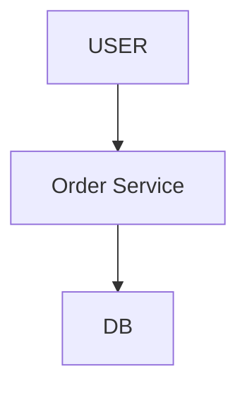
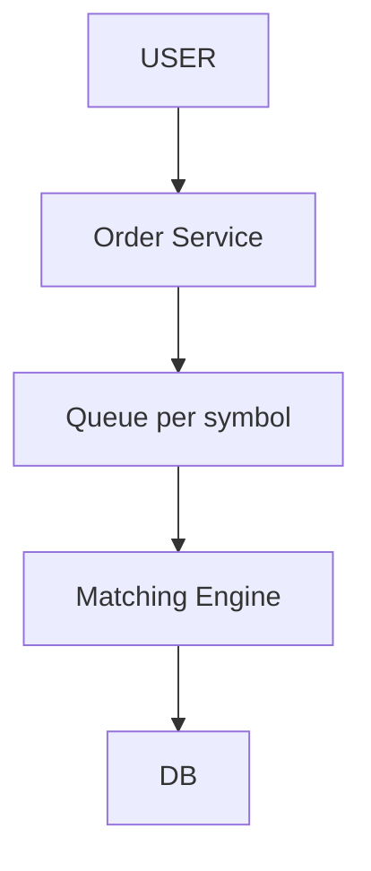
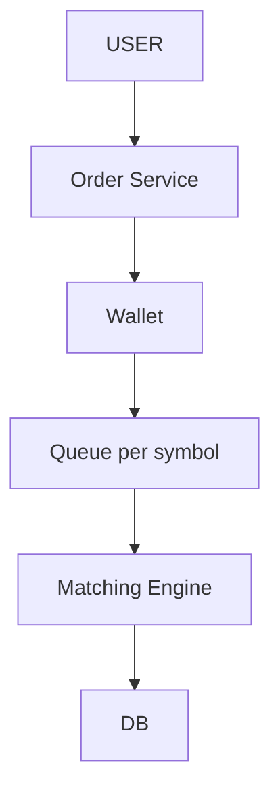
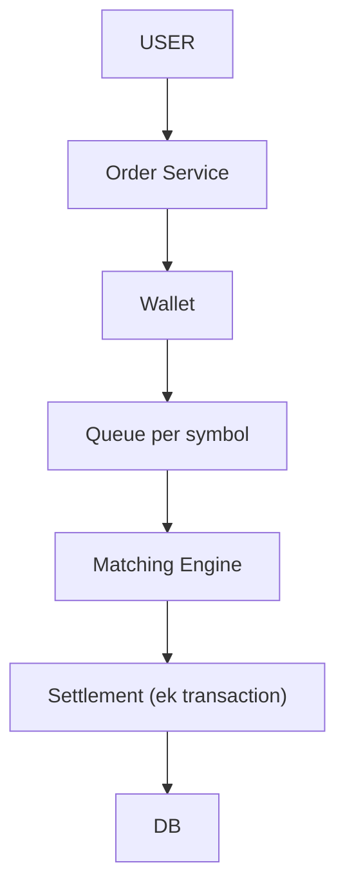
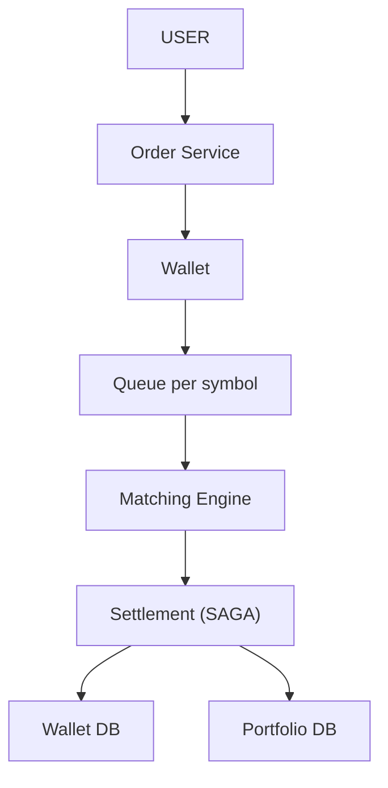
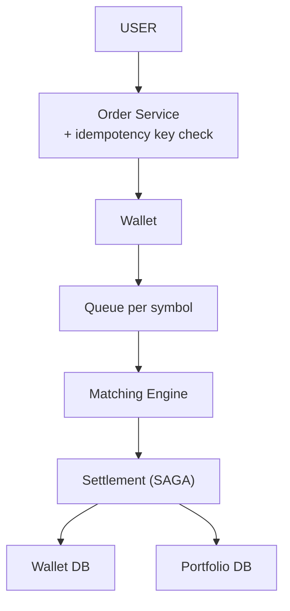
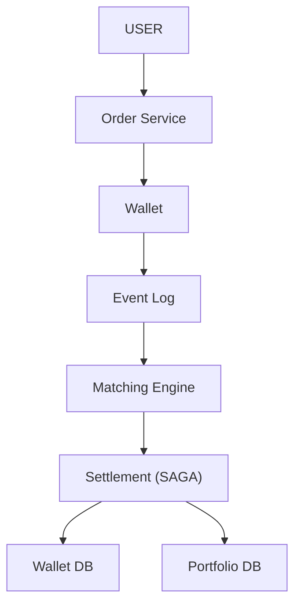
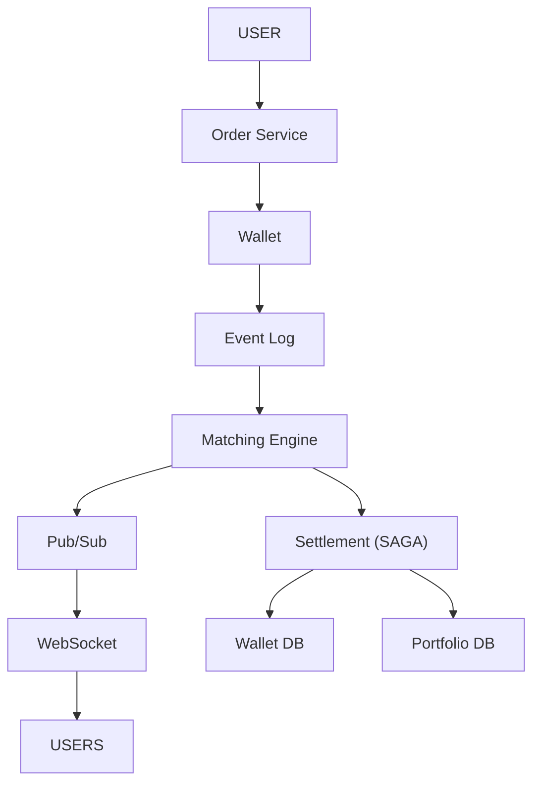
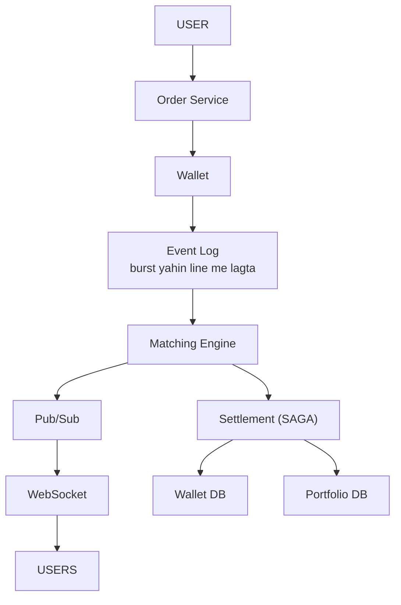

# Stock Broker / Trading Platform

> User BUY / SELL order deta hai -> system order MATCH karta hai -> paisa aur share sahi jagah pahunchte hain -> sabko live price dikhta hai.
> Is design ka dil: **paisa kabhi galat nahi (strong consistency)** + **matching bahut tez (RAM me, microseconds)**.
> Finance interview me (JP / GS) yahi poochte hain: consistency, ACID, idempotency, ledger, audit.

---

## TASVEER (ByteByteGo / Alex Xu · CC BY-NC-ND 4.0)


Source: [Design Stock Exchange](https://bytebytego.com/guides/design-stock-exchange/)


Source: [Low Latency Stock Exchange](https://bytebytego.com/guides/low-latency-stock-exchange/)

---

## SHURU: pehle poocho, phir numbers

```
POOCHO:  "Trading bada hai: matching, price feed, risk, settlement. Kis pe focus karein?"
         -> order MATCHING + paise / share ka SETTLEMENT (len-den poora karna).
            Risk / margin / IPO / mutual fund scope me nahi.
         LIMIT aur MARKET dono order? · aadha bhara (partial fill) chalega?
         hum EXCHANGE hain (khud match karte) ya BROKER (exchange ko order bhejte)?

KYA KARE (FR):    buy / sell · order match · paisa + share move · live price · cancel / status
KAISA CHALE (NFR): paisa hamesha sahi (strong, kabhi "thodi der baad sahi" nahi) · tez
                   · imaandar (jo pehle aaya wo pehle) · har cheez ka record (audit)

NUMBERS (andaaza):
   ~50 lakh user · ~50 lakh order / din, market ~6 ghante (~20,000 second) khulta -> ~250 order / second
   9:15 baje market khulte hi jhatka: 10,000+ order / second
   price dekhne wale bahut zyada: ~10 lakh log app khula rakhte, har second naya price -> ~10 lakh / second
   -> matching RAM me · price PUSH karo (har user ka baar-baar poochhna nahi)
   -> jo tez chahiye aur thodi der ka hai (order book) = RAM
   -> jo paisa hai aur hamesha ka hai (wallet / ledger) = SQL DB + ACID
```

---

## ════ MOCK SE PEHLE: SIRF YE CARD PADHO ════

> Har card: DIKKAT 1 (kya toota) -> HAL (kya kiya) -> diagram -> DIKKAT 2, 3 ... (interviewer ke
> agle sawaal) har ek ke neeche uska HAL. Revise: sirf baayein column padho.

#### DABBA 0: SABSE SIMPLE (yahan se shuru, phir "kahan tootega")
```
Order service har order DB me likhe, aur DB me milta-julta SELL dhoondh ke match kare.
```


#### 0 SHURU: ORDER BOOK KAISE MATCH KARTA
```
SCENE      TCS ka share. Kuch bechna chahte (SELL), kuch khareedna (BUY).

           Bechne wale   : sasta upar      3000, 3001, 3005 ...   (min-heap)
           Khareedne wale: mehnga upar     2999, 2998 ...         (max-heap)

           Match  -> jab top khareedar >= top bechne wala
           Daam   -> jo order pehle se book me tha, uska
           Tie    -> same daam pe jo pehle aaya (chhota number)

DIKKAT 1   Book DB me rakhi to?
HAL        RAM me rakho. DB = milliseconds har order, RAM = microseconds.

DIKKAT 2   RAM me hai, server crash hua -> book gayi?
HAL        Har order match se PEHLE log me likho (sirf neeche jodo).
           Crash pe log shuru se chalao -> wahi book wapas (same kram = same nateeja).

DIKKAT 3   Ramesh ko 10 chahiye, bechne wale ke paas 6?
HAL        6 ka sauda. Ramesh ke baaki 4 book me pade rehte, un 4 ka paisa ruka rehta.
```

#### 1 DO ORDER EK HI STOCK PE EK SAATH (RACE)
```
DIKKAT 1   Seller ke paas TCS ke 10 share. Ramesh aur Mohan ne ek saath BUY 10 maara.
           Do thread ne book dekhi, dono ko "10 hai" dikha -> 20 bik gaye, the 10.
HAL        TCS ke saare order ek line me, us line ko sirf EK thread chalata (TCS -> T1, INFY -> T2).
           Pehle Ramesh -> 10 mile. Phir Mohan -> 0 bache -> line me ruka. Lock ki zaroorat hi nahi.
```

```
DIKKAT 2   5000 stock = 5000 thread?
HAL        Nahi. Maan lo machine pe 8 thread (8 core). Stock ka naam -> number -> % 8 -> thread tay:
             TCS -> T3 · INFY -> T5 · WIPRO -> T3
           T3 pe TCS aur WIPRO dono, par TCS ka HAR order hamesha T3 pe hi -> kram pakka, lock nahi.
           5000 thread banate to zyadatar khaali baithe memory khaate, aur CPU unke beech switch karte thakta.

DIKKAT 3   "DB ka ACID ye rok dega"?
HAL        Nahi. Matching DB me hai hi nahi, RAM me hai.

DIKKAT 4   Wo thread atak gaya (Java ka GC pause)?
HAL        Us stock ke order line me ruk jaate.
           Kam GC wala Java setup + ek standby server jo log padh ke turant chal sake.
```

#### 2 WALLET ME 50K, 30K-30K KE DO ORDER (DOUBLE SPEND)
```
DIKKAT 1   Ramesh ke wallet me 50k. Laptop se TCS ka 30k order, usi second phone se INFY ka 30k.
           Do alag server, dono ne 50k dekha, dono pass -> 60k kharch, the 50k.
HAL        Order lagte hi paisa BLOCK, check + block EK query me:
             UPDATE wallet SET blocked = blocked + 30000
             WHERE user_id = 'Ramesh' AND total - blocked >= 30000
           Pehla -> 30k block, bacha 20k. Doosra -> 0 row badli -> reject.
```

```
DIKKAT 2   Pehle SELECT se balance padha, phir UPDATE kiya?
HAL        Race: SELECT aur UPDATE ke beech doosra order ghus jaata, dono 50k dekh ke pass.
           Isliye check + block ek hi query me (upar wali).

DIKKAT 3   10 me se sirf 6 ka sauda hua?
HAL        6 ka paisa kato, baaki 4 ka blocked rahe.

DIKKAT 4   Paisa block, order 3 din pada raha?
HAL        Order ki umar (day order shaam ko khatam) -> khatam hote hi block hatao.

DIKKAT 5   Ramesh ne CANCEL kiya, usi pal match ho raha tha?
HAL        Cancel bhi usi stock ki line me, order ke peeche jaata. Engine kram se dekhta:
           match ho chuka -> "pura ho gaya" · book me pada -> hatao + jo nahi bika uska block hatao.
```

#### 3 SAUDE KE BEECH CRASH (SETTLEMENT)
```
DIKKAT 1   Ramesh ne Suresh se 10 TCS liye (30k). Ramesh ka 30k kata, Suresh ko milne se PEHLE crash.
           30k hawa me.
HAL        Ek transaction: BEGIN  Ramesh -30k +10 share · Suresh +30k -10 share  COMMIT
           Beech me crash -> DB sab wapas (rollback). Aadha kabhi nahi.
           Khaate (ledger) me 2 line: Ramesh -30k, Suresh +30k -> jod hamesha 0.
```

```
DIKKAT 2   Har baar balance ledger jod ke nikaloge?
HAL        Nahi, dheema. Balance alag column, usi transaction me badalta. Ledger = record + audit.

DIKKAT 3   Paise me "thodi der baad sahi" chalega?
HAL        Nahi. Balance kabhi galat number nahi dikhata (strong consistency).
           Alag DB wale step-step kaam me bhi (agla card) beech ka haal "PENDING" dikhao, galat number nahi.

DIKKAT 4   Asli market me paisa aur share usi pal milte?
HAL        Nahi. India me T+1: asli len-den agle din clearing house (NSE Clearing, purana naam NSCCL) karta.
           Hamara turant wala hisaab broker ke apne khaate me.
```

#### 4 PAISA WALLET DB ME, SHARE PORTFOLIO DB ME (ALAG DB)
```
DIKKAT 1   Paisa Wallet DB me, share Portfolio DB me. Do DB pe ek transaction nahi chalta.
           30k kata, share daalne se PEHLE crash -> paisa gaya, share nahi aaye.
HAL        Settlement service step-step chalati, har step ka haal likhti:
             STARTED -> WALLET_DONE -> PORTFOLIO_DONE
           Share daalna fail -> pehle baar-baar koshish (share dena hi sahi raasta).
           Phir bhi na ho -> jo step hua wo ulta (SAGA). WALLET step me Ramesh -30k, Suresh +30k hua tha
           -> Ramesh ko 30k wapas, Suresh se 30k wapas. Share hile hi nahi, unka kuch ulta nahi.
           Settlement khud gira -> uth ke likha haal dekhti, wahin se aage ya ulta.
```

```
DIKKAT 2   2PC kyun nahi?
HAL        2PC me dono DB lock pakad ke intezaar karte. Coordinator gira = dono atke, har sauda dheema.
           SAGA me lamba lock nahi. Keemat: beech me haal PENDING dikhta (galat number nahi).

DIKKAT 3   Ulta kaam (paisa wapas) bhi fail?
HAL        Baar-baar koshish (do baar chale to bhi asar ek baar) + alert. Paisa wapas kabhi chhodna nahi.

DIKKAT 4   Ek service sab chalaye (orchestration) ya har service agle ko bataye (choreography)?
HAL        Orchestration: paise me saaf dikhta kaunsa step kahan atka.
```

#### 5 BUY DO BAAR DABA / NETWORK NE DOBARA BHEJA
```
DIKKAT 1   Ramesh ne BUY dabaya, app ghooma, phir daba diya (ya network ne dobara bheja).
           Do order bane, paisa do baar block.
HAL        App har order pe ek id banata (abc-123), dobara bhejne pe bhi WAHI id. Server pe id UNIQUE.
           Pehli baar -> order lagao + jawab save. Doosri baar -> saved jawab wapas, naya order nahi.
```

```
DIKKAT 2   Pehli request abhi chal hi rahi, dobara wali aa gayi?
HAL        Id ka haal IN_PROGRESS -> "thoda ruko" (409). DONE -> saved jawab.

DIKKAT 3   Id kitne din rakhoge?
HAL        ~24 ghante, phir saaf.
```

#### 6 ORDER BOOK RAM ME, SERVER GIRA = SAB GAYAB
```
DIKKAT 1   10:15 baje matching server gira. TCS ki book me 4,000 order, sab RAM me -> sab gayab.
HAL        Har order PEHLE log me likho (sirf neeche jodo), number ke saath (#501, #502). PHIR book me.
           Number log / sequencer deta (ek stock ki ek line, Kafka offset jaisa). Order Svc nahi deta,
           warna uski do machine same number de dein.
           Server gira -> naya server log #1 se kram me chala ke wahi book bana leta.
           Jaise cricket: scoreboard toota, scorer ke register se poora score wapas. Yahi log audit bhi.
```

```
DIKKAT 2   Number ki jagah time se kram kyun nahi?
HAL        Do server ki ghadi alag, do order same millisecond me aa sakte. Number pakka.

DIKKAT 3   Log me 1 crore order, shuru se padhne me der?
HAL        Har kuch minute book ki photo (snapshot). Gira -> photo + uske baad ka log.

DIKKAT 4   Seconds me wapas chahiye?
HAL        Standby server saath-saath log padhta, book RAM me taiyaar, khud sauda nahi karta.
           Pehla gira, tab ye chalne lagta.

DIKKAT 5   Crash pe kya-kya bachaoge?
HAL        Do jagah: matching (RAM) = log se replay · paisa (DB) = rollback / SAGA.
```

#### 7 LAKHON LOG LIVE PRICE DEKH RAHE
```
DIKKAT 1   10 lakh log har second poochh rahe "TCS ka price?" -> server mar gaya, jawab aksar wahi purana.
HAL        App ka server se ek connection khula rehta (WebSocket).
           Price badla -> matching Redis pe "price:TCS = 3005" bhejta -> TCS dekhne walon ke server
           apne users ko bhej dete.
```

```
DIKKAT 2   Price second me 1000 baar badla, sab bhejoge?
HAL        Nahi. Har ~100 ms sirf aakhri price, beech wale bekaar.

DIKKAT 3   Kafka kyun nahi?
HAL        Kafka sab store karta. Yahan purana price bekaar, sirf abhi wala chahiye.

DIKKAT 4   Connection toota, wapas juda?
HAL        Redis pub/sub kuch store nahi karta -> abhi ka price alag se de do.

DIKKAT 5   Ek WebSocket server kitne user?
HAL        Lakh ke aas-paas. Zyada -> aur server, LB se baanto.
```

#### 8 9:15 BAJE AKELE TCS PE HAZAARON ORDER / SECOND
```
DIKKAT 1   9:15 baje akele TCS pe hazaaron order / second. Ek stock = ek thread, TCS baant nahi sakte.
HAL        Baanto mat. Ek thread, RAM me, bina lock -> lakhon order / second nikal leta.
           Bheed zyada -> log order ko line me rok leta, koi phenka nahi jaata, bas thoda der se match.
           Badhana stocks ke BEECH: TCS ek thread, INFY doosra.
```

```
DIKKAT 2   Order line me pada, Ramesh ko app me kya dikhe?
HAL        Do status: ACCEPTED turant (order mil gaya), FILLED jab sauda ho jaaye.
```

```
AAKHRI DABBE (sab dikkat ke baad):
  User -> Order Svc (check + idempotency key) -> Wallet (paisa BLOCK)
  -> Event Log / Kafka (number lagta, key = stock) -> Matching engine (ek stock ek thread, book RAM me)
  -> Settlement (ek transaction, ya alag DB ho to SAGA) -> Wallet DB + Portfolio DB
  price: Matching -> Pub/Sub -> WebSocket -> users

DB:  paisa / order = SQL + ACID · order book = RAM · ledger = append-only (sirf jodo)
     portfolio / history = read replica

END ME POOCHEGA:
  "10x?"             -> Order Svc stateless (machine badhao + LB) · read replica
                        · Matching: ek chalta, standby sirf khada (dono saath kabhi nahi chalte),
                          stock ke hisaab se baanto (TCS ek engine, INFY doosra)
                        · Kafka partition badhao (key = stock) · WebSocket server badhao
  "Matching ek thread kyun?" -> do copy = do book = ek share do baar bike; ek stock ek engine pe
  "Engine gira?"     -> log se number ke kram me replay, book wapas (audit bhi wahi log)
  "Limit ya market?" -> LIMIT = daam pakka, waqt nahi · MARKET = turant, daam jo bhi
```

AAKHRI DABBE ki tasveer:


---

## 10 GUNA TRAFFIC — har dabba alag se

```
Order Service (stateless, kuch yaad nahi rakhta) -> machine badhao + LOAD BALANCER
Portfolio / history  -> READ REPLICA (padhne ke liye DB ki copy)
Matching (book RAM me, yaad rakhta) -> do CHALTI copy nahi (do book = ek share do baar bike);
                     standby log padhta khada rehta, sirf pehla gire tab chalta (card 6)
                     -> stock ke hisaab se baanto: TCS ek engine pe, INFY doosre pe
Kafka                -> partition badhao (key = stock)
Price                -> WebSocket server badhao

POOCHEGA: "How would you scale this to 10x users?"
          (10 guna users ho gaye to kaise badhaoge?)

JAWAB:    Jo service kuch yaad nahi rakhti (order service), uski machine badhao + load balancer. Padhne
          wale data (portfolio, history) ki copy.
          Matching engine book yaad rakhta, do chalti copy nahi bana sakte (do book = gadbad). Standby
          bas khada rehta. Engine ko stock ke hisaab se baanto: TCS ek machine, INFY doosri.
```

---

## POOCHE TO (gehra sawaal aaye tab)

```
ORDER BOOK:  bechne wale: sasta upar (3001, 3003 ...) · khareedne wale: mehnga upar (2998, 2995 ...)
             sauda jab sabse mehnga khareedar >= sabse sasta bechne wala
             pehle behtar daam, same daam pe jo pehle aaya

LIMIT  = "3000 ya isse behtar, warna rukunga"  -> daam pakka
MARKET = "jo bhav hai, abhi do"                -> waqt pakka
kab kya: sahi daam chahiye, jaldi nahi -> LIMIT · turant ghusna / nikalna -> MARKET

AADHA BHARA: Ramesh BUY 10, mile 6 -> 6 ka sauda, 4 pade -> naya seller @3000 aaya -> 4 bhi bhar gaye
             status: FILLED / PARTIALLY FILLED / OPEN (Zerodha / Groww / NSE me yahi)

DB:  paisa / order = SQL + ACID · order book = RAM · ledger = append-only

API: POST /order {stock, side, qty, price, type, idempotencyKey} · DELETE /order/{id} · GET /order/{id}
     WS /prices?symbol=
```

---

## AAKHRI DABBA + WRAP

```
Order Service = check + idempotency · Wallet = paisa BLOCK · Event Log = number + replay + audit
Matching = ek stock ek thread, book RAM me, stock ke hisaab se baanto
Settlement = ek transaction / alag DB = SAGA
```
```
JAWAB:    Order service check karti aur dobara order rokti (id se). Wallet paisa block karta. Order
          number ke saath log me, phir har stock ka ek-thread matching engine RAM wali book me match karta.
          Sauda = ek transaction, alag DB ho to step-step + ulta kaam. Price WebSocket se. Log se crash
          ke baad book wapas, aur hisaab ka record bhi.
          Aage: stop-loss, risk check, regulator ki report.
```


ARCHETYPE C (transactional) · CONCEPTS: [db-what-when](../../FOUNDATIONS/09_databases_what_when.md) · [CAP](../../FOUNDATIONS/08_cap_theorem.md) · saath: [payment](../06_payment_system/06_payment_system.md) · [← MASTER SHEET](../../00_MASTER_SHEET.md)
